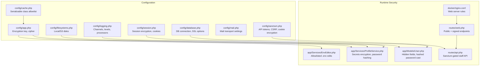
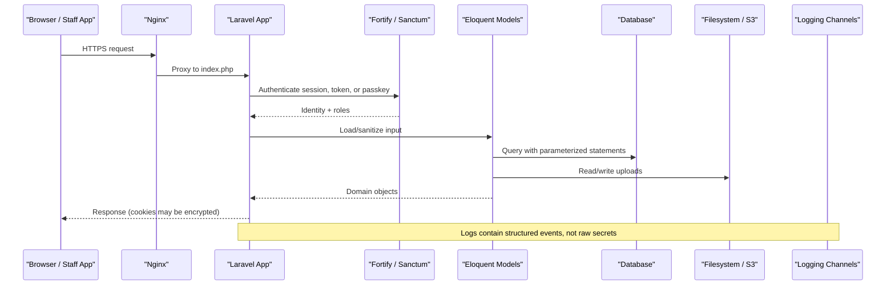
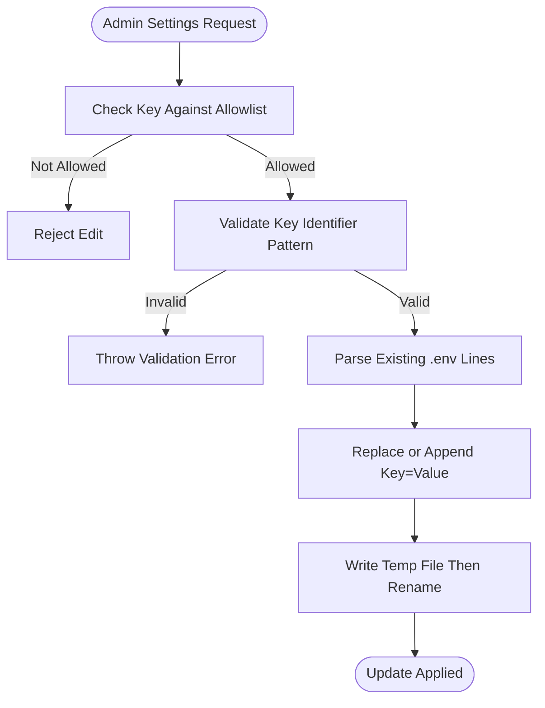
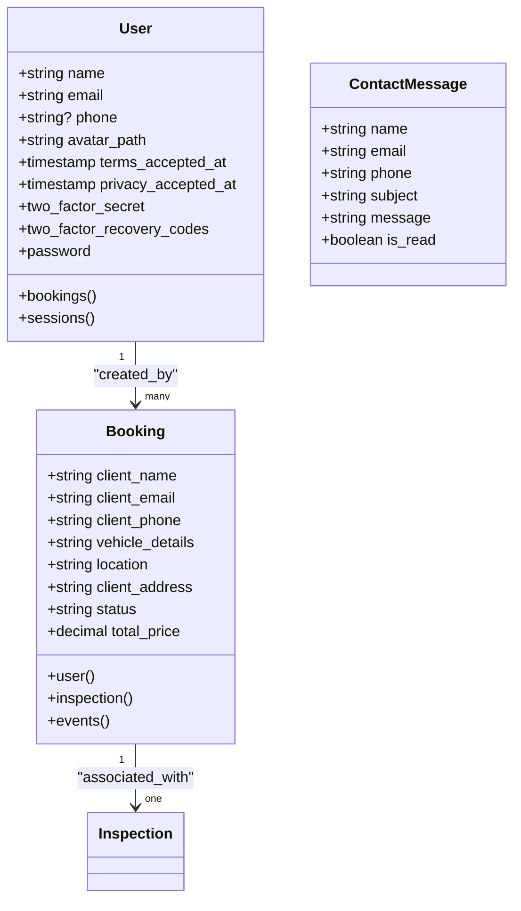
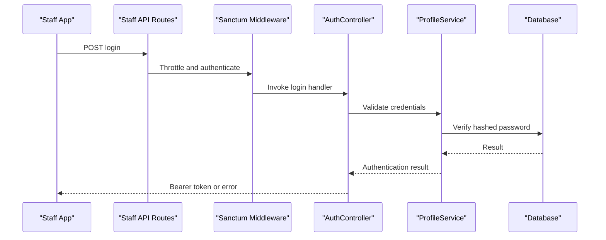
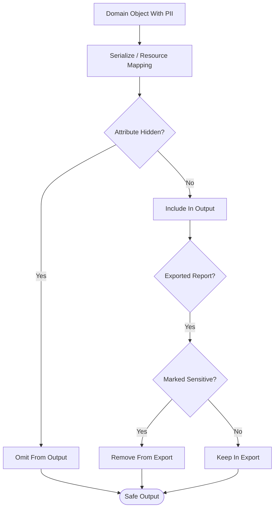
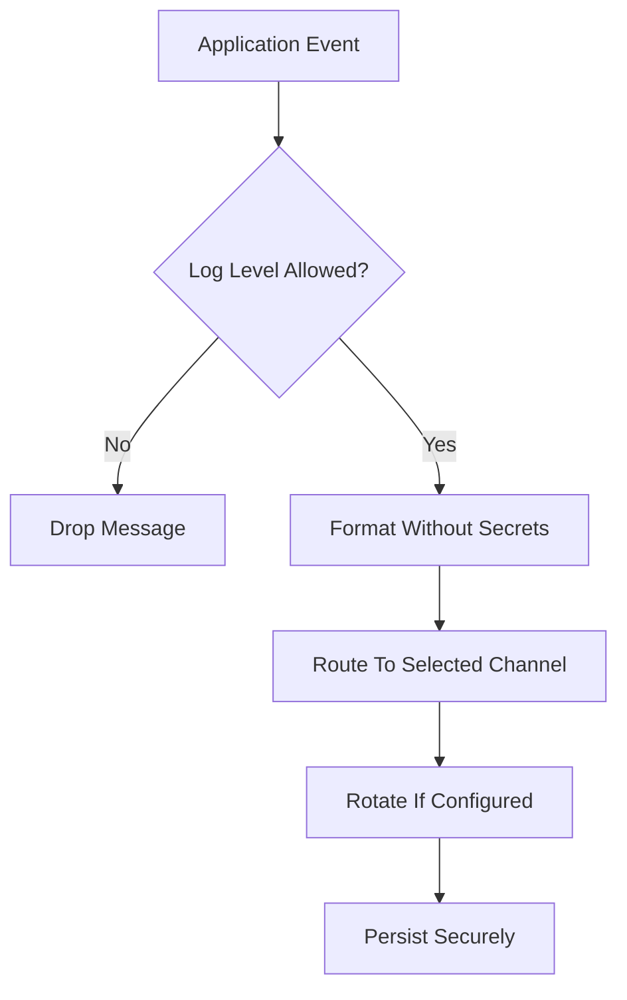
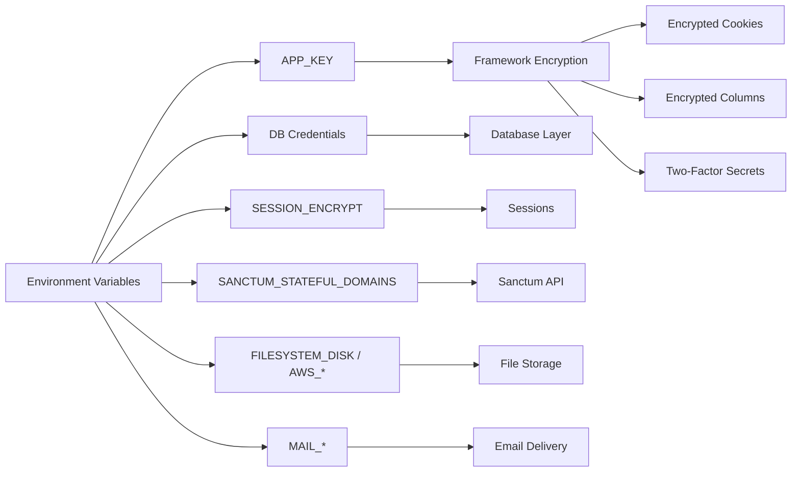

# Data Protection & Encryption

<cite>
**Referenced Files in This Document**
- [config/app.php](file://config/app.php)
- [config/database.php](file://config/database.php)
- [config/logging.php](file://config/logging.php)
- [config/session.php](file://config/session.php)
- [config/sanctum.php](file://config/sanctum.php)
- [config/filesystems.php](file://config/filesystems.php)
- [config/cache.php](file://config/cache.php)
- [config/mail.php](file://config/mail.php)
- [app/Services/EnvEditor.php](file://app/Services/EnvEditor.php)
- [app/Services/ProfileService.php](file://app/Services/ProfileService.php)
- [app/Models/User.php](file://app/Models/User.php)
- [app/Models/ContactMessage.php](file://app/Models/ContactMessage.php)
- [app/Models/Booking.php](file://app/Models/Booking.php)
- [routes/api.php](file://routes/api.php)
- [routes/web.php](file://routes/web.php)
- [docker/nginx.conf](file://docker/nginx.conf)
- [docker-compose.yml](file://docker-compose.yml)
</cite>

## Table of Contents
1. [Introduction](#introduction)
2. [Project Structure](#project-structure)
3. [Core Components](#core-components)
4. [Architecture Overview](#architecture-overview)
5. [Detailed Component Analysis](#detailed-component-analysis)
6. [Dependency Analysis](#dependency-analysis)
7. [Performance Considerations](#performance-considerations)
8. [Troubleshooting Guide](#troubleshooting-guide)
9. [Conclusion](#conclusion)

## Introduction
This document explains how the Highblossom application protects data at rest, in transit, and during processing. It focuses on environment variable security, database encryption configuration, sensitive field handling, secure configuration management, data masking for exports, PII protection, secure API authentication, logging hygiene, file storage controls, and operational considerations such as backups and retention.

The application is a Laravel-based system with:
- A public web interface for visitors.
- An authenticated staff admin panel.
- A Sanctum-authenticated API for the staff mobile app.
- Database-backed sessions, optional Redis cache, and filesystem or S3 media storage.
- Fortify-powered authentication, two-factor authentication, and passkeys.

Where encryption is not explicitly implemented in code, this document distinguishes built-in framework behavior from missing protections so that operators can configure or extend them safely.

## Project Structure
Security-relevant configuration is centralized under `config/`, while runtime-sensitive logic lives in services, models, routes, and container-level bootstrap files.

**Diagram sources**
- [config/app.php:80-110](file://config/app.php#L80-L110)
- [config/session.php:40-70](file://config/session.php#L40-L70)
- [config/sanctum.php:10-45](file://config/sanctum.php#L10-L45)
- [config/filesystems.php:10-90](file://config/filesystems.php#L10-L90)
- [config/cache.php:120-146](file://config/cache.php#L120-L146)
- [config/database.php:40-110](file://config/database.php#L40-L110)
- [config/logging.php:20-110](file://config/logging.php#L20-L110)
- [app/Services/EnvEditor.php:1-60](file://app/Services/EnvEditor.php#L1-L60)
- [app/Services/ProfileService.php:120-200](file://app/Services/ProfileService.php#L120-L200)
- [app/Models/User.php:20-45](file://app/Models/User.php#L20-L45)
- [routes/web.php:1-76](file://routes/web.php#L1-L76)
- [routes/api.php:1-30](file://routes/api.php#L1-L30)
- [docker/nginx.conf:1-20](file://docker/nginx.conf#L1-L20)

**Section sources**
- [config/app.php:80-110](file://config/app.php#L80-L110)
- [config/session.php:40-70](file://config/session.php#L40-L70)
- [config/sanctum.php:10-45](file://config/sanctum.php#L10-L45)
- [config/filesystems.php:10-90](file://config/filesystems.php#L10-L90)
- [config/cache.php:120-146](file://config/cache.php#L120-L146)
- [config/database.php:40-110](file://config/database.php#L40-L110)
- [config/logging.php:20-110](file://config/logging.php#L20-L110)
- [app/Services/EnvEditor.php:1-60](file://app/Services/EnvEditor.php#L1-L60)
- [app/Services/ProfileService.php:120-200](file://app/Services/ProfileService.php#L120-L200)
- [app/Models/User.php:20-45](file://app/Models/User.php#L20-L45)
- [routes/web.php:1-76](file://routes/web.php#L1-L76)
- [routes/api.php:1-30](file://routes/api.php#L1-L30)
- [docker/nginx.conf:1-20](file://docker/nginx.conf#L1-L20)

## Core Components
This section summarizes the primary data-protection mechanisms.

| Area | Implementation | Security Effect |
|---|---|---|
| Application encryption | `APP_KEY` used with AES-256-CBC; previous keys supported | Encrypts framework features such as encrypted columns, cookies (when enabled), and user-supplied encrypted payloads |
| Session protection | Optional session encryption via `SESSION_ENCRYPT`; HTTP-only cookies by default | Prevents client tampering and reduces exposure when stored elsewhere |
| API authentication | Sanctum guards with `auth:sanctum` middleware and role abilities | Protects staff API endpoints behind bearer tokens or stateful cookies |
| Password handling | Eloquent `hashed` cast plus bcrypt/argon hashing through Laravel’s hasher | Never stores plaintext passwords |
| Two-factor secrets | Explicit `encrypt()`/`decrypt()` around TOTP secret and recovery codes | Protects 2FA credentials even if the users table is compromised |
| Configuration editing | `EnvEditor` restricts editable `.env` keys to a safe allowlist | Prevents browser-driven modification of secrets |
| File storage | Local private/public disks and optional S3 disk | Controls whether uploaded content is accessible only through the application or publicly |
| Logging | Monolog channels, configurable level, stderr/syslog/slack support | Centralizes logs; must be configured to avoid logging secrets |
| Serializable classes | Whitelisted cache serialization classes | Reduces gadget-chain risk if `APP_KEY` leaks |

**Section sources**
- [config/app.php:80-110](file://config/app.php#L80-L110)
- [config/session.php:40-70](file://config/session.php#L40-L70)
- [config/sanctum.php:20-45](file://config/sanctum.php#L20-L45)
- [app/Models/User.php:30-45](file://app/Models/User.php#L30-L45)
- [app/Services/ProfileService.php:120-200](file://app/Services/ProfileService.php#L120-L200)
- [app/Services/EnvEditor.php:1-60](file://app/Services/EnvEditor.php#L1-L60)
- [config/filesystems.php:10-90](file://config/filesystems.php#L10-L90)
- [config/logging.php:20-110](file://config/logging.php#L20-L110)
- [config/cache.php:120-146](file://config/cache.php#L120-L146)

## Architecture Overview
The application layers data protection across configuration, request handling, persistence, and output.

**Diagram sources**
- [docker/nginx.conf:1-20](file://docker/nginx.conf#L1-L20)
- [routes/api.php:10-30](file://routes/api.php#L10-L30)
- [config/sanctum.php:20-45](file://config/sanctum.php#L20-L45)
- [config/session.php:40-70](file://config/session.php#L40-L70)
- [config/filesystems.php:10-90](file://config/filesystems.php#L10-L90)
- [config/logging.php:20-110](file://config/logging.php#L20-L110)

## Detailed Component Analysis

### Environment Variable Security and Secure Configuration Management
The application reads most sensitive values from environment variables. The `EnvEditor` service provides controlled reading and writing of `.env` entries but intentionally excludes secrets from the administrative settings UI.

Key behaviors:
- Only a fixed allowlist of non-secret keys can be edited or displayed, including application name, URL, timezone, locales, and feature flags prefixed with `FEATURES_`.
- Secret keys such as `APP_KEY`, `DB_*`, `REDIS_*`, and `MAIL_*` are deliberately excluded from the editable display list.
- Direct writes use an internal method that validates key names against a strict identifier pattern and writes atomically through a temporary file followed by rename.
- Trusted services such as SMTP configuration can write mailer-related environment keys programmatically, but these values are never returned to the browser.

**Diagram sources**
- [app/Services/EnvEditor.php:1-60](file://app/Services/EnvEditor.php#L1-L60)
- [app/Services/EnvEditor.php:60-120](file://app/Services/EnvEditor.php#L60-L120)
- [app/Services/EnvEditor.php:120-200](file://app/Services/EnvEditor.php#L120-L200)

Recommendations:
- Treat `.env` as confidential infrastructure configuration and store it outside version control.
- Use a secrets manager or deployment platform for production environments.
- Avoid adding new sensitive keys to the settings UI unless they are truly non-secret.

**Section sources**
- [app/Services/EnvEditor.php:1-60](file://app/Services/EnvEditor.php#L1-L60)
- [app/Services/EnvEditor.php:60-120](file://app/Services/EnvEditor.php#L60-L120)
- [app/Services/EnvEditor.php:120-200](file://app/Services/EnvEditor.php#L120-L200)

### Database Encryption for Sensitive Fields
The application does not currently define custom Eloquent encrypted column casts or a shared trait for transparent encryption. Instead, it uses explicit encryption around specific high-value fields.

Current practices:
- User passwords are protected using the `hashed` Eloquent cast, which delegates to Laravel’s password hasher rather than storing plaintext.
- Two-factor authentication secrets and recovery codes are explicitly encrypted before persistence and decrypted when needed for verification.
- No automatic per-column encryption was found for fields such as phone numbers, addresses, vehicle details, or contact message bodies.

**Diagram sources**
- [app/Models/User.php:20-45](file://app/Models/User.php#L20-L45)
- [app/Models/Booking.php:20-60](file://app/Models/Booking.php#L20-L60)
- [app/Models/ContactMessage.php:10-30](file://app/Models/ContactMessage.php#L10-L30)

Guidance:
- For highly sensitive fields such as medical, financial, or government identifiers, implement per-field encryption using Laravel’s encrypted columns or a dedicated encryptor.
- Apply encryption consistently at model boundaries rather than scattering calls throughout services.
- Plan key rotation carefully, especially when multiple applications share the same database.

**Section sources**
- [app/Models/User.php:30-45](file://app/Models/User.php#L30-L45)
- [app/Services/ProfileService.php:120-200](file://app/Services/ProfileService.php#L120-L200)
- [app/Models/Booking.php:20-60](file://app/Models/Booking.php#L20-L60)
- [app/Models/ContactMessage.php:10-30](file://app/Models/ContactMessage.php#L10-L30)

### Secure Authentication and Token Handling
Passwords, two-factor secrets, and API tokens follow different protection patterns:

- Passwords: stored via Laravel’s hasher and exposed through a `hashed` cast.
- Two-factor secrets: manually encrypted and decrypted around persistence and verification.
- API tokens: managed through Sanctum, with stateful domains, token prefixes, and CSRF/cookie encryption middleware.

**Diagram sources**
- [routes/api.php:10-30](file://routes/api.php#L10-L30)
- [config/sanctum.php:10-45](file://config/sanctum.php#L10-L45)
- [app/Services/ProfileService.php:120-200](file://app/Services/ProfileService.php#L120-L200)

Important notes:
- All staff API endpoints are grouped under Sanctum authentication and further gated by Spatie permissions.
- Login and two-factor challenge endpoints are rate-limited.
- Stateful Sanctum domains should include only trusted frontend hosts.

**Section sources**
- [routes/api.php:10-30](file://routes/api.php#L10-L30)
- [config/sanctum.php:10-45](file://config/sanctum.php#L10-L45)
- [app/Services/ProfileService.php:120-200](file://app/Services/ProfileService.php#L120-L200)

### Data Masking, PII Protection, and Secure Output
PII includes names, emails, phone numbers, booking locations, vehicle details, and consent timestamps.

Current protections:
- Sensitive user attributes such as `password`, two-factor secrets, recovery codes, and remember tokens are hidden from serialized output via the model’s `#[Hidden]` attribute.
- Public booking references fall back to a generated value when no reference exists, reducing reliance on potentially predictable identifiers.
- System overview exports filter out items marked as sensitive, preventing diagnostic information from leaking into downloadable reports.

**Diagram sources**
- [app/Models/User.php:20-45](file://app/Models/User.php#L20-L45)
- [app/Models/Booking.php:60-100](file://app/Models/Booking.php#L60-L100)
- [app/Support/SystemOverview/ProbeItem.php:1-60](file://app/Support/SystemOverview/ProbeItem.php#L1-L60)
- [app/Support/SystemOverview/SystemOverviewExport.php:1-90](file://app/Support/SystemOverview/SystemOverviewExport.php#L1-L90)

Recommendations:
- Define explicit API resource transformers for each domain entity to control exactly which fields leave the application.
- Mark additional PII fields as hidden where appropriate.
- Avoid dumping entire model instances into logs or error responses.

**Section sources**
- [app/Models/User.php:20-45](file://app/Models/User.php#L20-L45)
- [app/Models/Booking.php:60-100](file://app/Models/Booking.php#L60-L100)
- [app/Support/SystemOverview/ProbeItem.php:1-60](file://app/Support/SystemOverview/ProbeItem.php#L1-L60)
- [app/Support/SystemOverview/SystemOverviewExport.php:1-90](file://app/Support/SystemOverview/SystemOverviewExport.php#L1-L90)

### Secure Data Transmission Protocols
HTTPS/TLS coverage depends on deployment configuration:

- The Docker Nginx configuration listens on port 8080 and proxies PHP requests. TLS termination is therefore expected to occur at a reverse proxy, load balancer, or cloud edge rather than inside this container.
- Session cookies can be restricted to HTTPS through the session configuration’s secure cookie option.
- Database connections support MySQL/MariaDB CA configuration and PostgreSQL SSL mode.
- Mail transports read scheme and URL settings, allowing secure SMTP delivery when configured.

Operational guidance:
- Enforce HTTPS at the ingress layer and set `SESSION_SECURE_COOKIE` appropriately.
- Enable database TLS where supported and required by policy.
- Configure mailer transports to use TLS or explicit secure schemes.

**Section sources**
- [docker/nginx.conf:1-20](file://docker/nginx.conf#L1-L20)
- [config/session.php:120-170](file://config/session.php#L120-L170)
- [config/database.php:40-110](file://config/database.php#L40-L110)
- [config/mail.php:20-80](file://config/mail.php#L20-L80)

### Encryption at Rest for Sensitive Files and Backups
Sensitive files are handled through filesystem disks:

- Private local storage is rooted under `storage/app/private`.
- Public storage is either local or S3, depending on `PUBLIC_DISK_DRIVER`.
- Temporary uploads use a separate local temp disk.
- S3 credentials are read from environment variables.

Encryption at rest for files is delegated to the underlying storage provider:
- For S3, enable bucket/server-side encryption according to provider documentation.
- For local disks, rely on filesystem or volume encryption provided by the operating system or storage backend.

Backups should protect:
- The database, including tables with PII.
- Encrypted two-factor secrets and other application secrets.
- Any uploaded files containing personal data.
- Environment variables and deployment secrets separately from application data.

Retention policies should distinguish:
- Active business records.
- Audit and compliance logs.
- Temporary uploads and failed job payloads.
- Backup archives, which should have their own retention and access controls.

**Section sources**
- [config/filesystems.php:10-90](file://config/filesystems.php#L10-L90)

### Secure Logging Practices
Logging configuration supports multiple channels, including single-file, daily rotation, Slack, Papertrail, syslog, stderr, and null handlers.

Best practices derived from the configuration:
- Use structured log channels and processors rather than raw dumps.
- Set appropriate log levels per environment.
- Avoid logging full request/response bodies, authorization headers, passwords, tokens, or two-factor secrets.
- Route production logs to a centralized, access-controlled destination such as syslog or a secure remote handler.
- Disable debug output in production through application configuration.

**Diagram sources**
- [config/logging.php:20-110](file://config/logging.php#L20-L110)

**Section sources**
- [config/logging.php:20-110](file://config/logging.php#L20-L110)

### Example Patterns for Encrypting User Data
Although the application does not currently apply transparent encryption to every sensitive field, the following patterns show how related functionality is implemented:

| Scenario | Current Approach | Recommended Extension |
|---|---|---|
| Passwords | Hashed via Eloquent `hashed` cast | Continue relying on framework hashing; do not store plaintext |
| Two-factor secrets | Explicit `encrypt()`/`decrypt()` around TOTP secret and recovery codes | Keep explicit encryption for secrets; add audit logging for access |
| Phone numbers and addresses | Stored as plain strings | Add per-field encryption or application-layer redaction for outputs |
| Contact messages | Stored as plain text | Restrict access and consider encryption for sensitive submissions |
| API tokens | Managed by Sanctum | Use token prefixes and short lifetimes where appropriate |

These examples illustrate that encryption should be applied close to the data boundary and combined with least-privilege access controls.

**Section sources**
- [app/Models/User.php:30-45](file://app/Models/User.php#L30-L45)
- [app/Services/ProfileService.php:120-200](file://app/Services/ProfileService.php#L120-L200)
- [app/Models/ContactMessage.php:10-30](file://app/Models/ContactMessage.php#L10-L30)
- [app/Models/Booking.php:20-60](file://app/Models/Booking.php#L20-L60)
- [routes/api.php:10-30](file://routes/api.php#L10-L30)

## Dependency Analysis
Data protection depends on several layered components:

**Diagram sources**
- [config/app.php:80-110](file://config/app.php#L80-L110)
- [config/session.php:40-70](file://config/session.php#L40-L70)
- [config/sanctum.php:10-45](file://config/sanctum.php#L10-L45)
- [config/filesystems.php:10-90](file://config/filesystems.php#L10-L90)
- [config/mail.php:20-80](file://config/mail.php#L20-L80)
- [config/database.php:40-110](file://config/database.php#L40-L110)
- [app/Services/ProfileService.php:120-200](file://app/Services/ProfileService.php#L120-L200)

Coupling observations:
- The encryption key is central to cookies, cached encrypted data, and any encrypted payload.
- Sanctum and session configuration together determine whether API and web authentication remain secure after deployment changes.
- Filesystem configuration determines whether uploads are local or cloud-hosted, changing the encryption-at-rest responsibility.

**Section sources**
- [config/app.php:80-110](file://config/app.php#L80-L110)
- [config/session.php:40-70](file://config/session.php#L40-L70)
- [config/sanctum.php:10-45](file://config/sanctum.php#L10-L45)
- [config/filesystems.php:10-90](file://config/filesystems.php#L10-L90)
- [config/mail.php:20-80](file://config/mail.php#L20-L80)
- [config/database.php:40-110](file://config/database.php#L40-L110)
- [app/Services/ProfileService.php:120-200](file://app/Services/ProfileService.php#L120-L200)

## Performance Considerations
- Encryption adds CPU overhead for sensitive operations such as password hashing, two-factor secret encryption, and encrypted column I/O.
- Explicit encryption around small secrets is acceptable; bulk encryption of large datasets should be evaluated for performance and key rotation cost.
- Database TLS introduces handshake and encryption overhead; use persistent connections and TLS offloading where appropriate.
- File uploads processed through image libraries incur CPU and memory costs; ensure appropriate quality and size limits.
- Logging to many channels or verbose levels can increase I/O pressure.

[No sources needed since this section provides general guidance]

## Troubleshooting Guide
Common data-protection issues and remediation steps:

| Symptom | Likely Cause | Action |
|---|---|---|
| Encrypted settings cannot be read | Missing or changed `APP_KEY` | Restore the correct key; use `APP_PREVIOUS_KEYS` during planned rotation |
| Two-factor setup fails after deployment | Encrypted secrets become unreadable | Ensure consistent encryption key across deployments |
| Session hijacking suspected | Session cookies not secured or not encrypted | Enable secure session cookies and optionally session encryption |
| API requests rejected | Invalid Sanctum stateful domains or missing token | Review `SANCTUM_STATEFUL_DOMAINS` and bearer token presence |
| Uploaded files unexpectedly public | Public disk misconfiguration | Verify `PUBLIC_DISK_DRIVER` and S3 ACL/visibility settings |
| Logs contain secrets | Unfiltered dump of requests or models | Sanitize log messages and avoid logging sensitive fields |
| Debug errors expose internals | Debug mode enabled in production | Disable debug and detailed stack traces in production |

**Section sources**
- [config/app.php:80-110](file://config/app.php#L80-L110)
- [config/session.php:40-70](file://config/session.php#L40-L70)
- [config/sanctum.php:10-45](file://config/sanctum.php#L10-L45)
- [config/filesystems.php:10-90](file://config/filesystems.php#L10-L90)
- [config/logging.php:20-110](file://config/logging.php#L20-L110)

## Conclusion
Highblossom implements meaningful data protection through environment-based configuration, encrypted framework keys, explicit secret encryption for two-factor data, hidden sensitive model attributes, Sanctum-gated API access, controlled environment editing, and structured logging. However, it does not yet provide automatic per-column encryption for all PII fields, and HTTPS termination is delegated to the surrounding infrastructure.

To strengthen protection:
- Apply per-field encryption for highly sensitive data.
- Enforce HTTPS at the edge and configure secure session cookies.
- Enable database TLS and provider-level file encryption.
- Standardize API resources to prevent accidental PII leakage.
- Harden logging to exclude secrets and reduce verbosity in production.
- Implement backup encryption, retention policies, and access controls aligned with compliance requirements.