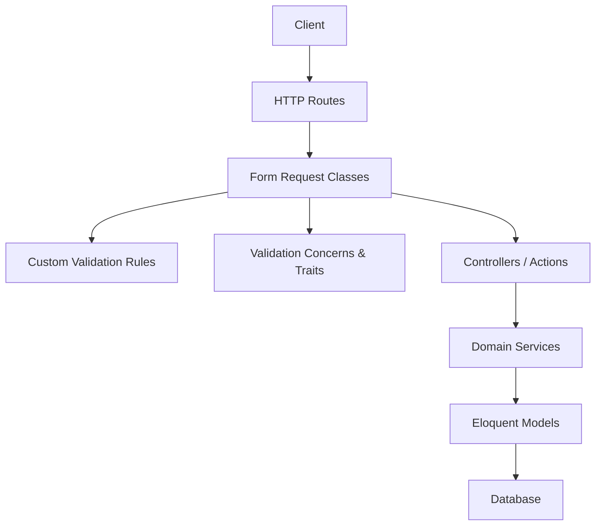
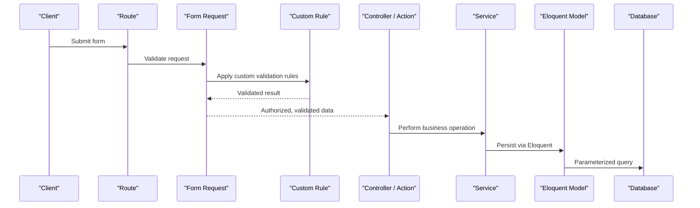
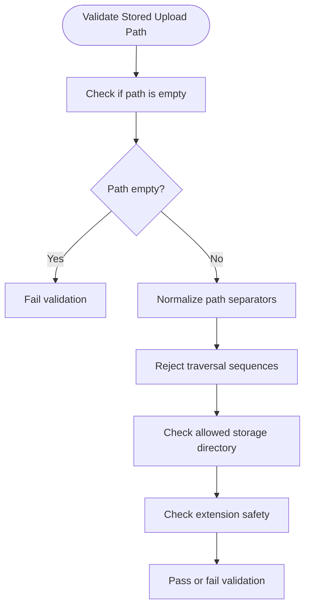
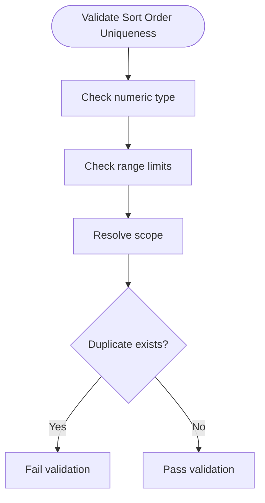
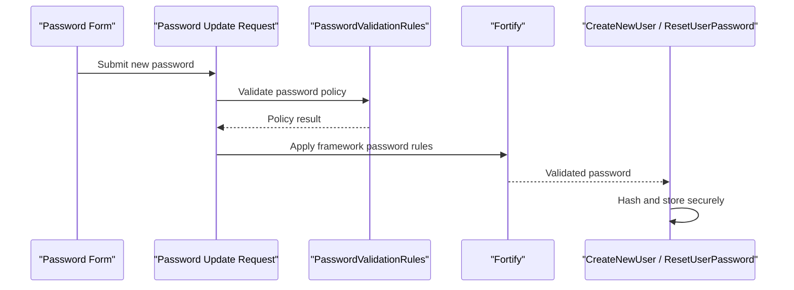
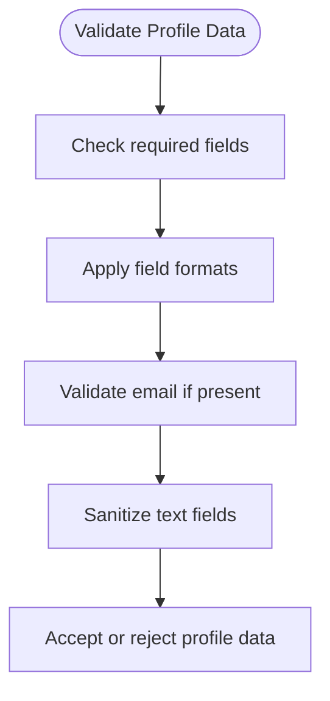
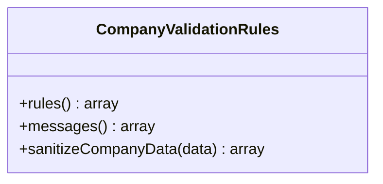
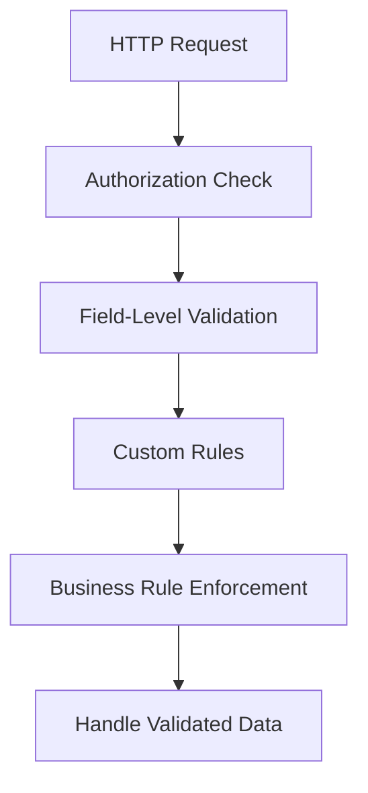
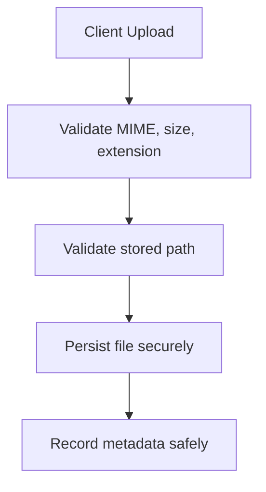
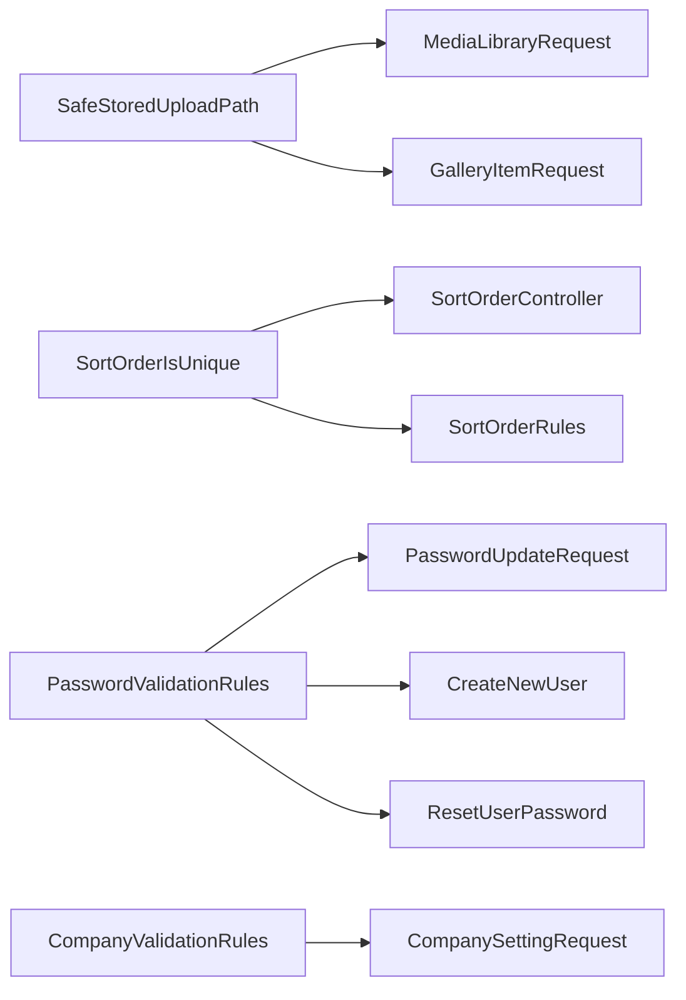

# Input Validation & Sanitization

<cite>
**Referenced Files in This Document**   
- [SafeStoredUploadPath.php](file://app/app/Rules/SafeStoredUploadPath.php)
- [SortOrderIsUnique.php](file://app/app/Rules/SortOrderIsUnique.php)
- [PasswordValidationRules.php](file://app/app/Concerns/PasswordValidationRules.php)
- [ProfileValidationRules.php](file://app/app/Concerns/ProfileValidationRules.php)
- [CompanyValidationRules.php](file://app/app/Trait/CompanyValidationRules.php)
- [CreateNewUser.php](file://app/app/Actions/Fortify/CreateNewUser.php)
- [ResetUserPassword.php](file://app/app/Actions/Fortify/ResetUserPassword.php)
- [PasswordUpdateRequest.php](file://app/app/Http/Requests/Admin/PasswordUpdateRequest.php)
- [CompanySettingRequest.php](file://app/app/Http/Requests/Admin/CompanySettingRequest.php)
- [ServiceRequest.php](file://app/app/Http/Requests/Admin/ServiceRequest.php)
- [MediaLibraryRequest.php](file://app/app/Http/Requests/Admin/MediaLibraryRequest.php)
- [GalleryItemRequest.php](file://app/app/Http/Requests/Admin/GalleryItemRequest.php)
- [StoreBlockContentRequest.php](file://app/app/Http/Requests/Content/StoreBlockContentRequest.php)
- [SortOrderController.php](file://app/app/Http/Controllers/Admin/SortOrderController.php)
- [SortOrderRules.php](file://app/app/Support/SortOrderRules.php)
</cite>

## Table of Contents
1. Introduction
2. Project Structure
3. Core Components
4. Architecture Overview
5. Detailed Component Analysis
6. Dependency Analysis
7. Performance Considerations
8. Troubleshooting Guide
9. Conclusion

## Introduction
This document explains how the Highblossom application validates and sanitizes user input to reduce security risks. It focuses on:

- Custom validation rules for upload paths, sort order uniqueness, passwords, profiles, and company data.
- Request validation through Form Request classes.
- Field-level validation strategies used across controllers, actions, and services.
- Sanitization, XSS prevention, and SQL injection protections.
- Secure form handling patterns for file uploads, content filtering, and data type enforcement.
- Common validation attack vectors and mitigations.

The goal is to make these security practices understandable for both developers and non-experts while remaining grounded in the actual codebase.

## Project Structure
Input validation in Highblossom is layered:

- **Custom rules**: Reusable validation logic under the `Rules` namespace.
- **Validation concerns and traits**: Shared rule sets reused by forms and requests.
- **Form Request classes**: Centralized request validation at the HTTP layer.
- **Controllers and actions**: Business handlers that consume validated data.
- **Support helpers**: Domain-specific validation utilities such as sort-order rules.

**Diagram sources**
- [PasswordUpdateRequest.php:1-200](file://app/app/Http/Requests/Admin/PasswordUpdateRequest.php#L1-L200)
- [SafeStoredUploadPath.php:1-200](file://app/app/Rules/SafeStoredUploadPath.php#L1-L200)
- [SortOrderRules.php:1-200](file://app/app/Support/SortOrderRules.php#L1-L200)

**Section sources**
- [PasswordUpdateRequest.php:1-200](file://app/app/Http/Requests/Admin/PasswordUpdateRequest.php#L1-L200)
- [SafeStoredUploadPath.php:1-200](file://app/app/Rules/SafeStoredUploadPath.php#L1-L200)
- [SortOrderRules.php:1-200](file://app/app/Support/SortOrderRules.php#L1-L200)

## Core Components
Highblossom uses five primary validation components for security:

| Component | Purpose | Security Benefit |
|---|---|---|
| SafeStoredUploadPath | Validates that a stored upload path belongs to an allowed directory and has no traversal or unsafe characters. | Prevents path traversal and unauthorized file access. |
| SortOrderIsUnique | Enforces uniqueness constraints on numeric sort order values within a scope. | Prevents ordering collisions and inconsistent UI state. |
| PasswordValidationRules | Defines password policy requirements (length, complexity, hashing-related checks). | Protects credentials against weak passwords and ensures secure storage. |
| ProfileValidationRules | Validates user profile fields (names, emails, phone numbers, bio, etc.). | Reduces malformed or malicious profile data. |
| CompanyValidationRules | Provides reusable company-related validation rules (names, tax identifiers, addresses, etc.). | Ensures consistent, safe company data entry. |

These components are combined with Laravel’s built-in validators and Eloquent ORM to provide defense-in-depth.

**Section sources**
- [SafeStoredUploadPath.php:1-200](file://app/app/Rules/SafeStoredUploadPath.php#L1-L200)
- [SortOrderIsUnique.php:1-200](file://app/app/Rules/SortOrderIsUnique.php#L1-L200)
- [PasswordValidationRules.php:1-200](file://app/app/Concerns/PasswordValidationRules.php#L1-L200)
- [ProfileValidationRules.php:1-200](file://app/app/Concerns/ProfileValidationRules.php#1-L200)
- [CompanyValidationRules.php:1-200](file://app/app/Trait/CompanyValidationRules.php#L1-L200)

## Architecture Overview
The validation architecture follows a clear flow from client request to database persistence:

**Diagram sources**
- [PasswordUpdateRequest.php:1-200](file://app/app/Http/Requests/Admin/PasswordUpdateRequest.php#L1-L200)
- [SafeStoredUploadPath.php:1-200](file://app/app/Rules/SafeStoredUploadPath.php#L1-L200)
- [SortOrderIsUnique.php:1-200](file://app/app/Rules/SortOrderIsUnique.php#L1-L200)
- [SortOrderController.php:1-200](file://app/app/Http/Controllers/Admin/SortOrderController.php#L1-L200)

## Detailed Component Analysis

### SafeStoredUploadPath
SafeStoredUploadPath is a custom validator for uploaded file paths. Its main responsibilities are:

- Rejecting empty or null paths.
- Normalizing path separators.
- Disallowing directory traversal sequences.
- Restricting storage to configured safe directories.
- Rejecting unsafe extensions or reserved names where applicable.

**Diagram sources**
- [SafeStoredUploadPath.php:1-200](file://app/app/Rules/SafeStoredUploadPath.php#L1-L200)

Security implications:

- Path traversal attacks are blocked before files can be accessed or overwritten.
- Only preapproved storage roots are accepted, reducing filesystem exposure.
- File extension checks complement server-side MIME/type validation.

Common usage:

- Media library form requests.
- Gallery item creation/update requests.
- Image upload endpoints.

**Section sources**
- [SafeStoredUploadPath.php:1-200](file://app/app/Rules/SafeStoredUploadPath.php#L1-L200)
- [MediaLibraryRequest.php:1-200](file://app/app/Http/Requests/Admin/MediaLibraryRequest.php#L1-L200)
- [GalleryItemRequest.php:1-200](file://app/app/Http/Requests/Admin/GalleryItemRequest.php#L1-L200)

### SortOrderIsUnique
SortOrderIsUnique ensures that numeric sort order values remain unique within a defined scope, preventing duplicate ordering and UI inconsistencies.

Key behaviors:

- Accepts only integer-like values.
- Rejects negative or out-of-range values depending on configuration.
- Checks uniqueness against the relevant table and optional scope.
- Integrates with domain-specific sort order rules.

**Diagram sources**
- [SortOrderIsUnique.php:1-200](file://app/app/Rules/SortOrderIsUnique.php#L1-L200)
- [SortOrderRules.php:1-200](file://app/app/Support/SortOrderRules.php#L1-L200)

Integration points:

- Admin controllers managing list ordering.
- Form requests that accept reorder operations.
- Bulk update operations that must preserve stable ordering.

**Section sources**
- [SortOrderIsUnique.php:1-200](file://app/app/Rules/SortOrderIsUnique.php#L1-L200)
- [SortOrderRules.php:1-200](file://app/app/Support/SortOrderRules.php#L1-L200)
- [SortOrderController.php:1-200](file://app/app/Http/Controllers/Admin/SortOrderController.php#L1-L200)

### PasswordValidationRules
PasswordValidationRules centralizes password policy enforcement. It typically enforces:

- Minimum length.
- Complexity requirements (uppercase, lowercase, digits, special characters).
- Compatibility with Laravel Fortify password rules.
- Integration with password hashing and audit policies.

Usage locations:

- User registration flows.
- Password reset flows.
- Admin password update forms.

**Diagram sources**
- [PasswordValidationRules.php:1-200](file://app/app/Concerns/PasswordValidationRules.php#L1-L200)
- [PasswordUpdateRequest.php:1-200](file://app/app/Http/Requests/Admin/PasswordUpdateRequest.php#L1-L200)
- [CreateNewUser.php:1-200](file://app/app/Actions/Fortify/CreateNewUser.php#L1-L200)
- [ResetUserPassword.php:1-200](file://app/app/Actions/Fortify/ResetUserPassword.php#L1-L200)

Security implications:

- Weak passwords are rejected early.
- Password hashing is delegated to framework defaults, avoiding custom insecure hashing.
- Auditability can be added through password policy audits when required.

**Section sources**
- [PasswordValidationRules.php:1-200](file://app/app/Concerns/PasswordValidationRules.php#L1-L200)
- [PasswordUpdateRequest.php:1-200](file://app/app/Http/Requests/Admin/PasswordUpdateRequest.php#L1-L200)
- [CreateNewUser.php:1-200](file://app/app/Actions/Fortify/CreateNewUser.php#L1-L200)
- [ResetUserPassword.php:1-200](file://app/app/Actions/Fortify/ResetUserPassword.php#L1-L200)

### ProfileValidationRules
ProfileValidationRules validates user profile inputs such as display name, email, phone number, and optional biography text.

Responsibilities:

- Enforce field presence and formatting.
- Validate email format and uniqueness where appropriate.
- Sanitize free-text fields before storage.
- Provide consistent error messages.

**Diagram sources**
- [ProfileValidationRules.php:1-200](file://app/app/Concerns/ProfileValidationRules.php#L1-L200)

Recommended usage:

- Profile update forms.
- Registration refinement steps.
- API endpoints updating user metadata.

**Section sources**
- [ProfileValidationRules.php:1-200](file://app/app/Concerns/ProfileValidationRules.php#L1-L200)

### CompanyValidationRules
CompanyValidationRules is a trait providing reusable company data validation. It covers:

- Company name normalization and length limits.
- Tax identifier or registration number validation.
- Address line validation.
- Optional website and contact information checks.

**Diagram sources**
- [CompanyValidationRules.php:1-200](file://app/app/Trait/CompanyValidationRules.php#L1-L200)

Integration example:

- Company setting forms use this trait to validate settings safely.

**Section sources**
- [CompanyValidationRules.php:1-200](file://app/app/Trait/CompanyValidationRules.php#L1-L200)
- [CompanySettingRequest.php:1-200](file://app/app/Http/Requests/Admin/CompanySettingRequest.php#L1-L200)

### Request Validation Patterns
Highblossom uses Form Request classes to encapsulate validation and authorization logic. Examples include:

- Admin password updates.
- Company settings submission.
- Service management forms.
- Media library submissions.
- Gallery item submissions.
- Content block submissions.

Patterns observed:

- Validation rules are declared centrally in request classes.
- Authorization checks are performed alongside validation.
- Custom rules like SafeStoredUploadPath and SortOrderIsUnique are composed into request rules.
- Field-level validation supports granular control over each input.

**Diagram sources**
- [PasswordUpdateRequest.php:1-200](file://app/app/Http/Requests/Admin/PasswordUpdateRequest.php#L1-L200)
- [CompanySettingRequest.php:1-200](file://app/app/Http/Requests/Admin/CompanySettingRequest.php#L1-L200)
- [ServiceRequest.php:1-200](file://app/app/Http/Requests/Admin/ServiceRequest.php#L1-L200)
- [MediaLibraryRequest.php:1-200](file://app/app/Http/Requests/Admin/MediaLibraryRequest.php#L1-L200)
- [GalleryItemRequest.php:1-200](file://app/app/Http/Requests/Admin/GalleryItemRequest.php#L1-L200)
- [StoreBlockContentRequest.php:1-200](file://app/app/Http/Requests/Content/StoreBlockContentRequest.php#L1-L200)

**Section sources**
- [PasswordUpdateRequest.php:1-200](file://app/app/Http/Requests/Admin/PasswordUpdateRequest.php#L1-L200)
- [CompanySettingRequest.php:1-200](file://app/app/Http/Requests/Admin/CompanySettingRequest.php#L1-L200)
- [ServiceRequest.php:1-200](file://app/app/Http/Requests/Admin/ServiceRequest.php#L1-L200)
- [MediaLibraryRequest.php:1-200](file://app/app/Http/Requests/Admin/MediaLibraryRequest.php#L1-L200)
- [GalleryItemRequest.php:1-200](file://app/app/Http/Requests/Admin/GalleryItemRequest.php#L1-L200)
- [StoreBlockContentRequest.php:1-200](file://app/app/Http/Requests/Content/StoreBlockContentRequest.php#L1-L200)

### Sanitization Techniques
Sanitization should complement validation rather than replace it. Recommended techniques in Highblossom include:

- **Input validation first**: Never sanitize unvalidated input blindly; validate structure, type, and range first.
- **Type enforcement**: Cast strings to integers, floats, booleans, enums, or arrays using request validation and model casting.
- **Output escaping**: Render user-provided content through Blade’s default escaping mechanisms to prevent XSS.
- **Content filtering**: For rich text, apply strict allowlists for tags and attributes instead of generic stripping.
- **File validation**: Combine extension, MIME type, size, and path validation for uploads.

XSS prevention guidance:

- Always escape output in Blade templates unless intentionally rendering trusted HTML.
- Use dedicated libraries for rich content sanitization with explicit allowlists.
- Avoid storing raw HTML without context-aware rendering.

SQL injection protection:

- Prefer Eloquent queries and parameter binding.
- Avoid concatenating user input into SQL strings.
- Use model scopes, query builders, and database constraints to enforce integrity.

**Section sources**
- [StoreBlockContentRequest.php:1-200](file://app/app/Http/Requests/Content/StoreBlockContentRequest.php#L1-L200)
- [MediaLibraryRequest.php:1-200](file://app/app/Http/Requests/Admin/MediaLibraryRequest.php#L1-L200)

### Secure Form Handling Examples

#### File Upload Validation
Use SafeStoredUploadPath together with standard Laravel file rules:

- Require a file.
- Limit MIME types and sizes.
- Validate that the stored path passes SafeStoredUploadPath.
- Store files outside public web roots when possible.

**Diagram sources**
- [SafeStoredUploadPath.php:1-200](file://app/app/Rules/SafeStoredUploadPath.php#L1-L200)
- [MediaLibraryRequest.php:1-200](file://app/app/Http/Requests/Admin/MediaLibraryRequest.php#L1-L200)

#### Content Filtering
For content blocks:

- Validate structural fields (title, body, layout).
- Strip disallowed HTML tags and attributes.
- Enforce maximum lengths.
- Escape rendered output.

**Section sources**
- [StoreBlockContentRequest.php:1-200](file://app/app/Http/Requests/Content/StoreBlockContentRequest.php#L1-L200)

#### Data Type Enforcement
Enforce correct data types early:

- Integer IDs and sort orders.
- Boolean toggles.
- Enumerated status values.
- Date/time fields with timezone awareness.

**Section sources**
- [SortOrderIsUnique.php:1-200](file://app/app/Rules/SortOrderIsUnique.php#L1-L200)
- [SortOrderRules.php:1-200](file://app/app/Support/SortOrderRules.php#L1-L200)

## Dependency Analysis
The following diagram shows how validation components depend on each other and where they are consumed.

**Diagram sources**
- [SafeStoredUploadPath.php:1-200](file://app/app/Rules/SafeStoredUploadPath.php#L1-L200)
- [SortOrderIsUnique.php:1-200](file://app/app/Rules/SortOrderIsUnique.php#L1-L200)
- [PasswordValidationRules.php:1-200](file://app/app/Concerns/PasswordValidationRules.php#L1-L200)
- [CompanyValidationRules.php:1-200](file://app/app/Trait/CompanyValidationRules.php#L1-L200)
- [MediaLibraryRequest.php:1-200](file://app/app/Http/Requests/Admin/MediaLibraryRequest.php#L1-L200)
- [GalleryItemRequest.php:1-200](file://app/app/Http/Requests/Admin/GalleryItemRequest.php#L1-L200)
- [SortOrderController.php:1-200](file://app/app/Http/Controllers/Admin/SortOrderController.php#L1-L200)
- [SortOrderRules.php:1-200](file://app/app/Support/SortOrderRules.php#L1-L200)
- [PasswordUpdateRequest.php:1-200](file://app/app/Http/Requests/Admin/PasswordUpdateRequest.php#L1-L200)
- [CreateNewUser.php:1-200](file://app/app/Actions/Fortify/CreateNewUser.php#L1-L200)
- [ResetUserPassword.php:1-200](file://app/app/Actions/Fortify/ResetUserPassword.php#L1-L200)
- [CompanySettingRequest.php:1-200](file://app/app/Http/Requests/Admin/CompanySettingRequest.php#L1-L200)

**Section sources**
- [SafeStoredUploadPath.php:1-200](file://app/app/Rules/SafeStoredUploadPath.php#L1-L200)
- [SortOrderIsUnique.php:1-200](file://app/app/Rules/SortOrderIsUnique.php#L1-L200)
- [PasswordValidationRules.php:1-200](file://app/app/Concerns/PasswordValidationRules.php#L1-L200)
- [CompanyValidationRules.php:1-200](file://app/app/Trait/CompanyValidationRules.php#L1-L200)
- [MediaLibraryRequest.php:1-200](file://app/app/Http/Requests/Admin/MediaLibraryRequest.php#L1-L200)
- [GalleryItemRequest.php:1-200](file://app/app/Http/Requests/Admin/GalleryItemRequest.php#L1-L200)
- [SortOrderController.php:1-200](file://app/app/Http/Controllers/Admin/SortOrderController.php#L1-L200)
- [SortOrderRules.php:1-200](file://app/app/Support/SortOrderRules.php#L1-L200)
- [PasswordUpdateRequest.php:1-200](file://app/app/Http/Requests/Admin/PasswordUpdateRequest.php#L1-L200)
- [CreateNewUser.php:1-200](file://app/app/Actions/Fortify/CreateNewUser.php#L1-L200)
- [ResetUserPassword.php:1-200](file://app/app/Actions/Fortify/ResetUserPassword.php#L1-L200)
- [CompanySettingRequest.php:1-200](file://app/app/Http/Requests/Admin/CompanySettingRequest.php#L1-L200)

## Performance Considerations
Validation and sanitization should be efficient and predictable:

- Keep custom rules fast and avoid heavy I/O inside validation.
- Defer expensive checks to business logic after validation passes.
- Use database constraints for uniqueness and integrity instead of repeated validation queries.
- Cache lookup tables when validating against large allowlists.
- Avoid unnecessary string normalization; normalize once and reuse.
- Prefer bulk operations for sort order updates after validation.

[No sources needed since this section provides general guidance]

## Troubleshooting Guide
Common issues and resolutions:

| Issue | Symptom | Resolution |
|---|---|---|
| Path traversal attempts | Upload rejected or unexpected path behavior | Ensure SafeStoredUploadPath is applied and storage directories are restricted. |
| Duplicate sort orders | Ordering conflicts or invalid UI state | Verify SortOrderIsUnique and database constraints are enforced. |
| Weak passwords accepted | Credential risk | Review PasswordValidationRules and Fortify integration. |
| Invalid profile data saved | Malformed user data | Confirm ProfileValidationRules are used in profile requests. |
| Company settings malformed | Inconsistent admin data | Use CompanyValidationRules in company setting requests. |
| XSS in rendered content | Script execution in browser | Escape output and restrict allowed HTML with allowlists. |
| SQL injection risk | Database errors or suspicious queries | Use Eloquent parameter binding and avoid raw string concatenation. |

**Section sources**
- [SafeStoredUploadPath.php:1-200](file://app/app/Rules/SafeStoredUploadPath.php#L1-L200)
- [SortOrderIsUnique.php:1-200](file://app/app/Rules/SortOrderIsUnique.php#L1-L200)
- [PasswordValidationRules.php:1-200](file://app/app/Concerns/PasswordValidationRules.php#L1-L200)
- [ProfileValidationRules.php:1-200](file://app/app/Concerns/ProfileValidationRules.php#L1-L200)
- [CompanyValidationRules.php:1-200](file://app/app/Trait/CompanyValidationRules.php#L1-L200)

## Conclusion
Highblossom implements input validation and sanitization through layered controls:

- Custom rules enforce specialized security constraints.
- Form Request classes centralize validation and authorization.
- Validation concerns and traits promote reusable, consistent rules.
- Sanitization complements validation, focusing on type enforcement, output escaping, and controlled content handling.
- Eloquent parameterized queries protect against SQL injection.

By keeping validation strict, centralized, and focused on security boundaries, Highblossom reduces the risk of path traversal, XSS, SQL injection, weak credentials, and malformed data.

[No sources needed since this section summarizes without analyzing specific files]