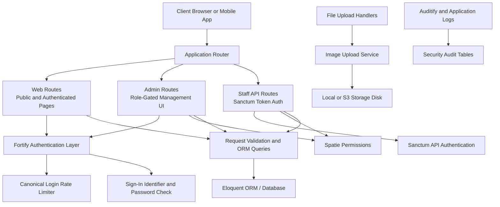
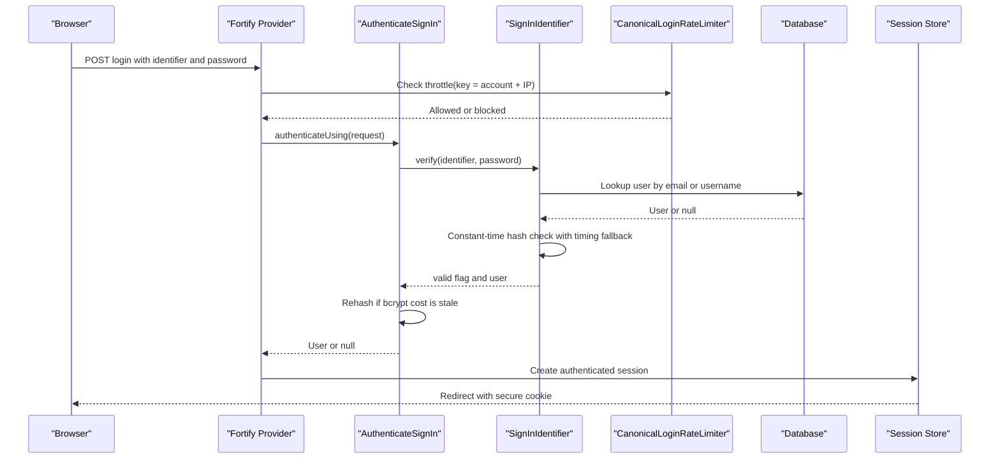
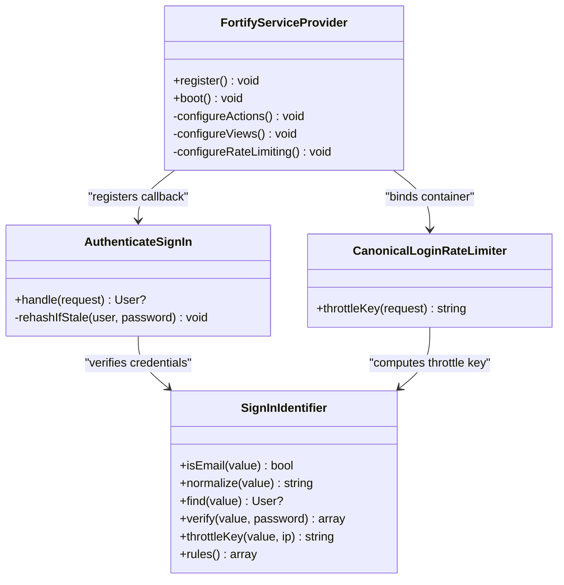
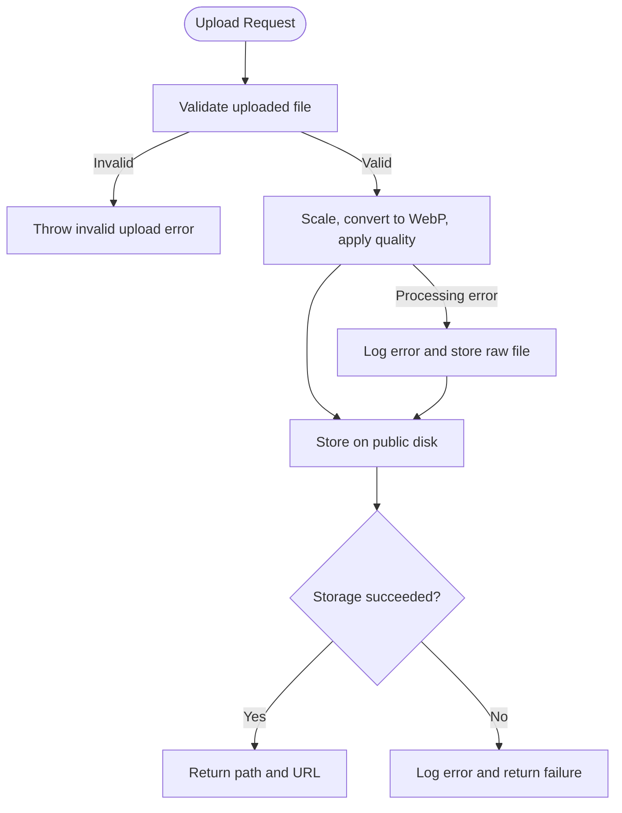
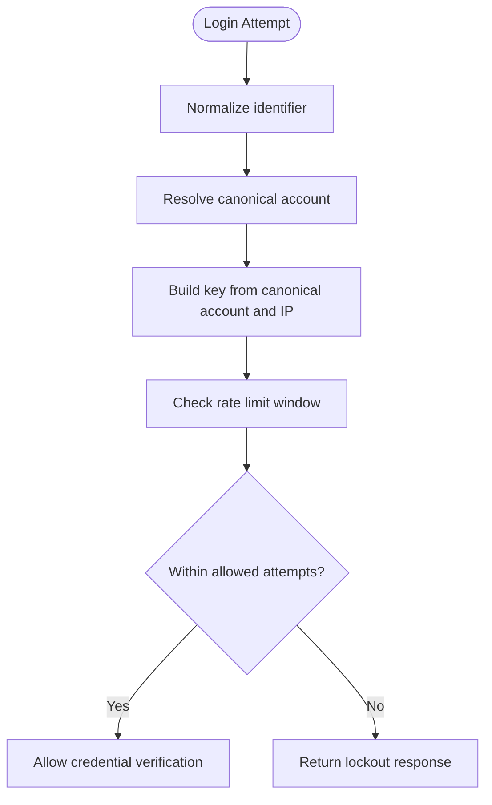
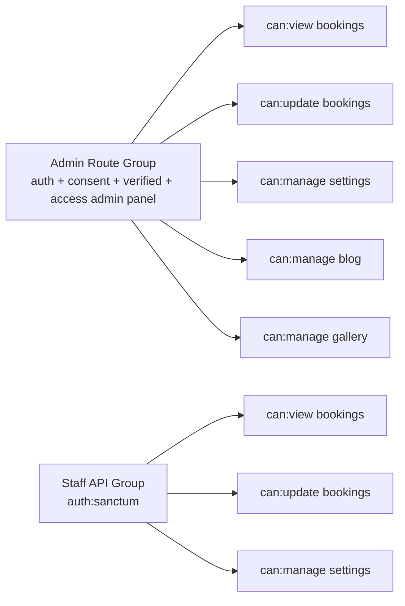
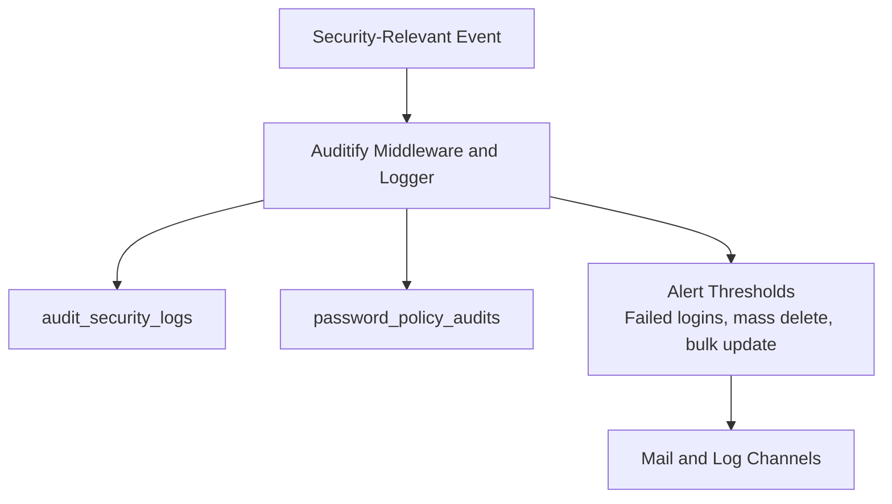
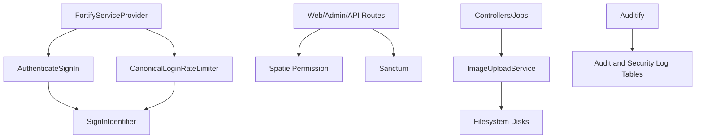

# Security Considerations

<cite>
**Referenced Files in This Document**   
- [FortifyServiceProvider.php](file://app/Providers/FortifyServiceProvider.php)
- [AuthenticateSignIn.php](file://app/Actions/Fortify/AuthenticateSignIn.php)
- [CanonicalLoginRateLimiter.php](file://app/Support/CanonicalLoginRateLimiter.php)
- [SignInIdentifier.php](file://app/Support/SignInIdentifier.php)
- [auth.php](file://config/auth.php)
- [session.php](file://config/session.php)
- [sanctum.php](file://config/sanctum.php)
- [fortify.php](file://config/fortify.php)
- [permission.php](file://config/permission.php)
- [auditify.php](file://config/auditify.php)
- [app.php](file://config/app.php)
- [logging.php](file://config/logging.php)
- [nginx.conf](file://docker/nginx.conf)
- [web.php](file://routes/web.php)
- [admin.php](file://routes/admin.php)
- [api.php](file://routes/api.php)
- [User.php](file://app/Models/User.php)
- [ImageUploadService.php](file://app/Services/ImageUploadService.php)
- [filesytems.php](file://config/filesystems.php)
- [UserService.php](file://app/Services/UserService.php)
- [2026_01_01_000002_create_audit_security_logs_table.php](file://database/migrations/2026_01_01_000002_create_audit_security_logs_table.php)
- [2026_10_20_000000_create_password_policy_audits_table.php](file://database/migrations/2026_10_20_000000_create_password_policy_audits_table.php)
</cite>

## Table of Contents
1. [Introduction](#introduction)
2. [Project Structure](#project-structure)
3. [Core Components](#core-components)
4. [Architecture Overview](#architecture-overview)
5. [Detailed Component Analysis](#detailed-component-analysis)
6. [Dependency Analysis](#dependency-analysis)
7. [Performance Considerations](#performance-considerations)
8. [Troubleshooting Guide](#troubleshooting-guide)
9. [Conclusion](#conclusion)

## Introduction
This document describes the security posture of the Highblossom application as implemented in the repository. It focuses on authentication, authorization, input validation, CSRF protection, SQL injection prevention, file upload safety, encryption, session security, rate limiting, audit logging, and operational hardening. It also provides guidance for security testing and incident response based on the existing codebase.

## Project Structure
Security-relevant concerns are distributed across several layers:

- Authentication and login flows use Laravel Fortify with custom request handling, a canonical login rate limiter, and a sign-in identifier abstraction.
- Authorization is enforced through Spatie Permission roles and permissions applied at route and controller levels.
- API access uses Sanctum token authentication with explicit throttling and parameter validation.
- Input validation is centralized in request classes and Eloquent models; query construction uses parameterized Eloquent queries.
- File uploads are processed by an image service that normalizes media and stores it under controlled filesystem disks.
- Audit logging is configured through the Auditify package with dedicated security log tables.
- Infrastructure-level protections include Nginx configuration and application environment settings.

**Diagram sources**
- [web.php:1-76](file://routes/web.php#L1-L76)
- [admin.php:1-171](file://routes/admin.php#L1-L171)
- [api.php:1-117](file://routes/api.php#L1-L117)
- [FortifyServiceProvider.php:1-118](file://app/Providers/FortifyServiceProvider.php#L1-L118)
- [CanonicalLoginRateLimiter.php:1-37](file://app/Support/CanonicalLoginRateLimiter.php#L1-L37)
- [SignInIdentifier.php:1-150](file://app/Support/SignInIdentifier.php#L1-L150)
- [ImageUploadService.php:1-70](file://app/Services/ImageUploadService.php#L1-L70)
- [filesytems.php:1-109](file://config/filesystems.php#L1-L109)
- [auditify.php:1-81](file://config/auditify.php#L1-L81)

**Section sources**
- [web.php:1-76](file://routes/web.php#L1-L76)
- [admin.php:1-171](file://routes/admin.php#L1-L171)
- [api.php:1-117](file://routes/api.php#L1-L117)

## Core Components
The main security components are:

- **Authentication**: Fortify integrates with a custom sign-in action that accepts either username or email, verifies passwords, and upgrades stale bcrypt hashes.
- **Rate Limiting**: A canonical login rate limiter groups attempts by resolved account plus IP rather than raw submitted text, reducing brute-force opportunities.
- **Authorization**: Route-level `can:` middleware enforces role-based permissions using Spatie Permission.
- **API Security**: Sanctum authenticates stateful SPA requests and bearer tokens for mobile endpoints, with per-route throttling.
- **Input Validation**: Request classes and model attributes provide structured validation; Eloquent builds parameterized queries.
- **File Upload Security**: Uploaded images are normalized to a safe format and size before storage; storage paths are returned through a URL helper.
- **Encryption and Secrets**: Application key and cipher are configured; session cookies and encrypted cookies are used.
- **Audit Logging**: Auditify tracks security events, failed logins, and sensitive module changes; separate tables store security logs and password policy audits.

**Section sources**
- [FortifyServiceProvider.php:1-118](file://app/Providers/FortifyServiceProvider.php#L1-L118)
- [AuthenticateSignIn.php:1-76](file://app/Actions/Fortify/AuthenticateSignIn.php#L1-L76)
- [CanonicalLoginRateLimiter.php:1-37](file://app/Support/CanonicalLoginRateLimiter.php#L1-L37)
- [SignInIdentifier.php:1-150](file://app/Support/SignInIdentifier.php#L1-L150)
- [permission.php:1-206](file://config/permission.php#L1-L206)
- [sanctum.php:1-87](file://config/sanctum.php#L1-L87)
- [api.php:1-117](file://routes/api.php#L1-L117)
- [ImageUploadService.php:1-70](file://app/Services/ImageUploadService.php#L1-L70)
- [app.php:1-126](file://config/app.php#L1-L126)
- [auditify.php:1-81](file://config/auditify.php#L1-L81)

## Architecture Overview
The security architecture separates concerns between the web interface, admin panel, and staff API while sharing common authentication and authorization primitives.

**Diagram sources**
- [FortifyServiceProvider.php:60-118](file://app/Providers/FortifyServiceProvider.php#L60-L118)
- [AuthenticateSignIn.php:23-76](file://app/Actions/Fortify/AuthenticateSignIn.php#L23-L76)
- [SignInIdentifier.php:65-150](file://app/Support/SignInIdentifier.php#L65-L150)
- [CanonicalLoginRateLimiter.php:17-37](file://app/Support/CanonicalLoginRateLimiter.php#L17-L37)
- [auth.php:20-60](file://config/auth.php#L20-L60)
- [session.php:1-120](file://config/session.php#L1-L120)

## Detailed Component Analysis

### Authentication and Login Security
The login flow is built around Fortify but replaces default behavior to support a single field accepting either username or email. The provider binds custom request classes, neutralizes password reset link responses, registers a custom login rate limiter, and configures the authentication callback.

Key behaviors:
- The sign-in action reads the Fortify username field, resolves the user through `SignInIdentifier`, and verifies the password.
- `SignInIdentifier` treats the value as an email when it validates as one; otherwise it treats it as a username. Both branches perform equivalent work to avoid timing leaks.
- When no user is found, the implementation still performs a hash comparison against a fixed dummy hash so attacker-controlled identifiers cannot be distinguished by response time.
- On successful login, stale bcrypt hashes are upgraded if the framework indicates rehashing is needed.

**Diagram sources**
- [FortifyServiceProvider.php:1-118](file://app/Providers/FortifyServiceProvider.php#L1-L118)
- [AuthenticateSignIn.php:1-76](file://app/Actions/Fortify/AuthenticateSignIn.php#L1-L76)
- [SignInIdentifier.php:1-150](file://app/Support/SignInIdentifier.php#L1-L150)
- [CanonicalLoginRateLimiter.php:1-37](file://app/Support/CanonicalLoginRateLimiter.php#L1-L37)

**Section sources**
- [FortifyServiceProvider.php:1-118](file://app/Providers/FortifyServiceProvider.php#L1-L118)
- [AuthenticateSignIn.php:1-76](file://app/Actions/Fortify/AuthenticateSignIn.php#L1-L76)
- [SignInIdentifier.php:1-150](file://app/Support/SignInIdentifier.php#L1-L150)
- [CanonicalLoginRateLimiter.php:1-37](file://app/Support/CanonicalLoginRateLimiter.php#L1-L37)
- [fortify.php:1-162](file://config/fortify.php#L1-L162)

### CSRF Protection
CSRF protection is provided by Laravel’s standard stack:
- Sanctum includes the `ValidateCsrfToken` middleware in its Sanctum middleware stack.
- Blade views throughout the application include CSRF fields, indicating form submissions are protected.
- Sanctum stateful domains are configurable via environment variables, which controls which origins receive stateful cookies.

Recommendations:
- Ensure production environments set `SESSION_SECURE_COOKIE` to true so session cookies are only sent over HTTPS.
- Configure same-site cookies appropriately for cross-site scenarios.
- Keep Sanctum stateful domains limited to trusted front-end hosts.

**Section sources**
- [sanctum.php:1-87](file://config/sanctum.php#L1-L87)
- [session.php:1-200](file://config/session.php#L1-L200)

### SQL Injection Prevention
The application uses Eloquent models and parameterized queries rather than concatenating user input into SQL strings. Most data access is expressed through model methods, query builders, and relation definitions, which protect against SQL injection by design.

Examples from the codebase:
- `SignInIdentifier::find()` builds queries using `where()` clauses instead of raw SQL.
- Models define relationships and fillable attributes, keeping data binding within Eloquent.

Best practices reflected here:
- Avoid raw SQL where possible.
- Use Eloquent parameters and scopes.
- Validate and cast model attributes.

**Section sources**
- [SignInIdentifier.php:45-64](file://app/Support/SignInIdentifier.php#L45-L64)
- [User.php:1-141](file://app/Models/User.php#L1-L141)

### File Upload Security
The image upload service normalizes every accepted image to WebP, constrains dimensions, and sets a fixed quality level. If image processing fails, it logs the error and falls back to storing the original file path rather than failing the endpoint entirely.

**Diagram sources**
- [ImageUploadService.php:1-70](file://app/Services/ImageUploadService.php#L1-L70)

Important considerations:
- The current service does not explicitly validate MIME type or magic bytes before calling the image library.
- Stored files are placed on the public disk, which may be served publicly depending on the storage backend.
- For stricter security, add content-type validation, reject executable extensions, enforce maximum file sizes, and consider storing untrusted uploads outside the web root or behind signed URLs.

**Section sources**
- [ImageUploadService.php:1-70](file://app/Services/ImageUploadService.php#L1-L70)
- [filesytems.php:1-109](file://config/filesystems.php#L1-L109)

### Input Validation Strategy
Validation is layered:
- Fortify request classes are replaced with application-specific subclasses for consistent messages and rules.
- Sign-in identifiers are validated to accept either a well-formed email or a username following the project’s username rules.
- Public routes such as contact, quote, booking, and poll voting use global throttle middleware.
- API endpoints restrict parameter shapes using route constraints and controller logic.

Recommended additions:
- Centralize all business input validation in request classes.
- Apply strict types and allowlist validation for enum-like inputs.
- Sanitize rich-text content at the boundary before persistence or rendering.

**Section sources**
- [FortifyServiceProvider.php:20-59](file://app/Providers/FortifyServiceProvider.php#L20-L59)
- [SignInIdentifier.php:110-150](file://app/Support/SignInIdentifier.php#L110-L150)
- [web.php:15-76](file://routes/web.php#L15-L76)
- [api.php:1-117](file://routes/api.php#L1-L117)

### XSS Protection Mechanisms
Auditify’s configuration enables XSS protection and can block detected payloads. However, no application-level Content Security Policy header implementation was found in the analyzed files. XSS mitigation should therefore be reviewed holistically:

- Enable and tune Auditify XSS scanning according to application needs.
- Add server-side CSP headers through a dedicated HTTP middleware or web server configuration.
- Escape output in templates and sanitize any rich-text content before storage.
- Review third-party assets such as CKEditor for their own CSP requirements.

**Section sources**
- [auditify.php:55-64](file://config/auditify.php#L55-L64)

### Rate Limiting Through CanonicalLoginRateLimiter
The custom rate limiter improves security by grouping login attempts by the resolved account identity and source IP. This prevents attackers from bypassing limits simply by alternating between an email address and its corresponding username.

**Diagram sources**
- [CanonicalLoginRateLimiter.php:17-37](file://app/Support/CanonicalLoginRateLimiter.php#L17-L37)
- [SignInIdentifier.php:94-108](file://app/Support/SignInIdentifier.php#L94-L108)
- [FortifyServiceProvider.php:95-118](file://app/Providers/FortifyServiceProvider.php#L95-L118)

**Section sources**
- [CanonicalLoginRateLimiter.php:1-37](file://app/Support/CanonicalLoginRateLimiter.php#L1-L37)
- [SignInIdentifier.php:94-108](file://app/Support/SignInIdentifier.php#L94-L108)
- [FortifyServiceProvider.php:95-118](file://app/Providers/FortifyServiceProvider.php#L95-L118)

### Authorization Controls and Role-Based Access Enforcement
Authorization is enforced primarily at the route layer:
- Admin routes are grouped under an `auth` group and require a specific permission to access the admin panel.
- Individual resource routes use `can:` middleware for view, update, create, and delete operations.
- Staff API routes reuse the same ability names, ensuring parity between the web admin and mobile API.

**Diagram sources**
- [admin.php:1-171](file://routes/admin.php#L1-L171)
- [api.php:1-117](file://routes/api.php#L1-L117)
- [permission.php:1-206](file://config/permission.php#L1-L206)

**Section sources**
- [admin.php:1-171](file://routes/admin.php#L1-L171)
- [api.php:1-117](file://routes/api.php#L1-L117)
- [permission.php:1-206](file://config/permission.php#L1-L206)

### Data Encryption Strategies
- Application encryption uses AES-256-CBC with an application key sourced from the environment.
- Session cookies are configurable for secure transport, HTTP-only access, and same-site behavior.
- Sanctum supports encrypting cookies as part of its middleware stack.
- User passwords are stored as hashed values through Eloquent casting and bcrypt hashing in user creation/update paths.

Operational notes:
- Ensure `APP_KEY` is securely generated and never committed.
- Rotate previous keys when rotating the application key.
- Enable session encryption in production if long-lived sessions contain sensitive data.

**Section sources**
- [app.php:60-100](file://config/app.php#L60-L100)
- [session.php:1-200](file://config/session.php#L1-L200)
- [sanctum.php:1-87](file://config/sanctum.php#L1-L87)
- [User.php:30-55](file://app/Models/User.php#L30-L55)
- [UserService.php:19-69](file://app/Services/UserService.php#L19-L69)

### Secure Communication Protocols
Nginx serves the application through FastCGI and denies access to hidden files except for the `well-known` directory. While this blocks direct access to `.env`, `.git`, and similar artifacts, it does not configure TLS termination itself.

Recommendations:
- Terminate TLS at the reverse proxy or load balancer and force HTTPS redirects.
- Set `Strict-Transport-Security` at the proxy layer.
- Restrict allowed HTTP methods and disable unnecessary server features.
- Use secure connection settings for external services such as S3.

**Section sources**
- [nginx.conf:1-20](file://docker/nginx.conf#L1-L20)

### Security Headers and Content Security Policy
No explicit security header middleware or CSP implementation was found in the analyzed files. Recommended measures include:
- Adding a security headers middleware for `X-Frame-Options`, `X-Content-Type-Options`, `Referrer-Policy`, `Permissions-Policy`, and `Content-Security-Policy`.
- Aligning CSP with the application’s frontend dependencies and third-party scripts.
- Using nonces or hashes for inline scripts where required.
- Monitoring CSP violations through reporting endpoints.

[No sources needed since this section provides general guidance]

### Audit Logging for Security Events
Auditify is configured to track authentication events, page visits, IP addresses, user agents, and URLs. It includes alerting thresholds for failed logins, mass deletions, and bulk updates, along with sensitivity tagging for modules like User, Role, Permission, Setting, and Config. Two database migrations provide persistent audit storage:
- `audit_security_logs` stores severity, title, description, status, resolution notes, request metadata, and payload.
- `password_policy_audits` records password policy changes with IP and JSON change details.

**Diagram sources**
- [auditify.php:1-81](file://config/auditify.php#L1-L81)
- [2026_01_01_000002_create_audit_security_logs_table.php:1-40](file://database/migrations/2026_01_01_000002_create_audit_security_logs_table.php#L1-L40)
- [2026_10_20_000000_create_password_policy_audits_table.php:1-32](file://database/migrations/2026_10_20_000000_create_password_policy_audits_table.php#L1-L32)

**Section sources**
- [auditify.php:1-81](file://config/auditify.php#L1-L81)
- [2026_01_01_000002_create_audit_security_logs_table.php:1-40](file://database/migrations/2026_01_01_000002_create_audit_security_logs_table.php#L1-L40)
- [2026_10_20_000000_create_password_policy_audits_table.php:1-32](file://database/migrations/2026_10_20_000000_create_password_policy_audits_table.php#L1-L32)

## Dependency Analysis
The authentication and authorization subsystems have clear dependency boundaries:

- Fortify depends on the application’s custom request classes, authentication action, and rate limiter.
- The sign-in action depends on `SignInIdentifier` for canonical identity resolution and constant-time verification.
- Route authorization depends on Spatie Permission policies.
- API authentication depends on Sanctum guards and token configuration.
- File uploads depend on the image service and filesystem disks.
- Auditing depends on Auditify configuration and database tables.

**Diagram sources**
- [FortifyServiceProvider.php:1-118](file://app/Providers/FortifyServiceProvider.php#L1-L118)
- [AuthenticateSignIn.php:1-76](file://app/Actions/Fortify/AuthenticateSignIn.php#L1-L76)
- [CanonicalLoginRateLimiter.php:1-37](file://app/Support/CanonicalLoginRateLimiter.php#L1-L37)
- [SignInIdentifier.php:1-150](file://app/Support/SignInIdentifier.php#L1-L150)
- [admin.php:1-171](file://routes/admin.php#L1-L171)
- [api.php:1-117](file://routes/api.php#L1-L117)
- [ImageUploadService.php:1-70](file://app/Services/ImageUploadService.php#L1-L70)
- [filesytems.php:1-109](file://config/filesystems.php#L1-L109)
- [auditify.php:1-81](file://config/auditify.php#L1-L81)

**Section sources**
- [FortifyServiceProvider.php:1-118](file://app/Providers/FortifyServiceProvider.php#L1-L118)
- [admin.php:1-171](file://routes/admin.php#L1-L171)
- [api.php:1-117](file://routes/api.php#L1-L117)

## Performance Considerations
- Bcrypt password hashing and rehashing on login introduce CPU cost; keep hash rounds aligned with infrastructure capacity.
- Audit logging adds write overhead; tune log levels and pruning intervals to balance visibility and performance.
- Rate limiting should use a scalable store (database, cache, or Redis) under high traffic.
- Image processing should be offloaded to background jobs for large galleries to avoid blocking request handlers.

[No sources needed since this section provides general guidance]

## Troubleshooting Guide
Common security-related issues and where to investigate:

- **Unexpected login lockouts**:
  - Inspect the canonical throttle key computation and whether multiple identifiers map to the same account.
  - Check rate limiter configuration and storage backend availability.

- **Password reset leaking account existence**:
  - Verify neutral password reset link responses and consistent messaging.
  - Confirm Auditify XSS and audit logging configurations are not exposing sensitive details.

- **Unauthorized API access**:
  - Verify Sanctum guard configuration, token prefix, stateful domains, and route-level `auth:sanctum` middleware.
  - Confirm `can:` abilities match expected permissions.

- **File upload failures or unsafe files**:
  - Check image processing exceptions and fallback behavior.
  - Validate storage disk configuration and public visibility settings.

- **Missing security headers**:
  - Add and test security headers in a middleware or reverse proxy.
  - Validate CSP compatibility with frontend assets.

- **Audit log gaps**:
  - Confirm Auditify middleware is active and thresholds are configured.
  - Verify database migrations for security logs and password policy audits have been applied.

**Section sources**
- [CanonicalLoginRateLimiter.php:1-37](file://app/Support/CanonicalLoginRateLimiter.php#L1-L37)
- [FortifyServiceProvider.php:20-59](file://app/Providers/FortifyServiceProvider.php#L20-L59)
- [sanctum.php:1-87](file://config/sanctum.php#L1-L87)
- [ImageUploadService.php:1-70](file://app/Services/ImageUploadService.php#L1-L70)
- [filesytems.php:1-109](file://config/filesystems.php#L1-L109)
- [auditify.php:1-81](file://config/auditify.php#L1-L81)

## Conclusion
Highblossom implements a layered security model centered on Fortify authentication, a canonical login rate limiter, Sanctum API authentication, route-level role-based authorization, parameterized Eloquent queries, and structured audit logging. Key areas requiring attention include strengthening file upload validation, adding explicit security headers and CSP, and reviewing third-party asset integration. Operational hardening should emphasize secure secrets management, HTTPS termination, audit log retention, and continuous vulnerability scanning and penetration testing.

[No sources needed since this section summarizes without analyzing specific files]