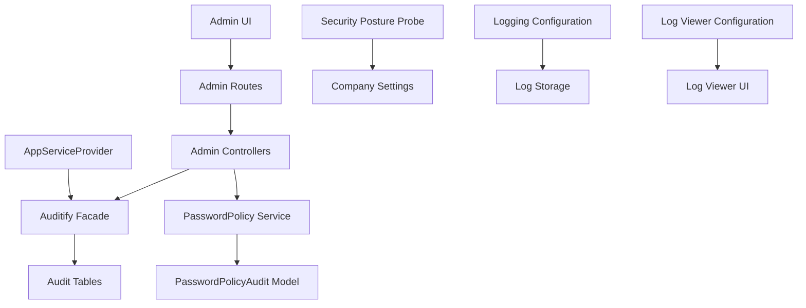
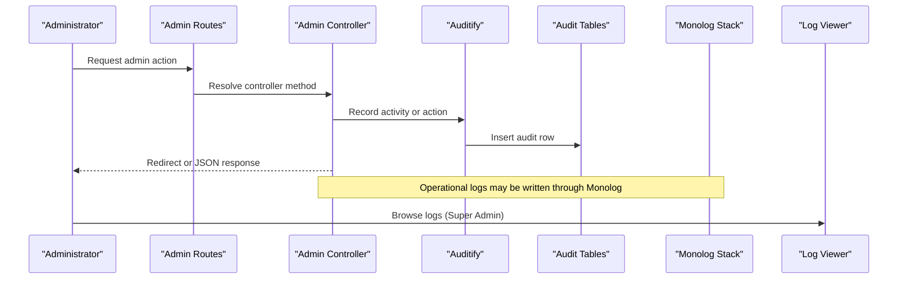
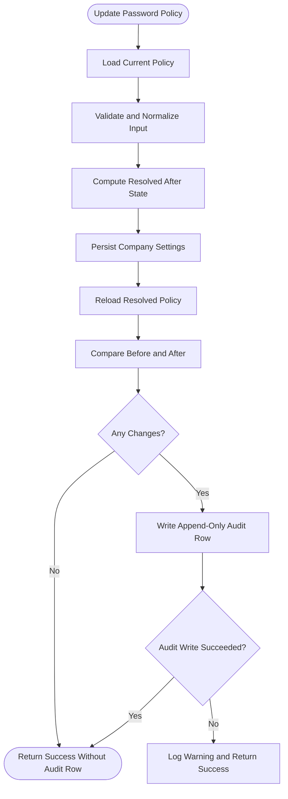
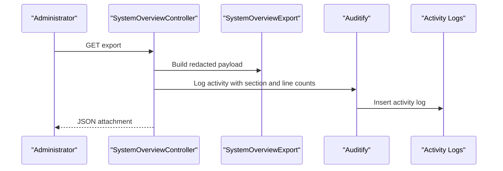
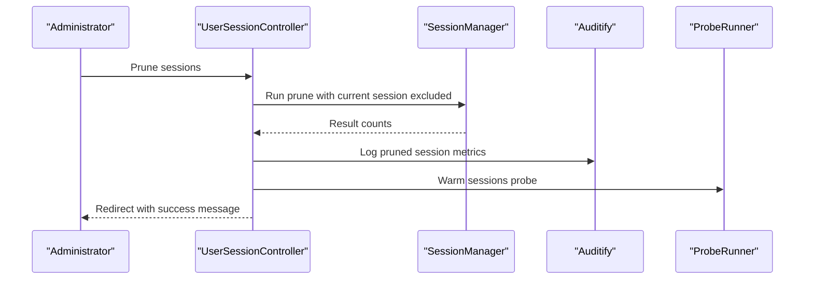
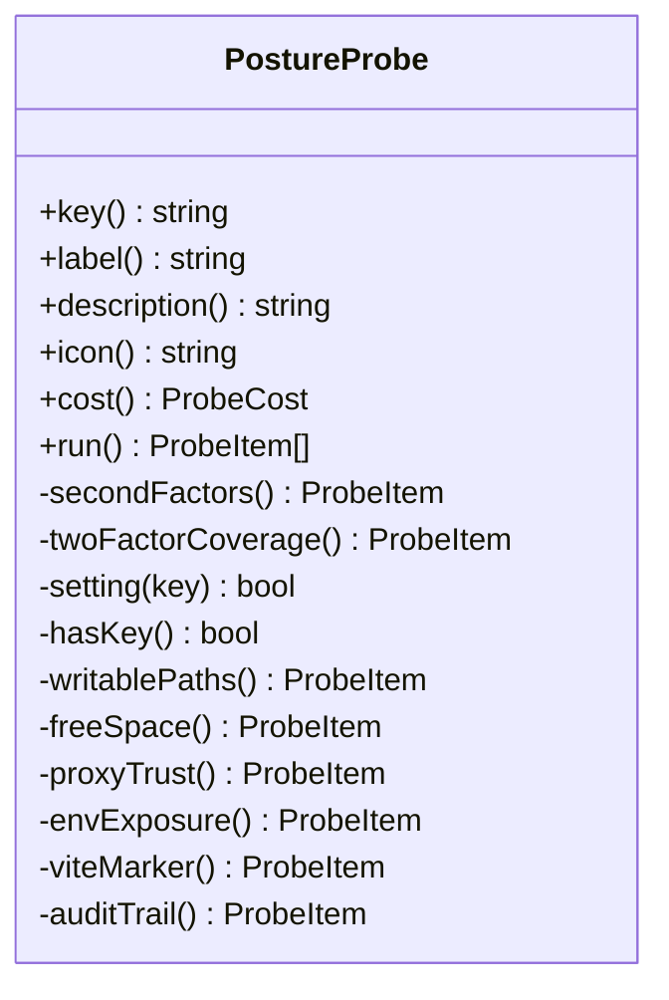
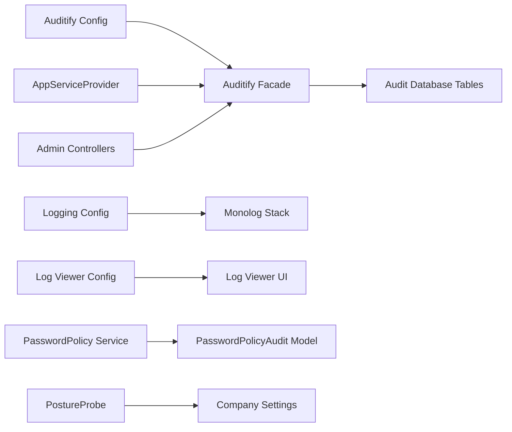

# Security Monitoring & Audit

<cite>
**Referenced Files in This Document**   
- [auditify.php](file://config/auditify.php)
- [logging.php](file://config/logging.php)
- [log-viewer.php](file://config/log-viewer.php)
- [AppServiceProvider.php](file://app/Providers/AppServiceProvider.php)
- [PasswordPolicyAudit.php](file://app/Models/PasswordPolicyAudit.php)
- [PasswordPolicy.php](file://app/Services/PasswordPolicy.php)
- [PasswordPolicyController.php](file://app/Http/Controllers/Admin/PasswordPolicyController.php)
- [UserSessionController.php](file://app/Http/Controllers/Admin/UserSessionController.php)
- [SystemOverviewController.php](file://app/Http/Controllers/Admin/SystemOverviewController.php)
- [PostureProbe.php](file://app/Support/SystemOverview/Probes/PostureProbe.php)
- [2026_01_01_000000_create_audit_action_logs_table.php](file://database/migrations/2026_01_01_000000_create_audit_action_logs_table.php)
- [2026_01_01_000001_create_audit_activity_logs_table.php](file://database/migrations/2026_01_01_000001_create_audit_activity_logs_table.php)
- [2026_01_01_000002_create_audit_security_logs_table.php](file://database/migrations/2026_01_01_000002_create_audit_security_logs_table.php)
- [2026_10_20_000000_create_password_policy_audits_table.php](file://database/migrations/2026_10_20_000000_create_password_policy_audits_table.php)
- [admin.php](file://routes/admin.php)
</cite>

## Table of Contents
1. [Introduction](#introduction)
2. [Project Structure](#project-structure)
3. [Core Components](#core-components)
4. [Architecture Overview](#architecture-overview)
5. [Detailed Component Analysis](#detailed-component-analysis)
6. [Dependency Analysis](#dependency-analysis)
7. [Performance Considerations](#performance-considerations)
8. [Troubleshooting Guide](#troubleshooting-guide)
9. [Conclusion](#conclusion)
10. [Appendices](#appendices)

## Introduction
This document explains the security monitoring and audit capabilities of the Himblossom application. It focuses on:

- The Auditify-based audit system, including configuration, database tables, and access control.
- Security event tracking through action logs, activity logs, and security logs.
- User activity auditing for administrative operations such as exporting system data and pruning sessions.
- System change tracking through a dedicated password policy audit trail.
- Security posture inspection via the system overview probes.
- Log aggregation through Laravel’s logging stack and the log viewer.
- Privacy considerations for sensitive fields in audit records.
- Practical guidance for dashboards, alerting, incident response, compliance reporting, and automated threat detection.

The goal is to make these mechanisms understandable for operators, auditors, and developers while preserving enough technical detail for secure implementation.

## Project Structure
Security-related code and configuration are distributed across configuration files, service providers, controllers, models, migrations, and probes:

- Configuration defines Auditify behavior, logging channels, and log viewer access.
- The application service provider registers Auditify authorization and integrates with other security controls.
- Controllers record selected administrative actions using Auditify.
- A password policy service provides an append-only audit model for configuration changes.
- Migrations create structured audit tables for actions, activities, and security events.
- The system overview includes a security posture probe that evaluates hardening settings and references audit trails.

**Diagram sources**
- [AppServiceProvider.php:70-90](file://app/Providers/AppServiceProvider.php#L70-L90)
- [SystemOverviewController.php:55-78](file://app/Http/Controllers/Admin/SystemOverviewController.php#L55-L78)
- [UserSessionController.php:76-100](file://app/Http/Controllers/Admin/UserSessionController.php#L76-L100)
- [PasswordPolicy.php:200-322](file://app/Services/PasswordPolicy.php#L200-L322)
- [PasswordPolicyAudit.php:1-42](file://app/Models/PasswordPolicyAudit.php#L1-L42)
- [auditify.php:1-81](file://config/auditify.php#L1-L81)
- [logging.php:1-132](file://config/logging.php#L1-L132)
- [log-viewer.php:1-120](file://config/log-viewer.php#L1-L120)

**Section sources**
- [auditify.php:1-81](file://config/auditify.php#L1-L81)
- [logging.php:1-132](file://config/logging.php#L1-L132)
- [log-viewer.php:1-120](file://config/log-viewer.php#L1-L120)
- [AppServiceProvider.php:1-110](file://app/Providers/AppServiceProvider.php#L1-L110)

## Core Components
The audit and security monitoring system consists of several coordinated components:

### Auditify Configuration
Auditify is configured through a dedicated configuration file. Key behaviors include:

- Route prefix under which Auditify routes are served.
- Dark theme and web middleware.
- Pagination size for audit listings.
- Tracking options for IP address, user agent, and URL.
- Optional authorization gate for viewing Auditify.
- Authentication event tracking.
- User attribute mappings for email, username, and phone.
- Page visit tracking.
- Alerts with recipients, channels, sensitive modules, and thresholds for failed logins, mass deletes, and bulk updates.
- XSS protection with block mode and optional route exclusions.
- Automatic model auditing toggle.
- Security alert polling interval.
- Excluded models from global auditing.
- Pruning retention window.

These settings define what is captured, how it is protected, and how alerts are routed.

**Section sources**
- [auditify.php:1-81](file://config/auditify.php#L1-L81)

### Database Schema for Auditing
Three primary Auditify tables store different kinds of audit information:

| Table | Purpose | Important Fields |
|---|---|---|
| `audit_action_logs` | Records model-level actions such as create, update, or delete | `user`, `subject`, `action`, `module`, `description`, `old_values`, `new_values`, `ip_address`, `url`, `user_agent`, timestamps |
| `audit_activity_logs` | Records broader application activity | `user`, `activity`, `properties`, `url`, `ip_address`, `user_agent`, timestamps |
| `audit_security_logs` | Tracks security-focused events with status and resolution | `user`, `severity`, `title`, `description`, `is_read`, `status`, `resolved_at`, `resolution_notes`, `method`, `route_name`, `payload`, `ip_address`, `user_agent`, timestamps |

These tables provide structured storage for operational, behavioral, and security-oriented audit data.

**Section sources**
- [2026_01_01_000000_create_audit_action_logs_table.php:8-27](file://database/migrations/2026_01_01_000000_create_audit_action_logs_table.php#L8-L27)
- [2026_01_01_000001_create_audit_activity_logs_table.php:8-24](file://database/migrations/2026_01_01_000001_create_audit_activity_logs_table.php#L8-L24)
- [2026_01_01_000002_create_audit_security_logs_table.php:8-32](file://database/migrations/2026_01_01_000002_create_audit_security_logs_table.php#L8-L32)

### Application Service Provider Integration
The application service provider configures Auditify authorization so that only authorized users can view audit interfaces. It uses a role check against Super Admin. This aligns Auditify access with the application’s existing permission model.

The provider also protects the log viewer with a similar Super Admin gate and enforces production-safe defaults such as disabling destructive database commands outside development.

**Section sources**
- [AppServiceProvider.php:43-90](file://app/Providers/AppServiceProvider.php#L43-L90)

### Password Policy Audit Trail
The password policy feature has its own audit model and service:

- `PasswordPolicyAudit` stores who changed the policy, the exact field changes, and the originating IP.
- The table is append-only; rows are not updated or deleted by normal application logic.
- The service computes before-and-after policy states, clamps values to safe bounds, writes company settings, and records only actual differences.
- Reading the audit trail is defensive: if the table is missing or unreadable, it returns an empty list rather than failing the page.
- Writing the audit trail is isolated from the main save operation; failures are logged without rolling back the policy change.

This design ensures that security-sensitive configuration changes remain observable even when secondary systems fail.

**Section sources**
- [PasswordPolicyAudit.php:1-42](file://app/Models/PasswordPolicyAudit.php#L1-L42)
- [PasswordPolicy.php:200-322](file://app/Services/PasswordPolicy.php#L200-L322)
- [2026_10_20_000000_create_password_policy_audits_table.php:8-28](file://database/migrations/2026_10_20_000000_create_password_policy_audits_table.php#L8-L28)

### Administrative Action Auditing
Administrative controllers explicitly record important operations through Auditify:

- Exporting the system overview records the number of sections, lines, withheld lines, and pending sections.
- Pruning user sessions records counts for deleted, closed, expired, orphaned, idle, and purged sessions.

These logs tie operator actions to concrete outcomes, supporting accountability and troubleshooting.

**Section sources**
- [SystemOverviewController.php:55-78](file://app/Http/Controllers/Admin/SystemOverviewController.php#L55-L78)
- [UserSessionController.php:76-100](file://app/Http/Controllers/Admin/UserSessionController.php#L76-L100)

### Security Posture Inspection
The security posture probe evaluates configuration and exposure factors relevant to security monitoring:

- Debug mode status.
- Registration openness.
- Email verification requirements.
- Available sign-in hardening features.
- Two-factor coverage for privileged roles.
- Application key presence.
- Writable paths and free space.
- Proxy trust configuration.
- Environment exposure indicators.
- Vite marker presence.
- Audit trail availability.

The probe intentionally avoids per-user state because its results are cached globally, preventing one viewer from seeing another viewer’s personalized findings.

**Section sources**
- [PostureProbe.php:1-120](file://app/Support/SystemOverview/Probes/PostureProbe.php#L1-L120)

## Architecture Overview
The security monitoring architecture combines structured audit tables, request-scoped logging, configuration-driven alerts, and administrative controls.

**Diagram sources**
- [AppServiceProvider.php:70-90](file://app/Providers/AppServiceProvider.php#L70-L90)
- [SystemOverviewController.php:55-78](file://app/Http/Controllers/Admin/SystemOverviewController.php#L55-L78)
- [UserSessionController.php:76-100](file://app/Http/Controllers/Admin/UserSessionController.php#L76-L100)
- [logging.php:25-120](file://config/logging.php#L25-L120)
- [log-viewer.php:1-120](file://config/log-viewer.php#L1-L120)

## Detailed Component Analysis

### Auditify Configuration and Access Control
Auditify is enabled with IP, user agent, and URL tracking. Authentication event tracking is turned on, and page visits can be recorded. Alerts are enabled with configurable recipients, mail and log channels, sensitive module names, and thresholds for suspicious patterns such as repeated failed logins and bulk operations. XSS protection is enabled with block mode.

Access to Auditify is controlled by the application service provider through a Super Admin role check. The configuration also exposes an optional gate named after the package.

**Section sources**
- [auditify.php:1-81](file://config/auditify.php#L1-L81)
- [AppServiceProvider.php:70-90](file://app/Providers/AppServiceProvider.php#L70-L90)

### Audit Data Models and Storage
The audit schema separates concerns:

- Action logs capture entity mutations with old and new values.
- Activity logs capture high-level user or system activities.
- Security logs add severity, status, resolution state, HTTP context, and payload data.

This separation supports different analytical workflows:

- Compliance reviewers can examine action logs for data changes.
- Operators can review activity logs for administrative workflows.
- Security responders can triage security logs by severity and status.

**Section sources**
- [2026_01_01_000000_create_audit_action_logs_table.php:8-27](file://database/migrations/2026_01_01_000000_create_audit_action_logs_table.php#L8-L27)
- [2026_01_01_000001_create_audit_activity_logs_table.php:8-24](file://database/migrations/2026_01_01_000001_create_audit_activity_logs_table.php#L8-L24)
- [2026_01_01_000002_create_audit_security_logs_table.php:8-32](file://database/migrations/2026_01_01_000002_create_audit_security_logs_table.php#L8-L32)

### Password Policy Audit Flow
The password policy audit flow ensures that every meaningful configuration change is preserved as an immutable record.

**Diagram sources**
- [PasswordPolicy.php:200-322](file://app/Services/PasswordPolicy.php#L200-L322)
- [PasswordPolicyAudit.php:1-42](file://app/Models/PasswordPolicyAudit.php#L1-L42)
- [2026_10_20_000000_create_password_policy_audits_table.php:8-28](file://database/migrations/2026_10_20_000000_create_password_policy_audits_table.php#L8-L28)

Key properties:

- The service clamps minimum and maximum lengths to safe bounds.
- Boolean settings are normalized to prevent accidental inversion.
- Only actual differences are recorded.
- Audit write failures do not undo the policy update.
- The audit trail query handles missing tables and database errors gracefully.

**Section sources**
- [PasswordPolicy.php:200-322](file://app/Services/PasswordPolicy.php#L200-L322)
- [PasswordPolicyController.php:1-44](file://app/Http/Controllers/Admin/PasswordPolicyController.php#L1-L44)
- [2026_10_20_000000_create_password_policy_audits_table.php:8-28](file://database/migrations/2026_10_20_000000_create_password_policy_audits_table.php#L8-L28)

### System Overview Export Audit
Exporting the system overview generates a redacted JSON payload and records who exported it. The audit is written before the response is returned, ensuring that successful exports are always accompanied by an audit entry.

**Diagram sources**
- [SystemOverviewController.php:55-78](file://app/Http/Controllers/Admin/SystemOverviewController.php#L55-L78)

**Section sources**
- [SystemOverviewController.php:20-78](file://app/Http/Controllers/Admin/SystemOverviewController.php#L20-L78)

### Session Pruning Audit
Pruning sessions is exposed through an administrative endpoint and records detailed counts. After pruning, the session card cache is warmed so the dashboard reflects the latest state.

**Diagram sources**
- [UserSessionController.php:76-100](file://app/Http/Controllers/Admin/UserSessionController.php#L76-L100)

**Section sources**
- [UserSessionController.php:1-126](file://app/Http/Controllers/Admin/UserSessionController.php#L1-L126)

### Security Posture Probe
The security posture probe produces a set of flagged items describing the installation’s security posture. It checks authentication hardening, privileged account coverage, encryption key presence, writable paths, proxy trust, environment exposure, and audit trail readiness.

**Diagram sources**
- [PostureProbe.php:1-120](file://app/Support/SystemOverview/Probes/PostureProbe.php#L1-L120)

**Section sources**
- [PostureProbe.php:1-120](file://app/Support/SystemOverview/Probes/PostureProbe.php#L1-L120)

## Dependency Analysis
Security monitoring depends on several layers:

- Auditify provides structured audit recording and optional alerting.
- Laravel’s logging stack forwards operational logs to configured handlers.
- The log viewer presents log files through an authenticated interface.
- Controllers depend on Auditify for administrative action tracking.
- The password policy service depends on company settings and its own audit model.
- The system overview controller depends on audit recording and the export component.
- The posture probe reads configuration and runtime state without depending on the requesting user.

**Diagram sources**
- [auditify.php:1-81](file://config/auditify.php#L1-L81)
- [AppServiceProvider.php:43-90](file://app/Providers/AppServiceProvider.php#L43-L90)
- [SystemOverviewController.php:55-78](file://app/Http/Controllers/Admin/SystemOverviewController.php#L55-L78)
- [UserSessionController.php:76-100](file://app/Http/Controllers/Admin/UserSessionController.php#L76-L100)
- [PasswordPolicy.php:200-322](file://app/Services/PasswordPolicy.php#L200-L322)
- [PostureProbe.php:1-120](file://app/Support/SystemOverview/Probes/PostureProbe.php#L1-L120)
- [logging.php:25-120](file://config/logging.php#L25-L120)
- [log-viewer.php:1-120](file://config/log-viewer.php#L1-L120)

**Section sources**
- [auditify.php:1-81](file://config/auditify.php#L1-L81)
- [logging.php:25-120](file://config/logging.php#L25-L120)
- [log-viewer.php:1-120](file://config/log-viewer.php#L1-L120)
- [AppServiceProvider.php:43-90](file://app/Providers/AppServiceProvider.php#L43-L90)

## Performance Considerations
Several aspects affect performance and operational cost:

- Auditify’s automatic model auditing can generate many rows if enabled broadly. Use exclusion lists to avoid auditing high-volume entities such as sessions or temporary caches.
- XSS scanning adds request processing time. Exclude known rich-text routes where dynamic content must pass through unchanged.
- Security alert polling is disabled by default through the polling interval setting. Enable it only when needed and use a reasonable interval.
- Pruning sessions warms the related probe cache to keep dashboard metrics consistent.
- The log viewer loads log files into memory; large log directories can increase load. Rotate logs and restrict included paths.
- Audit table growth should be managed through retention policies. Auditify includes a pruning configuration, but external log rotation and database archiving may also be necessary.

[No sources needed since this section provides general guidance]

## Troubleshooting Guide

### Audit Interfaces Are Not Accessible
Check whether the Auditify authorization callback grants access to the requesting user. In this application, Super Admin is required. Also verify that the Auditify route prefix exists and that the web middleware group is applied.

**Section sources**
- [AppServiceProvider.php:70-90](file://app/Providers/AppServiceProvider.php#L70-L90)
- [auditify.php:5-15](file://config/auditify.php#L5-L15)

### Audit Rows Are Missing
Confirm that the Auditify migrations have been applied. Verify that the application can write to the audit tables. If automatic model auditing is enabled, ensure the affected model is not listed in the exclusion list.

**Section sources**
- [2026_01_01_000000_create_audit_action_logs_table.php:8-27](file://database/migrations/2026_01_01_000000_create_audit_action_logs_table.php#L8-L27)
- [2026_01_01_000001_create_audit_activity_logs_table.php:8-24](file://database/migrations/2026_01_01_000001_create_audit_activity_logs_table.php#L8-L24)
- [2026_01_01_000002_create_audit_security_logs_table.php:8-32](file://database/migrations/2026_01_01_000002_create_audit_security_logs_table.php#L8-L32)
- [auditify.php:63-73](file://config/auditify.php#L63-L73)

### Password Policy Audit Trail Is Empty
If the table does not exist yet, the audit trail reader returns an empty array. If the database connection fails, it logs a warning and returns an empty trail. When no actual policy values changed, no audit row is created.

**Section sources**
- [PasswordPolicy.php:234-294](file://app/Services/PasswordPolicy.php#L234-L294)
- [2026_10_20_000000_create_password_policy_audits_table.php:8-28](file://database/migrations/2026_10_20_000000_create_password_policy_audits_table.php#L8-L28)

### Log Viewer Is Not Visible
The log viewer is guarded by a Super Admin gate in the application service provider. Its route path is under the admin area, and it requires authentication in production. Ensure the environment allows the viewer and that the requesting user has sufficient privileges.

**Section sources**
- [AppServiceProvider.php:43-60](file://app/Providers/AppServiceProvider.php#L43-L60)
- [log-viewer.php:1-80](file://config/log-viewer.php#L1-L80)

### Audit Alerts Are Not Sent
Auditify alerts can be sent through mail and log channels. Verify recipients, channels, and the alert threshold configuration. Check application mail configuration and log output for delivery failures.

**Section sources**
- [auditify.php:31-53](file://config/auditify.php#L31-L53)

### Export or Prune Actions Are Not Logged
Ensure the controller calls Auditify before returning the response. For exports, the audit entry must precede the response. For session pruning, verify that the result object contains expected keys and that the audit call receives them.

**Section sources**
- [SystemOverviewController.php:55-78](file://app/Http/Controllers/Admin/SystemOverviewController.php#L55-L78)
- [UserSessionController.php:76-100](file://app/Http/Controllers/Admin/UserSessionController.php#L76-L100)

## Conclusion
Himblossom’s security monitoring combines structured audit tables, explicit administrative auditing, a dedicated password policy audit trail, and a security posture probe. Auditify provides the foundation for capturing actions, activities, and security events, while the application layer decides which operations require visibility. Logging infrastructure supports operational diagnostics, and the log viewer offers controlled access for administrators.

For a mature security program, extend this foundation with centralized log aggregation, SIEM integration, alert routing, retention policies, and regular compliance reviews. The existing design already isolates critical audit data, limits exposure through role-based access, and treats audit failures as non-fatal side effects.

[No sources needed since this section summarizes without analyzing specific files]

## Appendices

### Security Dashboard Implementation Guidance
A security dashboard can combine:

- Unread security log counts.
- Recent failed login trends.
- Mass deletion or bulk update spikes.
- Privileged account two-factor coverage.
- Audit trail availability and age.
- Writable-path warnings.
- Pending security incidents.

Data sources include:

- `audit_security_logs` for security events.
- `audit_activity_logs` for administrative actions.
- `audit_action_logs` for model mutations.
- `password_policy_audits` for configuration history.
- The security posture probe for configuration health.

[No sources needed since this section provides general guidance]

### Log Aggregation Strategies
Recommended strategies:

- Ship application logs to a central collector using stdout/stderr or a remote handler.
- Keep local daily logs for short-term debugging.
- Separate error, warning, and info streams according to alert sensitivity.
- Include correlation identifiers for requests when feasible.
- Avoid storing secrets in logs; sanitize payloads before sending them off-host.
- Use the log viewer only for internal administration and protect it behind strong access controls.

**Section sources**
- [logging.php:25-120](file://config/logging.php#L25-L120)
- [log-viewer.php:1-120](file://config/log-viewer.php#L1-L120)

### Alerting Mechanisms
Use Auditify alerts for built-in thresholds, and integrate with external alerting for operational needs:

- Configure mail and log channels for Auditify alerts.
- Forward critical application logs to a monitoring platform.
- Create rules for failed login bursts, unexpected privilege escalation, and large data changes.
- Correlate audit entries with network and host logs.
- Route alerts by severity and module.

**Section sources**
- [auditify.php:31-53](file://config/auditify.php#L31-L53)
- [logging.php:70-120](file://config/logging.php#L70-L120)

### Incident Response Procedures
Suggested steps:

1. Identify the incident from security logs or alerts.
2. Preserve the relevant audit rows and log snapshots.
3. Determine scope by correlating user, IP, route, and timestamp.
4. Revoke compromised sessions through administrative controls.
5. Review password policy and company settings changes.
6. Assess whether data was modified through action logs.
7. Update security log status and add resolution notes.
8. Apply compensating controls and document lessons learned.

**Section sources**
- [UserSessionController.php:76-100](file://app/Http/Controllers/Admin/UserSessionController.php#L76-L100)
- [2026_01_01_000002_create_audit_security_logs_table.php:8-32](file://database/migrations/2026_01_01_000002_create_audit_security_logs_table.php#L8-L32)
- [2026_01_01_000000_create_audit_action_logs_table.php:8-27](file://database/migrations/2026_01_01_000000_create_audit_action_logs_table.php#L8-L27)

### Automated Threat Detection
Automated detection can build on:

- Threshold-based rules for failed logins, mass deletions, and bulk updates.
- Anomaly detection for unusual route access patterns.
- Correlation between login attempts and privilege escalation.
- Scheduled jobs that summarize unresolved security logs.
- Health checks that flag missing audit tables or disabled protections.

[No sources needed since this section provides general guidance]

### Privacy and Secure Storage
Privacy-sensitive practices:

- Do not log passwords, tokens, or full credit-card data.
- Redact sensitive fields before writing to logs or audit payloads.
- Restrict audit and log viewer access to trusted administrators.
- Encrypt audit databases at rest where supported.
- Limit retention periods and archive older records securely.
- Treat IP addresses and user agents as personal data under applicable regulations.
- Minimize audit payloads to what is necessary for investigation.

**Section sources**
- [auditify.php:17-29](file://config/auditify.php#L17-L29)
- [auditify.php:55-81](file://config/auditify.php#L55-L81)
- [PasswordPolicyAudit.php:1-42](file://app/Models/PasswordPolicyAudit.php#L1-L42)

### Compliance Reporting
Compliance reports can combine:

- Password policy change history.
- Administrative action summaries.
- Security incident lifecycle data.
- Privileged account coverage metrics.
- Audit retention and pruning status.
- Configuration hardening results from the posture probe.

Sources include:

- `password_policy_audits`.
- `audit_activity_logs`.
- `audit_security_logs`.
- `audit_action_logs`.
- Security posture probe outputs.

**Section sources**
- [PasswordPolicy.php:234-294](file://app/Services/PasswordPolicy.php#L234-L294)
- [2026_10_20_000000_create_password_policy_audits_table.php:8-28](file://database/migrations/2026_10_20_000000_create_password_policy_audits_table.php#L8-L28)
- [PostureProbe.php:1-120](file://app/Support/SystemOverview/Probes/PostureProbe.php#L1-L120)