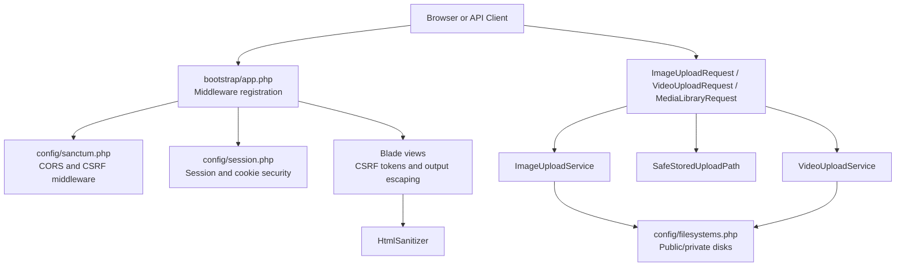
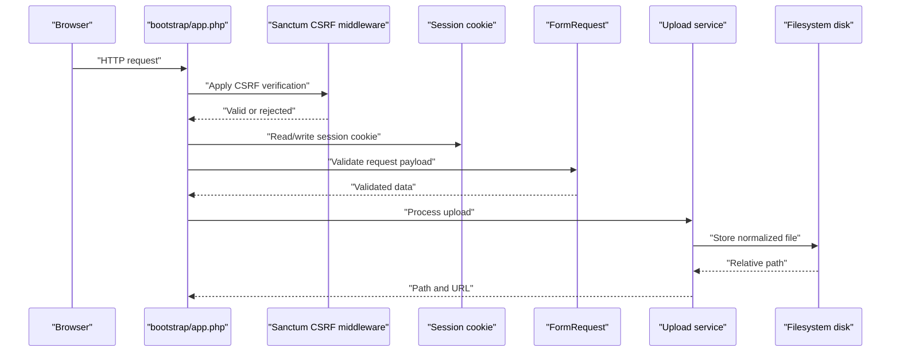
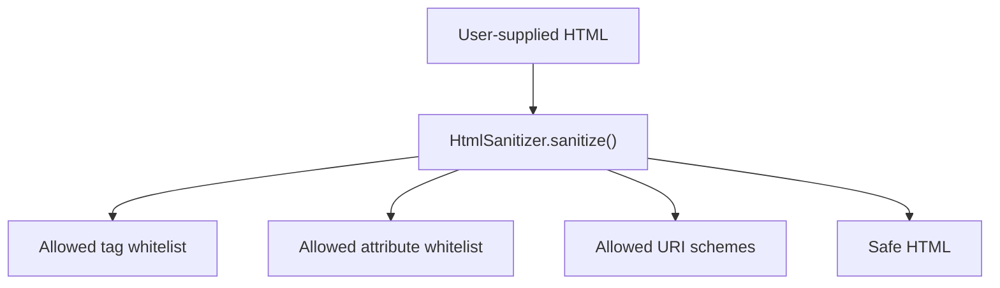
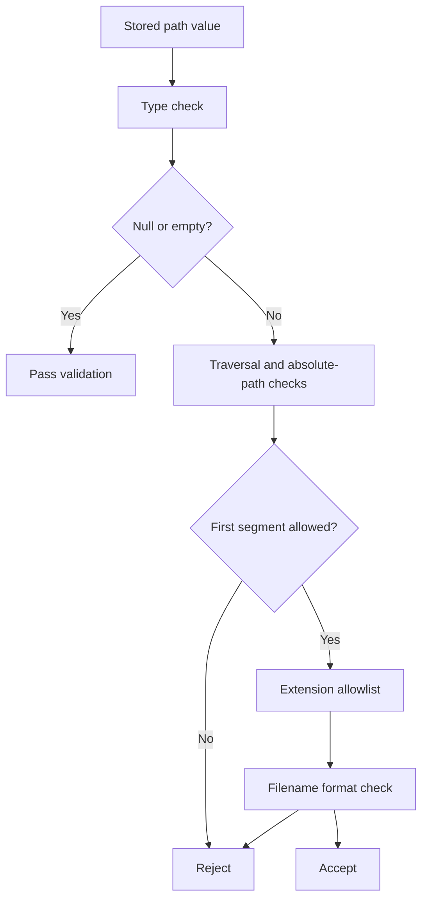
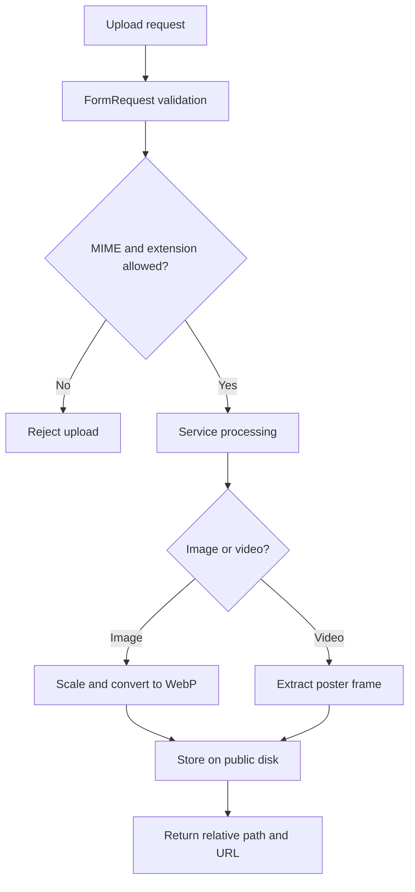
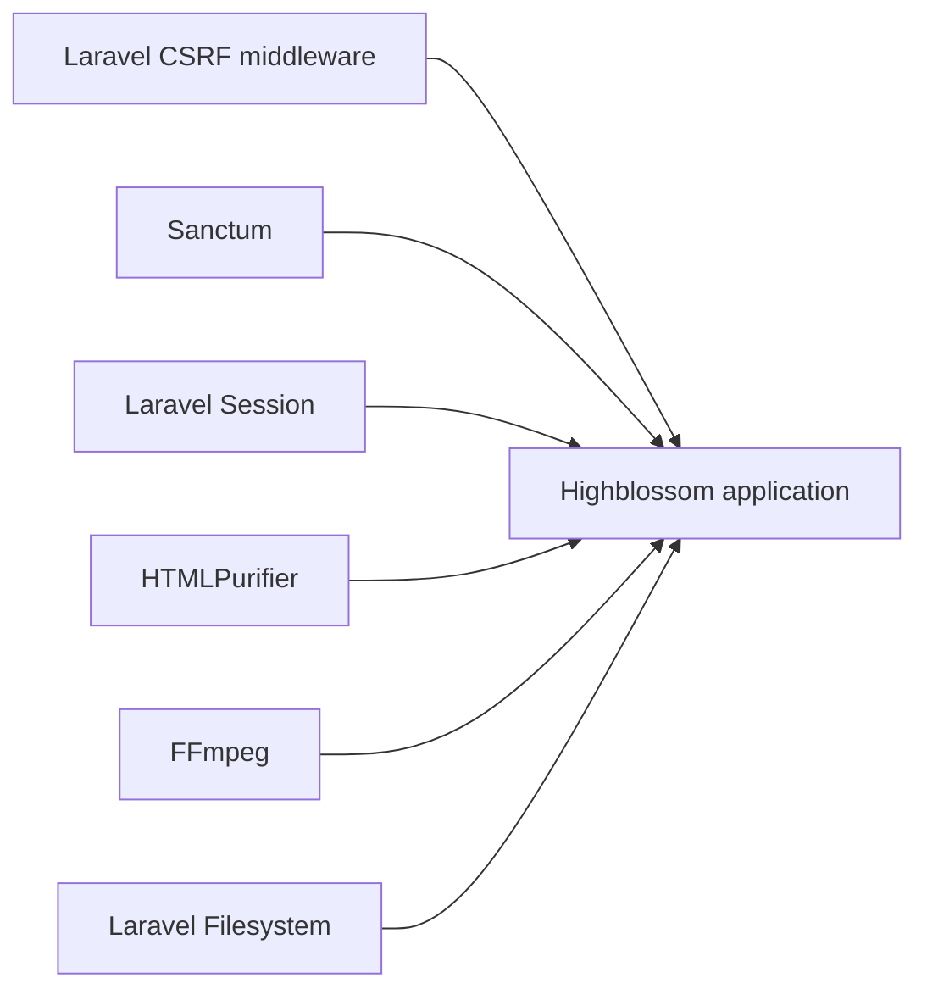

# Web Vulnerability Mitigation

<cite>
**Referenced Files in This Document**
- [bootstrap/app.php](file://bootstrap/app.php)
- [config/sanctum.php](file://config/sanctum.php)
- [config/session.php](file://config/session.php)
- [config/filesystems.php](file://config/filesystems.php)
- [packages/ContentBlocks/src/Services/HtmlSanitizer.php](file://packages/ContentBlocks/src/Services/HtmlSanitizer.php)
- [packages/ContentBlocks/config/content-blocks.php](file://packages/ContentBlocks/config/content-blocks.php)
- [app/Rules/SafeStoredUploadPath.php](file://app/Rules/SafeStoredUploadPath.php)
- [app/Http/Requests/Admin/ImageUploadRequest.php](file://app/Http/Requests/Admin/ImageUploadRequest.php)
- [app/Http/Requests/Admin/VideoUploadRequest.php](file://app/Http/Requests/Admin/VideoUploadRequest.php)
- [app/Http/Requests/Admin/MediaLibraryRequest.php](file://app/Http/Requests/Admin/MediaLibraryRequest.php)
- [app/Services/ImageUploadService.php](file://app/Services/ImageUploadService.php)
- [app/Services/VideoUploadService.php](file://app/Services/VideoUploadService.php)
- [resources/views/site/contact.blade.php](file://resources/views/site/contact.blade.php)
- [resources/views/site/booking.blade.php](file://resources/views/site/booking.blade.php)
- [resources/views/site/quote.blade.php](file://resources/views/site/quote.blade.php)
- [resources/views/components/desktop-user-menu.blade.php](file://resources/views/components/desktop-user-menu.blade.php)
</cite>

## Table of Contents
1. [Introduction](#introduction)
2. [Project Structure](#project-structure)
3. [Core Components](#core-components)
4. [Architecture Overview](#architecture-overview)
5. [Detailed Component Analysis](#detailed-component-analysis)
6. [Dependency Analysis](#dependency-analysis)
7. [Performance Considerations](#performance-considerations)
8. [Troubleshooting Guide](#troubleshooting-guide)
9. [Conclusion](#conclusion)

## Introduction
This document explains how the Highblossom application mitigates common web vulnerabilities. It covers CSRF protection, XSS prevention through Blade auto-escaping and HTML sanitization, clickjacking and browser security headers, CORS configuration via Sanctum, SQL injection defenses through parameter binding, command injection and path traversal protections, and secure file upload handling including MIME validation, size limits, directory restrictions, and safe storage rules. It also maps these controls to OWASP Top 10 categories and identifies remaining defense-in-depth opportunities.

## Project Structure
Security-relevant code is distributed across:

- HTTP bootstrap and middleware wiring
- Session, cookie, and CSRF configuration
- API authentication and CORS configuration
- Request validation classes for uploads and content
- Filesystem disk configuration
- HTML sanitization service and its configuration
- Safe path validation rule
- Upload services that process images and videos
- Blade templates that include CSRF tokens and render user-provided content safely

**Diagram sources**
- [bootstrap/app.php:1-71](file://bootstrap/app.php#L1-L71)
- [config/sanctum.php:1-87](file://config/sanctum.php#L1-L87)
- [config/session.php:1-233](file://config/session.php#L1-L233)
- [config/filesystems.php:1-109](file://config/filesystems.php#L1-L109)
- [app/Http/Requests/Admin/ImageUploadRequest.php:1-54](file://app/Http/Requests/Admin/ImageUploadRequest.php#L1-L54)
- [app/Http/Requests/Admin/VideoUploadRequest.php:1-33](file://app/Http/Requests/Admin/VideoUploadRequest.php#L1-L33)
- [app/Http/Requests/Admin/MediaLibraryRequest.php:1-37](file://app/Http/Requests/Admin/MediaLibraryRequest.php#L1-L37)
- [app/Services/ImageUploadService.php:1-70](file://app/Services/ImageUploadService.php#L1-L70)
- [app/Services/VideoUploadService.php:1-105](file://app/Services/VideoUploadService.php#L1-L105)
- [packages/ContentBlocks/src/Services/HtmlSanitizer.php:1-124](file://packages/ContentBlocks/src/Services/HtmlSanitizer.php#L1-L124)
- [app/Rules/SafeStoredUploadPath.php:1-139](file://app/Rules/SafeStoredUploadPath.php#L1-L139)

**Section sources**
- [bootstrap/app.php:1-71](file://bootstrap/app.php#L1-L71)
- [config/sanctum.php:1-87](file://config/sanctum.php#L1-L87)
- [config/session.php:1-233](file://config/session.php#L1-L233)
- [config/filesystems.php:1-109](file://config/filesystems.php#L1-L109)

## Core Components
The primary security mechanisms are:

- CSRF protection using Laravel’s built-in token mechanism and Blade `@csrf` directives.
- XSS prevention through Blade’s default HTML auto-escaping and a dedicated HTML sanitizer for stored content.
- Clickjacking and browser hardening through recommended response headers.
- CORS control through Sanctum stateful domains and CSRF middleware integration.
- Input validation and authorization through FormRequest classes.
- Secure file upload handling with MIME type validation, size limits, allowed folder allowlists, normalized image formats, and safe path validation.
- Database safety through Laravel’s query builder and Eloquent parameter binding.
- Path traversal protection through strict path validation rules.

These components form layered defenses against OWASP Top 10 categories such as Broken Access Control, Cryptographic Failures, Injection, Insecure Design, Security Misconfiguration, Vulnerable and Outdated Components, Identification and Authentication Failures, Software and Data Integrity Failures, Security Logging and Monitoring Failures, and SSRF.

**Section sources**
- [bootstrap/app.php:1-71](file://bootstrap/app.php#L1-L71)
- [config/sanctum.php:1-87](file://config/sanctum.php#L1-L87)
- [config/session.php:180-233](file://config/session.php#L180-L233)
- [packages/ContentBlocks/src/Services/HtmlSanitizer.php:1-124](file://packages/ContentBlocks/src/Services/HtmlSanitizer.php#L1-L124)
- [app/Rules/SafeStoredUploadPath.php:1-139](file://app/Rules/SafeStoredUploadPath.php#L1-L139)
- [app/Http/Requests/Admin/ImageUploadRequest.php:1-54](file://app/Http/Requests/Admin/ImageUploadRequest.php#L1-L54)
- [app/Http/Requests/Admin/VideoUploadRequest.php:1-33](file://app/Http/Requests/Admin/VideoUploadRequest.php#L1-L33)
- [app/Http/Requests/Admin/MediaLibraryRequest.php:1-37](file://app/Http/Requests/Admin/MediaLibraryRequest.php#L1-L37)

## Architecture Overview
The request lifecycle applies security at multiple layers:

1. The client sends an HTTP request to the application entry point.
2. Middleware trusts reverse proxies and registers shared middleware groups.
3. For web routes, CSRF verification is enforced by Laravel’s default stack; Blade templates include CSRF tokens.
4. For first-party SPA requests, Sanctum configures stateful domains and includes CSRF validation in its middleware pipeline.
5. Session cookies use JSON serialization, HTTP-only flags, and SameSite policies to reduce session hijacking and CSRF risk.
6. User input is validated by FormRequest classes before reaching controllers.
7. Uploaded files are processed by dedicated services that normalize images, validate video types, and store files on configured disks.
8. Stored HTML content is sanitized through HTMLPurifier before rendering.
9. Paths used to reference uploaded files are validated against an allowlist and path-traversal checks.

**Diagram sources**
- [bootstrap/app.php:1-71](file://bootstrap/app.php#L1-L71)
- [config/sanctum.php:1-87](file://config/sanctum.php#L1-L87)
- [config/session.php:180-233](file://config/session.php#L180-L233)
- [app/Http/Requests/Admin/ImageUploadRequest.php:1-54](file://app/Http/Requests/Admin/ImageUploadRequest.php#L1-L54)
- [app/Services/ImageUploadService.php:1-70](file://app/Services/ImageUploadService.php#L1-L70)
- [config/filesystems.php:1-109](file://config/filesystems.php#L1-L109)

## Detailed Component Analysis

### CSRF Protection
Highblossom uses Laravel’s standard CSRF protection model:

- Blade forms include CSRF tokens through the `@csrf` directive.
- The application registers web routes under the `web` middleware group, which includes CSRF verification by default.
- Sanctum integrates Laravel’s `ValidateCsrfToken` middleware into its authentication pipeline, ensuring first-party SPA requests remain protected.
- Stateful domains are controlled through environment configuration, limiting cross-origin cookie behavior to trusted hosts.

Common patterns observed in the repository include:

- Site-facing forms such as contact, booking, quote, and feedback forms include CSRF tokens.
- Admin UI elements such as menus, modals, and bulk actions include CSRF tokens.

Recommended review points:

- Confirm every mutating endpoint expects a valid CSRF token.
- Ensure Sanctum stateful domains do not unintentionally broaden CORS scope.
- Avoid bypassing CSRF validation except for documented public APIs that use alternative authentication mechanisms.

**Section sources**
- [bootstrap/app.php:1-71](file://bootstrap/app.php#L1-L71)
- [config/sanctum.php:1-87](file://config/sanctum.php#L1-L87)
- [resources/views/site/contact.blade.php](file://resources/views/site/contact.blade.php)
- [resources/views/site/booking.blade.php](file://resources/views/site/booking.blade.php)
- [resources/views/site/quote.blade.php](file://resources/views/site/quote.blade.php)
- [resources/views/components/desktop-user-menu.blade.php](file://resources/views/components/desktop-user-menu.blade.php)

### XSS Prevention Through Blade Auto-Escaping and Content Sanitization
XSS mitigation is implemented in two complementary ways:

1. **Blade auto-escaping**: Blade automatically escapes variables when rendered, preventing unescaped user data from becoming executable JavaScript or HTML in normal view output.
2. **HTML sanitization for stored content**: The Content Blocks package provides an `HtmlSanitizer` service backed by HTMLPurifier. It enforces:
   - A whitelist of allowed tags.
   - A whitelist of allowed attributes.
   - Allowed URI schemes such as HTTP, HTTPS, and mailto.
   - A separate embed configuration that permits safe iframe attributes while stripping scripts and unsafe inline handlers.

The sanitizer configuration is centralized in the Content Blocks configuration file and can be tuned conservatively through environment variables.

Best practices:

- Prefer Blade auto-escaping for all dynamic output.
- Use the sanitizer only for explicitly intended rich HTML content.
- Keep allowed tags and attributes minimal.
- Restrict URI schemes and avoid `javascript:` URLs.
- Treat embed markup separately and constrain iframe permissions.

**Diagram sources**
- [packages/ContentBlocks/src/Services/HtmlSanitizer.php:1-124](file://packages/ContentBlocks/src/Services/HtmlSanitizer.php#L1-L124)
- [packages/ContentBlocks/config/content-blocks.php:1-140](file://packages/ContentBlocks/config/content-blocks.php#L1-L140)

**Section sources**
- [packages/ContentBlocks/src/Services/HtmlSanitizer.php:1-124](file://packages/ContentBlocks/src/Services/HtmlSanitizer.php#L1-L124)
- [packages/ContentBlocks/config/content-blocks.php:1-140](file://packages/ContentBlocks/config/content-blocks.php#L1-L140)

### Clickjacking and Browser Security Headers
Clickjacking protection is achieved by configuring browsers to restrict framing and enforce modern security behaviors. While this repository does not define a custom security header middleware in the analyzed files, the recommended approach for Highblossom is to add response headers globally, either through a framework middleware or reverse proxy.

Recommended headers:

- `X-Frame-Options: DENY` or `SAMEORIGIN`
- `Content-Security-Policy` with restrictive defaults for scripts, frames, forms, and base URIs
- `X-Content-Type-Options: nosniff`
- `Strict-Transport-Security` for HTTPS enforcement
- `Referrer-Policy` to limit referrer leakage
- `Permissions-Policy` to disable unnecessary browser features

Where applicable, CSP should:

- Set `default-src 'self'`.
- Restrict `script-src` to trusted origins.
- Restrict `frame-ancestors` to prevent embedding.
- Restrict `form-action` to same-origin where possible.
- Restrict `base-uri` and `object-src`.
- Use `sandbox` for embedded third-party iframes.

**Section sources**
- [bootstrap/app.php:1-71](file://bootstrap/app.php#L1-L71)

### CORS Configuration
CORS is handled primarily through Sanctum:

- Stateful domains are configured through an environment variable and expanded with the current application URL.
- Sanctum guards default to the `web` guard.
- Sanctum middleware includes `AuthenticateSession`, `EncryptCookies`, and `ValidateCsrfToken`.

Security implications:

- Stateful API access relies on cookies and CSRF tokens.
- Broadening stateful domains increases the attack surface for cross-site cookie exposure.
- Public APIs that do not use Sanctum cookies must implement their own origin checks and authentication strategy.

Recommendations:

- Limit stateful domains to known frontends.
- Avoid wildcard origins for authenticated endpoints.
- Separate public read-only APIs from state-changing APIs.
- Apply explicit CORS policies per route or controller where needed.

**Section sources**
- [config/sanctum.php:1-87](file://config/sanctum.php#L1-L87)

### Protection Against SQL Injection
SQL injection is mitigated by using Laravel’s database layer:

- Eloquent models and the query builder use parameter binding rather than string concatenation.
- Raw queries should be avoided unless necessary, and when used, they must bind parameters instead of interpolating user input.
- Database credentials are loaded from environment configuration.

Defense-in-depth recommendations:

- Prefer Eloquent over raw SQL.
- Validate and sanitize identifiers before use.
- Apply least-privilege database accounts.
- Monitor slow-query logs and audit logs for suspicious patterns.

[No sources needed since this section provides general guidance based on established framework behavior referenced elsewhere]

### Protection Against Command Injection
Command injection is relevant because the video upload pipeline invokes FFmpeg to extract poster frames. The service:

- Accepts only a whitelist of video extensions.
- Uses FFmpeg through a library wrapper.
- Writes temporary thumbnails to a temporary directory and deletes them after processing.

Risks:

- External command execution depends on installed system tools.
- Malformed or malicious media may cause FFmpeg errors.
- Temporary files must be isolated and cleaned up.

Mitigations:

- Keep extension validation strict.
- Run FFmpeg in a restricted environment.
- Limit resource usage and timeouts.
- Store generated assets through the filesystem abstraction.
- Monitor FFmpeg failures and log without exposing sensitive paths.

**Section sources**
- [app/Services/VideoUploadService.php:1-105](file://app/Services/VideoUploadService.php#L1-L105)

### Protection Against Path Traversal
Path traversal protection is implemented through a dedicated validation rule:

- Rejects null values, empty strings, non-string values, absolute paths, drive prefixes, null bytes, backslashes, dot segments, and empty segments.
- Requires a minimum number of path segments.
- Enforces an allowlist of permitted top-level directories.
- Restricts accepted image extensions.
- Validates filenames against a safe character pattern.

This rule is used for media library references to ensure only application-managed paths are accepted.

**Diagram sources**
- [app/Rules/SafeStoredUploadPath.php:1-139](file://app/Rules/SafeStoredUploadPath.php#L1-L139)

**Section sources**
- [app/Rules/SafeStoredUploadPath.php:1-139](file://app/Rules/SafeStoredUploadPath.php#L1-L139)
- [app/Http/Requests/Admin/MediaLibraryRequest.php:1-37](file://app/Http/Requests/Admin/MediaLibraryRequest.php#L1-L37)

### File Upload Security
File uploads are handled through request validation and dedicated services.

#### Image Uploads
- The image upload request validates that the field is an image and restricts MIME types to JPEG, PNG, JPG, WebP, and GIF.
- Maximum file size is limited to 2 MB.
- Destination folders are restricted to an allowlist.
- The image upload service scales images to a maximum long edge, converts them to WebP, and stores them on the public disk.
- If image processing fails, the service logs the error and falls back to storing the raw file, preserving availability while reducing normalization guarantees.

#### Video Uploads
- The video upload request restricts MIME types to MP4, WebM, MOV, and AVI.
- Maximum file size is limited to 30 MB.
- The video upload service validates the extension, generates a filename, extracts a poster frame with FFmpeg, stores the video, and writes the thumbnail separately.

#### Storage Configuration
- Public and private disks are configured through the filesystem configuration.
- The local public disk serves files through a symlink.
- The S3 disk supports object storage deployment.
- A temporary disk exists for transient operations.

Important limitations:

- No antivirus scanning is implemented in the analyzed upload services.
- MIME validation is performed through PHP validators and service-level extension checks.
- Image normalization reduces some risks but does not replace virus scanning.
- Fallback-to-raw-image behavior should be reviewed carefully in high-security environments.

**Diagram sources**
- [app/Http/Requests/Admin/ImageUploadRequest.php:1-54](file://app/Http/Requests/Admin/ImageUploadRequest.php#L1-L54)
- [app/Http/Requests/Admin/VideoUploadRequest.php:1-33](file://app/Http/Requests/Admin/VideoUploadRequest.php#L1-L33)
- [app/Services/ImageUploadService.php:1-70](file://app/Services/ImageUploadService.php#L1-L70)
- [app/Services/VideoUploadService.php:1-105](file://app/Services/VideoUploadService.php#L1-L105)
- [config/filesystems.php:1-109](file://config/filesystems.php#L1-L109)

**Section sources**
- [app/Http/Requests/Admin/ImageUploadRequest.php:1-54](file://app/Http/Requests/Admin/ImageUploadRequest.php#L1-L54)
- [app/Http/Requests/Admin/VideoUploadRequest.php:1-33](file://app/Http/Requests/Admin/VideoUploadRequest.php#L1-L33)
- [app/Http/Requests/Admin/MediaLibraryRequest.php:1-37](file://app/Http/Requests/Admin/MediaLibraryRequest.php#L1-L37)
- [app/Services/ImageUploadService.php:1-70](file://app/Services/ImageUploadService.php#L1-L70)
- [app/Services/VideoUploadService.php:1-105](file://app/Services/VideoUploadService.php#L1-L105)
- [config/filesystems.php:1-109](file://config/filesystems.php#L1-L109)

### Session and Cookie Security
Session configuration provides important baseline protections:

- Session driver defaults to database storage.
- Sessions use JSON serialization to avoid PHP object serialization attacks.
- Session lifetime and expiration settings are configurable.
- Cookies can be marked secure, HTTP-only, and SameSite lax by default.
- Partitioned cookies are supported for cross-site contexts.

These settings reduce session fixation, session hijacking, and CSRF risks when combined with CSRF tokens.

**Section sources**
- [config/session.php:1-233](file://config/session.php#L1-L233)

### Defense-in-Depth Mapping to OWASP Top 10

| OWASP Area | Implemented Controls | Notes |
|---|---|---|
| A01 Broken Access Control | Role and permission middleware aliases; request authorization methods; route grouping | Authorization details depend on additional providers and routes not fully analyzed here. |
| A02 Cryptographic Failures | Encrypted cookies via Sanctum middleware; JSON session serialization | Ensure strong application key and HTTPS. |
| A03 Injection | Parameter binding through Laravel ORM; strict MIME and extension validation; path traversal validation | Avoid raw SQL and external command injection risks. |
| A04 Insecure Design | Allowlisted upload directories; conservative HTML sanitization | Review fallback behaviors and embed configurations. |
| A05 Security Misconfiguration | TrustProxies for reverse proxy scenarios; Sanctum stateful domains | Add global security headers and restrict CORS. |
| A06 Vulnerable and Outdated Components | HTMLPurifier-based sanitization | Keep dependencies updated. |
| A07 Identification and Authentication Failures | Sanctum CSRF middleware; session security options | Combine with strong authentication and rate limiting. |
| A08 Software and Data Integrity Failures | Signed CSRF tokens; normalized image outputs; controlled storage paths | Protect CI/CD and secret management separately. |
| A09 Security Logging and Monitoring Failures | Error logging for upload failures and FFmpeg issues | Centralize and monitor logs securely. |
| A10 SSRF | Restricted URI schemes in HTML sanitizer; oEmbed provider configuration | Validate external URLs and network access. |

**Section sources**
- [bootstrap/app.php:1-71](file://bootstrap/app.php#L1-L71)
- [config/sanctum.php:1-87](file://config/sanctum.php#L1-L87)
- [packages/ContentBlocks/src/Services/HtmlSanitizer.php:1-124](file://packages/ContentBlocks/src/Services/HtmlSanitizer.php#L1-L124)
- [packages/ContentBlocks/config/content-blocks.php:1-140](file://packages/ContentBlocks/config/content-blocks.php#L1-L140)
- [app/Services/VideoUploadService.php:1-105](file://app/Services/VideoUploadService.php#L1-L105)

## Dependency Analysis
Security-related dependencies include:

- Laravel CSRF and session middleware.
- Sanctum for SPA authentication and CSRF integration.
- HTMLPurifier for HTML sanitization.
- FFmpeg for video thumbnail extraction.
- Laravel filesystem abstraction for local and cloud storage.

**Diagram sources**
- [bootstrap/app.php:1-71](file://bootstrap/app.php#L1-L71)
- [config/sanctum.php:1-87](file://config/sanctum.php#L1-L87)
- [packages/ContentBlocks/src/Services/HtmlSanitizer.php:1-124](file://packages/ContentBlocks/src/Services/HtmlSanitizer.php#L1-L124)
- [app/Services/VideoUploadService.php:1-105](file://app/Services/VideoUploadService.php#L1-L105)
- [config/filesystems.php:1-109](file://config/filesystems.php#L1-L109)

**Section sources**
- [bootstrap/app.php:1-71](file://bootstrap/app.php#L1-L71)
- [config/sanctum.php:1-87](file://config/sanctum.php#L1-L87)
- [packages/ContentBlocks/src/Services/HtmlSanitizer.php:1-124](file://packages/ContentBlocks/src/Services/HtmlSanitizer.php#L1-L124)
- [app/Services/VideoUploadService.php:1-105](file://app/Services/VideoUploadService.php#L1-L105)
- [config/filesystems.php:1-109](file://config/filesystems.php#L1-L109)

## Performance Considerations
- HTMLPurifier caches serialized definitions to reduce initialization overhead.
- Image uploads scale and convert images, which adds CPU cost but improves consistency and reduces downstream rendering costs.
- Video thumbnail extraction invokes FFmpeg, which is expensive and should be queued or throttled in production.
- Session JSON serialization avoids PHP object serialization overhead and improves safety.
- Filesystem disks may switch between local and object storage; performance characteristics depend on the selected driver.

Recommendations:

- Cache HTMLPurifier definitions as already configured.
- Consider background jobs for large video processing.
- Monitor storage latency for object storage deployments.
- Profile image conversion queues under load.

**Section sources**
- [packages/ContentBlocks/src/Services/HtmlSanitizer.php:1-124](file://packages/ContentBlocks/src/Services/HtmlSanitizer.php#L1-L124)
- [app/Services/ImageUploadService.php:1-70](file://app/Services/ImageUploadService.php#L1-L70)
- [app/Services/VideoUploadService.php:1-105](file://app/Services/VideoUploadService.php#L1-L105)
- [config/session.php:1-233](file://config/session.php#L1-L233)
- [config/filesystems.php:1-109](file://config/filesystems.php#L1-L109)

## Troubleshooting Guide
Common security-related issues and resolutions:

| Symptom | Likely Cause | Resolution |
|---|---|---|
| CSRF token mismatch | Missing `@csrf` or incorrect stateful domain | Verify Blade forms include CSRF tokens and Sanctum stateful domains are correct. |
| Cross-origin API blocked | Sanctum CORS misconfiguration | Narrow stateful domains and review API authentication strategy. |
| Frames blocked by browser | Missing or restrictive framing policy | Configure `X-Frame-Options` or CSP `frame-ancestors` appropriately. |
| Uploaded image not normalized | Image processing failure | Check image library availability and review fallback behavior. |
| Video thumbnail missing | FFmpeg unavailable or unsupported media | Install FFmpeg, verify codec support, and review error logs. |
| Stored path rejected | Invalid directory, extension, or traversal attempt | Use only allowed folders and generated filenames. |
| HTML stripped unexpectedly | Overly restrictive sanitizer configuration | Adjust allowed tags and attributes conservatively. |

**Section sources**
- [config/sanctum.php:1-87](file://config/sanctum.php#L1-L87)
- [packages/ContentBlocks/src/Services/HtmlSanitizer.php:1-124](file://packages/ContentBlocks/src/Services/HtmlSanitizer.php#L1-L124)
- [app/Rules/SafeStoredUploadPath.php:1-139](file://app/Rules/SafeStoredUploadPath.php#L1-L139)
- [app/Services/ImageUploadService.php:1-70](file://app/Services/ImageUploadService.php#L1-L70)
- [app/Services/VideoUploadService.php:1-105](file://app/Services/VideoUploadService.php#L1-L105)

## Conclusion
Highblossom implements a practical defense-in-depth posture:

- CSRF protection is applied consistently through Blade forms and Sanctum middleware.
- XSS prevention combines Blade auto-escaping with HTMLPurifier-based sanitization for stored HTML.
- Clickjacking and browser security require explicit security headers, ideally added globally.
- CORS is controlled through Sanctum stateful domains and CSRF middleware.
- Injection defenses rely on parameter binding, strict input validation, and path traversal checks.
- File upload security includes MIME validation, size limits, directory allowlists, image normalization, and safe path validation.
- Virus scanning, comprehensive security headers, and hardened CSP are areas where additional configuration or infrastructure controls can strengthen the overall posture.