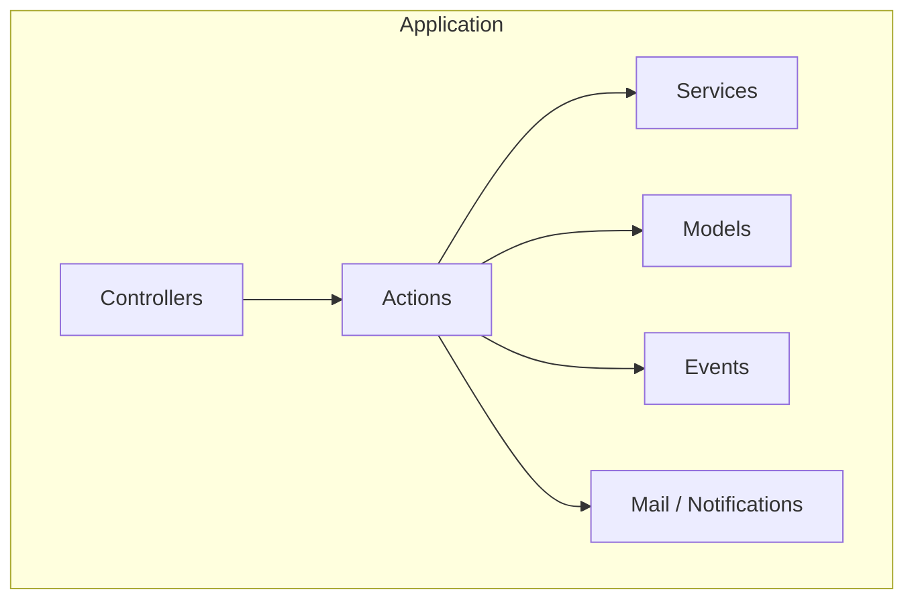
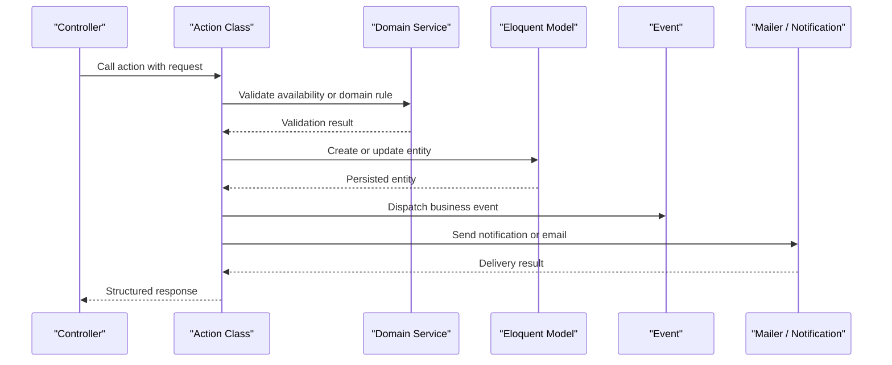
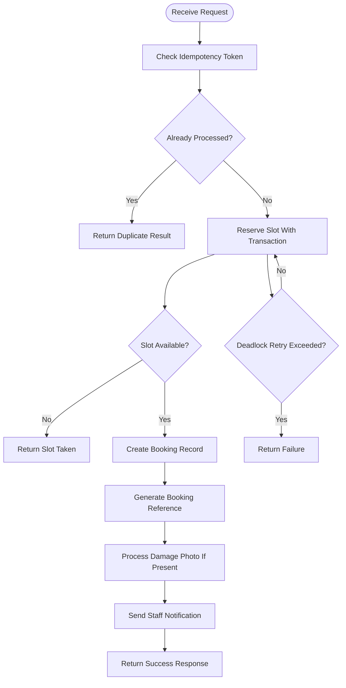
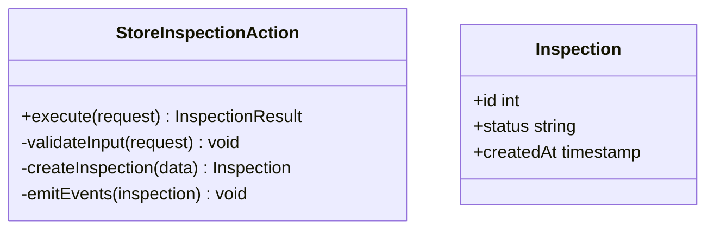
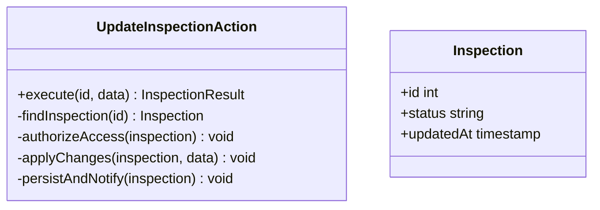
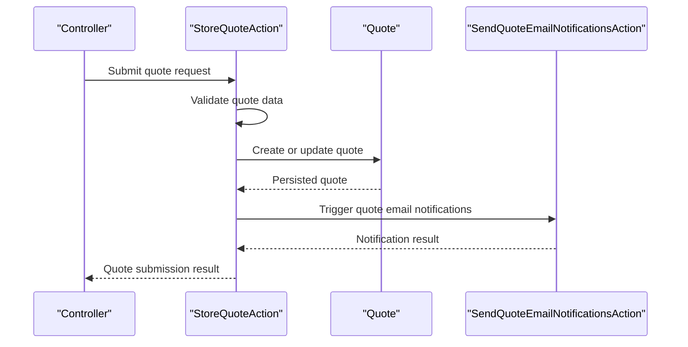
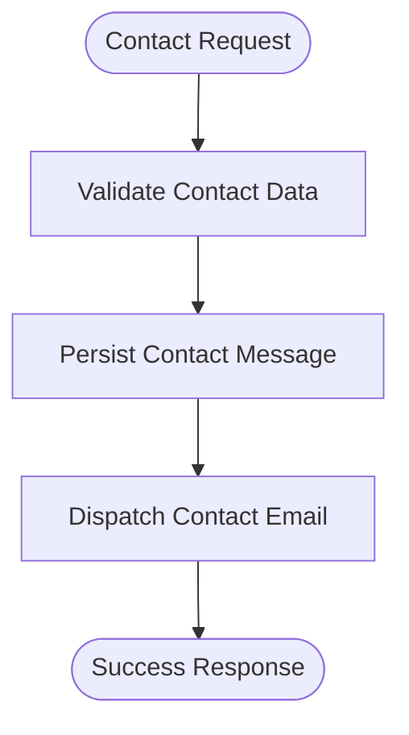
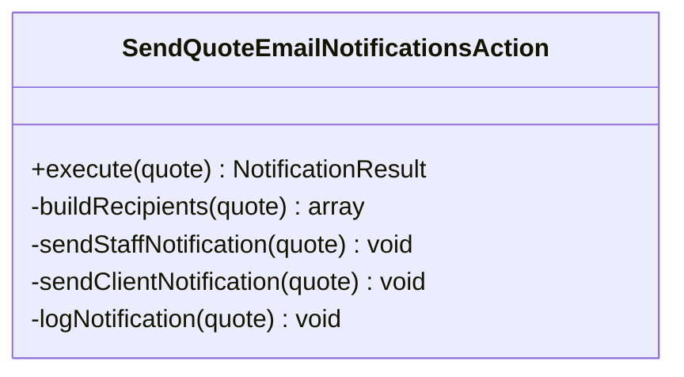
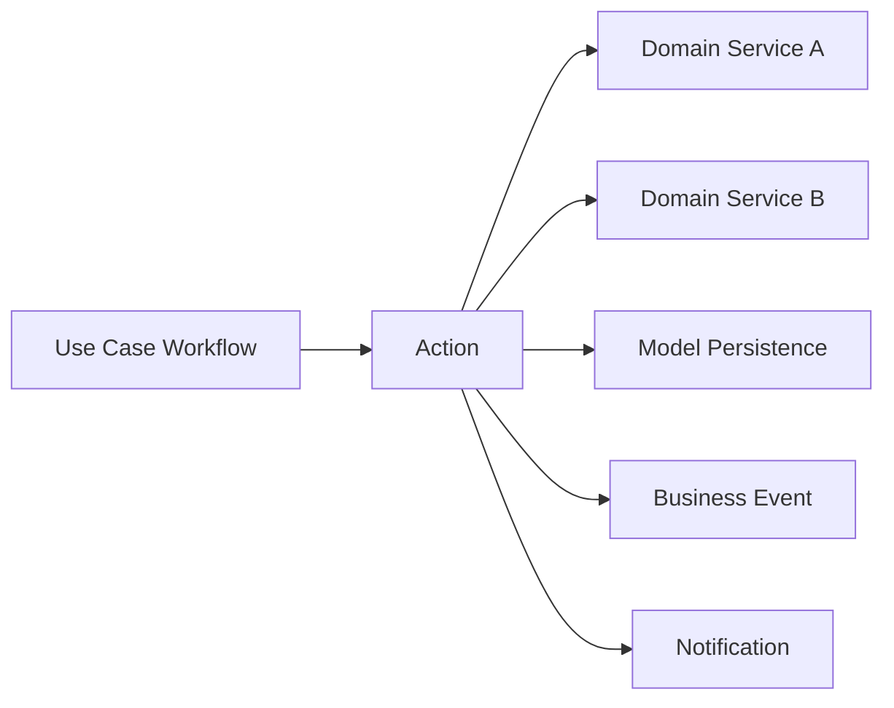

# Action Classes

<cite>
**Referenced Files in This Document**
- [StoreBookingAction.php](file://app/Actions/StoreBookingAction.php)
- [StoreInspectionAction.php](file://app/Actions/StoreInspectionAction.php)
- [UpdateInspectionAction.php](file://app/Actions/UpdateInspectionAction.php)
- [StoreQuoteAction.php](file://app/Actions/StoreQuoteAction.php)
- [SendContactMessage.php](file://app/Actions/SendContactMessage.php)
- [SendQuoteEmailNotificationsAction.php](file://app/Actions/SendQuoteEmailNotificationsAction.php)
- [BookingCreatedEvent.php](file://app/Events/BookingCreatedEvent.php)
- [Booking.php](file://app/Models/Booking.php)
- [Inspection.php](file://app/Models/Inspection.php)
- [Quote.php](file://app/Models/Quote.php)
- [IdempotencyService.php](file://app/Services/IdempotencyService.php)
- [AvailabilityServiceInterface.php](file://app/Services/Contracts/AvailabilityServiceInterface.php)
- [BookingTimeline.php](file://app/Services/BookingTimeline.php)
</cite>

## Table of Contents
1. Introduction
2. Project Structure
3. Core Components
4. Architecture Overview
5. Detailed Component Analysis
6. Dependency Analysis
7. Performance Considerations
8. Troubleshooting Guide
9. Conclusion

## Introduction
This document explains the Highblossom action classes pattern used across the application. Actions encapsulate single-responsibility business workflows, such as creating a booking, managing inspections, processing quotes, handling authentication flows through Fortify integrations, and performing SEO operations. Unlike services, which expose reusable domain capabilities, actions focus on specific use cases and orchestrate models, services, events, notifications, logging, and side effects.

The repository contains more than 17 action classes organized under `app/Actions`, including:
- Booking creation
- Inspection management
- Quote processing
- Authentication-related Fortify actions
- SEO actions
- Contact message handling
- Email notification orchestration

These actions are designed to be testable, predictable, and easy to extend without mixing presentation logic with business rules.

## Project Structure
The action classes live primarily under `app/Actions`. They are grouped by feature or integration:
- Root-level actions for cross-cutting workflows like booking storage, inspection management, quote submission, contact messaging, and quote email notifications.
- Feature-specific folders such as Fortify, Admin, Auth, Content, and Seo that group related actions.

**Diagram sources**
- [StoreBookingAction.php:1-60](file://app/Actions/StoreBookingAction.php#L1-L60)
- [StoreInspectionAction.php:1-60](file://app/Actions/StoreInspectionAction.php#L1-L60)
- [UpdateInspectionAction.php:1-60](file://app/Actions/UpdateInspectionAction.php#L1-L60)
- [StoreQuoteAction.php:1-60](file://app/Actions/StoreQuoteAction.php#L1-L60)
- [SendContactMessage.php:1-60](file://app/Actions/SendContactMessage.php#L1-L60)
- [SendQuoteEmailNotificationsAction.php:1-60](file://app/Actions/SendQuoteEmailNotificationsAction.php#L1-L60)

**Section sources**
- [StoreBookingAction.php:1-60](file://app/Actions/StoreBookingAction.php#L1-L60)
- [StoreInspectionAction.php:1-60](file://app/Actions/StoreInspectionAction.php#L1-L60)
- [UpdateInspectionAction.php:1-60](file://app/Actions/UpdateInspectionAction.php#L1-L60)
- [StoreQuoteAction.php:1-60](file://app/Actions/StoreQuoteAction.php#L1-L60)
- [SendContactMessage.php:1-60](file://app/Actions/SendContactMessage.php#L1-L60)
- [SendQuoteEmailNotificationsAction.php:1-60](file://app/Actions/SendQuoteEmailNotificationsAction.php#L1-L60)

## Core Components
The core action classes represent concrete business workflows:

- StoreBookingAction
  - Purpose: Accepts a public booking request, validates idempotency, reserves an available slot, persists the booking, and triggers notifications.
  - Key responsibilities: Idempotency check, availability reservation, booking persistence, reference generation, optional damage photo handling, event/notification emission, error logging.

- StoreInspectionAction
  - Purpose: Creates a new inspection record and performs inspection-specific setup such as status transitions and related model updates.

- UpdateInspectionAction
  - Purpose: Updates an existing inspection, enforcing ownership or permission checks, applying changes, and emitting relevant events.

- StoreQuoteAction
  - Purpose: Processes a quote submission, creates or updates quote data, and orchestrates downstream communication such as email notifications.

- SendContactMessage
  - Purpose: Handles incoming contact messages, validates input, persists the message, and dispatches email notifications or other side effects.

- SendQuoteEmailNotificationsAction
  - Purpose: Coordinates sending quote-related emails after successful quote processing, possibly integrating mailers, templates, and audit logging.

These actions follow consistent patterns:
- Constructor injection of dependencies.
- A primary method (often `execute` or `__invoke`) that represents the workflow entry point.
- Internal helper methods for step-specific concerns.
- Structured return values or exceptions that callers can handle.

**Section sources**
- [StoreBookingAction.php:1-120](file://app/Actions/StoreBookingAction.php#L1-L120)
- [StoreInspectionAction.php:1-120](file://app/Actions/StoreInspectionAction.php#L1-L120)
- [UpdateInspectionAction.php:1-120](file://app/Actions/UpdateInspectionAction.php#L1-L120)
- [StoreQuoteAction.php:1-120](file://app/Actions/StoreQuoteAction.php#L1-L120)
- [SendContactMessage.php:1-120](file://app/Actions/SendContactMessage.php#L1-L120)
- [SendQuoteEmailNotificationsAction.php:1-120](file://app/Actions/SendQuoteEmailNotificationsAction.php#L1-L120)

## Architecture Overview
The action class architecture separates orchestration from domain capabilities:

- Controllers receive requests and delegate to actions.
- Actions compose services, models, events, and mailers.
- Services provide reusable domain logic.
- Models represent persistent entities.
- Events capture important state changes.
- Mailers and notifications deliver user-facing communications.

**Diagram sources**
- [StoreBookingAction.php:60-160](file://app/Actions/StoreBookingAction.php#L60-L160)
- [StoreQuoteAction.php:60-160](file://app/Actions/StoreQuoteAction.php#L60-L160)
- [SendContactMessage.php:60-160](file://app/Actions/SendContactMessage.php#L60-L160)

## Detailed Component Analysis

### StoreBookingAction
StoreBookingAction implements a complete booking submission workflow. It protects against duplicate submissions, ensures slot availability, persists the booking, generates a customer-facing reference, optionally processes an uploaded damage photo, and emits notifications.

Key behaviors:
- Idempotency token validation prevents duplicate bookings.
- Availability service checks whether the requested time slot is free.
- Database transaction coordinates slot reservation and booking creation.
- Deadlock retry logic improves resilience under contention.
- Booking reference formatting standardizes identifiers in emails.
- Image processing resizes and stores damage photos safely.
- Logging captures errors and retries.

**Diagram sources**
- [StoreBookingAction.php:60-200](file://app/Actions/StoreBookingAction.php#L60-L200)

**Section sources**
- [StoreBookingAction.php:1-200](file://app/Actions/StoreBookingAction.php#L1-L200)

### StoreInspectionAction
StoreInspectionAction creates a new inspection. Typical responsibilities include:
- Validating inspection inputs.
- Creating the inspection model.
- Setting initial status or metadata.
- Emitting inspection-related events.
- Returning structured results for callers.

**Diagram sources**
- [StoreInspectionAction.php:1-120](file://app/Actions/StoreInspectionAction.php#L1-L120)
- [Inspection.php:1-120](file://app/Models/Inspection.php#L1-L120)

**Section sources**
- [StoreInspectionAction.php:1-120](file://app/Actions/StoreInspectionAction.php#L1-L120)
- [Inspection.php:1-120](file://app/Models/Inspection.php#L1-L120)

### UpdateInspectionAction
UpdateInspectionAction updates an existing inspection. It typically enforces permissions, applies validated changes, updates timestamps or status, and emits change events.

**Diagram sources**
- [UpdateInspectionAction.php:1-120](file://app/Actions/UpdateInspectionAction.php#L1-L120)
- [Inspection.php:1-120](file://app/Models/Inspection.php#L1-L120)

**Section sources**
- [UpdateInspectionAction.php:1-120](file://app/Actions/UpdateInspectionAction.php#L1-L120)
- [Inspection.php:1-120](file://app/Models/Inspection.php#L1-L120)

### StoreQuoteAction
StoreQuoteAction processes quote submissions. Responsibilities include:
- Validating quote data.
- Creating or updating the quote model.
- Orchestrating quote email notifications.
- Returning structured success or failure responses.

**Diagram sources**
- [StoreQuoteAction.php:60-160](file://app/Actions/StoreQuoteAction.php#L60-L160)
- [SendQuoteEmailNotificationsAction.php:60-160](file://app/Actions/SendQuoteEmailNotificationsAction.php#L60-L160)

**Section sources**
- [StoreQuoteAction.php:1-160](file://app/Actions/StoreQuoteAction.php#L1-L160)
- [SendQuoteEmailNotificationsAction.php:1-160](file://app/Actions/SendQuoteEmailNotificationsAction.php#L1-L160)

### SendContactMessage
SendContactMessage handles contact form submissions. It validates contact data, persists the message, and dispatches email notifications or listeners.

**Diagram sources**
- [SendContactMessage.php:60-160](file://app/Actions/SendContactMessage.php#L60-L160)

**Section sources**
- [SendContactMessage.php:1-160](file://app/Actions/SendContactMessage.php#L1-L160)

### SendQuoteEmailNotificationsAction
SendQuoteEmailNotificationsAction coordinates sending quote-related emails. It may integrate mailers, templates, recipients, and audit logging.

**Diagram sources**
- [SendQuoteEmailNotificationsAction.php:1-160](file://app/Actions/SendQuoteEmailNotificationsAction.php#L1-L160)

**Section sources**
- [SendQuoteEmailNotificationsAction.php:1-160](file://app/Actions/SendQuoteEmailNotificationsAction.php#L1-L160)

### Conceptual Overview
Actions differ from services by focusing on use-case workflows rather than domain capabilities:
- Actions answer “how do I complete this task?”
- Services answer “what domain capability can I reuse?”
- Actions orchestrate multiple services, models, events, and side effects.
- Services remain focused on cohesive domain operations.

[No sources needed since this diagram shows conceptual workflow, not actual code structure]

## Dependency Analysis
Actions depend on several layers:
- Eloquent models for persistence.
- Domain services for reusable business logic.
- Contracts such as availability interfaces.
- Events for decoupled side effects.
- Mailers and notifications for external communication.

```mermaid
graph TB
    StoreBooking["StoreBookingAction"]
    StoreInspection["StoreInspectionAction"]
    UpdateInspection["UpdateInspectionAction"]
    StoreQuote["StoreQuoteAction"]
    SendContact["SendContactMessage"]
    SendQuoteEmail["SendQuoteEmailNotificationsAction"]

    Availability["AvailabilityServiceInterface"]
    Idempotency["IdempotencyService"]
    Timeline["BookingTimeline"]
    Booking["Booking Model"]
    Inspection["Inspection Model"]
    Quote["Quote Model"]
    BookingEvent["BookingCreatedEvent"]

    StoreBooking --> Availability
    StoreBooking --> Idempotency
    StoreBooking --> Timeline
    StoreBooking --> Booking
    StoreBooking --> BookingEvent

    StoreInspection --> Inspection
    UpdateInspection --> Inspection

    StoreQuote --> Quote
    StoreQuoteEmail --> Quote
```

**Diagram sources**
- [StoreBookingAction.php:1-120](file://app/Actions/StoreBookingAction.php#L1-L120)
- [StoreInspectionAction.php:1-120](file://app/Actions/StoreInspectionAction.php#L1-L120)
- [UpdateInspectionAction.php:1-120](file://app/Actions/UpdateInspectionAction.php#L1-L120)
- [StoreQuoteAction.php:1-120](file://app/Actions/StoreQuoteAction.php#L1-L120)
- [SendContactMessage.php:1-120](file://app/Actions/SendContactMessage.php#L1-L120)
- [SendQuoteEmailNotificationsAction.php:1-120](file://app/Actions/SendQuoteEmailNotificationsAction.php#L1-L120)
- [AvailabilityServiceInterface.php:1-60](file://app/Services/Contracts/AvailabilityServiceInterface.php#L1-L60)
- [IdempotencyService.php:1-60](file://app/Services/IdempotencyService.php#L1-L60)
- [BookingTimeline.php:1-60](file://app/Services/BookingTimeline.php#L1-L60)
- [Booking.php:1-120](file://app/Models/Booking.php#L1-L120)
- [Inspection.php:1-120](file://app/Models/Inspection.php#L1-L120)
- [Quote.php:1-120](file://app/Models/Quote.php#L1-L120)
- [BookingCreatedEvent.php:1-60](file://app/Events/BookingCreatedEvent.php#L1-L60)

**Section sources**
- [StoreBookingAction.php:1-120](file://app/Actions/StoreBookingAction.php#L1-L120)
- [StoreInspectionAction.php:1-120](file://app/Actions/StoreInspectionAction.php#L1-L120)
- [UpdateInspectionAction.php:1-120](file://app/Actions/UpdateInspectionAction.php#L1-L120)
- [StoreQuoteAction.php:1-120](file://app/Actions/StoreQuoteAction.php#L1-L120)
- [SendContactMessage.php:1-120](file://app/Actions/SendContactMessage.php#L1-L120)
- [SendQuoteEmailNotificationsAction.php:1-120](file://app/Actions/SendQuoteEmailNotificationsAction.php#L1-L120)

## Performance Considerations
- Idempotency: Prevents duplicate work and reduces redundant database writes.
- Transactions: Ensure consistency during slot reservation and booking creation.
- Deadlock retries: Improve resilience under high concurrency.
- Image processing: Resize and convert images efficiently to avoid large uploads.
- Event-driven notifications: Keep synchronous paths fast while offloading email delivery.

[No sources needed since this section provides general guidance]

## Troubleshooting Guide
Common issues and how to diagnose them:

- Duplicate booking submissions
  - Symptom: Repeated bookings or unexpected duplicates.
  - Check: Idempotency token handling and duplicate result behavior.
  - Verify: Whether tokens are unique per request and stored correctly.

- Slot already taken
  - Symptom: Customer receives a “slot taken” response.
  - Check: Availability service logic and transactional reservation.
  - Verify: Concurrency conditions and deadlock retry behavior.

- Image upload failures
  - Symptom: Booking succeeds but no damage photo is attached.
  - Check: Image processing path and error logging.
  - Verify: File validity, image format support, and storage permissions.

- Notification delivery failures
  - Symptom: Emails not sent after booking or quote submission.
  - Check: Mailer configuration and notification dispatch.
  - Verify: Queue settings and mail transport configuration.

**Section sources**
- [StoreBookingAction.php:120-200](file://app/Actions/StoreBookingAction.php#L120-L200)
- [SendQuoteEmailNotificationsAction.php:60-160](file://app/Actions/SendQuoteEmailNotificationsAction.php#L60-L160)

## Conclusion
Highblossom’s action classes provide clear, single-purpose workflows that orchestrate services, models, events, and side effects. This pattern keeps controllers thin, makes business logic testable, and clarifies where each concern belongs. By focusing actions on use cases and using services for reusable domain capabilities, the codebase remains maintainable and scalable.

[No sources needed since this section summarizes without analyzing specific files]