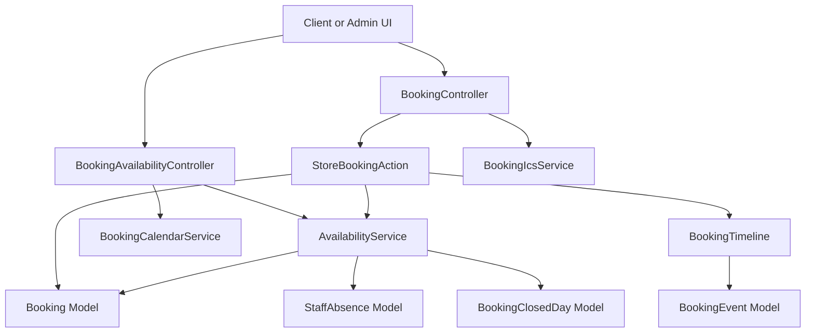
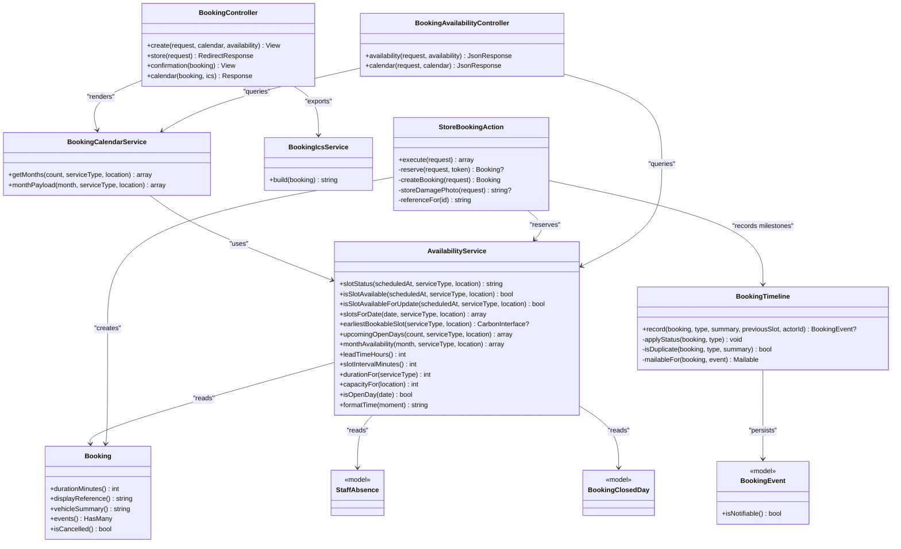
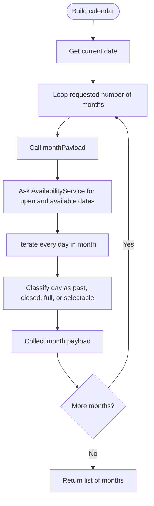
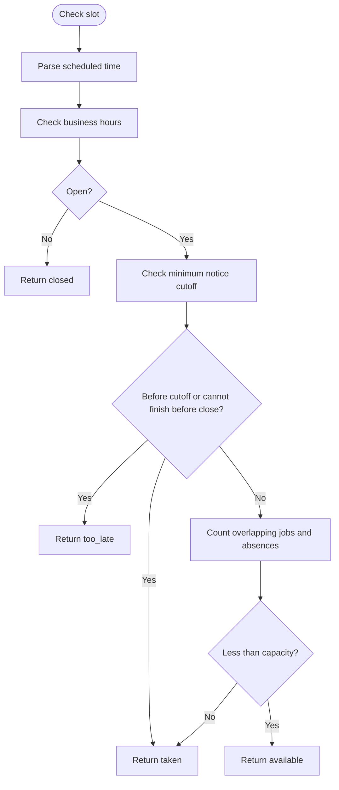
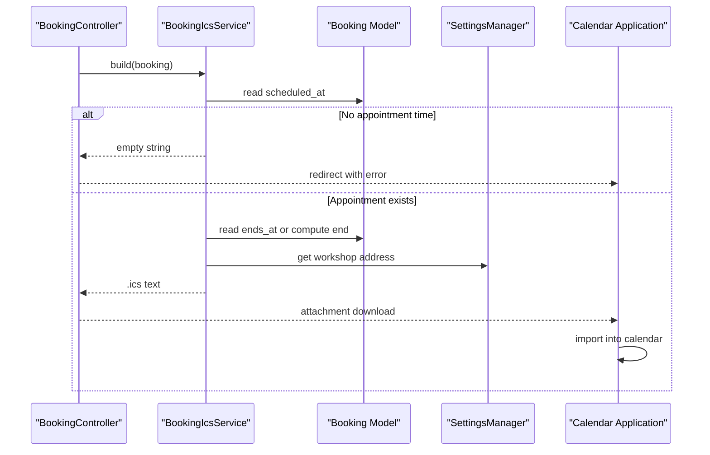
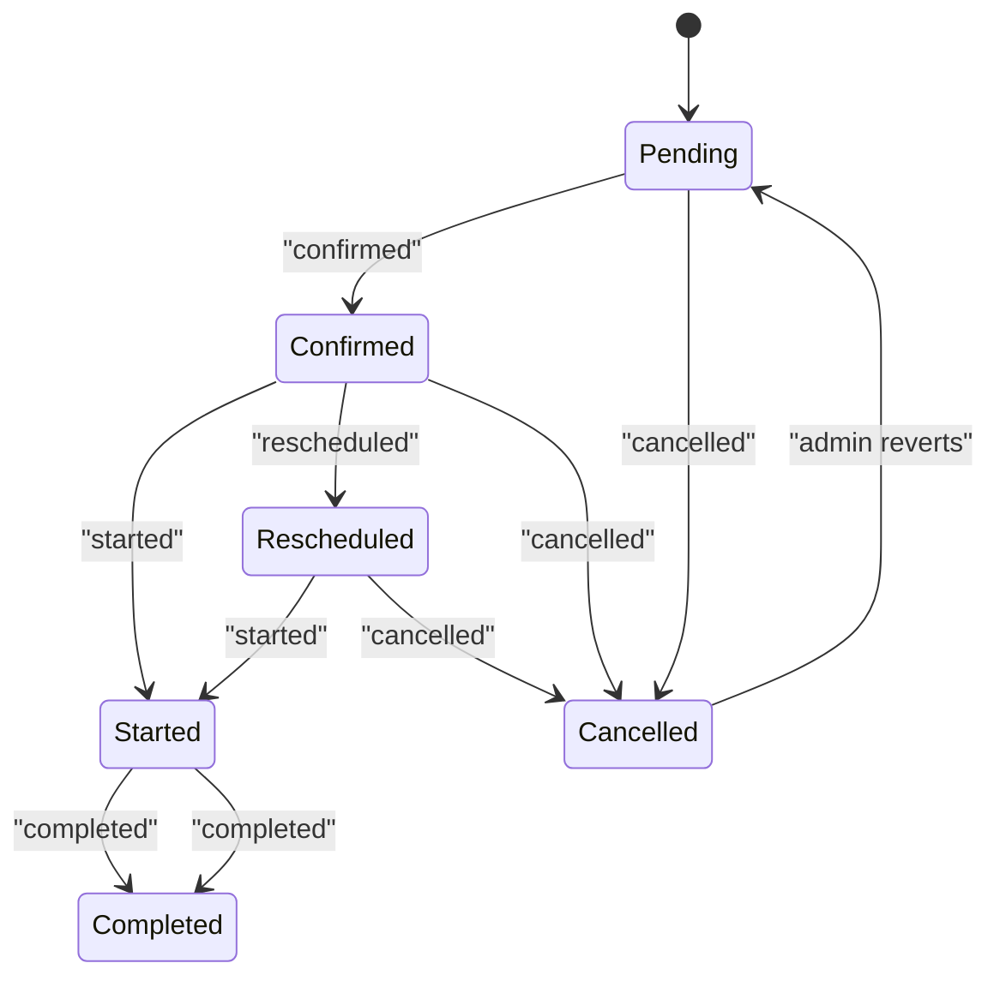
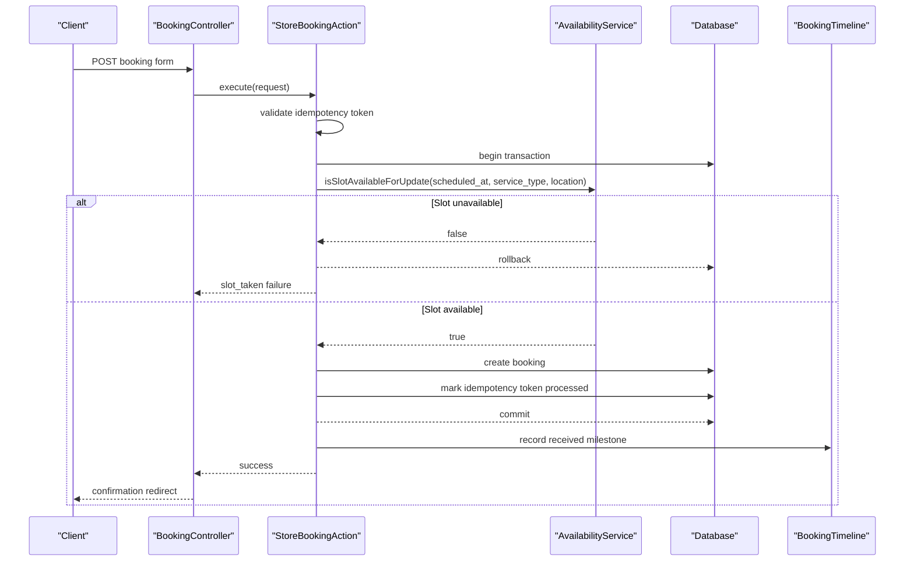
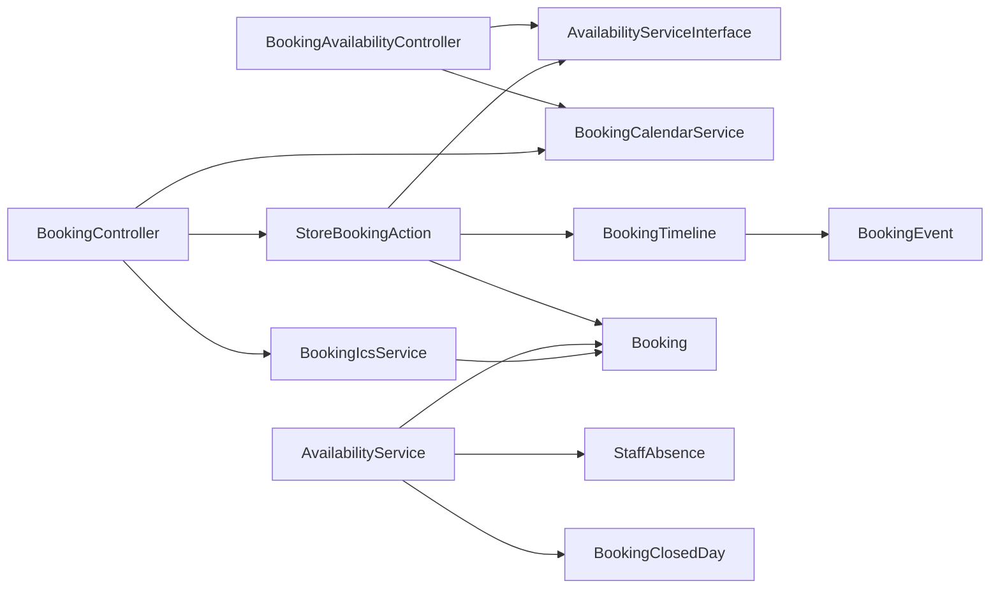

# Booking Services

<cite>
**Referenced Files in This Document**   
- [BookingCalendarService.php](file://app/Services/BookingCalendarService.php)
- [AvailabilityService.php](file://app/Services/AvailabilityService.php)
- [AvailabilityServiceInterface.php](file://app/Services/Contracts/AvailabilityServiceInterface.php)
- [BookingIcsService.php](file://app/Services/BookingIcsService.php)
- [BookingTimeline.php](file://app/Services/BookingTimeline.php)
- [StoreBookingAction.php](file://app/Actions/StoreBookingAction.php)
- [BookingController.php](file://app/Http/Controllers/BookingController.php)
- [BookingAvailabilityController.php](file://app/Http/Controllers/Api/BookingAvailabilityController.php)
- [Booking.php](file://app/Models/Booking.php)
- [BookingEvent.php](file://app/Models/BookingEvent.php)
- [BookingClosedDay.php](file://app/Models/BookingClosedDay.php)
- [StaffAbsence.php](file://app/Models/StaffAbsence.php)
- [BookingCreatedEvent.php](file://app/Events/BookingCreatedEvent.php)
- [BookingServiceType.php](file://app/Enums/BookingServiceType.php)
- [2026_10_18_000001_create_booking_closed_days_table.php](file://database/migrations/2026_10_18_000001_create_booking_closed_days_table.php)
- [2026_07_07_000000_add_scheduled_fields_to_bookings_table.php](file://database/migrations/2026_07_07_000000_add_scheduled_fields_to_bookings_table.php)
- [2026_10_01_150000_create_booking_events_table.php](file://database/migrations/2026_10_01_150000_create_booking_events_table.php)
</cite>

## Table of Contents
1. [Introduction](#introduction)
2. [Project Structure](#project-structure)
3. [Core Components](#core-components)
4. [Architecture Overview](#architecture-overview)
5. [Detailed Component Analysis](#detailed-component-analysis)
6. [Dependency Analysis](#dependency-analysis)
7. [Performance Considerations](#performance-considerations)
8. [Troubleshooting Guide](#troubleshooting-guide)
9. [Conclusion](#conclusion)

## Introduction
This document explains the booking-related services that power Highblossom’s appointment scheduling system. It focuses on four core components:

- **BookingCalendarService**: Builds calendar months with selectable days and reasons for unavailability.
- **AvailabilityService**: Determines open/closed days, generates slot lists, computes durations and capacities, detects conflicts, and supports safe concurrent bookings.
- **BookingIcsService**: Generates RFC 5545-compliant `.ics` calendar files from a scheduled booking.
- **BookingTimeline**: Centralizes booking milestones, status transitions, duplicate suppression, and customer email notifications.

These services coordinate with Eloquent models (`Booking`, `BookingEvent`, `BookingClosedDay`, `StaffAbsence`), API/web controllers, events, and queued mail to deliver consistent behavior between the public booking form, admin operations, and external calendar integrations.

## Project Structure
The booking subsystem is organized by responsibility rather than by feature folder:

| Layer | Responsibility | Key Files |
|---|---|---|
| Services | Core scheduling logic, calendar generation, conflict detection, timeline, and `.ics` export | `BookingCalendarService.php`, `AvailabilityService.php`, `BookingIcsService.php`, `BookingTimeline.php` |
| Contracts | Public service interface for availability | `AvailabilityServiceInterface.php` |
| Actions | Transactional booking submission with idempotency and retry | `StoreBookingAction.php` |
| Controllers | HTTP endpoints for availability, calendar, booking creation, and `.ics` download | `BookingAvailabilityController.php`, `BookingController.php` |
| Models | Persistent entities for bookings, milestones, closures, and absences | `Booking.php`, `BookingEvent.php`, `BookingClosedDay.php`, `StaffAbsence.php` |
| Enums | Service type metadata and default durations | `BookingServiceType.php` |
| Events | Domain event indicating a new booking was created | `BookingCreatedEvent.php` |
| Migrations | Schema for scheduled bookings, milestone history, and closed days | `2026_07_07_...`, `2026_10_01_150000_create_booking_events_table.php`, `2026_10_18_000001_create_booking_closed_days_table.php` |

**Diagram sources**
- [BookingAvailabilityController.php:1-117](file://app/Http/Controllers/Api/BookingAvailabilityController.php#L1-L117)
- [BookingController.php:1-146](file://app/Http/Controllers/BookingController.php#L1-L146)
- [StoreBookingAction.php:1-267](file://app/Actions/StoreBookingAction.php#L1-L267)
- [AvailabilityService.php:1-748](file://app/Services/AvailabilityService.php#L1-L748)
- [BookingCalendarService.php:1-101](file://app/Services/BookingCalendarService.php#L1-L101)
- [BookingIcsService.php:1-141](file://app/Services/BookingIcsService.php#L1-L141)
- [BookingTimeline.php:1-128](file://app/Services/BookingTimeline.php#L1-L128)
- [Booking.php:1-134](file://app/Models/Booking.php#L1-L134)
- [BookingEvent.php:1-84](file://app/Models/BookingEvent.php#L1-L84)
- [StaffAbsence.php:1-39](file://app/Models/StaffAbsence.php#L1-L39)
- [BookingClosedDay.php:1-35](file://app/Models/BookingClosedDay.php#L1-L35)

**Section sources**
- [BookingCalendarService.php:1-101](file://app/Services/BookingCalendarService.php#L1-L101)
- [AvailabilityService.php:1-748](file://app/Services/AvailabilityService.php#L1-L748)
- [BookingIcsService.php:1-141](file://app/Services/BookingIcsService.php#L1-L141)
- [BookingTimeline.php:1-128](file://app/Services/BookingTimeline.php#L1-L128)
- [StoreBookingAction.php:1-267](file://app/Actions/StoreBookingAction.php#L1-L267)
- [BookingController.php:1-146](file://app/Http/Controllers/BookingController.php#L1-L146)
- [BookingAvailabilityController.php:1-117](file://app/Http/Controllers/Api/BookingAvailabilityController.php#L1-L117)

## Core Components

### BookingCalendarService
`BookingCalendarService` produces the calendar payload consumed by the public picker. Its responsibilities are:

- Generate consecutive months starting from today.
- Ask `AvailabilityServiceInterface` which dates are open and which still have at least one bookable slot.
- Build each day with:
  - ISO date string.
  - Day-of-month number.
  - Whether it is selectable.
  - A reason: `past`, `closed`, or `full`.
  - Whether it is today.
- Use Monday-first layout semantics so the grid reads like a working week even when Saturday is fully booked.

The key design rule is that server-side availability determines selectability; the client must not guess which days are truly bookable.

**Section sources**
- [BookingCalendarService.php:1-101](file://app/Services/BookingCalendarService.php#L1-L101)

### AvailabilityService
`AvailabilityService` is the authoritative scheduler. It handles:

- Open/closed day determination.
- Business hours per day.
- Minimum notice cutoff (lead time).
- Slot interval configuration.
- Duration calculation per service type.
- Capacity limits per location (`mobile`, `workshop`).
- Conflict detection across bookings, inspections, and staff absences.
- Safe reservation under database locks.
- Efficient windowed caching of jobs and absences.

It exposes both read-only availability methods and a transaction-safe update method used during booking submission.

**Section sources**
- [AvailabilityService.php:1-748](file://app/Services/AvailabilityService.php#L1-L748)
- [AvailabilityServiceInterface.php:1-133](file://app/Services/Contracts/AvailabilityServiceInterface.php#L1-L133)

### BookingIcsService
`BookingIcsService` renders a single booking as an RFC 5545 `.ics` file:

- Uses the booking’s `scheduled_at` as the start.
- Derives the end from `ends_at` or adds the booking’s duration.
- Produces a stable UID based on the booking reference.
- Includes summary, description, location, and confirmed status.
- Escapes reserved characters.
- Folds long lines to 75 octets.
- Returns an empty string when no appointment time exists, allowing callers to reject the download gracefully.

**Section sources**
- [BookingIcsService.php:1-141](file://app/Services/BookingIcsService.php#L1-L141)
- [Booking.php:1-134](file://app/Models/Booking.php#L1-L134)

### BookingTimeline
`BookingTimeline` is the single place where booking milestones are recorded:

- Validates milestone types against `BookingEvent::ALL`.
- Prevents changes after cancellation except explicit reversion to pending.
- Suppresses duplicate back-to-back events with the same type and summary.
- Persists a `BookingEvent`.
- Updates the coarse `status` field for `confirmed`, `completed`, and `cancelled`.
- Queues a customer-facing mailable for notifiable milestones.

Milestones include received, confirmed, rescheduled, started, completed, and cancelled.

**Section sources**
- [BookingTimeline.php:1-128](file://app/Services/BookingTimeline.php#L1-L128)
- [BookingEvent.php:1-84](file://app/Models/BookingEvent.php#L1-L84)

## Architecture Overview

**Diagram sources**
- [AvailabilityService.php:1-748](file://app/Services/AvailabilityService.php#L1-L748)
- [BookingCalendarService.php:1-101](file://app/Services/BookingCalendarService.php#L1-L101)
- [BookingIcsService.php:1-141](file://app/Services/BookingIcsService.php#L1-L141)
- [BookingTimeline.php:1-128](file://app/Services/BookingTimeline.php#L1-L128)
- [StoreBookingAction.php:1-267](file://app/Actions/StoreBookingAction.php#L1-L267)
- [BookingController.php:1-146](file://app/Http/Controllers/BookingController.php#L1-L146)
- [BookingAvailabilityController.php:1-117](file://app/Http/Controllers/Api/BookingAvailabilityController.php#L1-L117)
- [Booking.php:1-134](file://app/Models/Booking.php#L1-L134)
- [BookingEvent.php:1-84](file://app/Models/BookingEvent.php#L1-L84)
- [StaffAbsence.php:1-39](file://app/Models/StaffAbsence.php#L1-L39)
- [BookingClosedDay.php:1-35](file://app/Models/BookingClosedDay.php#L1-L35)

## Detailed Component Analysis

### BookingCalendarService: Appointment Scheduling Grid
`BookingCalendarService` delegates all business rules to `AvailabilityServiceInterface`. It does not calculate whether a slot fits before closing time, how many bays are available, or whether a day is closed. Instead, it converts those results into a flat month payload.

Key behaviors:
- Iterates consecutive months from today.
- For each month, calls `monthAvailability` to obtain open and available dates.
- Marks past dates as non-selectable.
- Marks closed days as non-selectable.
- Marks days with zero available slots as full.
- Computes leading blanks using Monday-first weekday arithmetic.

**Diagram sources**
- [BookingCalendarService.php:1-101](file://app/Services/BookingCalendarService.php#L1-L101)
- [AvailabilityServiceInterface.php:1-133](file://app/Services/Contracts/AvailabilityServiceInterface.php#L1-L133)

**Section sources**
- [BookingCalendarService.php:1-101](file://app/Services/BookingCalendarService.php#L1-L101)

### AvailabilityService: Open/Closed Days, Staff Availability, and Service Constraints
`AvailabilityService` implements `AvailabilityServiceInterface` and owns the scheduling math.

#### Open/Closed Day Logic
A day is considered open only when business hours exist for it. The service also supports shop-wide closures through `BookingClosedDay`. When computing occupancy, it counts:

- Committed bookings whose span overlaps the slot.
- Inspections that have moved the real job start away from the booking row.
- Staff absence ranges overlapping the slot.
- Location-specific capacity constraints.

#### Slot Generation
Slots are generated as start times spaced by `slotIntervalMinutes`, bounded by daily opening and closing times. A job must finish before closing, so late-start slots are excluded.

#### Conflict Detection
Conflict detection compares intervals, not instants. A 90-minute job starting at 08:00 occupies the bay until 09:30, so a 09:00 slot is taken. The `occupies` predicate respects:

- Location matching or wildcard behavior when no location is set.
- Inspection-driven rescheduling.
- Cancellation exclusion.
- Both cached survey and locked reservation paths.

#### Concurrent Safety
During booking submission, `isSlotAvailableForUpdate` uses `lockForUpdate` on relevant booking rows and absence rows. `StoreBookingAction` retries once after an InnoDB deadlock, then returns a “slot already taken” response.

**Diagram sources**
- [AvailabilityService.php:1-200](file://app/Services/AvailabilityService.php#L1-L200)
- [AvailabilityService.php:201-631](file://app/Services/AvailabilityService.php#L201-L631)
- [StoreBookingAction.php:1-267](file://app/Actions/StoreBookingAction.php#L1-L267)

**Section sources**
- [AvailabilityService.php:1-748](file://app/Services/AvailabilityService.php#L1-L748)
- [AvailabilityServiceInterface.php:1-133](file://app/Services/Contracts/AvailabilityServiceInterface.php#L1-L133)

### BookingIcsService: Calendar Integration
`BookingIcsService` is designed for interoperability with desktop and mobile calendars. It writes floating local wall-clock times because the application stores naive timestamps aligned with the app timezone.

Important properties:
- Empty body when `scheduled_at` is missing.
- UID derived from the booking’s display reference.
- Summary includes service type and vehicle summary.
- Description includes booking reference, damage type, contact information, optional notes, and appointment window.
- Location resolves to mobile address when applicable, otherwise the configured workshop address.
- Lines are escaped and folded according to RFC 5545.

**Diagram sources**
- [BookingController.php:1-146](file://app/Http/Controllers/BookingController.php#L1-L146)
- [BookingIcsService.php:1-141](file://app/Services/BookingIcsService.php#L1-L141)
- [Booking.php:1-134](file://app/Models/Booking.php#L1-L134)

**Section sources**
- [BookingIcsService.php:1-141](file://app/Services/BookingIcsService.php#L1-L141)
- [BookingController.php:1-146](file://app/Http/Controllers/BookingController.php#L1-L146)

### BookingTimeline: Event Sequencing and Status Progression
`BookingTimeline` enforces a strict lifecycle:

| Milestone | Coarse Booking Status | Customer Email |
|---|---:|---:|
| Received | None persisted directly by this method | Yes |
| Confirmed | `confirmed` | Yes |
| Rescheduled | None persisted directly by this method | Yes |
| Started | None persisted directly by this method | No |
| Completed | `completed` | Yes |
| Cancelled | `cancelled` | Yes |

Cancellation is terminal for customer-facing progression. Duplicate suppression prevents double emails when multiple code paths reach the same milestone with identical data.

**Diagram sources**
- [BookingTimeline.php:1-128](file://app/Services/BookingTimeline.php#L1-L128)
- [BookingEvent.php:1-84](file://app/Models/BookingEvent.php#L1-L84)

**Section sources**
- [BookingTimeline.php:1-128](file://app/Services/BookingTimeline.php#L1-L128)
- [BookingEvent.php:1-84](file://app/Models/BookingEvent.php#L1-L84)

### StoreBookingAction: Creating New Appointments
`StoreBookingAction` is the transactional entry point for public booking submissions. It coordinates:

1. Idempotency token validation.
2. Transactional reservation using `isSlotAvailableForUpdate`.
3. Database lock contention handling with one retry.
4. Booking creation with snapshot duration.
5. Reference assignment.
6. Staff notification and success/failure redirection.

**Diagram sources**
- [StoreBookingAction.php:1-267](file://app/Actions/StoreBookingAction.php#L1-L267)
- [AvailabilityService.php:1-200](file://app/Services/AvailabilityService.php#L1-L200)
- [BookingTimeline.php:1-128](file://app/Services/BookingTimeline.php#L1-L128)
- [BookingController.php:1-146](file://app/Http/Controllers/BookingController.php#L1-L146)

**Section sources**
- [StoreBookingAction.php:1-267](file://app/Actions/StoreBookingAction.php#L1-L267)
- [BookingController.php:1-146](file://app/Http/Controllers/BookingController.php#L1-L146)

## Dependency Analysis

**Diagram sources**
- [BookingAvailabilityController.php:1-117](file://app/Http/Controllers/Api/BookingAvailabilityController.php#L1-L117)
- [BookingController.php:1-146](file://app/Http/Controllers/BookingController.php#L1-L146)
- [StoreBookingAction.php:1-267](file://app/Actions/StoreBookingAction.php#L1-L267)
- [AvailabilityService.php:1-748](file://app/Services/AvailabilityService.php#L1-L748)
- [BookingCalendarService.php:1-101](file://app/Services/BookingCalendarService.php#L1-L101)
- [BookingIcsService.php:1-141](file://app/Services/BookingIcsService.php#L1-L141)
- [BookingTimeline.php:1-128](file://app/Services/BookingTimeline.php#L1-L128)
- [Booking.php:1-134](file://app/Models/Booking.php#L1-L134)
- [BookingEvent.php:1-84](file://app/Models/BookingEvent.php#L1-L84)
- [StaffAbsence.php:1-39](file://app/Models/StaffAbsence.php#L1-L39)
- [BookingClosedDay.php:1-35](file://app/Models/BookingClosedDay.php#L1-L35)

**Section sources**
- [BookingAvailabilityController.php:1-117](file://app/Http/Controllers/Api/BookingAvailabilityController.php#L1-L117)
- [BookingController.php:1-146](file://app/Http/Controllers/BookingController.php#L1-L146)
- [StoreBookingAction.php:1-267](file://app/Actions/StoreBookingAction.php#L1-L267)
- [AvailabilityService.php:1-748](file://app/Services/AvailabilityService.php#L1-L748)

## Performance Considerations
High-traffic booking scenarios benefit from several built-in optimizations:

| Area | Optimization | Why It Matters |
|---|---|---|
| Calendar rendering | `monthAvailability` batches open and available dates per month | Avoids thousands of per-slot queries across three months |
| Occupancy checks | Windowed cache of bookings and absences | Reuses one loaded window for many slot tests |
| Conflict detection | Interval-based overlap test reused by both read and write paths | Keeps picker and reservation logic consistent |
| Concurrency | Row-level locking plus padded range | Reduces race conditions while avoiding overly broad locks |
| Retry policy | One retry after deadlock | Handles transient InnoDB contention without infinite loops |
| Idempotency | Token-based deduplication | Prevents duplicate bookings from retries or repeated clicks |
| Timezone math | All calculations use application timezone | Prevents accidental daylight-saving or display-timezone mismatches |
| Service duration | Configurable override with clamped bounds | Lets operators tune fleet or heavy-machinery jobs without redeploying |

Recommendations for scaling further:
- Keep `HORIZON_DAYS` reasonable so the cached window does not grow indefinitely.
- Monitor database lock contention around `scheduled_at` and inspection windows.
- Use separate queues for email sending and image processing to keep booking submission fast.
- Add monitoring metrics around slot contention, failed reservations, and `.ics` export failures.
- Validate settings such as `booking_slot_interval_minutes`, `booking_capacity_workshop`, and `booking_capacity_mobile` to avoid invalid capacity or excessively fine-grained slots.

[No sources needed since this section provides general guidance]

## Troubleshooting Guide

### A Date Shows as Selectable but Becomes Full After Submission
Likely causes:
- Another request claimed the slot between the picker check and submission.
- The capacity setting is lower than expected.
- An inspection or staff absence overlaps the slot.
- The service duration makes the last slot invalid because the job would finish after closing.

Checks:
- Verify `isSlotAvailableForUpdate` returned true inside the transaction.
- Confirm `durationFor` and `slotIntervalMinutes` match business expectations.
- Review overlapping bookings and inspections.
- Review staff absences and capacity settings.

**Section sources**
- [StoreBookingAction.php:1-267](file://app/Actions/StoreBookingAction.php#L1-L267)
- [AvailabilityService.php:1-748](file://app/Services/AvailabilityService.php#L1-L748)

### A Fully Booked Saturday Appears Pickable in the Calendar
This should no longer happen after the redesign. If it does:
- Ensure the frontend requests the calendar with the correct `service` and `location`.
- Confirm the API call goes through `BookingAvailabilityController::calendar`.
- Verify `monthAvailability` reports the date in `available_dates`.
- Check that `BookingCalendarService` marks the day as non-selectable when `reason` is `full`.

**Section sources**
- [BookingCalendarService.php:1-101](file://app/Services/BookingCalendarService.php#L1-L101)
- [BookingAvailabilityController.php:1-117](file://app/Http/Controllers/Api/BookingAvailabilityController.php#L1-L117)

### A Booking Is Not Sending Customer Emails
Possible issues:
- The milestone is not sent through `BookingTimeline::record`.
- The milestone type is not in `BookingEvent::NOTIFIABLE`.
- The booking is cancelled and another milestone was attempted.
- The email queue is failing or delayed.

Checks:
- Confirm the milestone type matches one of `BookingEvent::ALL`.
- Verify the latest event is not a duplicate with the same type and summary.
- Inspect queued mail logs for delivery errors.

**Section sources**
- [BookingTimeline.php:1-128](file://app/Services/BookingTimeline.php#L1-L128)
- [BookingEvent.php:1-84](file://app/Models/BookingEvent.php#L1-L84)

### The `.ics` File Downloads But Shows No Appointment
Likely cause:
- The booking has no `scheduled_at`.

Resolution:
- Complete the scheduling step before exporting.
- Use the controller’s fallback error message to guide the user back to the booking wizard.

**Section sources**
- [BookingIcsService.php:1-141](file://app/Services/BookingIcsService.php#L1-L141)
- [BookingController.php:1-146](file://app/Http/Controllers/BookingController.php#L1-L146)

### A Booking Loses a Race Condition
Behavior:
- `StoreBookingAction` retries once after a deadlock.
- If the second attempt fails, it returns `slot_already_taken`.
- The controller redirects back with input preserved and highlights the relevant step.

Resolution:
- Ask the customer to refresh the picker and choose another slot.
- Investigate high contention if this happens frequently.

**Section sources**
- [StoreBookingAction.php:1-267](file://app/Actions/StoreBookingAction.php#L1-L267)
- [BookingController.php:1-146](file://app/Http/Controllers/BookingController.php#L1-L146)

## Conclusion
Highblossom’s booking subsystem separates concerns cleanly:

- `BookingCalendarService` builds a predictable, server-authoritative calendar grid.
- `AvailabilityService` centralizes scheduling math, capacity rules, and conflict detection.
- `StoreBookingAction` guarantees safe, idempotent reservation under concurrency.
- `BookingTimeline` keeps milestones, status, and customer communications consistent.
- `BookingIcsService` exports appointments to standard calendar formats.

Together, these services ensure that what a customer sees in the browser is the same reality the database accepts, while supporting business requirements such as lead time, service-specific durations, location capacity, staff absences, and shop-wide closures.

[No sources needed since this section summarizes without analyzing specific files]