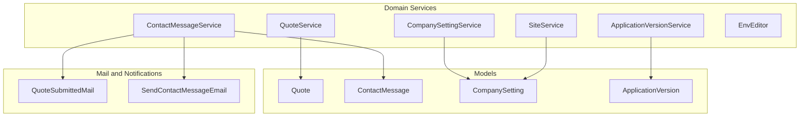
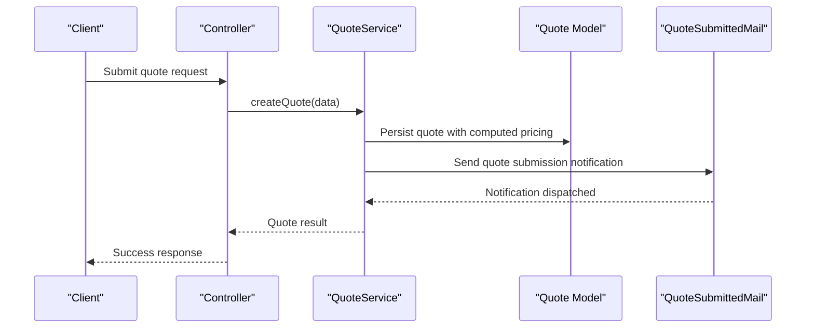
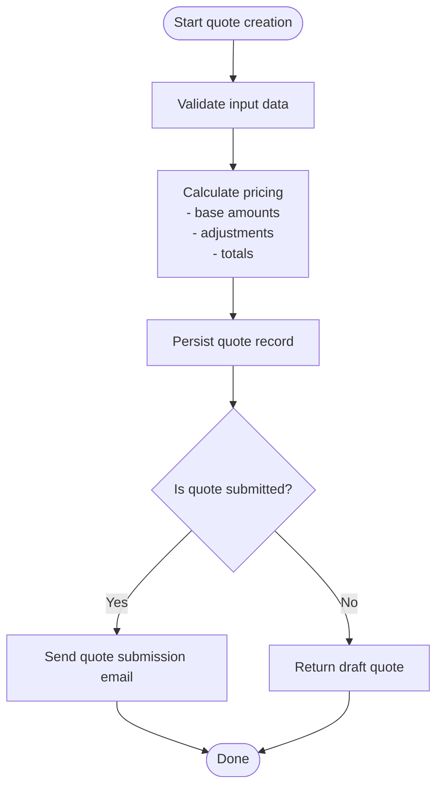
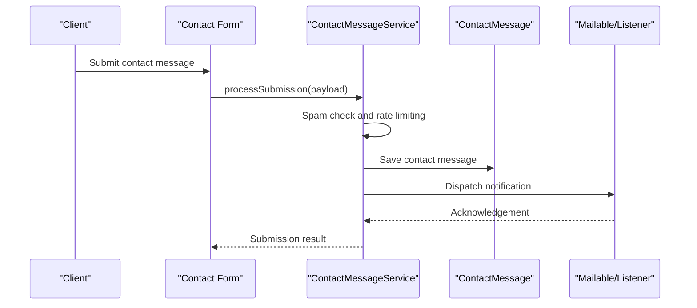
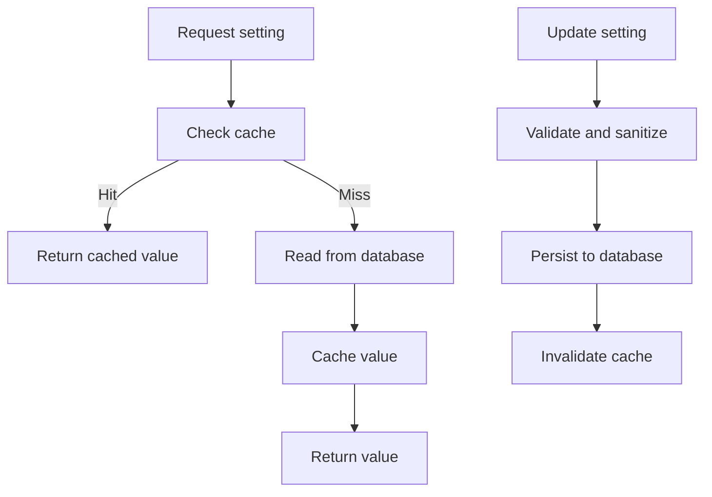
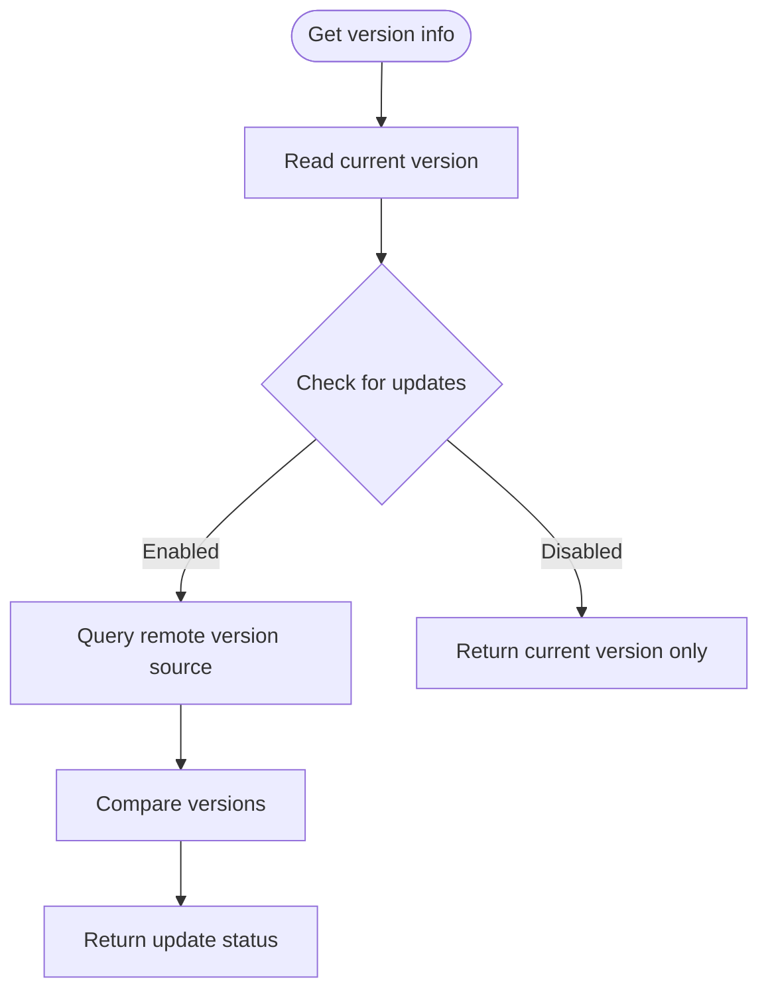
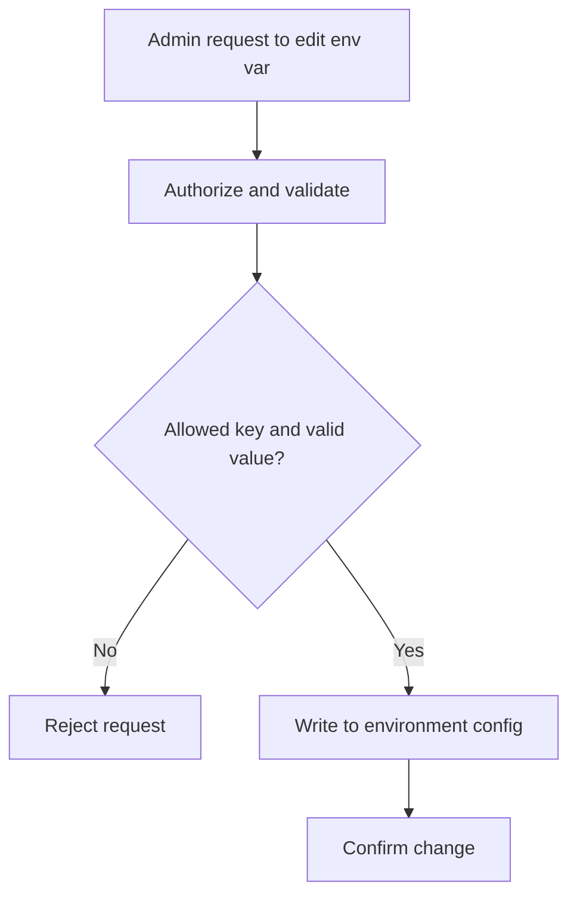
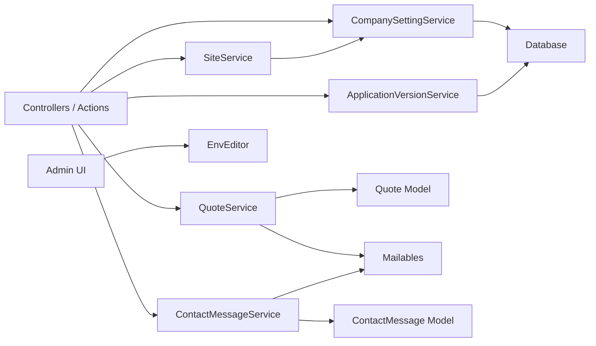

# Business Domain Services

<cite>
**Referenced Files in This Document**   
- [QuoteService.php](file://app/app/Services/QuoteService.php)
- [ContactMessageService.php](file://app/app/Services/ContactMessageService.php)
- [CompanySettingService.php](file://app/app/Services/CompanySettingService.php)
- [ApplicationVersionService.php](file://app/app/Services/ApplicationVersionService.php)
- [SiteService.php](file://app/app/Services/SiteService.php)
- [EnvEditor.php](file://app/app/Services/EnvEditor.php)
</cite>

## Table of Contents
1. [Introduction](#introduction)
2. [Project Structure](#project-structure)
3. [Core Components](#core-components)
4. [Architecture Overview](#architecture-overview)
5. [Detailed Component Analysis](#detailed-component-analysis)
6. [Dependency Analysis](#dependency-analysis)
7. [Performance Considerations](#performance-considerations)
8. [Troubleshooting Guide](#troubleshooting-guide)
9. [Conclusion](#conclusion)

## Introduction
This document explains the core business domain services used by the application: quote generation, contact message handling, company configuration, application versioning, site-wide configuration, and secure environment variable editing. It focuses on service responsibilities, workflows, data flow, error handling, and integration points with models, mail, jobs, and configuration layers.

## Project Structure
The business domain services live under `app/app/Services`. Each service encapsulates a focused domain capability and is typically consumed by controllers, actions, listeners, or commands.

**Diagram sources**
- [QuoteService.php](file://app/app/Services/QuoteService.php)
- [ContactMessageService.php](file://app/app/Services/ContactMessageService.php)
- [CompanySettingService.php](file://app/app/Services/CompanySettingService.php)
- [ApplicationVersionService.php](file://app/app/Services/ApplicationVersionService.php)
- [SiteService.php](file://app/app/Services/SiteService.php)
- [EnvEditor.php](file://app/app/Services/EnvEditor.php)

**Section sources**
- [QuoteService.php](file://app/app/Services/QuoteService.php)
- [ContactMessageService.php](file://app/app/Services/ContactMessageService.php)
- [CompanySettingService.php](file://app/app/Services/CompanySettingService.php)
- [ApplicationVersionService.php](file://app/app/Services/ApplicationVersionService.php)
- [SiteService.php](file://app/app/Services/SiteService.php)
- [EnvEditor.php](file://app/app/Services/EnvEditor.php)

## Core Components
- QuoteService: Orchestrates quote creation, pricing logic, state transitions, and email notifications for submitted quotes.
- ContactMessageService: Processes public contact form submissions, applies spam protection, persists messages, and routes notifications to staff or external channels.
- CompanySettingService: Centralizes company configuration retrieval, persistence, caching, and environment-driven defaults.
- ApplicationVersionService: Tracks application versions, checks for updates, and supports deployment-related version management.
- SiteService: Provides site-wide configuration access and exposes public-facing site operations such as metadata and routing helpers.
- EnvEditor: Secures environment variable inspection and mutation through authorization, validation, and safe file writes.

**Section sources**
- [QuoteService.php](file://app/app/Services/QuoteService.php)
- [ContactMessageService.php](file://app/app/Services/ContactMessageService.php)
- [CompanySettingService.php](file://app/app/Services/CompanySettingService.php)
- [ApplicationVersionService.php](file://app/app/Services/ApplicationVersionService.php)
- [SiteService.php](file://app/app/Services/SiteService.php)
- [EnvEditor.php](file://app/app/Services/EnvEditor.php)

## Architecture Overview
The services follow a layered approach: controllers and actions invoke services; services coordinate models, configuration, mail, and events/jobs.

**Diagram sources**
- [QuoteService.php](file://app/app/Services/QuoteService.php)

## Detailed Component Analysis

### QuoteService
Responsibilities:
- Generate new quotes from validated input.
- Compute pricing based on configured rates, quantities, and options.
- Transition quote state (e.g., draft to submitted).
- Trigger email notifications when quotes are submitted.

Workflow overview:
- Input validation occurs before service invocation.
- Pricing calculation aggregates line items, discounts, taxes, and totals.
- The service persists the final quote entity and dispatches notifications.

Key implementation aspects:
- Pricing rules are applied deterministically and should be unit-testable.
- Email notifications use queued mailables to avoid blocking the request path.
- Errors during persistence or mailing should fail gracefully and return actionable results.

Example usage pattern:
- Create a quote: call the service with validated fields, then render confirmation or redirect.
- Resubmit a quote: re-run pricing and send updated notifications if status changed.

**Section sources**
- [QuoteService.php](file://app/app/Services/QuoteService.php)

### ContactMessageService
Responsibilities:
- Accept and validate contact form submissions.
- Apply spam protection heuristics or rules.
- Persist contact messages.
- Route notifications to staff or other recipients.

Spam protection:
- Check for suspicious patterns (e.g., excessive links, repeated submissions, known bot signals).
- Enforce rate limits at the service boundary or via middleware prior to service calls.

Notification routing:
- Deliver internal notifications to staff accounts.
- Optionally integrate with external channels depending on configuration.

Operational notes:
- Validation errors short-circuit processing.
- Spam-detected submissions may be logged or silently rejected based on policy.
- Notification failures should not prevent saving the message unless required by business rules.

Example usage pattern:
- Handle form POST: pass sanitized payload to the service, handle success/failure responses accordingly.

**Section sources**
- [ContactMessageService.php](file://app/app/Services/ContactMessageService.php)

### CompanySettingService
Responsibilities:
- Provide centralized access to company settings.
- Persist changes to the database.
- Cache frequently read settings.
- Support environment variable overrides where appropriate.

Configuration model:
- Settings are stored as key-value pairs with typed values.
- Defaults can be seeded or derived from environment variables.

Persistence and caching:
- Reads may be cached to reduce database load.
- Writes invalidate relevant cache entries.

Environment integration:
- Certain sensitive or deployment-specific settings can be sourced from environment variables and exposed through this service.

Example usage pattern:
- Read site-wide settings: use getters for keys like company name, support email, or operational hours.
- Update settings: call update methods with validated payloads; notify dependent caches.

**Section sources**
- [CompanySettingService.php](file://app/app/Services/CompanySettingService.php)

### ApplicationVersionService
Responsibilities:
- Track current application version.
- Compare against upstream or release channel versions.
- Manage deployment metadata and audit version changes.

Version tracking:
- Stores version identifiers and timestamps.
- Exposes current version to controllers and views.

Update checking:
- Queries an external source or manifest to determine available updates.
- Returns availability and metadata without mutating state.

Deployment management:
- Records deployment events and version rollbacks when applicable.

Example usage pattern:
- Display version badge in admin UI.
- Admin action to mark a deployment as complete after successful rollout.

**Section sources**
- [ApplicationVersionService.php](file://app/app/Services/ApplicationVersionService.php)

### SiteService
Responsibilities:
- Provide site-wide configuration access.
- Expose public-facing site operations (e.g., metadata, SEO hints, navigation helpers).
- Coordinate with CompanySettingService for shared settings.

Public-facing operations:
- Render site title, description, and canonical information.
- Supply route or content hints to views and components.

Integration:
- Uses CompanySettingService to fetch organizational details.
- May expose helper methods for theme, locale, and feature flags.

Example usage pattern:
- In Blade templates or Livewire components, call SiteService to obtain site metadata and presentation helpers.

**Section sources**
- [SiteService.php](file://app/app/Services/SiteService.php)

### EnvEditor
Responsibilities:
- Securely inspect and modify environment variables.
- Enforce authorization and permission checks.
- Validate allowed keys and values before writing.
- Safely persist changes to the `.env` file or equivalent configuration store.

Security controls:
- Restrict editing to authorized roles.
- Whitelist editable keys and apply strict validation.
- Avoid logging sensitive values.

Operations:
- List current environment variables safely.
- Update selected variables and confirm changes.
- Rollback or audit edits where supported.

Example usage pattern:
- Use the admin interface to view and edit non-sensitive configuration.
- Integrate with deployment pipelines for immutable environments where editing is disabled.

**Section sources**
- [EnvEditor.php](file://app/app/Services/EnvEditor.php)

## Dependency Analysis
High-level dependencies among services and related subsystems:

**Diagram sources**
- [QuoteService.php](file://app/app/Services/QuoteService.php)
- [ContactMessageService.php](file://app/app/Services/ContactMessageService.php)
- [CompanySettingService.php](file://app/app/Services/CompanySettingService.php)
- [ApplicationVersionService.php](file://app/app/Services/ApplicationVersionService.php)
- [SiteService.php](file://app/app/Services/SiteService.php)
- [EnvEditor.php](file://app/app/Services/EnvEditor.php)

## Performance Considerations
- QuoteService:
  - Keep pricing calculations deterministic and cache expensive lookups.
  - Queue email sending to avoid request latency.
- ContactMessageService:
  - Apply lightweight spam checks early to minimize unnecessary work.
  - Batch notifications when possible.
- CompanySettingService:
  - Cache frequent reads and invalidate on writes.
  - Prefer typed getters over raw array access.
- ApplicationVersionService:
  - Cache remote version checks with a short TTL.
  - Debounce update checks on deployment-heavy endpoints.
- SiteService:
  - Memoize computed site metadata within a request.
- EnvEditor:
  - Validate inputs strictly and avoid heavy filesystem operations on every request.

[No sources needed since this section provides general guidance]

## Troubleshooting Guide
Common issues and resolutions:
- QuoteService:
  - Incorrect pricing: verify pricing rules and input validation.
  - Missing emails: check mail queue and transport configuration.
- ContactMessageService:
  - False positives in spam detection: review heuristics and allowlist policies.
  - Duplicate submissions: ensure idempotency at controller or service layer.
- CompanySettingService:
  - Stale settings: clear caches after updates or restart workers.
  - Environment conflicts: confirm precedence between env vars and persisted settings.
- ApplicationVersionService:
  - Update checks failing: verify network access and remote manifest URL.
  - Version drift: reconcile local and deployed versions after rollouts.
- SiteService:
  - Incorrect metadata: validate site configuration and SEO settings.
- EnvEditor:
  - Permission denied: ensure role-based authorization is granted.
  - Invalid edits: check key whitelist and value constraints.

**Section sources**
- [QuoteService.php](file://app/app/Services/QuoteService.php)
- [ContactMessageService.php](file://app/app/Services/ContactMessageService.php)
- [CompanySettingService.php](file://app/app/Services/CompanySettingService.php)
- [ApplicationVersionService.php](file://app/app/Services/ApplicationVersionService.php)
- [SiteService.php](file://app/app/Services/SiteService.php)
- [EnvEditor.php](file://app/app/Services/EnvEditor.php)

## Conclusion
These domain services encapsulate critical business logic across quoting, customer communication, configuration, versioning, and environment management. By keeping each service focused, validating inputs, using caching judiciously, and delegating long-running tasks to queues, the application remains maintainable, secure, and performant. Use the examples and diagrams here as a guide for integrating these services into controllers, actions, and admin interfaces.