# Business Services

<cite>
**Referenced Files in This Document**
- [AppServiceProvider.php](file://app/Providers/AppServiceProvider.php)
- [AvailabilityServiceInterface.php](file://app/Services/Contracts/AvailabilityServiceInterface.php)
- [AvailabilityService.php](file://app/Services/AvailabilityService.php)
- [BookingCalendarService.php](file://app/Services/BookingCalendarService.php)
- [QuoteService.php](file://app/Services/QuoteService.php)
- [UserService.php](file://app/Services/UserService.php)
- [GalleryService.php](file://app/Services/GalleryService.php)
- [MediaLibraryService.php](file://app/Services/MediaLibraryService.php)
- [ImageUploadService.php](file://app/Services/ImageUploadService.php)
- [MediaRegistryService.php](file://app/Services/MediaRegistryService.php)
- [ContentBlockCleanupService.php](file://app/Services/Content/ContentBlockCleanupService.php)
- [SettingsManager.php](file://app/Services/Settings/SettingsManager.php)
- [ContactDetails.php](file://app/Services/Contact/ContactDetails.php)
- [SeoMetadata.php](file://app/Services/DataTransferObjects/SeoMetadata.php)
</cite>

## Table of Contents
1. [Introduction](#introduction)
2. [Project Structure](#project-structure)
3. [Core Components](#core-components)
4. [Architecture Overview](#architecture-overview)
5. [Detailed Component Analysis](#detailed-component-analysis)
6. [Dependency Analysis](#dependency-analysis)
7. [Performance Considerations](#performance-considerations)
8. [Troubleshooting Guide](#troubleshooting-guide)
9. [Conclusion](#conclusion)
10. [Appendices](#appendices)

## Introduction
This document explains the Highblossom business services layer, which centralizes domain logic behind models, controllers, Livewire components, actions, and background jobs. The service classes encapsulate workflows such as booking availability calculation, gallery media management, user administration, content cleanup, settings resolution, contact link generation, SEO metadata handling, and image processing.

The documentation covers:
- Service architecture patterns used across the codebase.
- Dependency injection through Laravel’s service container.
- Interface contracts under `app/Services/Contracts/`.
- Data transfer objects under `app/Services/DataTransferObjects/`.
- How services coordinate between Eloquent models, storage, external APIs, events, listeners, and jobs.
- Practical guidance for creating new services, handling transactions, managing errors, and testing.

## Project Structure
The business services live primarily under `app/Services`, with supporting namespaces for contracts, data transfer objects, and feature subdomains such as `Content`, `Contact`, `Seo`, and `Settings`.

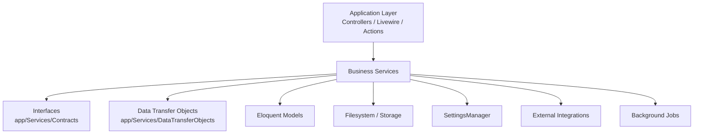

**Diagram sources**
- [AppServiceProvider.php:26-44](file://app/Providers/AppServiceProvider.php#L26-L44)
- [AvailabilityServiceInterface.php:7-132](file://app/Services/Contracts/AvailabilityServiceInterface.php#L7-L132)
- [SeoMetadata.php:9-139](file://app/Services/DataTransferObjects/SeoMetadata.php#L9-L139)

**Section sources**
- [AppServiceProvider.php:1-110](file://app/Providers/AppServiceProvider.php#L1-L110)

## Core Components
The most important business services include:

| Service | Responsibility | Key Dependencies |
|---|---|---|
| `AvailabilityService` | Computes slot status, capacity, and bookable windows for bookings | `SettingsManager`, `Booking`, `Inspection`, `StaffAbsence`, `BookingClosedDay` |
| `BookingCalendarService` | Builds month and day payloads for the public booking calendar | `AvailabilityServiceInterface` |
| `QuoteService` | Updates quote status and deletes quotes | `Quote` model |
| `UserService` | Creates, updates, and deletes users; handles password change session revocation | `UserSessionService`, `User` model |
| `GalleryService` | Manages gallery images, replacement, deletion, and media registry tracking | `MediaRegistryService`, `Storage`, `Image` |
| `MediaLibraryService` | Creates library assets from uploads or existing paths | `GalleryImage`, `Image` |
| `ImageUploadService` | Normalizes uploaded images to WebP at a fixed size and quality | `Image`, `MediaUrl` |
| `MediaRegistryService` | Tracks media file usage across models and supports safe deletion | `MediaRegistry`, `MediaUsage`, `Storage` |
| `ContentBlockCleanupService` | Cleans orphaned temporary uploads referenced by posts | `Post`, `Storage`, filesystem utilities |
| `SettingsManager` | Loads defaults and persisted company settings with request-scoped caching | `CompanySetting`, cache facade |
| `ContactDetails` | Derives phone, WhatsApp, email, and opening hours links from settings | `SettingsManager` |
| `SeoMetadata` | Validates and transforms structured SEO metadata into arrays | Input validation, array conversion helpers |

**Section sources**
- [AvailabilityService.php:1-200](file://app/Services/AvailabilityService.php#L1-L200)
- [BookingCalendarService.php:1-101](file://app/Services/BookingCalendarService.php#L1-L101)
- [QuoteService.php:1-22](file://app/Services/QuoteService.php#L1-L22)
- [UserService.php:1-69](file://app/Services/UserService.php#L1-L69)
- [GalleryService.php:1-139](file://app/Services/GalleryService.php#L1-L139)
- [MediaLibraryService.php:1-79](file://app/Services/MediaLibraryService.php#L1-L79)
- [ImageUploadService.php:1-70](file://app/Services/ImageUploadService.php#L1-L70)
- [MediaRegistryService.php:1-67](file://app/Services/MediaRegistryService.php#L1-L67)
- [ContentBlockCleanupService.php:1-200](file://app/Services/Content/ContentBlockCleanupService.php#L1-L200)
- [SettingsManager.php:1-163](file://app/Services/Settings/SettingsManager.php#L1-L163)
- [ContactDetails.php:1-200](file://app/Services/Contact/ContactDetails.php#L1-L200)
- [SeoMetadata.php:1-140](file://app/Services/DataTransferObjects/SeoMetadata.php#L1-L140)

## Architecture Overview
Highblossom follows a layered approach where presentation and orchestration layers call service methods rather than manipulating models directly. Services encapsulate business rules, coordinate multiple dependencies, and return stable data structures.

Key architectural patterns:
- **Domain-specific services**: Each major area has one primary service (`BookingCalendarService`, `AvailabilityService`, `GalleryService`, `UserService`, `QuoteService`).
- **Interface-driven design**: Availability logic is defined by `AvailabilityServiceInterface`, allowing tests and alternate implementations without changing callers.
- **Request-scoped singletons**: `SettingsManager` is registered as a singleton in the application provider so settings are loaded once per request.
- **Attribute-level DTOs**: Structured values like `SeoMetadata` validate inputs and expose typed accessors instead of passing raw arrays.
- **Separation of concerns**: Image processing, media registry, cleanup, settings, and contact formatting each live in their own service.

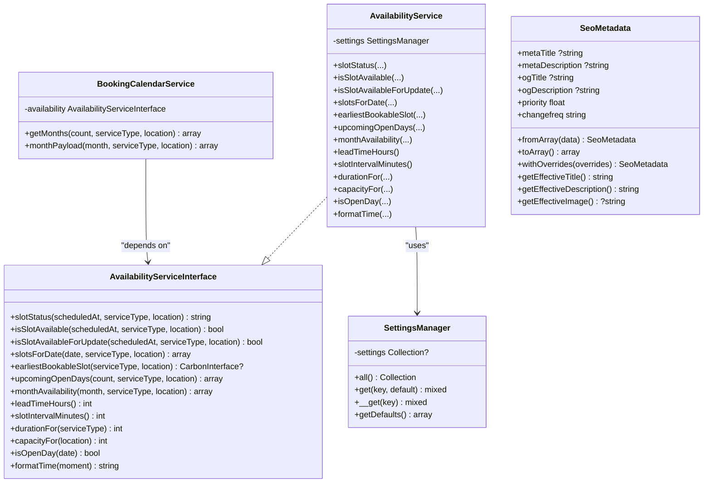

**Diagram sources**
- [AvailabilityServiceInterface.php:7-132](file://app/Services/Contracts/AvailabilityServiceInterface.php#L7-L132)
- [AvailabilityService.php:1-200](file://app/Services/AvailabilityService.php#L1-L200)
- [BookingCalendarService.php:1-101](file://app/Services/BookingCalendarService.php#L1-L101)
- [SettingsManager.php:1-163](file://app/Services/Settings/SettingsManager.php#L1-L163)
- [SeoMetadata.php:1-140](file://app/Services/DataTransferObjects/SeoMetadata.php#L1-L140)

## Detailed Component Analysis

### Booking and Availability Domain

#### Availability Calculation
`AvailabilityService` is the core scheduling engine. It determines whether a requested booking time can be accepted based on:
- Trading hours and closed days.
- Minimum booking notice.
- Job duration for the selected service type.
- Capacity limits per location.
- Existing bookings, inspections, and staff absences.

It exposes both read-only and transaction-safe checks:
- `isSlotAvailable`: normal availability check.
- `isSlotAvailableForUpdate`: intended to run while holding database locks inside a transaction.
- `slotsForDate`: builds display-ready slots with labels, end times, availability, and status codes.
- `monthAvailability`: batches date surveys for efficient calendar rendering.

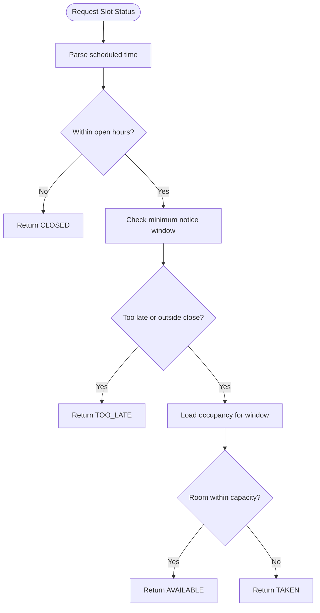

**Diagram sources**
- [AvailabilityService.php:1-200](file://app/Services/AvailabilityService.php#L1-L200)
- [AvailabilityServiceInterface.php:21-66](file://app/Services/Contracts/AvailabilityServiceInterface.php#L21-L66)

#### Calendar Rendering
`BookingCalendarService` delegates availability decisions to `AvailabilityServiceInterface` and returns a predictable structure for the frontend picker. It computes:
- Consecutive months.
- Leading blanks for Monday-first grids.
- Whether a day is selectable.
- Reasons why a day is not selectable: past, closed, or full.

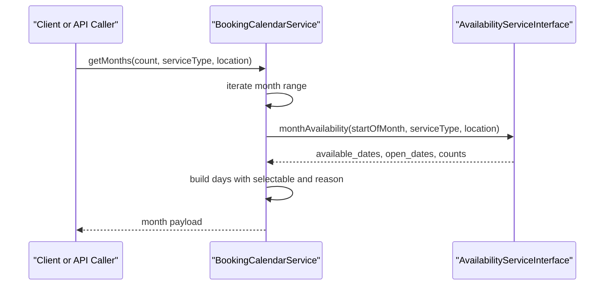

**Diagram sources**
- [BookingCalendarService.php:20-101](file://app/Services/BookingCalendarService.php#L20-L101)
- [AvailabilityServiceInterface.php:68-104](file://app/Services/Contracts/AvailabilityServiceInterface.php#L68-L104)

**Section sources**
- [AvailabilityServiceInterface.php:7-132](file://app/Services/Contracts/AvailabilityServiceInterface.php#L7-L132)
- [AvailabilityService.php:1-200](file://app/Services/AvailabilityService.php#L1-L200)
- [BookingCalendarService.php:1-101](file://app/Services/BookingCalendarService.php#L1-L101)

### User Administration

`UserService` provides create, update, and delete operations for users. It also coordinates session revocation when an admin changes another user’s password.

Important behaviors:
- Password hashing occurs before persistence.
- Role synchronization uses `syncRoles`.
- Update leaves unchanged fields untouched unless explicitly provided.
- Password changes trigger session revocation through `UserSessionService`.

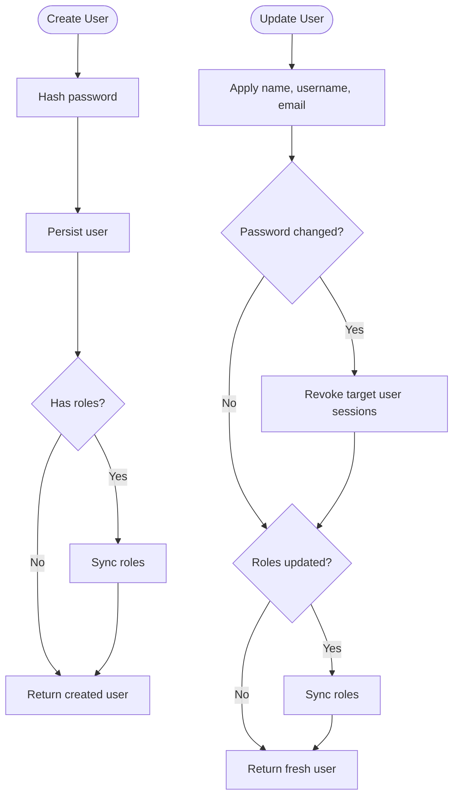

**Diagram sources**
- [UserService.php:9-69](file://app/Services/UserService.php#L9-L69)

**Section sources**
- [UserService.php:1-69](file://app/Services/UserService.php#L1-L69)

### Gallery and Media Management

Gallery and media services handle image uploads, replacement, deletion, and persistent usage tracking.

#### GalleryService
`GalleryService` manages public gallery items:
- Resolves image path from upload, hidden field, or removal flag.
- Sets source metadata.
- Registers or unregisters media usage through `MediaRegistryService`.
- Deletes physical files only after registry cleanup.

#### MediaLibraryService
`MediaLibraryService` creates internal library assets that are not published until explicitly activated. It enforces stricter failure behavior than gallery creation.

#### ImageUploadService
`ImageUploadService` normalizes uploaded images:
- Scales to a maximum long edge.
- Converts to WebP.
- Applies a fixed quality value.
- Falls back to storing the raw file if processing fails.

#### MediaRegistryService
`MediaRegistryService` maintains a registry of stored files and their usages:
- `register`: creates or finds a registry entry and records a model attribute usage.
- `unregister`: removes usage for a specific model and attribute.
- `forceDelete`: deletes the file only when no usages remain.

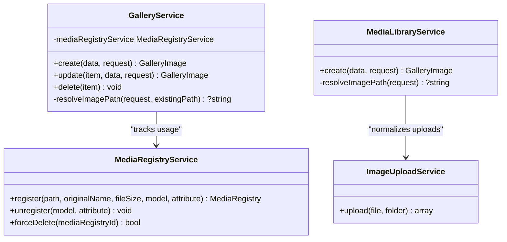

**Diagram sources**
- [GalleryService.php:1-139](file://app/Services/GalleryService.php#L1-L139)
- [MediaLibraryService.php:1-79](file://app/Services/MediaLibraryService.php#L1-L79)
- [ImageUploadService.php:1-70](file://app/Services/ImageUploadService.php#L1-L70)
- [MediaRegistryService.php:1-67](file://app/Services/MediaRegistryService.php#L1-L67)

**Section sources**
- [GalleryService.php:1-139](file://app/Services/GalleryService.php#L1-L139)
- [MediaLibraryService.php:1-79](file://app/Services/MediaLibraryService.php#L1-L79)
- [ImageUploadService.php:1-70](file://app/Services/ImageUploadService.php#L1-L70)
- [MediaRegistryService.php:1-67](file://app/Services/MediaRegistryService.php#L1-L67)

### Content Cleanup

`ContentBlockCleanupService` protects storage from accumulating orphaned temporary uploads. It:
- Scans temporary storage.
- Collects all file paths referenced by post block content.
- Classifies files older than a retention threshold as orphaned.
- Returns counts of deleted and skipped files.
- Logs deletions and failures.

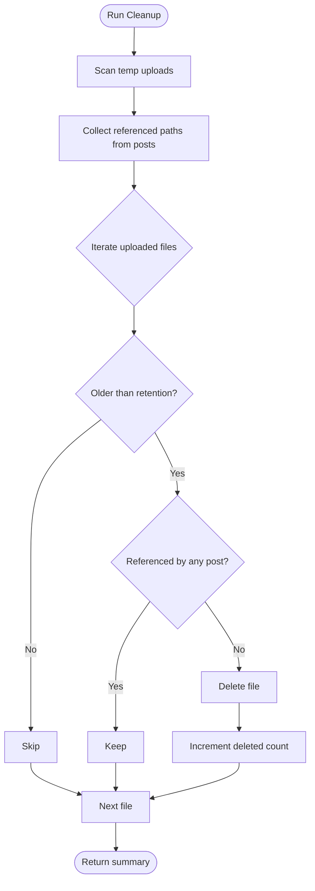

**Diagram sources**
- [ContentBlockCleanupService.php:1-200](file://app/Services/Content/ContentBlockCleanupService.php#L1-L200)

**Section sources**
- [ContentBlockCleanupService.php:1-200](file://app/Services/Content/ContentBlockCleanupService.php#L1-L200)

### Settings and Contact Details

#### SettingsManager
`SettingsManager` merges default configuration with persisted company settings and caches them per request. Defaults cover business hours, booking durations, capacities, timezone, locale, hero content, SEO fields, social links, and more.

#### ContactDetails
`ContactDetails` derives consistent contact information for navigation, footers, CTAs, WhatsApp messages, and structured data. It normalizes phone numbers, generates `tel:` and `wa.me:` links, and collapses working hours into readable ranges.

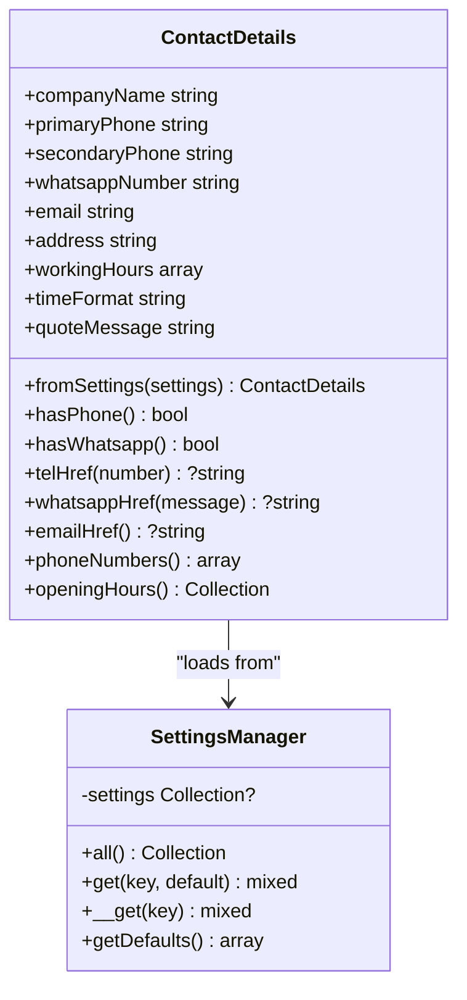

**Diagram sources**
- [SettingsManager.php:1-163](file://app/Services/Settings/SettingsManager.php#L1-L163)
- [ContactDetails.php:1-200](file://app/Services/Contact/ContactDetails.php#L1-L200)

**Section sources**
- [SettingsManager.php:1-163](file://app/Services/Settings/SettingsManager.php#L1-L163)
- [ContactDetails.php:1-200](file://app/Services/Contact/ContactDetails.php#L1-L200)

### SEO Metadata DTO

`SeoMetadata` is a final readonly data transfer object representing page SEO metadata. It validates priority and sitemap change frequency, provides construction from arrays, safe overrides, effective title/description/image fallbacks, and array serialization.

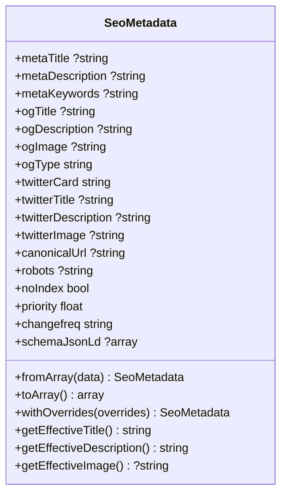

**Diagram sources**
- [SeoMetadata.php:1-140](file://app/Services/DataTransferObjects/SeoMetadata.php#L1-L140)

**Section sources**
- [SeoMetadata.php:1-140](file://app/Services/DataTransferObjects/SeoMetadata.php#L1-L140)

### Quote Service

`QuoteService` provides simple domain operations for quotes:
- `updateStatus`: persists a status and returns a refreshed model.
- `delete`: deletes a quote record.

Although small, it isolates quote mutations from controllers and Livewire components, making authorization, auditing, and event dispatch easier to add later.

**Section sources**
- [QuoteService.php:1-22](file://app/Services/QuoteService.php#L1-L22)

## Dependency Analysis

### Container Registration and Singletons
`AppServiceProvider` registers key services:
- `SettingsManager` as a singleton.
- `AvailabilityServiceInterface` bound to `AvailabilityService`.
- `ProbeRunner` as a request-scoped singleton.

This ensures that settings and availability calculations use consistent state during a request and can be replaced or extended in tests.

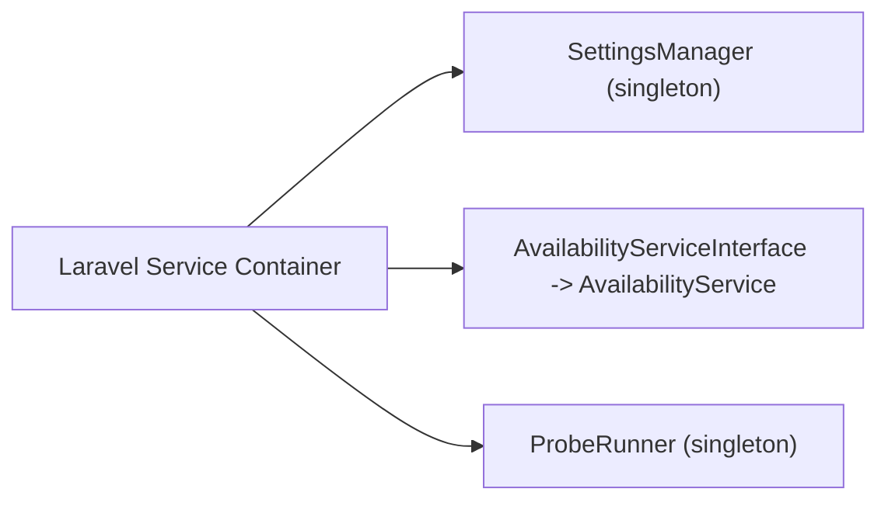

**Diagram sources**
- [AppServiceProvider.php:26-44](file://app/Providers/AppServiceProvider.php#L26-L44)

### Service-to-Model Relationships
Services coordinate with models as follows:
- `AvailabilityService` reads `Booking`, `Inspection`, `StaffAbsence`, and `BookingClosedDay` to determine conflicts.
- `GalleryService` and `MediaLibraryService` create and update `GalleryImage`.
- `MediaRegistryService` tracks relationships between `MediaRegistry` and `MediaUsage`.
- `ContentBlockCleanupService` scans `Post` content for referenced files.
- `UserService` interacts with `User` and role synchronization.

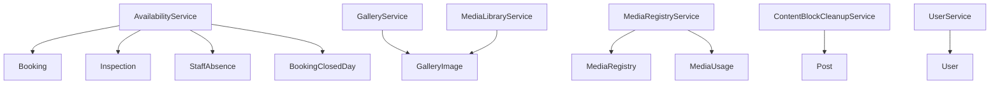

**Diagram sources**
- [AvailabilityService.php:1-200](file://app/Services/AvailabilityService.php#L1-L200)
- [GalleryService.php:1-139](file://app/Services/GalleryService.php#L1-L139)
- [MediaLibraryService.php:1-79](file://app/Services/MediaLibraryService.php#L1-L79)
- [MediaRegistryService.php:1-67](file://app/Services/MediaRegistryService.php#L1-L67)
- [ContentBlockCleanupService.php:1-200](file://app/Services/Content/ContentBlockCleanupService.php#L1-L200)
- [UserService.php:1-69](file://app/Services/UserService.php#L1-L69)

**Section sources**
- [AppServiceProvider.php:26-44](file://app/Providers/AppServiceProvider.php#L26-L44)
- [AvailabilityService.php:1-200](file://app/Services/AvailabilityService.php#L1-L200)
- [GalleryService.php:1-139](file://app/Services/GalleryService.php#L1-L139)
- [MediaLibraryService.php:1-79](file://app/Services/MediaLibraryService.php#L1-L79)
- [MediaRegistryService.php:1-67](file://app/Services/MediaRegistryService.php#L1-L67)
- [ContentBlockCleanupService.php:1-200](file://app/Services/Content/ContentBlockCleanupService.php#L1-L200)
- [UserService.php:1-69](file://app/Services/UserService.php#L1-L69)

## Performance Considerations
- **Batched availability queries**: `AvailabilityService` avoids per-slot queries by loading occupancy once per time window, reducing database round trips for large calendars.
- **Request-scoped settings cache**: `SettingsManager` loads defaults and persisted settings once per request, preventing repeated lookups.
- **Image normalization limits**: `ImageUploadService` caps dimensions and applies a fixed WebP quality to reduce storage and bandwidth costs.
- **Conditional media cleanup**: Orphaned file cleanup separates deletion from scanning and logging, minimizing unnecessary I/O.
- **Transaction-safe availability checks**: `isSlotAvailableForUpdate` is designed for use inside database transactions to prevent double-booking under concurrency.

[No sources needed since this section provides general guidance]

## Troubleshooting Guide

### Common Issues and Mitigations

| Symptom | Likely Cause | Recommended Action |
|---|---|---|
| Calendar shows fully booked days as selectable | Old client-side selection logic relying only on open days | Verify that `BookingCalendarService.monthPayload` sets `selectable` using available dates, not just open dates. |
| Double-bookings occur under concurrent requests | Availability checked outside a lock | Use `isSlotAvailableForUpdate` inside a transaction when persisting bookings. |
| Uploaded images fail or consume excessive space | Image processing driver failure or oversized input | Check `ImageUploadService` error logs and ensure the image driver is configured; verify scaling and quality constants. |
| Deleted gallery images still exist on disk | Physical file deletion not coordinated with registry | Ensure `GalleryService::delete` calls registry unregister and deletes the file only after registry cleanup. |
| Temporary uploads accumulate over time | Cleanup job not running or retention threshold too high | Run `ContentBlockCleanupService::cleanupOrphanedUploads` regularly and adjust retention hours. |
| Contact links show wrong numbers or missing hrefs | Missing or malformed settings | Validate company settings via `SettingsManager` and inspect `ContactDetails` output. |
| SEO metadata contains invalid priority or changefreq | Raw array passed without validation | Construct `SeoMetadata` through its constructor or `fromArray`, which validates constraints. |

**Section sources**
- [BookingCalendarService.php:40-101](file://app/Services/BookingCalendarService.php#L40-L101)
- [AvailabilityServiceInterface.php:47-66](file://app/Services/Contracts/AvailabilityServiceInterface.php#L47-L66)
- [ImageUploadService.php:28-70](file://app/Services/ImageUploadService.php#L28-L70)
- [GalleryService.php:73-139](file://app/Services/GalleryService.php#L73-L139)
- [ContentBlockCleanupService.php:1-200](file://app/Services/Content/ContentBlockCleanupService.php#L1-L200)
- [SettingsManager.php:1-163](file://app/Services/Settings/SettingsManager.php#L1-L163)
- [ContactDetails.php:1-200](file://app/Services/Contact/ContactDetails.php#L1-L200)
- [SeoMetadata.php:15-45](file://app/Services/DataTransferObjects/SeoMetadata.php#L15-L45)

## Conclusion
Highblossom’s business services layer provides clear boundaries between presentation and domain logic. Services encapsulate complex workflows around bookings, galleries, users, settings, content cleanup, and SEO data. The architecture favors interfaces for critical domain capabilities, request-scoped singletons for shared state, and explicit DTOs for structured data exchange. Controllers, Livewire components, actions, and jobs should consume these services rather than reaching directly into models or storage, keeping business rules testable, maintainable, and consistent.

[No sources needed since this section summarizes without analyzing specific files]

## Appendices

### Creating a New Business Service
Recommended steps:
1. Define the responsibility clearly and place the class under `app/Services` or a feature subdirectory such as `app/Services/Content`.
2. If the behavior may need alternate implementations, define an interface under `app/Services/Contracts`.
3. Inject dependencies through the constructor; prefer narrow interfaces over facades.
4. Return stable data structures or Eloquent models rather than raw arrays whenever possible.
5. Register bindings in `AppServiceProvider` if you need container control beyond automatic resolution.
6. Add validation and error handling at the service boundary.
7. Write unit tests against the interface and mock external dependencies such as storage, mail, or third-party APIs.

**Section sources**
- [AppServiceProvider.php:26-44](file://app/Providers/AppServiceProvider.php#L26-L44)
- [AvailabilityServiceInterface.php:7-132](file://app/Services/Contracts/AvailabilityServiceInterface.php#L7-L132)

### Handling Transactions
Use cases:
- Booking creation must reserve a slot while preventing race conditions.
- Multi-step operations involving models, media registry, and notifications should succeed or fail atomically.

Guidelines:
- Wrap related writes in a database transaction.
- Call `isSlotAvailableForUpdate` while holding the row lock.
- Perform side effects such as emails or background jobs outside the critical transaction when appropriate.
- Roll back automatically on exceptions; log meaningful context.

**Section sources**
- [AvailabilityServiceInterface.php:47-66](file://app/Services/Contracts/AvailabilityServiceInterface.php#L47-L66)

### Managing Errors
Patterns observed in the codebase:
- Throw domain-specific exceptions for invalid inputs, such as `RuntimeException` when required uploads are missing.
- Log recoverable infrastructure failures, such as image processing errors, without crashing endpoints.
- Return structured summaries for batch operations, such as cleanup results.
- Use validation in DTO constructors to fail fast on invalid configuration data.

**Section sources**
- [ImageUploadService.php:28-70](file://app/Services/ImageUploadService.php#L28-L70)
- [MediaLibraryService.php:20-79](file://app/Services/MediaLibraryService.php#L20-L79)
- [ContentBlockCleanupService.php:1-200](file://app/Services/Content/ContentBlockCleanupService.php#L1-L200)
- [SeoMetadata.php:15-45](file://app/Services/DataTransferObjects/SeoMetadata.php#L15-L45)

### Testing Service Classes
Recommendations:
- Test interface-bound services against their contract.
- Mock `SettingsManager`, `Storage`, and other external dependencies.
- Assert returned data shapes for calendar, availability, and cleanup operations.
- Use Laravel’s test container to bind alternative implementations where necessary.
- Cover error paths for invalid uploads, missing settings, and failed storage operations.

**Section sources**
- [AvailabilityServiceInterface.php:7-132](file://app/Services/Contracts/AvailabilityServiceInterface.php#L7-L132)
- [SettingsManager.php:1-163](file://app/Services/Settings/SettingsManager.php#L1-L163)
- [ImageUploadService.php:1-70](file://app/Services/ImageUploadService.php#L1-L70)
- [ContentBlockCleanupService.php:1-200](file://app/Services/Content/ContentBlockCleanupService.php#L1-L200)