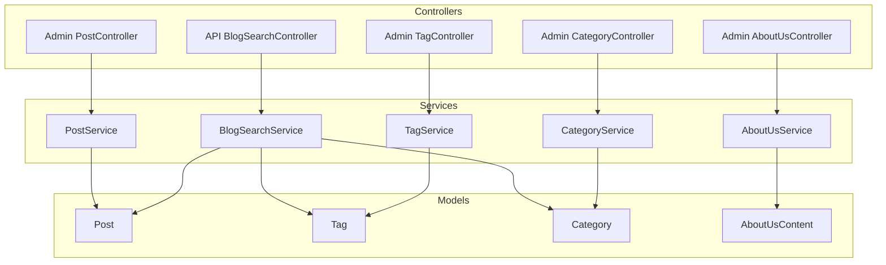
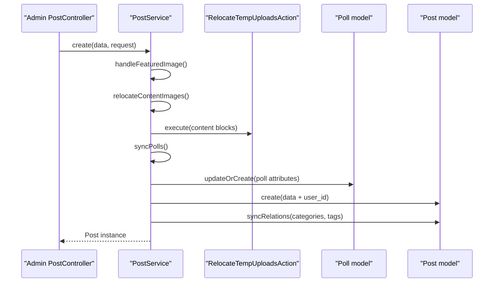
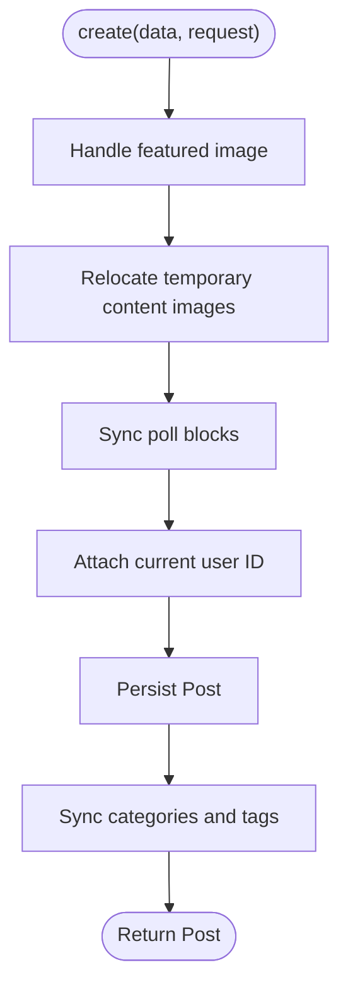
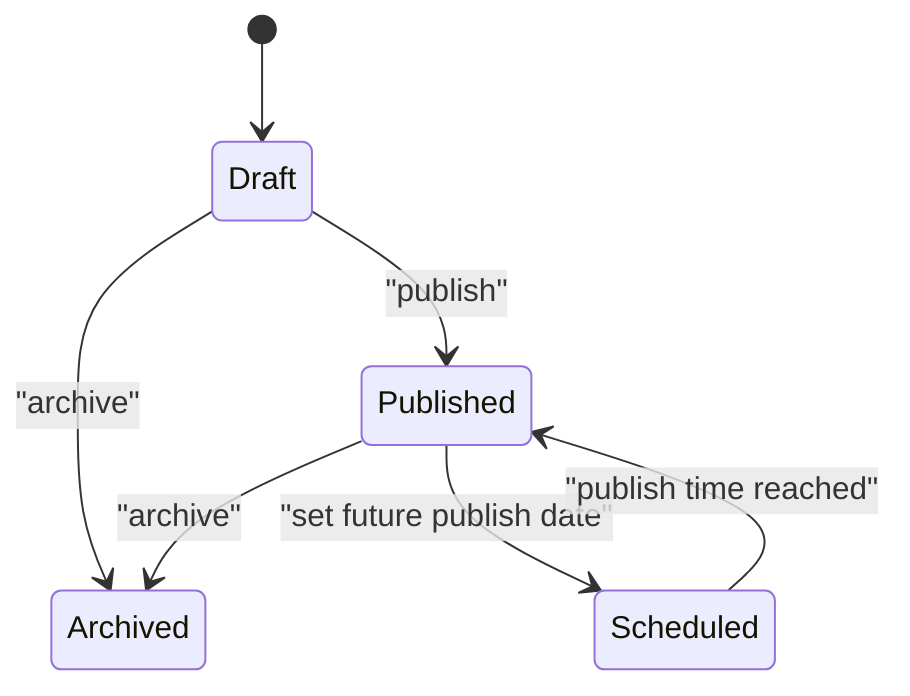
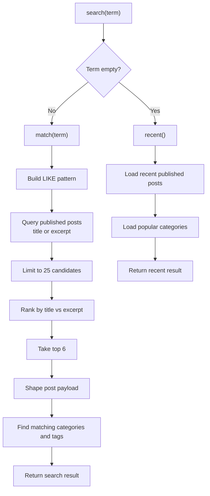
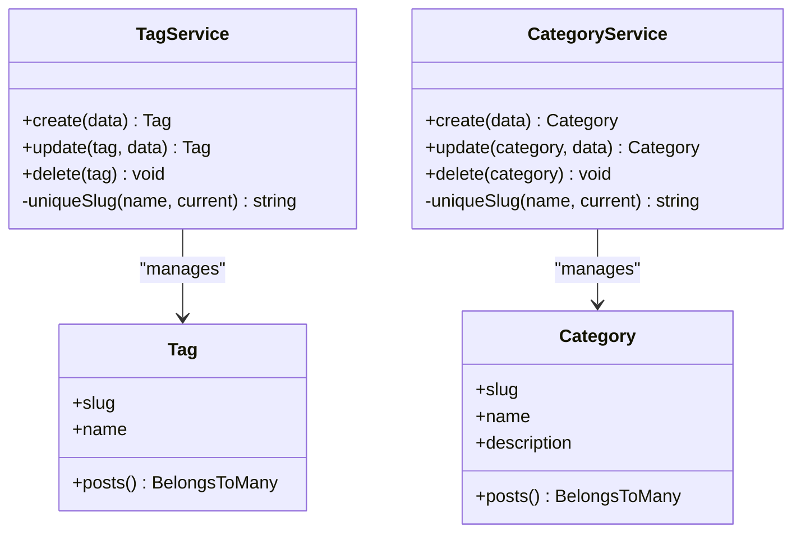
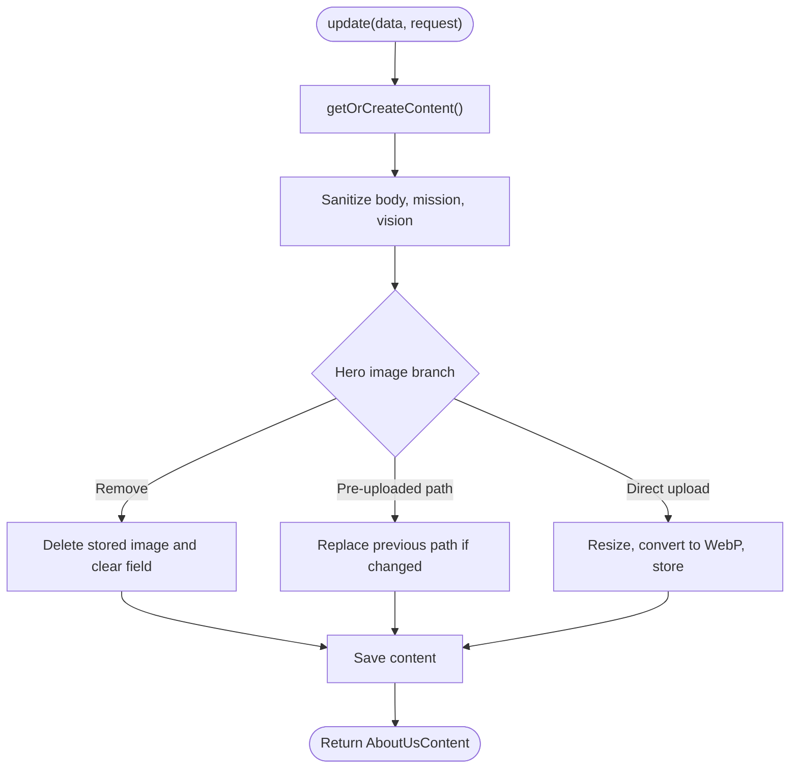
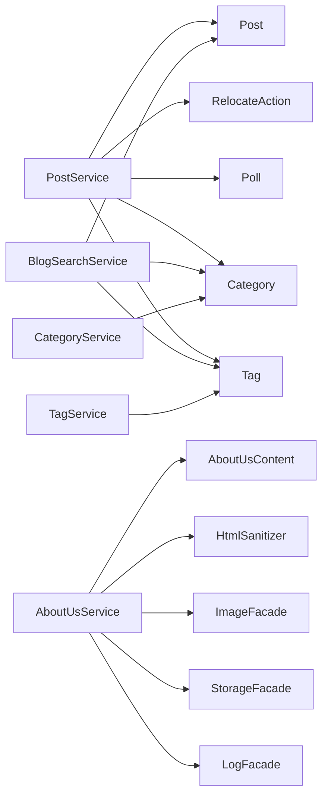

# Content Management Services

<cite>
**Referenced Files in This Document **
- [PostService.php](file://app/Services/PostService.php)
- [BlogSearchService.php](file://app/Services/BlogSearchService.php)
- [TagService.php](file://app/Services/TagService.php)
- [CategoryService.php](file://app/Services/CategoryService.php)
- [AboutUsService.php](file://app/Services/AboutUsService.php)
- [Post.php](file://app/Models/Post.php)
- [Tag.php](file://app/Models/Tag.php)
- [Category.php](file://app/Models/Category.php)
- [AboutUsContent.php](file://app/Models/AboutUsContent.php)
- [Admin PostController.php](file://app/Http/Controllers/Admin/PostController.php)
- [API BlogSearchController.php](file://app/Http/Controllers/Api/BlogSearchController.php)
- [Admin TagController.php](file://app/Http/Controllers/Admin/TagController.php)
- [Admin CategoryController.php](file://app/Http/Controllers/Admin/CategoryController.php)
- [Admin AboutUsController.php](file://app/Http/Controllers/Admin/AboutUsController.php)
- [Web routes](file://routes/web.php)
</cite>

## Table of Contents
1. [Introduction](#introduction)
2. [Project Structure](#project-structure)
3. [Core Components](#core-components)
4. [Architecture Overview](#architecture-overview)
5. [Detailed Component Analysis](#detailed-component-analysis)
6. [Dependency Analysis](#dependency-analysis)
7. [Performance Considerations](#performance-considerations)
8. [Troubleshooting Guide](#troubleshooting-guide)
9. [Conclusion](#conclusion)
10. [Appendices](#appendices)

## Introduction
This document explains the content management services layer that powers blog posts, search, taxonomy, and dynamic About Us page content. It focuses on:

- Post lifecycle management through `PostService`, including creation, updating, publishing, archiving, and relation synchronization.
- Full-text search behavior through `BlogSearchService`, including candidate selection, ranking, filtering by category or tag, and performance constraints.
- Taxonomy management through `TagService` and `CategoryService`, including slug generation and relationship handling.
- Dynamic page building through `AboutUsService`, including content block sanitization, hero image processing, and active-content resolution.

The services are intentionally thin business layers around Eloquent models. Controllers validate input and delegate persistence, media handling, status transitions, and presentation shaping to these services.

## Project Structure
The content management services live under `app/Services`. They interact with Eloquent models under `app/Models`, admin/API controllers under `app/Http/Controllers`, and public/admin routes under `routes`.

**Diagram sources**
- [Admin PostController.php:1-191](file://app/Http/Controllers/Admin/PostController.php#L1-L191)
- [API BlogSearchController.php:1-37](file://app/Http/Controllers/Api/BlogSearchController.php#L1-L37)
- [Admin TagController.php:1-98](file://app/Http/Controllers/Admin/TagController.php#L1-L98)
- [Admin CategoryController.php:1-98](file://app/Http/Controllers/Admin/CategoryController.php#L1-L98)
- [Admin AboutUsController.php:1-40](file://app/Http/Controllers/Admin/AboutUsController.php#L1-L40)
- [PostService.php:1-178](file://app/Services/PostService.php#L1-L178)
- [BlogSearchService.php:1-203](file://app/Services/BlogSearchService.php#L1-L203)
- [TagService.php:1-64](file://app/Services/TagService.php#L1-L64)
- [CategoryService.php:1-64](file://app/Services/CategoryService.php#L1-L64)
- [AboutUsService.php:1-173](file://app/Services/AboutUsService.php#L1-L173)
- [Post.php:1-274](file://app/Models/Post.php#L1-L274)
- [Tag.php:1-46](file://app/Models/Tag.php#L1-L46)
- [Category.php:1-46](file://app/Models/Category.php#L1-L46)
- [AboutUsContent.php:1-55](file://app/Models/AboutUsContent.php#L1-L55)

**Section sources**
- [PostService.php:1-178](file://app/Services/PostService.php#L1-L178)
- [BlogSearchService.php:1-203](file://app/Services/BlogSearchService.php#L1-L203)
- [TagService.php:1-64](file://app/Services/TagService.php#L1-L64)
- [CategoryService.php:1-64](file://app/Services/CategoryService.php#L1-L64)
- [AboutUsService.php:1-173](file://app/Services/AboutUsService.php#L1-L173)
- [Post.php:1-274](file://app/Models/Post.php#L1-L274)
- [Tag.php:1-46](file://app/Models/Tag.php#L1-L46)
- [Category.php:1-46](file://app/Models/Category.php#L1-L46)
- [AboutUsContent.php:1-55](file://app/Models/AboutUsContent.php#L1-L55)
- [Admin PostController.php:1-191](file://app/Http/Controllers/Admin/PostController.php#L1-L191)
- [API BlogSearchController.php:1-37](file://app/Http/Controllers/Api/BlogSearchController.php#L1-L37)
- [Admin TagController.php:1-98](file://app/Http/Controllers/Admin/TagController.php#L1-L98)
- [Admin CategoryController.php:1-98](file://app/Http/Controllers/Admin/CategoryController.php#L1-L98)
- [Admin AboutUsController.php:1-40](file://app/Http/Controllers/Admin/AboutUsController.php#L1-L40)
- [Web routes:21-40](file://routes/web.php#L21-L40)

## Core Components
| Service | Responsibility | Key Behaviors | Primary Model(s) |
|---|---|---|---|
| `PostService` | Blog post lifecycle | Create/update posts, handle featured images, relocate temporary content images, sync polls, sync categories/tags, update single or bulk status, delete posts | `Post` |
| `BlogSearchService` | Predictive blog search | Normalize queries, return recent posts when empty, match title/excerpt, rank candidates, include matching categories and tags | `Post`, `Category`, `Tag` |
| `TagService` | Tag CRUD and SEO-friendly slugs | Generate unique slugs, create/update/delete tags | `Tag` |
| `CategoryService` | Category CRUD and SEO-friendly slugs | Generate unique slugs, create/update/delete categories | `Category` |
| `AboutUsService` | Dynamic About Us page content | Get-or-create active content, sanitize rich text, process hero images, persist content | `AboutUsContent` |

**Section sources**
- [PostService.php:1-178](file://app/Services/PostService.php#L1-L178)
- [BlogSearchService.php:1-203](file://app/Services/BlogSearchService.php#L1-L203)
- [TagService.php:1-64](file://app/Services/TagService.php#L1-L64)
- [CategoryService.php:1-64](file://app/Services/CategoryService.php#L1-L64)
- [AboutUsService.php:1-173](file://app/Services/AboutUsService.php#L1-L173)

## Architecture Overview
The content system follows a controller-to-service-to-model flow:

- Admin/API controllers receive validated requests.
- Services encapsulate domain logic: persistence, media handling, status transitions, search ranking, and URL-safe slug generation.
- Models define relationships, scopes, computed attributes, and route binding.

**Diagram sources**
- [Admin PostController.php:58-75](file://app/Http/Controllers/Admin/PostController.php#L58-L75)
- [PostService.php:25-47](file://app/Services/PostService.php#L25-L47)
- [PostService.php:97-121](file://app/Services/PostService.php#L97-L121)
- [PostService.php:157-177](file://app/Services/PostService.php#L157-L177)

## Detailed Component Analysis

### PostService: Article Lifecycle Management
`PostService` centralizes blog post operations. Its responsibilities include:

- Creating posts with featured images, relocated content images, synced poll data, author attribution, and category/tag relations.
- Updating existing posts while preserving image replacement/removal semantics and relation synchronization.
- Publishing workflow: transitioning between draft, published, and archived states; automatically setting `published_at` for newly published posts.
- Bulk status updates across multiple posts.
- Deleting posts.

#### Post Creation Flow

**Diagram sources**
- [PostService.php:25-47](file://app/Services/PostService.php#L25-L47)
- [PostService.php:97-121](file://app/Services/PostService.php#L97-L121)
- [PostService.php:157-177](file://app/Services/PostService.php#L157-L177)

#### Publishing Workflow
Publishing is enforced at both the service and controller layers:

- The controller checks whether required fields exist before allowing publication.
- `PostService::updateStatus` changes the status and sets `published_at` when transitioning to published.
- `Post::scopePublished` ensures only published posts with a past publish time are visible publicly.
- `Post::isLive` and `Post::isScheduled` distinguish immediately live posts from scheduled ones.

**Diagram sources**
- [Admin PostController.php:95-125](file://app/Http/Controllers/Admin/PostController.php#L95-L125)
- [PostService.php:49-76](file://app/Services/PostService.php#L49-L76)
- [Post.php:120-140](file://app/Models/Post.php#L120-L140)
- [Post.php:160-180](file://app/Models/Post.php#L160-L180)

#### Image and Content Handling
- Featured images can be uploaded during creation or updated/replaced during editing.
- Temporary content images are relocated into permanent storage through `RelocateTempUploadsAction`.
- Poll blocks embedded in content are synchronized with the `Poll` table so their IDs remain stable.

**Section sources**
- [PostService.php:25-177](file://app/Services/PostService.php#L25-L177)
- [Admin PostController.php:58-191](file://app/Http/Controllers/Admin/PostController.php#L58-L191)
- [Post.php:120-274](file://app/Models/Post.php#L120-L274)

### BlogSearchService: Full-Text Search, Filtering, and Performance
`BlogSearchService` implements a lightweight, predictive search experience intended for a command palette rather than a heavy full-page re-render.

Key behaviors:

- Empty query returns recent published posts and popular categories.
- Non-empty query matches only published posts against title and excerpt using SQL `LIKE`.
- Candidates are limited to 25 rows and ranked in PHP: title matches rank higher than excerpt matches.
- Results are capped at six posts.
- Matching categories and tags are included so users can quickly switch filters.
- Query terms are normalized and escaped to prevent SQL wildcard injection.

**Diagram sources**
- [BlogSearchService.php:33-115](file://app/Services/BlogSearchService.php#L33-L115)
- [BlogSearchService.php:117-199](file://app/Services/BlogSearchService.php#L117-L199)

#### Filtering Capabilities
- Category and tag filtering appear as suggestions in the search results.
- Each suggestion includes an identifier, type, label, post count metadata, and a generated route link.
- Exact name matches sort first, then by post count, then alphabetically.

#### Performance Optimizations
- Dedicated search path avoids re-rendering heavy Livewire components on every keystroke.
- Candidate limit prevents large dataset scans.
- Only necessary columns are selected.
- Ranking is performed in PHP over a small candidate set instead of complex driver-specific SQL.
- Term escaping protects against wildcard abuse.
- Controller validates maximum query length.

**Section sources**
- [BlogSearchService.php:1-203](file://app/Services/BlogSearchService.php#L1-L203)
- [API BlogSearchController.php:1-37](file://app/Http/Controllers/Api/BlogSearchController.php#L1-L37)

### TagService and CategoryService: Relationship Management and SEO-Friendly URLs
Both services provide symmetric CRUD operations for blog taxonomy:

- Create: generate a URL-safe slug based on the human-readable name.
- Update: regenerate slug if missing after a name change.
- Delete: remove the taxonomy term.
- Slug uniqueness: append numeric suffixes such as `-2`, `-3`, until a free slug is found.

**Diagram sources**
- [TagService.php:1-64](file://app/Services/TagService.php#L1-L64)
- [CategoryService.php:1-64](file://app/Services/CategoryService.php#L1-L64)
- [Tag.php:1-46](file://app/Models/Tag.php#L1-L46)
- [Category.php:1-46](file://app/Models/Category.php#L1-L46)

#### Hierarchical Organization Notes
The current implementation does not enforce parent-child hierarchy between categories or tags. Categories and tags are flat taxonomies connected to posts through many-to-many pivot tables. If hierarchical organization is needed, it should be introduced through additional schema fields and service-level validation, while preserving slug uniqueness and SEO routing.

**Section sources**
- [TagService.php:1-64](file://app/Services/TagService.php#L1-L64)
- [CategoryService.php:1-64](file://app/Services/CategoryService.php#L1-L64)
- [Tag.php:1-46](file://app/Models/Tag.php#L1-L46)
- [Category.php:1-46](file://app/Models/Category.php#L1-L46)
- [Admin TagController.php:1-98](file://app/Http/Controllers/Admin/TagController.php#L1-L98)
- [Admin CategoryController.php:1-98](file://app/Http/Controllers/Admin/CategoryController.php#L1-L98)

### AboutUsService: Content Block Management and Dynamic Page Building
`AboutUsService` manages the company’s About Us page content. It resolves the active row, sanitizes rich text, processes hero images, and persists structured fields.

Key capabilities:

- Get-or-create active content: prefers an active row with real content, otherwise falls back to the most recently edited row.
- Rich text sanitization: uses `HtmlSanitizer` to strip unsafe markup while preserving safe HTML.
- Hero image handling supports three branches:
  1. Explicit removal deletes stored files and clears the field.
  2. Adoption of a pre-uploaded path replaces previous files when changed.
  3. Direct file upload resizes to a fixed cover size, converts to WebP, applies fixed quality, and stores under the public disk.
- Structured fields include title, subtitle, body, mission, vision, and an active flag.

**Diagram sources**
- [AboutUsService.php:45-94](file://app/Services/AboutUsService.php#L45-L94)
- [AboutUsService.php:113-172](file://app/Services/AboutUsService.php#L113-L172)

#### Active Content Resolution
The model determines which row represents the “active” About Us content by scanning active rows ordered by recency and preferring the first row that contains renderable copy. If no active row has content, it returns the most recently edited row.

**Section sources**
- [AboutUsService.php:1-173](file://app/Services/AboutUsService.php#L1-L173)
- [AboutUsContent.php:1-55](file://app/Models/AboutUsContent.php#L1-L55)
- [Admin AboutUsController.php:1-40](file://app/Http/Controllers/Admin/AboutUsController.php#L1-L40)
- [Web routes:21-21](file://routes/web.php#L21-L21)

## Dependency Analysis
The services have clear boundaries and minimal coupling:

- `PostService` depends on:
  - `Post` model for persistence.
  - `RelocateTempUploadsAction` for content image relocation.
  - `Poll` model for embedded poll synchronization.
  - Category and tag relations via `Post` relationships.
- `BlogSearchService` depends on:
  - `Post`, `Category`, and `Tag` models.
  - Route generation for taxonomy links.
  - Laravel string utilities for normalization and escaping.
- `TagService` and `CategoryService` depend only on their respective models and string utilities.
- `AboutUsService` depends on:
  - `AboutUsContent` model.
  - HTML sanitizer.
  - Image processing facade.
  - Storage facade for file deletion.
  - Logging facade for error recording.

**Diagram sources**
- [PostService.php:1-178](file://app/Services/PostService.php#L1-L178)
- [BlogSearchService.php:1-203](file://app/Services/BlogSearchService.php#L1-L203)
- [TagService.php:1-64](file://app/Services/TagService.php#L1-L64)
- [CategoryService.php:1-64](file://app/Services/CategoryService.php#L1-L64)
- [AboutUsService.php:1-173](file://app/Services/AboutUsService.php#L1-L173)

**Section sources**
- [PostService.php:1-178](file://app/Services/PostService.php#L1-L178)
- [BlogSearchService.php:1-203](file://app/Services/BlogSearchService.php#L1-L203)
- [TagService.php:1-64](file://app/Services/TagService.php#L1-L64)
- [CategoryService.php:1-64](file://app/Services/CategoryService.php#L1-L64)
- [AboutUsService.php:1-173](file://app/Services/AboutUsService.php#L1-L173)

## Performance Considerations
- **Candidate limits:** Blog search caps candidates at 25 rows and final results at 6 posts, reducing memory and ranking overhead.
- **Column selection:** Search queries select only the columns needed for the palette response.
- **Eager loading:** Search loads related categories with minimal columns.
- **PHP ranking:** Ranking is done in PHP over a small dataset instead of complex database expressions, keeping queries portable.
- **Image processing:** About Us hero images are processed once during save and stored as WebP with fixed dimensions and quality.
- **Avoided re-renders:** The search API deliberately bypasses heavy Livewire components to support fast type-ahead.

[No sources needed since this section provides general guidance derived from already analyzed files]

## Troubleshooting Guide
Common issues and where to investigate:

- **Post cannot be published:**
  - Check required content, excerpt, and category presence via the model’s publish requirement logic.
  - Verify the controller rejects publication when requirements are missing.
  - Confirm the status transition goes through `PostService::updateStatus`.

- **Post appears scheduled instead of live:**
  - Inspect `published_at`; a future timestamp marks a post as scheduled even if its status is published.
  - Use `Post::isScheduled` and `Post::isLive` to understand visibility.

- **Search returns no results:**
  - Ensure the post status is `published`.
  - Confirm the query matches title or excerpt because body content is not searched directly.
  - Validate the search query length and normalization.

- **Tag or category slug collision:**
  - The services append numeric suffixes until a unique slug exists.
  - Verify the slug generation excludes the current entity during updates.

- **About Us hero image not saved or deleted:**
  - Check the three image branches: removal, pre-uploaded path, direct upload.
  - Review logs for image processing failures.
  - Verify public disk storage configuration and permissions.

**Section sources**
- [Post.php:140-200](file://app/Models/Post.php#L140-L200)
- [Admin PostController.php:95-191](file://app/Http/Controllers/Admin/PostController.php#L95-L191)
- [BlogSearchService.php:33-115](file://app/Services/BlogSearchService.php#L33-L115)
- [TagService.php:45-64](file://app/Services/TagService.php#L45-L64)
- [CategoryService.php:45-64](file://app/Services/CategoryService.php#L45-L64)
- [AboutUsService.php:113-172](file://app/Services/AboutUsService.php#L113-L172)

## Conclusion
The content management services layer provides focused, testable domains for blog posts, search, taxonomy, and dynamic page content. Post lifecycle operations are centralized behind `PostService`, search behavior is optimized for responsive autocomplete experiences, taxonomy services ensure SEO-friendly slugs, and `AboutUsService` combines structured content with safe rich text and processed media. Extending the system should preserve these boundaries: add new fields or behaviors inside the relevant service and model, keep controllers thin, and avoid moving heavy presentation logic into services.

[No sources needed since this section summarizes without analyzing specific files]

## Appendices

### Example Workflows

#### Creating a Blog Post
1. Admin submits a post form through `Admin\PostController@store`.
2. Request validation extracts block content.
3. `PostService::create` handles featured image, relocates temporary images, syncs polls, assigns author, creates the post, and synchronizes categories and tags.
4. Admin is redirected to the post index.

**Section sources**
- [Admin PostController.php:58-75](file://app/Http/Controllers/Admin/PostController.php#L58-L75)
- [PostService.php:25-47](file://app/Services/PostService.php#L25-L47)

#### Implementing Search Functionality
1. Frontend calls the search API endpoint with an optional query parameter.
2. `BlogSearchController` validates the query length.
3. `BlogSearchService::search` returns either recent posts or ranked results with matching taxonomy suggestions.
4. Frontend renders a lightweight palette without full-page re-renders.

**Section sources**
- [API BlogSearchController.php:1-37](file://app/Http/Controllers/Api/BlogSearchController.php#L1-L37)
- [BlogSearchService.php:33-115](file://app/Services/BlogSearchService.php#L33-L115)

#### Managing Content Taxonomy
1. Admin creates, updates, or deletes tags/categories through their respective controllers.
2. Services compute unique slugs.
3. Posts attach categories and tags through many-to-many relationships.
4. Routes use slugs for SEO-friendly listing pages.

**Section sources**
- [Admin TagController.php:1-98](file://app/Http/Controllers/Admin/TagController.php#L1-L98)
- [Admin CategoryController.php:1-98](file://app/Http/Controllers/Admin/CategoryController.php#L1-L98)
- [TagService.php:1-64](file://app/Services/TagService.php#L1-L64)
- [CategoryService.php:1-64](file://app/Services/CategoryService.php#L1-L64)

#### Extending the Content System
- Custom post fields:
  - Add fillable attributes and casts to the `Post` model.
  - Include them in `PostService::create` and `update` payloads.
  - Extend publish requirements if the field is mandatory.
- Custom About Us blocks:
  - Add fields to `AboutUsContent`.
  - Sanitize and persist them through `AboutUsService::update`.
  - Update the active-content selection logic if the new fields affect “content.”
- Custom search scope:
  - Extend `BlogSearchService::match` with additional searchable columns.
  - Keep candidate limits and ranking strategy consistent with the existing design.

**Section sources**
- [Post.php:1-120](file://app/Models/Post.php#L1-L120)
- [PostService.php:25-121](file://app/Services/PostService.php#L25-L121)
- [AboutUsContent.php:1-55](file://app/Models/AboutUsContent.php#L1-L55)
- [AboutUsService.php:45-112](file://app/Services/AboutUsService.php#L45-L112)
- [BlogSearchService.php:60-115](file://app/Services/BlogSearchService.php#L60-L115)