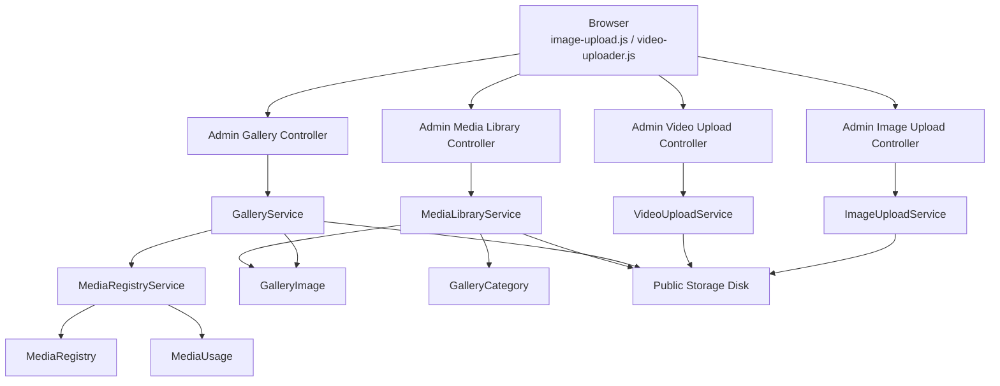
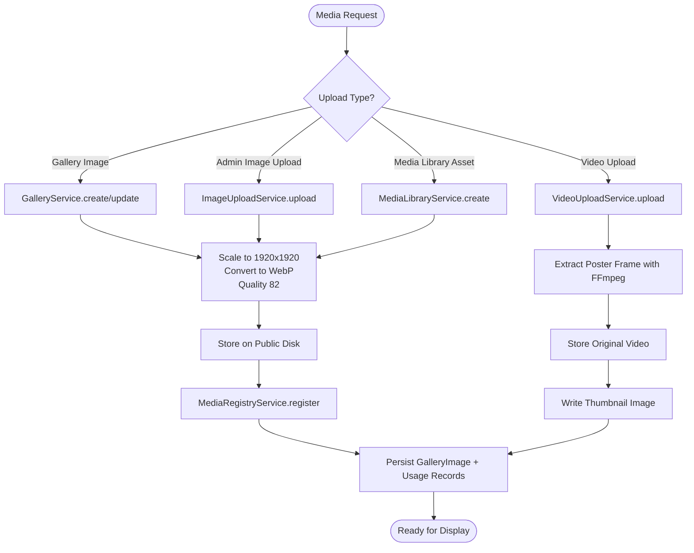
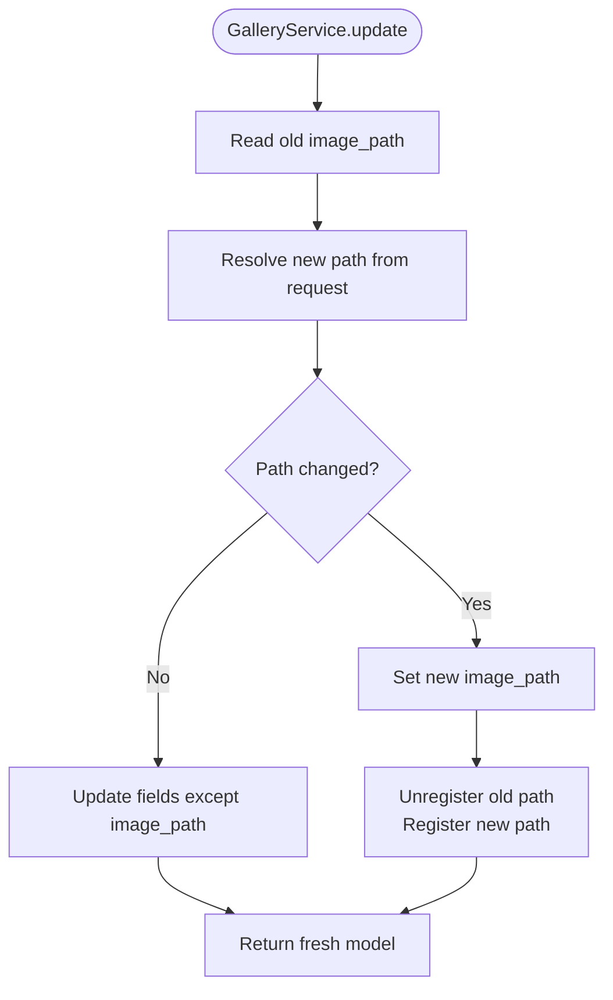
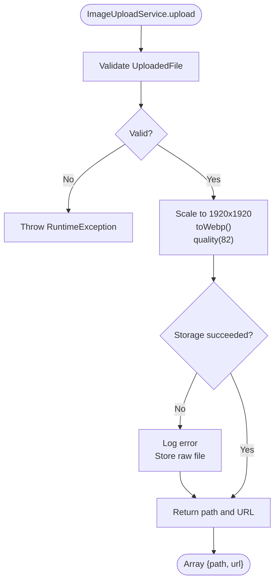
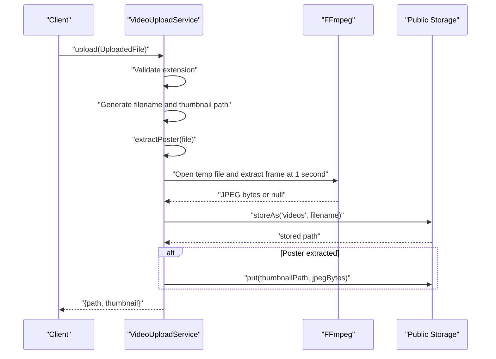
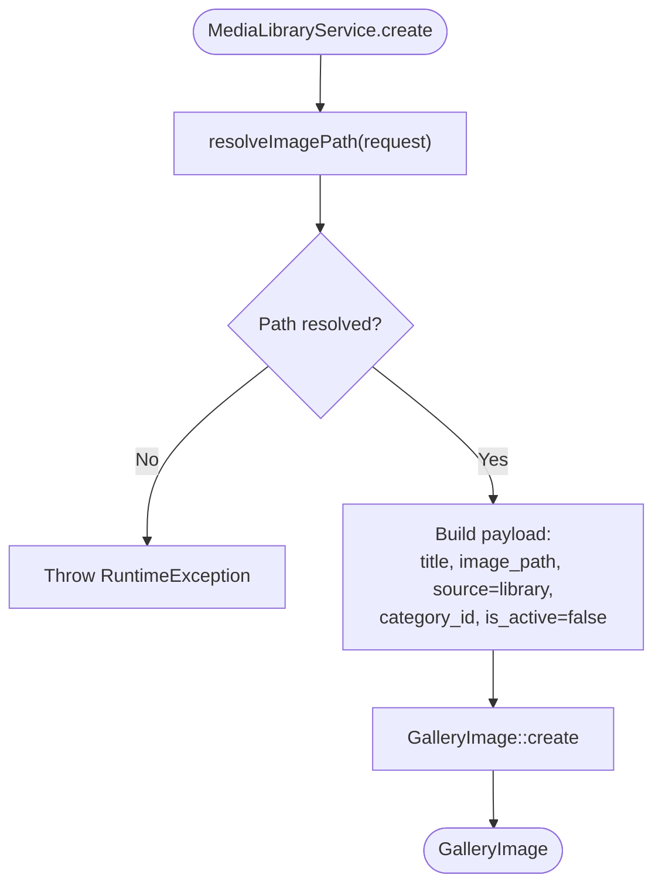
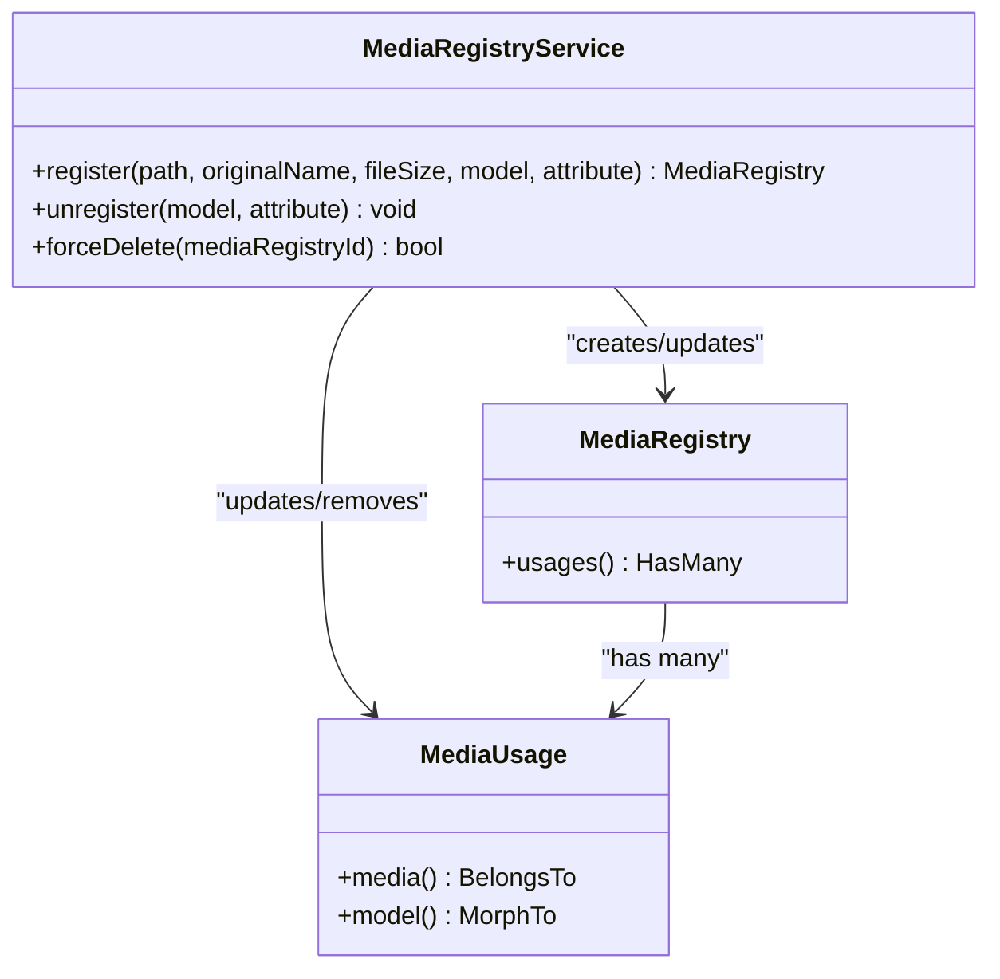
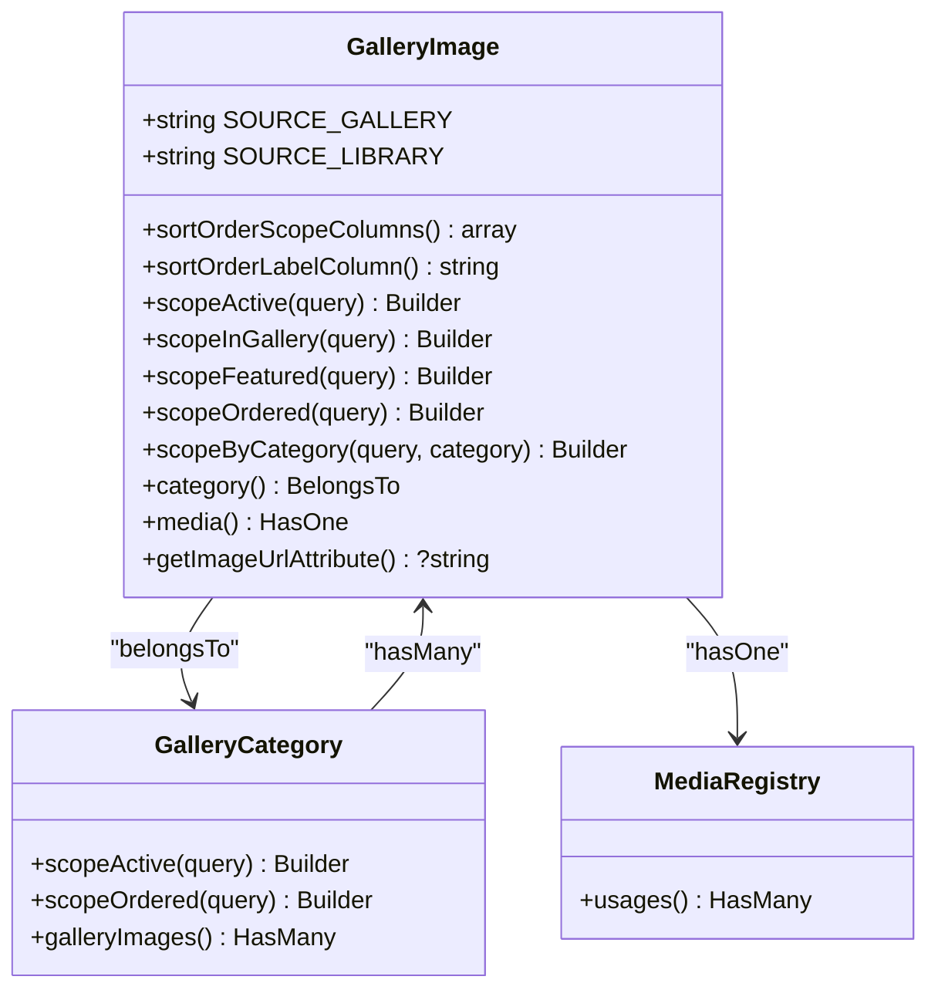
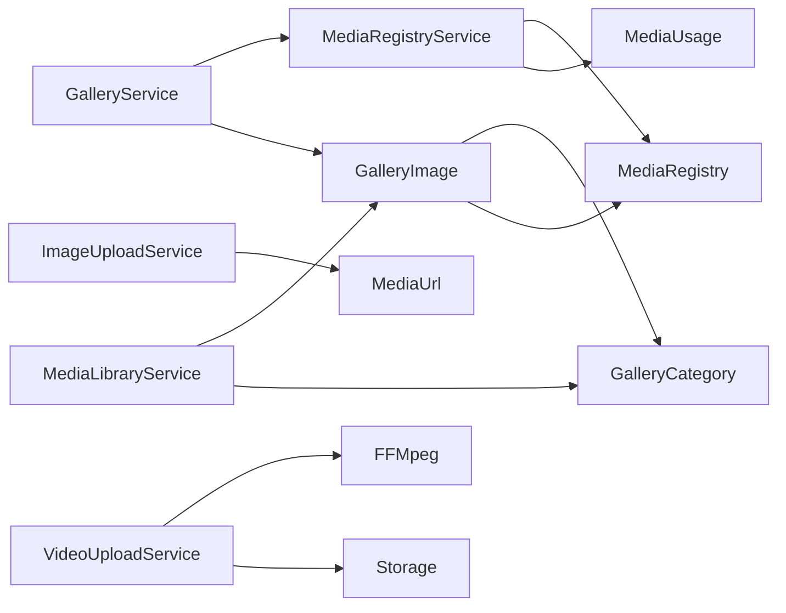

# Media and Gallery Services

<cite>
**Referenced Files in This Document**
- [GalleryService.php](file://app/Services/GalleryService.php)
- [ImageUploadService.php](file://app/Services/ImageUploadService.php)
- [VideoUploadService.php](file://app/Services/VideoUploadService.php)
- [MediaLibraryService.php](file://app/Services/MediaLibraryService.php)
- [MediaRegistryService.php](file://app/Services/MediaRegistryService.php)
- [GalleryImage.php](file://app/Models/GalleryImage.php)
- [GalleryCategory.php](file://app/Models/GalleryCategory.php)
- [MediaRegistry.php](file://app/Models/MediaRegistry.php)
- [MediaUsage.php](file://app/Models/MediaUsage.php)
- [HasSortOrder.php](file://app/Models/Concerns/HasSortOrder.php)
- [filesystems.php](file://config/filesystems.php)
- [image-upload.js](file://public/js/image-upload.js)
- [video-uploader.js](file://public/js/video-uploader.js)
</cite>

## Table of Contents
1. [Introduction](#introduction)
2. [Project Structure](#project-structure)
3. [Core Components](#core-components)
4. [Architecture Overview](#architecture-overview)
5. [Detailed Component Analysis](#detailed-component-analysis)
6. [Dependency Analysis](#dependency-analysis)
7. [Performance Considerations](#performance-considerations)
8. [Troubleshooting Guide](#troubleshooting-guide)
9. [Conclusion](#conclusion)
10. [Appendices](#appendices)

## Introduction
This document explains the media and gallery management layer used by the application. It covers:
- How images and videos are uploaded, validated, transformed, stored, and tracked.
- How curated gallery items differ from reusable library assets.
- How galleries are categorized, ordered, and exposed to the frontend.
- How usage tracking prevents accidental deletion of still-used media files.
- Practical guidance for uploading media, organizing galleries, implementing lazy loading, and optimizing assets for different devices.

The services focus on server-side processing and persistence; client-side uploaders provide drag-and-drop previews, progress bars, and AJAX submission helpers.

## Project Structure
The relevant code lives under `app/Services`, `app/Models`, `config/filesystems.php`, and public JavaScript uploaders:
- Services: `GalleryService`, `ImageUploadService`, `VideoUploadService`, `MediaLibraryService`, `MediaRegistryService`.
- Models: `GalleryImage`, `GalleryCategory`, `MediaRegistry`, `MediaUsage`, plus the `HasSortOrder` concern.
- Storage configuration: filesystem disks including a switchable `public` disk.
- Client uploaders: image and video JavaScript classes that send AJAX uploads with progress indicators.

**Diagram sources**
- [image-upload.js:1-241](file://public/js/image-upload.js#L1-L241)
- [video-uploader.js:1-211](file://public/js/video-uploader.js#L1-L211)
- [ImageUploadService.php:1-70](file://app/Services/ImageUploadService.php#L1-L70)
- [VideoUploadService.php:1-105](file://app/Services/VideoUploadService.php#L1-L105)
- [GalleryService.php:1-139](file://app/Services/GalleryService.php#L1-L139)
- [MediaLibraryService.php:1-79](file://app/Services/MediaLibraryService.php#L1-L79)
- [MediaRegistryService.php:1-67](file://app/Services/MediaRegistryService.php#L1-L67)
- [GalleryImage.php:1-169](file://app/Models/GalleryImage.php#L1-L169)
- [GalleryCategory.php:1-61](file://app/Models/GalleryCategory.php#L1-L61)
- [MediaRegistry.php:1-25](file://app/Models/MediaRegistry.php#L1-L25)
- [MediaUsage.php:1-34](file://app/Models/MediaUsage.php#L1-L34)
- [filesystems.php:1-109](file://config/filesystems.php#L1-L109)

**Section sources**
- [filesystems.php:1-109](file://config/filesystems.php#L1-L109)

## Core Components
- `GalleryService`: Creates, updates, and deletes curated gallery images, processes uploaded images, and registers storage metadata through `MediaRegistryService`.
- `ImageUploadService`: Normalizes admin image uploads to WebP at a fixed quality and size, falling back to raw storage when processing fails.
- `VideoUploadService`: Accepts selected video formats, generates poster frames using FFmpeg, stores original videos, and writes thumbnail images.
- `MediaLibraryService`: Adds reusable assets to the media library, marking them inactive so only curated gallery rows render publicly.
- `MediaRegistryService`: Tracks which model attributes reference each media path and safely removes unused files.

Key data model responsibilities:
- `GalleryImage`: Stores title, description, image path, source (`gallery` or `library`), category, feature flags, sort order, and URL generation.
- `GalleryCategory`: Active categories with ordering and one-to-many relationship to gallery images.
- `MediaRegistry`: Central registry entry per persisted media path, with original name and file size.
- `MediaUsage`: Polymorphic pivot linking a registry entry to a specific model attribute.

**Section sources**
- [GalleryService.php:1-139](file://app/Services/GalleryService.php#L1-L139)
- [ImageUploadService.php:1-70](file://app/Services/ImageUploadService.php#L1-L70)
- [VideoUploadService.php:1-105](file://app/Services/VideoUploadService.php#L1-L105)
- [MediaLibraryService.php:1-79](file://app/Services/MediaLibraryService.php#L1-L79)
- [MediaRegistryService.php:1-67](file://app/Services/MediaRegistryService.php#L1-L67)
- [GalleryImage.php:1-169](file://app/Models/GalleryImage.php#L1-L169)
- [GalleryCategory.php:1-61](file://app/Models/GalleryCategory.php#L1-L61)
- [MediaRegistry.php:1-25](file://app/Models/MediaRegistry.php#L1-L25)
- [MediaUsage.php:1-34](file://app/Models/MediaUsage.php#L1-L34)

## Architecture Overview
The media pipeline has two main branches:
1. Curated gallery content: `GalleryService` creates or updates `GalleryImage` records with `source = gallery`, processes images to WebP, and tracks usage via `MediaRegistryService`.
2. Reusable media library assets: `MediaLibraryService` creates `GalleryImage` records with `source = library` and `is_active = false`, intended for content blocks rather than public gallery display.

Both branches normalize images to WebP with a maximum long edge of 1920 pixels and a quality setting of 82 before storing them on the public disk. The `public` disk can be local or an S3-compatible object store depending on environment configuration.

**Diagram sources**
- [GalleryService.php:22-139](file://app/Services/GalleryService.php#L22-L139)
- [ImageUploadService.php:32-70](file://app/Services/ImageUploadService.php#L32-L70)
- [VideoUploadService.php:28-105](file://app/Services/VideoUploadService.php#L28-L105)
- [MediaLibraryService.php:18-79](file://app/Services/MediaLibraryService.php#L18-L79)
- [MediaRegistryService.php:15-67](file://app/Services/MediaRegistryService.php#L15-L67)
- [filesystems.php:33-76](file://config/filesystems.php#L33-L76)

## Detailed Component Analysis

### GalleryService
`GalleryService` manages curated gallery images:
- `create`: Resolves an image path from the request, sets `source = gallery`, persists the record, and registers the media path with `MediaRegistryService`.
- `update`: Compares old and new paths, updates the image, toggles registry entries, and returns a fresh model instance.
- `delete`: Unregisters the media reference, attempts naive storage cleanup, and deletes the record.
- `resolveImagePath`: Handles removal requests, validates uploaded files, scales and converts images to WebP, falls back to existing hidden input values, and uses a placeholder for new gallery records without uploads.

Important behavior:
- Uploaded files take precedence over hidden `image_path` inputs.
- Invalid image processing is logged instead of failing the whole request.
- Registry updates occur only when the actual storage path changes.

**Diagram sources**
- [GalleryService.php:38-87](file://app/Services/GalleryService.php#L38-L87)

**Section sources**
- [GalleryService.php:18-139](file://app/Services/GalleryService.php#L18-L139)

### ImageUploadService
`ImageUploadService` is the normalizing uploader for admin AJAX image uploads:
- Validates the uploaded file.
- Attempts to scale to a maximum dimension of 1920 pixels, convert to WebP, and apply quality 82.
- Falls back to storing the raw file if image processing throws an exception.
- Throws a runtime exception if storage itself fails.
- Returns both the stored path and a generated asset URL.

This service ensures consistent output format while protecting the upload endpoint from transient image-processing failures.

**Diagram sources**
- [ImageUploadService.php:32-70](file://app/Services/ImageUploadService.php#L32-L70)

**Section sources**
- [ImageUploadService.php:1-70](file://app/Services/ImageUploadService.php#L1-L70)

### VideoUploadService
`VideoUploadService` handles video uploads:
- Validates allowed extensions: mp4, webm, mov, avi.
- Generates a safe filename and thumbnail path.
- Extracts a poster frame from the PHP temporary upload path before the file is moved.
- Stores the original video on the public disk.
- Writes a JPEG thumbnail next to the video.
- Returns both the video path and optional thumbnail path.

Streaming support:
- The service does not implement adaptive streaming or HLS/DASH conversion. It stores original files and extracts a single poster frame. Streaming would require additional encoding steps outside this class.

**Diagram sources**
- [VideoUploadService.php:28-105](file://app/Services/VideoUploadService.php#L28-L105)

**Section sources**
- [VideoUploadService.php:1-105](file://app/Services/VideoUploadService.php#L1-L105)

### MediaLibraryService
`MediaLibraryService` provides a unified interface for adding reusable media assets:
- `create`: Resolves an image path from either an uploaded file or an existing path, assigns `source = library`, marks the record inactive, and associates it with a category slug.
- `resolveImagePath`: Processes uploaded files into WebP at 1920-pixel maximum dimensions and quality 82, logs processing errors, and throws a runtime exception when no valid image is provided.

Unlike gallery records, library assets are not published directly; they serve as reusable content-block assets.

**Diagram sources**
- [MediaLibraryService.php:18-79](file://app/Services/MediaLibraryService.php#L18-L79)

**Section sources**
- [MediaLibraryService.php:1-79](file://app/Services/MediaLibraryService.php#L1-L79)

### MediaRegistryService
`MediaRegistryService` centralizes media-file usage tracking:
- `register`: Creates or reuses a `MediaRegistry` row for a path and updates or creates a `MediaUsage` row for the model attribute referencing it.
- `unregister`: Removes usage records for a specific model and attribute.
- `forceDelete`: Deletes a registry entry and its underlying file only when no usages remain.

This design avoids orphaned files and protects active references during deletions.

**Diagram sources**
- [MediaRegistryService.php:15-67](file://app/Services/MediaRegistryService.php#L15-L67)
- [MediaRegistry.php:1-25](file://app/Models/MediaRegistry.php#L1-L25)
- [MediaUsage.php:1-34](file://app/Models/MediaUsage.php#L1-L34)

**Section sources**
- [MediaRegistryService.php:1-67](file://app/Services/MediaRegistryService.php#L1-L67)
- [MediaRegistry.php:1-25](file://app/Models/MediaRegistry.php#L1-L25)
- [MediaUsage.php:1-34](file://app/Models/MediaUsage.php#L1-L34)

### GalleryImage Model
`GalleryImage` is the central entity for both curated gallery images and reusable library assets:
- Distinguishes sources through constants: `SOURCE_GALLERY` and `SOURCE_LIBRARY`.
- Uses `HasSortOrder` with `source` as a numbering scope so gallery and library records maintain independent order lines.
- Provides scopes for active records, gallery-only records, featured records, ordered results, and filtering by category slug.
- Relates to `GalleryCategory` and `MediaRegistry`.
- Exposes `getImageUrlAttribute` to generate URLs through `MediaUrl`.

**Diagram sources**
- [GalleryImage.php:1-169](file://app/Models/GalleryImage.php#L1-L169)
- [GalleryCategory.php:1-61](file://app/Models/GalleryCategory.php#L1-L61)
- [MediaRegistry.php:1-25](file://app/Models/MediaRegistry.php#L1-L25)

**Section sources**
- [GalleryImage.php:1-169](file://app/Models/GalleryImage.php#L1-L169)
- [GalleryCategory.php:1-61](file://app/Models/GalleryCategory.php#L1-L61)
- [HasSortOrder.php:1-186](file://app/Models/Concerns/HasSortOrder.php#L1-L186)

### Client-Side Uploaders
The JavaScript uploaders provide consistent UX:
- `ImageUploader`: Supports drag-and-drop, type validation, size validation, preview, progress bar, AJAX upload, and callback hooks. Default accepted types include common image formats.
- `VideoUploader`: Similar UX for videos with default accepted types for mp4, webm, quicktime, and AVI. It includes a longer timeout suitable for large uploads.

These classes do not perform server-side optimization; they prepare and transmit files to backend endpoints.

**Section sources**
- [image-upload.js:1-241](file://public/js/image-upload.js#L1-L241)
- [video-uploader.js:1-211](file://public/js/video-uploader.js#L1-L211)

## Dependency Analysis
The services depend on Laravel facades, Eloquent models, FFmpeg, and the configured storage system:
- `GalleryService` depends on `MediaRegistryService`, `GalleryImage`, HTTP request, image processing, logging, and storage.
- `ImageUploadService` depends on image processing, logging, and a media URL helper.
- `VideoUploadService` depends on FFmpeg, storage, and string utilities.
- `MediaLibraryService` depends on `GalleryImage`, `GalleryCategory`, image processing, and logging.
- `MediaRegistryService` depends on `MediaRegistry`, `MediaUsage`, Eloquent models, and storage.

**Diagram sources**
- [GalleryService.php:1-139](file://app/Services/GalleryService.php#L1-L139)
- [ImageUploadService.php:1-70](file://app/Services/ImageUploadService.php#L1-L70)
- [VideoUploadService.php:1-105](file://app/Services/VideoUploadService.php#L1-L105)
- [MediaLibraryService.php:1-79](file://app/Services/MediaLibraryService.php#L1-L79)
- [MediaRegistryService.php:1-67](file://app/Services/MediaRegistryService.php#L1-L67)
- [GalleryImage.php:1-169](file://app/Models/GalleryImage.php#L1-L169)
- [GalleryCategory.php:1-61](file://app/Models/GalleryCategory.php#L1-L61)

**Section sources**
- [GalleryService.php:1-139](file://app/Services/GalleryService.php#L1-L139)
- [ImageUploadService.php:1-70](file://app/Services/ImageUploadService.php#L1-L70)
- [VideoUploadService.php:1-105](file://app/Services/VideoUploadService.php#L1-L105)
- [MediaLibraryService.php:1-79](file://app/Services/MediaLibraryService.php#L1-L79)
- [MediaRegistryService.php:1-67](file://app/Services/MediaRegistryService.php#L1-L67)
- [GalleryImage.php:1-169](file://app/Models/GalleryImage.php#L1-L169)
- [GalleryCategory.php:1-61](file://app/Models/GalleryCategory.php#L1-L61)

## Performance Considerations
- Image normalization: All image-related services scale to a maximum of 1920 × 1920 pixels and convert to WebP at quality 82. This reduces bandwidth and improves rendering performance compared to uncompressed formats.
- Upload fallback: `ImageUploadService` falls back to storing the raw file if processing fails, preventing upload endpoints from breaking due to transient driver issues.
- Video thumbnails: Poster extraction happens before moving the uploaded file because object-store-backed disks may not expose readable local paths. Thumbnail generation failures are logged and treated gracefully.
- Sorting concurrency: `HasSortOrder` reserves sort numbers inside transactions and retries on unique-constraint collisions, improving reliability when multiple admins assign order values simultaneously.
- Storage driver: The `public` disk can point to a local folder or S3. When targeting S3, visibility is set to public and throw/report options are configured for safer failure detection.

[No sources needed since this section provides general guidance]

## Troubleshooting Guide
Common issues and their likely causes:
- Image upload fails during processing: Check image-processing exceptions and logs. The gallery and library services log failures but may return placeholders or throw depending on the service.
- Raw file stored instead of WebP: `ImageUploadService` intentionally falls back to raw storage when image processing fails; investigate driver or image-format compatibility.
- No thumbnail for video: FFmpeg extraction may fail due to missing FFmpeg, unreadable temp files, or unsupported codecs. Logs capture the exception message.
- Orphaned files after deletion: `GalleryService.delete` performs naive storage deletion. For safe cleanup based on usage, use `MediaRegistryService.forceDelete`.
- Category filter returns empty: Ensure the category slug matches the `slug` column used by `scopeByCategory`, and verify the category exists and is active.
- Sort-order conflicts: The `HasSortOrder` trait retries number assignment up to three times. Persistent uniqueness violations suggest concurrent edits or incorrect manual sort values.

Operational recommendations:
- Use `MediaRegistryService.forceDelete` for bulk cleanup of unused media.
- Verify the `public` disk configuration when switching between local and S3 storage.
- Monitor logs for image-processing and FFmpeg errors.
- Keep client-side validators aligned with server-side limits to avoid confusing user errors.

**Section sources**
- [GalleryService.php:89-139](file://app/Services/GalleryService.php#L89-L139)
- [ImageUploadService.php:32-70](file://app/Services/ImageUploadService.php#L32-L70)
- [VideoUploadService.php:70-105](file://app/Services/VideoUploadService.php#L70-L105)
- [MediaRegistryService.php:49-67](file://app/Services/MediaRegistryService.php#L49-L67)
- [HasSortOrder.php:1-186](file://app/Models/Concerns/HasSortOrder.php#L1-L186)
- [filesystems.php:33-76](file://config/filesystems.php#L33-L76)

## Conclusion
The media and gallery services provide a cohesive pipeline for uploading, transforming, storing, categorizing, and tracking media assets. `GalleryService` and `MediaLibraryService` separate curated gallery content from reusable library assets, while `ImageUploadService` and `VideoUploadService` standardize how files are processed and persisted. `MediaRegistryService` adds safety by tracking usage relationships, and the models provide clear scoping, ordering, and URL resolution. Together, these components form a scalable foundation for media-heavy applications, with room to extend into adaptive video streaming and more aggressive device-specific optimization.

[No sources needed since this section summarizes without analyzing specific files]

## Appendices

### Examples and Best Practices

#### Uploading an Image Through the Admin Uploader
- Use the client-side `ImageUploader` to validate type and size, show a preview, and send an AJAX upload.
- Backend `ImageUploadService` normalizes the image to WebP, rescales it, and returns a path and URL.
- If processing fails, the service stores the raw file and logs the error.

Recommended integration:
- Configure accepted types and maximum file size in the UI.
- Handle success callbacks to populate hidden inputs and update previews.
- Surface error messages from the response or network failures.

**Section sources**
- [image-upload.js:1-241](file://public/js/image-upload.js#L1-L241)
- [ImageUploadService.php:32-70](file://app/Services/ImageUploadService.php#L32-L70)

#### Uploading a Video
- Use `VideoUploader` for drag-and-drop, preview, progress indication, and AJAX submission.
- Backend `VideoUploadService` validates the extension, extracts a poster frame, stores the original video, and writes a thumbnail.
- No automatic adaptive streaming is performed; consider external encoding jobs for HLS/DASH if required.

**Section sources**
- [video-uploader.js:1-211](file://public/js/video-uploader.js#L1-L211)
- [VideoUploadService.php:28-105](file://app/Services/VideoUploadService.php#L28-L105)

#### Organizing Galleries
- Create or select a `GalleryCategory` and assign images by category slug.
- Use `GalleryImage::scopeByCategory` to filter images by category.
- Use `scopeActive`, `scopeInGallery`, `scopeFeatured`, and `scopeOrdered` to build curated gallery views.
- Maintain separate ordering for gallery and library assets through `HasSortOrder`.

**Section sources**
- [GalleryImage.php:62-169](file://app/Models/GalleryImage.php#L62-L169)
- [GalleryCategory.php:24-61](file://app/Models/GalleryCategory.php#L24-L61)
- [HasSortOrder.php:1-186](file://app/Models/Concerns/HasSortOrder.php#L1-L186)

#### Implementing Lazy Loading
- Serve optimized WebP images at a maximum dimension of 1920 pixels.
- Use HTML `loading="lazy"` or IntersectionObserver-based lazy loading for large galleries.
- Generate responsive image variants at the presentation layer for different screen sizes.
- Cache image URLs through the application’s cache layer where appropriate.

[No sources needed since this section provides general guidance]

#### Optimizing Assets for Different Devices
- Serve appropriately sized images by generating multiple resolutions in the presentation layer.
- Prefer WebP for modern browsers and fall back to original formats if necessary.
- Use responsive `<picture>` elements or CSS background strategies for varying viewport widths.
- For videos, consider server-side transcoding pipelines to produce adaptive streams alongside the original uploads handled by `VideoUploadService`.

[No sources needed since this section provides general guidance]