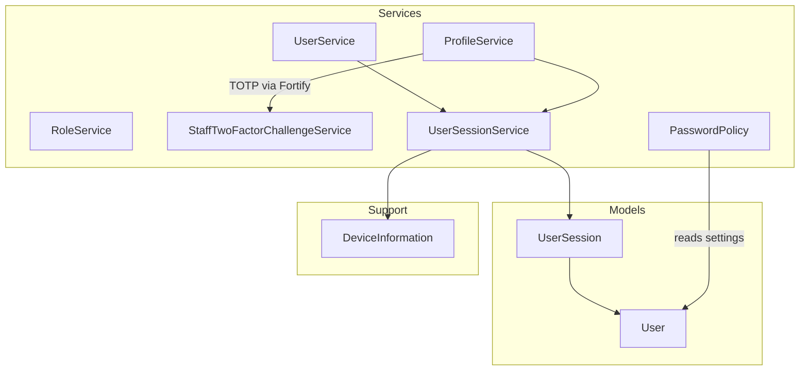
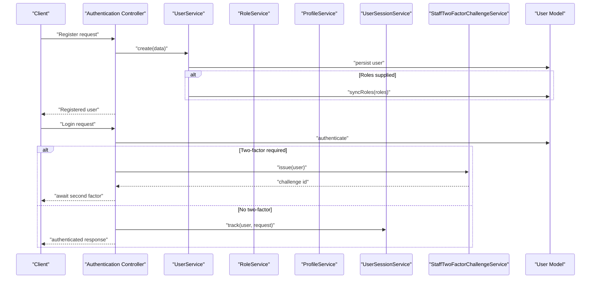
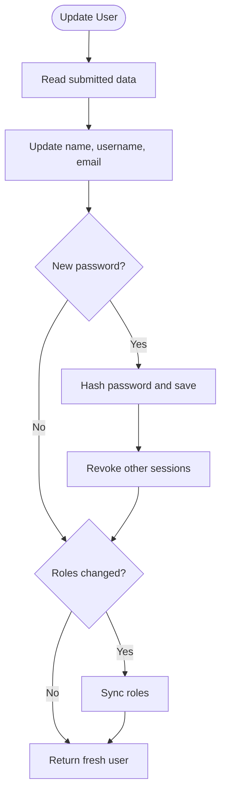
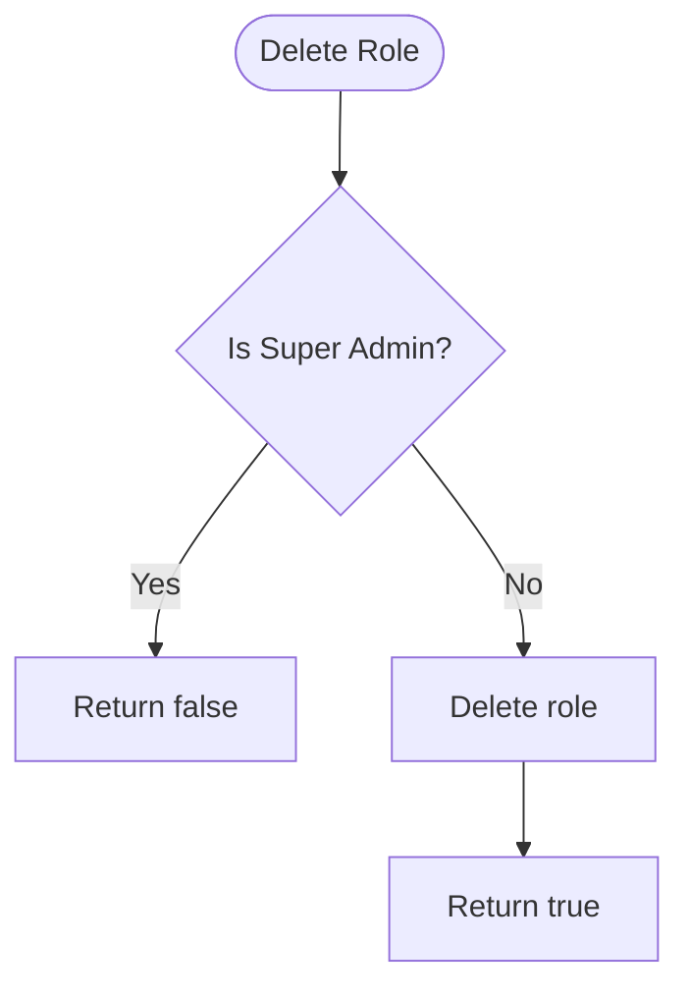
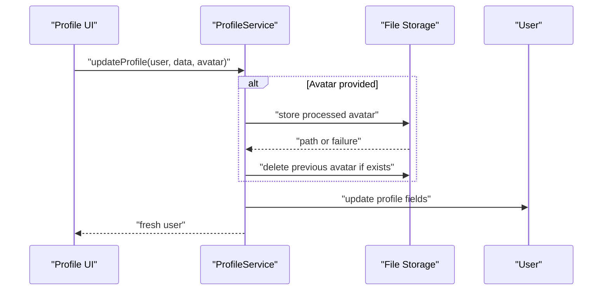
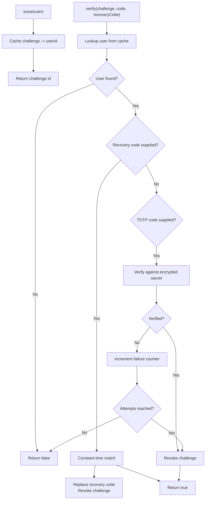
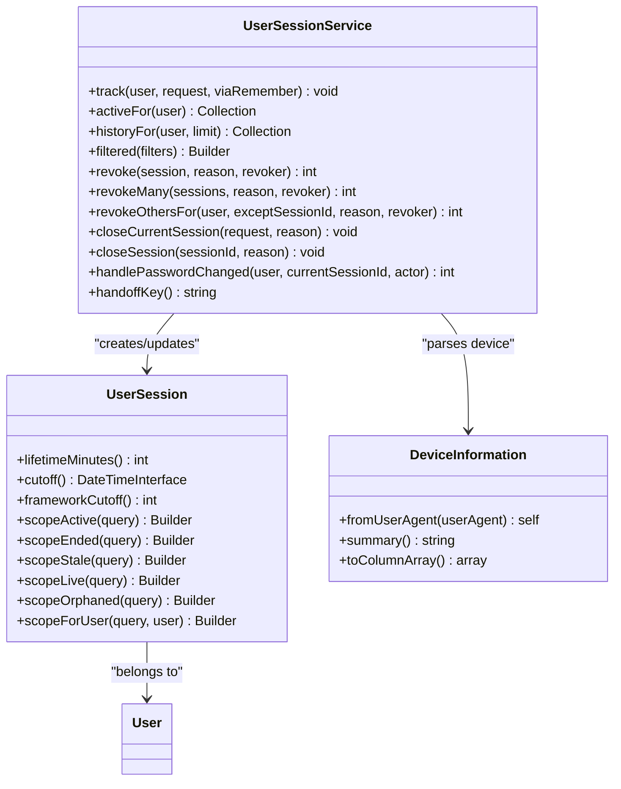
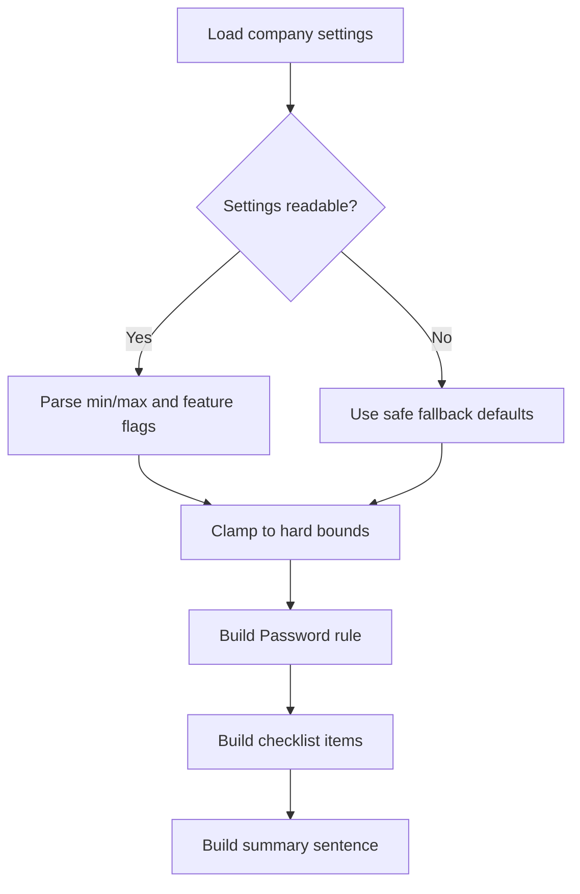
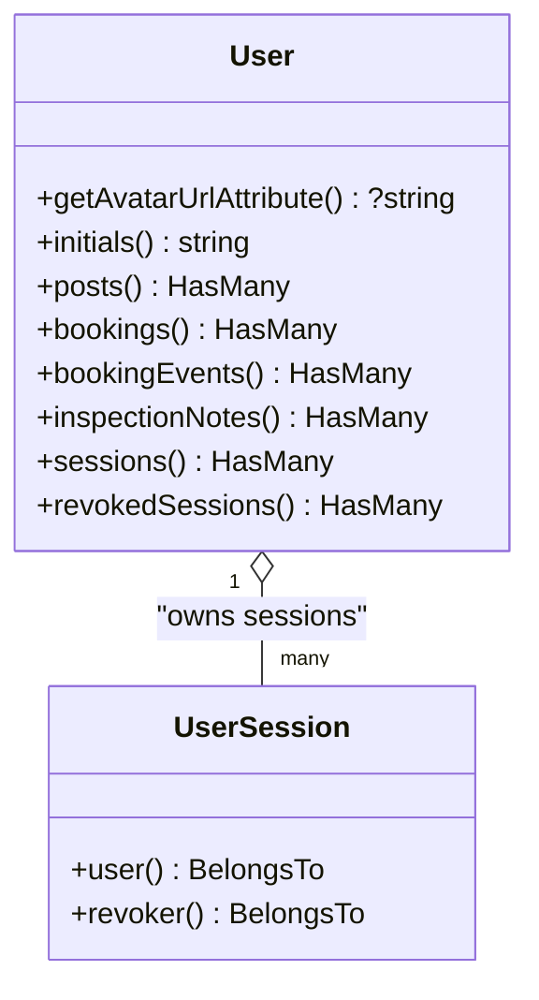
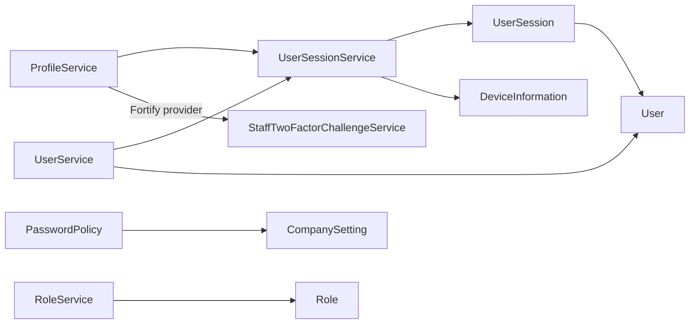

# User and Authentication Services

<cite>
**Referenced Files in This Document**
- [UserService.php](file://app/Services/UserService.php)
- [RoleService.php](file://app/Services/RoleService.php)
- [ProfileService.php](file://app/Services/ProfileService.php)
- [StaffTwoFactorChallengeService.php](file://app/Services/StaffTwoFactorChallengeService.php)
- [UserSessionService.php](file://app/Services/UserSessionService.php)
- [PasswordPolicy.php](file://app/Services/PasswordPolicy.php)
- [User.php](file://app/Models/User.php)
- [UserSession.php](file://app/Models/UserSession.php)
- [DeviceInformation.php](file://app/Support/DeviceInformation.php)
</cite>

## Table of Contents
1. [Introduction](#introduction)
2. [Project Structure](#project-structure)
3. [Core Components](#core-components)
4. [Architecture Overview](#architecture-overview)
5. [Detailed Component Analysis](#detailed-component-analysis)
6. [Dependency Analysis](#dependency-analysis)
7. [Performance Considerations](#performance-considerations)
8. [Troubleshooting Guide](#troubleshooting-guide)
9. [Conclusion](#conclusion)

## Introduction
This document explains the user management and authentication services that underpin registration, login, role-based access control, profile updates, two-factor authentication, session tracking, and password policy enforcement. It is intended for developers extending the system with custom authentication flows or administrators integrating these services into new features.

The codebase uses:
- Eloquent models for persistent entities such as users and sessions.
- Laravel Fortify for two-factor authentication helpers.
- Spatie Permission traits for roles and permissions on the user model.
- A dedicated `user_sessions` ledger for device-level visibility and administrative session controls.
- A centralized password policy service that reads company settings and produces validation rules.

## Project Structure
The relevant files live under the application’s service, model, and support directories:

**Diagram sources**
- [UserService.php:1-69](file://app/Services/UserService.php#L1-L69)
- [RoleService.php:1-43](file://app/Services/RoleService.php#L1-L43)
- [ProfileService.php:1-255](file://app/Services/ProfileService.php#L1-L255)
- [StaffTwoFactorChallengeService.php:1-197](file://app/Services/StaffTwoFactorChallengeService.php#L1-L197)
- [UserSessionService.php:1-272](file://app/Services/UserSessionService.php#L1-L272)
- [PasswordPolicy.php:1-322](file://app/Services/PasswordPolicy.php#L1-L322)
- [User.php:1-141](file://app/Models/User.php#L1-L141)
- [UserSession.php:1-257](file://app/Models/UserSession.php#L1-L257)
- [DeviceInformation.php:1-130](file://app/Support/DeviceInformation.php#L1-L130)

**Section sources**
- [UserService.php:1-69](file://app/Services/UserService.php#L1-L69)
- [RoleService.php:1-43](file://app/Services/RoleService.php#L1-L43)
- [ProfileService.php:1-255](file://app/Services/ProfileService.php#L1-L255)
- [StaffTwoFactorChallengeService.php:1-197](file://app/Services/StaffTwoFactorChallengeService.php#L1-L197)
- [UserSessionService.php:1-272](file://app/Services/UserSessionService.php#L1-L272)
- [PasswordPolicy.php:1-322](file://app/Services/PasswordPolicy.php#L1-L322)
- [User.php:1-141](file://app/Models/User.php#L1-L141)
- [UserSession.php:1-257](file://app/Models/UserSession.php#L1-L257)
- [DeviceInformation.php:1-130](file://app/Support/DeviceInformation.php#L1-L130)

## Core Components
- UserService creates, updates, and deletes users, optionally assigning roles and revoking sessions when an admin changes a password.
- RoleService manages role creation, permission assignment, and safe deletion with protection for the Super Admin role.
- ProfileService handles profile fields, avatar uploads, appearance preferences, password changes, two-factor setup and confirmation, recovery codes, and account deletion.
- StaffTwoFactorChallengeService provides stateless two-factor challenges for Sanctum-backed mobile APIs.
- UserSessionService tracks active sessions, refreshes activity, lists sessions, revokes sessions, and closes session ledgers.
- PasswordPolicy centralizes password strength configuration, validation rule generation, human-readable hints, and audit logging.

**Section sources**
- [UserService.php:1-69](file://app/Services/UserService.php#L1-L69)
- [RoleService.php:1-43](file://app/Services/RoleService.php#L1-L43)
- [ProfileService.php:1-255](file://app/Services/ProfileService.php#L1-L255)
- [StaffTwoFactorChallengeService.php:1-197](file://app/Services/StaffTwoFactorChallengeService.php#L1-L197)
- [UserSessionService.php:1-272](file://app/Services/UserSessionService.php#L1-L272)
- [PasswordPolicy.php:1-322](file://app/Services/PasswordPolicy.php#L1-L322)

## Architecture Overview
The authentication architecture combines several layers:

- Registration and lifecycle are handled by UserService, which persists User records and assigns roles through Spatie Permission.
- Two-factor authentication is coordinated by ProfileService for web flows and StaffTwoFactorChallengeService for stateless API flows.
- Session awareness is provided by UserSessionService, which maintains a `user_sessions` ledger alongside the framework session store.
- Device information is parsed once at sign-in using DeviceInformation.
- Password validation is centralized through PasswordPolicy so all forms and providers share the same requirements.

**Diagram sources**
- [UserService.php:1-69](file://app/Services/UserService.php#L1-L69)
- [StaffTwoFactorChallengeService.php:1-197](file://app/Services/StaffTwoFactorChallengeService.php#L1-L197)
- [UserSessionService.php:1-272](file://app/Services/UserSessionService.php#L1-L272)
- [User.php:1-141](file://app/Models/User.php#L1-L141)

## Detailed Component Analysis

### UserService: User Lifecycle Management
Responsibilities:
- Create users with name, username, email, and hashed password.
- Optionally assign roles during creation.
- Update core details while preserving unchanged usernames.
- Revoke other sessions when an admin changes a target user’s password.
- Delete users.

Key behaviors:
- Passwords are hashed before storage.
- Role synchronization only occurs when roles are explicitly present in the update payload.
- The service depends on UserSessionService to enforce session security after password changes.

**Diagram sources**
- [UserService.php:25-69](file://app/Services/UserService.php#L25-L69)

Practical examples:
- Registering a user: call `create` with name, username, email, password, and optional roles.
- Updating a user: call `update` with the current user instance and the fields to change.
- Deleting a user: call `delete` with the user instance.

Security notes:
- Admin-initiated password changes trigger session revocation for every device except the acting admin’s own session.

**Section sources**
- [UserService.php:1-69](file://app/Services/UserService.php#L1-L69)

### RoleService: Permission Management and Safe Deletion
Responsibilities:
- Create roles and attach permissions.
- Update role names and permissions.
- Prevent deletion of the Super Admin role.

Design highlights:
- Permissions are attached only when explicitly supplied.
- Super Admin is protected from accidental deletion.

**Diagram sources**
- [RoleService.php:1-43](file://app/Services/RoleService.php#L1-L43)

Usage guidance:
- Use `create` to define a role and its initial permissions.
- Use `update` to rename a role or replace its permissions list.
- Always check the return value of `delete`; it returns false for Super Admin.

**Section sources**
- [RoleService.php:1-43](file://app/Services/RoleService.php#L1-L43)

### ProfileService: Profile Updates, Avatar Management, and Preferences
Responsibilities:
- Update general profile attributes and persist an uploaded avatar.
- Process avatars into square WebP images and manage old file cleanup.
- Update appearance preferences.
- Securely change passwords after verifying the current one.
- Manage two-factor authentication setup, confirmation, QR code generation, recovery code rotation, disabling, and cancellation.
- Verify passwords and delete accounts.

Avatar processing:
- Avatars are resized to a fixed square size, converted to WebP, stored under a public disk path, and replaced safely.
- Image exceptions are logged; failures do not break the surrounding profile update.

Two-factor flow:
- Enabling generates encrypted TOTP secrets and recovery codes without overwriting existing pending setups.
- Confirming validates the code and marks two-factor as confirmed.
- Disabling clears two-factor state.
- Cancelling removes a pending setup but does not affect a confirmed setup.

**Diagram sources**
- [ProfileService.php:1-120](file://app/Services/ProfileService.php#L1-L120)

Security considerations:
- Password changes require the current password and revoke other sessions.
- Two-factor operations rely on Fortify’s provider and encrypted secret storage.
- Account deletion verifies the password and logs the user out before deleting.

**Section sources**
- [ProfileService.php:1-255](file://app/Services/ProfileService.php#L1-L255)

### StaffTwoFactorChallengeService: Stateless Two-Factor Challenges
Purpose:
- Provide a single-use challenge identifier for Sanctum-authenticated mobile clients that cannot rely on server-side web sessions.
- Bind a short-lived cache entry to a user ID.
- Validate TOTP codes or recovery codes with attempt limits.
- Reuse Fortify’s encryption and verification mechanisms without exposing secrets.

Threat model:
- Challenge IDs are opaque UUIDs stored in cache.
- Wrong TOTP attempts are counted and cause the challenge to be burned after a threshold.
- Recovery codes are consumed and rotated securely.

**Diagram sources**
- [StaffTwoFactorChallengeService.php:1-197](file://app/Services/StaffTwoFactorChallengeService.php#L1-L197)

Integration example:
- After successful password verification for a staff member with two-factor enabled, call `issue` and return the challenge ID to the client.
- When the client submits a TOTP or recovery code, call `verify`. On success, proceed to token issuance.

**Section sources**
- [StaffTwoFactorChallengeService.php:1-197](file://app/Services/StaffTwoFactorChallengeService.php#L1-L197)

### UserSessionService: Session Ledger and Security Policies
Responsibilities:
- Track active sessions in a dedicated ledger table.
- Open new session rows, handle concurrent requests safely, and throttle write frequency.
- List active and ended sessions per user.
- Filter and search session history for administration screens.
- Revoke individual sessions, multiple sessions, or all other sessions for a user.
- Close the current session on logout.
- Revoke other sessions after a password change when configured.

Concurrent login handling:
- If two parallel requests open the same session, the second request detects the duplicate and refreshes the first row instead of failing.
- Throttling avoids writing `last_seen_at` on every request.

Session validity:
- Active means open and seen within the framework session lifetime.
- Live additionally checks that the underlying framework session still exists when using the database driver.
- Orphaned sessions are those past the grace window without a valid framework session row.

**Diagram sources**
- [UserSessionService.php:1-272](file://app/Services/UserSessionService.php#L1-L272)
- [UserSession.php:1-257](file://app/Models/UserSession.php#L1-L257)
- [DeviceInformation.php:1-130](file://app/Support/DeviceInformation.php#L1-L130)

Operational examples:
- Listing active sessions: use `activeFor` to display devices currently signed in.
- Revoking another device: obtain the session and call `revoke`, or use `revokeOthersFor` to keep the current device.
- Closing logout: call `closeCurrentSession` after the framework destroys its own session row.

**Section sources**
- [UserSessionService.php:1-272](file://app/Services/UserSessionService.php#L1-L272)
- [UserSession.php:1-257](file://app/Models/UserSession.php#L1-L257)
- [DeviceInformation.php:1-130](file://app/Support/DeviceInformation.php#L1-L130)

### PasswordPolicy: Centralized Password Strength Rules
Responsibilities:
- Resolve minimum and maximum lengths, mixed-case requirements, numeric requirements, symbol requirements, and breach checking from company settings.
- Clamp values to hard bounds to prevent unsafe configurations.
- Produce Laravel validation rules compatible with the displayed form hints.
- Generate human-readable summaries and per-rule checklists.
- Persist policy changes and record audit entries.

Safety guarantees:
- Fallback defaults are conservative and reflect the previously enforced behavior when settings cannot be read.
- Maximum length never exceeds bcrypt’s practical limit.
- Audit failures do not roll back policy saves.

**Diagram sources**
- [PasswordPolicy.php:1-322](file://app/Services/PasswordPolicy.php#L1-L322)

Integration points:
- Registration, reset, and profile forms should consume `rule()` and `checklist()` so server and client validations remain synchronized.
- Administrators update policies through `save`, which writes settings and audits changes.

**Section sources**
- [PasswordPolicy.php:1-322](file://app/Services/PasswordPolicy.php#L1-L322)

### User Model: Identity, Relationships, and Casts
Highlights:
- Supports email verification, passkeys, roles, and two-factor authentication.
- Normalizes usernames to lowercase consistently across the application.
- Provides avatar URL computation, initials generation, and relationships to related domain entities.
- Exposes session relationships used by UserSessionService.

**Diagram sources**
- [User.php:1-141](file://app/Models/User.php#L1-L141)
- [UserSession.php:1-257](file://app/Models/UserSession.php#L1-L257)

**Section sources**
- [User.php:1-141](file://app/Models/User.php#L1-L141)
- [UserSession.php:1-257](file://app/Models/UserSession.php#L1-L257)

## Dependency Analysis
The services form a layered dependency graph:

Coupling observations:
- UserService and ProfileService depend on UserSessionService for consistent session revocation semantics.
- StaffTwoFactorChallengeService isolates stateless two-factor logic from web session state.
- DeviceInformation is isolated behind a thin wrapper around a third-party parser.
- PasswordPolicy centralizes policy resolution so unrelated forms do not duplicate rules.

Potential risks:
- Tight coupling between ProfileService and UserSessionService requires both to agree on password-change revocation behavior.
- Two-factor flows split between web (ProfileService) and API (StaffTwoFactorChallengeService); maintainers must ensure parity in recovery code behavior.

**Diagram sources**
- [UserService.php:1-69](file://app/Services/UserService.php#L1-L69)
- [ProfileService.php:1-255](file://app/Services/ProfileService.php#L1-L255)
- [StaffTwoFactorChallengeService.php:1-197](file://app/Services/StaffTwoFactorChallengeService.php#L1-L197)
- [UserSessionService.php:1-272](file://app/Services/UserSessionService.php#L1-L272)
- [UserSession.php:1-257](file://app/Models/UserSession.php#L1-L257)
- [User.php:1-141](file://app/Models/User.php#L1-L141)
- [DeviceInformation.php:1-130](file://app/Support/DeviceInformation.php#L1-L130)
- [PasswordPolicy.php:1-322](file://app/Services/PasswordPolicy.php#L1-L322)

**Section sources**
- [UserService.php:1-69](file://app/Services/UserService.php#L1-L69)
- [ProfileService.php:1-255](file://app/Services/ProfileService.php#L1-L255)
- [StaffTwoFactorChallengeService.php:1-197](file://app/Services/StaffTwoFactorChallengeService.php#L1-L197)
- [UserSessionService.php:1-272](file://app/Services/UserSessionService.php#L1-L272)
- [UserSession.php:1-257](file://app/Models/UserSession.php#L1-L257)
- [User.php:1-141](file://app/Models/User.php#L1-L141)
- [DeviceInformation.php:1-130](file://app/Support/DeviceInformation.php#L1-L130)
- [PasswordPolicy.php:1-322](file://app/Services/PasswordPolicy.php#L1-L322)

## Performance Considerations
- Avatar processing converts images to WebP and resizes them once at upload time, avoiding repeated resizing on each request.
- Session last-seen updates are throttled to reduce database writes during high-frequency requests.
- Device information is parsed once at sign-in and persisted, rather than re-parsed per request.
- PasswordPolicy caches its resolved policy within a request to avoid repeated setting reads.
- Concurrent session opens are guarded against duplicate inserts, falling back to refreshing the existing row.

[No sources needed since this section provides general guidance]

## Troubleshooting Guide
Common issues and remedies:

- Avatar upload fails silently:
  - Check image processing exceptions and storage disk configuration.
  - Verify that the public disk path is writable and accessible.

- Two-factor QR code does not validate:
  - Ensure two-factor is enabled and pending.
  - Confirm that the code was generated after enabling two-factor and has not expired.
  - For mobile APIs, verify the challenge ID has not been revoked or exceeded its attempt limit.

- Sessions appear active after logout:
  - The framework may destroy its session row lazily; rely on the `ended_at` timestamp and prune commands to reconcile stale ledger rows.
  - Check whether the session is considered active based on the framework session lifetime.

- Password change does not revoke other sessions:
  - Confirm that the configuration option enabling revocation on password change is set.
  - Ensure the calling context supplies the current session identifier correctly.

- Password policy changes are not audited:
  - Audit failures are logged but do not block saving the new policy.
  - Inspect logs for database connectivity or schema issues.

**Section sources**
- [ProfileService.php:1-255](file://app/Services/ProfileService.php#L1-L255)
- [StaffTwoFactorChallengeService.php:1-197](file://app/Services/StaffTwoFactorChallengeService.php#L1-L197)
- [UserSessionService.php:1-272](file://app/Services/UserSessionService.php#L1-L272)
- [PasswordPolicy.php:1-322](file://app/Services/PasswordPolicy.php#L1-L322)

## Conclusion
These services provide a cohesive foundation for secure user management:
- UserService centralizes user creation, updates, and role synchronization.
- RoleService enforces safe role lifecycle management.
- ProfileService unifies profile updates, avatar handling, password changes, and two-factor workflows.
- StaffTwoFactorChallengeService adds stateless two-factor support for mobile APIs.
- UserSessionService delivers device visibility, concurrency-safe session tracking, and administrative controls.
- PasswordPolicy ensures consistent password enforcement and auditing.

When implementing custom authentication flows, prefer these services over direct model manipulation to preserve validation, security, and auditability.

[No sources needed since this section summarizes without analyzing specific files]