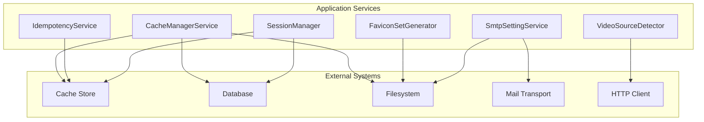
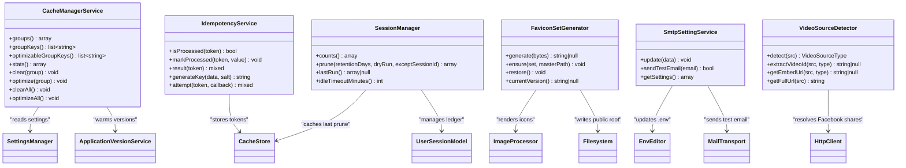
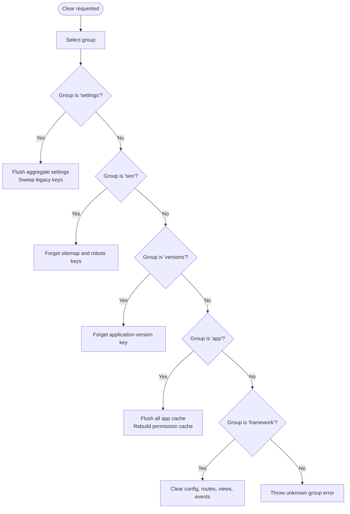
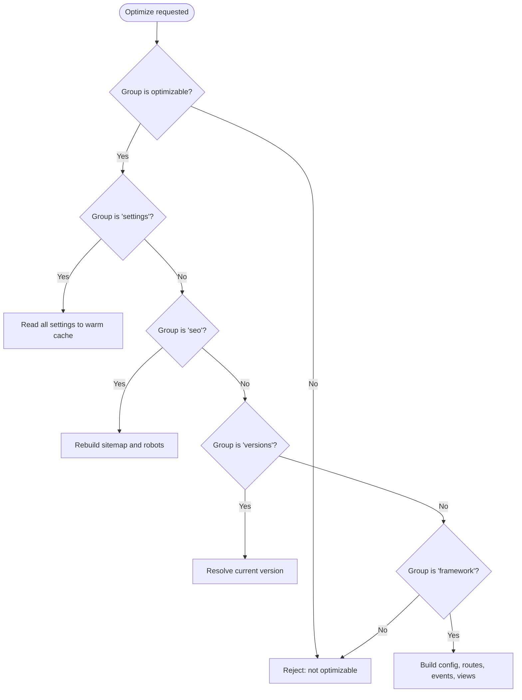
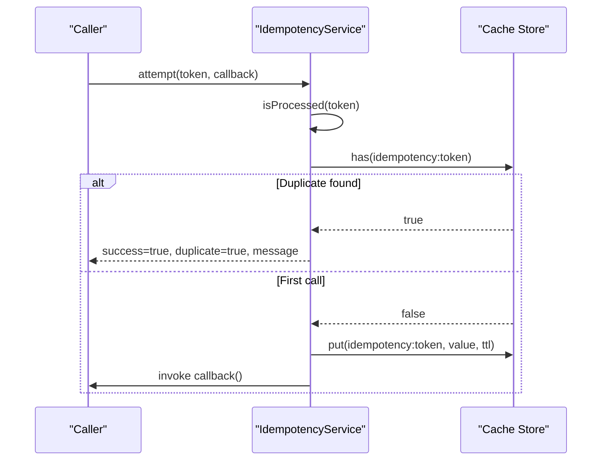
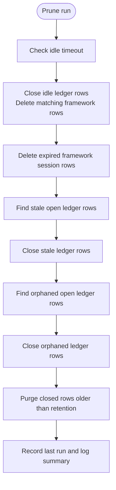
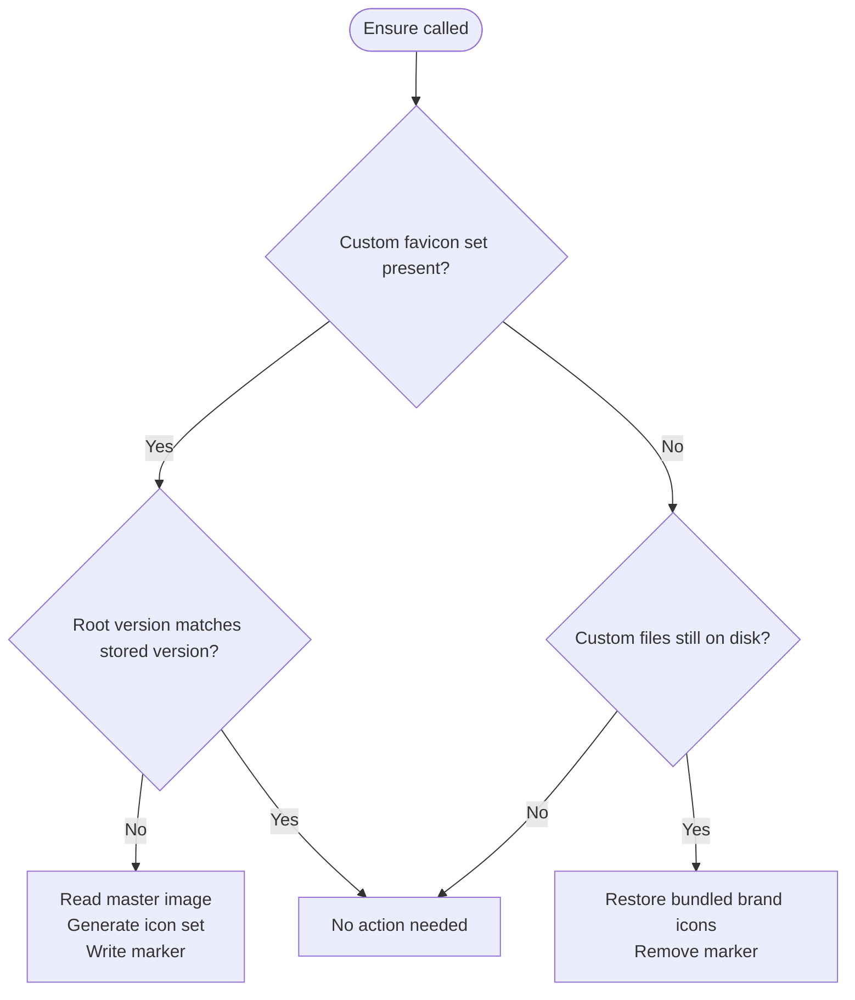
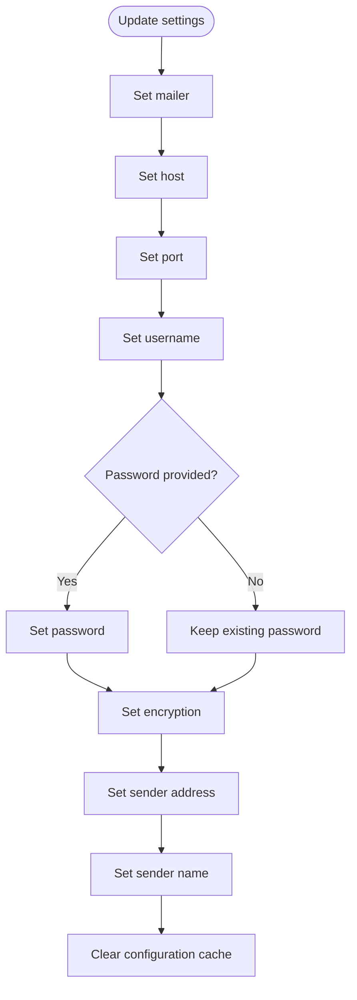
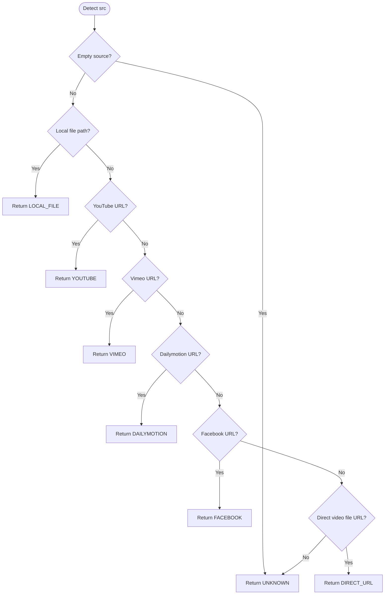
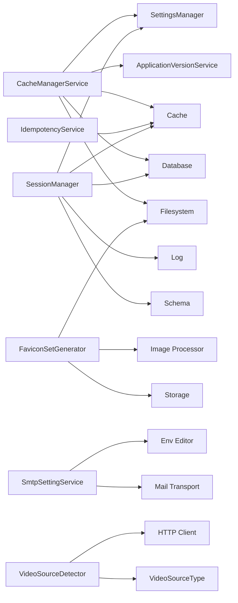

# Utility and Support Services

<cite>
**Referenced Files in This Document **
- [CacheManagerService.php](file://app/Services/CacheManagerService.php)
- [IdempotencyService.php](file://app/Services/IdempotencyService.php)
- [SessionManager.php](file://app/Services/SessionManager.php)
- [FaviconSetGenerator.php](file://app/Services/FaviconSetGenerator.php)
- [SmtpSettingService.php](file://app/Services/SmtpSettingService.php)
- [VideoSourceDetector.php](file://app/Services/VideoSourceDetector.php)
</cite>

## Table of Contents
1. [Introduction](#introduction)
2. [Project Structure](#project-structure)
3. [Core Components](#core-components)
4. [Architecture Overview](#architecture-overview)
5. [Detailed Component Analysis](#detailed-component-analysis)
6. [Dependency Analysis](#dependency-analysis)
7. [Performance Considerations](#performance-considerations)
8. [Troubleshooting Guide](#troubleshooting-guide)
9. [Conclusion](#conclusion)

## Introduction
This document explains the cross-cutting utility services that support caching, request safety, session hygiene, media assets, email configuration, and video source handling. Each service encapsulates a focused responsibility so controllers, actions, Livewire components, and commands can reuse shared behavior consistently.

The services covered here are:
- CacheManagerService: structured cache inspection, clearing, warming, and optimization.
- IdempotencyService: token-based duplicate prevention for form submissions and API requests.
- SessionManager: reconciliation and pruning of framework sessions and application sign-in ledger rows.
- FaviconSetGenerator: generation, deployment, and self-healing of browser icon sets.
- SmtpSettingService: editing SMTP settings in environment configuration and testing mail delivery.
- VideoSourceDetector: classification, ID extraction, embed URL construction, and Facebook share resolution.

## Project Structure
These utilities live under the application service layer and are invoked by higher-level features rather than directly by routes or views. Their design emphasizes explicit keys, bounded operations, and clear failure paths.

**Diagram sources **
- [CacheManagerService.php:1-328](file://app/Services/CacheManagerService.php#L1-L328)
- [IdempotencyService.php:1-95](file://app/Services/IdempotencyService.php#L1-L95)
- [SessionManager.php:1-357](file://app/Services/SessionManager.php#L1-L357)
- [FaviconSetGenerator.php:1-204](file://app/Services/FaviconSetGenerator.php#L1-L204)
- [SmtpSettingService.php:1-85](file://app/Services/SmtpSettingService.php#L1-L85)
- [VideoSourceDetector.php:1-445](file://app/Services/VideoSourceDetector.php#L1-L445)

## Core Components
- CacheManagerService provides an allowlisted registry of cache groups, per-group statistics, safe clearing, and optimized rebuilding of cached content.
- IdempotencyService stores short-lived tokens to prevent duplicate processing and optionally returns the original result when a duplicate is detected.
- SessionManager measures live sessions, prunes expired and idle sessions, closes orphaned ledger entries, and purges old history records in batches.
- FaviconSetGenerator renders multiple icon formats from one master image, writes them into the public root, and restores bundled icons when needed.
- SmtpSettingService reads, updates, and validates SMTP configuration while keeping passwords write-only.
- VideoSourceDetector classifies video sources, extracts IDs, builds embed URLs, resolves Facebook share links, and normalizes local file paths.

**Section sources**
- [CacheManagerService.php:1-328](file://app/Services/CacheManagerService.php#L1-L328)
- [IdempotencyService.php:1-95](file://app/Services/IdempotencyService.php#L1-L95)
- [SessionManager.php:1-357](file://app/Services/SessionManager.php#L1-L357)
- [FaviconSetGenerator.php:1-204](file://app/Services/FaviconSetGenerator.php#L1-L204)
- [SmtpSettingService.php:1-85](file://app/Services/SmtpSettingService.php#L1-L85)
- [VideoSourceDetector.php:1-445](file://app/Services/VideoSourceDetector.php#L1-L445)

## Architecture Overview
Each service is designed as a single-purpose utility with minimal coupling:
- CacheManagerService depends on settings, versioning, permissions, and Laravel cache/framework artifacts.
- IdempotencyService depends only on the cache store.
- SessionManager depends on the application’s user session model, settings, database, and logging.
- FaviconSetGenerator depends on image processing, storage, and filesystem access.
- SmtpSettingService depends on environment editing and the mail transport.
- VideoSourceDetector depends on HTTP and an enum for source types.

**Diagram sources **
- [CacheManagerService.php:1-328](file://app/Services/CacheManagerService.php#L1-L328)
- [IdempotencyService.php:1-95](file://app/Services/IdempotencyService.php#L1-L95)
- [SessionManager.php:1-357](file://app/Services/SessionManager.php#L1-L357)
- [FaviconSetGenerator.php:1-204](file://app/Services/FaviconSetGenerator.php#L1-L204)
- [SmtpSettingService.php:1-85](file://app/Services/SmtpSettingService.php#L1-L85)
- [VideoSourceDetector.php:1-445](file://app/Services/VideoSourceDetector.php#L1-L445)

## Detailed Component Analysis

### CacheManagerService
CacheManagerService centralizes cache management through a fixed group registry. Consumers select groups by allowlisted keys, never raw cache keys, which reduces accidental cache poisoning and makes admin interfaces safer.

Key responsibilities:
- Group registry: labels, descriptions, and whether a group supports optimization.
- Statistics: entry counts and sizes where possible; database-backed cache stores expose more metrics than non-database stores.
- Clearing: safely forgets or flushes grouped cache data and related framework caches.
- Optimization: warms settings, rebuilds SEO output, refreshes application versions, and rebuilds compiled framework caches.

Caching strategies:
- Settings are aggregated and cleared through the settings subsystem, plus legacy per-key entries are swept.
- SEO output is rebuilt into dedicated cache keys with configurable durations.
- Application version cache uses a stable key provided by the versioning service.
- Framework cache includes config, routes, events, and compiled Blade views.

Cache invalidation flow:

Optimization flow:

Performance considerations:
- Database cache stats use targeted queries filtered by known key patterns.
- Framework stats count compiled files and view cache entries without scanning unrelated directories.
- Permission cache is refreshed after flushing application cache because it lives on the same store.

Usage examples:
- Inspect cache groups and their metadata before exposing controls to administrators.
- Use `groupKeys()` and `optimizableGroupKeys()` to validate user input.
- Call `stats()` to populate dashboard tables.
- Use `clear()` and `optimize()` for administrative maintenance tasks.

**Section sources**
- [CacheManagerService.php:1-328](file://app/Services/CacheManagerService.php#L1-L328)

### IdempotencyService
IdempotencyService prevents duplicate submissions by associating a unique token with processed results in the cache. It supports both simple boolean deduplication and returning the original operation result to callers that need idempotent responses.

Core behaviors:
- Token check: determines whether a token has already been marked processed.
- Marking: records a token with a fixed TTL.
- Result retrieval: returns the original value produced by the first successful call.
- Key generation: hashes request payload data with optional salt and time jitter to reduce collisions.
- Attempt wrapper: runs the callback only once per token and returns a standardized response structure for duplicates.

Request deduplication sequence:

Duplicate prevention best practices:
- Generate one token per logical mutation, such as booking creation, quote submission, or payment confirmation.
- Include enough request context in the token payload so different mutations cannot accidentally collide.
- Keep the cache TTL aligned with the expected retry window; the default is five minutes.
- For long-running operations, consider extending the TTL or using a durable backend if retries may outlive the default window.

Example usage pattern:
- Accept a client-supplied idempotency token in the request.
- Validate its presence and format.
- Wrap the business action in `attempt()`.
- Return the standardized duplicate response or the actual result.

**Section sources**
- [IdempotencyService.php:1-95](file://app/Services/IdempotencyService.php#L1-L95)

### SessionManager
SessionManager owns reconciliation between two session layers:
- The framework session store, which tracks browser sessions and last activity timestamps.
- The application’s sign-in ledger stored in `UserSession`, which models open and closed sessions with reasons and timestamps.

It measures live sessions, prunes stale state, and reports consistent numbers to dashboards and scheduled jobs.

Key responsibilities:
- Counts: total, valid, authenticated, guest, stale framework sessions; distinct users; open, live, stale, and orphaned sign-ins.
- Pruning: close idle sessions, delete expired framework rows, close stale or orphaned ledger rows, and purge old history.
- Batch processing: uses chunked transactions to avoid holding long locks during large sweeps.
- Last-run tracking: caches the most recent prune summary and logs completion details.

Pruning workflow:

Important concepts:
- A session is considered live based on a cutoff derived from configuration and the framework’s lifetime.
- Idle sessions are treated as real sign-outs; closing the ledger row without removing the framework row would leave the browser signed in.
- Orphaned ledger rows are those still open but whose corresponding framework session no longer exists.
- Dry runs report counts without mutating data, making scheduling and auditing safer.

Operational guidance:
- Schedule regular pruning according to site traffic and retention policy.
- Exclude the administrator’s own session when running manual cleanup from the UI.
- Monitor logs and the cached last-run record to confirm pruning progress.

**Section sources**
- [SessionManager.php:1-357](file://app/Services/SessionManager.php#L1-L357)

### FaviconSetGenerator
FaviconSetGenerator turns one uploaded image into a complete set of browser icons and manages their deployment to the public root. It also restores bundled brand icons when custom icons are removed.

Supported outputs:
- ICO container with embedded 16, 32, and 48 pixel PNGs.
- PNG icons for 48, 96, 180, 192, and 512 pixels.
- Apple touch icon at 180 pixels.
- Maskable icon variant at 512 pixels with a white background.
- A marker file recording the active version hash.

Generation and self-healing flow:

Behavior highlights:
- Generation computes a short version hash from the source bytes and writes it to a marker file.
- On deployment, the public root may be rebuilt from version control; `ensure()` detects drift and rewrites custom icons from the persistent master.
- If the custom set is removed, bundled icons are restored automatically.
- Errors during generation are logged and trigger restoration of bundled icons to keep the site functional.

Asset optimization notes:
- Multiple PNG sizes are cached in memory during one generation pass to avoid recomputation.
- The ICO container is assembled manually from pre-rendered PNG payloads.
- Output path and marker filename can be configured for tests or unusual deployments.

Implementation example:
- Upload a master image to the public disk.
- Call `generate()` with the encoded image bytes to produce a new icon set.
- Persist the returned version hash in the favicon metadata.
- Run `ensure()` during deployment to reconcile the public root.

**Section sources**
- [FaviconSetGenerator.php:1-204](file://app/Services/FaviconSetGenerator.php#L1-L204)

### SmtpSettingService
SmtpSettingService manages SMTP configuration stored in the environment file and provides a way to verify the configuration by sending a test email.

Capabilities:
- Update mailer, host, port, username, password, encryption, sender address, and sender name.
- Preserve existing password when the password field is empty.
- Clear Laravel’s configuration cache after writing changes.
- Retrieve current settings without exposing the password.
- Send a test email and return success or failure.

Configuration update flow:

Security and usability notes:
- Password fields are write-only; they are never returned by `getSettings()`.
- Missing mailer values are logged with context but do not crash configuration retrieval.
- Test emails wrap transport errors so validation failures can be surfaced to administrators without unhandled exceptions.

Operational advice:
- Always test SMTP settings immediately after updating them.
- Avoid logging full settings arrays; use selective fields if debugging is required.
- Treat failed test sends as indicators of network, authentication, or TLS problems.

**Section sources**
- [SmtpSettingService.php:1-85](file://app/Services/SmtpSettingService.php#L1-L85)

### VideoSourceDetector
VideoSourceDetector identifies the origin of a video reference and produces platform-appropriate embed information. It supports local files, YouTube, Vimeo, Dailymotion, Facebook, and direct video URLs.

Detection pipeline:

Capabilities:
- Detect source type from a raw string.
- Extract platform-specific video identifiers.
- Build embed URLs suitable for iframe players.
- Resolve local paths into full asset URLs.
- Normalize Facebook share and short links by performing HTTP redirects with realistic headers.

Facebook share resolution behavior:
- Recognizes reels, share links, short links, watch URLs, legacy endpoints, profile videos, and older VB-style URLs.
- Attempts a HEAD request to capture redirect locations, then falls back to a GET request with redirect following.
- Caches resolved URLs within the detector instance to avoid repeated network calls during one request lifecycle.
- Logs resolution outcomes and warnings when network or parsing fails.

Format identification tips:
- Direct video detection looks for common extensions and query-safe URL patterns.
- When a platform requires the full original URL for embedding, such as Facebook, the detector preserves or resolves that URL accordingly.

Usage examples:
- Classify incoming video references before rendering.
- Pass the detected type to template helpers that build player markup.
- Use `getFullUrl()` to convert relative paths into absolute asset URLs.

**Section sources**
- [VideoSourceDetector.php:1-445](file://app/Services/VideoSourceDetector.php#L1-L445)

## Dependency Analysis
The services have low internal coupling and depend on well-defined external systems:

- CacheManagerService depends on settings, versioning, permissions, cache, database, filesystem, and Artisan commands.
- IdempotencyService depends only on cache.
- SessionManager depends on database, cache, logging, schema inspection, settings, and the user session model.
- FaviconSetGenerator depends on image processing, storage, filesystem, and configuration.
- SmtpSettingService depends on environment editing, configuration clearing, and mail transport.
- VideoSourceDetector depends on HTTP, logging, and an enum.

**Diagram sources **
- [CacheManagerService.php:1-328](file://app/Services/CacheManagerService.php#L1-L328)
- [IdempotencyService.php:1-95](file://app/Services/IdempotencyService.php#L1-L95)
- [SessionManager.php:1-357](file://app/Services/SessionManager.php#L1-L357)
- [FaviconSetGenerator.php:1-204](file://app/Services/FaviconSetGenerator.php#L1-L204)
- [SmtpSettingService.php:1-85](file://app/Services/SmtpSettingService.php#L1-L85)
- [VideoSourceDetector.php:1-445](file://app/Services/VideoSourceDetector.php#L1-L445)

## Performance Considerations
- Prefer allowlisted cache groups over arbitrary cache keys to reduce risk and improve maintainability.
- Use database-backed cache stores when you need accurate entry counts and size statistics.
- Batch expensive operations: SessionManager processes sessions in chunks, avoiding long database locks.
- Reuse generated resources: FaviconSetGenerator caches intermediate PNGs during one generation pass.
- Limit network calls: VideoSourceDetector caches resolved Facebook URLs per request.
- Keep idempotency TTLs short but sufficient for retry windows; otherwise, duplicate prevention becomes less useful.
- Clear and rebuild framework caches together during deployment or maintenance windows rather than piecemeal.

## Troubleshooting Guide
Common issues and diagnostics:

- Cache group not recognized:
  - Only allowed group keys are accepted. Validate against the service’s key registry before calling clear or optimize.
- SEO cache not updating:
  - Ensure SEO cache rebuild is triggered after content changes. Check configured durations for sitemap and robots caches.
- Permissions still stale after cache flush:
  - Application cache flush does not automatically refresh third-party permission caches. The service explicitly rebuilds the permission registrar cache.
- Duplicate request still occurring:
  - Verify that the same token is used for identical logical operations.
  - Confirm the cache store is reachable and that the TTL is not expiring too quickly.
- Sessions remain open after logout:
  - Ensure SessionManager pruning runs regularly.
  - Check idle timeout configuration and verify that framework session driver is database when reconciliation is expected.
- Favicon set missing after deployment:
  - The generator self-heals by comparing the marker version with the stored master. Check logs for generation failures and verify writable public root permissions.
- SMTP test email fails:
  - Validate mailer, host, port, encryption, credentials, and firewall rules.
  - Use the service’s send-test-email method to isolate transport errors from application logic.
- Facebook embed not loading:
  - Share links may require redirection resolution. Check logs for resolution attempts and verify that outbound HTTP requests are allowed.

**Section sources**
- [CacheManagerService.php:1-328](file://app/Services/CacheManagerService.php#L1-L328)
- [IdempotencyService.php:1-95](file://app/Services/IdempotencyService.php#L1-L95)
- [SessionManager.php:1-357](file://app/Services/SessionManager.php#L1-L357)
- [FaviconSetGenerator.php:1-204](file://app/Services/FaviconSetGenerator.php#L1-L204)
- [SmtpSettingService.php:1-85](file://app/Services/SmtpSettingService.php#L1-L85)
- [VideoSourceDetector.php:1-445](file://app/Services/VideoSourceDetector.php#L1-L445)

## Conclusion
These utility services provide foundational capabilities that many parts of the application rely on:
- CacheManagerService keeps cached data organized, measurable, and repairable.
- IdempotencyService protects mutable operations from accidental duplication.
- SessionManager maintains consistency between browser sessions and application sign-in records.
- FaviconSetGenerator ensures reliable, optimized browser icons across devices and deployments.
- SmtpSettingService centralizes SMTP configuration and verification.
- VideoSourceDetector simplifies video source classification and embed preparation.

Adopt these services instead of ad-hoc implementations to gain predictable behavior, safer APIs, clearer logs, and easier maintenance.