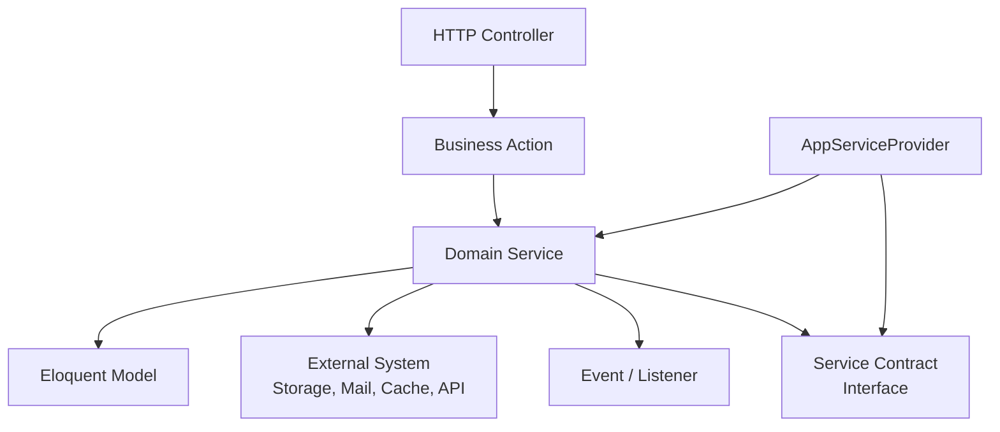
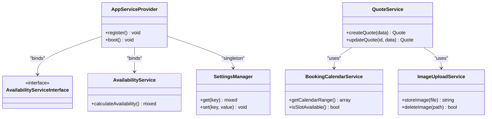
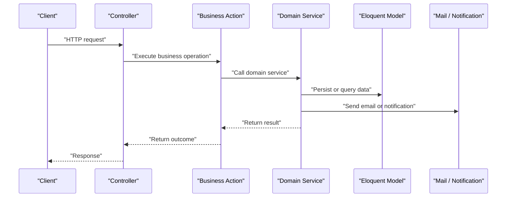
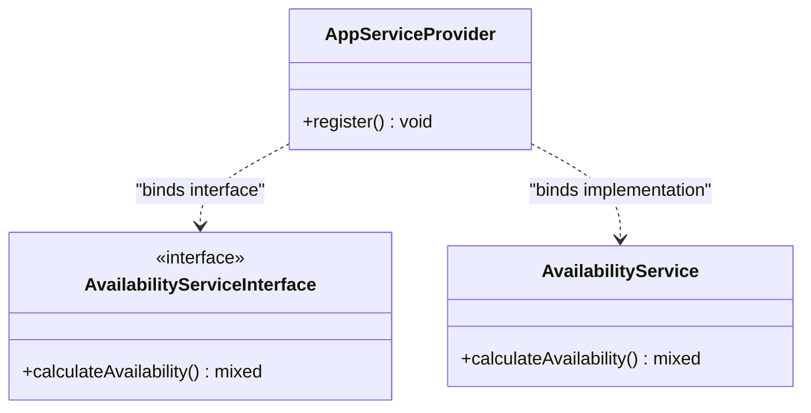
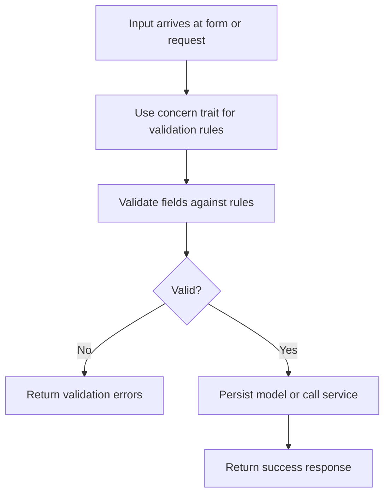
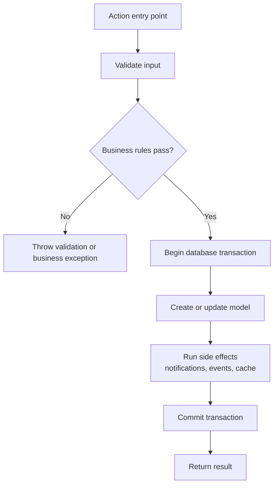
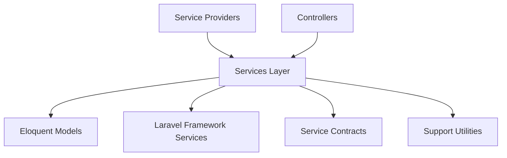

# Services Layer

<cite>
**Referenced Files in This Document**
- [AppServiceProvider.php](file://app/Providers/AppServiceProvider.php)
- [AvailabilityServiceInterface.php](file://app/app/Services/Contracts/AvailabilityServiceInterface.php)
- [AboutUsService.php](file://app/app/Services/AboutUsService.php)
- [ApplicationVersionService.php](file://app/app/Services/ApplicationVersionService.php)
- [AvailabilityService.php](file://app/app/Services/AvailabilityService.php)
- [BlogSearchService.php](file://app/app/Services/BlogSearchService.php)
- [BookingCalendarService.php](file://app/app/Services/BookingCalendarService.php)
- [BookingIcsService.php](file://app/app/Services/BookingIcsService.php)
- [BookingTimeline.php](file://app/app/Services/BookingTimeline.php)
- [CacheManagerService.php](file://app/app/Services/CacheManagerService.php)
- [CategoryService.php](file://app/app/Services/CategoryService.php)
- [CompanySettingService.php](file://app/app/Services/CompanySettingService.php)
- [ContactMessageService.php](file://app/app/Services/ContactMessageService.php)
- [ContactNumberService.php](file://app/app/Services/ContactNumberService.php)
- [EnvEditor.php](file://app/app/Services/EnvEditor.php)
- [FaviconSetGenerator.php](file://app/app/Services/FaviconSetGenerator.php)
- [GalleryCategoryService.php](file://app/app/Services/GalleryCategoryService.php)
- [GalleryService.php](file://app/app/Services/GalleryService.php)
- [GlassSubCategoryService.php](file://app/app/Services/GlassSubCategoryService.php)
- [GlassTypeService.php](file://app/app/Services/GlassTypeService.php)
- [IdempotencyService.php](file://app/app/Services/IdempotencyService.php)
- [ImageUploadService.php](file://app/app/Services/ImageUploadService.php)
- [MediaLibraryService.php](file://app/app/Services/MediaLibraryService.php)
- [MediaRegistryService.php](file://app/app/Services/MediaRegistryService.php)
- [PasswordPolicy.php](file://app/app/Services/PasswordPolicy.php)
- [PostService.php](file://app/app/Services/PostService.php)
- [ProfileService.php](file://app/app/Services/ProfileService.php)
- [QuoteService.php](file://app/app/Services/QuoteService.php)
- [RoleService.php](file://app/app/Services/RoleService.php)
- [SeoInjectionService.php](file://app/app/Services/SeoInjectionService.php)
- [SeoService.php](file://app/app/Services/SeoService.php)
- [ServiceService.php](file://app/app/Services/ServiceService.php)
- [ServiceTypeService.php](file://app/app/Services/ServiceTypeService.php)
- [SessionManager.php](file://app/app/Services/SessionManager.php)
- [SiteService.php](file://app/app/Services/SiteService.php)
- [SmtpSettingService.php](file://app/app/Services/SmtpSettingService.php)
- [StaffTwoFactorChallengeService.php](file://app/app/Services/StaffTwoFactorChallengeService.php)
- [TagService.php](file://app/app/Services/TagService.php)
- [TestimonialService.php](file://app/app/Services/TestimonialService.php)
- [UserService.php](file://app/app/Services/UserService.php)
- [UserSessionService.php](file://app/app/Services/UserSessionService.php)
- [VideoSourceDetector.php](file://app/app/Services/VideoSourceDetector.php)
- [VideoUploadService.php](file://app/app/Services/VideoUploadService.php)
- [SendContactMessage.php](file://app/app/Actions/SendContactMessage.php)
- [StoreBookingAction.php](file://app/app/Actions/StoreBookingAction.php)
- [StoreInspectionAction.php](file://app/app/Actions/StoreInspectionAction.php)
- [StoreQuoteAction.php](file://app/app/Actions/StoreQuoteAction.php)
- [UpdateInspectionAction.php](file://app/app/Actions/UpdateInspectionAction.php)
- [PasswordValidationRules.php](file://app/app/Concerns/PasswordValidationRules.php)
- [ProfileValidationRules.php](file://app/app/Concerns/ProfileValidationRules.php)
</cite>

## Table of Contents
1. [Introduction](#introduction)
2. [Project Structure](#project-structure)
3. [Core Components](#core-components)
4. [Architecture Overview](#architecture-overview)
5. [Detailed Component Analysis](#detailed-component-analysis)
6. [Dependency Analysis](#dependency-analysis)
7. [Performance Considerations](#performance-considerations)
8. [Troubleshooting Guide](#troubleshooting-guide)
9. [Conclusion](#conclusion)
10. [Appendices](#appendices)

## Introduction
This document explains the Highblossom services layer architecture and how business logic is organized across service classes, action classes, and concern traits. The application uses a layered design where:

- **Controllers and Livewire components** handle HTTP concerns, request/response shaping, and presentation coordination.
- **Services** encapsulate domain workflows, cross-cutting rules, data transformation, and orchestration between models, external systems, and events.
- **Action classes** represent focused, single-purpose business operations such as creating or updating records through a transactional workflow.
- **Concern traits** provide reusable validation rules and shared behavior that can be composed into forms, requests, or services.

The services directory contains over 159 classes covering domains such as bookings, content, SEO, media, user management, system settings, availability, and infrastructure utilities. Contracts under `app/Services/Contracts` define interfaces for loose coupling, while the application provider wires concrete implementations into the service container.

## Project Structure
The relevant parts of the repository are organized by feature and responsibility:

| Area | Purpose | Examples |
|---|---|---|
| `app/app/Services` | Business services, orchestration, and domain workflows | `UserService`, `BookingCalendarService`, `SeoService`, `ImageUploadService` |
| `app/app/Services/Contracts` | Interface contracts for services | `AvailabilityServiceInterface` |
| `app/app/Services/DataTransferObjects` | Typed input/output payloads for services | Data transfer objects used by services |
| `app/app/Services/Settings` | Configuration and environment-related services | `SettingsManager` |
| `app/app/Services/Content` | Content-oriented business logic | Content services |
| `app/app/Services/Contact` | Contact form and message handling | Contact message service |
| `app/app/Services/Seo` | SEO-specific services | SEO injection and metadata services |
| `app/app/Actions` | Single-purpose business actions | `StoreBookingAction`, `StoreQuoteAction`, `UpdateInspectionAction` |
| `app/app/Concerns` | Reusable validation rule traits | `PasswordValidationRules`, `ProfileValidationRules` |
| `app/app/Models` | Eloquent entities representing domain data | `User`, `Booking`, `Quote`, `Post`, `GalleryImage` |
| `app/app/Http/Controllers` | HTTP controllers coordinating requests to services | Controllers calling services and actions |
| `app/app/Providers/AppServiceProvider` | Container bindings, global configuration, and gate definitions | Service registration and defaults |

**Diagram sources**
- [AppServiceProvider.php:1-110](file://app/Providers/AppServiceProvider.php#L1-L110)
- [AvailabilityServiceInterface.php](file://app/app/Services/Contracts/AvailabilityServiceInterface.php)

**Section sources**
- [AppServiceProvider.php:1-110](file://app/Providers/AppServiceProvider.php#L1-L110)

## Core Components
The core of the services layer consists of:

- **Service classes**: One or more methods per domain capability, often orchestrating multiple models, validations, jobs, events, and side effects.
- **Action classes**: Focused workflows that perform one operation end-to-end, usually wrapping database transactions and notifications.
- **Concern traits**: Shared validation rules and reusable logic that can be included in forms, requests, or services.
- **Contracts**: Interfaces that define expected service behavior so controllers and other layers depend on abstractions rather than concrete classes.
- **Container wiring**: The application provider registers singleton bindings for critical services, ensuring consistent resolution and shared state when appropriate.

Key responsibilities include:

- Enforcing business rules before persisting data.
- Coordinating multi-step workflows such as booking creation, quote submission, inspection updates, and media uploads.
- Managing availability calculations, calendar generation, and scheduling helpers.
- Handling SEO metadata, static routes, and content injection.
- Managing user sessions, roles, permissions, and two-factor challenges.
- Centralizing image and video upload logic with storage abstraction.

**Section sources**
- [AppServiceProvider.php:1-110](file://app/Providers/AppServiceProvider.php#L1-L110)
- [AvailabilityServiceInterface.php](file://app/app/Services/Contracts/AvailabilityServiceInterface.php)
- [AboutUsService.php](file://app/app/Services/AboutUsService.php)
- [ApplicationVersionService.php](file://app/app/Services/ApplicationVersionService.php)
- [AvailabilityService.php](file://app/app/Services/AvailabilityService.php)
- [BlogSearchService.php](file://app/app/Services/BlogSearchService.php)
- [BookingCalendarService.php](file://app/app/Services/BookingCalendarService.php)
- [BookingIcsService.php](file://app/app/Services/BookingIcsService.php)
- [BookingTimeline.php](file://app/app/Services/BookingTimeline.php)
- [CacheManagerService.php](file://app/app/Services/CacheManagerService.php)
- [CategoryService.php](file://app/app/Services/CategoryService.php)
- [CompanySettingService.php](file://app/app/Services/CompanySettingService.php)
- [ContactMessageService.php](file://app/app/Services/ContactMessageService.php)
- [ContactNumberService.php](file://app/app/Services/ContactNumberService.php)
- [EnvEditor.php](file://app/app/Services/EnvEditor.php)
- [FaviconSetGenerator.php](file://app/app/Services/FaviconSetGenerator.php)
- [GalleryCategoryService.php](file://app/app/Services/GalleryCategoryService.php)
- [GalleryService.php](file://app/app/Services/GalleryService.php)
- [GlassSubCategoryService.php](file://app/app/Services/GlassSubCategoryService.php)
- [GlassTypeService.php](file://app/app/Services/GlassTypeService.php)
- [IdempotencyService.php](file://app/app/Services/IdempotencyService.php)
- [ImageUploadService.php](file://app/app/Services/ImageUploadService.php)
- [MediaLibraryService.php](file://app/app/Services/MediaLibraryService.php)
- [MediaRegistryService.php](file://app/app/Services/MediaRegistryService.php)
- [PasswordPolicy.php](file://app/app/Services/PasswordPolicy.php)
- [PostService.php](file://app/app/Services/PostService.php)
- [ProfileService.php](file://app/app/Services/ProfileService.php)
- [QuoteService.php](file://app/app/Services/QuoteService.php)
- [RoleService.php](file://app/app/Services/RoleService.php)
- [SeoInjectionService.php](file://app/app/Services/SeoInjectionService.php)
- [SeoService.php](file://app/app/Services/SeoService.php)
- [ServiceService.php](file://app/app/Services/ServiceService.php)
- [ServiceTypeService.php](file://app/app/Services/ServiceTypeService.php)
- [SessionManager.php](file://app/app/Services/SessionManager.php)
- [SiteService.php](file://app/app/Services/SiteService.php)
- [SmtpSettingService.php](file://app/app/Services/SmtpSettingService.php)
- [StaffTwoFactorChallengeService.php](file://app/app/Services/StaffTwoFactorChallengeService.php)
- [TagService.php](file://app/app/Services/TagService.php)
- [TestimonialService.php](file://app/app/Services/TestimonialService.php)
- [UserService.php](file://app/app/Services/UserService.php)
- [UserSessionService.php](file://app/app/Services/UserSessionService.php)
- [VideoSourceDetector.php](file://app/app/Services/VideoSourceDetector.php)
- [VideoUploadService.php](file://app/app/Services/VideoUploadService.php)

## Architecture Overview
The services layer sits between HTTP boundaries and data models. It centralizes business logic so controllers remain thin and testable.

**Diagram sources**
- [AppServiceProvider.php:1-110](file://app/Providers/AppServiceProvider.php#L1-L110)
- [AvailabilityServiceInterface.php](file://app/app/Services/Contracts/AvailabilityServiceInterface.php)
- [AvailabilityService.php](file://app/app/Services/AvailabilityService.php)
- [BookingCalendarService.php](file://app/app/Services/BookingCalendarService.php)
- [QuoteService.php](file://app/app/Services/QuoteService.php)
- [ImageUploadService.php](file://app/app/Services/ImageUploadService.php)

### Request Flow Through the Services Layer
A typical request follows this sequence:

1. A controller validates the incoming request using Laravel request classes or form requests.
2. The controller delegates business work to an action or service.
3. The action/service enforces business rules, performs validations, persists models, emits events, sends emails, and returns structured results.
4. The controller returns a response, view, redirect, or API resource.

**Diagram sources**
- [StoreBookingAction.php](file://app/app/Actions/StoreBookingAction.php)
- [StoreQuoteAction.php](file://app/app/Actions/StoreQuoteAction.php)
- [UpdateInspectionAction.php](file://app/app/Actions/UpdateInspectionAction.php)
- [BookingCalendarService.php](file://app/app/Services/BookingCalendarService.php)
- [QuoteService.php](file://app/app/Services/QuoteService.php)

## Detailed Component Analysis

### Service Contracts and Dependency Injection
The application defines contracts for services that need interchangeable implementations or clear integration points. For example, `AvailabilityServiceInterface` expresses the contract for availability calculations, and `AppServiceProvider` binds it to `AvailabilityService`. This pattern supports testing, swapping implementations, and keeping controllers decoupled from concrete logic.

**Diagram sources**
- [AppServiceProvider.php:1-110](file://app/Providers/AppServiceProvider.php#L1-L110)
- [AvailabilityServiceInterface.php](file://app/app/Services/Contracts/AvailabilityServiceInterface.php)

**Section sources**
- [AppServiceProvider.php:1-110](file://app/Providers/AppServiceProvider.php#L1-L110)
- [AvailabilityServiceInterface.php](file://app/app/Services/Contracts/AvailabilityServiceInterface.php)

### Validation Rules and Concern Traits
Validation rules are abstracted into reusable traits under `app/app/Concerns`. This keeps form and request validation consistent across authentication, profile editing, and related features.

- `PasswordValidationRules`: Centralizes password policy constraints used by authentication and profile flows.
- `ProfileValidationRules`: Centralizes profile-related field validation rules.

These traits promote consistency and reduce duplication across controllers, requests, and services that need to validate user input.

**Diagram sources**
- [PasswordValidationRules.php](file://app/app/Concerns/PasswordValidationRules.php)
- [ProfileValidationRules.php](file://app/app/Concerns/ProfileValidationRules.php)

**Section sources**
- [PasswordValidationRules.php](file://app/app/Concerns/PasswordValidationRules.php)
- [ProfileValidationRules.php](file://app/app/Concerns/ProfileValidationRules.php)

### Business Actions for Encapsulated Workflows
Actions encapsulate specific business operations. They are useful for complex workflows that involve multiple steps, transactions, events, and side effects.

Examples include:

- `SendContactMessage`: Handles contact message submission and notification delivery.
- `StoreBookingAction`: Creates a booking, validates availability, schedules staff, and sends confirmations.
- `StoreInspectionAction`: Creates an inspection record with associated notes and status changes.
- `StoreQuoteAction`: Creates a quote, applies pricing rules, stores images, and notifies staff.
- `UpdateInspectionAction`: Updates an existing inspection with audit-friendly changes and event emission.

**Diagram sources**
- [StoreBookingAction.php](file://app/app/Actions/StoreBookingAction.php)
- [StoreInspectionAction.php](file://app/app/Actions/StoreInspectionAction.php)
- [StoreQuoteAction.php](file://app/app/Actions/StoreQuoteAction.php)
- [UpdateInspectionAction.php](file://app/app/Actions/UpdateInspectionAction.php)

**Section sources**
- [SendContactMessage.php](file://app/app/Actions/SendContactMessage.php)
- [StoreBookingAction.php](file://app/app/Actions/StoreBookingAction.php)
- [StoreInspectionAction.php](file://app/app/Actions/StoreInspectionAction.php)
- [StoreQuoteAction.php](file://app/app/Actions/StoreQuoteAction.php)
- [UpdateInspectionAction.php](file://app/app/Actions/UpdateInspectionAction.php)

### Domain Services by Feature Area

#### Booking and Scheduling Services
- `BookingCalendarService`: Computes available slots, working hours, and closed days.
- `BookingIcsService`: Generates iCal-compatible calendar data for bookings.
- `BookingTimeline`: Builds chronological booking timeline data for display or export.

These services coordinate with `Booking`, `BookingClosedDay`, `Staff`, and related models to enforce scheduling policies.

#### Content and Media Services
- `GalleryService` and `GalleryCategoryService`: Manage gallery collections and categories.
- `ImageUploadService`: Handles image upload, validation, storage, and path normalization.
- `VideoUploadService` and `VideoSourceDetector`: Handle video uploads and source detection.
- `MediaLibraryService` and `MediaRegistryService`: Provide centralized media registry and usage tracking.
- `FaviconSetGenerator`: Generates favicon sets from uploaded assets.

#### SEO and Site Services
- `SeoService` and `SeoInjectionService`: Manage SEO metadata, static routes, and injected page content.
- `SiteService`: Provides site-wide configuration and presentation data.
- `CompanySettingService` and `SmtpSettingService`: Manage company and mail configuration.
- `ApplicationVersionService`: Tracks application version information.

#### User, Role, and Session Services
- `UserService`: Manages user lifecycle, profile updates, and related business rules.
- `RoleService`: Handles role assignment and permission-related logic.
- `SessionManager` and `UserSessionService`: Manage session state and user session auditing.
- `StaffTwoFactorChallengeService`: Coordinates two-factor authentication challenges for staff.

#### Product and Catalog Services
- `ServiceService`, `ServiceTypeService`, `GlassTypeService`, `GlassSubCategoryService`: Manage service catalog, types, and glass classifications.
- `CategoryService`, `TagService`, `PostService`, `TestimonialService`: Manage blog posts, categories, tags, and testimonials.
- `QuoteService`: Encapsulates quote creation, updates, and pricing workflows.
- `ContactMessageService` and `ContactNumberService`: Handle contact messages and phone number management.

#### Infrastructure and Utility Services
- `CacheManagerService`: Centralizes cache operations and invalidation strategies.
- `IdempotencyService`: Ensures idempotent operations for safety in retries.
- `PasswordPolicy`: Enforces password strength and policy rules.
- `EnvEditor`: Provides safe editing of environment configuration.

**Section sources**
- [BookingCalendarService.php](file://app/app/Services/BookingCalendarService.php)
- [BookingIcsService.php](file://app/app/Services/BookingIcsService.php)
- [BookingTimeline.php](file://app/app/Services/BookingTimeline.php)
- [GalleryService.php](file://app/app/Services/GalleryService.php)
- [GalleryCategoryService.php](file://app/app/Services/GalleryCategoryService.php)
- [ImageUploadService.php](file://app/app/Services/ImageUploadService.php)
- [VideoUploadService.php](file://app/app/Services/VideoUploadService.php)
- [VideoSourceDetector.php](file://app/app/Services/VideoSourceDetector.php)
- [MediaLibraryService.php](file://app/app/Services/MediaLibraryService.php)
- [MediaRegistryService.php](file://app/app/Services/MediaRegistryService.php)
- [FaviconSetGenerator.php](file://app/app/Services/FaviconSetGenerator.php)
- [SeoService.php](file://app/app/Services/SeoService.php)
- [SeoInjectionService.php](file://app/app/Services/SeoInjectionService.php)
- [SiteService.php](file://app/app/Services/SiteService.php)
- [CompanySettingService.php](file://app/app/Services/CompanySettingService.php)
- [SmtpSettingService.php](file://app/app/Services/SmtpSettingService.php)
- [ApplicationVersionService.php](file://app/app/Services/ApplicationVersionService.php)
- [UserService.php](file://app/app/Services/UserService.php)
- [RoleService.php](file://app/app/Services/RoleService.php)
- [SessionManager.php](file://app/app/Services/SessionManager.php)
- [UserSessionService.php](file://app/app/Services/UserSessionService.php)
- [StaffTwoFactorChallengeService.php](file://app/app/Services/StaffTwoFactorChallengeService.php)
- [ServiceService.php](file://app/app/Services/ServiceService.php)
- [ServiceTypeService.php](file://app/app/Services/ServiceTypeService.php)
- [GlassTypeService.php](file://app/app/Services/GlassTypeService.php)
- [GlassSubCategoryService.php](file://app/app/Services/GlassSubCategoryService.php)
- [CategoryService.php](file://app/app/Services/CategoryService.php)
- [TagService.php](file://app/app/Services/TagService.php)
- [PostService.php](file://app/app/Services/PostService.php)
- [TestimonialService.php](file://app/app/Services/TestimonialService.php)
- [QuoteService.php](file://app/app/Services/QuoteService.php)
- [ContactMessageService.php](file://app/app/Services/ContactMessageService.php)
- [ContactNumberService.php](file://app/app/Services/ContactNumberService.php)
- [CacheManagerService.php](file://app/app/Services/CacheManagerService.php)
- [IdempotencyService.php](file://app/app/Services/IdempotencyService.php)
- [PasswordPolicy.php](file://app/app/Services/PasswordPolicy.php)
- [EnvEditor.php](file://app/app/Services/EnvEditor.php)

## Dependency Analysis
The services layer depends on:

- **Eloquent models** for persistence.
- **Laravel services** such as mail, cache, queue, filesystem, and events.
- **Domain contracts** for loose coupling.
- **Providers** for container bindings and global configuration.
- **Support and utility classes** for system overview, device detection, sort order management, and admin navigation.

**Diagram sources**
- [AppServiceProvider.php:1-110](file://app/Providers/AppServiceProvider.php#L1-L110)

### Coupling and Cohesion
- High cohesion: Each service focuses on a bounded domain area, such as bookings, media, SEO, or user management.
- Loose coupling: Contracts like `AvailabilityServiceInterface` allow swapping implementations and mocking during tests.
- Controlled coupling: Services may collaborate, but heavy orchestration should stay within services or actions rather than leaking into controllers.

### Potential Circular Dependencies
Avoid having services import each other unnecessarily. Prefer:

- Using a higher-level orchestrator (action or service) to compose lower-level services.
- Defining contracts for cross-service dependencies.
- Keeping infrastructure concerns isolated behind interfaces.

**Section sources**
- [AppServiceProvider.php:1-110](file://app/Providers/AppServiceProvider.php#L1-L110)

## Performance Considerations
- **Caching**: Use `CacheManagerService` or direct cache access for expensive queries, especially for SEO metadata, site settings, and catalog data.
- **Database efficiency**: Avoid N+1 queries in services by eager loading relationships and using efficient scopes.
- **Idempotency**: Use `IdempotencyService` for retry-safe operations such as payment-like or notification-heavy workflows.
- **Queues**: Offload long-running tasks like email sending, media processing, and report generation to queues.
- **Lazy loading protection**: The provider disables lazy loading in non-production environments to help catch performance issues early.
- **Schema defaults**: Default string length adjustments prevent migration and index failures on certain databases.

[No sources needed since this section provides general guidance]

## Troubleshooting Guide
Common issues and remedies:

| Issue | Likely Cause | Resolution |
|---|---|---|
| Service not found | Missing container binding | Register the service or contract in `AppServiceProvider::register`. |
| Unexpected shared state | Singleton misused | Review whether the service should be a singleton, scoped, or transient. |
| Validation inconsistency | Rules duplicated | Move shared rules into concern traits under `app/app/Concerns`. |
| Slow page load | N+1 queries or missing cache | Add eager loading and cache frequently accessed data. |
| Failed uploads | Storage misconfiguration | Verify filesystem disk configuration and path normalization in upload services. |
| Idempotency violations | Missing idempotency key | Use `IdempotencyService` for retry-safe endpoints. |
| Permission denied | Gate or role not configured | Check gates and roles defined in providers and policies. |

**Section sources**
- [AppServiceProvider.php:1-110](file://app/Providers/AppServiceProvider.php#L1-L110)
- [IdempotencyService.php](file://app/app/Services/IdempotencyService.php)
- [ImageUploadService.php](file://app/app/Services/ImageUploadService.php)
- [PasswordValidationRules.php](file://app/app/Concerns/PasswordValidationRules.php)
- [ProfileValidationRules.php](file://app/app/Concerns/ProfileValidationRules.php)

## Conclusion
The Highblossom services layer organizes business logic around clear responsibilities:

- **Services** own domain workflows and orchestrate models, events, mail, cache, and storage.
- **Actions** encapsulate focused business operations with transactional integrity.
- **Concern traits** centralize reusable validation rules.
- **Contracts** enable loose coupling and testability.
- **Providers** wire dependencies and configure production-safe defaults.

This structure promotes reusability, maintainability, and testability. New functionality should follow the same patterns: introduce a service or action, define a contract if the behavior needs to be swapped or mocked, bind it in the provider, and keep controllers focused on HTTP concerns.

[No sources needed since this section summarizes without analyzing specific files]

## Appendices

### How to Create a New Service
1. Create a class under `app/app/Services` named after the domain capability, such as `OrderProcessingService`.
2. Define public methods for each business operation.
3. Inject dependencies via constructor or method parameters.
4. If the service has a stable contract, create an interface under `app/app/Services/Contracts`.
5. Bind the interface to the implementation in `AppServiceProvider::register`.
6. Call the service from a controller, action, or command.

**Section sources**
- [AppServiceProvider.php:1-110](file://app/Providers/AppServiceProvider.php#L1-L110)

### How to Implement a Business Workflow
1. Choose an action for end-to-end operations or a service for reusable domain logic.
2. Validate input using request classes, form requests, or concern traits.
3. Enforce business rules before persisting data.
4. Wrap database mutations in transactions.
5. Emit events or send notifications after successful persistence.
6. Return structured results to the caller.

**Section sources**
- [StoreBookingAction.php](file://app/app/Actions/StoreBookingAction.php)
- [StoreQuoteAction.php](file://app/app/Actions/StoreQuoteAction.php)
- [UpdateInspectionAction.php](file://app/app/Actions/UpdateInspectionAction.php)
- [PasswordValidationRules.php](file://app/app/Concerns/PasswordValidationRules.php)
- [ProfileValidationRules.php](file://app/app/Concerns/ProfileValidationRules.php)

### How to Test Service Classes
- Resolve services from the container or inject them into test cases.
- Mock contracts and external dependencies such as mail, cache, and storage.
- Assert model state, events, notifications, and cache changes.
- Use factories and seeders to prepare test data.
- Verify error paths, including validation failures and business rule violations.

[No sources needed since this section provides general guidance]