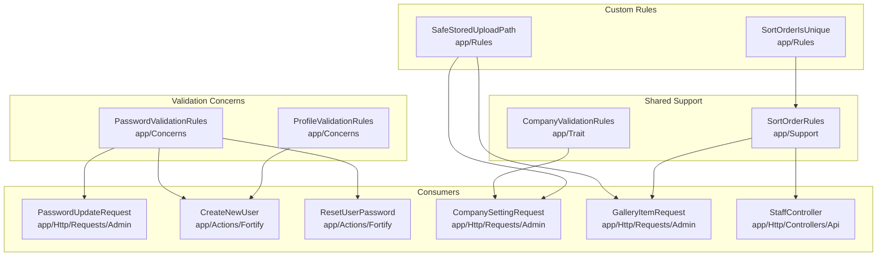
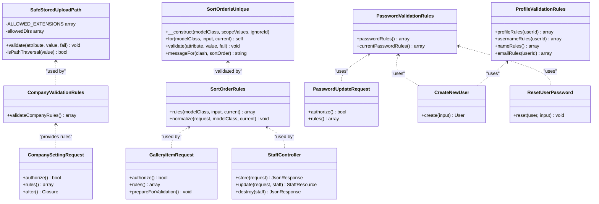
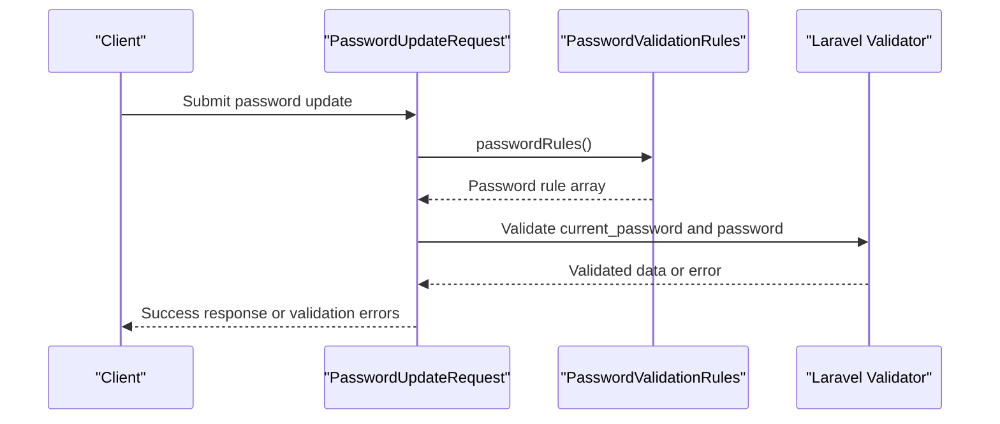
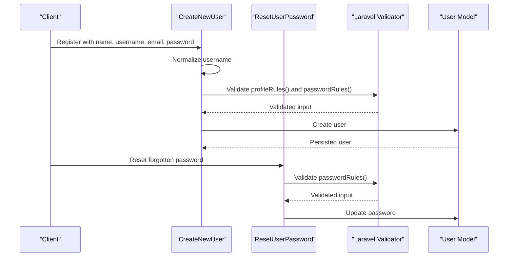
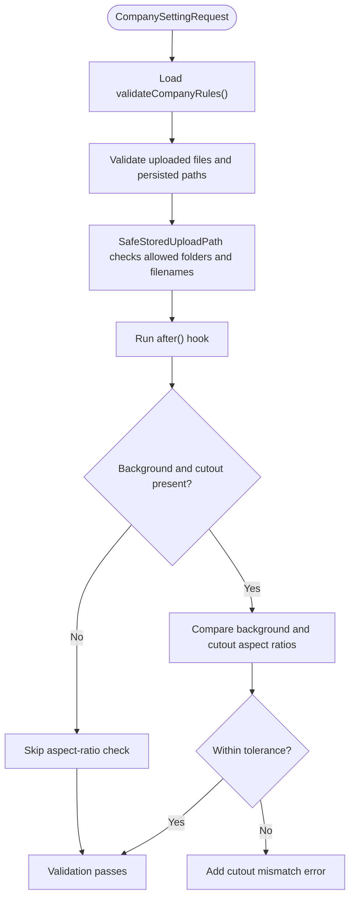
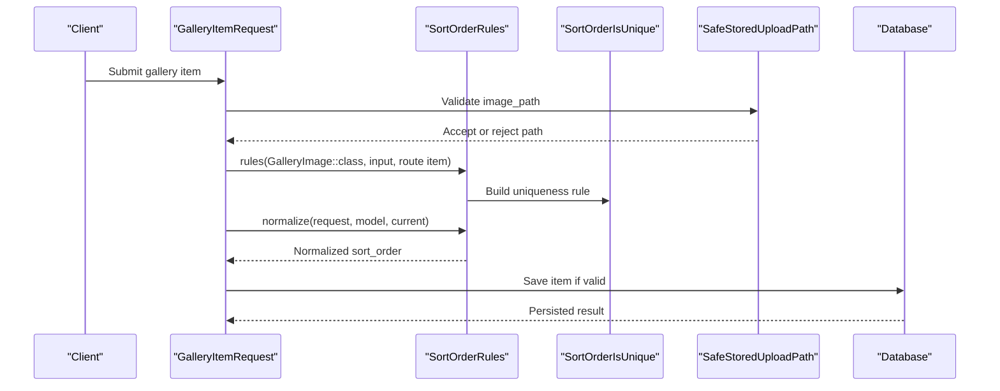
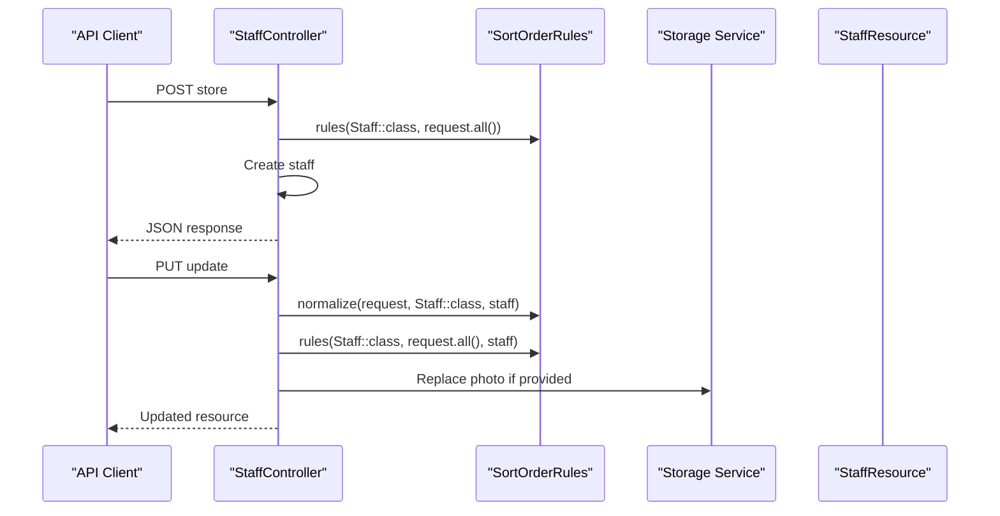
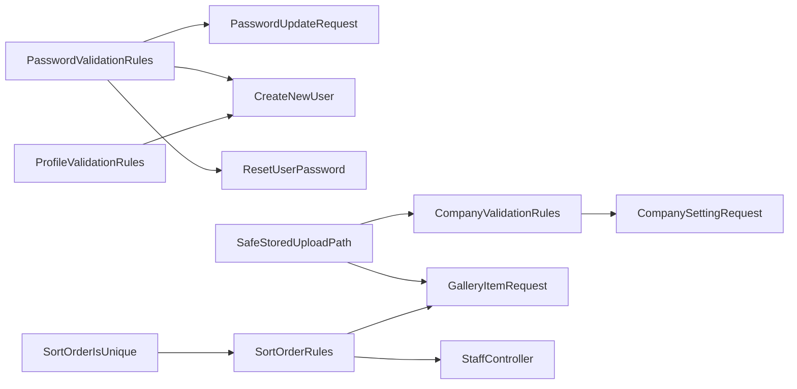

# Validation Concerns & Rules

<cite>
**Referenced Files in This Document**   
- [PasswordValidationRules.php](file://app/Concerns/PasswordValidationRules.php)
- [ProfileValidationRules.php](file://app/Concerns/ProfileValidationRules.php)
- [SafeStoredUploadPath.php](file://app/Rules/SafeStoredUploadPath.php)
- [SortOrderIsUnique.php](file://app/Rules/SortOrderIsUnique.php)
- [CompanyValidationRules.php](file://app/Trait/CompanyValidationRules.php)
- [SortOrderRules.php](file://app/Support/SortOrderRules.php)
- [PasswordUpdateRequest.php](file://app/Http/Requests/Admin/PasswordUpdateRequest.php)
- [CreateNewUser.php](file://app/Actions/Fortify/CreateNewUser.php)
- [ResetUserPassword.php](file://app/Actions/Fortify/ResetUserPassword.php)
- [CompanySettingRequest.php](file://app/Http/Requests/Admin/CompanySettingRequest.php)
- [GalleryItemRequest.php](file://app/Http/Requests/Admin/GalleryItemRequest.php)
- [StaffController.php](file://app/Http/Controllers/Api/StaffController.php)
</cite>

## Table of Contents
1. [Introduction](#introduction)
2. [Project Structure](#project-structure)
3. [Core Components](#core-components)
4. [Architecture Overview](#architecture-overview)
5. [Detailed Component Analysis](#detailed-component-analysis)
6. [Dependency Analysis](#dependency-analysis)
7. [Performance Considerations](#performance-considerations)
8. [Troubleshooting Guide](#troubleshooting-guide)
9. [Conclusion](#conclusion)

## Introduction
This document explains the Highblossom validation system that combines reusable validation concerns with custom rules and shared support classes. It focuses on:

- Reusable validation traits for passwords and user profiles under `app/app/Concerns`.
- Custom validation rules for file path safety and ordering uniqueness under `app/app/Rules`.
- How these components integrate with Laravel form requests, Fortify actions, API controllers, and service-layer validators.
- Guidance for creating new validation concerns and rules, extending existing logic, and testing custom validators.

The goal is to keep validation centralized, secure, consistent across web forms and APIs, and easy to extend without duplicating business constraints.

## Project Structure
The validation surface relevant to this documentation lives in a small set of focused directories:

**Diagram sources**
- [PasswordValidationRules.php:1-36](file://app/Concerns/PasswordValidationRules.php#L1-L36)
- [ProfileValidationRules.php:1-74](file://app/Concerns/ProfileValidationRules.php#L1-L74)
- [SafeStoredUploadPath.php:1-139](file://app/Rules/SafeStoredUploadPath.php#L1-L139)
- [SortOrderIsUnique.php:1-85](file://app/Rules/SortOrderIsUnique.php#L1-L85)
- [CompanyValidationRules.php:1-143](file://app/Trait/CompanyValidationRules.php#L1-L143)
- [SortOrderRules.php:1-59](file://app/Support/SortOrderRules.php#L1-L59)
- [PasswordUpdateRequest.php:1-42](file://app/Http/Requests/Admin/PasswordUpdateRequest.php#L1-L42)
- [CreateNewUser.php:1-99](file://app/Actions/Fortify/CreateNewUser.php#L1-L99)
- [ResetUserPassword.php:1-47](file://app/Actions/Fortify/ResetUserPassword.php#L1-L47)
- [CompanySettingRequest.php:1-77](file://app/Http/Requests/Admin/CompanySettingRequest.php#L1-L77)
- [GalleryItemRequest.php:1-66](file://app/Http/Requests/Admin/GalleryItemRequest.php#L1-L66)
- [StaffController.php:1-115](file://app/Http/Controllers/Api/StaffController.php#L1-L115)

**Section sources**
- [PasswordValidationRules.php:1-36](file://app/Concerns/PasswordValidationRules.php#L1-L36)
- [ProfileValidationRules.php:1-74](file://app/Concerns/ProfileValidationRules.php#L1-L74)
- [SafeStoredUploadPath.php:1-139](file://app/Rules/SafeStoredUploadPath.php#L1-L139)
- [SortOrderIsUnique.php:1-85](file://app/Rules/SortOrderIsUnique.php#L1-L85)
- [CompanyValidationRules.php:1-143](file://app/Trait/CompanyValidationRules.php#L1-L143)
- [SortOrderRules.php:1-59](file://app/Support/SortOrderRules.php#L1-L59)

## Core Components
This section summarizes the main building blocks.

### PasswordValidationRules
A trait providing password validation helpers:

- `passwordRules()` returns required string password rules including the application’s default password policy and confirmation.
- `currentPasswordRules()` validates the current password using Laravel’s built-in rule.

These methods are consumed by authentication-related request and action classes so password strength does not drift between registration, reset, and admin updates.

**Section sources**
- [PasswordValidationRules.php:1-36](file://app/Concerns/PasswordValidationRules.php#L1-L36)

### ProfileValidationRules
A trait providing user profile validation helpers:

- `profileRules($userId)` returns name, username, and email rules.
- `usernameRules($userId)` delegates shape, reserved names, and uniqueness to the `Username` helper used elsewhere in the application.
- `nameRules()` enforces required string length.
- `emailRules($userId)` enforces email format and unique email, ignoring the current user when editing.

This ensures login-friendly usernames and consistent email uniqueness behavior across sign-up and profile editing.

**Section sources**
- [ProfileValidationRules.php:1-74](file://app/Concerns/ProfileValidationRules.php#L1-L74)

### SafeStoredUploadPath
A custom Laravel validation rule that accepts only storage paths produced by the application’s upload pipeline. It rejects:

- Path traversal sequences and control characters.
- Absolute paths or Windows-style drive letters.
- Empty, dot-only, or parent-directory segments.
- Paths outside allowed top-level directories.
- Non-image extensions.
- Filenames that do not match the expected generated filename pattern.

It also supports an optional sentinel value that is always accepted, useful for placeholder images.

**Section sources**
- [SafeStoredUploadPath.php:1-139](file://app/Rules/SafeStoredUploadPath.php#L1-L139)

### SortOrderIsUnique
A custom rule ensuring a sort order is unique within a model scope. It:

- Accepts a model class, scope values, and an optional ID to ignore during update.
- Uses a static factory method to build the rule from submitted input and the bound model.
- Rejects duplicate sort orders with a message naming the conflicting record.

This complements database unique indexes by producing human-readable inline errors.

**Section sources**
- [SortOrderIsUnique.php:1-85](file://app/Rules/SortOrderIsUnique.php#L1-L85)

### CompanyValidationRules
A trait exposing a large array of company settings validation rules. It uses:

- Built-in Laravel rules for strings, booleans, arrays, enums, URLs, emails, and dimensions.
- The `SafeStoredUploadPath` rule for persisted image paths.
- Enum-based validation for admin navigation layout and hero style.

This keeps all company-setting fields validated in one place and avoids repeating field rules across controllers.

**Section sources**
- [CompanyValidationRules.php:1-143](file://app/Trait/CompanyValidationRules.php#L1-L143)

### SortOrderRules
A shared support class for validating and normalizing sort-order fields:

- `rules(modelClass, input, current)` returns nullable integer rules plus the uniqueness constraint.
- `normalize(request, modelClass, current)` converts blank, empty, or zero sort-order inputs into the stored value on edit or null on create, preventing accidental overwrites.

This makes ordering validation consistent across form requests and API controllers.

**Section sources**
- [SortOrderRules.php:1-59](file://app/Support/SortOrderRules.php#L1-L59)

## Architecture Overview
The validation architecture separates concerns into reusable traits, custom rules, support classes, and consumers:

**Diagram sources**
- [PasswordValidationRules.php:1-36](file://app/Concerns/PasswordValidationRules.php#L1-L36)
- [ProfileValidationRules.php:1-74](file://app/Concerns/ProfileValidationRules.php#L1-L74)
- [SafeStoredUploadPath.php:1-139](file://app/Rules/SafeStoredUploadPath.php#L1-L139)
- [SortOrderIsUnique.php:1-85](file://app/Rules/SortOrderIsUnique.php#L1-L85)
- [CompanyValidationRules.php:1-143](file://app/Trait/CompanyValidationRules.php#L1-L143)
- [SortOrderRules.php:1-59](file://app/Support/SortOrderRules.php#L1-L59)
- [PasswordUpdateRequest.php:1-42](file://app/Http/Requests/Admin/PasswordUpdateRequest.php#L1-L42)
- [CreateNewUser.php:1-99](file://app/Actions/Fortify/CreateNewUser.php#L1-L99)
- [ResetUserPassword.php:1-47](file://app/Actions/Fortify/ResetUserPassword.php#L1-L47)
- [CompanySettingRequest.php:1-77](file://app/Http/Requests/Admin/CompanySettingRequest.php#L1-L77)
- [GalleryItemRequest.php:1-66](file://app/Http/Requests/Admin/GalleryItemRequest.php#L1-L66)
- [StaffController.php:1-115](file://app/Http/Controllers/Api/StaffController.php#L1-L115)

## Detailed Component Analysis

### Password Validation Flow
Password validation is centralized through `PasswordValidationRules`. Consumers include a form request for admin password changes and Fortify actions for registration and password reset.

**Diagram sources**
- [PasswordUpdateRequest.php:1-42](file://app/Http/Requests/Admin/PasswordUpdateRequest.php#L1-L42)
- [PasswordValidationRules.php:1-36](file://app/Concerns/PasswordValidationRules.php#L1-L36)

**Section sources**
- [PasswordUpdateRequest.php:10-42](file://app/Http/Requests/Admin/PasswordUpdateRequest.php#L10-L42)
- [PasswordValidationRules.php:10-36](file://app/Concerns/PasswordValidationRules.php#L10-L36)

### Registration and Password Reset Flow
Registration uses both password and profile validation through Fortify actions. Password reset adds strength and confirmation validation before persisting the new password.

**Diagram sources**
- [CreateNewUser.php:1-99](file://app/Actions/Fortify/CreateNewUser.php#L1-L99)
- [ResetUserPassword.php:1-47](file://app/Actions/Fortify/ResetUserPassword.php#L1-L47)
- [PasswordValidationRules.php:1-36](file://app/Concerns/PasswordValidationRules.php#L1-L36)
- [ProfileValidationRules.php:1-74](file://app/Concerns/ProfileValidationRules.php#L1-L74)

**Section sources**
- [CreateNewUser.php:10-99](file://app/Actions/Fortify/CreateNewUser.php#L10-L99)
- [ResetUserPassword.php:10-47](file://app/Actions/Fortify/ResetUserPassword.php#L10-L47)

### Company Settings Validation Flow
Company settings validation combines the `CompanyValidationRules` trait with additional cross-field validation in the request class.

**Diagram sources**
- [CompanySettingRequest.php:1-77](file://app/Http/Requests/Admin/CompanySettingRequest.php#L1-L77)
- [CompanyValidationRules.php:1-143](file://app/Trait/CompanyValidationRules.php#L1-L143)
- [SafeStoredUploadPath.php:1-139](file://app/Rules/SafeStoredUploadPath.php#L1-L139)

**Section sources**
- [CompanySettingRequest.php:10-77](file://app/Http/Requests/Admin/CompanySettingRequest.php#L10-L77)
- [CompanyValidationRules.php:10-143](file://app/Trait/CompanyValidationRules.php#L10-L143)

### Gallery Item and Sort Order Flow
Gallery item validation uses a custom file-path rule and shared sort-order normalization.

**Diagram sources**
- [GalleryItemRequest.php:1-66](file://app/Http/Requests/Admin/GalleryItemRequest.php#L1-L66)
- [SortOrderRules.php:1-59](file://app/Support/SortOrderRules.php#L1-L59)
- [SortOrderIsUnique.php:1-85](file://app/Rules/SortOrderIsUnique.php#L1-L85)
- [SafeStoredUploadPath.php:1-139](file://app/Rules/SafeStoredUploadPath.php#L1-L139)

**Section sources**
- [GalleryItemRequest.php:10-66](file://app/Http/Requests/Admin/GalleryItemRequest.php#L10-L66)
- [SortOrderRules.php:10-59](file://app/Support/SortOrderRules.php#L10-L59)

### API Staff Controller Integration
The API controller demonstrates how sort-order validation is applied directly in controller code rather than only in form requests.

**Diagram sources**
- [StaffController.php:1-115](file://app/Http/Controllers/Api/StaffController.php#L1-L115)
- [SortOrderRules.php:1-59](file://app/Support/SortOrderRules.php#L1-L59)

**Section sources**
- [StaffController.php:10-115](file://app/Http/Controllers/Api/StaffController.php#L10-L115)

## Dependency Analysis
The validation system has clear layers:

- Traits provide domain-specific rule sets for users and company settings.
- Custom rules encapsulate security and ordering constraints.
- Support classes centralize sort-order behavior.
- Consumers apply these components through form requests, Fortify actions, and API controllers.

**Diagram sources**
- [PasswordValidationRules.php:1-36](file://app/Concerns/PasswordValidationRules.php#L1-L36)
- [ProfileValidationRules.php:1-74](file://app/Concerns/ProfileValidationRules.php#L1-L74)
- [CompanyValidationRules.php:1-143](file://app/Trait/CompanyValidationRules.php#L1-L143)
- [SafeStoredUploadPath.php:1-139](file://app/Rules/SafeStoredUploadPath.php#L1-L139)
- [SortOrderRules.php:1-59](file://app/Support/SortOrderRules.php#L1-L59)
- [SortOrderIsUnique.php:1-85](file://app/Rules/SortOrderIsUnique.php#L1-L85)
- [PasswordUpdateRequest.php:1-42](file://app/Http/Requests/Admin/PasswordUpdateRequest.php#L1-L42)
- [CreateNewUser.php:1-99](file://app/Actions/Fortify/CreateNewUser.php#L1-L99)
- [ResetUserPassword.php:1-47](file://app/Actions/Fortify/ResetUserPassword.php#L1-L47)
- [CompanySettingRequest.php:1-77](file://app/Http/Requests/Admin/CompanySettingRequest.php#L1-L77)
- [GalleryItemRequest.php:1-66](file://app/Http/Requests/Admin/GalleryItemRequest.php#L1-L66)
- [StaffController.php:1-115](file://app/Http/Controllers/Api/StaffController.php#L1-L115)

**Section sources**
- [PasswordValidationRules.php:1-36](file://app/Concerns/PasswordValidationRules.php#L1-L36)
- [ProfileValidationRules.php:1-74](file://app/Concerns/ProfileValidationRules.php#L1-L74)
- [CompanyValidationRules.php:1-143](file://app/Trait/CompanyValidationRules.php#L1-L143)
- [SafeStoredUploadPath.php:1-139](file://app/Rules/SafeStoredUploadPath.php#L1-L139)
- [SortOrderRules.php:1-59](file://app/Support/SortOrderRules.php#L1-L59)
- [SortOrderIsUnique.php:1-85](file://app/Rules/SortOrderIsUnique.php#L1-L85)

## Performance Considerations
- Custom validation rules should avoid expensive operations when possible. `SafeStoredUploadPath` performs string parsing and regex checks against short paths, which is lightweight.
- `SortOrderIsUnique` queries the database to detect duplicates; this is necessary for correctness but should be used where ordering is truly constrained.
- Centralizing rules reduces repeated validation logic and helps maintain consistency, indirectly improving testability and reducing regression risk.
- For bulk operations, consider batching uniqueness checks at the service layer instead of validating each row individually, while keeping database constraints as the final guard.

[No sources needed since this section provides general guidance]

## Troubleshooting Guide

### Password Strength Mismatches
If a password passes one form but fails another, verify that consumers use the same password rule source:

- Admin password updates should use `passwordRules()` from `PasswordValidationRules`.
- Registration and reset flows delegate to `Password::default()` through the same trait.
- Avoid overriding the core strength rule locally unless you intend to diverge intentionally.

**Section sources**
- [PasswordValidationRules.php:10-36](file://app/Concerns/PasswordValidationRules.php#L10-L36)
- [PasswordUpdateRequest.php:20-42](file://app/Http/Requests/Admin/PasswordUpdateRequest.php#L20-L42)
- [CreateNewUser.php:10-99](file://app/Actions/Fortify/CreateNewUser.php#L10-L99)
- [ResetUserPassword.php:10-47](file://app/Actions/Fortify/ResetUserPassword.php#L10-L47)

### Invalid or Dangerous Stored Paths
When persisted image paths are rejected:

- Confirm the path starts with an allowed directory.
- Ensure the filename matches the generated pattern and has an allowed image extension.
- If a placeholder must be accepted, configure the sentinel value explicitly.
- Review the exact error message to determine whether the issue is traversal, folder, extension, or filename formatting.

**Section sources**
- [SafeStoredUploadPath.php:10-139](file://app/Rules/SafeStoredUploadPath.php#L10-L139)
- [CompanySettingRequest.php:20-77](file://app/Http/Requests/Admin/CompanySettingRequest.php#L20-L77)
- [GalleryItemRequest.php:20-66](file://app/Http/Requests/Admin/GalleryItemRequest.php#L20-L66)

### Duplicate Sort Orders
When a sort order is rejected:

- Use `SortOrderRules::rules()` to add the uniqueness constraint.
- Call `SortOrderRules::normalize()` before validation so blank or zero values preserve the existing rank on edit.
- Inspect the conflict message returned by `SortOrderIsUnique::messageFor()` to identify the offending record.

**Section sources**
- [SortOrderRules.php:10-59](file://app/Support/SortOrderRules.php#L10-L59)
- [SortOrderIsUnique.php:10-85](file://app/Rules/SortOrderIsUnique.php#L10-L85)
- [GalleryItemRequest.php:20-66](file://app/Http/Requests/Admin/GalleryItemRequest.php#L20-L66)
- [StaffController.php:40-115](file://app/Http/Controllers/Api/StaffController.php#L40-L115)

### Cutout and Background Shape Mismatch
In company settings, a cutout must match the background image’s aspect ratio. If validation fails:

- Verify both background and cutout paths pass `SafeStoredUploadPath`.
- Ensure the cutout was exported from the same image at the same pixel size.
- Clear the cutout if it is not needed.

**Section sources**
- [CompanySettingRequest.php:30-77](file://app/Http/Requests/Admin/CompanySettingRequest.php#L30-L77)
- [CompanyValidationRules.php:10-143](file://app/Trait/CompanyValidationRules.php#L10-L143)
- [SafeStoredUploadPath.php:10-139](file://app/Rules/SafeStoredUploadPath.php#L10-L139)

## Conclusion
Highblossom’s validation system centers around reusable traits for common domains, custom rules for security and ordering constraints, and shared support utilities for consistent behavior. The key design principles are:

- Keep password and profile validation centralized through traits.
- Encapsulate security-sensitive validation, such as stored upload paths, in dedicated custom rules.
- Use support classes like `SortOrderRules` to normalize and constrain ordering consistently across web and API surfaces.
- Compose these components in form requests, Fortify actions, and API controllers rather than duplicating rules.

This structure makes validation easier to understand, test, and evolve while protecting against unsafe file paths, inconsistent password policies, and invalid ordering.

[No sources needed since this section summarizes without analyzing specific files]