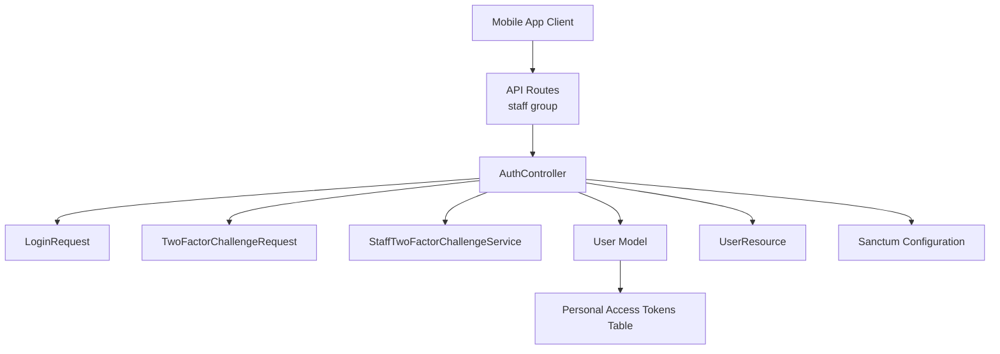
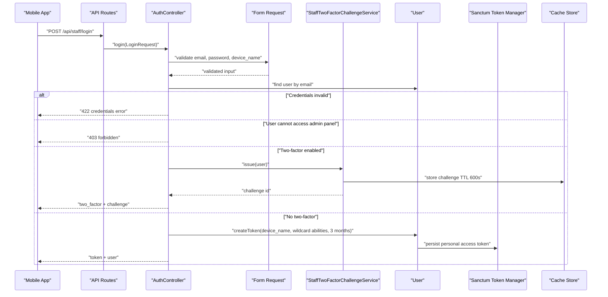
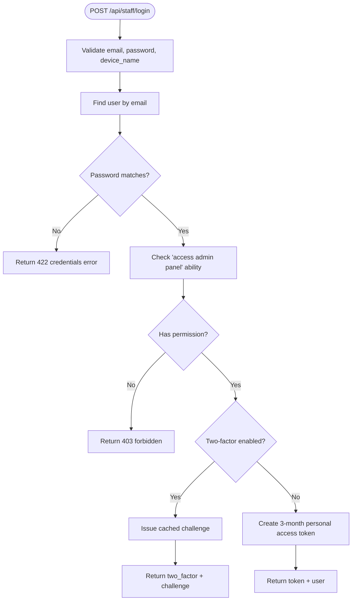
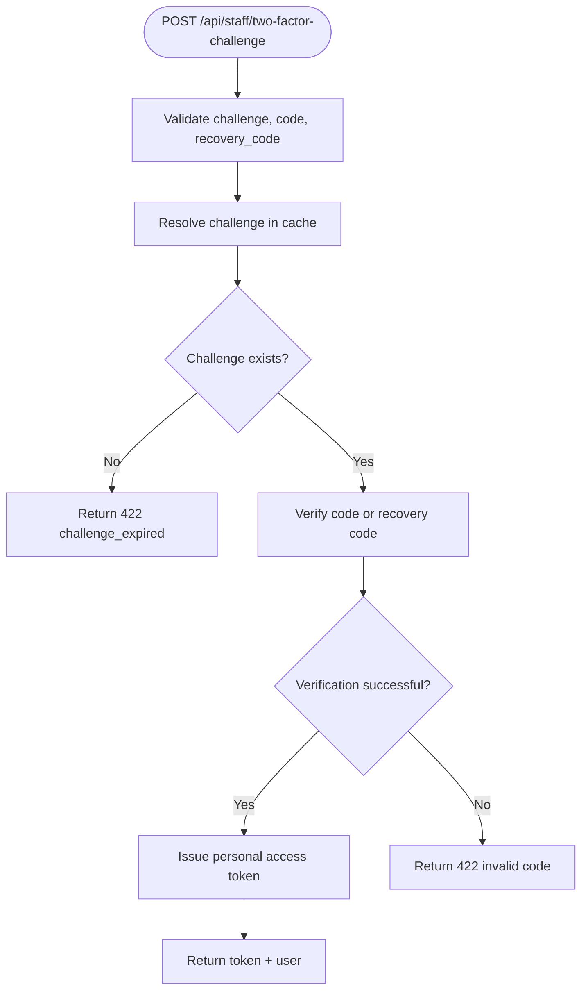
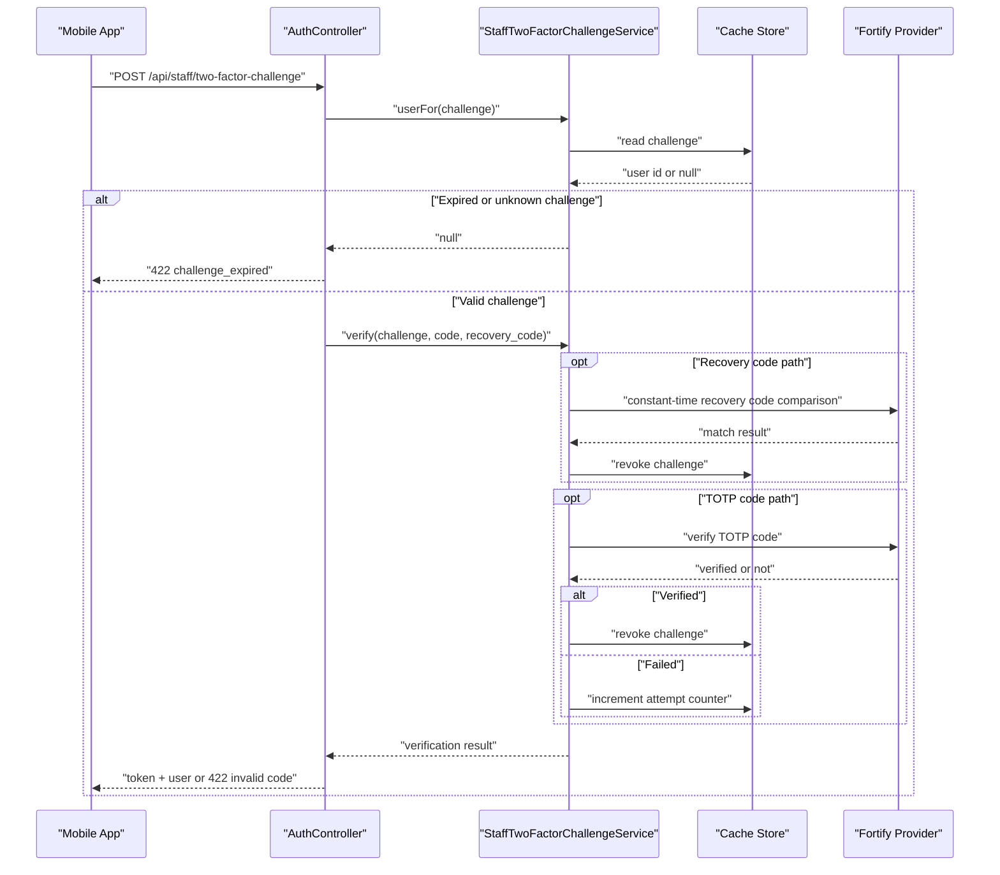
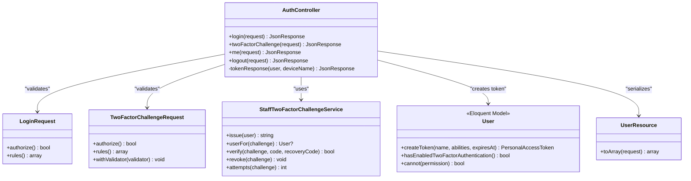
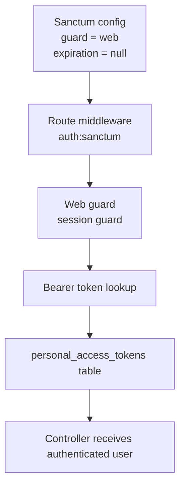

# Authentication & Authorization

<cite>
**Referenced Files in This Document**   
- [routes/api.php](file://routes/api.php)
- [AuthController.php](file://app/Http/Controllers/Api/AuthController.php)
- [LoginRequest.php](file://app/Http/Requests/Api/LoginRequest.php)
- [TwoFactorChallengeRequest.php](file://app/Http/Requests/Api/TwoFactorChallengeRequest.php)
- [UserResource.php](file://app/Http/Resources/Api/UserResource.php)
- [StaffTwoFactorChallengeService.php](file://app/Services/StaffTwoFactorChallengeService.php)
- [User.php](file://app/Models/User.php)
- [sanctum.php](file://config/sanctum.php)
- [auth.php](file://config/auth.php)
- [create_personal_access_tokens_table.php](file://database/migrations/2026_10_22_103941_create_personal_access_tokens_table.php)
</cite>

## Table of Contents
1. [Introduction](#introduction)
2. [Project Structure](#project-structure)
3. [Core Components](#core-components)
4. [Architecture Overview](#architecture-overview)
5. [Detailed Component Analysis](#detailed-component-analysis)
6. [Dependency Analysis](#dependency-analysis)
7. [Performance Considerations](#performance-considerations)
8. [Troubleshooting Guide](#troubleshooting-guide)
9. [Conclusion](#conclusion)

## Introduction
This document describes the Staff Mobile App authentication system. It is a Sanctum-based token authentication flow exposing four staff endpoints:

- `POST /api/staff/login` — obtain an API token or start two-factor authentication
- `POST /api/staff/two-factor-challenge` — complete two-factor authentication and obtain an API token
- `GET /api/staff/me` — read the authenticated user profile and abilities
- `POST /api/staff/logout` — revoke the current personal access token

The API lives under the `/api/staff` prefix, uses stateless Bearer tokens for subsequent requests, and relies on Spatie permissions to gate resource access through the same abilities used by the web admin panel.

## Project Structure
The authentication behavior is defined across routing, controllers, request validation, resources, services, models, configuration, and database schema:



**Diagram sources**
- [routes/api.php:27-43](file://routes/api.php#L27-L43)
- [AuthController.php:24-133](file://app/Http/Controllers/Api/AuthController.php#L24-L133)
- [LoginRequest.php:12-34](file://app/Http/Requests/Api/LoginRequest.php#L12-L34)
- [TwoFactorChallengeRequest.php:12-64](file://app/Http/Requests/Api/TwoFactorChallengeRequest.php#L12-L64)
- [StaffTwoFactorChallengeService.php:23-197](file://app/Services/StaffTwoFactorChallengeService.php#L23-L197)
- [User.php:27-45](file://app/Models/User.php#L27-L45)
- [UserResource.php:17-34](file://app/Http/Resources/Api/UserResource.php#L17-L34)
- [sanctum.php:12-87](file://config/sanctum.php#L12-L87)
- [create_personal_access_tokens_table.php:8-30](file://database/migrations/2026_10_22_103941_create_personal_access_tokens_table.php#L8-L30)

**Section sources**
- [routes/api.php:12-43](file://routes/api.php#L12-L43)
- [AuthController.php:12-133](file://app/Http/Controllers/Api/AuthController.php#L12-L133)

## Core Components

### API Endpoints Summary

| Endpoint | Method | Authentication | Purpose | Rate Limiting |
|---|---:|---|---|---|
| `/api/staff/login` | `POST` | None | Authenticate credentials; return token or two-factor challenge | 6 requests per minute |
| `/api/staff/two-factor-challenge` | `POST` | None | Verify second factor using authenticator code or recovery code; return token | 6 requests per minute |
| `/api/staff/me` | `GET` | Valid Sanctum personal access token | Return authenticated user and UI abilities | Not explicitly throttled |
| `/api/staff/logout` | `POST` | Valid Sanctum personal access token | Revoke the current request’s token | Not explicitly throttled |

#### Common Headers

| Header | Required | Description |
|---|---|---|
| `Accept: application/json` | Recommended | Indicates JSON response format |
| `Content-Type: application/json` | For login and two-factor challenge | Indicates JSON request body |
| `Authorization: Bearer <token>` | For `/api/staff/me` and `/api/staff/logout` | Sanctum bearer token |

#### Common Error Codes

| Status | Meaning |
|---:|---|
| `200` | Success |
| `401` | Unauthenticated; missing or invalid token |
| `403` | Forbidden; account lacks required permission |
| `422` | Validation failure, expired challenge, invalid credentials, or invalid code |
| `429` | Too many requests; rate limit exceeded |

**Section sources**
- [routes/api.php:27-43](file://routes/api.php#L27-L43)
- [AuthController.php:34-133](file://app/Http/Controllers/Api/AuthController.php#L34-L133)

## Architecture Overview
The authentication architecture separates concerns between HTTP handling, validation, challenge state management, user model integration, and token issuance.



**Diagram sources**
- [routes/api.php:27-43](file://routes/api.php#L27-L43)
- [AuthController.php:34-115](file://app/Http/Controllers/Api/AuthController.php#L34-L115)
- [StaffTwoFactorChallengeService.php:61-81](file://app/Services/StaffTwoFactorChallengeService.php#L61-L81)
- [User.php:27-45](file://app/Models/User.php#L27-L45)

**Section sources**
- [routes/api.php:27-43](file://routes/api.php#L27-L43)
- [AuthController.php:34-115](file://app/Http/Controllers/Api/AuthController.php#L34-L115)
- [StaffTwoFactorChallengeService.php:23-81](file://app/Services/StaffTwoFactorChallengeService.php#L23-L81)

## Detailed Component Analysis

### Login Flow

#### Endpoint Specification

- **URL:** `/api/staff/login`
- **Method:** `POST`
- **Authentication:** None
- **Rate Limiting:** 6 requests per minute per client

#### Request Schema

| Field | Type | Required | Validation |
|---|---|---:|---|
| `email` | string | Yes | Email format, maximum 255 characters |
| `password` | string | Yes | Any non-empty string value |
| `device_name` | string | No | Maximum 255 characters; defaults to `staff-app` when empty |

#### Response Schemas

**Successful authentication without two-factor:**

| Field | Type | Description |
|---|---|---|
| `token` | string | Plaintext personal access token |
| `user` | object | Authenticated user profile |

**Two-factor challenge required:**

| Field | Type | Description |
|---|---|---|
| `two_factor` | boolean | Always `true` |
| `challenge` | string | UUID challenge identifier valid for 600 seconds |

**Error responses:**

| Status | Payload Fields | Meaning |
|---:|---|---|
| `422` | `message` | Credentials do not match stored records |
| `403` | `message` | Account lacks admin panel access permission |

#### Processing Logic



**Diagram sources**
- [AuthController.php:34-115](file://app/Http/Controllers/Api/AuthController.php#L34-L115)
- [StaffTwoFactorChallengeService.php:61-81](file://app/Services/StaffTwoFactorChallengeService.php#L61-L81)

#### Practical Example

A mobile app should:

1. Send a JSON POST request with email, password, and an optional device name.
2. If the response contains `two_factor: true`, store the challenge and prompt for a second factor.
3. If the response contains `token`, persist it securely and attach it as a Bearer token for later requests.
4. Treat `422` as invalid credentials and `403` as an unauthorized staff account.

**Section sources**
- [routes/api.php:27-33](file://routes/api.php#L27-L33)
- [AuthController.php:34-115](file://app/Http/Controllers/Api/AuthController.php#L34-L115)
- [LoginRequest.php:12-34](file://app/Http/Requests/Api/LoginRequest.php#L12-L34)

### Two-Factor Challenge Flow

#### Endpoint Specification

- **URL:** `/api/staff/two-factor-challenge`
- **Method:** `POST`
- **Authentication:** None
- **Rate Limiting:** 6 requests per minute per client

#### Request Schema

| Field | Type | Required | Validation |
|---|---|---:|---|
| `challenge` | string | Yes | UUID format |
| `code` | string | Conditional | 6–8 digits; required unless `recovery_code` is provided |
| `recovery_code` | string | Conditional | Maximum 64 characters; required unless `code` is provided |

Exactly one of `code` or `recovery_code` must be present.

#### Response Schemas

**Successful completion:**

| Field | Type | Description |
|---|---|---|
| `token` | string | Plaintext personal access token |
| `user` | object | Authenticated user profile |

**Error responses:**

| Status | Payload Fields | Meaning |
|---:|---|---|
| `422` | `message`, optionally `reason` | Expired or unknown challenge |
| `422` | `message` | Invalid authenticator code or recovery code |

#### Processing Logic



**Diagram sources**
- [AuthController.php:117-133](file://app/Http/Controllers/Api/AuthController.php#L117-L133)
- [StaffTwoFactorChallengeService.php:83-197](file://app/Services/StaffTwoFactorChallengeService.php#L83-L197)
- [TwoFactorChallengeRequest.php:12-64](file://app/Http/Requests/Api/TwoFactorChallengeRequest.php#L12-L64)

#### Two-Factor Workflow



**Diagram sources**
- [AuthController.php:117-133](file://app/Http/Controllers/Api/AuthController.php#L117-L133)
- [StaffTwoFactorChallengeService.php:83-197](file://app/Services/StaffTwoFactorChallengeService.php#L83-L197)

**Section sources**
- [routes/api.php:33-39](file://routes/api.php#L33-L39)
- [AuthController.php:117-133](file://app/Http/Controllers/Api/AuthController.php#L117-L133)
- [TwoFactorChallengeRequest.php:12-64](file://app/Http/Requests/Api/TwoFactorChallengeRequest.php#L12-L64)
- [StaffTwoFactorChallengeService.php:61-197](file://app/Services/StaffTwoFactorChallengeService.php#L61-L197)

### Current User Info

#### Endpoint Specification

- **URL:** `/api/staff/me`
- **Method:** `GET`
- **Authentication:** Valid Sanctum personal access token via `Authorization: Bearer <token>`
- **Rate Limiting:** Not explicitly throttled

#### Response Schema

| Field | Type | Description |
|---|---|---|
| `user` | object | Authenticated user profile |

The user object includes:

| Field | Type | Description |
|---|---|---|
| `id` | integer | User identifier |
| `name` | string | Full display name |
| `username` | string | Normalized username |
| `email` | string | Account email |
| `avatar_url` | string or null | Avatar asset URL |
| `roles` | array of strings | Role names |
| `abilities` | array of strings | Permission names used to gate UI features |

#### Practical Example

After obtaining a token, send:

```text
GET /api/staff/me
Authorization: Bearer <token>
Accept: application/json
```

Use the returned `abilities` array to enable or disable UI features rather than trusting the backend alone.

**Section sources**
- [routes/api.php:41-43](file://routes/api.php#L41-L43)
- [AuthController.php:135-133](file://app/Http/Controllers/Api/AuthController.php#L135-L133)
- [UserResource.php:17-34](file://app/Http/Resources/Api/UserResource.php#L17-L34)

### Logout

#### Endpoint Specification

- **URL:** `/api/staff/logout`
- **Method:** `POST`
- **Authentication:** Valid Sanctum personal access token via `Authorization: Bearer <token>`
- **Rate Limiting:** Not explicitly throttled

#### Response Schema

| Field | Type | Description |
|---|---|---|
| `message` | string | Confirmation that the session has been logged out |

#### Behavior

The endpoint deletes the current access token associated with the request. The mobile app should discard the stored token after receiving a successful logout response.

**Section sources**
- [routes/api.php:41-43](file://routes/api.php#L41-L43)
- [AuthController.php:135-133](file://app/Http/Controllers/Api/AuthController.php#L135-L133)

## Dependency Analysis

### Authentication Stack



**Diagram sources**
- [AuthController.php:24-133](file://app/Http/Controllers/Api/AuthController.php#L24-L133)
- [LoginRequest.php:12-34](file://app/Http/Requests/Api/LoginRequest.php#L12-L34)
- [TwoFactorChallengeRequest.php:12-64](file://app/Http/Requests/Api/TwoFactorChallengeRequest.php#L12-L64)
- [StaffTwoFactorChallengeService.php:23-197](file://app/Services/StaffTwoFactorChallengeService.php#L23-L197)
- [User.php:27-45](file://app/Models/User.php#L27-L45)
- [UserResource.php:17-34](file://app/Http/Resources/Api/UserResource.php#L17-L34)

### Sanctum and Token Lifecycle

Sanctum is configured to authenticate against the `web` guard. The default expiration is unset at the Sanctum configuration level, but the controller issues three-month tokens explicitly. The database migration creates the `personal_access_tokens` table used by Sanctum.



**Diagram sources**
- [sanctum.php:26-52](file://config/sanctum.php#L26-L52)
- [auth.php:24-44](file://config/auth.php#L24-L44)
- [create_personal_access_tokens_table.php:8-30](file://database/migrations/2026_10_22_103941_create_personal_access_tokens_table.php#L8-L30)

**Section sources**
- [sanctum.php:12-87](file://config/sanctum.php#L12-L87)
- [auth.php:24-44](file://config/auth.php#L24-L44)
- [create_personal_access_tokens_table.php:8-30](file://database/migrations/2026_10_22_103941_create_personal_access_tokens_table.php#L8-L30)

## Performance Considerations

- **Credential hashing:** Password verification uses secure hashing; avoid caching raw passwords.
- **Challenge cache usage:** Two-factor challenges are short-lived (600 seconds) and limited to five failed attempts before being revoked. This limits brute-force exposure while keeping cache pressure low.
- **Token lifetime:** Tokens expire after three months, reducing long-term risk if a device is compromised.
- **Rate limiting:** Login and two-factor endpoints are limited to six requests per minute to mitigate credential stuffing and code guessing.
- **Database writes:** Only the login and two-factor flows write persistent data through Sanctum; other endpoints read existing tokens.

[No sources needed since this section provides general guidance]

## Troubleshooting Guide

### Common Issues

| Symptom | Likely Cause | Resolution |
|---|---|---|
| `401 Unauthorized` on protected endpoints | Missing or expired `Authorization: Bearer <token>` header | Ensure the token is persisted and attached to every authenticated request |
| `422 These credentials do not match our records` | Wrong email or password | Confirm credentials and verify the account exists |
| `403 This account is not permitted to use the staff app` | User lacks `access admin panel` ability | Assign the appropriate role or permission |
| `422 That sign-in attempt has expired` | Challenge older than 600 seconds or already consumed | Restart login from `/api/staff/login` |
| `422 That code is not valid` | Invalid TOTP code, exhausted attempts, or wrong recovery code | Use a fresh authenticator code or a new recovery code |
| `429 Too Many Requests` | Exceeded 6 requests per minute | Wait before retrying |
| `422 Enter the six-digit code...` | Neither `code` nor `recovery_code` was sent | Provide exactly one second-factor field |

### Debugging Techniques

1. **Inspect route registration:** Confirm the staff routes exist under `/api/staff`.
2. **Enable request logging:** Log incoming headers, especially `Authorization`, to confirm token presence.
3. **Check cache backend:** For two-factor failures, verify the cache store is available because challenges and attempt counters rely on it.
4. **Validate payload shape:** Use a client-side request logger to confirm JSON fields match the documented schemas.
5. **Review permissions:** Confirm the user has `access admin panel` and the expected Spatie roles and abilities.
6. **Inspect token expiry:** Although Sanctum configuration leaves global expiration unset, the controller sets three-month tokens; check whether the token was issued and retained correctly.

**Section sources**
- [routes/api.php:27-43](file://routes/api.php#L27-L43)
- [AuthController.php:34-133](file://app/Http/Controllers/Api/AuthController.php#L34-L133)
- [StaffTwoFactorChallengeService.php:61-197](file://app/Services/StaffTwoFactorChallengeService.php#L61-L197)
- [TwoFactorChallengeRequest.php:35-64](file://app/Http/Requests/Api/TwoFactorChallengeRequest.php#L35-L64)

## Conclusion
The Staff Mobile App authentication system uses Sanctum bearer tokens combined with a stateless two-factor challenge mechanism. Login returns either a token directly or a short-lived challenge requiring a second factor. Subsequent requests use the Bearer token, and the `/api/staff/me` endpoint exposes both user identity and abilities so the mobile app can enforce its own UI-level authorization. Security controls include rate limiting, permission checks, constant-time recovery code comparison, challenge expiration, and attempt caps. Mobile developers should treat the token as sensitive material, refresh it only through the documented login flow, and handle all documented error codes gracefully.

[No sources needed since this section summarizes without analyzing specific files]