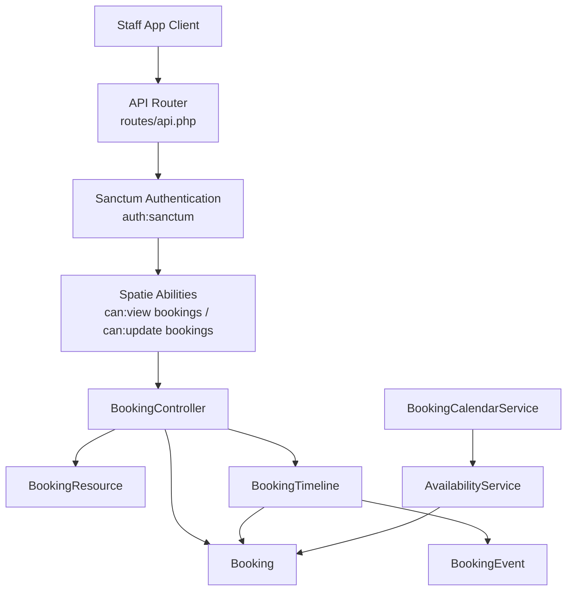
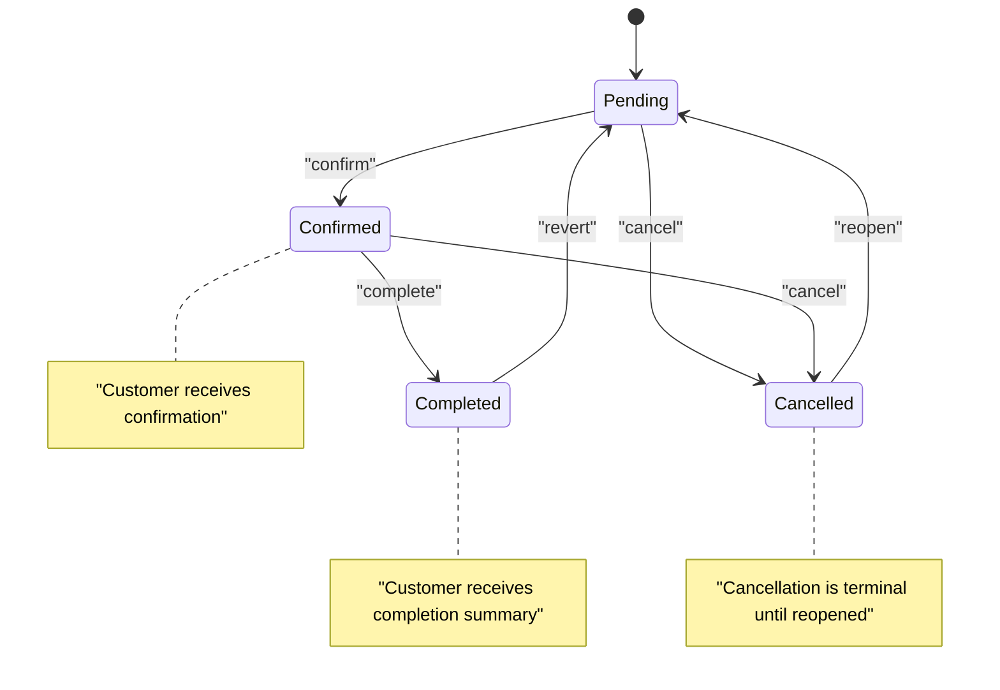
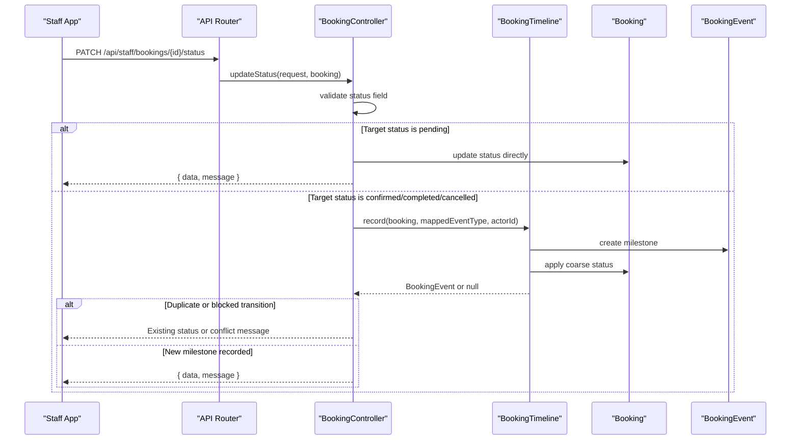
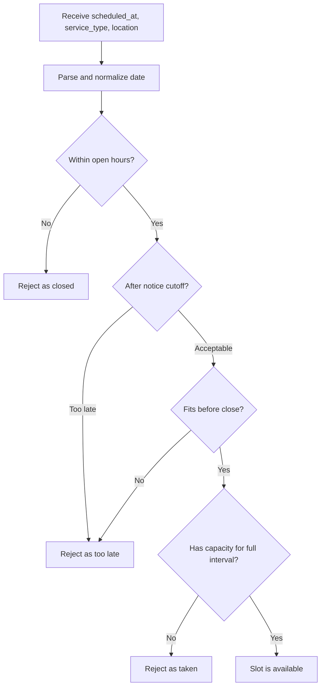
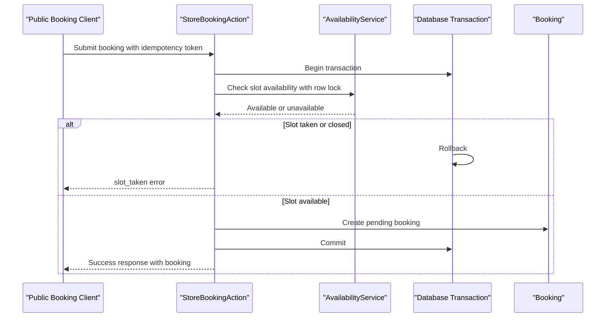
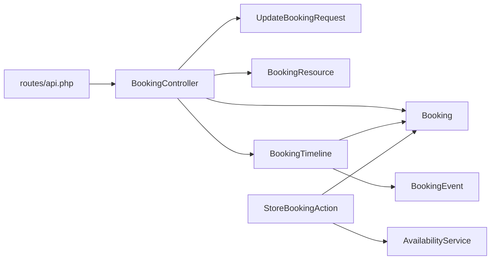

# Booking Management

<cite>
**Referenced Files in This Document**   
- [routes/api.php](file://routes/api.php)
- [BookingController.php](file://app/Http/Controllers/Api/BookingController.php)
- [UpdateBookingRequest.php](file://app/Http/Requests/Admin/UpdateBookingRequest.php)
- [BookingResource.php](file://app/Http/Resources/Api/BookingResource.php)
- [Booking.php](file://app/Models/Booking.php)
- [BookingEvent.php](file://app/Models/BookingEvent.php)
- [BookingTimeline.php](file://app/Services/BookingTimeline.php)
- [AvailabilityService.php](file://app/Services/AvailabilityService.php)
- [BookingCalendarService.php](file://app/Services/BookingCalendarService.php)
- [StoreBookingAction.php](file://app/Actions/StoreBookingAction.php)
- [2026_04_17_093356_create_bookings_table.php](file://database/migrations/2026_04_17_093356_create_bookings_table.php)
</cite>

## Table of Contents
1. [Introduction](#introduction)
2. [Project Structure](#project-structure)
3. [Core Components](#core-components)
4. [Architecture Overview](#architecture-overview)
5. [Detailed Component Analysis](#detailed-component-analysis)
6. [Dependency Analysis](#dependency-analysis)
7. [Performance Considerations](#performance-considerations)
8. [Troubleshooting Guide](#troubleshooting-guide)
9. [Conclusion](#conclusion)

## Introduction
This document specifies the booking management API for the staff application. It covers:

- Listing bookings
- Viewing an individual booking
- Updating editable booking fields
- Updating booking status through a controlled lifecycle

The endpoints are token-authenticated and permission-gated, mirroring the web admin panel’s abilities. The booking model stores customer details, vehicle information, service type, damage type, scheduling data, pricing, location, and a coarse lifecycle status. Milestone history is tracked separately so that customer-visible state can be audited without exposing internal notes.

## Project Structure
The booking API is implemented as part of the Laravel staff API group under the `staff` prefix. All routes require a valid Sanctum token and Spatie-style route-level ability middleware.

**Diagram sources**
- [routes/api.php:24-47](file://routes/api.php#L24-L47)
- [BookingController.php:1-122](file://app/Http/Controllers/Api/BookingController.php#L1-L122)
- [BookingResource.php:1-60](file://app/Http/Resources/Api/BookingResource.php#L1-L60)
- [Booking.php:1-134](file://app/Models/Booking.php#L1-L134)
- [BookingEvent.php:1-84](file://app/Models/BookingEvent.php#L1-L84)
- [BookingTimeline.php:1-128](file://app/Services/BookingTimeline.php#L1-L128)
- [AvailabilityService.php:1-200](file://app/Services/AvailabilityService.php#L1-L200)
- [BookingCalendarService.php:1-101](file://app/Services/BookingCalendarService.php#L1-L101)

**Section sources**
- [routes/api.php:1-117](file://routes/api.php#L1-L117)

## Core Components
- **Booking**: The central domain model for a customer appointment. It includes structured vehicle fields, service and damage enums, scheduled start time, duration, location, price, reference generation, derived end time, cancellation detection, and relationships to inspections, events, and users.
- **BookingEvent**: A milestone record representing received, confirmed, rescheduled, started, completed, or cancelled transitions. It also defines which milestones notify the customer by email.
- **BookingTimeline**: The authoritative service for recording milestones, synchronizing the booking status, preventing duplicate milestones, handling cancellations as terminal until explicitly reverted, and queuing customer emails.
- **BookingResource**: JSON serialization layer used by both list and detail endpoints. It exposes normalized client, service, damage, vehicle, scheduling, pricing, photo URL, timestamps, inspection, and event data.
- **BookingController**: Staff-facing controller implementing listing, showing, updating, and status transitions with validation and response shaping.
- **UpdateBookingRequest**: Request validator currently allowing only `total_price`, enforcing numeric and non-negative values.
- **AvailabilityService**: Scheduling conflict engine used by public booking submission. It calculates open hours, notice cutoffs, slot intervals, capacity, closed days, absences, and whether a slot is available or taken.
- **BookingCalendarService**: Builds calendar month payloads based on availability, marking past, closed, full, and today’s dates.

**Section sources**
- [Booking.php:1-134](file://app/Models/Booking.php#L1-L134)
- [BookingEvent.php:1-84](file://app/Models/BookingEvent.php#L1-L84)
- [BookingTimeline.php:1-128](file://app/Services/BookingTimeline.php#L1-L128)
- [BookingResource.php:1-60](file://app/Http/Resources/Api/BookingResource.php#L1-L60)
- [BookingController.php:1-122](file://app/Http/Controllers/Api/BookingController.php#L1-L122)
- [UpdateBookingRequest.php:1-33](file://app/Http/Requests/Admin/UpdateBookingRequest.php#L1-L33)
- [AvailabilityService.php:1-200](file://app/Services/AvailabilityService.php#L1-L200)
- [BookingCalendarService.php:1-101](file://app/Services/BookingCalendarService.php#L1-L101)

## Architecture Overview
The booking lifecycle has two layers:

1. **Coarse status** on the `bookings.status` column: `pending`, `confirmed`, `completed`, `cancelled`.
2. **Fine-grained timeline** stored in `booking_events`: `received`, `confirmed`, `rescheduled`, `started`, `completed`, `cancelled`.

Status updates from the staff API use `BookingTimeline` when transitioning into confirmed, completed, or cancelled. Reverting to pending bypasses a milestone because it is administrative; other transitions create a timeline entry, may update the coarse status, and can queue a customer email.

**Diagram sources**
- [BookingTimeline.php:22-128](file://app/Services/BookingTimeline.php#L22-L128)
- [BookingEvent.php:24-84](file://app/Models/BookingEvent.php#L24-L84)
- [BookingController.php:62-116](file://app/Http/Controllers/Api/BookingController.php#L62-L116)

## Detailed Component Analysis

### Endpoint Reference

#### List Bookings
- **Method**: GET
- **URL**: `/api/staff/bookings`
- **Authentication**: Sanctum token
- **Authorization**: `view bookings` ability
- **Query parameters**:
  - `status`: Filter by booking status.
  - `search`: Case-insensitive partial match across `client_name`, `client_email`, and `reference`.
  - `per_page`: Page size clamped between 1 and 100; default is 15.
- **Response**: Paginated collection of `BookingResource`.
- **Sorting**: Latest first.

**Section sources**
- [routes/api.php:35-37](file://routes/api.php#L35-L37)
- [BookingController.php:24-43](file://app/Http/Controllers/Api/BookingController.php#L24-L43)
- [BookingResource.php:18-59](file://app/Http/Resources/Api/BookingResource.php#L18-L59)

#### View Individual Booking
- **Method**: GET
- **URL**: `/api/staff/bookings/{booking}`
- **Path constraint**: `{booking}` must be numeric.
- **Authentication**: Sanctum token
- **Authorization**: `view bookings` ability
- **Path parameter**:
  - `booking`: Numeric booking ID.
- **Response**: Single `BookingResource` with inspection and events eager-loaded.

**Section sources**
- [routes/api.php:36-37](file://routes/api.php#L36-L37)
- [BookingController.php:45-54](file://app/Http/Controllers/Api/BookingController.php#L45-L54)
- [BookingResource.php:18-59](file://app/Http/Resources/Api/BookingResource.php#L18-L59)

#### Update Booking Details
- **Method**: PATCH
- **URL**: `/api/staff/bookings/{booking}`
- **Path constraint**: `{booking}` must be numeric.
- **Authentication**: Sanctum token
- **Authorization**: `update bookings` ability
- **Request body schema**:
  - `total_price`: Optional numeric value; must be greater than or equal to zero.
- **Behavior**: Updates only validated fields and returns the refreshed booking resource.
- **Response**: JSON object containing:
  - `data`: Updated `BookingResource`.
  - `message`: Human-readable success message.

**Section sources**
- [routes/api.php:37-38](file://routes/api.php#L37-L38)
- [BookingController.php:56-64](file://app/Http/Controllers/Api/BookingController.php#L56-L64)
- [UpdateBookingRequest.php:18-32](file://app/Http/Requests/Admin/UpdateBookingRequest.php#L18-L32)
- [BookingResource.php:18-59](file://app/Http/Resources/Api/BookingResource.php#L18-L59)

#### Update Booking Status
- **Method**: PATCH
- **URL**: `/api/staff/bookings/{booking}/status`
- **Path constraint**: `{booking}` must be numeric.
- **Authentication**: Sanctum token
- **Authorization**: `update bookings` ability
- **Request body schema**:
  - `status`: Required string; one of `pending`, `confirmed`, `completed`, `cancelled`.
- **Validation rules**:
  - Status must be one of the allowed lifecycle values.
- **Business behavior**:
  - If the target status is `pending`, the endpoint performs a direct status write without creating a milestone.
  - For `confirmed`, `completed`, or `cancelled`, the request delegates to `BookingTimeline::record()` with the corresponding event type.
  - Duplicate milestones are ignored; the existing status remains unchanged.
  - A cancelled booking cannot move forward unless it is first reverted to pending.
- **Responses**:
  - Success: JSON object with `data` (refreshed booking) and `message`.
  - Conflict: When attempting to advance a cancelled booking, returns a conflict response indicating the booking must be set back to pending first.

**Diagram sources**
- [BookingController.php:62-116](file://app/Http/Controllers/Api/BookingController.php#L62-L116)
- [BookingTimeline.php:22-128](file://app/Services/BookingTimeline.php#L22-L128)
- [BookingEvent.php:24-84](file://app/Models/BookingEvent.php#L24-L84)

**Section sources**
- [routes/api.php:38](file://routes/api.php#L38)
- [BookingController.php:62-116](file://app/Http/Controllers/Api/BookingController.php#L62-L116)
- [BookingTimeline.php:22-128](file://app/Services/BookingTimeline.php#L22-L128)
- [BookingEvent.php:24-84](file://app/Models/BookingEvent.php#L24-L84)

### Booking Data Model

| Field | Type | Nullable | Description |
|---|---|---:|---|
| `id` | Integer | No | Primary key. |
| `user_id` | Integer | Yes | Customer user account, if linked. |
| `client_name` | String | No | Customer display name. |
| `client_email` | String | No | Contact email; indexed. |
| `client_phone` | String | No | Contact phone number. |
| `prefers_whatsapp` | Boolean | No | Communication preference. |
| `vehicle_details` | String | Yes | Legacy or freeform vehicle description. |
| `service_type` | Enum | Yes | Service category. |
| `damage_type` | Enum | Yes | Damage classification. |
| `vehicle_make` | String | Yes | Structured vehicle make. |
| `vehicle_model` | String | Yes | Structured vehicle model. |
| `vehicle_year` | Integer | Yes | Vehicle year. |
| `damage_photo_path` | String | Yes | Stored path to damage image. |
| `scheduled_at` | DateTime | Yes | Naive wall-clock start time in application timezone. |
| `duration_minutes` | Integer | No | Job duration; minimum enforced at 15 minutes. |
| `location` | String | Yes | Mobile or workshop location. |
| `client_address` | String | Yes | Customer address. |
| `status` | Enum | No | Coarse lifecycle: pending, confirmed, completed, cancelled. |
| `total_price` | Decimal | Yes | Quoted price; updated via staff API. |
| `reference` | String | Yes | Customer-facing reference; generated when missing. |
| `created_at` | Timestamp | Yes | Creation time. |
| `updated_at` | Timestamp | Yes | Last update time. |

Derived fields exposed by the resource:

| Derived Field | Type | Description |
|---|---|---|
| `is_cancelled` | Boolean | True when status equals `cancelled`. |
| `ends_at` | ISO 8601 datetime or null | Start plus duration; null when no slot is assigned. |
| `service_type_label` | String or null | Human-readable service label. |
| `damage_type_label` | String or null | Human-readable damage label. |
| `vehicle.summary` | String | Structured vehicle text or fallback to legacy details. |
| `damage_photo_url` | String or null | Public URL built from stored damage photo path. |

**Section sources**
- [2026_04_17_093356_create_bookings_table.php:10-34](file://database/migrations/2026_04_17_093356_create_bookings_table.php#L10-L34)
- [Booking.php:18-134](file://app/Models/Booking.php#L18-L134)
- [BookingResource.php:18-59](file://app/Http/Resources/Api/BookingResource.php#L18-L59)

### Request and Response Schemas

#### List Bookings Response Shape
- Top level: paginated resource collection.
- Each item uses the `BookingResource` shape.

#### View Booking Response Shape
- `data`: `BookingResource`.
- Includes:
  - Identifier and reference.
  - Status and cancellation flag.
  - Client contact and communication preference.
  - Service and damage types with labels.
  - Vehicle structure and summary.
  - Scheduled start, computed end, duration, location.
  - Price and damage photo URL.
  - Inspection data when loaded.
  - Milestone events when loaded.

#### Update Booking Request
- Allowed field: `total_price`.
- Validation: nullable, numeric, non-negative.
- Returns the refreshed booking resource wrapped in a response envelope.

#### Update Status Request
- Allowed fields: `status`.
- Allowed values: `pending`, `confirmed`, `completed`, `cancelled`.
- Returns either a success envelope or a conflict message when advancing a cancelled booking.

**Section sources**
- [BookingResource.php:18-59](file://app/Http/Resources/Api/BookingResource.php#L18-L59)
- [UpdateBookingRequest.php:18-32](file://app/Http/Requests/Admin/UpdateBookingRequest.php#L18-L32)
- [BookingController.php:56-116](file://app/Http/Controllers/Api/BookingController.php#L56-L116)

### Business Validation Rules

| Operation | Rule | Reason |
|---|---|---|
| List bookings | Status filter applied server-side | Reduces payload and lets clients filter by lifecycle stage. |
| Search bookings | Partial match across name, email, reference | Supports quick lookup by customer identity or reference. |
| Page size | Clamped to 1–100 | Prevents oversized responses while allowing reasonable pagination. |
| Update total price | Numeric and non-negative | Prevents invalid pricing updates. |
| Update status | Must be one of four allowed values | Enforces the supported lifecycle. |
| Confirm/complete/cancel | Uses `BookingTimeline` | Guarantees consistent milestone recording and email delivery. |
| Revert to pending | Direct status update | Administrative correction without creating a milestone. |
| Advance cancelled booking | Blocked | Cancellation is terminal until reopened. |
| Duplicate milestone | Ignored | Avoids duplicate confirmations or completions. |

**Section sources**
- [BookingController.php:24-116](file://app/Http/Controllers/Api/BookingController.php#L24-L116)
- [UpdateBookingRequest.php:18-32](file://app/Http/Requests/Admin/UpdateBookingRequest.php#L18-L32)
- [BookingTimeline.php:22-128](file://app/Services/BookingTimeline.php#L22-L128)

### Date, Time, and Scheduling Handling

- `scheduled_at` is stored as a naive datetime in the application timezone.
- `ends_at` is derived from `scheduled_at` plus `duration_minutes`; it is null when no slot exists.
- `duration_minutes` defaults to 60 minutes but is clamped to a minimum of 15 minutes.
- Public availability and conflict checking are performed by `AvailabilityService`, which considers:
  - Open working hours.
  - Notice cutoff.
  - Whether a job fits before closing.
  - Capacity conflicts across the job’s entire interval.
  - Closed days and staff absences.
- `BookingCalendarService` builds selectable day grids using the same availability logic, ensuring the UI cannot promise slots the backend will reject.

**Diagram sources**
- [AvailabilityService.php:65-160](file://app/Services/AvailabilityService.php#L65-L160)
- [BookingCalendarService.php:20-101](file://app/Services/BookingCalendarService.php#L20-L101)

**Section sources**
- [Booking.php:40-103](file://app/Models/Booking.php#L40-L103)
- [AvailabilityService.php:1-200](file://app/Services/AvailabilityService.php#L1-L200)
- [BookingCalendarService.php:1-101](file://app/Services/BookingCalendarService.php#L1-L101)

### Integration with Calendar System

- Public booking creation uses `StoreBookingAction`, which calls `AvailabilityService::isSlotAvailableForUpdate()` inside a database transaction.
- Concurrent submissions retry once on deadlock, then report that the slot was taken.
- Idempotency tokens prevent duplicate submissions for the same request.
- Successful creation writes a `pending` booking with duration supplied by availability, assigns a generated reference, and triggers notifications.

**Diagram sources**
- [StoreBookingAction.php:1-200](file://app/Actions/StoreBookingAction.php#L1-L200)
- [AvailabilityService.php:120-200](file://app/Services/AvailabilityService.php#L120-L200)

**Section sources**
- [StoreBookingAction.php:1-200](file://app/Actions/StoreBookingAction.php#L1-L200)

### Lifecycle Scenarios

#### Rescheduling
- Rescheduling is represented as a `rescheduled` milestone in the timeline.
- The previous slot is preserved in the event so the customer email can show what changed.
- On the staff API, reversion to `pending` does not create a milestone; rescheduling should normally go through the appropriate business action that records the `rescheduled` event.
- After rescheduling, the new slot must pass availability checks.

#### Cancellations
- Cancelling sets the coarse status to `cancelled` and creates a cancellation milestone.
- A cancelled booking cannot be confirmed, completed, or rescheduled without first reverting to `pending`.
- The staff status endpoint returns a conflict when attempting to advance a cancelled booking.

#### Conflict Resolution
- Conflicts are resolved by comparing full job intervals, not just start instants.
- Closed days, staff absences, and capacity pools affect availability.
- Public submissions use locked transactions and retries to avoid double-booking.
- Staff status changes do not perform availability checks; they rely on the timeline to enforce logical state transitions.

**Section sources**
- [BookingTimeline.php:22-128](file://app/Services/BookingTimeline.php#L22-L128)
- [BookingController.php:62-116](file://app/Http/Controllers/Api/BookingController.php#L62-L116)
- [StoreBookingAction.php:60-140](file://app/Actions/StoreBookingAction.php#L60-L140)
- [AvailabilityService.php:65-200](file://app/Services/AvailabilityService.php#L65-L200)

## Dependency Analysis

**Diagram sources**
- [routes/api.php:24-47](file://routes/api.php#L24-L47)
- [BookingController.php:1-122](file://app/Http/Controllers/Api/BookingController.php#L1-L122)
- [UpdateBookingRequest.php:1-33](file://app/Http/Requests/Admin/UpdateBookingRequest.php#L1-L33)
- [BookingResource.php:1-60](file://app/Http/Resources/Api/BookingResource.php#L1-L60)
- [Booking.php:1-134](file://app/Models/Booking.php#L1-L134)
- [BookingEvent.php:1-84](file://app/Models/BookingEvent.php#L1-L84)
- [BookingTimeline.php:1-128](file://app/Services/BookingTimeline.php#L1-L128)
- [AvailabilityService.php:1-200](file://app/Services/AvailabilityService.php#L1-L200)
- [StoreBookingAction.php:1-200](file://app/Actions/StoreBookingAction.php#L1-L200)

**Section sources**
- [routes/api.php:24-47](file://routes/api.php#L24-L47)
- [BookingController.php:1-122](file://app/Http/Controllers/Api/BookingController.php#L1-L122)
- [BookingTimeline.php:1-128](file://app/Services/BookingTimeline.php#L1-L128)
- [StoreBookingAction.php:1-200](file://app/Actions/StoreBookingAction.php#L1-L200)

## Performance Considerations
- Listing uses eager loading of related inspection data and applies filters before sorting and pagination.
- Page size is bounded to protect against large responses.
- Availability calculations batch occupancy reads per window rather than querying per slot.
- Public booking submission retries once on deadlock to reduce transient failures.
- Calendar generation precomputes selectable days server-side, avoiding client-side ambiguity.

[No sources needed since this section provides general guidance]

## Troubleshooting Guide

| Symptom | Likely Cause | Recommended Action |
|---|---|---|
| Status update rejected with invalid status | Request contained a value outside the allowed set. | Use `pending`, `confirmed`, `completed`, or `cancelled`. |
| Advancing a cancelled booking fails | Cancellation is terminal until reopened. | Set the booking back to `pending` first. |
| Duplicate status change produces no milestone | The same milestone already exists as the latest event. | Verify existing timeline events; avoid redundant calls. |
| Public booking reports slot already taken | Availability check failed or another writer took the slot. | Ask the customer to choose another slot; retry is limited to one attempt. |
| Calendar shows a day as full | No bookable slot remains for that service and location. | Check open hours, closed days, absences, and capacity. |
| Price update returns validation error | `total_price` is missing, non-numeric, or negative. | Send a nullable numeric value greater than or equal to zero. |

**Section sources**
- [BookingController.php:62-116](file://app/Http/Controllers/Api/BookingController.php#L62-L116)
- [StoreBookingAction.php:60-140](file://app/Actions/StoreBookingAction.php#L60-L140)
- [AvailabilityService.php:65-200](file://app/Services/AvailabilityService.php#L65-L200)

## Conclusion
The booking management API exposes a clear, permission-gated surface for staff operations. Listing supports filtering and search, viewing includes inspection and milestone context, updating allows safe price adjustments, and status transitions flow through a centralized timeline that preserves auditability and email consistency. Scheduling conflicts are handled by dedicated availability logic, and the calendar system ensures the user interface cannot promise unavailable slots. For robust operations, always treat `cancelled` as terminal until explicitly reverted, prefer `BookingTimeline` for milestone-driven changes, and rely on availability services for any scheduling decision.