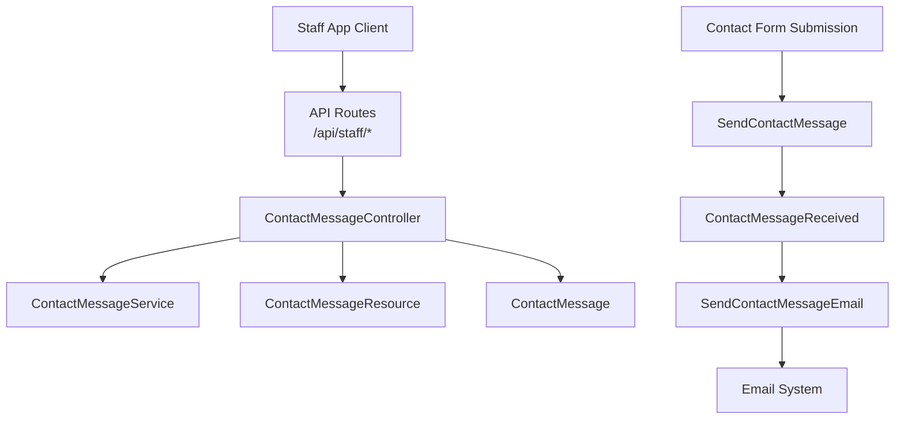
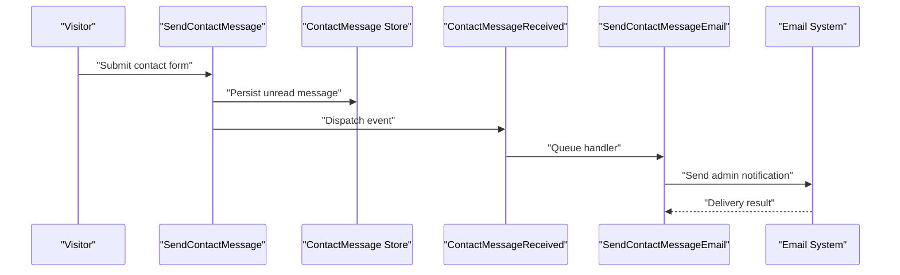
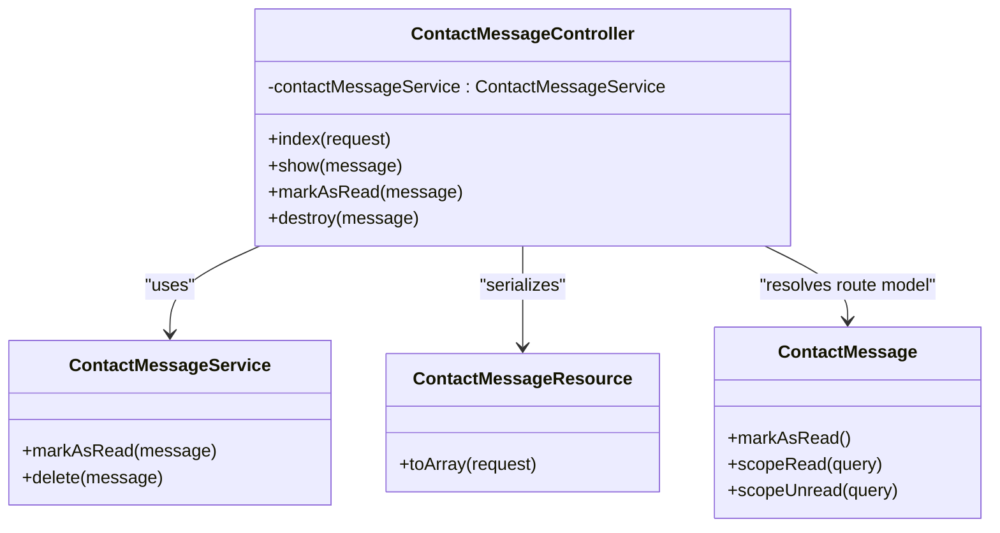
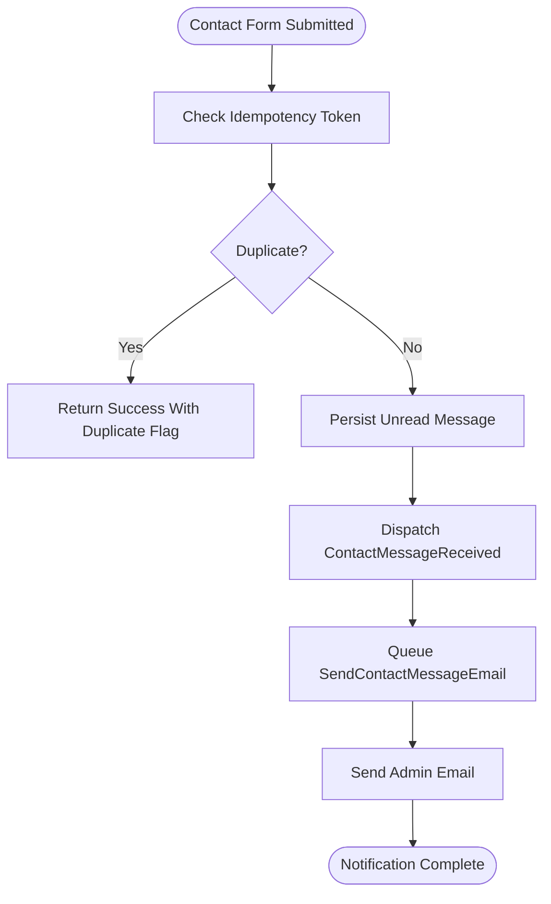
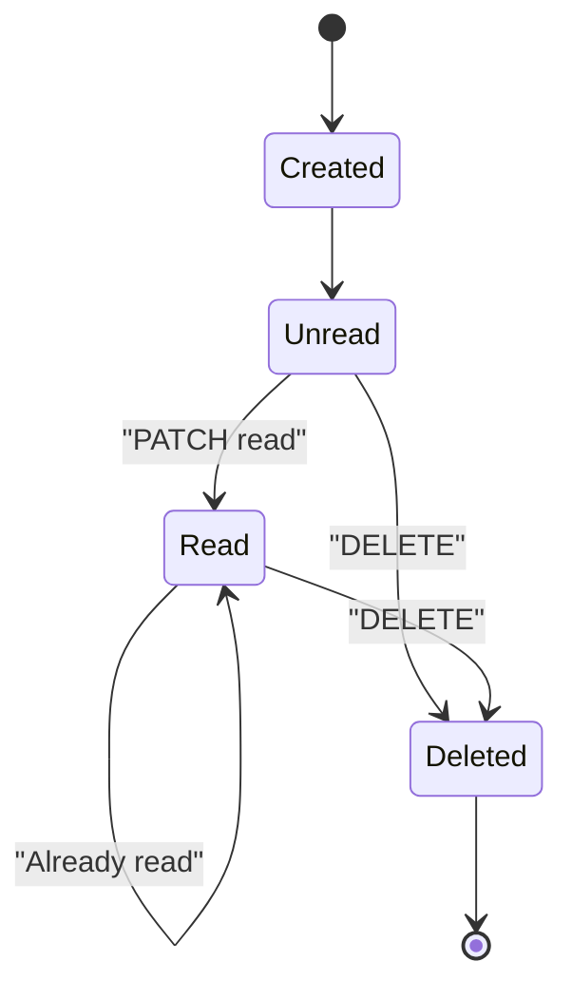
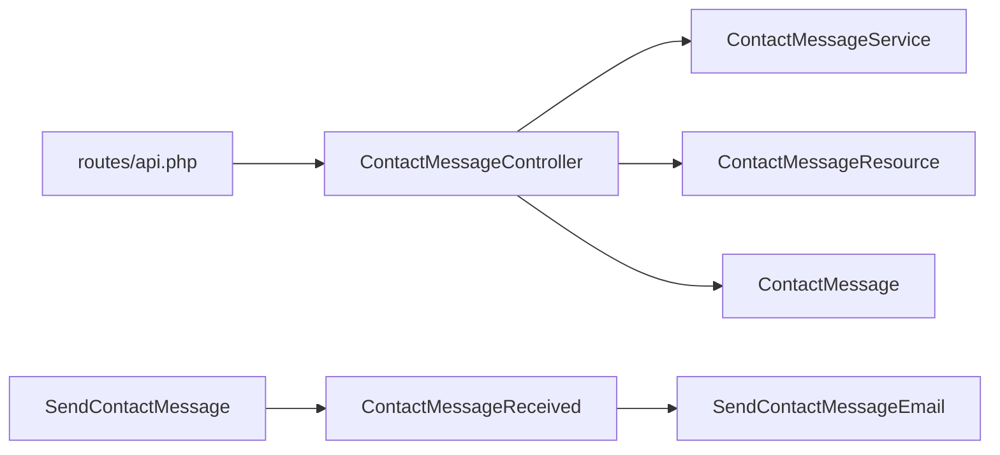

# Contact Message Triage

<cite>
**Referenced Files in This Document**
- [routes/api.php](file://routes/api.php)
- [app/Http/Controllers/Api/ContactMessageController.php](file://app/Http/Controllers/Api/ContactMessageController.php)
- [app/Services/ContactMessageService.php](file://app/Services/ContactMessageService.php)
- [app/Models/ContactMessage.php](file://app/Models/ContactMessage.php)
- [app/Http/Resources/Api/ContactMessageResource.php](file://app/Http/Resources/Api/ContactMessageResource.php)
- [app/Actions/SendContactMessage.php](file://app/Actions/SendContactMessage.php)
- [app/Events/ContactMessageReceived.php](file://app/Events/ContactMessageReceived.php)
- [app/Listeners/SendContactMessageEmail.php](file://app/Listeners/SendContactMessageEmail.php)
</cite>

## Table of Contents
1. [Introduction](#introduction)
2. [Project Structure](#project-structure)
3. [Core Components](#core-components)
4. [Architecture Overview](#architecture-overview)
5. [API Reference](#api-reference)
6. [Detailed Component Analysis](#detailed-component-analysis)
7. [Message Lifecycle and Business Rules](#message-lifecycle-and-business-rules)
8. [Dependency Analysis](#dependency-analysis)
9. [Performance Considerations](#performance-considerations)
10. [Troubleshooting Guide](#troubleshooting-guide)
11. [Conclusion](#conclusion)

## Introduction
This document describes the contact message triage system used by the staff application. It covers how visitor messages are received, stored, listed, viewed, marked as read, and deleted through a Sanctum-authenticated API. The focus is on these endpoints:

- List contact messages: `GET /api/staff/contact-messages`
- View one message: `GET /api/staff/contact-messages/{message}`
- Mark a message as read: `PATCH /api/staff/contact-messages/{message}/read`
- Delete a message: `DELETE /api/staff/contact-messages/{message}`

The system uses Spatie-style abilities for authorization, Eloquent models for persistence, JSON resources for serialization, events and listeners for email notifications, and an idempotency mechanism to prevent duplicate submissions.

## Project Structure
The contact message feature spans controllers, services, models, resources, actions, events, and listeners. The API routes are grouped under `/api/staff`, authenticated with Sanctum, and protected by the `can:view contact messages` ability.



**Diagram sources**
- [routes/api.php:74-77](file://routes/api.php#L74-L77)
- [app/Http/Controllers/Api/ContactMessageController.php:1-81](file://app/Http/Controllers/Api/ContactMessageController.php#L1-L81)
- [app/Services/ContactMessageService.php:1-33](file://app/Services/ContactMessageService.php#L1-L33)
- [app/Models/ContactMessage.php:1-55](file://app/Models/ContactMessage.php#L1-L55)
- [app/Http/Resources/Api/ContactMessageResource.php:1-36](file://app/Http/Resources/Api/ContactMessageResource.php#L1-L36)
- [app/Actions/SendContactMessage.php:1-71](file://app/Actions/SendContactMessage.php#L1-L71)
- [app/Events/ContactMessageReceived.php:1-24](file://app/Events/ContactMessageReceived.php#L1-L24)
- [app/Listeners/SendContactMessageEmail.php:1-54](file://app/Listeners/SendContactMessageEmail.php#L1-L54)

**Section sources**
- [routes/api.php:74-77](file://routes/api.php#L74-L77)
- [app/Http/Controllers/Api/ContactMessageController.php:1-81](file://app/Http/Controllers/Api/ContactMessageController.php#L1-L81)

## Core Components
- API controller: exposes list, show, mark-read, and delete operations for contact messages.
- Service: encapsulates mutating operations such as marking read and deleting.
- Model: represents a contact form submission and provides read/unread scopes and a mark-as-read method.
- Resource: serializes model data into the stable API response shape.
- Action: processes public contact form submissions, persists them, and dispatches an event.
- Event and listener: notify administrators asynchronously via email when a new message arrives.

**Section sources**
- [app/Http/Controllers/Api/ContactMessageController.php:1-81](file://app/Http/Controllers/Api/ContactMessageController.php#L1-L81)
- [app/Services/ContactMessageService.php:1-33](file://app/Services/ContactMessageService.php#L1-L33)
- [app/Models/ContactMessage.php:1-55](file://app/Models/ContactMessage.php#L1-L55)
- [app/Http/Resources/Api/ContactMessageResource.php:1-36](file://app/Http/Resources/Api/ContactMessageResource.php#L1-L36)
- [app/Actions/SendContactMessage.php:1-71](file://app/Actions/SendContactMessage.php#L1-L71)
- [app/Events/ContactMessageReceived.php:1-24](file://app/Events/ContactMessageReceived.php#L1-L24)
- [app/Listeners/SendContactMessageEmail.php:1-54](file://app/Listeners/SendContactMessageEmail.php#L1-L54)

## Architecture Overview
The contact message flow has two directions:

1. Public submission flow: A visitor submits a contact form. The action validates input, applies idempotency protection, stores the message, and emits an event. The queued listener sends an email notification to the primary administrator address.
2. Staff triage flow: A staff client authenticates with Sanctum, calls the staff API under `/api/staff`, and performs listing, viewing, marking read, or deletion operations. Authorization is enforced by the `can:view contact messages` ability.



**Diagram sources**
- [app/Actions/SendContactMessage.php:1-71](file://app/Actions/SendContactMessage.php#L1-L71)
- [app/Events/ContactMessageReceived.php:1-24](file://app/Events/ContactMessageReceived.php#L1-L24)
- [app/Listeners/SendContactMessageEmail.php:1-54](file://app/Listeners/SendContactMessageEmail.php#L1-L54)

## API Reference
All contact message endpoints require:

- Authentication: Bearer token issued by the staff login endpoint using Sanctum.
- Authorization: `can:view contact messages` ability.
- Base path: `/api/staff`.

### Common Response Wrappers
- Successful list responses use a paginated resource collection produced by the JSON resource layer.
- Successful mutation responses return a JSON object with a `data` field containing the updated resource and a localized `message` string, or just a `message` field for deletion.
- Validation errors, unauthorized access, and not found responses follow standard Laravel API error conventions.

### GET /api/staff/contact-messages
List contact messages.

- Method: `GET`
- URL pattern: `/api/staff/contact-messages`
- Required permissions: `view contact messages`
- Query parameters:
  - `status`: Filter by read state. Allowed values:
    - `read`: Only read messages.
    - `unread`: Only unread messages.
  - `search`: Text filter matching name, email, or subject.
  - `per_page`: Number of items per page. Validated range is from 1 to 100; default is 15.
- Response schema (collection):
  - Each item includes:
    - `id`: Integer identifier.
    - `name`: Visitor name.
    - `email`: Visitor email address.
    - `phone`: Optional phone number.
    - `subject`: Subject line.
    - `message`: Full message body.
    - `is_read`: Boolean read state.
    - `created_at`: ISO 8601 timestamp.
- Pagination behavior:
  - Results are ordered newest first.
  - The pagination envelope is provided by Laravel’s paginator wrapper around the resource collection.

Example request:
```http
GET /api/staff/contact-messages?status=unread&search=john&per_page=20
Authorization: Bearer {token}
```

Example response (simplified):
```json
{
  "data": [
    {
      "id": 1,
      "name": "Jane Doe",
      "email": "jane@example.com",
      "phone": "+15550000000",
      "subject": "Quote request",
      "message": "I need a glass estimate...",
      "is_read": false,
      "created_at": "2026-10-28T10:15:00+00:00"
    }
  ]
}
```

### GET /api/staff/contact-messages/{message}
View one message without changing its read state.

- Method: `GET`
- URL pattern: `/api/staff/contact-messages/{message}`
- Path parameter:
  - `message`: Numeric message identifier.
- Required permissions: `view contact messages`
- Response schema (single resource):
  - Same fields as the list items.
- Behavior:
  - Does not mark the message as read. Use the dedicated mark-read endpoint to change state.

Example request:
```http
GET /api/staff/contact-messages/42
Authorization: Bearer {token}
```

Example response (simplified):
```json
{
  "id": 42,
  "name": "John Smith",
  "email": "john@example.com",
  "phone": null,
  "subject": "Booking question",
  "message": "Can I reschedule my inspection?",
  "is_read": false,
  "created_at": "2026-10-28T09:00:00+00:00"
}
```

### PATCH /api/staff/contact-messages/{message}/read
Mark a message as read.

- Method: `PATCH`
- URL pattern: `/api/staff/contact-messages/{message}/read`
- Path parameter:
  - `message`: Numeric message identifier.
- Required permissions: `view contact messages`
- Request body: None required.
- Response schema:
  - `data`: Updated contact message resource.
  - `message`: Localized success message indicating the message was marked read.
- Business rules:
  - If the message is already read, the operation remains idempotent and returns the current resource.
  - The read state is persisted by updating the underlying model.

Example request:
```http
PATCH /api/staff/contact-messages/42/read
Authorization: Bearer {token}
```

Example response (simplified):
```json
{
  "data": {
    "id": 42,
    "name": "John Smith",
    "email": "john@example.com",
    "phone": null,
    "subject": "Booking question",
    "message": "Can I reschedule my inspection?",
    "is_read": true,
    "created_at": "2026-10-28T09:00:00+00:00"
  },
  "message": "Contact message marked as read"
}
```

### DELETE /api/staff/contact-messages/{message}
Delete a message permanently.

- Method: `DELETE`
- URL pattern: `/api/staff/contact-messages/{message}`
- Path parameter:
  - `message`: Numeric message identifier.
- Required permissions: `view contact messages`
- Request body: None required.
- Response schema:
  - `message`: Localized success message indicating the message was deleted.
- Business rules:
  - Deletion is permanent. There is no soft-delete flag or recovery endpoint in this feature.

Example request:
```http
DELETE /api/staff/contact-messages/42
Authorization: Bearer {token}
```

Example response (simplified):
```json
{
  "message": "Contact message deleted"
}
```

**Section sources**
- [routes/api.php:74-77](file://routes/api.php#L74-L77)
- [app/Http/Controllers/Api/ContactMessageController.php:1-81](file://app/Http/Controllers/Api/ContactMessageController.php#L1-L81)
- [app/Http/Resources/Api/ContactMessageResource.php:1-36](file://app/Http/Resources/Api/ContactMessageResource.php#L1-L36)

## Detailed Component Analysis

### ContactMessageController
Responsibilities:
- Expose list, show, mark-read, and delete operations.
- Apply filtering by status and search term.
- Return paginated results ordered by newest first.
- Delegate mutations to `ContactMessageService`.
- Serialize data through `ContactMessageResource`.

Key behaviors:
- Listing supports optional `status` and `search` query parameters.
- `show` is intentionally read-only and does not alter read state.
- `markAsRead` returns both the updated resource and a localized message.
- `destroy` delegates deletion and returns a localized success message.



**Diagram sources**
- [app/Http/Controllers/Api/ContactMessageController.php:1-81](file://app/Http/Controllers/Api/ContactMessageController.php#L1-L81)
- [app/Services/ContactMessageService.php:1-33](file://app/Services/ContactMessageService.php#L1-L33)
- [app/Models/ContactMessage.php:1-55](file://app/Models/ContactMessage.php#L1-L55)
- [app/Http/Resources/Api/ContactMessageResource.php:1-36](file://app/Http/Resources/Api/ContactMessageResource.php#L1-L36)

**Section sources**
- [app/Http/Controllers/Api/ContactMessageController.php:1-81](file://app/Http/Controllers/Api/ContactMessageController.php#L1-L81)

### ContactMessageService
Responsibilities:
- Encapsulate business mutations for contact messages.
- Ensure marking read is safe even if the message is already read.
- Provide deletion logic.

Design notes:
- Marking read checks the current state before writing, avoiding unnecessary updates.
- Deletion is a straightforward hard delete.

**Section sources**
- [app/Services/ContactMessageService.php:1-33](file://app/Services/ContactMessageService.php#L1-L33)

### ContactMessage Model
Responsibilities:
- Represent a visitor contact form submission.
- Provide boolean casting for `is_read`.
- Implement a `markAsRead` method.
- Provide `read` and `unread` query scopes.

Data shape:
- Fields include visitor name, email, optional phone, subject, message body, and read state.
- Timestamps include creation time; the resource formats it as ISO 8601.

**Section sources**
- [app/Models/ContactMessage.php:1-55](file://app/Models/ContactMessage.php#L1-L55)

### ContactMessageResource
Responsibilities:
- Convert model data into a stable API representation.
- Normalize `is_read` to a boolean.
- Format timestamps as ISO 8601 strings.

Response contract:
- Every listed or shown message contains the same set of fields so clients can rely on consistent structure across endpoints.

**Section sources**
- [app/Http/Resources/Api/ContactMessageResource.php:1-36](file://app/Http/Resources/Api/ContactMessageResource.php#L1-L36)

### Contact Form Submission and Notification Flow
Public-facing contact submissions are handled by an action that validates input, protects against duplicate submissions, persists the message, and dispatches an event. A queued listener then sends an email to the administrator.



**Diagram sources**
- [app/Actions/SendContactMessage.php:1-71](file://app/Actions/SendContactMessage.php#L1-L71)
- [app/Events/ContactMessageReceived.php:1-24](file://app/Events/ContactMessageReceived.php#L1-L24)
- [app/Listeners/SendContactMessageEmail.php:1-54](file://app/Listeners/SendContactMessageEmail.php#L1-L54)

**Section sources**
- [app/Actions/SendContactMessage.php:1-71](file://app/Actions/SendContactMessage.php#L1-L71)
- [app/Events/ContactMessageReceived.php:1-24](file://app/Events/ContactMessageReceived.php#L1-L24)
- [app/Listeners/SendContactMessageEmail.php:1-54](file://app/Listeners/SendContactMessageEmail.php#L1-L54)

## Message Lifecycle and Business Rules

### Lifecycle States
A contact message moves through these states during its lifecycle:

1. Created: When a visitor submits the contact form, the message is saved with `is_read` set to false.
2. Unread: Messages appear in the inbox until explicitly marked read.
3. Read: After calling the mark-read endpoint, the message becomes read.
4. Deleted: Once deleted, the record is removed permanently.



**Diagram sources**
- [app/Actions/SendContactMessage.php:1-71](file://app/Actions/SendContactMessage.php#L1-L71)
- [app/Models/ContactMessage.php:1-55](file://app/Models/ContactMessage.php#L1-L55)
- [app/Services/ContactMessageService.php:1-33](file://app/Services/ContactMessageService.php#L1-L33)

### Permissions
All four endpoints are protected by the `can:view contact messages` ability. This means:

- Any role granted the `view contact messages` permission can list, view, mark read, and delete messages.
- There is no separate write permission for contact messages in the current API implementation.

### Filtering and Search
The list endpoint supports:

- `status=read`: Show only read messages.
- `status=unread`: Show only unread messages.
- `search`: Partial match against name, email, and subject.
- `per_page`: Between 1 and 100, default 15.

### Priority Handling
There is no explicit priority field or sorting option in the current implementation. Messages are returned newest first. If prioritization is needed later, consider adding a priority field and corresponding scope or sort parameter.

### Read and Unread State Semantics
- New messages start unread.
- The view endpoint does not change read state.
- The mark-read endpoint sets `is_read` to true.
- Repeated mark-read calls are safe and idempotent.

### Notification Handling
When a contact form submission succeeds:

- An event is dispatched.
- A queued listener sends an email to the primary administrator address.
- The email address and company name are resolved from settings, falling back to mail configuration.
- Errors are logged and re-thrown so the queue retry mechanism can handle failures.

**Section sources**
- [routes/api.php:74-77](file://routes/api.php#L74-L77)
- [app/Http/Controllers/Api/ContactMessageController.php:1-81](file://app/Http/Controllers/Api/ContactMessageController.php#L1-L81)
- [app/Models/ContactMessage.php:1-55](file://app/Models/ContactMessage.php#L1-L55)
- [app/Listeners/SendContactMessageEmail.php:1-54](file://app/Listeners/SendContactMessageEmail.php#L1-L54)

## Dependency Analysis
The contact message API depends on several layers:

- Route definitions define URLs, HTTP methods, and abilities.
- The controller coordinates request handling and delegates mutations.
- The service encapsulates domain operations.
- The model defines persistence semantics and query scopes.
- The resource defines the public contract.
- The action and event/listener pair implement the public submission and notification workflow.



**Diagram sources**
- [routes/api.php:74-77](file://routes/api.php#L74-L77)
- [app/Http/Controllers/Api/ContactMessageController.php:1-81](file://app/Http/Controllers/Api/ContactMessageController.php#L1-L81)
- [app/Services/ContactMessageService.php:1-33](file://app/Services/ContactMessageService.php#L1-L33)
- [app/Models/ContactMessage.php:1-55](file://app/Models/ContactMessage.php#L1-L55)
- [app/Http/Resources/Api/ContactMessageResource.php:1-36](file://app/Http/Resources/Api/ContactMessageResource.php#L1-L36)
- [app/Actions/SendContactMessage.php:1-71](file://app/Actions/SendContactMessage.php#L1-L71)
- [app/Events/ContactMessageReceived.php:1-24](file://app/Events/ContactMessageReceived.php#L1-L24)
- [app/Listeners/SendContactMessageEmail.php:1-54](file://app/Listeners/SendContactMessageEmail.php#L1-L54)

**Section sources**
- [routes/api.php:74-77](file://routes/api.php#L74-L77)
- [app/Http/Controllers/Api/ContactMessageController.php:1-81](file://app/Http/Controllers/Api/ContactMessageController.php#L1-L81)

## Performance Considerations
- Pagination limits: The list endpoint caps `per_page` at 100 to avoid excessive payloads. Clients should choose a reasonable page size.
- Indexing: For large inboxes, database indexes on frequently filtered columns such as `is_read`, `created_at`, `email`, and `subject` can improve list performance.
- Read-state writes: Marking read is idempotent and only updates when necessary, reducing unnecessary writes.
- Asynchronous notifications: Email sending is queued, keeping the submission path fast and resilient.

[No sources needed since this section provides general guidance]

## Troubleshooting Guide

Common issues and resolutions:

- Missing authentication:
  - Ensure the client includes a valid Sanctum bearer token.
  - Verify the staff login endpoint successfully issued a token.

- Authorization failure:
  - Confirm the authenticated user has the `view contact messages` ability.
  - Check role and permission configuration if the ability is missing.

- Unexpected read state after viewing:
  - The API view endpoint does not mark messages as read. Use the dedicated mark-read endpoint to update state.

- Duplicate submissions:
  - Public contact submissions use an idempotency token. If the token has already been processed, the submission returns success with a duplicate flag rather than creating another message.

- Email not received:
  - Check queue worker status because email delivery is queued.
  - Inspect logs for email-sending errors; the listener logs failures and re-throws exceptions for queue retry behavior.
  - Verify primary email and company name settings, and confirm mail configuration.

**Section sources**
- [app/Actions/SendContactMessage.php:1-71](file://app/Actions/SendContactMessage.php#L1-L71)
- [app/Listeners/SendContactMessageEmail.php:1-54](file://app/Listeners/SendContactMessageEmail.php#L1-L54)

## Conclusion
The contact message triage system provides a focused, permission-gated API for managing visitor inquiries. It separates concerns cleanly between routing, controllers, services, models, resources, and asynchronous notifications. Staff applications can reliably list, inspect, mark as read, and delete messages, while visitors receive responsive handling and administrators receive queued email notifications. Future enhancements could add priority handling, richer filtering, assignment workflows, and reply tracking.