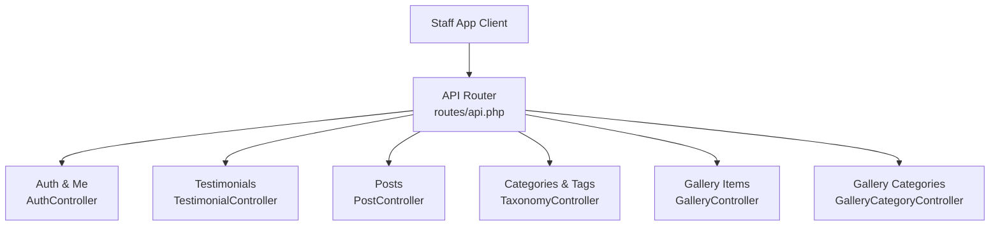
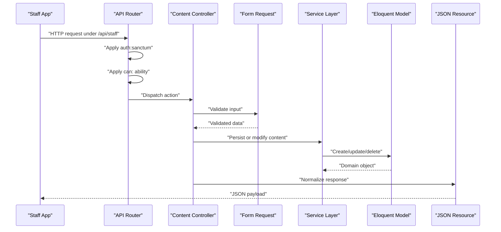
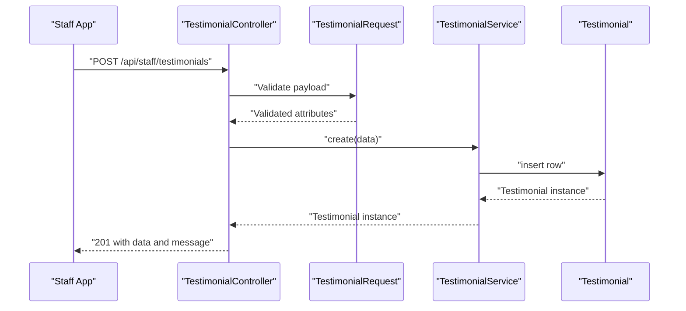
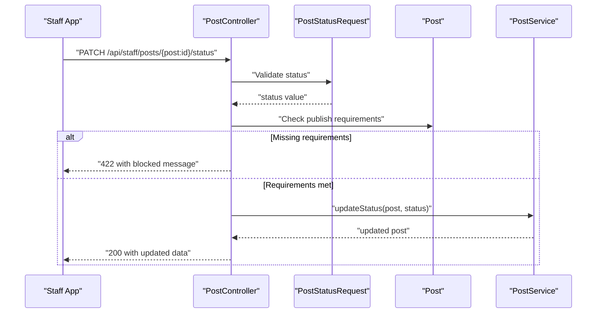
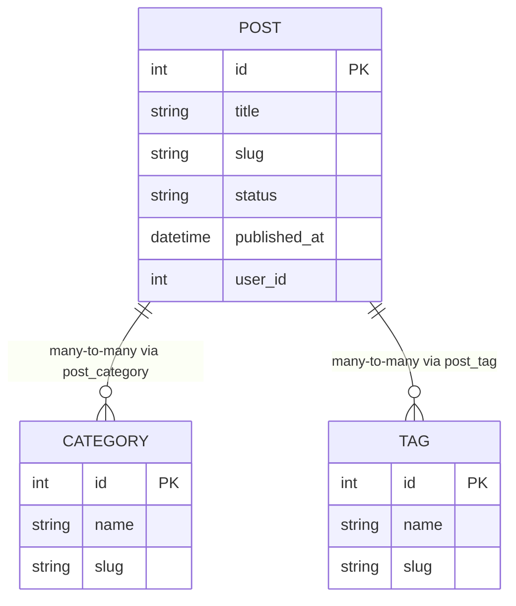
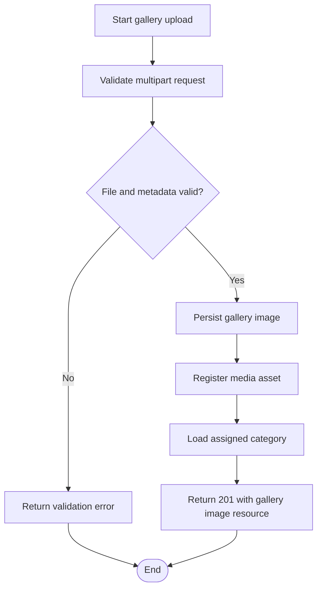
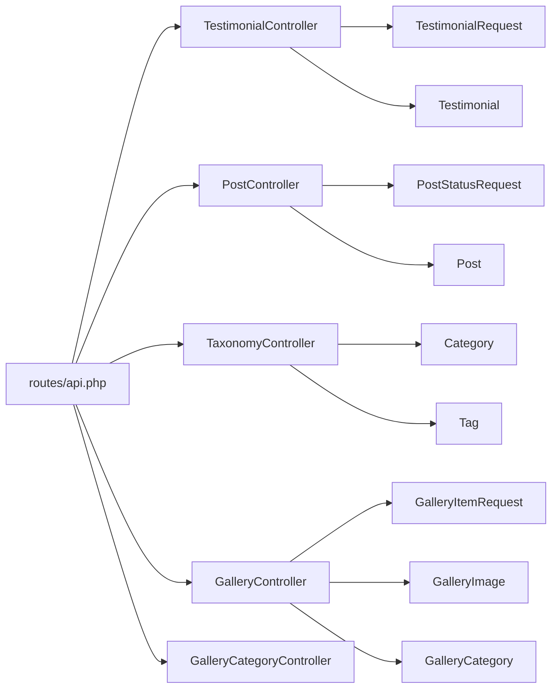

# Content Management

<cite>
**Referenced Files in This Document**
- [routes/api.php](file://routes/api.php)
- [TestimonialController.php](file://app/Http/Controllers/Api/TestimonialController.php)
- [PostController.php](file://app/Http/Controllers/Api/PostController.php)
- [TaxonomyController.php](file://app/Http/Controllers/Api/TaxonomyController.php)
- [GalleryController.php](file://app/Http/Controllers/Api/GalleryController.php)
- [GalleryCategoryController.php](file://app/Http/Controllers/Api/GalleryCategoryController.php)
- [TestimonialRequest.php](file://app/Http/Requests/Admin/TestimonialRequest.php)
- [GalleryItemRequest.php](file://app/Http/Requests/Admin/GalleryItemRequest.php)
- [PostStatusRequest.php](file://app/Http/Requests/Admin/PostStatusRequest.php)
- [Testimonial.php](file://app/Models/Testimonial.php)
- [Post.php](file://app/Models/Post.php)
- [Category.php](file://app/Models/Category.php)
- [Tag.php](file://app/Models/Tag.php)
- [GalleryImage.php](file://app/Models/GalleryImage.php)
- [GalleryCategory.php](file://app/Models/GalleryCategory.php)
</cite>

## Table of Contents
1. [Introduction](#introduction)
2. [Project Structure](#project-structure)
3. [Core Components](#core-components)
4. [Architecture Overview](#architecture-overview)
5. [Detailed Component Analysis](#detailed-component-analysis)
6. [Dependency Analysis](#dependency-analysis)
7. [Performance Considerations](#performance-considerations)
8. [Troubleshooting Guide](#troubleshooting-guide)
9. [Conclusion](#conclusion)

## Introduction
This document provides API documentation for the content management endpoints exposed by the staff application under `/api/staff`. It covers:

- Testimonials: full CRUD through `/api/staff/testimonials`.
- Blog posts: read, status moderation, and deletion through `/api/staff/posts`.
- Taxonomy: read-only blog categories and tags through `/api/staff/categories` and `/api/staff/tags`.
- Gallery media: curated image management and category listing through `/api/staff/gallery` and `/api/staff/gallery-categories`.

All endpoints are behind Sanctum authentication and Spatie-style `can:` ability gates. The controller layer delegates persistence to services or Eloquent models, while validation is centralized in Laravel Form Request classes. Responses use JSON resources so clients receive normalized payloads rather than raw database rows.

## Project Structure
The staff API is registered as a single route group with prefix `staff`, protected by `auth:sanctum`, and split into feature-specific controllers:

**Diagram sources**
- [routes/api.php:1-117](file://routes/api.php#L1-L117)

The relevant files form a clear layered structure:

| Layer | Responsibility | Representative Files |
|---|---|---|
| Routing | URL patterns, middleware, and permission gates | [routes/api.php](file://routes/api.php) |
| Controllers | HTTP request handling and response shaping | [TestimonialController.php](file://app/Http/Controllers/Api/TestimonialController.php), [PostController.php](file://app/Http/Controllers/Api/PostController.php), [TaxonomyController.php](file://app/Http/Controllers/Api/TaxonomyController.php), [GalleryController.php](file://app/Http/Controllers/Api/GalleryController.php), [GalleryCategoryController.php](file://app/Http/Controllers/Api/GalleryCategoryController.php) |
| Requests | Validation and boolean coercion | [TestimonialRequest.php](file://app/Http/Requests/Admin/TestimonialRequest.php), [GalleryItemRequest.php](file://app/Http/Requests/Admin/GalleryItemRequest.php), [PostStatusRequest.php](file://app/Http/Requests/Admin/PostStatusRequest.php) |
| Models | Domain data, relationships, scopes, and publishing logic | [Testimonial.php](file://app/Models/Testimonial.php), [Post.php](file://app/Models/Post.php), [Category.php](file://app/Models/Category.php), [Tag.php](file://app/Models/Tag.php), [GalleryImage.php](file://app/Models/GalleryImage.php), [GalleryCategory.php](file://app/Models/GalleryCategory.php) |

**Section sources**
- [routes/api.php:1-117](file://routes/api.php#L1-L117)

## Core Components
Each endpoint group has a dedicated controller, one or more request validators, and one or more domain models. Services are used where persistence requires shared business rules:

- **Testimonials**: validated through `TestimonialRequest`, persisted through `TestimonialService`, represented by `TestimonialResource`.
- **Posts**: validated through `PostStatusRequest` for status changes; list and show operations return `PostResource`.
- **Taxonomy**: read-only listing through `CategoryResource` and `TagResource`.
- **Gallery**: validated through `GalleryItemRequest`, persisted through `GalleryService`, represented by `GalleryImageResource`.

All staff API routes share these constraints:

| Constraint | Behavior |
|---|---|
| Authentication | Requires a valid Sanctum token via `auth:sanctum`. |
| Authorization | Uses `can:` middleware with abilities such as `manage testimonials`, `view blog`, `update blog`, `delete blog`, `view gallery`, and `manage gallery`. |
| Pagination | Most list endpoints paginate results and clamp `per_page` between 1 and 100. |
| Sorting | Testimonials and gallery items support sort-order normalization through shared sorting utilities. |
| Boolean fields | Boolean inputs are coerced so string values like `"true"` are accepted safely. |

**Section sources**
- [routes/api.php:1-117](file://routes/api.php#L1-L117)
- [TestimonialController.php:1-91](file://app/Http/Controllers/Api/TestimonialController.php#L1-L91)
- [PostController.php:1-92](file://app/Http/Controllers/Api/PostController.php#L1-L92)
- [TaxonomyController.php:1-35](file://app/Http/Controllers/Api/TaxonomyController.php#L1-L35)
- [GalleryController.php:1-92](file://app/Http/Controllers/Api/GalleryController.php#L1-L92)
- [GalleryCategoryController.php:1-28](file://app/Http/Controllers/Api/GalleryCategoryController.php#L1-L28)

## Architecture Overview
The staff content-management architecture separates routing concerns from validation, business logic, and persistence.

This design ensures that:

- Clients never validate directly against database schemas.
- Permission checks are applied at the route level.
- Content lifecycle logic stays in models and services.
- Response shape is consistent across list, show, create, update, and delete operations.

**Diagram sources**
- [routes/api.php:1-117](file://routes/api.php#L1-L117)
- [TestimonialController.php:1-91](file://app/Http/Controllers/Api/TestimonialController.php#L1-L91)
- [PostController.php:1-92](file://app/Http/Controllers/Api/PostController.php#L1-L92)
- [GalleryController.php:1-92](file://app/Http/Controllers/Api/GalleryController.php#L1-L92)

## Detailed Component Analysis

### Testimonial Endpoints
Base path: `/api/staff/testimonials`

#### Permissions
Every testimonial endpoint uses the `manage testimonials` ability.

#### Endpoints

| Method | Path | Purpose | Query Parameters | Success Response | Error Response |
|---|---|---|---|---|---|
| GET | `/api/staff/testimonials` | List testimonials | `search`, `published`, `per_page` | Paginated collection with `data` array | Standard error |
| POST | `/api/staff/testimonials` | Create a testimonial | None | `data` object and success message | Validation error |
| GET | `/api/staff/testimonials/{id}` | Show one testimonial | None | Single `data` object | Not found |
| PUT | `/api/staff/testimonials/{id}` | Update a testimonial | None | `data` object and success message | Validation error |
| DELETE | `/api/staff/testimonials/{id}` | Delete a testimonial | None | Success message | Not found |

#### Request Schema
Used by both create and update:

| Field | Type | Required | Validation |
|---|---|---:|---|
| `name` | string | Yes | Required, max 255 characters |
| `content` | string | Yes | Required |
| `role` | string | No | Nullable, max 255 characters |
| `rating` | integer | Yes | Integer from 1 to 5 |
| `is_featured` | boolean | No | Boolean coercion applied |
| `is_published` | boolean | No | Boolean coercion applied |
| `sort_order` | integer | No | Normalized using shared sort-order rules scoped to `Testimonial` |

Boolean fields are coerced before validation, so clients may send `"true"` or `1`. Sort order is normalized relative to existing testimonials, preventing duplicate ordering when possible.

#### Query Filters
- `search`: searches name, role, and content using case-insensitive pattern matching.
- `published`: filters by published state after casting to boolean.
- `per_page`: clamped between 1 and 100.

#### Example Workflow
1. Create a draft testimonial with `is_published=false`.
2. Search unpublished testimonials.
3. Update rating or featured flag.
4. Publish by setting `is_published=true`.
5. Delete when no longer needed.

#### Example Sequence

**Diagram sources**
- [TestimonialController.php:1-91](file://app/Http/Controllers/Api/TestimonialController.php#L1-L91)
- [TestimonialRequest.php:1-54](file://app/Http/Requests/Admin/TestimonialRequest.php#L1-L54)

**Section sources**
- [routes/api.php:66-74](file://routes/api.php#L66-L74)
- [TestimonialController.php:1-91](file://app/Http/Controllers/Api/TestimonialController.php#L1-L91)
- [TestimonialRequest.php:1-54](file://app/Http/Requests/Admin/TestimonialRequest.php#L1-L54)
- [Testimonial.php:1-52](file://app/Models/Testimonial.php#L1-L52)

### Post Endpoints
Base path: `/api/staff/posts`

#### Permissions
| Operation | Ability |
|---|---|
| List and view posts | `view blog` |
| Change post status | `update blog` |
| Delete a post | `delete blog` |

Note: Creation and editing of block content remain on the web admin. The staff API is intentionally limited to reading posts and moderating their status.

#### Endpoints

| Method | Path | Purpose | Query Parameters | Success Response | Error Response |
|---|---|---|---|---|---|
| GET | `/api/staff/posts` | List posts | `status`, `user`, `search`, `per_page` | Paginated collection | Standard error |
| GET | `/api/staff/posts/{post:id}` | Show one post | None | Single `data` object | Not found |
| PATCH | `/api/staff/posts/{post:id}/status` | Update status | `status` | Updated `data` object | Validation or publish-block error |
| DELETE | `/api/staff/posts/{post:id}` | Delete a post | None | Success message | Not found |

#### Status Update Request Schema
| Field | Type | Required | Validation |
|---|---|---:|---|
| `status` | string | Yes | Must be one of the allowed post statuses |

The model defines three workflow states: draft, published, and archived. Publishing a post may still fail even if the status value is valid, because the server enforces additional publish requirements.

#### Query Filters
- `status`: filters by post status.
- `user`: filters by author ID.
- `search`: searches title and excerpt.
- `per_page`: clamped between 1 and 100.

#### Publishing Rules
A post cannot be set to `published` if required parts are missing. The system reports which fields prevent publication, typically including content, excerpt, and category assignment.

#### Example Workflow
1. View all posts filtered by draft status.
2. Open a post to inspect author, categories, and tags.
3. Attempt to publish it.
4. If blocked, edit the post through the web admin to complete missing fields.
5. Reattempt publishing from the staff app.
6. Archive the post when it should stay hidden but not be deleted.

#### Example Sequence

**Diagram sources**
- [PostController.php:1-92](file://app/Http/Controllers/Api/PostController.php#L1-L92)
- [PostStatusRequest.php:1-35](file://app/Http/Requests/Admin/PostStatusRequest.php#L1-L35)
- [Post.php:1-274](file://app/Models/Post.php#L1-L274)

**Section sources**
- [routes/api.php:76-84](file://routes/api.php#L76-L84)
- [PostController.php:1-92](file://app/Http/Controllers/Api/PostController.php#L1-L92)
- [PostStatusRequest.php:1-35](file://app/Http/Requests/Admin/PostStatusRequest.php#L1-L35)
- [Post.php:1-274](file://app/Models/Post.php#L1-L274)

### Taxonomy Endpoints
Base paths: `/api/staff/categories` and `/api/staff/tags`

#### Permissions
Both endpoints require the `view blog` ability.

#### Endpoints

| Method | Path | Purpose | Query Parameters | Success Response | Notes |
|---|---|---|---|---|---|
| GET | `/api/staff/categories` | List categories | None | Alphabetical collection | Read-only |
| GET | `/api/staff/tags` | List tags | None | Alphabetical collection | Read-only |

These endpoints exist so the staff UI can display categories and tags alongside posts. Full taxonomy creation and editing are handled by the web admin.

#### Data Model Relationships

**Diagram sources**
- [Post.php:1-274](file://app/Models/Post.php#L1-L274)
- [Category.php:1-46](file://app/Models/Category.php#L1-L46)
- [Tag.php:1-46](file://app/Models/Tag.php#L1-L46)

**Section sources**
- [routes/api.php:82-84](file://routes/api.php#L82-L84)
- [TaxonomyController.php:1-35](file://app/Http/Controllers/Api/TaxonomyController.php#L1-L35)
- [Category.php:1-46](file://app/Models/Category.php#L1-L46)
- [Tag.php:1-46](file://app/Models/Tag.php#L1-L46)

### Gallery Endpoints
Base paths: `/api/staff/gallery` and `/api/staff/gallery-categories`

#### Permissions
| Operation | Ability |
|---|---|
| List and view gallery images | `view gallery` |
| Create, update, delete gallery images | `manage gallery` |
| List gallery categories | `view gallery` |

#### Gallery Item Endpoints

| Method | Path | Purpose | Success Response | Error Response |
|---|---|---|---|---|
| GET | `/api/staff/gallery` | List gallery images | Paginated collection | Standard error |
| POST | `/api/staff/gallery` | Create a gallery image | `data` object and success message | Validation error |
| GET | `/api/staff/gallery/{item}` | Show one gallery image | Single `data` object | Not found |
| PUT | `/api/staff/gallery/{item}` | Update a gallery image | `data` object and success message | Validation error |
| DELETE | `/api/staff/gallery/{item}` | Delete a gallery image | Success message | Not found |

#### Gallery Category Endpoint

| Method | Path | Purpose | Success Response |
|---|---|---|---|
| GET | `/api/staff/gallery-categories` | List active gallery categories | Ordered collection |

#### Request Schema for Gallery Items
| Field | Type | Required | Validation |
|---|---|---:|---|
| `title` | string | Yes | Max 100 characters |
| `description` | string | No | Max 500 characters |
| `image` | file | No | Image only; JPEG, PNG, JPG, WebP; maximum 10 MB |
| `image_path` | string | No | Allowed stored upload path |
| `remove_image` | boolean | No | Boolean coercion applied |
| `gallery_category_id` | integer | Yes | Must reference an existing gallery category |
| `is_featured` | boolean | No | Boolean coercion applied |
| `is_active` | boolean | No | Boolean coercion applied |
| `sort_order` | integer | No | Normalized within the gallery source scope |
| `latitude` | number | No | Between -90 and 90 |
| `longitude` | number | No | Between -180 and 180 |
| `location_address` | string | No | Max 255 characters |

#### Query Filters
- `category`: filter by category slug.
- `featured`: include only featured images.
- `per_page`: clamped between 1 and 100.

#### Media Upload Process
1. Prepare a multipart form submission containing `image` and metadata.
2. Include `gallery_category_id`; it is required.
3. Optionally include `is_featured`, `is_active`, and sort order.
4. The server validates file type, size, and safe storage paths.
5. The service persists the gallery item and tracks media registration.
6. The response includes the normalized gallery image resource.

#### Example Workflow
1. Create a gallery category through the web admin.
2. Upload an image and assign it to that category.
3. Mark it as featured if appropriate.
4. Filter gallery images by category or featured flag.
5. Update or remove the image later.

#### Example Flowchart

**Diagram sources**
- [GalleryController.php:1-92](file://app/Http/Controllers/Api/GalleryController.php#L1-L92)
- [GalleryItemRequest.php:1-66](file://app/Http/Requests/Admin/GalleryItemRequest.php#L1-L66)
- [GalleryImage.php:1-169](file://app/Models/GalleryImage.php#L1-L169)

**Section sources**
- [routes/api.php:98-115](file://routes/api.php#L98-L115)
- [GalleryController.php:1-92](file://app/Http/Controllers/Api/GalleryController.php#L1-L92)
- [GalleryCategoryController.php:1-28](file://app/Http/Controllers/Api/GalleryCategoryController.php#L1-L28)
- [GalleryItemRequest.php:1-66](file://app/Http/Requests/Admin/GalleryItemRequest.php#L1-L66)
- [GalleryImage.php:1-169](file://app/Models/GalleryImage.php#L1-L169)
- [GalleryCategory.php:1-61](file://app/Models/GalleryCategory.php#L1-L61)

## Dependency Analysis
The following diagram maps the primary runtime dependencies among the content-management components.

**Diagram sources**
- [routes/api.php:1-117](file://routes/api.php#L1-L117)
- [TestimonialController.php:1-91](file://app/Http/Controllers/Api/TestimonialController.php#L1-L91)
- [PostController.php:1-92](file://app/Http/Controllers/Api/PostController.php#L1-L92)
- [TaxonomyController.php:1-35](file://app/Http/Controllers/Api/TaxonomyController.php#L1-L35)
- [GalleryController.php:1-92](file://app/Http/Controllers/Api/GalleryController.php#L1-L92)
- [GalleryCategoryController.php:1-28](file://app/Http/Controllers/Api/GalleryCategoryController.php#L1-L28)

### Coupling and Cohesion
- Controllers depend on request validators rather than raw `Request` objects for write operations.
- Models encapsulate domain behavior such as sorting, filtering, publishing checks, and relationship definitions.
- Gallery and testimonial sorting reuse shared sort-order utilities through model-level configuration, keeping pagination deterministic.
- Gallery items separate public gallery entries from library assets using a source discriminator, avoiding accidental cross-contamination.

### External Integration Points
- Database persistence through Eloquent models.
- File storage through the framework filesystem, constrained by allowed upload paths.
- Sitemap observation hooks on models that affect public URLs.
- Media registry tracking for gallery images.

**Section sources**
- [Testimonial.php:1-52](file://app/Models/Testimonial.php#L1-L52)
- [Post.php:1-274](file://app/Models/Post.php#L1-L274)
- [GalleryImage.php:1-169](file://app/Models/GalleryImage.php#L1-L169)

## Performance Considerations
- Pagination limits protect large result sets. Clients should request reasonable page sizes and rely on server-side clamping.
- List queries apply optional filters before pagination, reducing memory pressure compared to loading all records.
- Gallery listings eagerly load the category relationship when needed.
- Post listings eagerly load author, categories, and tags for richer responses.
- Sort-order uniqueness is scoped per model, avoiding expensive global conflict resolution during normal operations.
- Large image uploads are capped at 10 MB and restricted to supported formats.

[No sources needed since this section provides general guidance]

## Troubleshooting Guide

### Common Validation Errors
- Missing required testimonial fields such as `name`, `content`, or `rating`.
- Rating outside the allowed 1–5 range.
- Invalid gallery image format or file exceeding 10 MB.
- Missing or invalid `gallery_category_id`.
- Latitude or longitude outside allowed ranges.

**Section sources**
- [TestimonialRequest.php:1-54](file://app/Http/Requests/Admin/TestimonialRequest.php#L1-L54)
- [GalleryItemRequest.php:1-66](file://app/Http/Requests/Admin/GalleryItemRequest.php#L1-L66)

### Publishing Blocked
When attempting to set a post to `published`, the API returns a validation-like failure if required content is incomplete. Typical blockers include missing content, missing excerpt, or missing category assignment. Fix the post through the web admin and retry.

**Section sources**
- [PostController.php:49-73](file://app/Http/Controllers/Api/PostController.php#L49-L73)
- [Post.php:188-215](file://app/Models/Post.php#L188-L215)

### Unauthorized Access
All staff endpoints require authentication and the correct ability. A missing or invalid Sanctum token produces an authentication error; insufficient permissions produce an authorization error. Confirm the client sends the bearer token and that the user has the required ability.

**Section sources**
- [routes/api.php:1-117](file://routes/api.php#L1-L117)

### Sorting Conflicts
Sort order is normalized per model and per scope. For gallery items, sort order is scoped to the gallery source, so gallery rankings do not collide with library asset rankings.

**Section sources**
- [GalleryImage.php:37-73](file://app/Models/GalleryImage.php#L37-L73)
- [Testimonial.php:14-52](file://app/Models/Testimonial.php#L14-L52)

## Conclusion
The staff content-management API provides a focused surface for managing testimonials, moderating blog posts, browsing taxonomy, and curating gallery media. It emphasizes secure access control, explicit validation, predictable pagination, and clear separation between public gallery assets and internal media-library assets. For full content authoring workflows—especially complex blog block content—the web admin remains the primary interface, while the staff API supports moderation, quick updates, and mobile-friendly consumption.

[No sources needed since this section summarizes without analyzing specific files]