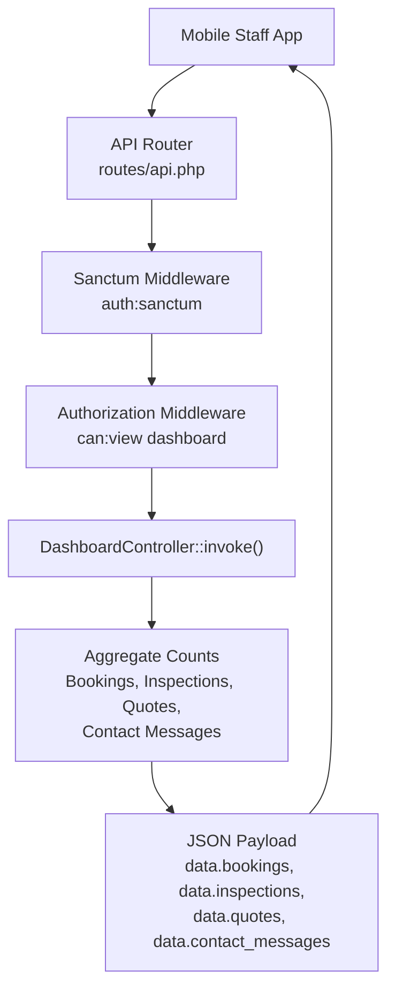
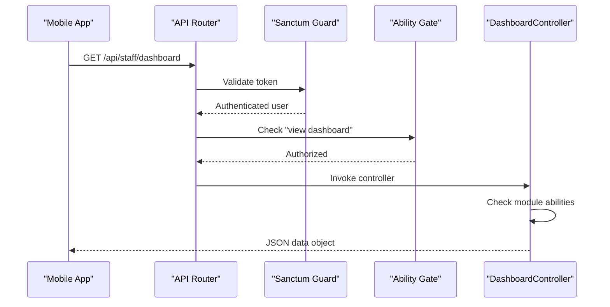
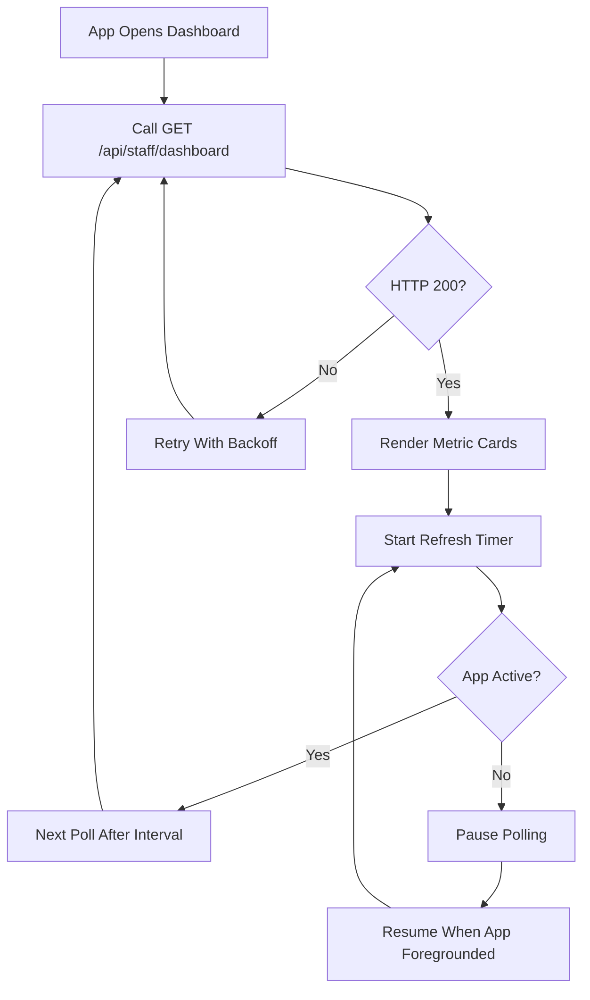
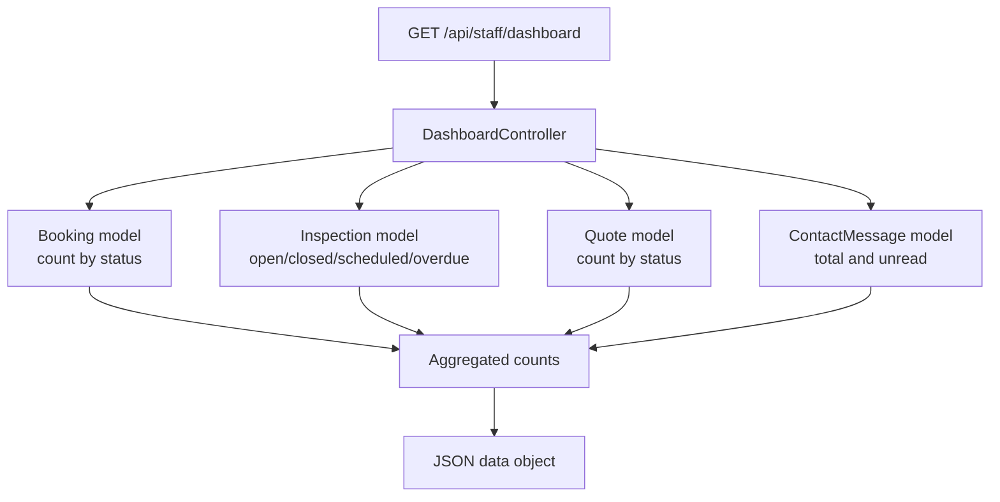
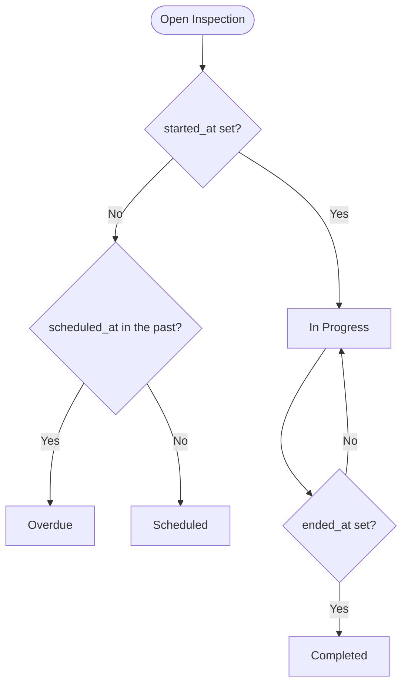
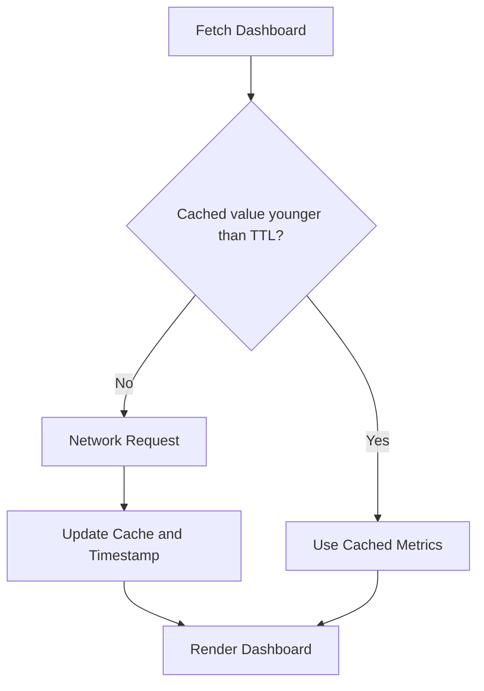

# Dashboard & Analytics

<cite>
**Referenced Files in This Document**   
- [routes/api.php](file://routes/api.php)
- [DashboardController.php](file://app/Http/Controllers/Api/DashboardController.php)
- [Booking.php](file://app/Models/Booking.php)
- [Inspection.php](file://app/Models/Inspection.php)
- [Quote.php](file://app/Models/Quote.php)
- [ContactMessage.php](file://app/Models/ContactMessage.php)
- [RolesAndPermissionsSeeder.php](file://database/seeders/RolesAndPermissionsSeeder.php)
</cite>

## Table of Contents
1. [Introduction](#introduction)
2. [Endpoint Definition](#endpoint-definition)
3. [Authentication and Authorization](#authentication-and-authorization)
4. [Response Schema](#response-schema)
5. [Filtering, Real-Time Behavior, and Refresh Strategy](#filtering-real-time-behavior-and-refresh-strategy)
6. [Analytics Pipeline and Data Sources](#analytics-pipeline-and-data-sources)
7. [Performance Considerations](#performance-considerations)
8. [Practical Visualization and Caching Examples](#practical-visualization-and-caching-examples)
9. [Common Use Cases](#common-use-cases)
10. [Troubleshooting Guide](#troubleshooting-guide)
11. [Conclusion](#conclusion)

## Introduction
This document describes the dashboard analytics surface exposed to the staff mobile application. The primary endpoint is `/api/staff/dashboard`. It returns read-only aggregate counts across bookings, inspections, quotes, and contact messages. Each section is included only when the authenticated user has the corresponding permission, so the response is both a dashboard payload and an authorization boundary.

The endpoint is designed for operational dashboards: KPI monitoring, workload visibility, overdue inspection alerts, and contact-message triage. It does not return full entity lists or detailed audit history; those are served by other endpoints under `/api/staff/bookings`, `/api/staff/inspections`, `/api/staff/quotes`, and `/api/staff/contact-messages`.

## Endpoint Definition
| Field | Value |
|---|---|
| Method | `GET` |
| Path | `/api/staff/dashboard` |
| Route name | `api.staff.dashboard` |
| Authentication | Sanctum token required via `auth:sanctum` |
| Authorization | Requires ability `can:view dashboard`; sections gated by module abilities |
| Content type | JSON |
| Purpose | Aggregate dashboard metrics for the staff app home screen |



**Diagram sources**  
- [routes/api.php:28-40](file://routes/api.php#L28-L40)  
- [DashboardController.php:1-79](file://app/Http/Controllers/Api/DashboardController.php#L1-L79)

**Section sources**  
- [routes/api.php:28-40](file://routes/api.php#L28-L40)

## Authentication and Authorization
The dashboard endpoint belongs to the staff API group. Every request must carry a valid Sanctum personal access token. In addition, the controller uses Laravel’s policy-style ability checks:

| Requirement | Effect |
|---|---|
| `auth:sanctum` | Rejects unauthenticated requests with standard API authentication failures |
| `can:view dashboard` | Restricts access to users allowed to view the dashboard |
| Module abilities | Include each metric section only when the user can view that module |

The relevant abilities include:

| Ability | Section affected |
|---|---|
| `view dashboard` | Access to the endpoint itself |
| `view bookings` | `bookings` and `quotes` sections |
| `view inspections` | `inspections` section |
| `view contact messages` | `contact_messages` section |

These abilities are registered by the roles and permissions seeder. If a user has `view dashboard` but lacks `view bookings`, the `bookings` key will not appear in the response.



**Diagram sources**  
- [routes/api.php:28-40](file://routes/api.php#L28-L40)  
- [DashboardController.php:17-79](file://app/Http/Controllers/Api/DashboardController.php#L17-L79)  
- [RolesAndPermissionsSeeder.php:32-85](file://database/seeders/RolesAndPermissionsSeeder.php#L32-L85)

**Section sources**  
- [routes/api.php:28-40](file://routes/api.php#L28-L40)  
- [DashboardController.php:17-79](file://app/Http/Controllers/Api/DashboardController.php#L17-L79)  
- [RolesAndPermissionsSeeder.php:32-85](file://database/seeders/RolesAndPermissionsSeeder.php#L32-L85)

## Response Schema
The endpoint returns a JSON envelope containing a single top-level `data` object. Keys are included conditionally based on abilities.

### Top-Level Structure
| Key | Type | Description |
|---|---|---|
| `data` | Object | Dashboard payload |
| `data.bookings` | Object or absent | Booking aggregate counts when the user can view bookings |
| `data.inspections` | Object or absent | Inspection aggregate counts when the user can view inspections |
| `data.quotes` | Object or absent | Quote aggregate counts when the user can view bookings |
| `data.contact_messages` | Object or absent | Contact message aggregate counts when the user can view contact messages |

### Bookings Metrics
| Key | Type | Meaning |
|---|---|---|
| `total` | Integer | Total number of bookings |
| `pending` | Integer | Bookings with status `pending` |
| `confirmed` | Integer | Bookings with status `confirmed` |
| `completed` | Integer | Bookings with status `completed` |
| `cancelled` | Integer | Bookings with status `cancelled` |

### Inspections Metrics
| Key | Type | Meaning |
|---|---|---|
| `total` | Integer | Total number of inspections |
| `completed` | Integer | Inspections with a non-null `ended_at` |
| `in_progress` | Integer | Open inspections with a non-null `started_at` |
| `overdue` | Integer | Open inspections without `started_at` where `scheduled_at` is in the past |
| `scheduled` | Integer | Open inspections without `started_at` where `scheduled_at` is now or later |

### Quotes Metrics
| Key | Type | Meaning |
|---|---|---|
| `total` | Integer | Total number of quotes |
| `pending` | Integer | Quotes with status `pending` |
| `contacted` | Integer | Quotes with status `contacted` |
| `completed` | Integer | Quotes with status `completed` |
| `cancelled` | Integer | Quotes with status `cancelled` |

### Contact Message Metrics
| Key | Type | Meaning |
|---|---|---|
| `total` | Integer | Total number of contact messages |
| `unread` | Integer | Contact messages where `is_read` is false |

### Example Response Shape
```json
{
  "data": {
    "bookings": {
      "total": 120,
      "pending": 15,
      "confirmed": 40,
      "completed": 58,
      "cancelled": 7
    },
    "inspections": {
      "total": 80,
      "completed": 50,
      "in_progress": 8,
      "overdue": 5,
      "scheduled": 17
    },
    "quotes": {
      "total": 60,
      "pending": 12,
      "contacted": 20,
      "completed": 25,
      "cancelled": 3
    },
    "contact_messages": {
      "total": 45,
      "unread": 9
    }
  }
}
```

A minimal permitted response may contain only one section:

```json
{
  "data": {
    "contact_messages": {
      "total": 45,
      "unread": 9
    }
  }
}
```

**Section sources**  
- [DashboardController.php:17-79](file://app/Http/Controllers/Api/DashboardController.php#L17-L79)

## Filtering, Real-Time Behavior, and Refresh Strategy
### Query Parameters
The dashboard endpoint currently accepts no query parameters. It computes aggregates directly from the database for every request.

### Real-Time Updates
The endpoint does not use server-sent events, WebSockets, or broadcast channels. “Real-time” behavior is achieved by polling:

| Aspect | Current Implementation |
|---|---|
| Data freshness | Always fresh per HTTP request |
| Server-side caching | None at the controller level |
| Client-side caching | Not enforced by the API |
| Recommended refresh interval | Poll every 15–60 seconds depending on operational urgency |
| Conflict handling | Idempotent GET; safe to retry |

For a mobile dashboard, implement exponential backoff and request debouncing:

- Start with a short interval such as 30 seconds.
- Increase the interval after idle periods.
- Pause polling when the app is backgrounded.
- Debounce rapid UI-triggered refreshes.
- Show a small loading indicator during refresh.
- Treat missing keys as zero rather than failing the dashboard layout.



[No sources needed since this diagram shows conceptual workflow, not actual code structure]

## Analytics Pipeline and Data Sources
The dashboard pipeline is intentionally lightweight. It reads from four domain models and returns precomputed counts.



**Diagram sources**  
- [DashboardController.php:17-79](file://app/Http/Controllers/Api/DashboardController.php#L17-L79)  
- [Booking.php:1-134](file://app/Models/Booking.php#L1-L134)  
- [Inspection.php:1-82](file://app/Models/Inspection.php#L1-L82)  
- [Quote.php:1-76](file://app/Models/Quote.php#L1-L76)  
- [ContactMessage.php:1-55](file://app/Models/ContactMessage.php#L1-L55)

### Data Source Details
| Data Source | Model | Aggregation Logic | Notes |
|---|---|---|---|
| Bookings | `Booking` | `count()` plus filtered counts by `status` | Status values used include `pending`, `confirmed`, `completed`, `cancelled` |
| Inspections | `Inspection` | Counts based on `ended_at`, `started_at`, and `scheduled_at` | Overdue and scheduled categories apply only to open inspections |
| Quotes | `Quote` | `count()` plus filtered counts by `status` | Gated by `view bookings` |
| Contact Messages | `ContactMessage` | Total count and `unread()` scope | Unread means `is_read` is false |

### Inspection State Logic
The inspection model exposes a computed status attribute. The dashboard controller uses its own date-based logic for `overdue` versus `scheduled`, which aligns with the model’s intent:

- Completed: `ended_at` is set.
- In progress: open inspection with `started_at` set.
- Scheduled: open inspection without `started_at` where `scheduled_at` is in the future or current time.
- Overdue: open inspection without `started_at` where `scheduled_at` is in the past.



**Diagram sources**  
- [Inspection.php:24-82](file://app/Models/Inspection.php#L24-L82)  
- [DashboardController.php:36-48](file://app/Http/Controllers/Api/DashboardController.php#L36-L48)

**Section sources**  
- [DashboardController.php:17-79](file://app/Http/Controllers/Api/DashboardController.php#L17-L79)  
- [Booking.php:1-134](file://app/Models/Booking.php#L1-L134)  
- [Inspection.php:1-82](file://app/Models/Inspection.php#L1-L82)  
- [Quote.php:1-76](file://app/Models/Quote.php#L1-L76)  
- [ContactMessage.php:1-55](file://app/Models/ContactMessage.php#L1-L55)

## Performance Considerations
### Current Cost
Each dashboard request executes multiple direct database queries:

- One count per booking status.
- Multiple inspection counts derived from different conditions.
- One count per quote status.
- One total and one unread count for contact messages.

There is no in-memory cache layer around these aggregates. Under heavy load, frequent polling can generate many read-heavy queries.

### Scalability Risks
- Large tables increase query cost even for simple counts.
- Missing indexes on frequently filtered columns such as `status`, `scheduled_at`, `started_at`, `ended_at`, and `is_read` can degrade performance.
- High-frequency polling multiplies database pressure linearly with active clients.

### Recommended Optimizations
| Area | Recommendation |
|---|---|
| Database indexing | Ensure indexes exist on `bookings.status`, `inspections.scheduled_at`, `inspections.started_at`, `inspections.ended_at`, and `contact_messages.is_read` |
| Read replicas | Route dashboard queries to a read replica if available |
| Application cache | Cache aggregated results for a short TTL (for example, 15–60 seconds) keyed by tenant or company context |
| Background job | Periodically compute and store dashboard aggregates in a cache table or Redis key |
| Client throttling | Enforce minimum poll intervals and debounce repeated UI actions |
| Pagination alternative | Keep list endpoints paginated and use the dashboard only for high-level KPIs |

### Caching Strategy Options
| Strategy | Pros | Cons |
|---|---|---|
| No cache | Always fresh | Scales poorly under heavy polling |
| Short-lived cache | Reduces database load | Stale data between refreshes |
| Cache invalidation on writes | Near-real-time accuracy | Requires write hooks and careful key design |
| Precomputed aggregate table | Predictable query cost | Adds complexity and synchronization overhead |

**Section sources**  
- [DashboardController.php:17-79](file://app/Http/Controllers/Api/DashboardController.php#L17-L79)

## Practical Visualization and Caching Examples
### KPI Monitoring
Use the dashboard payload to render:

- Total bookings today or selected window through a separate list endpoint, while using the dashboard endpoint for summary cards.
- Overdue inspection count as an alert badge.
- Unread contact message count as an inbox indicator.
- Quote conversion funnel: pending → contacted → completed.

### Trend Analysis
Because the dashboard endpoint returns point-in-time aggregates, trend analysis should be implemented by storing historical snapshots:

1. On successful dashboard response, persist key metrics with a timestamp.
2. Store metrics such as `bookings.total`, `bookings.pending`, `inspections.overdue`, and `contact_messages.unread`.
3. Compute deltas and percentages on the client or backend over time windows.
4. Avoid re-requesting the dashboard solely for historical comparison; reuse stored snapshots.

### Operational Insights for Mobile Dashboards
- Highlight overdue inspections above all other indicators.
- Dim or hide sections the user cannot view.
- Show a last-updated timestamp supplied by the client-side refresh timer.
- Surface actionable drill-down routes to `/api/staff/bookings`, `/api/staff/inspections`, `/api/staff/quotes`, and `/api/staff/contact-messages`.

### Caching Pattern for Mobile Clients


[No sources needed since this diagram shows conceptual workflow, not actual code structure]

## Common Use Cases
### KPI Monitoring
- Track total and status-based booking volumes.
- Monitor inspection throughput and backlog.
- Watch quote progression and cancellation rate.
- Monitor incoming contact volume and unread backlog.

### Workload Balancing
- Use `inspections.in_progress` and `inspections.scheduled` to distribute assignments.
- Use `inspections.overdue` to prioritize urgent visits.
- Combine with team availability endpoints where applicable.

### Inbox Triage
- Use `contact_messages.unread` to determine whether to show a notification badge.
- Mark messages as read through the dedicated contact message endpoint.
- Refresh the dashboard after triaging important contacts.

### Capacity Planning
- Compare `bookings.completed` against inspection capacity.
- Correlate quote volume with upcoming booking demand.
- Use historical snapshots to identify peak hours or days.

**Section sources**  
- [DashboardController.php:17-79](file://app/Http/Controllers/Api/DashboardController.php#L17-L79)

## Troubleshooting Guide
### 401 Unauthorized
**Symptoms:** The mobile app receives an authentication error when calling the dashboard endpoint.  
**Likely causes:**
- Missing or expired Sanctum token.
- Token not attached to the request.
- User revoked or deleted.

**Resolution:**
- Ensure the bearer token is included in the `Authorization` header.
- Refresh tokens through `/api/staff/login` or the appropriate authentication flow.
- Verify the token belongs to a valid staff user.

### 403 Forbidden
**Symptoms:** The request reaches the controller but the user cannot see any dashboard data.  
**Likely causes:**
- User lacks the `view dashboard` ability.
- User lacks module-specific abilities such as `view bookings` or `view inspections`.

**Resolution:**
- Assign the `view dashboard` ability.
- Grant module abilities according to the user’s role.
- Confirm that abilities are registered by the roles and permissions seeder.

### Empty Sections in Response
**Symptoms:** The response contains `data`, but some expected keys are missing.  
**Likely causes:**
- The user lacks the corresponding module ability.
- The endpoint intentionally excludes sections not permitted for the current user.

**Resolution:**
- Treat missing keys as zero in the UI.
- Verify the user’s abilities.
- Do not assume every section always exists.

### Slow Dashboard Loading
**Symptoms:** Frequent polling causes slow responses or database pressure.  
**Likely causes:**
- No application-level caching.
- Heavy database load from concurrent polls.
- Missing indexes on filtered columns.

**Resolution:**
- Implement client-side polling throttling and backoff.
- Add appropriate database indexes.
- Introduce short-lived caching or precomputed aggregates.
- Offload reads to a database replica if available.

### Incorrect Overdue or Scheduled Counts
**Symptoms:** Inspection counts look wrong relative to expected operations.  
**Likely causes:**
- Timezone differences between client and server.
- Inspections without `scheduled_at`, `started_at`, or `ended_at`.
- Misunderstanding of open vs closed inspection logic.

**Resolution:**
- Normalize timestamps consistently.
- Ensure inspections have proper scheduling fields.
- Remember that overdue and scheduled counts apply only to open inspections without `started_at`.

**Section sources**  
- [routes/api.php:28-40](file://routes/api.php#L28-L40)  
- [DashboardController.php:17-79](file://app/Http/Controllers/Api/DashboardController.php#L17-L79)  
- [Inspection.php:24-82](file://app/Models/Inspection.php#L24-L82)  
- [RolesAndPermissionsSeeder.php:32-85](file://database/seeders/RolesAndPermissionsSeeder.php#L32-L85)

## Conclusion
The `/api/staff/dashboard` endpoint provides a focused, authorization-aware aggregation surface for the staff mobile dashboard. It returns counts for bookings, inspections, quotes, and contact messages, with each section gated by module permissions. It is best used for KPI cards, alert badges, and workload signals rather than detailed reporting.

For production-grade dashboards:

- Keep the endpoint lightweight and read-only.
- Add client-side caching and controlled polling.
- Index queried columns and consider read replicas.
- Persist historical snapshots for trend analysis.
- Design the UI to handle missing keys gracefully.
- Drill into dedicated list endpoints for detail, filtering, and pagination.