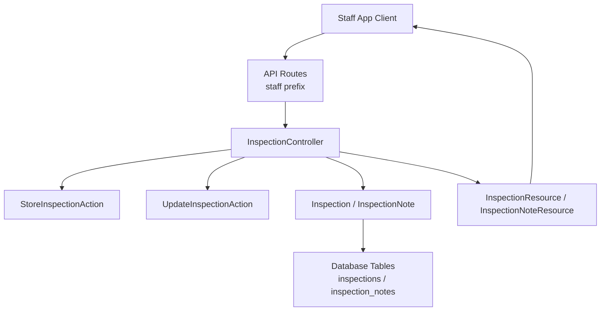
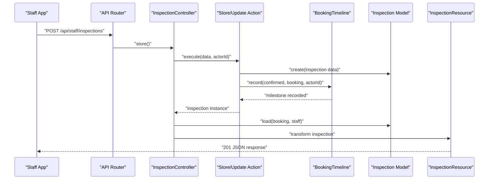
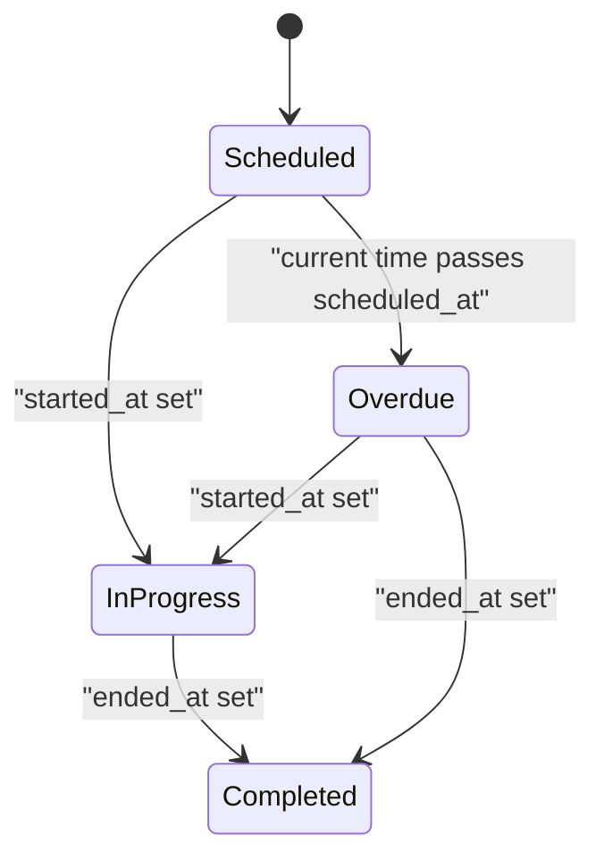
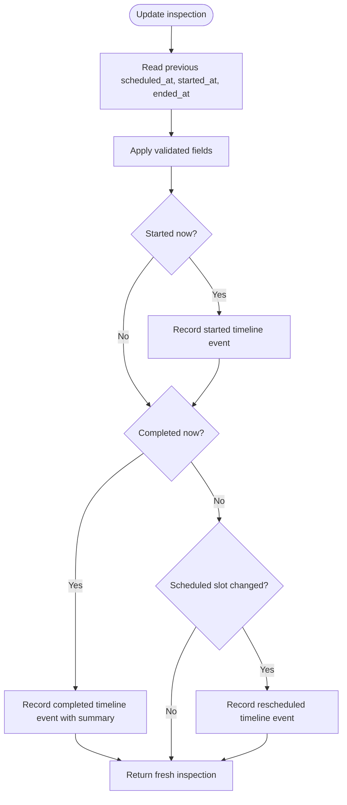
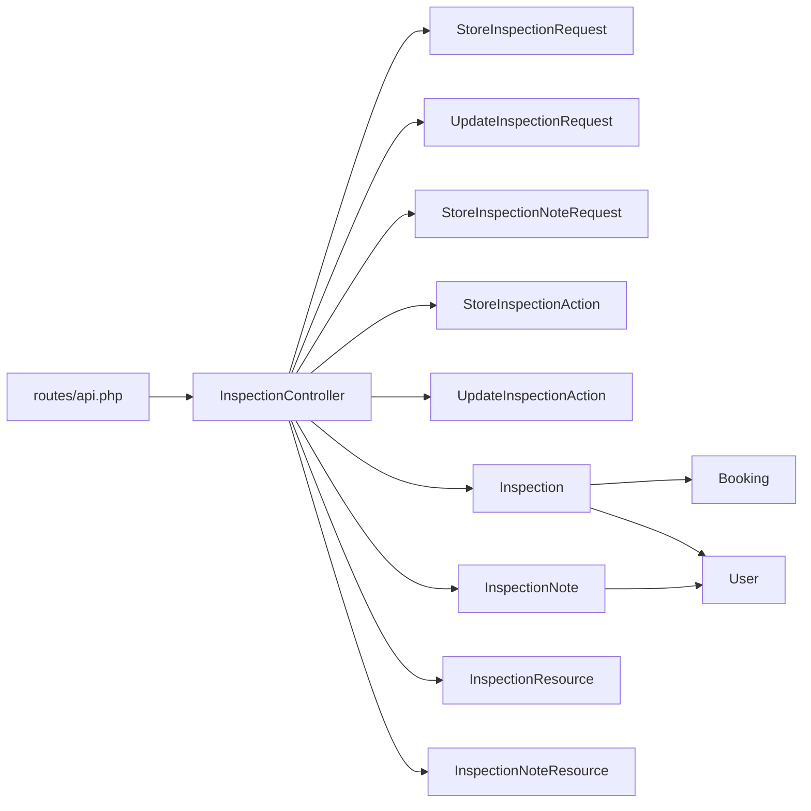

# Inspection Tracking

<cite>
**Referenced Files in This Document**
- [routes/api.php](file://routes/api.php)
- [InspectionController.php](file://app/Http/Controllers/Api/InspectionController.php)
- [StoreInspectionAction.php](file://app/Actions/StoreInspectionAction.php)
- [UpdateInspectionAction.php](file://app/Actions/UpdateInspectionAction.php)
- [StoreInspectionRequest.php](file://app/Http/Requests/Admin/StoreInspectionRequest.php)
- [UpdateInspectionRequest.php](file://app/Http/Requests/Admin/UpdateInspectionRequest.php)
- [StoreInspectionNoteRequest.php](file://app/Http/Requests/Admin/StoreInspectionNoteRequest.php)
- [InspectionResource.php](file://app/Http/Resources/Api/InspectionResource.php)
- [InspectionNoteResource.php](file://app/Http/Resources/Api/InspectionNoteResource.php)
- [Inspection.php](file://app/Models/Inspection.php)
- [InspectionNote.php](file://app/Models/InspectionNote.php)
- [2026_04_17_093358_create_inspections_table.php](file://database/migrations/2026_04_17_093358_create_inspections_table.php)
- [2026_07_09_194144_make_ended_at_nullable_on_inspections_table.php](file://database/migrations/2026_07_09_194144_make_ended_at_nullable_on_inspections_table.php)
- [2026_10_01_150100_create_inspection_notes_table.php](file://database/migrations/2026_10_01_150100_create_inspection_notes_table.php)
- [2026_10_01_150200_add_started_at_to_inspections_table.php](file://database/migrations/2026_10_01_150200_add_started_at_to_inspections_table.php)
</cite>

## Table of Contents
1. [Introduction](#introduction)
2. [Project Structure](#project-structure)
3. [Core Components](#core-components)
4. [Architecture Overview](#architecture-overview)
5. [Detailed Component Analysis](#detailed-component-analysis)
6. [Dependency Analysis](#dependency-analysis)
7. [Performance Considerations](#performance-considerations)
8. [Troubleshooting Guide](#troubleshooting-guide)
9. [Conclusion](#conclusion)

## Introduction
This document describes the inspection tracking API for the staff application. Inspections represent on-site or workshop appointments linked to bookings, and they support internal notes for collaborative work coordination. The API is token-authenticated through Sanctum, uses Spatie permission middleware for authorization, and returns JSON responses shaped by dedicated API resources.

Key responsibilities:
- List, create, view, update, and delete inspections.
- Manage internal inspection notes, including action items.
- Track inspection lifecycle timestamps: scheduled start, actual start, and completion.
- Record booking timeline milestones when inspections are confirmed, started, rescheduled, or completed.

## Project Structure
The inspection feature spans routes, controller logic, validation requests, Eloquent models, database migrations, and API resource transformers.



**Diagram sources**
- [routes/api.php:38-65](file://routes/api.php#L38-L65)
- [InspectionController.php:26-137](file://app/Http/Controllers/Api/InspectionController.php#L26-L137)
- [StoreInspectionAction.php:12-41](file://app/Actions/StoreInspectionAction.php#L12-L41)
- [UpdateInspectionAction.php:12-76](file://app/Actions/UpdateInspectionAction.php#L12-L76)
- [Inspection.php:12-81](file://app/Models/Inspection.php#L12-L81)
- [InspectionNote.php:12-60](file://app/Models/InspectionNote.php#L12-L60)
- [InspectionResource.php:14-42](file://app/Http/Resources/Api/InspectionResource.php#L14-L42)
- [InspectionNoteResource.php:14-37](file://app/Http/Resources/Api/InspectionNoteResource.php#L14-L37)

**Section sources**
- [routes/api.php:38-65](file://routes/api.php#L38-L65)
- [InspectionController.php:26-137](file://app/Http/Controllers/Api/InspectionController.php#L26-L137)

## Core Components
- **API routes**: All inspection endpoints live under `/api/staff` and require a valid Sanctum token. Authorization is enforced with Spatie `can:` middleware.
- **Controller**: `InspectionController` handles listing, creation, retrieval, updates, deletion, note management, and note completion toggling.
- **Actions**: Business logic for creating and updating inspections delegates to `StoreInspectionAction` and `UpdateInspectionAction`, which also record booking timeline events.
- **Validation requests**: Input validation is centralized in `StoreInspectionRequest`, `UpdateInspectionRequest`, and `StoreInspectionNoteRequest`.
- **Models**: `Inspection` links a booking to staff, tracks scheduling and lifecycle timestamps, computes status, and owns many notes. `InspectionNote` belongs to an inspection and optionally represents an open action item.
- **Resources**: `InspectionResource` and `InspectionNoteResource` shape the JSON payloads returned to clients.
- **Migrations**: Define the inspection and note tables, nullable end times, explicit start timestamps, and indexes used by availability and listing queries.

**Section sources**
- [routes/api.php:38-65](file://routes/api.php#L38-L65)
- [InspectionController.php:26-137](file://app/Http/Controllers/Api/InspectionController.php#L26-L137)
- [StoreInspectionAction.php:12-41](file://app/Actions/StoreInspectionAction.php#L12-L41)
- [UpdateInspectionAction.php:12-76](file://app/Actions/UpdateInspectionAction.php#L12-L76)
- [StoreInspectionRequest.php:12-38](file://app/Http/Requests/Admin/StoreInspectionRequest.php#L12-L38)
- [UpdateInspectionRequest.php:12-40](file://app/Http/Requests/Admin/UpdateInspectionRequest.php#L12-L40)
- [StoreInspectionNoteRequest.php:12-45](file://app/Http/Requests/Admin/StoreInspectionNoteRequest.php#L12-L45)
- [Inspection.php:12-81](file://app/Models/Inspection.php#L12-L81)
- [InspectionNote.php:12-60](file://app/Models/InspectionNote.php#L12-L60)
- [InspectionResource.php:14-42](file://app/Http/Resources/Api/InspectionResource.php#L14-L42)
- [InspectionNoteResource.php:14-37](file://app/Http/Resources/Api/InspectionNoteResource.php#L14-L37)

## Architecture Overview
The inspection API follows a layered Laravel pattern:



**Diagram sources**
- [routes/api.php:48-52](file://routes/api.php#L48-L52)
- [InspectionController.php:47-62](file://app/Http/Controllers/Api/InspectionController.php#L47-L62)
- [StoreInspectionAction.php:12-41](file://app/Actions/StoreInspectionAction.php#L12-L41)
- [InspectionResource.php:14-42](file://app/Http/Resources/Api/InspectionResource.php#L14-L42)

## Detailed Component Analysis

### Authentication and Authorization
- All `/api/staff/*` routes are inside a Sanctum-authenticated group.
- Inspection endpoints use Spatie ability gates:
  - `can:view inspections` for listing and viewing details.
  - `can:update inspections` for creating, updating, deleting, and managing notes.

**Section sources**
- [routes/api.php:38-65](file://routes/api.php#L38-L65)

### Endpoints Reference

#### List Inspections
- **Path**: `/api/staff/inspections`
- **Method**: `GET`
- **Authorization**: Sanctum token + `view inspections` ability.
- **Query parameters**:
  - `per_page`: integer; defaults to 15; clamped between 1 and 100.
- **Response**: Paginated collection of inspection objects.
- **Ordering**: Newest scheduled appointment first.
- **Eager loading**: Each inspection includes its related booking and assigned staff.
- **Notes**: Notes are not included in the list response unless explicitly loaded elsewhere.

**Section sources**
- [routes/api.php:50-50](file://routes/api.php#L50-L50)
- [InspectionController.php:29-42](file://app/Http/Controllers/Api/InspectionController.php#L29-L42)
- [InspectionResource.php:14-42](file://app/Http/Resources/Api/InspectionResource.php#L14-L42)

#### Create Inspection
- **Path**: `/api/staff/inspections`
- **Method**: `POST`
- **Authorization**: Sanctum token + `update inspections` ability.
- **Request body fields**:
  - `booking_id`: required integer; must exist in the bookings table.
  - `staff_id`: required integer; must exist in the users table.
  - `scheduled_at`: required datetime; must be after the current time.
  - `ended_at`: optional datetime; must be after `scheduled_at`.
  - `location`: required string; maximum 255 characters.
  - `type`: required enum; must be `mobile` or `workshop`.
- **Response**:
  - Status code: `201 Created`.
  - Body contains a `data` object with the created inspection and a `message` field.
- **Side effects**:
  - Creates the inspection record.
  - Confirms the related booking through the booking timeline.

**Section sources**
- [routes/api.php:51-51](file://routes/api.php#L51-L51)
- [InspectionController.php:47-62](file://app/Http/Controllers/Api/InspectionController.php#L47-L62)
- [StoreInspectionRequest.php:25-37](file://app/Http/Requests/Admin/StoreInspectionRequest.php#L25-L37)
- [StoreInspectionAction.php:12-41](file://app/Actions/StoreInspectionAction.php#L12-L41)

#### View Inspection Details
- **Path**: `/api/staff/inspections/{inspection}`
- **Method**: `GET`
- **Authorization**: Sanctum token + `view inspections` ability.
- **Path parameter**:
  - `inspection`: numeric inspection identifier.
- **Response**: Single inspection object including:
  - Booking details.
  - Assigned staff.
  - Internal notes with authors.
  - Computed status.
- **Notes**: This endpoint eagerly loads notes so the client can see collaboration history.

**Section sources**
- [routes/api.php:52-52](file://routes/api.php#L52-L52)
- [InspectionController.php:44-46](file://app/Http/Controllers/Api/InspectionController.php#L44-L46)
- [InspectionResource.php:14-42](file://app/Http/Resources/Api/InspectionResource.php#L14-L42)

#### Update Inspection
- **Path**: `/api/staff/inspections/{inspection}`
- **Method**: `PUT`
- **Authorization**: Sanctum token + `update inspections` ability.
- **Path parameter**:
  - `inspection`: numeric inspection identifier.
- **Request body fields**:
  - `staff_id`: optional integer; must exist in the users table if provided.
  - `scheduled_at`: optional datetime.
  - `started_at`: optional datetime.
  - `ended_at`: optional datetime; must be after `scheduled_at`.
  - `location`: optional string; maximum 255 characters.
  - `type`: optional enum; must be `mobile` or `workshop`.
  - `client_summary`: optional string; maximum 500 characters; used for the completion timeline event but not stored on the inspection model.
- **Response**: Updated inspection object.
- **Side effects**:
  - Records a timeline milestone when an inspection transitions from not started to started.
  - Records a timeline milestone when an inspection transitions from not completed to completed.
  - Records a reschedule milestone when the scheduled slot changes without completing the inspection.

**Section sources**
- [routes/api.php:53-53](file://routes/api.php#L53-L53)
- [InspectionController.php:64-75](file://app/Http/Controllers/Api/InspectionController.php#L64-L75)
- [UpdateInspectionRequest.php:25-39](file://app/Http/Requests/Admin/UpdateInspectionRequest.php#L25-L39)
- [UpdateInspectionAction.php:12-76](file://app/Actions/UpdateInspectionAction.php#L12-L76)

#### Delete Inspection
- **Path**: `/api/staff/inspections/{inspection}`
- **Method**: `DELETE`
- **Authorization**: Sanctum token + `update inspections` ability.
- **Path parameter**:
  - `inspection`: numeric inspection identifier.
- **Response**: JSON message confirming deletion.
- **Side effects**: Deletes the inspection record.

**Section sources**
- [routes/api.php:54-54](file://routes/api.php#L54-L54)
- [InspectionController.php:77-84](file://app/Http/Controllers/Api/InspectionController.php#L77-L84)

#### Add Inspection Note
- **Path**: `/api/staff/inspections/{inspection}/notes`
- **Method**: `POST`
- **Authorization**: Sanctum token + `update inspections` ability.
- **Path parameter**:
  - `inspection`: numeric inspection identifier.
- **Request body fields**:
  - `body`: required string; maximum 2000 characters.
  - `is_action`: optional boolean; marks the note as an action item.
- **Response**:
  - Status code: `201 Created`.
  - Body contains a `data` object with the new note and a `message` field.
- **Behavior**: The requesting user is automatically set as the note author.

**Section sources**
- [routes/api.php:55-55](file://routes/api.php#L55-L55)
- [InspectionController.php:86-99](file://app/Http/Controllers/Api/InspectionController.php#L86-L99)
- [StoreInspectionNoteRequest.php:25-44](file://app/Http/Requests/Admin/StoreInspectionNoteRequest.php#L25-L44)
- [InspectionNoteResource.php:14-37](file://app/Http/Resources/Api/InspectionNoteResource.php#L14-L37)

#### Toggle Note Completion
- **Path**: `/api/staff/inspections/{inspection}/notes/{note}/done`
- **Method**: `PATCH`
- **Authorization**: Sanctum token + `update inspections` ability.
- **Path parameters**:
  - `inspection`: numeric inspection identifier.
  - `note`: numeric note identifier.
- **Behavior**: Toggles the note’s completion state. If the note has no completion timestamp, it sets one; otherwise, it clears it.
- **Response**: Updated note object.
- **Security**: The controller verifies that the note actually belongs to the requested inspection.

**Section sources**
- [routes/api.php:56-56](file://routes/api.php#L56-L56)
- [InspectionController.php:101-110](file://app/Http/Controllers/Api/InspectionController.php#L101-L110)

#### Delete Inspection Note
- **Path**: `/api/staff/inspections/{inspection}/notes/{note}`
- **Method**: `DELETE`
- **Authorization**: Sanctum token + `update inspections` ability.
- **Path parameters**:
  - `inspection`: numeric inspection identifier.
  - `note`: numeric note identifier.
- **Behavior**: Deletes the note only if it belongs to the specified inspection.
- **Response**: JSON message confirming removal.

**Section sources**
- [routes/api.php:57-57](file://routes/api.php#L57-L57)
- [InspectionController.php:112-122](file://app/Http/Controllers/Api/InspectionController.php#L112-L122)

### Request and Response Schemas

#### Inspection Object
| Field | Type | Required | Description |
|---|---|---:|---|
| `id` | integer | Yes | Inspection identifier. |
| `booking_id` | integer | Yes | Related booking identifier. |
| `status` | string | Yes | Computed status: `scheduled`, `overdue`, `in_progress`, or `completed`. |
| `type` | string | Yes | Appointment type: `mobile` or `workshop`. |
| `location` | string | Yes | Inspection location. |
| `scheduled_at` | ISO-8601 datetime | Yes | Planned appointment time. |
| `started_at` | ISO-8601 datetime or null | No | Actual start time. |
| `ended_at` | ISO-8601 datetime or null | No | Completion time. |
| `created_at` | ISO-8601 datetime or null | Yes | Creation timestamp. |
| `staff` | object or omitted | Optional | Assigned staff member with `id` and `name`; present only when eager-loaded. |
| `booking` | object | Optional | Related booking resource; present when eager-loaded. |
| `notes` | array or omitted | Optional | Collection of internal notes; present when eager-loaded. |

**Section sources**
- [InspectionResource.php:14-42](file://app/Http/Resources/Api/InspectionResource.php#L14-L42)
- [Inspection.php:12-81](file://app/Models/Inspection.php#L12-L81)

#### Inspection Note Object
| Field | Type | Required | Description |
|---|---|---:|---|
| `id` | integer | Yes | Note identifier. |
| `body` | string | Yes | Note content. |
| `is_action` | boolean | Yes | Whether the note is an action item. |
| `is_open` | boolean | Yes | Derived flag: true when the note is an action item and not yet completed. |
| `done_at` | ISO-8601 datetime or null | Yes | Completion timestamp for action items. |
| `created_at` | ISO-8601 datetime or null | Yes | Creation timestamp. |
| `author` | object or omitted | Optional | Staff member who wrote the note; present when eager-loaded. |

**Section sources**
- [InspectionNoteResource.php:14-37](file://app/Http/Resources/Api/InspectionNoteResource.php#L14-L37)
- [InspectionNote.php:12-60](file://app/Models/InspectionNote.php#L12-L60)

### Data Model Relationships

```mermaid
erDiagram
  INSPECTIONS {
    bigint id PK
    bigint booking_id FK
    bigint staff_id FK
    datetime scheduled_at
    datetime started_at
    datetime ended_at
    string location
    enum type
    timestamp created_at
    timestamp updated_at
  }

  INSPECTION_NOTES {
    bigint id PK
    bigint inspection_id FK
    bigint user_id FK
    text body
    boolean is_action
    timestamp done_at
    timestamp created_at
    timestamp updated_at
  }

  BOOKINGS ||--o{ INSPECTIONS : "one booking can have one inspection"
  USERS ||--o{ INSPECTIONS : "assigned staff"
  USERS ||o--o{ INSPECTION_NOTES : "note author"
  INSPECTIONS ||--o{ INSPECTION_NOTES : "has many notes"
```

**Diagram sources**
- [2026_04_17_093358_create_inspections_table.php:11-33](file://database/migrations/2026_04_17_093358_create_inspections_table.php#L11-L33)
- [2026_07_09_194144_make_ended_at_nullable_on_inspections_table.php:15-26](file://database/migrations/2026_07_09_194144_make_ended_at_nullable_on_inspections_table.php#L15-L26)
- [2026_10_01_150100_create_inspection_notes_table.php:18-41](file://database/migrations/2026_10_01_150100_create_inspection_notes_table.php#L18-L41)
- [2026_10_01_150200_add_started_at_to_inspections_table.php:20-35](file://database/migrations/2026_10_01_150200_add_started_at_to_inspections_table.php#L20-L35)

**Section sources**
- [Inspection.php:33-81](file://app/Models/Inspection.php#L33-L81)
- [InspectionNote.php:24-60](file://app/Models/InspectionNote.php#L24-L60)
- [2026_04_17_093358_create_inspections_table.php:11-33](file://database/migrations/2026_04_17_093358_create_inspections_table.php#L11-L33)
- [2026_10_01_150100_create_inspection_notes_table.php:18-41](file://database/migrations/2026_10_01_150100_create_inspection_notes_table.php#L18-L41)

### Validation Rules Summary

| Endpoint | Field | Rule |
|---|---|---|
| Create inspection | `booking_id` | Required; must exist in bookings. |
| Create inspection | `staff_id` | Required; must exist in users. |
| Create inspection | `scheduled_at` | Required; valid date; after current time. |
| Create inspection | `ended_at` | Optional; valid date; after `scheduled_at`. |
| Create inspection | `location` | Required; string; max 255. |
| Create inspection | `type` | Required; must be `mobile` or `workshop`. |
| Update inspection | `staff_id` | Optional; must exist in users. |
| Update inspection | `scheduled_at` | Optional; valid date. |
| Update inspection | `started_at` | Optional; valid date. |
| Update inspection | `ended_at` | Optional; valid date; after `scheduled_at`. |
| Update inspection | `location` | Optional; string; max 255. |
| Update inspection | `type` | Optional; must be `mobile` or `workshop`. |
| Update inspection | `client_summary` | Optional; string; max 500; not persisted on the inspection. |
| Create note | `body` | Required; string; max 2000. |
| Create note | `is_action` | Optional; boolean. |

**Section sources**
- [StoreInspectionRequest.php:25-37](file://app/Http/Requests/Admin/StoreInspectionRequest.php#L25-L37)
- [UpdateInspectionRequest.php:25-39](file://app/Http/Requests/Admin/UpdateInspectionRequest.php#L25-L39)
- [StoreInspectionNoteRequest.php:25-44](file://app/Http/Requests/Admin/StoreInspectionNoteRequest.php#L25-L44)

### Inspection Lifecycle and Timestamps



Status computation rules:
- `completed` when `ended_at` is set.
- `in_progress` when `started_at` is set.
- `overdue` when `scheduled_at` is in the past and neither start nor end is set.
- `scheduled` otherwise.

**Diagram sources**
- [Inspection.php:67-81](file://app/Models/Inspection.php#L67-L81)

**Section sources**
- [Inspection.php:12-81](file://app/Models/Inspection.php#L12-L81)
- [2026_10_01_150200_add_started_at_to_inspections_table.php:12-35](file://database/migrations/2026_10_01_150200_add_started_at_to_inspections_table.php#L12-L35)
- [2026_07_09_194144_make_ended_at_nullable_on_inspections_table.php:12-26](file://database/migrations/2026_07_09_194144_make_ended_at_nullable_on_inspections_table.php#L12-L26)

### Note Hierarchy and Collaboration
- Notes belong to exactly one inspection.
- Notes may be authored by a staff user.
- Action notes are marked with `is_action` and remain open until `done_at` is set.
- The API provides an `is_open` derived field indicating whether an action note still needs attention.
- Notes are ordered newest first at the model level.

**Section sources**
- [InspectionNote.php:12-60](file://app/Models/InspectionNote.php#L12-L60)
- [InspectionNoteResource.php:14-37](file://app/Http/Resources/Api/InspectionNoteResource.php#L14-L37)
- [Inspection.php:54-65](file://app/Models/Inspection.php#L54-L65)

### Integration With Booking Records
Creating or updating an inspection interacts with the booking timeline:
- Creating an inspection confirms the related booking.
- Starting an inspection records a started milestone.
- Completing an inspection records a completed milestone and accepts a `client_summary`.
- Rescheduling an inspection records a rescheduled milestone with the previous slot.



**Diagram sources**
- [UpdateInspectionAction.php:12-76](file://app/Actions/UpdateInspectionAction.php#L12-L76)

**Section sources**
- [StoreInspectionAction.php:12-41](file://app/Actions/StoreInspectionAction.php#L12-L41)
- [UpdateInspectionAction.php:12-76](file://app/Actions/UpdateInspectionAction.php#L12-L76)

### Practical Workflows

#### Schedule a New Inspection
1. Authenticate with the staff API using Sanctum.
2. Call `POST /api/staff/inspections` with a valid booking, staff member, future scheduled time, location, and type.
3. The system creates the inspection and confirms the booking timeline.
4. The client receives the created inspection with booking and staff information.

#### Collect Field Data During an Inspection
- Use the inspection’s `location`, `type`, and `scheduled_at` as baseline context.
- Set `started_at` when the inspector begins work.
- Optionally add internal notes documenting observations.
- Mark relevant notes as action items with `is_action`.

#### Track Progress Collaboratively
- Add notes during the inspection.
- Mark action notes as done when resolved; unmark them if work remains.
- Monitor `is_open` to identify outstanding tasks.
- Update `ended_at` to complete the inspection.

#### Complete an Inspection
1. Send `PUT /api/staff/inspections/{inspection}` with `ended_at` set.
2. Optionally include `client_summary` for the completion timeline event.
3. The system records a completed milestone and returns the updated inspection.

**Section sources**
- [InspectionController.php:47-75](file://app/Http/Controllers/Api/InspectionController.php#L47-L75)
- [StoreInspectionAction.php:12-41](file://app/Actions/StoreInspectionAction.php#L12-L41)
- [UpdateInspectionAction.php:12-76](file://app/Actions/UpdateInspectionAction.php#L12-L76)
- [InspectionNote.php:24-60](file://app/Models/InspectionNote.php#L24-L60)

## Dependency Analysis



**Diagram sources**
- [routes/api.php:38-65](file://routes/api.php#L38-L65)
- [InspectionController.php:12-144](file://app/Http/Controllers/Api/InspectionController.php#L12-L144)
- [StoreInspectionRequest.php:12-38](file://app/Http/Requests/Admin/StoreInspectionRequest.php#L12-L38)
- [UpdateInspectionRequest.php:12-40](file://app/Http/Requests/Admin/UpdateInspectionRequest.php#L12-L40)
- [StoreInspectionNoteRequest.php:12-45](file://app/Http/Requests/Admin/StoreInspectionNoteRequest.php#L12-L45)
- [Inspection.php:12-81](file://app/Models/Inspection.php#L12-L81)
- [InspectionNote.php:12-60](file://app/Models/InspectionNote.php#L12-L60)

**Section sources**
- [routes/api.php:38-65](file://routes/api.php#L38-L65)
- [InspectionController.php:12-144](file://app/Http/Controllers/Api/InspectionController.php#L12-L144)

## Performance Considerations
- Listing inspections paginates results with a safe page size between 1 and 100.
- The list query sorts by scheduled appointment time and eager-loads booking and staff relationships to reduce N+1 queries.
- The detail endpoint eagerly loads notes and their authors for full inspection context.
- Database indexes support availability checks and common filtering on scheduled time, completion time, and staff assignment.
- Notes are indexed by inspection and creation time to optimize recent-note queries.

**Section sources**
- [InspectionController.php:29-42](file://app/Http/Controllers/Api/InspectionController.php#L29-L42)
- [2026_04_17_093358_create_inspections_table.php:24-33](file://database/migrations/2026_04_17_093358_create_inspections_table.php#L24-L33)
- [2026_10_01_150100_create_inspection_notes_table.php:32-41](file://database/migrations/2026_10_01_150100_create_inspection_notes_table.php#L32-L41)

## Troubleshooting Guide

### Common Errors and Causes
- **Unauthorized access**: Missing or invalid Sanctum token.
- **Forbidden access**: User lacks `view inspections` or `update inspections` abilities.
- **Invalid request body**: Validation failures such as missing booking or staff identifiers, invalid dates, unsupported types, or excessively long text.
- **Note ownership mismatch**: Attempting to toggle or delete a note that does not belong to the specified inspection returns a not found error because the controller enforces ownership.
- **Completion conflicts**: Updating `ended_at` without a valid `scheduled_at` fails validation because `ended_at` must be after `scheduled_at`.
- **Scheduling conflict**: Creating an inspection with a `scheduled_at` earlier than the current time fails validation.

### Debugging Tips
- Verify authentication headers before calling inspection endpoints.
- Confirm the user role has the required Spatie abilities.
- Validate request payloads against the documented schemas.
- When troubleshooting note operations, ensure the note ID belongs to the inspection path segment.
- When inspecting lifecycle state, check both `started_at` and `ended_at` alongside `scheduled_at`.

**Section sources**
- [routes/api.php:38-65](file://routes/api.php#L38-L65)
- [StoreInspectionRequest.php:25-37](file://app/Http/Requests/Admin/StoreInspectionRequest.php#L25-L37)
- [UpdateInspectionRequest.php:25-39](file://app/Http/Requests/Admin/UpdateInspectionRequest.php#L25-L39)
- [StoreInspectionNoteRequest.php:25-44](file://app/Http/Requests/Admin/StoreInspectionNoteRequest.php#L25-L44)
- [InspectionController.php:124-137](file://app/Http/Controllers/Api/InspectionController.php#L124-L137)

## Conclusion
The inspection tracking API provides a structured way to manage on-site appointments, track progress through explicit timestamps, and coordinate internal work through actionable notes. Authorization is enforced per ability, input is validated centrally, and business side effects like booking confirmation and timeline milestones are handled by dedicated actions. Clients should treat inspections as the primary workflow object, use notes for internal collaboration, and rely on computed status and timestamp fields to understand inspection progress.