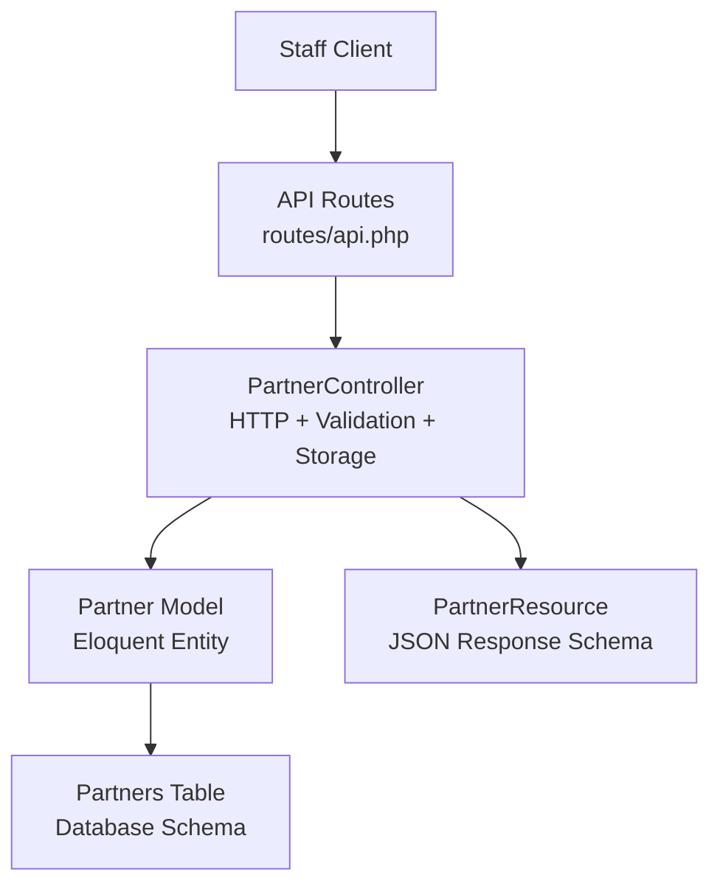
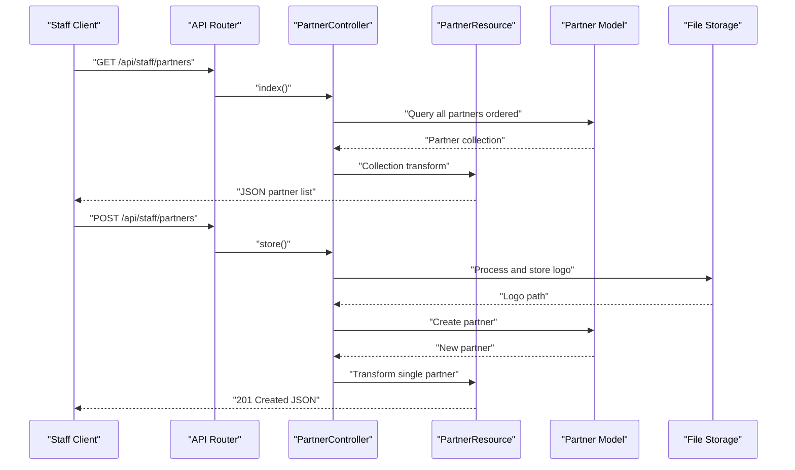
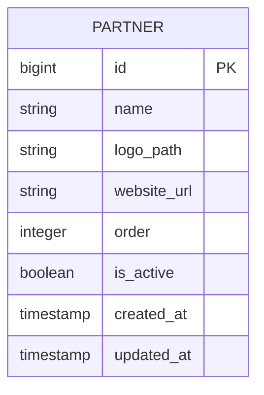
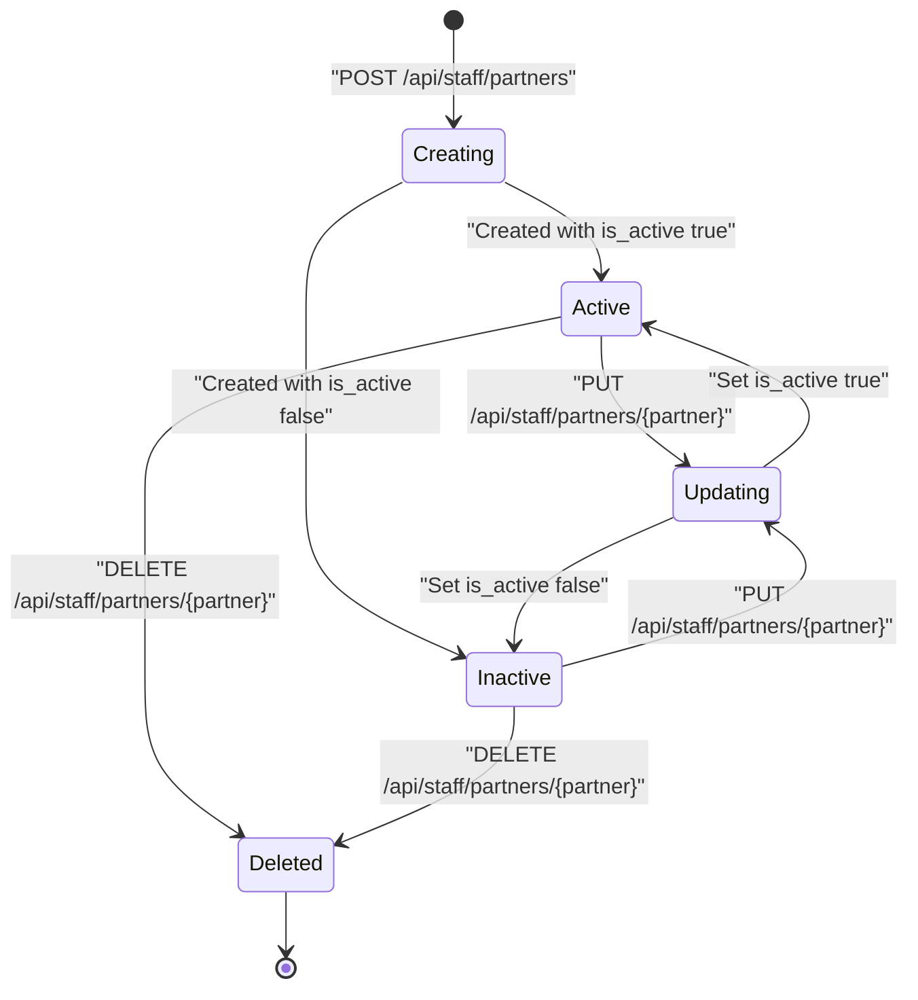
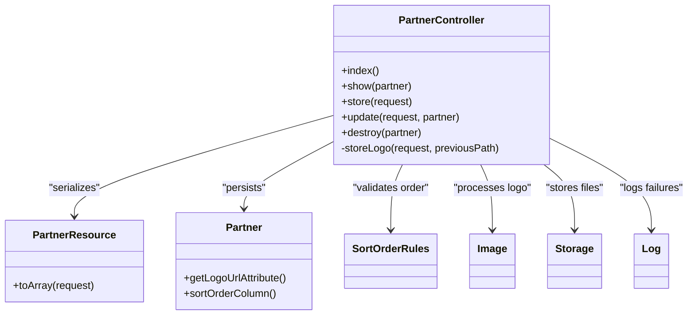

# Partner Management

<cite>
**Referenced Files in This Document**
- [api.php](file://routes/api.php)
- [PartnerController.php](file://app/Http/Controllers/Api/PartnerController.php)
- [PartnerResource.php](file://app/Http/Resources/Api/PartnerResource.php)
- [Partner.php](file://app/Models/Partner.php)
- [create_partners_table.php](file://database/migrations/2026_05_25_093322_create_partners_table.php)
- [add_manage_settings_permission.php](file://database/migrations/2026_10_23_215000_add_manage_settings_permission.php)
</cite>

## Table of Contents
1. [Introduction](#introduction)
2. [Project Structure](#project-structure)
3. [Core Components](#core-components)
4. [Architecture Overview](#architecture-overview)
5. [Detailed Component Analysis](#detailed-component-analysis)
6. [Dependency Analysis](#dependency-analysis)
7. [Performance Considerations](  #performance-considerations)
8. [Troubleshooting Guide](#troubleshooting-guide)
9. [Conclusion](#conclusion)
10. [Appendices](#appendices)

## Introduction
This document describes the partner management API for the staff application. It covers listing, creating, retrieving, updating, and deleting business partners. The endpoints are token-authenticated through Sanctum, require the `manage settings` ability, and mirror the web admin panel behavior.

The partner resource represents a business affiliate or partner organization. Each partner has:
- A display name
- An uploaded logo stored as an optimized image
- An optional website URL
- A sort order used to control list presentation
- An active flag controlling whether the partner is visible

## Project Structure
The partner API lives under the `/api/staff` prefix. All routes are grouped under Sanctum authentication and protected by Spatie-style abilities. The partner endpoints use:
- Route definitions in the API routes file
- An API controller handling HTTP logic
- A JSON resource defining the response schema
- An Eloquent model representing the database entity
- A migration defining the storage schema
- A permission migration defining access requirements

**Diagram sources**
- [api.php:80-117](file://routes/api.php#L80-L117)
- [PartnerController.php:1-133](file://app/Http/Controllers/Api/PartnerController.php#L1-L133)
- [PartnerResource.php:1-36](file://app/Http/Resources/Api/PartnerResource.php#L1-L36)
- [Partner.php:1-46](file://app/Models/Partner.php#L1-L46)
- [create_partners_table.php:1-32](file://database/migrations/2026_05_25_093322_create_partners_table.php#L1-L32)

**Section sources**
- [api.php:1-117](file://routes/api.php#L1-L117)

## Core Components
- **Route group**: `/api/staff` with Sanctum authentication and `can:manage settings` authorization.
- **Controller**: `App\Http\Controllers\Api\PartnerController` implements CRUD operations, validation, logo processing, and storage cleanup.
- **Resource**: `App\Http\Resources\Api\PartnerResource` serializes partner data into a stable JSON structure.
- **Model**: `App\Models\Partner` defines fillable fields, casting, ordering behavior, and logo URL generation.
- **Schema**: The `partners` table stores core partner metadata and timestamps.

**Section sources**
- [api.php:100-117](file://routes/api.php#L100-L117)
- [PartnerController.php:1-133](file://app/Http/Controllers/Api/PartnerController.php#L1-L133)
- [PartnerResource.php:1-36](file://app/Http/Resources/Api/PartnerResource.php#L1-L36)
- [Partner.php:1-46](file://app/Models/Partner.php#L1-L46)
- [create_partners_table.php:1-32](file://database/migrations/2026_05_25_093322_create_partners_table.php#L1-L32)

## Architecture Overview
The partner management flow follows a standard Laravel API pattern:

**Diagram sources**
- [api.php:100-117](file://routes/api.php#L100-L117)
- [PartnerController.php:15-85](file://app/Http/Controllers/Api/PartnerController.php#L15-L85)
- [PartnerResource.php:17-35](file://app/Http/Resources/Api/PartnerResource.php#L17-L35)
- [Partner.php:1-46](file://app/Models/Partner.php#L1-L46)

## Detailed Component Analysis

### Authentication and Authorization
All partner endpoints are:
- Token-authenticated via Sanctum
- Authorized using the `manage settings` ability
- Located under the `/api/staff` route group

Clients must include a valid Sanctum token when calling any partner endpoint. Roles without the `manage settings` permission will be denied access.

**Section sources**
- [api.php:1-25](file://routes/api.php#L1-L25)
- [api.php:100-117](file://routes/api.php#L100-L117)
- [add_manage_settings_permission.php:10-35](file://database/migrations/2026_10_23_215000_add_manage_settings_permission.php#L10-L35)

### Endpoints

#### List Partners
- **Method**: GET
- **URL**: `/api/staff/partners`
- **Authorization**: `manage settings`
- **Response**: Array of partner objects sorted by position, then ID
- **Success code**: 200

Response fields:
| Field | Type | Description |
|---|---|---|
| `id` | integer | Internal partner identifier |
| `name` | string | Display name |
| `logo_url` | string | Publicly accessible logo URL |
| `website_url` | string or null | Partner website link |
| `order` | integer | Sort position |
| `is_active` | boolean | Visibility flag |
| `created_at` | ISO-8601 timestamp | Creation time |
| `updated_at` | ISO-8601 timestamp | Last update time |

The list query orders results by `order`, then by `id`.

**Section sources**
- [api.php:113-113](file://routes/api.php#L113-L113)
- [PartnerController.php:19-25](file://app/Http/Controllers/Api/PartnerController.php#L19-L25)
- [PartnerResource.php:17-35](file://app/Http/Resources/Api/PartnerResource.php#L17-L35)

#### Create Partner
- **Method**: POST
- **URL**: `/api/staff/partners`
- **Authorization**: `manage settings`
- **Content type**: multipart/form-data
- **Success code**: 201

Request fields:
| Field | Required | Type | Validation |
|---|---:|---|---|
| `name` | Yes | string | Required, max 255 characters |
| `logo` | Yes | File | Required image, max 2 MB |
| `website_url` | No | string | Optional URL |
| `is_active` | No | boolean | Defaults to true if omitted |
| `order` | No | integer | Validated against existing partners |

Logo processing:
- Uploaded images are resized to fit within 800x800 pixels
- Images are converted to WebP at quality 82
- If image processing fails, the original file is stored as a fallback
- Previous logos are replaced during updates

**Section sources**
- [api.php:114-114](file://routes/api.php#L114-L114)
- [PartnerController.php:28-54](file://app/Http/Controllers/Api/PartnerController.php#L28-L54)
- [PartnerController.php:99-132](file://app/Http/Controllers/Api/PartnerController.php#L99-L132)

#### Get Partner Details
- **Method**: GET
- **URL**: `/api/staff/partners/{partner}`
- **Authorization**: `manage settings`
- **Path parameter**: Numeric partner ID
- **Success code**: 200
- **Not found code**: 404

Returns a single partner object using the same schema as the list endpoint.

**Section sources**
- [api.php:115-115](file://routes/api.php#L115-L115)
- [PartnerController.php:27-31](file://app/Http/Controllers/Api/PartnerController.php#L27-L31)
- [PartnerResource.php:17-35](file://app/Http/Resources/Api/PartnerResource.php#L17-L35)

#### Update Partner
- **Method**: PUT
- **URL**: `/api/staff/partners/{partner}`
- **Authorization**: `manage settings`
- **Path parameter**: Numeric partner ID
- **Content type**: multipart/form-data
- **Success code**: 200

Request fields:
| Field | Required | Type | Validation |
|---|---:|---|---|
| `name` | Yes | string | Required, max 255 characters |
| `logo` | No | File | Optional image, max 2 MB |
| `website_url` | No | string | Optional URL |
| `is_active` | No | boolean | Defaults to current value if omitted |
| `order` | No | integer | Validated against existing partners |

Behavior:
- Logo upload is optional; omitting it preserves the existing logo
- When a new logo is uploaded, the previous logo file is deleted
- Sort order is normalized relative to the updated partner
- Partial updates are supported

**Section sources**
- [api.php:116-116](file://routes/api.php#L116-L116)
- [PartnerController.php:57-86](file://app/Http/Controllers/Api/PartnerController.php#L57-L86)

#### Delete Partner
- **Method**: DELETE
- **URL**: `/api/staff/partners/{partner}`
- **Authorization**: `manage settings`
- **Path parameter**: Numeric partner ID
- **Success code**: 200

Behavior:
- Deletes the associated logo file from public storage before removing the record
- Returns a confirmation message

**Section sources**
- [api.php:117-117](file://routes/api.php#L117-L117)
- [PartnerController.php:89-97](file://app/Http/Controllers/Api/PartnerController.php#L89-L97)

### Data Model
The partner entity maps directly to the `partners` database table.

| Column | Type | Constraints | Description |
|---|---|---|---|
| `id` | integer | Primary key | Unique identifier |
| `name` | string | Not null | Partner display name |
| `logo_path` | string | Not null | Stored logo file path |
| `website_url` | string | Nullable | External website link |
| `order` | integer | Default 0 | Position in partner lists |
| `is_active` | boolean | Default true | Active visibility flag |
| `created_at` | timestamp | Auto-managed | Record creation time |
| `updated_at` | timestamp | Auto-managed | Record update time |

The model casts `is_active` to boolean and `order` to integer. It also exposes `logo_url` as an attribute that resolves a full asset URL from the stored path.

**Diagram sources**
- [create_partners_table.php:12-25](file://database/migrations/2026_05_25_093322_create_partners_table.php#L12-L25)
- [Partner.php:14-46](file://app/Models/Partner.php#L14-L46)

**Section sources**
- [create_partners_table.php:1-32](file://database/migrations/2026_05_25_093322_create_partners_table.php#L1-L32)
- [Partner.php:1-46](file://app/Models/Partner.php#L1-L46)

### Request and Response Schemas

#### Partner Object
Every partner response uses this structure:

| Field | Type | Meaning |
|---|---|---|
| `id` | integer | Persistent identifier |
| `name` | string | Human-readable partner name |
| `logo_url` | string | Public URL to the processed logo |
| `website_url` | string or null | Partner website address |
| `order` | integer | Sorting position |
| `is_active` | boolean | Whether the partner is active |
| `created_at` | ISO-8601 string | Creation timestamp |
| `updated_at` | ISO-8601 string | Update timestamp |

**Section sources**
- [PartnerResource.php:17-35](file://app/Http/Resources/Api/PartnerResource.php#L17-L35)

#### Create Request Example
A client can create a partner by sending:
- `name`: partner display name
- `logo`: image file up to 2 MB
- `website_url`: optional external link
- `is_active`: optional boolean
- `order`: optional integer position

#### Update Request Example
An update may change only selected fields:
- Update `name` without changing the logo
- Replace `logo` while preserving other fields
- Toggle `is_active`
- Adjust `order`

**Section sources**
- [PartnerController.php:28-86](file://app/Http/Controllers/Api/PartnerController.php#L28-L86)

### Validation Rules

| Operation | Field | Rule |
|---|---|---|
| Create | `name` | Required string, maximum 255 characters |
| Create | `logo` | Required image, maximum 2 MB |
| Create | `website_url` | Optional valid URL |
| Create | `is_active` | Optional boolean |
| Create | `order` | Must pass sort-order uniqueness rules |
| Update | `name` | Required string, maximum 255 characters |
| Update | `logo` | Optional image, maximum 2 MB |
| Update | `website_url` | Optional valid URL |
| Update | `is_active` | Optional boolean |
| Update | `order` | Must pass sort-order uniqueness rules |

Sort order validation ensures positions remain consistent across partners.

**Section sources**
- [PartnerController.php:28-54](file://app/Http/Controllers/Api/PartnerController.php#L28-L54)
- [PartnerController.php:57-86](file://app/Http/Controllers/Api/PartnerController.php#L57-L86)

### Partner Lifecycle
The partner lifecycle consists of these stages:

Key behaviors:
- Creating requires a logo
- Updating allows replacing or preserving the logo
- Deleting removes both the database record and the stored logo file
- Ordering controls list presentation independently from activity status

**Diagram sources**
- [PartnerController.php:28-97](file://app/Http/Controllers/Api/PartnerController.php#L28-L97)

**Section sources**
- [PartnerController.php:28-97](file://app/Http/Controllers/Api/PartnerController.php#L28-L97)

### Contact Information Handling
The partner model does not include contact fields such as email, phone, or address. Only the following contact-related data is exposed:
- `website_url`: an external link to the partner’s website

Business operations requiring direct contact details should be implemented separately, for example through a dedicated contact person or integration system.

**Section sources**
- [Partner.php:14-46](file://app/Models/Partner.php#L14-L46)
- [create_partners_table.php:12-25](file://database/migrations/2026_05_25_093322_create_partners_table.php#L12-L25)

### Collaboration Workflows
Partners are best treated as reference entities rather than collaborative workspaces. Typical workflows include:
- Adding a partner after onboarding
- Publishing or hiding a partner by toggling `is_active`
- Reordering partners to reflect priority or prominence
- Maintaining accurate branding by updating logos periodically
- Removing inactive or terminated partners

There is no built-in workflow for contract documents, performance metrics, or approval chains. Those concerns belong in separate models or services.

[No sources needed since this section provides general operational guidance]

## Dependency Analysis

**Diagram sources**
- [PartnerController.php:1-133](file://app/Http/Controllers/Api/PartnerController.php#L1-L133)
- [PartnerResource.php:1-36](file://app/Http/Resources/Api/PartnerResource.php#L1-L36)
- [Partner.php:1-46](file://app/Models/Partner.php#L1-L46)

Coupling characteristics:
- The controller coordinates validation, storage, persistence, and serialization
- The model is lightweight and focused on data and simple attributes
- The resource isolates response formatting
- Storage and image processing are encapsulated inside the controller

Potential risks:
- Logo processing errors are logged but do not fail the request when fallback storage succeeds
- File deletion occurs before model deletion, so failed deletions leave orphaned files
- Sort order normalization depends on shared rules outside the controller

**Section sources**
- [PartnerController.php:1-133](file://app/Http/Controllers/Api/PartnerController.php#L1-L133)
- [PartnerResource.php:1-36](file://app/Http/Resources/Api/PartnerResource.php#L1-L36)
- [Partner.php:1-46](file://app/Models/Partner.php#L1-L46)

## Performance Considerations
- Partner listing returns all records without pagination. Large partner catalogs may benefit from server-side pagination.
- Logo conversion runs synchronously on every create or logo-update request. Heavy images increase response time.
- WebP conversion with resizing adds CPU overhead. Fallback storage avoids hard failures but produces larger files.
- Logo replacement deletes the previous file immediately, reducing storage growth but increasing write operations.
- Query ordering by `order` then `id` is inexpensive for typical partner counts but should be reviewed if the table grows significantly.

Recommendations:
- Add pagination when partner counts become large
- Consider background jobs for expensive image processing
- Cache partner lists if read traffic is high and data changes infrequently
- Monitor storage disk usage as logos accumulate

[No sources needed since this section provides general guidance]

## Troubleshooting Guide

### Common Issues
| Symptom | Likely Cause | Resolution |
|---|---|---|
| 401 Unauthorized | Missing or invalid Sanctum token | Include a valid bearer token |
| 403 Forbidden | Role lacks `manage settings` | Grant the permission to the role |
| 422 Unprocessable Entity | Invalid request body | Check required fields, types, and URL format |
| 404 Not Found | Partner ID does not exist | Verify the numeric partner identifier |
| Logo not visible | Logo path missing or storage unavailable | Check storage configuration and file permissions |
| Logo too large | Upload exceeds 2 MB limit | Compress or resize before uploading |
| Duplicate sort order | Order conflicts with existing partners | Use a unique position or let the server normalize |

### Error Handling Behavior
- Validation errors return standard Laravel validation responses
- Image processing failures are logged, and the original file is stored as a fallback
- Deleting a partner removes its logo file before deleting the database row
- Successful deletion returns a confirmation message rather than the deleted partner

**Section sources**
- [PartnerController.php:28-97](file://app/Http/Controllers/Api/PartnerController.php#L28-L97)
- [PartnerController.php:99-132](file://app/Http/Controllers/Api/PartnerController.php#L99-L132)

## Conclusion
The partner management API provides a secure, permission-gated interface for managing business partner records. It enforces strict validation, handles logo uploads with optimization and fallbacks, and exposes a clean JSON schema suitable for mobile and web clients. While the current design focuses on identity, branding, visibility, and ordering, additional business features such as contracts, contacts, and performance tracking should be modeled separately.

[No sources needed since this section summarizes without analyzing specific files]

## Appendices

### Practical Usage Scenarios

#### Partner Onboarding
1. Authenticate with Sanctum
2. Create a partner with name, logo, and optional website URL
3. Set initial sort order
4. Leave `is_active` true to publish immediately, or false to draft

#### Contract Management
The partner endpoint does not store contracts. Recommended approach:
- Store contract metadata in a separate contracts model
- Link contracts to partners through a foreign key
- Expose a separate API for contract lifecycle operations

#### Performance Tracking
Recommended approach:
- Create a performance metrics model tied to partners
- Track engagement, revenue, or service-level indicators
- Build reporting endpoints independent from partner metadata

[No sources needed since this section provides conceptual guidance]