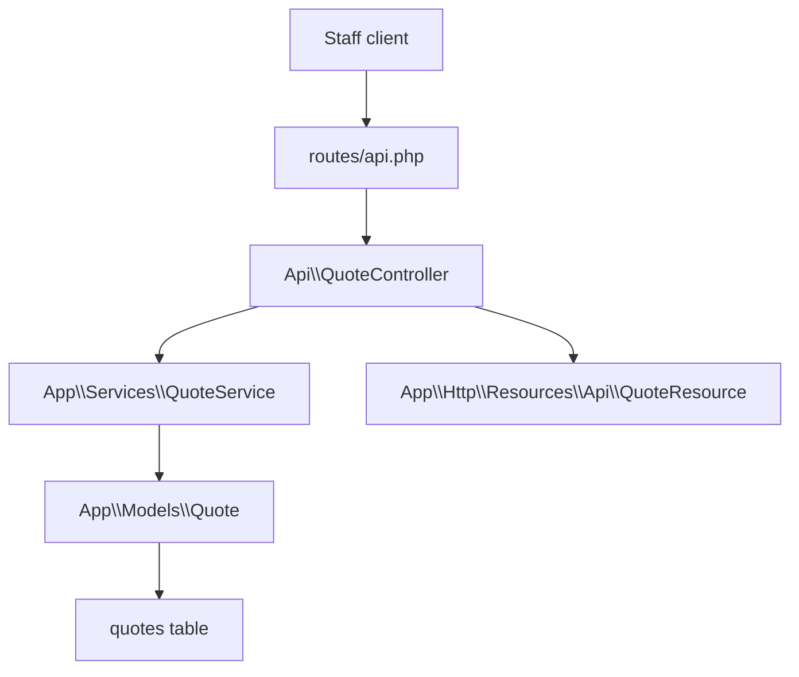
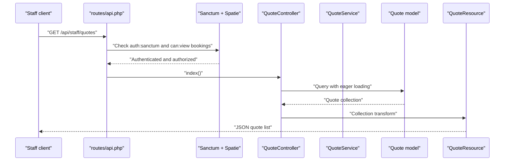
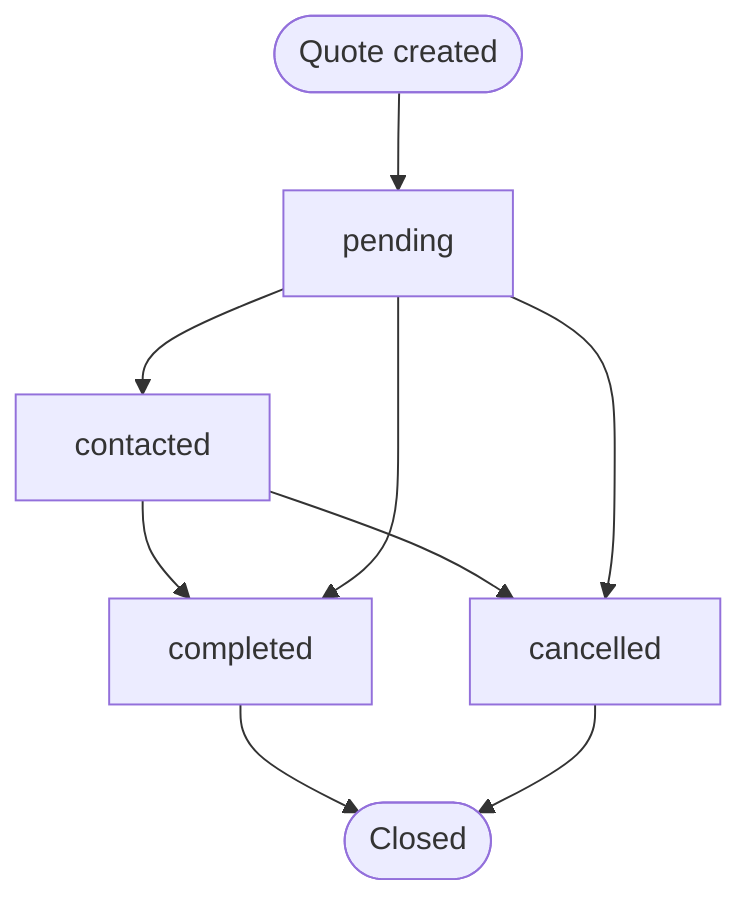
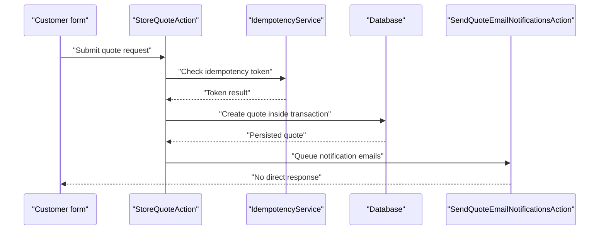
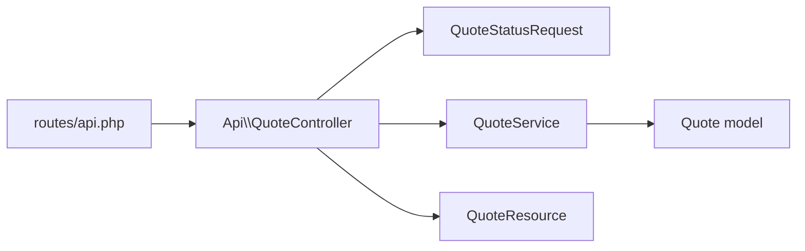

# Quote Management

<cite>
**Referenced Files in This Document**   
- [api.php](file://routes/api.php)
- [QuoteController.php](file://app/Http/Controllers/Api/QuoteController.php)
- [QuoteResource.php](file://app/Http/Resources/Api/QuoteResource.php)
- [QuoteStatusRequest.php](file://app/Http/Requests/Admin/QuoteStatusRequest.php)
- [QuoteService.php](file://app/Services/QuoteService.php)
- [Quote.php](file://app/Models/Quote.php)
- [StoreQuoteAction.php](file://app/Actions/StoreQuoteAction.php)
- [SendQuoteEmailNotificationsAction.php](file://app/Actions/SendQuoteEmailNotificationsAction.php)
- [2026_04_20_080002_create_quotes_table.php](file://database/migrations/2026_04_20_080002_create_quotes_table.php)
- [2026_04_20_090000_add_image_path_to_quotes_table.php](file://database/migrations/2026_04_20_090000_add_image_path_to_quotes_table.php)
- [2026_05_07_080001_add_glass_sub_category_id_to_quotes_table.php](file://database/migrations/2026_05_07_080001_add_glass_sub_category_id_to_quotes_table.php)
- [quote.php](file://lang/en/quote.php)
</cite>

## Table of Contents
1. [Introduction](#introduction)
2. [Project Structure](#project-structure)
3. [Core Components](#core-components)
4. [Architecture Overview](#architecture-overview)
5. [Detailed Component Analysis](#detailed-component-analysis)
6. [Dependency Analysis](#dependency-analysis)
7. [Performance Considerations](#performance-considerations)
8. [Troubleshooting Guide](#troubleshooting-guide)
9. [Conclusion](#conclusion)

## Introduction
This document describes the quote management API exposed to the staff application under `/api/staff`. It focuses on the read and triage operations for customer quote requests: listing quotes, viewing an individual quote, updating its status, and deleting it. The endpoints are token-authenticated with Sanctum and gated by Spatie permissions that mirror the web admin panel.

Key characteristics:
- Authentication: Sanctum bearer tokens for staff users.
- Authorization: Quotes use booking abilities (`can:view bookings` for reads, `can:update bookings` for status changes and deletion).
- Data model: Customer-driven quote requests linked to glass types, optional glass sub-categories, and service types.
- Lifecycle: Quotes begin as `pending` and move through statuses such as `contacted`, `completed`, or `cancelled`.
- Integration: Public quote submissions create records via a separate action pipeline; the staff API is primarily for reading and managing those quotes.

## Project Structure
The quote API lives inside the staff API group under the `staff` prefix. Routes are defined centrally, while the controller delegates persistence logic to a dedicated service class. Responses are normalized through a JSON resource.



**Diagram sources**
- [api.php:1-117](file://routes/api.php#L1-L117)
- [QuoteController.php:1-80](file://app/Http/Controllers/Api/QuoteController.php#L1-L80)
- [QuoteService.php:1-22](file://app/Services/QuoteService.php#L1-L22)
- [QuoteResource.php:1-52](file://app/Http/Resources/Api/QuoteResource.php#L1-L52)
- [Quote.php:1-76](file://app/Models/Quote.php#L1-L76)

**Section sources**
- [api.php:1-117](file://routes/api.php#L1-L117)

## Core Components
- Staff API routes define four quote endpoints behind `auth:sanctum` and booking abilities.
- `QuoteController` implements list, show, status update, and delete operations.
- `QuoteResource` serializes quote data into a stable API shape.
- `QuoteService` centralizes status updates and deletions.
- `Quote` model provides relationships to glass and service catalog entities and query scopes.
- Database migrations define the quote schema and related indexes.

**Section sources**
- [api.php:54-77](file://routes/api.php#L54-L77)
- [QuoteController.php:1-80](file://app/Http/Controllers/Api/QuoteController.php#L1-L80)
- [QuoteResource.php:1-52](file://app/Http/Resources/Api/QuoteResource.php#L1-L52)
- [QuoteService.php:1-22](file://app/Services/QuoteService.php#L1-L22)
- [Quote.php:1-76](file://app/Models/Quote.php#L1-L76)

## Architecture Overview
The quote management flow uses a layered approach:
1. HTTP request arrives at the staff API router.
2. Sanctum authenticates the bearer token.
3. Spatie authorization enforces booking abilities.
4. `QuoteController` validates input and calls business logic.
5. `QuoteService` persists state changes.
6. `QuoteResource` formats the response payload.



**Diagram sources**
- [api.php:54-62](file://routes/api.php#L54-L62)
- [QuoteController.php:24-45](file://app/Http/Controllers/Api/QuoteController.php#L24-L45)
- [QuoteResource.php:18-51](file://app/Http/Resources/Api/QuoteResource.php#L18-L51)

## Detailed Component Analysis

### Authentication and Authorization
- All staff API routes are under the `staff` prefix and require a valid Sanctum token.
- Quote endpoints enforce:
  - Read operations: `can:view bookings`
  - Status update and delete operations: `can:update bookings`
- The route definitions explicitly attach these middleware gates.

**Section sources**
- [api.php:15-25](file://routes/api.php#L15-L25)
- [api.php:54-77](file://routes/api.php#L54-L77)

### Endpoint: List Quotes
- **HTTP method:** `GET`
- **URL pattern:** `/api/staff/quotes`
- **Required permissions:** `view bookings`
- **Query parameters:**
  - `status`: Filter by quote status. Allowed values are `pending`, `contacted`, `completed`, `cancelled`.
  - `search`: Fuzzy search across name, email, phone, and registration number.
  - `per_page`: Pagination size between 1 and 100 inclusive; defaults to 20.
- **Response:** Paginated collection serialized by `QuoteResource`.

#### Request Examples
- List all pending quotes:
  ```http
  GET /api/staff/quotes?status=pending
  Authorization: Bearer {token}
  ```
- Search by vehicle registration:
  ```http
  GET /api/staff/quotes?search=ABC123
  Authorization: Bearer {token}
  ```
- Control pagination:
  ```http
  GET /api/staff/quotes?per_page=50
  Authorization: Bearer {token}
  ```

#### Response Schema
The response is a paginated JSON object whose items follow this structure:
- `id`: Integer ID.
- `status`: String from the allowed set.
- `name`: Client full name.
- `email`: Optional client email.
- `phone`: Client phone number.
- `vehicle`:
  - `type`: Vehicle type string.
  - `make_model`: Make and model string.
  - `reg_number`: Registration number.
  - `year`: Integer year or null.
- `mobile_service`: Boolean indicating whether mobile service was requested.
- `message`: Optional additional notes.
- `glass`:
  - `description`: Full glass description including sub-category when present.
  - `glass_type_id`: Foreign key to the glass type.
  - `glass_type_name`: Display name when loaded.
  - `glass_sub_category_id`: Optional foreign key to the glass sub-category.
  - `service_type_id`: Foreign key to the service type.
  - `service_type_name`: Display name when loaded.
- `image_url`: Media URL if an image was uploaded, otherwise null.
- `created_at`: ISO 8601 timestamp.

#### Business Validation Rules
- Only authenticated staff with `view bookings` can list quotes.
- Invalid `status` filter values are ignored because the controller applies the filter only when provided.
- `per_page` is clamped to the range 1–100.

**Section sources**
- [api.php:62-66](file://routes/api.php#L62-L66)
- [QuoteController.php:24-45](file://app/Http/Controllers/Api/QuoteController.php#L24-L45)
- [QuoteResource.php:18-51](file://app/Http/Resources/Api/QuoteResource.php#L18-L51)

### Endpoint: View Individual Quote
- **HTTP method:** `GET`
- **URL pattern:** `/api/staff/quotes/{quote}`
- **Path parameter:** `quote` must be numeric.
- **Required permissions:** `view bookings`
- **Behavior:** Loads the quote with glass type, service type, and glass sub-category relationships before serialization.

#### Request Example
```http
GET /api/staff/quotes/123
Authorization: Bearer {token}
```

#### Response Schema
Same as the list endpoint item schema.

#### Error Behavior
- A non-existent quote results in a standard Laravel not found response because the route uses implicit binding without custom handling.

**Section sources**
- [api.php:66-67](file://routes/api.php#L66-L67)
- [QuoteController.php:47-54](file://app/Http/Controllers/Api/QuoteController.php#L47-L54)
- [QuoteResource.php:18-51](file://app/Http/Resources/Api/QuoteResource.php#L18-L51)

### Endpoint: Update Quote Status
- **HTTP method:** `PUT`
- **URL pattern:** `/api/staff/quotes/{quote}/status`
- **Path parameter:** `quote` must be numeric.
- **Required permissions:** `update bookings`
- **Request body:**
  - `status`: Required string from the allowed set: `pending`, `contacted`, `completed`, `cancelled`.
- **Response:** JSON object containing:
  - `data`: Updated quote serialized by `QuoteResource`.
  - `message`: Localized success message.

#### Request Example
```http
PUT /api/staff/quotes/123/status
Authorization: Bearer {token}
Content-Type: application/json

{
  "status": "contacted"
}
```

#### Validation Rules
- `status` is required.
- Only the configured status values are accepted.

#### Status Transition Semantics
The code does not enforce a strict transition graph. Valid transitions commonly used include:
- `pending` → `contacted`: Staff has reached out to the client.
- `contacted` → `completed`: Quote converted to a booking or closed successfully.
- Any active status → `cancelled`: Quote rejected or withdrawn.
- `pending` may also move directly to `completed` or `cancelled` depending on business practice.

The system treats these as plain state labels rather than enforcing edges.

**Section sources**
- [api.php:67-68](file://routes/api.php#L67-L68)
- [QuoteController.php:56-70](file://app/Http/Controllers/Api/QuoteController.php#L56-L70)
- [QuoteStatusRequest.php:14-32](file://app/Http/Requests/Admin/QuoteStatusRequest.php#L14-L32)
- [QuoteService.php:9-15](file://app/Services/QuoteService.php#L9-L15)

### Endpoint: Delete Quote
- **HTTP method:** `DELETE`
- **URL pattern:** `/api/staff/quotes/{quote}`
- **Path parameter:** `quote` must be numeric.
- **Required permissions:** `update bookings`
- **Response:** JSON object containing a localized success message.

#### Request Example
```http
DELETE /api/staff/quotes/123
Authorization: Bearer {token}
```

#### Business Notes
- Deletion removes the quote record permanently.
- There is no soft-delete implementation visible in the quote model.
- This endpoint is intended for administrative cleanup rather than routine workflow progression.

**Section sources**
- [api.php:68-69](file://routes/api.php#L68-L69)
- [QuoteController.php:72-80](file://app/Http/Controllers/Api/QuoteController.php#L72-L80)
- [QuoteService.php:17-21](file://app/Services/QuoteService.php#L17-L21)

### Quote Data Model
The database schema defines quote records with customer, vehicle, glass, service, and lifecycle fields.

| Column | Type | Nullable | Default | Meaning |
|---|---|---:|---|---|
| `id` | Integer primary key | No | Auto-increment | Quote identifier |
| `name` | String | No | — | Client full name |
| `phone` | String | No | — | Client phone number |
| `email` | String | Yes | Null | Optional client email |
| `vehicle_type` | String | No | — | Vehicle type label |
| `make_model` | String | Yes | Null | Make and model |
| `reg_number` | String | Yes | Null | Registration number |
| `year` | Integer | Yes | Null | Vehicle year |
| `glass_type_id` | Foreign key | No | — | Linked glass type |
| `glass_sub_category_id` | Foreign key | Yes | Null | Optional glass sub-category |
| `service_type_id` | Foreign key | No | — | Linked service type |
| `message` | Text | Yes | Null | Additional notes |
| `image_path` | String | Yes | Null | Uploaded damage photo path |
| `mobile_service` | Boolean | No | False | Mobile service request flag |
| `status` | String | No | `pending` | Quote lifecycle state |
| `created_at` | Timestamp | Yes | Null | Creation time |
| `updated_at` | Timestamp | Yes | Null | Last update time |

Relationships:
- `glassType`: Belongs to the glass type catalog.
- `glassSubCategory`: Optional belongs-to relationship for refined glass descriptions.
- `serviceType`: Belongs to the service catalog.

**Section sources**
- [2026_04_20_080002_create_quotes_table.php:10-27](file://database/migrations/2026_04_20_080002_create_quotes_table.php#L10-L27)
- [2026_04_20_090000_add_image_path_to_quotes_table.php:10-17](file://database/migrations/2026_04_20_090000_add_image_path_to_quotes_table.php#L10-L17)
- [2026_05_07_080001_add_glass_sub_category_id_to_quotes_table.php:10-20](file://database/migrations/2026_05_07_080001_add_glass_sub_category_id_to_quotes_table.php#L10-L20)
- [Quote.php:18-76](file://app/Models/Quote.php#L18-L76)

### Quote Lifecycle and Approval Workflow
Quotes represent customer interest and initial assessment information. The status field tracks progress:
- `pending`: New quote received; awaiting staff review.
- `contacted`: Staff has contacted the client.
- `completed`: Quote progressed to a confirmed outcome, typically a booking or finalized estimate.
- `cancelled`: Quote was withdrawn or declined.



There is no explicit validation preventing arbitrary status jumps. Teams should enforce their own approval policy at the UI or orchestration layer if stricter transitions are needed.

**Diagram sources**
- [QuoteStatusRequest.php:26-31](file://app/Http/Requests/Admin/QuoteStatusRequest.php#L26-L31)
- [2026_04_20_080002_create_quotes_table.php:21-21](file://database/migrations/2026_04_20_080002_create_quotes_table.php#L21-L21)

**Section sources**
- [QuoteStatusRequest.php:26-31](file://app/Http/Requests/Admin/QuoteStatusRequest.php#L26-L31)
- [2026_04_20_080002_create_quotes_table.php:21-21](file://database/migrations/2026_04_20_080002_create_quotes_table.php#L21-L21)

### Relationship with Bookings
- The quote API reuses booking abilities for authorization, which means the same permission roles that manage bookings also manage quotes.
- The quote model does not declare a direct `booking_id` relationship in the current implementation.
- In practice, conversion tracking is likely implemented elsewhere: staff may convert a quote into a booking through the booking endpoints after contact and pricing discussion.
- Because there is no automatic link from quote to booking, conversion metrics should be tracked by business process rather than assumed from the quote record alone.

**Section sources**
- [api.php:62-69](file://routes/api.php#L62-L69)
- [Quote.php:47-76](file://app/Models/Quote.php#L47-L76)

### Integration with the Service Catalog
- Each quote references a `glass_type_id` and a `service_type_id`.
- An optional `glass_sub_category_id` allows more specific glass descriptions.
- The resource exposes both IDs and names when relationships are loaded.
- Pricing calculations are not performed by the quote endpoints; they are presentation and lookup concerns handled by clients or other services using the catalog data.

**Section sources**
- [Quote.php:47-76](file://app/Models/Quote.php#L47-L76)
- [QuoteResource.php:30-46](file://app/Http/Resources/Api/QuoteResource.php#L30-L46)

### Public Quote Submission Pipeline
Although the public submission route is outside the scope of the staff API, understanding it helps explain how quotes enter the system:
- The public form invokes `StoreQuoteAction`.
- The action handles idempotency, image upload, transactional quote creation, and email notifications.
- Newly created quotes always start with status `pending`.



**Diagram sources**
- [StoreQuoteAction.php:1-160](file://app/Actions/StoreQuoteAction.php#L1-L160)
- [SendQuoteEmailNotificationsAction.php:1-113](file://app/Actions/SendQuoteEmailNotificationsAction.php#L1-L113)

**Section sources**
- [StoreQuoteAction.php:27-62](file://app/Actions/StoreQuoteAction.php#L27-L62)
- [StoreQuoteAction.php:113-147](file://app/Actions/StoreQuoteAction.php#L113-L147)
- [SendQuoteEmailNotificationsAction.php:28-60](file://app/Actions/SendQuoteEmailNotificationsAction.php#L28-L60)

### Practical Scenarios

#### Quote Generation
- A customer submits a quote through the public form.
- The system creates a `pending` quote with vehicle, glass, and service details.
- An optional damage image is stored and referenced by `image_path`.
- Email notifications are queued for administrators and optionally the customer.

**Section sources**
- [StoreQuoteAction.php:27-62](file://app/Actions/StoreQuoteAction.php#L27-L62)
- [StoreQuoteAction.php:113-147](file://app/Actions/StoreQuoteAction.php#L113-L147)

#### Client Communication
- Staff retrieve quotes using the list endpoint, optionally filtering by status or searching by client details.
- Staff mark a quote as `contacted` once outreach occurs.
- The updated status is returned with the full serialized quote.

**Section sources**
- [QuoteController.php:24-70](file://app/Http/Controllers/Api/QuoteController.php#L24-L70)

#### Conversion Tracking
- Because quotes do not automatically store a booking reference, conversion should be recorded by creating a booking through the booking endpoints and correlating them operationally.
- Reporting should compare quote timestamps and booking creation events where applicable.

**Section sources**
- [Quote.php:47-76](file://app/Models/Quote.php#L47-L76)

#### Pricing Calculations
- The API returns catalog identifiers and descriptive names but does not compute prices.
- Clients should calculate estimates using service catalog data, glass selections, and any business rules external to this API.

**Section sources**
- [QuoteResource.php:30-46](file://app/Http/Resources/Api/QuoteResource.php#L30-L46)

## Dependency Analysis
The quote API depends on authentication, authorization, routing, controller logic, validation, service persistence, model relationships, and JSON serialization.



**Diagram sources**
- [api.php:62-69](file://routes/api.php#L62-L69)
- [QuoteController.php:1-80](file://app/Http/Controllers/Api/QuoteController.php#L1-L80)
- [QuoteStatusRequest.php:1-33](file://app/Http/Requests/Admin/QuoteStatusRequest.php#L1-L33)
- [QuoteService.php:1-22](file://app/Services/QuoteService.php#L1-L22)
- [QuoteResource.php:1-52](file://app/Http/Resources/Api/QuoteResource.php#L1-L52)

**Section sources**
- [api.php:62-69](file://routes/api.php#L62-L69)
- [QuoteController.php:1-80](file://app/Http/Controllers/Api/QuoteController.php#L1-L80)

## Performance Considerations
- Eager loading: The controller loads `glassType`, `serviceType`, and `glassSubCategory` to avoid N+1 queries.
- Pagination: The list endpoint paginates results and caps page size at 100.
- Indexing: The database migration adds an index on `glass_sub_category_id` for faster lookups involving glass sub-categories.
- Sorting: The default ordering is newest first based on `created_at`.

Recommendations:
- Keep `per_page` reasonable to avoid large payloads.
- Use `status` filters when browsing queues instead of fetching all quotes.
- Avoid unbounded search terms; narrow searches to reduce LIKE scanning.

**Section sources**
- [QuoteController.php:24-45](file://app/Http/Controllers/Api/QuoteController.php#L24-L45)
- [2026_05_07_080001_add_glass_sub_category_id_to_quotes_table.php:14-17](file://database/migrations/2026_05_07_080001_add_glass_sub_category_id_to_quotes_table.php#L14-L17)

## Troubleshooting Guide
Common issues and resolutions:

- **401 Unauthorized:**
  - Cause: Missing or invalid Sanctum token.
  - Resolution: Ensure the request includes a valid bearer token.

- **403 Forbidden:**
  - Cause: User lacks `view bookings` or `update bookings` ability.
  - Resolution: Assign the correct role or permission in the authorization system.

- **422 Unprocessable Entity on status update:**
  - Cause: Missing or invalid `status` value.
  - Resolution: Use one of `pending`, `contacted`, `completed`, `cancelled`.

- **404 Not Found on show or delete:**
  - Cause: Quote ID does not exist or route binding failed.
  - Resolution: Verify the numeric quote ID exists.

- **Large or slow list responses:**
  - Cause: Missing filters or excessive page size.
  - Resolution: Apply `status` and `search` filters and cap `per_page`.

- **Missing image URL:**
  - Cause: No image was uploaded or the path is null.
  - Resolution: Confirm the public submission flow stored the image and that media URLs are resolvable.

**Section sources**
- [QuoteStatusRequest.php:26-31](file://app/Http/Requests/Admin/QuoteStatusRequest.php#L26-L31)
- [QuoteController.php:24-80](file://app/Http/Controllers/Api/QuoteController.php#L24-L80)
- [QuoteResource.php:47-50](file://app/Http/Resources/Api/QuoteResource.php#L47-L50)

## Conclusion
The quote management API provides a focused, permission-gated interface for staff to review and triage customer quote requests. It integrates closely with the glass and service catalogs, supports basic lifecycle states, and pairs well with the public quote submission pipeline. While it does not enforce a strict approval workflow or directly bind quotes to bookings, it supplies the foundational data and status control needed for operational workflows. Teams should implement conversion tracking and pricing calculation in their application layer and consider adding stricter status transition validation if business policy requires it.