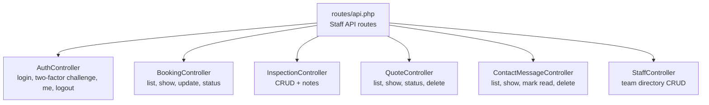
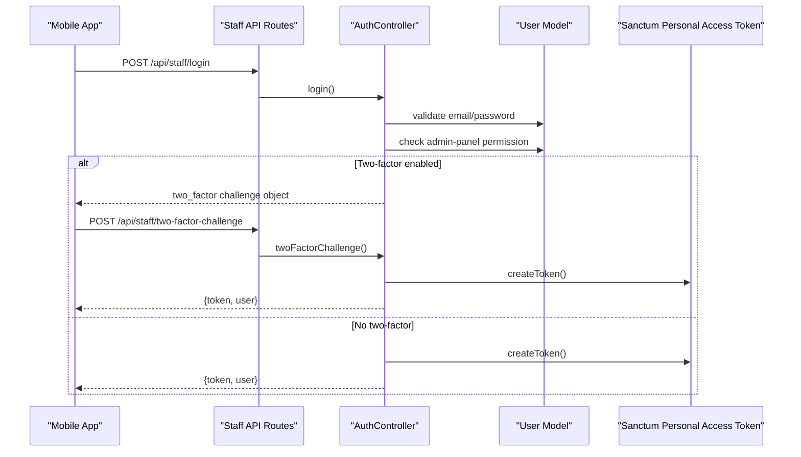
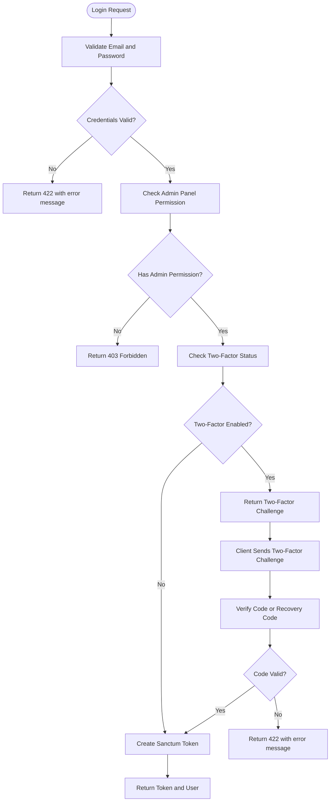
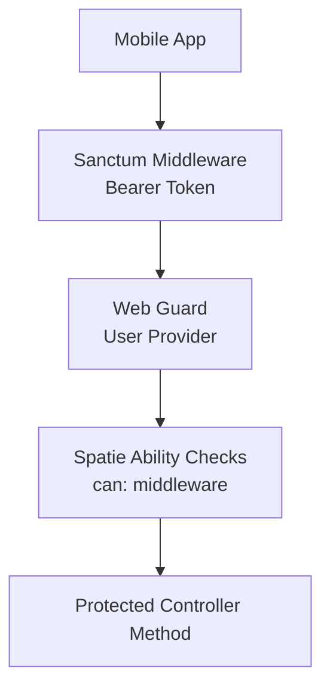

# Staff Mobile App API

<cite>
**Referenced Files in This Document**   
- [routes/api.php](file://routes/api.php)
- [AuthController.php](file://app/Http/Controllers/Api/AuthController.php)
- [BookingController.php](file://app/Http/Controllers/Api/BookingController.php)
- [InspectionController.php](file://app/Http/Controllers/Api/InspectionController.php)
- [QuoteController.php](file://app/Http/Controllers/Api/QuoteController.php)
- [ContactMessageController.php](file://app/Http/Controllers/Api/ContactMessageController.php)
- [StaffController.php](file://app/Http/Controllers/Api/StaffController.php)
- [UserResource.php](file://app/Http/Resources/Api/UserResource.php)
- [BookingResource.php](file://app/Http/Resources/Api/BookingResource.php)
- [InspectionResource.php](file://app/Http/Resources/Api/InspectionResource.php)
- [InspectionNoteResource.php](file://app/Http/Resources/Api/InspectionNoteResource.php)
- [QuoteResource.php](file://app/Http/Resources/Api/QuoteResource.php)
- [ContactMessageResource.php](file://app/Http/Resources/Api/ContactMessageResource.php)
- [StaffResource.php](file://app/Http/Resources/Api/StaffResource.php)
- [sanctum.php](file://config/sanctum.php)
- [auth.php](file://config/auth.php)
</cite>

## Table of Contents
1. [Introduction](#introduction)
2. [Project Structure](#project-structure)
3. [Core Components](#core-components)
4. [Architecture Overview](#architecture-overview)
5. [Authentication Flow](#authentication-flow)
6. [API Endpoints](#api-endpoints)
7. [Data Models and Response Schemas](#data-models-and-response-schemas)
8. [Authorization and Security](#authorization-and-security)
9. [Rate Limiting](#rate-limiting)
10. [Testing and Debugging](#testing-and-debugging)
11. [Integration Guidelines for Mobile Developers](#integration-guidelines-for-mobile-developers)
12. [Troubleshooting Guide](#troubleshooting-guide)
13. [Conclusion](#conclusion)

## Introduction
The Highblossom Staff Mobile App API is a token-authenticated JSON API used by the staff mobile application. It exposes RESTful endpoints for authentication, booking management, inspection tracking, quote triage, contact message handling, and team administration.

All data routes live under the `/api/staff` URL prefix so they do not collide with public-facing API routes. Every protected endpoint requires a valid Sanctum personal access token and additional Spatie permissions-based abilities. The same permission model used by the web admin panel is enforced through `can:` middleware, ensuring that what a mobile staff member can do matches what they can do in the browser.

## Project Structure
The API is defined as one Laravel route group with nested resource-style routes:

**Diagram sources**
- [routes/api.php:1-117](file://routes/api.php#L1-L117)
- [AuthController.php:1-135](file://app/Http/Controllers/Api/AuthController.php#L1-L135)
- [BookingController.php:1-122](file://app/Http/Controllers/Api/BookingController.php#L1-L122)
- [InspectionController.php:1-144](file://app/Http/Controllers/Api/InspectionController.php#L1-L144)
- [QuoteController.php:1-80](file://app/Http/Controllers/Api/QuoteController.php#L1-L80)
- [ContactMessageController.php:1-81](file://app/Http/Controllers/Api/ContactMessageController.php#L1-L81)
- [StaffController.php:1-115](file://app/Http/Controllers/Api/StaffController.php#L1-L115)

**Section sources**
- [routes/api.php:1-117](file://routes/api.php#L1-L117)

## Core Components
- **Authentication controller**: Issues Sanctum personal access tokens, handles two-factor challenges, returns the current user, and revokes tokens on logout.
- **Booking controller**: Reads bookings with optional filtering and pagination, updates editable fields, and moves bookings through their lifecycle using a shared timeline service.
- **Inspection controller**: Manages appointment records and internal action-item notes; creation and updates go through dedicated actions to keep scheduling and milestone recording consistent with the web admin.
- **Quote controller**: Lists quote requests with search and status filters, updates quote status through a shared service, and deletes quotes.
- **Contact message controller**: Provides read-only inbox viewing plus explicit mark-as-read and delete operations.
- **Staff controller**: Administers team members, including optional photo upload and sortable ordering.

Each controller returns structured JSON payloads shaped by API resource classes.

**Section sources**
- [AuthController.php:1-135](file://app/Http/Controllers/Api/AuthController.php#L1-L135)
- [BookingController.php:1-122](file://app/Http/Controllers/Api/BookingController.php#L1-L122)
- [InspectionController.php:1-144](file://app/Http/Controllers/Api/InspectionController.php#L1-L144)
- [QuoteController.php:1-80](file://app/Http/Controllers/Api/QuoteController.php#L1-L80)
- [ContactMessageController.php:1-81](file://app/Http/Controllers/Api/ContactMessageController.php#L1-L81)
- [StaffController.php:1-115](file://app/Http/Controllers/Api/StaffController.php#L1-L115)

## Architecture Overview

**Diagram sources**
- [routes/api.php:18-33](file://routes/api.php#L18-L33)
- [AuthController.php:29-87](file://app/Http/Controllers/Api/AuthController.php#L29-L87)

## Authentication Flow
The API uses Laravel Sanctum personal access tokens. Tokens are created for a named device and include wildcard abilities. Clients must attach the token as a bearer token on subsequent authenticated requests.

### Login
- **Method:** `POST`
- **URL:** `/api/staff/login`
- **Throttle:** 6 attempts per minute (applied at the route level).
- **Request body:**
  - `email`: string, required.
  - `password`: string, required.
  - `device_name`: string, optional; defaults to `staff-app`.
- **Response without two-factor:**
  - `200 OK` with `token` and `user`.
- **Response with two-factor:**
  - `200 OK` with `two_factor: true` and `challenge`.
- **Error responses:**
  - `422 Unprocessable Entity` when credentials do not match.
  - `403 Forbidden` when the account lacks the admin-panel permission.

### Two-Factor Challenge
- **Method:** `POST`
- **URL:** `/api/staff/two-factor-challenge`
- **Throttle:** 6 attempts per minute (route-level throttle).
- **Request body:**
  - `challenge`: string, required.
  - `code`: string or null, optional authenticator code.
  - `recovery_code`: string or null, optional recovery code.
- **Success response:** Returns a new token and user object.
- **Error responses:**
  - `422 Unprocessable Entity` for expired challenges or invalid codes.

### Current User
- **Method:** `GET`
- **URL:** `/api/staff/me`
- **Authentication:** Required Sanctum bearer token.
- **Response:** `user` object containing identity, roles, and abilities.

### Logout
- **Method:** `POST`
- **URL:** `/api/staff/logout`
- **Authentication:** Required Sanctum bearer token.
- **Response:** Success message. The current request’s token is deleted.

**Diagram sources**
- [AuthController.php:29-135](file://app/Http/Controllers/Api/AuthController.php#L29-L135)

**Section sources**
- [routes/api.php:18-33](file://routes/api.php#L18-L33)
- [AuthController.php:29-135](file://app/Http/Controllers/Api/AuthController.php#L29-L135)

## API Endpoints

### Authentication
| Method | URL | Authentication | Authorization | Description |
|--------|-----|----------------|---------------|-------------|
| `POST` | `/api/staff/login` | None | None | Exchange credentials for a token or two-factor challenge. |
| `POST` | `/api/staff/two-factor-challenge` | None | None | Complete two-factor verification and receive a token. |
| `GET` | `/api/staff/me` | Sanctum bearer token | None | Return the authenticated staff member. |
| `POST` | `/api/staff/logout` | Sanctum bearer token | None | Revoke the current token. |

**Section sources**
- [routes/api.php:18-33](file://routes/api.php#L18-L33)
- [AuthController.php:29-135](file://app/Http/Controllers/Api/AuthController.php#L29-L135)

### Booking Management
| Method | URL | Authentication | Authorization | Description |
|--------|-----|----------------|---------------|-------------|
| `GET` | `/api/staff/bookings` | Sanctum bearer token | `view bookings` | List bookings with optional `status` and `search` filters. Supports `per_page`. |
| `GET` | `/api/staff/bookings/{booking}` | Sanctum bearer token | `view bookings` | Show a single booking with its inspection and event timeline. |
| `PATCH` | `/api/staff/bookings/{booking}` | Sanctum bearer token | `update bookings` | Update editable booking fields such as quoted price. |
| `PATCH` | `/api/staff/bookings/{booking}/status` | Sanctum bearer token | `update bookings` | Move a booking through pending, confirmed, completed, or cancelled. |

**Query parameters for listing:**
- `status`: filter by booking status.
- `search`: fuzzy search across client name, client email, and reference.
- `per_page`: page size between 1 and 100, default 15.

**Status update request body:**
- `status`: one of `pending`, `confirmed`, `completed`, `cancelled`.

**Behavioral notes:**
- Moving to `confirmed`, `completed`, or `cancelled` records a timeline event.
- Reverting to `pending` is a plain field update.
- A cancelled booking cannot be advanced further; attempting to do so returns `409 Conflict`.

**Section sources**
- [routes/api.php:39-44](file://routes/api.php#L39-L44)
- [BookingController.php:1-122](file://app/Http/Controllers/Api/BookingController.php#L1-L122)

### Inspection Tracking
| Method | URL | Authentication | Authorization | Description |
|--------|-----|----------------|---------------|-------------|
| `GET` | `/api/staff/inspections` | Sanctum bearer token | `view inspections` | List inspections ordered by scheduled time. Supports `per_page`. |
| `POST` | `/api/staff/inspections` | Sanctum bearer token | `update inspections` | Schedule an inspection against a booking. |
| `GET` | `/api/staff/inspections/{inspection}` | Sanctum bearer token | `view inspections` | Show an inspection with booking, assigned staff, and notes. |
| `PUT` | `/api/staff/inspections/{inspection}` | Sanctum bearer token | `update inspections` | Update an inspection and record relevant milestones. |
| `DELETE` | `/api/staff/inspections/{inspection}` | Sanctum bearer token | `update inspections` | Delete an inspection. |
| `POST` | `/api/staff/inspections/{inspection}/notes` | Sanctum bearer token | `update inspections` | Add an internal note or action item. |
| `PATCH` | `/api/staff/inspections/{inspection}/notes/{note}/done` | Sanctum bearer token | `update inspections` | Toggle whether an action item is done. |
| `DELETE` | `/api/staff/inspections/{inspection}/notes/{note}` | Sanctum bearer token | `update inspections` | Remove an internal note. |

**List query parameter:**
- `per_page`: page size between 1 and 100, default 15.

**Notes behavior:**
- Notes belong to an inspection. Deleting or toggling a note validates that it belongs to the inspected booking.
- Action items expose an open/done state and may include an author.

**Section sources**
- [routes/api.php:46-58](file://routes/api.php#L46-L58)
- [InspectionController.php:1-144](file://app/Http/Controllers/Api/InspectionController.php#L1-L144)

### Quote Management
| Method | URL | Authentication | Authorization | Description |
|--------|-----|----------------|---------------|-------------|
| `GET` | `/api/staff/quotes` | Sanctum bearer token | `view bookings` | List quotes with optional `status` and `search` filters. Supports `per_page`. |
| `GET` | `/api/staff/quotes/{quote}` | Sanctum bearer token | `view bookings` | Show a quote with glass and service details. |
| `PUT` | `/api/staff/quotes/{quote}/status` | Sanctum bearer token | `update bookings` | Update quote status through the shared quote service. |
| `DELETE` | `/api/staff/quotes/{quote}` | Sanctum bearer token | `update bookings` | Delete a quote through the shared quote service. |

**Query parameters for listing:**
- `status`: filter by quote status.
- `search`: fuzzy search across name, email, phone, and vehicle registration number.
- `per_page`: page size between 1 and 100, default 20.

**Status update request body:**
- `status`: controlled by the shared request validation class used by the controller.

**Section sources**
- [routes/api.php:60-67](file://routes/api.php#L60-L67)
- [QuoteController.php:1-80](file://app/Http/Controllers/Api/QuoteController.php#L1-L80)

### Contact Message Triage
| Method | URL | Authentication | Authorization | Description |
|--------|-----|----------------|---------------|-------------|
| `GET` | `/api/staff/contact-messages` | Sanctum bearer token | `view contact messages` | List contact messages with optional `status` and `search` filters. Supports `per_page`. |
| `GET` | `/api/staff/contact-messages/{message}` | Sanctum bearer token | `view contact messages` | Show one contact message without changing its read state. |
| `PATCH` | `/api/staff/contact-messages/{message}/read` | Sanctum bearer token | `view contact messages` | Mark a contact message as read. |
| `DELETE` | `/api/staff/contact-messages/{message}` | Sanctum bearer token | `view contact messages` | Delete a contact message. |

**Query parameters for listing:**
- `status`: `read` or `unread`.
- `search`: fuzzy search across name, email, and subject.
- `per_page`: page size between 1 and 100, default 15.

**Section sources**
- [routes/api.php:69-76](file://routes/api.php#L69-L76)
- [ContactMessageController.php:1-81](file://app/Http/Controllers/Api/ContactMessageController.php#L1-L81)

### Team Management
| Method | URL | Authentication | Authorization | Description |
|--------|-----|----------------|---------------|-------------|
| `GET` | `/api/staff/team` | Sanctum bearer token | `manage settings` | List staff members ordered by position. |
| `POST` | `/api/staff/team` | Sanctum bearer token | `manage settings` | Create a staff member; photo is optional. |
| `GET` | `/api/staff/team/{staff}` | Sanctum bearer token | `manage settings` | Show one staff member. |
| `PUT` | `/api/staff/team/{staff}` | Sanctum bearer token | `manage settings` | Update a staff member; supports optional photo replacement and sort order normalization. |
| `DELETE` | `/api/staff/team/{staff}` | Sanctum bearer token | `manage settings` | Delete a staff member and remove their stored photo if present. |

**Create/update request body:**
- `name`: required string, maximum 255 characters.
- `role`: required string, maximum 255 characters.
- `bio`: optional string.
- `photo`: optional multipart image, maximum 2048 kilobytes.
- `is_active`: optional boolean, defaults to `true` on create.
- `order`: optional integer; validated against existing staff entries.

**Section sources**
- [routes/api.php:93-100](file://routes/api.php#L93-L100)
- [StaffController.php:1-115](file://app/Http/Controllers/Api/StaffController.php#L1-L115)

## Data Models and Response Schemas

### Authentication Response
| Field | Type | Description |
|-------|------|-------------|
| `token` | string | Sanctum personal access token for future requests. |
| `user` | object | Staff member identity and capabilities. |

**User object fields:**
| Field | Type | Description |
|-------|------|-------------|
| `id` | integer | Internal identifier. |
| `name` | string | Display name. |
| `username` | string | Username. |
| `email` | string | Email address. |
| `avatar_url` | string or null | Public avatar link. |
| `roles` | array of strings | Role names. |
| `abilities` | array of strings | Permission names usable for UI gating. |

**Section sources**
- [AuthController.php:89-135](file://app/Http/Controllers/Api/AuthController.php#L89-L135)
- [UserResource.php:1-35](file://app/Http/Resources/Api/UserResource.php#L1-L35)

### Booking Resource
| Field | Type | Description |
|-------|------|-------------|
| `id` | integer | Booking identifier. |
| `reference` | string | Customer-visible reference. |
| `status` | string | Booking lifecycle status. |
| `is_cancelled` | boolean | Derived cancellation flag. |
| `client` | object | Client name, email, phone, WhatsApp preference, and address. |
| `service_type` | string or null | Enum value for service type. |
| `service_type_label` | string or null | Human-readable label. |
| `damage_type` | string or null | Enum value for damage type. |
| `damage_type_label` | string or null | Human-readable label. |
| `vehicle` | object | Vehicle make, model, year, details, and summary. |
| `scheduled_at` | ISO 8601 string or null | Scheduled start time. |
| `ends_at` | ISO 8601 string or null | Scheduled end time. |
| `duration_minutes` | integer or null | Computed duration. |
| `location` | string or null | Service location. |
| `total_price` | float or null | Quoted total price. |
| `damage_photo_url` | string or null | Public damage photo link. |
| `created_at` | ISO 8601 string or null | Creation timestamp. |
| `inspection` | object or null | Eager-loaded inspection data. |
| `events` | array | Milestone timeline events. |

**Section sources**
- [BookingResource.php:1-60](file://app/Http/Resources/Api/BookingResource.php#L1-L60)

### Inspection Resource
| Field | Type | Description |
|-------|------|-------------|
| `id` | integer | Inspection identifier. |
| `booking_id` | integer | Associated booking. |
| `status` | string | Inspection status. |
| `type` | string | Inspection type. |
| `location` | string | On-site location. |
| `scheduled_at` | ISO 8601 string or null | Scheduled time. |
| `started_at` | ISO 8601 string or null | Start time. |
| `ended_at` | ISO 8601 string or null | End time. |
| `created_at` | ISO 8601 string or null | Creation timestamp. |
| `staff` | object or null | Assigned staff member. |
| `booking` | object or null | Linked booking. |
| `notes` | array | Internal notes and action items. |

**Section sources**
- [InspectionResource.php:1-43](file://app/Http/Resources/Api/InspectionResource.php#L1-L43)

### Inspection Note Resource
| Field | Type | Description |
|-------|------|-------------|
| `id` | integer | Note identifier. |
| `body` | string | Note content. |
| `is_action` | boolean | Whether this is an action item. |
| `is_open` | boolean | Whether the action item is still open. |
| `done_at` | ISO 8601 string or null | When the action was marked done. |
| `created_at` | ISO 8601 string or null | Creation timestamp. |
| `author` | object or null | Staff member who created the note. |

**Section sources**
- [InspectionNoteResource.php:1-38](file://app/Http/Resources/Api/InspectionNoteResource.php#L1-L38)

### Quote Resource
| Field | Type | Description |
|-------|------|-------------|
| `id` | integer | Quote identifier. |
| `status` | string | Quote lifecycle status. |
| `name` | string | Customer name. |
| `email` | string | Customer email. |
| `phone` | string | Customer phone. |
| `vehicle` | object | Vehicle type, make/model, registration, and year. |
| `mobile_service` | boolean | Whether the quote is for mobile service. |
| `message` | string | Customer message. |
| `glass` | object | Glass description, IDs, and related service/glass names. |
| `image_url` | string or null | Public uploaded image link. |
| `created_at` | ISO 8601 string or null | Creation timestamp. |

**Section sources**
- [QuoteResource.php:1-52](file://app/Http/Resources/Api/QuoteResource.php#L1-L52)

### Contact Message Resource
| Field | Type | Description |
|-------|------|-------------|
| `id` | integer | Message identifier. |
| `name` | string | Sender name. |
| `email` | string | Sender email. |
| `phone` | string or null | Sender phone. |
| `subject` | string | Subject line. |
| `message` | string | Body text. |
| `is_read` | boolean | Read/unread flag. |
| `created_at` | ISO 8601 string or null | Creation timestamp. |

**Section sources**
- [ContactMessageResource.php:1-36](file://app/Http/Resources/Api/ContactMessageResource.php#L1-L36)

### Staff Resource
| Field | Type | Description |
|-------|------|-------------|
| `id` | integer | Staff member identifier. |
| `name` | string | Display name. |
| `role` | string | Job role. |
| `bio` | string or null | Biography text. |
| `photo_url` | string or null | Public photo link. |
| `order` | integer | Sort position. |
| `is_active` | boolean | Active/inactive status. |
| `created_at` | ISO 8601 string or null | Creation timestamp. |
| `updated_at` | ISO 8601 string or null | Last update timestamp. |

**Section sources**
- [StaffResource.php:1-37](file://app/Http/Resources/Api/StaffResource.php#L1-L37)

## Authorization and Security
- **Authentication mechanism**: Sanctum personal access tokens.
- **Bearer token usage**: Include `Authorization: Bearer <token>` in every protected request.
- **Token scope**: Tokens issued by the login flow carry wildcard abilities; actual access is then restricted by `can:` middleware on each route.
- **Ability mapping**:
  - `view dashboard`, `view bookings`, `update bookings`, `view inspections`, `update inspections`, `view contact messages`, `manage testimonials`, `view blog`, `update blog`, `delete blog`, `manage settings`, `view gallery`, `manage gallery`.
- **Account restrictions**:
  - Accounts without the admin-panel permission receive `403 Forbidden` during login.
  - Only users with enabled two-factor authentication receive a challenge before receiving a token.
- **Session guard configuration**: Sanctum checks the `web` guard, which uses the session driver and the `users` provider backed by the `User` model.
- **Stateful domains**: Sanctum’s stateful domain list controls cookie-based SPA authentication; mobile apps should use bearer tokens instead of cookies.

**Diagram sources**
- [routes/api.php:35-117](file://routes/api.php#L35-L117)
- [AuthController.php:29-135](file://app/Http/Controllers/Api/AuthController.php#L29-L135)
- [auth.php:1-117](file://config/auth.php#L1-L117)
- [sanctum.php:1-87](file://config/sanctum.php#L1-L87)

**Section sources**
- [routes/api.php:18-117](file://routes/api.php#L18-L117)
- [AuthController.php:29-135](file://app/Http/Controllers/Api/AuthController.php#L29-L135)
- [auth.php:1-117](file://config/auth.php#L1-L117)
- [sanctum.php:1-87](file://config/sanctum.php#L1-L87)

## Rate Limiting
Explicit rate limiting is applied to authentication endpoints:

| Endpoint | Throttle Rule | Scope |
|----------|---------------|-------|
| `/api/staff/login` | 6 attempts per minute | Per route. |
| `/api/staff/two-factor-challenge` | 6 attempts per minute | Per route. |

Additional rate limiting exists elsewhere in the application for Fortify login flows and username availability, but those are not directly attached to these staff API routes.

Clients should implement exponential backoff and retry limits when encountering throttling responses.

**Section sources**
- [routes/api.php:18-33](file://routes/api.php#L18-L33)

## Testing and Debugging
- **Authentication testing**: Use the login endpoint first, capture the returned token, and attach it as a bearer token for all subsequent calls.
- **Two-factor testing**: If the login response includes `two_factor: true`, call the two-factor challenge endpoint with either an authenticator code or a recovery code.
- **Pagination testing**: Use `per_page` to control list sizes and verify that collections return paginated data structures.
- **Authorization testing**: Test both permitted and denied cases by comparing requested abilities with the user’s `abilities` array from the `/api/staff/me` endpoint.
- **Validation testing**: Send malformed payloads to inspect server-side validation errors returned by request validators.
- **Debugging tools**: The repository includes debugging and logging configuration files, although the specific implementation details are outside this document’s scope.

[No sources needed since this section provides general guidance]

## Integration Guidelines for Mobile Developers
- **Base URL**: All staff endpoints are under `/api/staff`.
- **Content type**: Send JSON bodies with appropriate headers unless uploading multipart images.
- **Authentication header**: Always send `Authorization: Bearer <token>` after successful login.
- **Token storage**: Store the token securely in the device’s secure credential store; never log it.
- **Logout behavior**: Call `/api/staff/logout` when the user signs out to revoke the token.
- **UI gating**: Use the `abilities` array returned by `/api/staff/me` to hide or disable features that the signed-in user is not allowed to access.
- **Pagination**: Respect `per_page` limits and handle large result sets by requesting smaller pages.
- **Idempotency**: For status-changing operations, treat duplicate network retries carefully; the booking timeline and quote services enforce state transitions, but clients should avoid unnecessary repeated mutations.
- **Time zones**: Timestamps are ISO 8601 strings; convert them to local time in the mobile app.
- **Images**: Photo uploads for staff use multipart form data; other image URLs are already resolved into public links.

[No sources needed since this section provides general guidance]

## Troubleshooting Guide

### Common Error Scenarios
| Symptom | Likely Cause | Resolution |
|---------|--------------|------------|
| `422` on login | Invalid email or password | Verify credentials and ensure the account exists. |
| `403` on login | Account lacks admin-panel permission | Assign the correct permission to the user. |
| `422` on two-factor challenge | Expired or invalid challenge/code | Restart login and use a fresh challenge. |
| `409` when updating booking status | Attempting to advance a cancelled booking | Reset the booking to `pending` first. |
| `404` on inspection note operations | Note does not belong to the given inspection | Confirm the note ID and inspection ID relationship. |
| Missing abilities in UI | User lacks required permission | Check the `abilities` array and adjust permissions. |
| Throttling errors | Too many login or challenge attempts | Back off and retry later. |

### Recommended Client Workflow
1. Authenticate and store the token.
2. Fetch `/api/staff/me` to populate UI permissions.
3. Use ability gates to show or hide screens.
4. Paginate lists and cache lightweight read-only data where appropriate.
5. Refresh sensitive data after write operations.
6. Clear the token on logout or when the backend indicates it is invalid.

**Section sources**
- [AuthController.php:29-135](file://app/Http/Controllers/Api/AuthController.php#L29-L135)
- [BookingController.php:60-122](file://app/Http/Controllers/Api/BookingController.php#L60-L122)
- [InspectionController.php:108-144](file://app/Http/Controllers/Api/InspectionController.php#L108-L144)

## Conclusion
The Highblossom Staff Mobile App API provides a focused, permission-gated interface for staff workflows. Authentication is handled through Sanctum tokens with optional two-factor support, while business operations for bookings, inspections, quotes, contact messages, and team members follow clear REST patterns. Controllers reuse shared services, actions, and resources so the mobile API remains consistent with the web admin experience.

For mobile developers, the most important integration steps are securing the bearer token, respecting pagination and rate limits, gating UI by abilities, and treating status-change endpoints as stateful operations.

[No sources needed since this section summarizes without analyzing specific files]