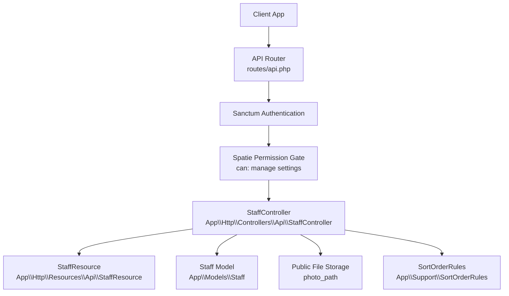
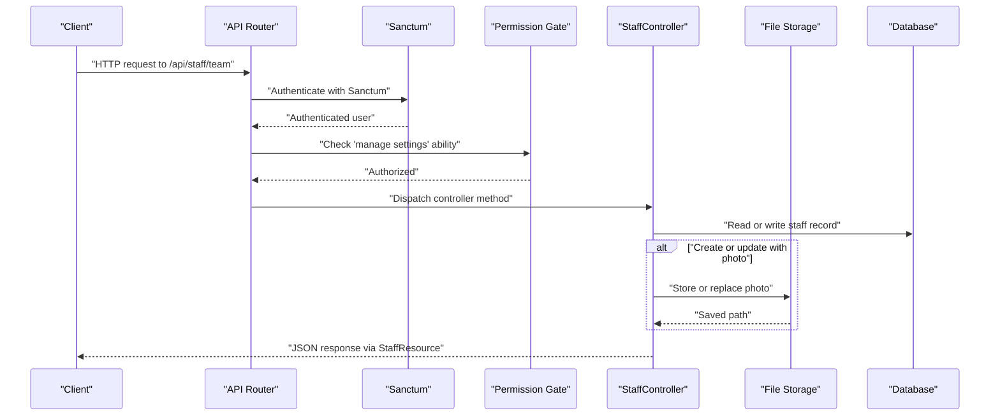
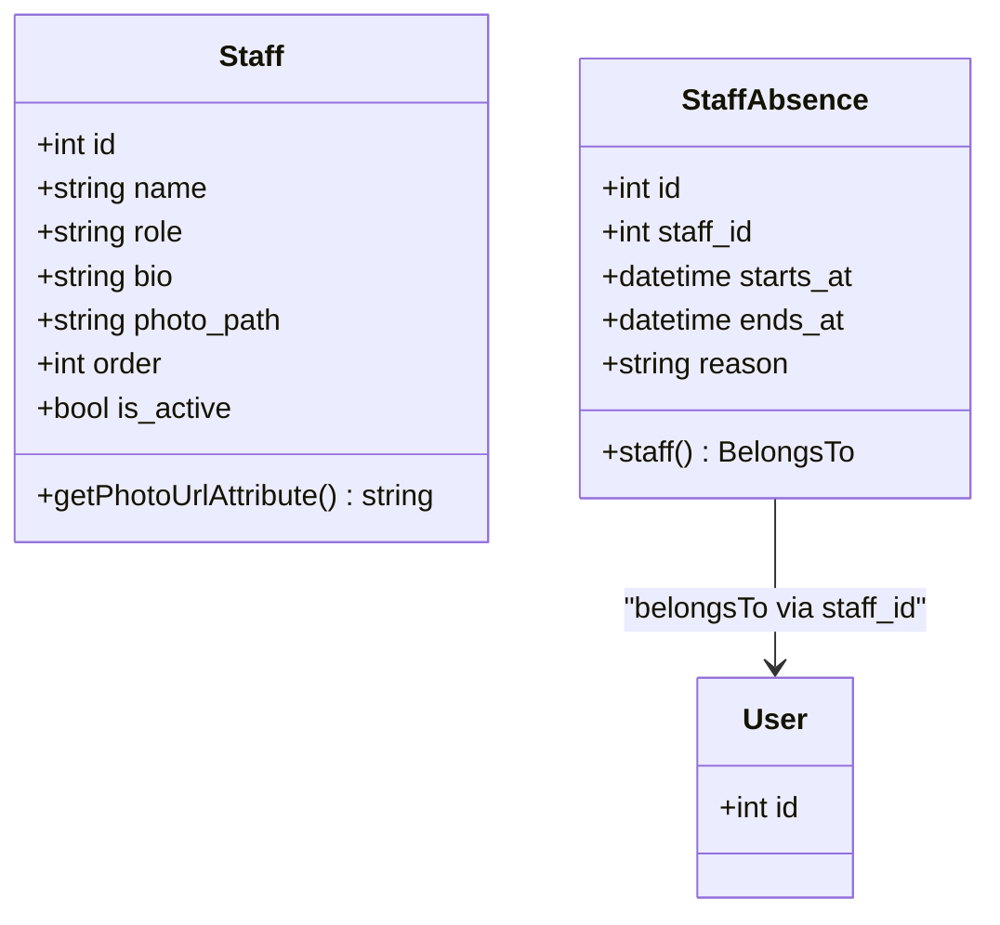
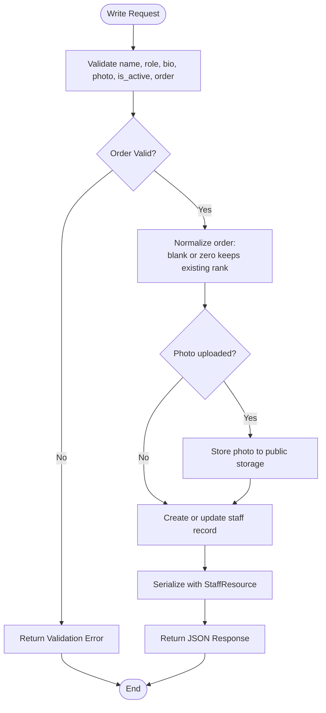
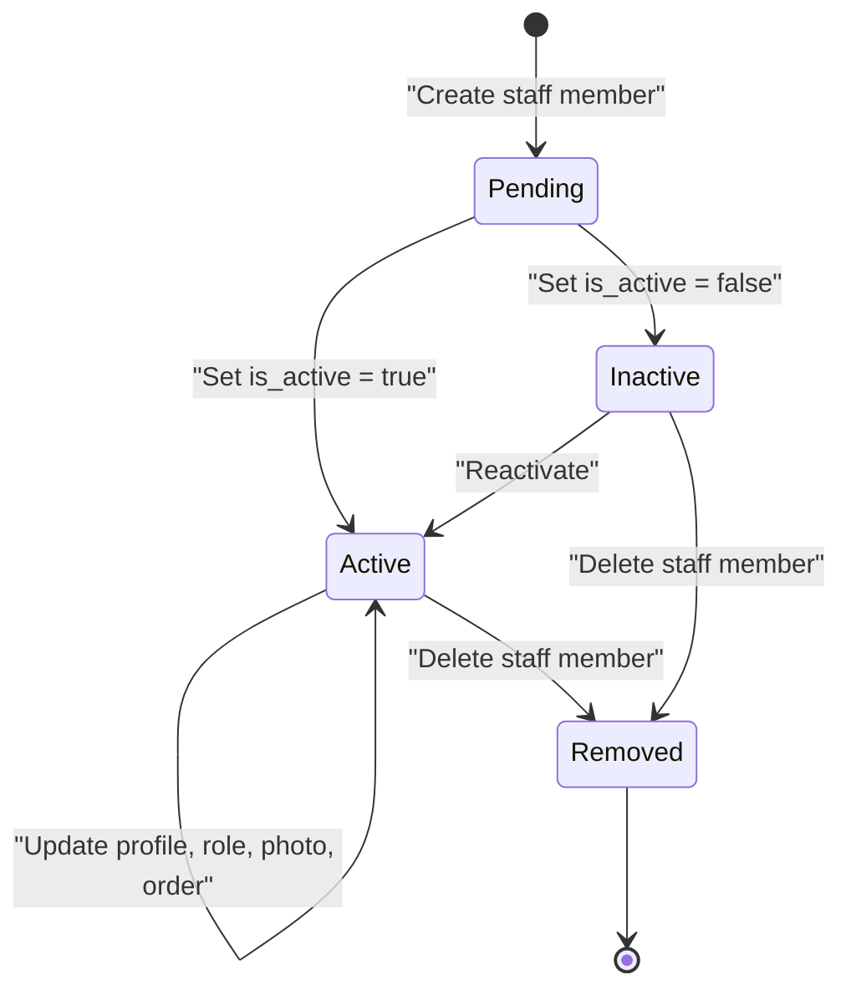
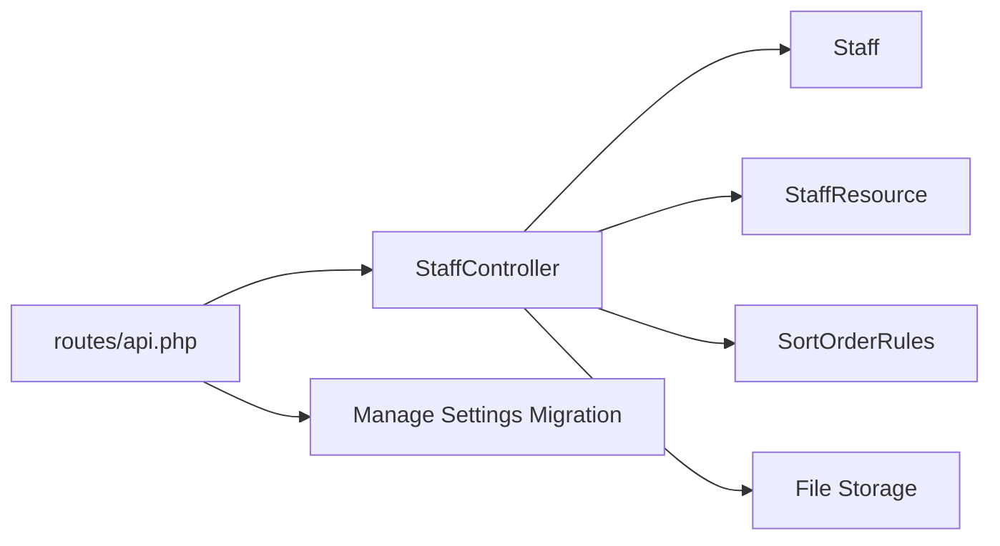

# Team Management

<cite>
**Referenced Files in This Document**
- [routes/api.php](file://routes/api.php)
- [StaffController.php](file://app/Http/Controllers/Api/StaffController.php)
- [StaffResource.php](file://app/Http/Resources/Api/StaffResource.php)
- [Staff.php](file://app/Models/Staff.php)
- [create_staff_table.php](file://database/migrations/2026_05_25_102702_create_staff_table.php)
- [create_staff_absences_table.php](file://database/migrations/2026_04_17_093357_create_staff_absences_table.php)
- [StaffAbsence.php](file://app/Models/StaffAbsence.php)
- [SortOrderRules.php](file://app/Support/SortOrderRules.php)
- [add_manage_settings_permission.php](file://database/migrations/2026_10_23_215000_add_manage_settings_permission.php)
</cite>

## Table of Contents
1. [Introduction](#introduction)
2. [Project Structure](#project-structure)
3. [Core Components](#core-components)
4. [Architecture Overview](#architecture-overview)
5. [Detailed Component Analysis](#detailed-component-analysis)
6. [Dependency Analysis](#dependency-analysis)
7. [Performance Considerations](#performance-considerations)
8. [Troubleshooting Guide](#troubleshooting-guide)
9. [Conclusion](#conclusion)

## Introduction
This document provides comprehensive API documentation for the team management endpoints exposed under the staff application API. The team directory allows administrators to list, create, view, update, and remove staff members. It also documents how staff data relates to availability and scheduling through the staff absence model, and how permissions control access.

The team endpoints are token-authenticated, JSON-only, and gated by the `manage settings` ability. They are designed for the staff mobile app but can be used by any client that authenticates with Sanctum tokens.

## Project Structure
The team management feature is implemented as a small, focused API controller backed by an Eloquent model, a JSON resource, route definitions, and supporting utilities:

- Routes are registered under `/api/staff`.
- The team endpoints live at `/api/staff/team`.
- All team routes require Sanctum authentication and the `can:manage settings` ability.
- The controller validates input, manages optional photo uploads, and returns structured JSON via `StaffResource`.
- Staff ordering is centralized through `SortOrderRules`.
- Staff profiles are stored in the `staff` table; scheduling-related absences are stored separately in `staff_absences`, linked to user accounts.



**Diagram sources**
- [routes/api.php:80-117](file://routes/api.php#L80-L117)
- [StaffController.php:1-115](file://app/Http/Controllers/Api/StaffController.php#L1-L115)
- [StaffResource.php:1-37](file://app/Http/Resources/Api/StaffResource.php#L1-L37)
- [Staff.php:1-45](file://app/Models/Staff.php#L1-L45)
- [SortOrderRules.php:1-59](file://app/Support/SortOrderRules.php#L1-L59)

**Section sources**
- [routes/api.php:1-117](file://routes/api.php#L1-L117)

## Core Components
- **Staff API controller**: Implements listing, creation, retrieval, updating, and deletion of staff members.
- **Staff Eloquent model**: Defines fillable fields, type casting, sort-order behavior, and photo URL generation.
- **Staff JSON resource**: Normalizes staff records into a stable API response shape.
- **Route definitions**: Register RESTful team endpoints under `/api/staff/team`.
- **Permission migration**: Declares and grants the `manage settings` permission required by these endpoints.
- **Sort order utility**: Validates and normalizes numeric ordering for consistent team presentation.
- **Staff absence model and schema**: Provides the data structure for scheduling and availability planning, although absence endpoints are not part of this document’s scope.

**Section sources**
- [StaffController.php:1-115](file://app/Http/Controllers/Api/StaffController.php#L1-L115)
- [StaffResource.php:1-37](file://app/Http/Resources/Api/StaffResource.php#L1-L37)
- [Staff.php:1-45](file://app/Models/Staff.php#L1-L45)
- [routes/api.php:80-117](file://routes/api.php#L80-L117)
- [add_manage_settings_permission.php:1-51](file://database/migrations/2026_10_23_215000_add_manage_settings_permission.php#L1-L51)
- [SortOrderRules.php:1-59](file://app/Support/SortOrderRules.php#L1-L59)
- [StaffAbsence.php:1-39](file://app/Models/StaffAbsence.php#L1-L39)
- [create_staff_absences_table.php:1-33](file://database/migrations/2026_04_17_093357_create_staff_absences_table.php#L1-L33)

## Architecture Overview
The team management flow uses Laravel’s standard request lifecycle:

1. A client sends a request to `/api/staff/team`.
2. The router resolves the `StaffController` method based on HTTP verb and URL pattern.
3. Sanctum middleware authenticates the request using a Bearer token.
4. Spatie’s authorization gate checks that the authenticated user has the `manage settings` ability.
5. The controller validates the payload.
6. For writes, files are stored to public storage and database records are created or updated.
7. Responses are serialized through `StaffResource`.



**Diagram sources**
- [routes/api.php:80-117](file://routes/api.php#L80-L117)
- [StaffController.php:1-115](file://app/Http/Controllers/Api/StaffController.php#L1-L115)
- [StaffResource.php:1-37](file://app/Http/Resources/Api/StaffResource.php#L1-L37)

## Detailed Component Analysis

### Authentication and Authorization
- **Authentication**: All team endpoints are inside the Sanctum-protected group. Clients must include a valid Bearer token obtained through the staff login flow.
- **Authorization**: Every team endpoint requires the `manage settings` ability. This means ordinary staff users cannot access team management unless explicitly granted.
- **Permission registration**: The `manage settings` permission is declared by a migration and granted to the Admin role. Existing installations may need to run migrations so roles can grant the permission through the admin panel.

**Security note**: Do not expose these endpoints publicly. They should only be called from trusted clients after successful staff authentication.

**Section sources**
- [routes/api.php:80-117](file://routes/api.php#L80-L117)
- [add_manage_settings_permission.php:1-51](file://database/migrations/2026_10_23_215000_add_manage_settings_permission.php#L1-L51)

### Endpoint Reference

#### List Team Members
- **Method**: `GET`
- **URL**: `/api/staff/team`
- **Authentication**: Required (Sanctum)
- **Permissions**: `manage settings`
- **Query parameters**: None defined by the controller.
- **Success response**: Array of staff objects.
- **Error responses**:
  - `401 Unauthorized`: Missing or invalid token.
  - `403 Forbidden`: User lacks `manage settings`.
  - `404 Not Found`: No matching route or missing identifier where applicable.

Example success response shape:
```json
{
  "data": [
    {
      "id": 1,
      "name": "Alice",
      "role": "Field Technician",
      "bio": "Senior glass installer.",
      "photo_url": "https://example.com/storage/staff/photo.jpg",
      "order": 1,
      "is_active": true,
      "created_at": "2026-01-15T10:00:00Z",
      "updated_at": "2026-01-16T12:00:00Z"
    }
  ]
}
```

**Section sources**
- [routes/api.php:98-100](file://routes/api.php#L98-L100)
- [StaffController.php:27-33](file://app/Http/Controllers/Api/StaffController.php#L27-L33)
- [StaffResource.php:22-37](file://app/Http/Resources/Api/StaffResource.php#L22-L37)

#### Add New Team Member
- **Method**: `POST`
- **URL**: `/api/staff/team`
- **Authentication**: Required (Sanctum)
- **Permissions**: `manage settings`
- **Content-Type**: `multipart/form-data` when uploading a photo; otherwise JSON-compatible field names apply.
- **Request body**:
  - `name`: Required string, maximum 255 characters.
  - `role`: Required string, maximum 255 characters.
  - `bio`: Optional string.
  - `photo`: Optional image file, maximum 2 MB.
  - `is_active`: Optional boolean; defaults to `true`.
  - `order`: Optional integer, minimum 1, must be unique among existing staff. If omitted, the system assigns the next available position.

Validation rules are enforced directly in the controller, including uniqueness constraints on `order`.

Example request body:
```json
{
  "name": "Bob",
  "role": "Office Manager",
  "bio": "Handles scheduling and quotes.",
  "is_active": true,
  "order": 2
}
```

Example success response:
```json
{
  "data": {
    "id": 2,
    "name": "Bob",
    "role": "Office Manager",
    "bio": "Handles scheduling and quotes.",
    "photo_url": null,
    "order": 2,
    "is_active": true,
    "created_at": "2026-01-17T09:00:00Z",
    "updated_at": "2026-01-17T09:00:00Z"
  }
}
```

**Section sources**
- [routes/api.php:98-100](file://routes/api.php#L98-L100)
- [StaffController.php:35-61](file://app/Http/Controllers/Api/StaffController.php#L35-L61)
- [SortOrderRules.php:14-35](file://app/Support/SortOrderRules.php#L14-L35)

#### View Individual Staff Profile
- **Method**: `GET`
- **URL**: `/api/staff/team/{staff}`
- **Authentication**: Required (Sanctum)
- **Permissions**: `manage settings`
- **Path parameter**:
  - `staff`: Numeric staff ID.
- **Success response**: Single staff object.
- **Error responses**:
  - `404 Not Found`: Invalid or missing staff ID.

Example success response:
```json
{
  "id": 1,
  "name": "Alice",
  "role": "Field Technician",
  "bio": "Senior glass installer.",
  "photo_url": "https://example.com/storage/staff/photo.jpg",
  "order": 1,
  "is_active": true,
  "created_at": "2026-01-15T10:00:00Z",
  "updated_at": "2026-01-16T12:00:00Z"
}
```

**Section sources**
- [routes/api.php:101-101](file://routes/api.php#L101-L101)
- [StaffController.php:35-40](file://app/Http/Controllers/Api/StaffController.php#L35-L40)
- [StaffResource.php:22-37](file://app/Http/Resources/Api/StaffResource.php#L22-L37)

#### Update Staff Information
- **Method**: `PUT`
- **URL**: `/api/staff/team/{staff}`
- **Authentication**: Required (Sanctum)
- **Permissions**: `manage settings`
- **Path parameter**:
  - `staff`: Numeric staff ID.
- **Request body**: Same fields as create, except `order` is validated against the existing set of staff records, excluding the current record.
- **Behavior**:
  - Omitting `order` preserves the existing rank.
  - Providing `0`, blank, or unset `order` also preserves the existing rank.
  - Uploading a new photo replaces the previous photo if one exists.
  - `is_active` defaults to the current value when omitted.

Example request body:
```json
{
  "name": "Alice Updated",
  "role": "Lead Field Technician",
  "bio": "Promoted to lead.",
  "is_active": true,
  "order": 1
}
```

Example success response:
```json
{
  "id": 1,
  "name": "Alice Updated",
  "role": "Lead Field Technician",
  "bio": "Promoted to lead.",
  "photo_url": "https://example.com/storage/staff/new-photo.jpg",
  "order": 1,
  "is_active": true,
  "created_at": "2026-01-15T10:00:00Z",
  "updated_at": "2026-01-18T14:30:00Z"
}
```

**Section sources**
- [routes/api.php:102-102](file://routes/api.php#L102-L102)
- [StaffController.php:63-97](file://app/Http/Controllers/Api/StaffController.php#L63-L97)
- [SortOrderRules.php:37-59](file://app/Support/SortOrderRules.php#L37-L59)

#### Remove Team Member
- **Method**: `DELETE`
- **URL**: `/api/staff/team/{staff}`
- **Authentication**: Required (Sanctum)
- **Permissions**: `manage settings`
- **Path parameter**:
  - `staff`: Numeric staff ID.
- **Success response**: Simple message indicating removal.
- **Side effects**: Deletes the staff record and removes the associated photo file if present.

Example success response:
```json
{
  "message": "Staff member removed."
}
```

**Section sources**
- [routes/api.php:103-103](file://routes/api.php#L103-L103)
- [StaffController.php:99-115](file://app/Http/Controllers/Api/StaffController.php#L99-L115)

### Request and Response Schemas

#### Staff Object Schema
| Field | Type | Required | Description |
|---|---|---:|---|
| `id` | integer | Always | Database primary key. |
| `name` | string | Yes for create/update | Display name of the staff member. |
| `role` | string | Yes for create/update | Job title or functional role. |
| `bio` | string or null | No | Optional biography text. |
| `photo_url` | string or null | Read-only | Public URL for the staff photo; falls back to a placeholder when no photo exists. |
| `order` | integer | Optional | Position in the team list; minimum 1, unique across staff. |
| `is_active` | boolean | Optional on write, always on read | Whether the staff member is active. Defaults to `true` on create. |
| `created_at` | ISO 8601 string | Read-only | Record creation timestamp. |
| `updated_at` | ISO 8601 string | Read-only | Record last-update timestamp. |

#### Create/Update Payload Rules
| Field | Create Rule | Update Rule | Notes |
|---|---|---|---|
| `name` | Required string, max 255 | Required string, max 255 | Human-readable staff name. |
| `role` | Required string, max 255 | Required string, max 255 | Role label such as technician or manager. |
| `bio` | Nullable string | Nullable string | Free-form profile text. |
| `photo` | Optional image, max 2 MB | Optional image, max 2 MB | Stored under `staff`; old photo replaced on update. |
| `is_active` | Optional boolean | Optional boolean | Defaults to `true` when omitted on create. |
| `order` | Optional integer, min 1, unique | Optional integer, min 1, unique | Blank, `0`, or omitted preserves existing rank on update. |

**Section sources**
- [StaffController.php:35-115](file://app/Http/Controllers/Api/StaffController.php#L35-L115)
- [StaffResource.php:22-37](file://app/Http/Resources/Api/StaffResource.php#L22-L37)
- [SortOrderRules.php:14-59](file://app/Support/SortOrderRules.php#L14-L59)

### Data Model Relationships
The core team entity is the `Staff` model. Absence scheduling is modeled separately and linked to user accounts rather than the `staff` table.



**Diagram sources**
- [Staff.php:1-45](file://app/Models/Staff.php#L1-L45)
- [StaffAbsence.php:1-39](file://app/Models/StaffAbsence.php#L1-L39)
- [create_staff_table.php:1-33](file://database/migrations/2026_05_25_102702_create_staff_table.php#L1-L33)
- [create_staff_absences_table.php:1-33](file://database/migrations/2026_04_17_093357_create_staff_absences_table.php#L1-L33)

**Section sources**
- [Staff.php:1-45](file://app/Models/Staff.php#L1-L45)
- [StaffAbsence.php:1-39](file://app/Models/StaffAbsence.php#L1-L39)
- [create_staff_table.php:1-33](file://database/migrations/2026_05_25_102702_create_staff_table.php#L1-L33)
- [create_staff_absences_table.php:1-33](file://database/migrations/2026_04_17_093357_create_staff_absences_table.php#L1-L33)

### Validation and Ordering Logic
The controller performs explicit validation for every write operation. Sorting logic is centralized in `SortOrderRules`, which:

- Enforces a minimum value of 1 for `order`.
- Ensures uniqueness across staff records.
- Treats blank, empty, zero, or string-zero values as “preserve existing rank” during updates.



**Diagram sources**
- [StaffController.php:35-115](file://app/Http/Controllers/Api/StaffController.php#L35-L115)
- [SortOrderRules.php:14-59](file://app/Support/SortOrderRules.php#L14-L59)

**Section sources**
- [StaffController.php:35-115](file://app/Http/Controllers/Api/StaffController.php#L35-L115)
- [SortOrderRules.php:14-59](file://app/Support/SortOrderRules.php#L14-L59)

### Staff Lifecycle
A typical staff lifecycle includes:

1. **Onboarding**: Create a staff record with name, role, optional bio, optional photo, initial order, and active status.
2. **Profile customization**: Update name, role, bio, photo, or active status without changing other fields.
3. **Positioning**: Assign or adjust `order` to place the staff member correctly in the team list.
4. **Deactivation**: Set `is_active` to `false` to hide or disable the member without deleting their history.
5. **Removal**: Delete the staff record and associated photo when no longer needed.



[No diagram sources since this diagram shows conceptual lifecycle, not direct code mapping]

### Role Assignments and Permissions
Team management does not assign roles through these endpoints. Instead, it relies on Spatie permissions:

- The `manage settings` ability controls access to all team endpoints.
- The permission is registered by a migration and granted to the Admin role.
- Other roles must be explicitly granted the ability through the admin panel.
- Ordinary staff users do not receive this ability by default.

**Section sources**
- [add_manage_settings_permission.php:1-51](file://database/migrations/2026_10_23_215000_add_manage_settings_permission.php#L1-L51)
- [routes/api.php:98-103](file://routes/api.php#L98-L103)

### Integration With the Admin Panel
The web admin panel and the staff API share the same authorization model. Both use Spatie abilities through the `can:` middleware. The team endpoints mirror the concept of managing settings, so any admin capable of managing settings in the web UI should also be able to call these API endpoints.

When extending the team feature, keep validation, ordering, and permission checks aligned with the controller and routing conventions already established.

**Section sources**
- [routes/api.php:80-117](file://routes/api.php#L80-L117)
- [StaffController.php:1-115](file://app/Http/Controllers/Api/StaffController.php#L1-L115)

### Practical Scenarios

#### Onboarding a New Team Member
1. Authenticate as an admin with `manage settings`.
2. Call `POST /api/staff/team` with name, role, and optional details.
3. Optionally upload a photo immediately or attach it later through an update.
4. Set `order` to position the person in the team directory.
5. Verify the response contains the correct `id`, `photo_url`, and timestamps.

#### Managing Schedules and Availability
Although absence management endpoints are not part of this document, the data model supports scheduling:

- `staff_absences` stores date ranges and reasons.
- Absences are linked to users through `staff_id`.
- Availability services can query absence ranges to determine when staff are unavailable.
- Use the team directory to identify staff identifiers and roles while scheduling tools reference user-based absence records.

**Section sources**
- [create_staff_absences_table.php:1-33](file://database/migrations/2026_04_17_093357_create_staff_absences_table.php#L1-L33)
- [StaffAbsence.php:1-39](file://app/Models/StaffAbsence.php#L1-L39)

#### Coordinating Field Operations
- Use `role` to distinguish field technicians, office managers, supervisors, or support staff.
- Use `is_active` to quickly toggle whether a field worker should appear in active team lists.
- Use `order` to prioritize senior or lead staff at the top of the team directory.
- Combine staff data with booking, inspection, or calendar services to coordinate assignments.

**Section sources**
- [Staff.php:1-45](file://app/Models/Staff.php#L1-L45)
- [StaffResource.php:22-37](file://app/Http/Resources/Api/StaffResource.php#L22-L37)

## Dependency Analysis
The team endpoints have clear, low-coupling dependencies:

- Routes depend on `StaffController`.
- `StaffController` depends on:
  - `Staff` model for persistence.
  - `StaffResource` for response serialization.
  - `SortOrderRules` for ordering validation and normalization.
  - Laravel storage for optional photo handling.
- The permission layer depends on Spatie permissions and the `manage settings` migration.



**Diagram sources**
- [routes/api.php:98-103](file://routes/api.php#L98-L103)
- [StaffController.php:1-115](file://app/Http/Controllers/Api/StaffController.php#L1-L115)
- [Staff.php:1-45](file://app/Models/Staff.php#L1-L45)
- [StaffResource.php:1-37](file://app/Http/Resources/Api/StaffResource.php#L1-L37)
- [SortOrderRules.php:1-59](file://app/Support/SortOrderRules.php#L1-L59)
- [add_manage_settings_permission.php:1-51](file://database/migrations/2026_10_23_215000_add_manage_settings_permission.php#L1-L51)

**Section sources**
- [routes/api.php:98-103](file://routes/api.php#L98-L103)
- [StaffController.php:1-115](file://app/Http/Controllers/Api/StaffController.php#L1-L115)
- [Staff.php:1-45](file://app/Models/Staff.php#L1-L45)
- [StaffResource.php:1-37](file://app/Http/Resources/Api/StaffResource.php#L1-L37)
- [SortOrderRules.php:1-59](file://app/Support/SortOrderRules.php#L1-L59)
- [add_manage_settings_permission.php:1-51](file://database/migrations/2026_10_23_215000_add_manage_settings_permission.php#L1-L51)

## Performance Considerations
- Listing staff uses a simple ordered query. For very large teams, consider pagination if future requirements demand it.
- Photo uploads go through Laravel’s public storage; ensure storage disks are configured and accessible.
- Avoid unnecessary photo replacements during frequent updates to reduce storage churn.
- Keep `order` assignments stable; repeated reordering can cause extra writes.

[No sources needed since this section provides general guidance]

## Troubleshooting Guide

### Common Errors
- **401 Unauthorized**: The request is missing a valid Sanctum token or the token has expired.
- **403 Forbidden**: The authenticated user does not have the `manage settings` ability.
- **422 Unprocessable Entity**: Validation failed, typically due to missing `name` or `role`, invalid `order`, oversized photos, or duplicate `order` values.
- **404 Not Found**: The requested staff ID does not exist or the route pattern is incorrect.

### Validation Problems
- Duplicate `order`: Ensure each staff member has a unique integer order.
- Invalid photo size: Photos must be images and under 2 MB.
- Null or zero order on update: This intentionally preserves the existing rank; set an explicit positive integer if you intend to change position.

### Permission Problems
If team endpoints return `403` consistently:
- Confirm the `manage settings` permission exists.
- Grant the permission to the appropriate role through the admin panel.
- Run migrations to register the permission on existing databases.

### Photo Issues
- Missing `photo_url`: The staff member may not have a photo uploaded yet.
- Broken photo links: Check that the public storage disk is properly configured and readable.
- Orphaned photos: When a photo is replaced or a staff member is deleted, the controller removes the previous file.

**Section sources**
- [StaffController.php:35-115](file://app/Http/Controllers/Api/StaffController.php#L35-L115)
- [add_manage_settings_permission.php:1-51](file://database/migrations/2026_10_23_215000_add_manage_settings_permission.php#L1-L51)

## Conclusion
The team management API provides a secure, permission-gated interface for managing staff profiles. It exposes a clean REST surface for listing, creating, viewing, updating, and removing team members, with optional photo uploads and deterministic ordering. Authorization is controlled by the `manage settings` ability, aligning team operations with the broader admin experience. While absence scheduling is modeled in the database, absence endpoints are separate from the team endpoints documented here. Clients should authenticate with Sanctum, respect validation rules, and treat `order`, `is_active`, and `photo_url` as important parts of team coordination workflows.