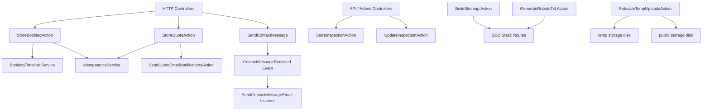
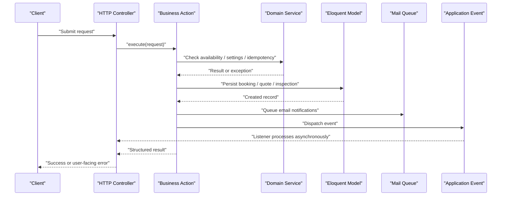
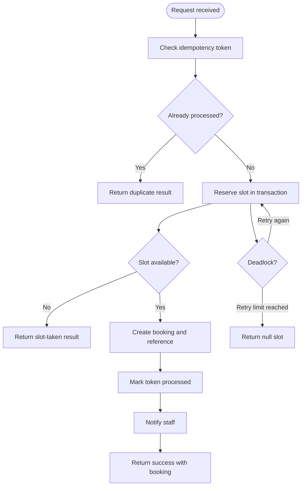
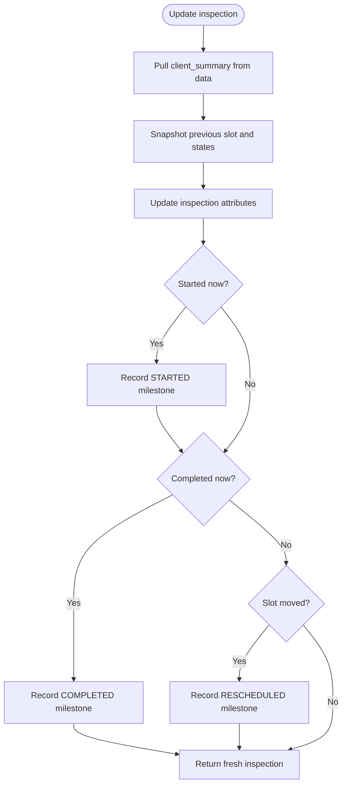
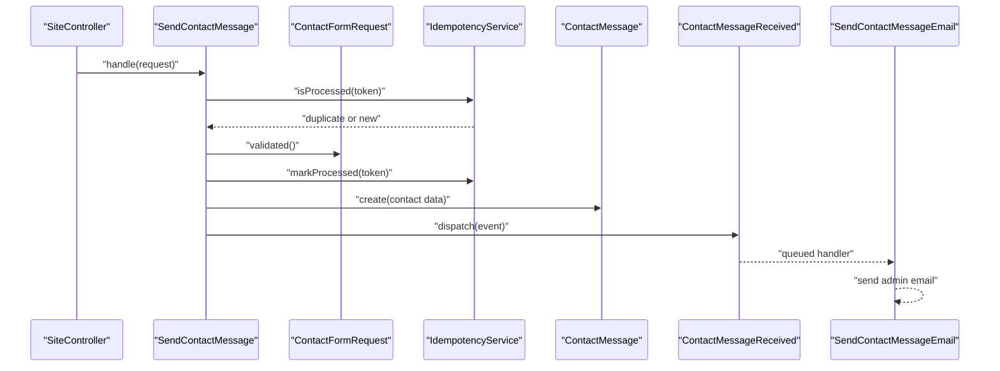
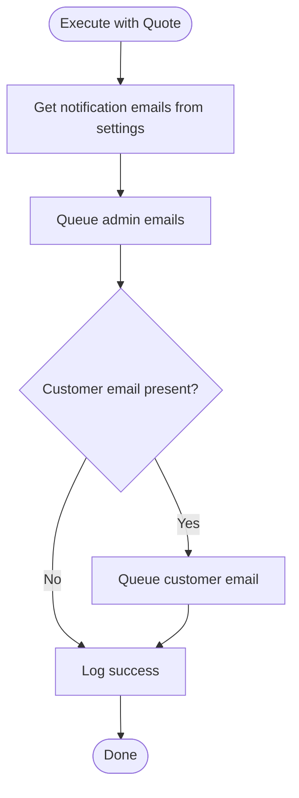
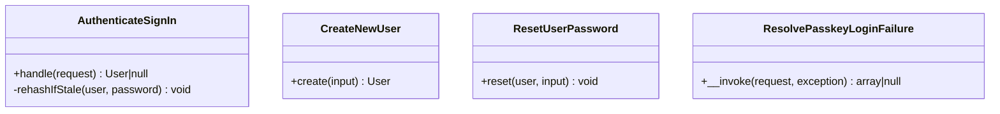
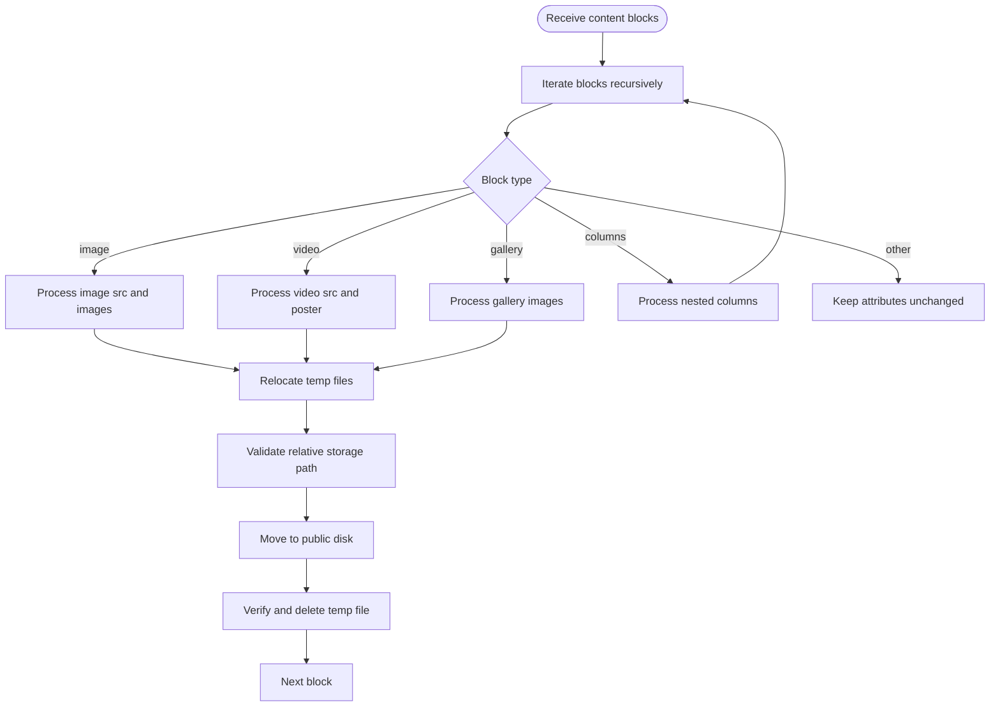
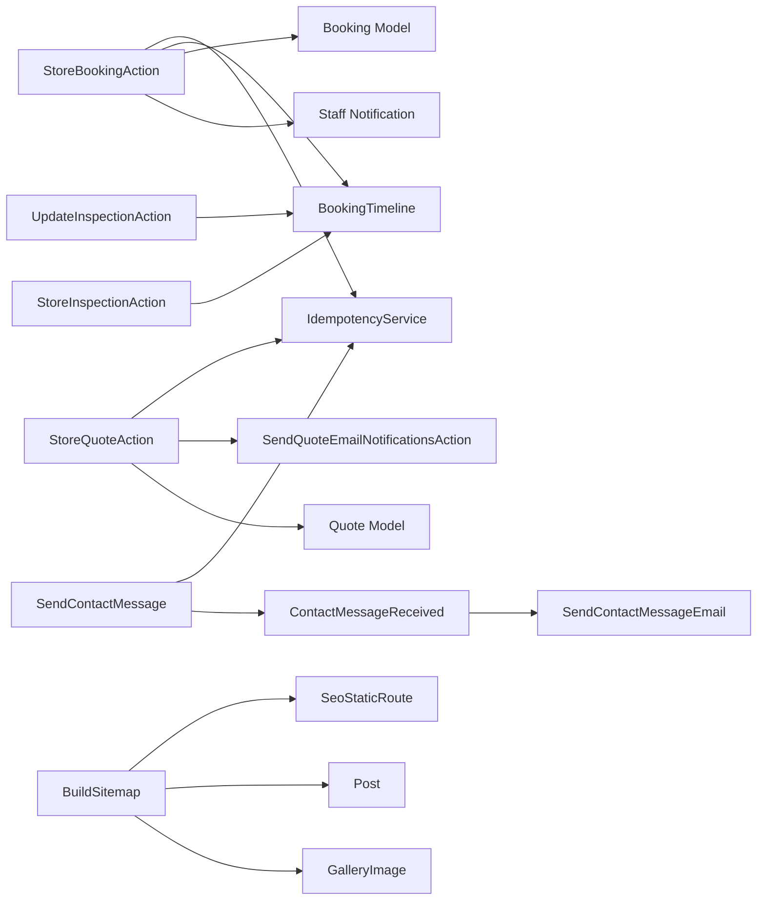
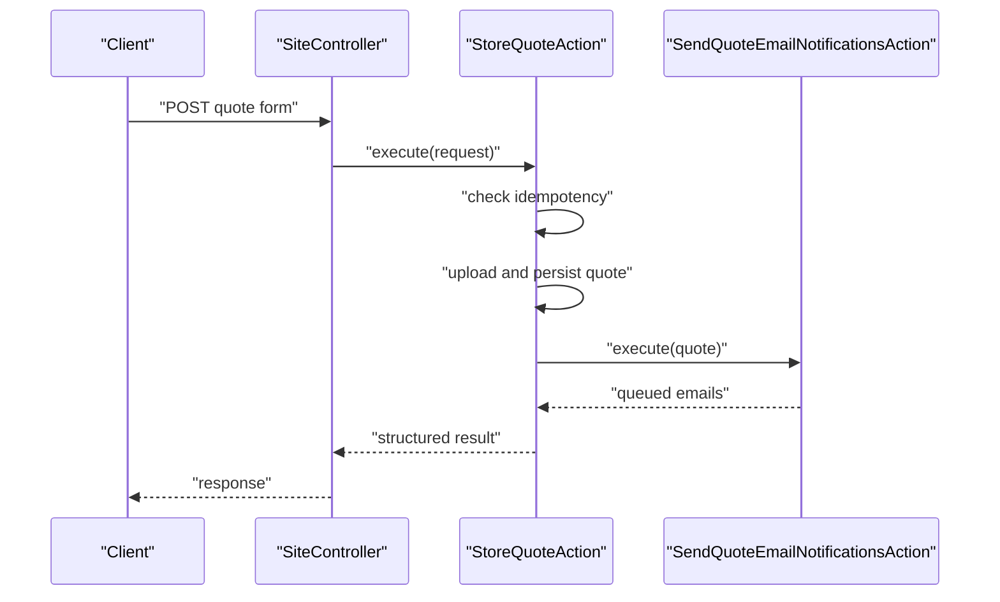

# Action Pattern

<cite>
**Referenced Files in This Document**
- [StoreBookingAction.php](file://app/Actions/StoreBookingAction.php)
- [UpdateInspectionAction.php](file://app/Actions/UpdateInspectionAction.php)
- [StoreInspectionAction.php](file://app/Actions/StoreInspectionAction.php)
- [SendContactMessage.php](file://app/Actions/SendContactMessage.php)
- [SendQuoteEmailNotificationsAction.php](file://app/Actions/SendQuoteEmailNotificationsAction.php)
- [StoreQuoteAction.php](file://app/Actions/StoreQuoteAction.php)
- [AssignRoleToUser.php](file://app/Actions/Admin/AssignRoleToUser.php)
- [ResolvePasskeyLoginFailure.php](file://app/Actions/Auth/ResolvePasskeyLoginFailure.php)
- [GenerateRobotsTxt.php](file://app/Actions/Seo/GenerateRobotsTxt.php)
- [BuildSitemap.php](file://app/Actions/Seo/BuildSitemap.php)
- [RelocateTempUploadsAction.php](file://app/Actions/Content/RelocateTempUploadsAction.php)
- [ResetUserPassword.php](file://app/Actions/Fortify/ResetUserPassword.php)
- [AuthenticateSignIn.php](file://app/Actions/Fortify/AuthenticateSignIn.php)
- [CreateNewUser.php](file://app/Actions/Fortify/CreateNewUser.php)
- [ContactMessageReceived.php](file://app/Events/ContactMessageReceived.php)
- [SendContactMessageEmail.php](file://app/Listeners/SendContactMessageEmail.php)
- [IdempotencyService.php](file://app/Services/IdempotencyService.php)
- [BookingTimeline.php](file://app/Services/BookingTimeline.php)
- [QuoteService.php](file://app/Services/QuoteService.php)
- [ContactMessageService.php](file://app/Services/ContactMessageService.php)
- [SiteController.php](file://app/Http/Controllers/SiteController.php)
- [BookingController.php](file://app/Http/Controllers/BookingController.php)
- [InspectionController.php (API)](file://app/Http/Controllers/Api/InspectionController.php)
- [InspectionController.php (Admin)](file://app/Http/Controllers/Admin/InspectionController.php)
</cite>

## Table of Contents
1. [Introduction](#introduction)
2. [Project Structure](#project-structure)
3. [Core Components](#core-components)
4. [Architecture Overview](#architecture-overview)
5. [Detailed Component Analysis](#detailed-component-analysis)
6. [Dependency Analysis](#dependency-analysis)
7. [Performance Considerations](#performance-considerations)
8. [Troubleshooting Guide](#troubleshooting-guide)
9. [Conclusion](#conclusion)

## Introduction
Highblossom uses an action pattern to encapsulate discrete business operations into single-responsibility classes. Rather than scattering request handling, persistence, validation, notifications, and side effects across controllers, the application groups related work into actions such as `StoreBookingAction`, `StoreQuoteAction`, `SendContactMessage`, `UpdateInspectionAction`, and several Fortify, SEO, content, admin, and authentication actions.

This approach makes complex workflows easier to understand, test, and evolve:
- Each action owns one meaningful operation.
- Controllers delegate execution rather than implementing business logic themselves.
- Services, models, events, jobs, mail, notifications, and settings are coordinated inside well-scoped classes.
- Idempotency, transactions, image processing, email queuing, and timeline transitions become repeatable units of behavior.

The repository currently contains a focused set of explicit action classes under `app/Actions`. The documentation objective mentions 117 action classes; this analysis documents the concrete action implementation present in the codebase and explains how it fits into the broader service-layer architecture.

## Project Structure
The action layer lives under `app/Actions` and is organized by domain:

| Area | Purpose | Example Actions |
| --- | --- | --- |
| Core business flows | Booking, quote, inspection, contact submissions | `StoreBookingAction`, `StoreQuoteAction`, `StoreInspectionAction`, `UpdateInspectionAction`, `SendContactMessage` |
| Communication | Email notification orchestration | `SendQuoteEmailNotificationsAction` |
| Content operations | File relocation for content blocks | `RelocateTempUploadsAction` |
| SEO generation | Robots.txt and sitemap construction | `GenerateRobotsTxt`, `BuildSitemap` |
| Authentication and Fortify integration | Sign-in, registration, password reset, passkey failure classification | `AuthenticateSignIn`, `CreateNewUser`, `ResetUserPassword`, `ResolvePasskeyLoginFailure` |
| Admin operations | Permission and role assignment | `AssignRoleToUser` |

**Diagram sources**
- [StoreBookingAction.php:1-200](file://app/Actions/StoreBookingAction.php#L1-L200)
- [StoreQuoteAction.php:1-160](file://app/Actions/StoreQuoteAction.php#L1-L160)
- [SendContactMessage.php:1-71](file://app/Actions/SendContactMessage.php#L1-L71)
- [StoreInspectionAction.php:1-42](file://app/Actions/StoreInspectionAction.php#L1-L42)
- [UpdateInspectionAction.php:1-77](file://app/Actions/UpdateInspectionAction.php#L1-L77)
- [SendQuoteEmailNotificationsAction.php:1-113](file://app/Actions/SendQuoteEmailNotificationsAction.php#L1-L113)
- [BuildSitemap.php:1-166](file://app/Actions/Seo/BuildSitemap.php#L1-L166)
- [GenerateRobotsTxt.php:1-70](file://app/Actions/Seo/GenerateRobotsTxt.php#L1-L70)
- [RelocateTempUploadsAction.php:1-257](file://app/Actions/Content/RelocateTempUploadsAction.php#L1-L257)

**Section sources**
- [StoreBookingAction.php:1-200](file://app/Actions/StoreBookingAction.php#L1-L200)
- [StoreQuoteAction.php:1-160](file://app/Actions/StoreQuoteAction.php#L1-L160)
- [SendContactMessage.php:1-71](file://app/Actions/SendContactMessage.php#L1-L71)
- [StoreInspectionAction.php:1-42](file://app/Actions/StoreInspectionAction.php#L1-L42)
- [UpdateInspectionAction.php:1-77](file://app/Actions/UpdateInspectionAction.php#L1-L77)
- [SendQuoteEmailNotificationsAction.php:1-113](file://app/Actions/SendQuoteEmailNotificationsAction.php#L1-L113)
- [BuildSitemap.php:1-166](file://app/Actions/Seo/BuildSitemap.php#L1-L166)
- [GenerateRobotsTxt.php:1-70](file://app/Actions/Seo/GenerateRobotsTxt.php#L1-L70)
- [RelocateTempUploadsAction.php:1-257](file://app/Actions/Content/RelocateTempUploadsAction.php#L1-L257)

## Core Components
The most important action classes fall into three categories:

### Booking and Inspection Actions
- `StoreBookingAction`: Handles public booking submission with idempotency protection, availability locking, booking creation, reference generation, damage photo processing, staff notification, and user-friendly error responses.
- `StoreInspectionAction`: Creates an inspection and confirms the related booking through `BookingTimeline`.
- `UpdateInspectionAction`: Updates an inspection, detects state transitions, records timeline milestones, and reschedules when the slot changes.

### Communication Actions
- `SendContactMessage`: Validates and persists a contact form, marks idempotency tokens, and dispatches `ContactMessageReceived`.
- `SendQuoteEmailNotificationsAction`: Queues admin and customer quote emails using configured settings.

### Supporting Actions
- Fortify integration: `AuthenticateSignIn`, `CreateNewUser`, `ResetUserPassword`, `ResolvePasskeyLoginFailure`.
- SEO generation: `GenerateRobotsTxt`, `BuildSitemap`.
- Content operations: `RelocateTempUploadsAction`.
- Admin operations: `AssignRoleToUser`.

These actions share common responsibilities:
- Encapsulate input handling or domain data.
- Coordinate services and models.
- Produce predictable return values or side effects.
- Fail safely without leaking internal details to callers.

**Section sources**
- [StoreBookingAction.php:1-200](file://app/Actions/StoreBookingAction.php#L1-L200)
- [StoreInspectionAction.php:1-42](file://app/Actions/StoreInspectionAction.php#L1-L42)
- [UpdateInspectionAction.php:1-77](file://app/Actions/UpdateInspectionAction.php#L1-L77)
- [SendContactMessage.php:1-71](file://app/Actions/SendContactMessage.php#L1-L71)
- [SendQuoteEmailNotificationsAction.php:1-113](file://app/Actions/SendQuoteEmailNotificationsAction.php#L1-L113)
- [AuthenticateSignIn.php:1-76](file://app/Actions/Fortify/AuthenticateSignIn.php#L1-L76)
- [CreateNewUser.php:1-99](file://app/Actions/Fortify/CreateNewUser.php#L1-L99)
- [ResetUserPassword.php:1-47](file://app/Actions/Fortify/ResetUserPassword.php#L1-L47)
- [ResolvePasskeyLoginFailure.php:1-95](file://app/Actions/Auth/ResolvePasskeyLoginFailure.php#L1-L95)
- [GenerateRobotsTxt.php:1-70](file://app/Actions/Seo/GenerateRobotsTxt.php#L1-L70)
- [BuildSitemap.php:1-166](file://app/Actions/Seo/BuildSitemap.php#L1-L166)
- [RelocateTempUploadsAction.php:1-257](file://app/Actions/Content/RelocateTempUploadsAction.php#L1-L257)
- [AssignRoleToUser.php:1-22](file://app/Actions/Admin/AssignRoleToUser.php#L1-L22)

## Architecture Overview
Actions sit between HTTP controllers and the service/model/event layers. They are not a replacement for services; they are workflow orchestrators that coordinate services, models, events, mail, and storage.

**Diagram sources**
- [StoreBookingAction.php:1-200](file://app/Actions/StoreBookingAction.php#L1-L200)
- [StoreQuoteAction.php:1-160](file://app/Actions/StoreQuoteAction.php#L1-L160)
- [SendContactMessage.php:1-71](file://app/Actions/SendContactMessage.php#L1-L71)
- [BookingTimeline.php:1-128](file://app/Services/BookingTimeline.php#L1-L128)
- [IdempotencyService.php:1-95](file://app/Services/IdempotencyService.php#L1-L95)

**Section sources**
- [StoreBookingAction.php:1-200](file://app/Actions/StoreBookingAction.php#L1-L200)
- [StoreQuoteAction.php:1-160](file://app/Actions/StoreQuoteAction.php#L1-L160)
- [SendContactMessage.php:1-71](file://app/Actions/SendContactMessage.php#L1-L71)
- [BookingTimeline.php:1-128](file://app/Services/BookingTimeline.php#L1-L128)
- [IdempotencyService.php:1-95](file://app/Services/IdempotencyService.php#L1-L95)

## Detailed Component Analysis

### StoreBookingAction
`StoreBookingAction` implements the complete public booking flow. It accepts an HTTP request, protects against duplicate submissions, checks availability, creates the booking, generates a human-readable reference, processes optional damage photos, notifies staff, and returns a consistent result array.

Key behaviors:
- **Idempotency**: Uses `_idempotency_token` from the request and `IdempotencyService` to avoid duplicate bookings.
- **Concurrency safety**: Wraps availability checking and booking insertion in a database transaction with retry logic for deadlocks.
- **Availability coordination**: Delegates slot availability to `AvailabilityServiceInterface`.
- **Reference generation**: Produces a stable booking reference after the record exists.
- **Image handling**: Scales, converts, and stores damage photos while allowing the booking to succeed even if image processing fails.
- **Notifications**: Sends staff notifications after successful booking creation.
- **Return contract**: Returns structured arrays with `success`, optional `message`, optional `booking`, and optional `slot_taken`.

**Diagram sources**
- [StoreBookingAction.php:1-200](file://app/Actions/StoreBookingAction.php#L1-L200)
- [IdempotencyService.php:1-95](file://app/Services/IdempotencyService.php#L1-L95)

**Section sources**
- [StoreBookingAction.php:1-200](file://app/Actions/StoreBookingAction.php#L1-L200)

### UpdateInspectionAction
`UpdateInspectionAction` updates an existing inspection and derives lifecycle events from field changes. It extracts client summary data before mass update, detects whether the inspection was started or completed during this call, records rescheduling when the appointment time moves, and returns a fresh model instance.

Important design points:
- State transition detection compares previous and current values.
- Timeline recording is conditional on actual state changes.
- Completed inspections do not trigger reschedule events.
- Actor identification supports auditability for staff actions.

**Diagram sources**
- [UpdateInspectionAction.php:1-77](file://app/Actions/UpdateInspectionAction.php#L1-L77)
- [BookingTimeline.php:1-128](file://app/Services/BookingTimeline.php#L1-L128)

**Section sources**
- [UpdateInspectionAction.php:1-77](file://app/Actions/UpdateInspectionAction.php#L1-L77)

### StoreInspectionAction
`StoreInspectionAction` is intentionally thin: create an inspection inside a transaction and confirm the related booking through `BookingTimeline`. This keeps inspection creation and booking confirmation atomic.

**Section sources**
- [StoreInspectionAction.php:1-42](file://app/Actions/StoreInspectionAction.php#L1-L42)
- [BookingTimeline.php:1-128](file://app/Services/BookingTimeline.php#L1-L128)

### SendContactMessage
`SendContactMessage` validates a contact form request, prevents duplicate submissions through an idempotency token, persists the message, and dispatches `ContactMessageReceived`. Asynchronous email delivery is handled by a listener rather than the action itself.

Design highlights:
- Validation is delegated to `ContactFormRequest`.
- Idempotency marking occurs before persistence so retries cannot create duplicates.
- Events keep email sending out of the synchronous write path.
- Return value is a simple success-oriented array.

**Diagram sources**
- [SendContactMessage.php:1-71](file://app/Actions/SendContactMessage.php#L1-L71)
- [ContactMessageReceived.php:1-24](file://app/Events/ContactMessageReceived.php#L1-L24)
- [SendContactMessageEmail.php:1-54](file://app/Listeners/SendContactMessageEmail.php#L1-L54)
- [IdempotencyService.php:1-95](file://app/Services/IdempotencyService.php#L1-L95)

**Section sources**
- [SendContactMessage.php:1-71](file://app/Actions/SendContactMessage.php#L1-L71)
- [ContactMessageReceived.php:1-24](file://app/Events/ContactMessageReceived.php#L1-L24)
- [SendContactMessageEmail.php:1-54](file://app/Listeners/SendContactMessageEmail.php#L1-L54)

### SendQuoteEmailNotificationsAction
`SendQuoteEmailNotificationsAction` queues email notifications for quotes. It resolves admin notification addresses from settings, sends queued admin messages, optionally sends a customer confirmation, and logs outcomes. Exceptions are caught and logged so malformed configuration or transient failures do not break caller expectations.

**Diagram sources**
- [SendQuoteEmailNotificationsAction.php:1-113](file://app/Actions/SendQuoteEmailNotificationsAction.php#L1-L113)

**Section sources**
- [SendQuoteEmailNotificationsAction.php:1-113](file://app/Actions/SendQuoteEmailNotificationsAction.php#L1-L113)

### StoreQuoteAction
`StoreQuoteAction` mirrors many concerns from `StoreBookingAction`: idempotency, transactional persistence, image upload, and notification orchestration. It delegates email sending to `SendQuoteEmailNotificationsAction`.

Key characteristics:
- Duplicate submissions return a structured success-with-duplicate response.
- Image uploads are scaled, converted, and stored safely.
- Database writes happen inside a transaction.
- Notifications run outside the transaction after persistence succeeds.
- Exceptions are caught and translated into user-facing error arrays.

**Section sources**
- [StoreQuoteAction.php:1-160](file://app/Actions/StoreQuoteAction.php#L1-L160)
- [SendQuoteEmailNotificationsAction.php:1-113](file://app/Actions/SendQuoteEmailNotificationsAction.php#L1-L113)

### Fortify Integration Actions
Fortify actions replace default framework behavior with application-specific validation and authentication logic.

| Action | Responsibility |
| --- | --- |
| `AuthenticateSignIn` | Resolves sign-in identifiers, verifies credentials, and rehashes stale bcrypt hashes at login. |
| `CreateNewUser` | Normalizes usernames, validates profile and password rules, and creates users with consent timestamps. |
| `ResetUserPassword` | Applies shared password validation rules and updates the user password. |
| `ResolvePasskeyLoginFailure` | Classifies passkey failures into machine-readable reasons and sets session flags for recovery flows. |

**Diagram sources**
- [AuthenticateSignIn.php:1-76](file://app/Actions/Fortify/AuthenticateSignIn.php#L1-L76)
- [CreateNewUser.php:1-99](file://app/Actions/Fortify/CreateNewUser.php#L1-L99)
- [ResetUserPassword.php:1-47](file://app/Actions/Fortify/ResetUserPassword.php#L1-L47)
- [ResolvePasskeyLoginFailure.php:1-95](file://app/Actions/Auth/ResolvePasskeyLoginFailure.php#L1-L95)

**Section sources**
- [AuthenticateSignIn.php:1-76](file://app/Actions/Fortify/AuthenticateSignIn.php#L1-L76)
- [CreateNewUser.php:1-99](file://app/Actions/Fortify/CreateNewUser.php#L1-L99)
- [ResetUserPassword.php:1-47](file://app/Actions/Fortify/ResetUserPassword.php#L1-L47)
- [ResolvePasskeyLoginFailure.php:1-95](file://app/Actions/Auth/ResolvePasskeyLoginFailure.php#L1-L95)

### SEO Actions
SEO actions generate static web assets from application data.

| Action | Output | Sources |
| --- | --- | --- |
| `GenerateRobotsTxt` | robots.txt text | Admin/auth routes, no-index static routes, sitemap URL |
| `BuildSitemap` | XML sitemap | Indexable static routes, published posts, active gallery images |

Both actions are stateless and return generated strings. They rely on Eloquent models and route resolution but do not mutate application state.

**Section sources**
- [GenerateRobotsTxt.php:1-70](file://app/Actions/Seo/GenerateRobotsTxt.php#L1-L70)
- [BuildSitemap.php:1-166](file://app/Actions/Seo/BuildSitemap.php#L1-L166)

### Content Operations Action
`RelocateTempUploadsAction` recursively processes content block arrays and moves temporary file references from the `temp` disk to permanent paths under the `public` disk. It validates relative storage paths, guards against traversal attacks, reads and writes files, verifies persistence, deletes temp files, and logs relocation results.

**Diagram sources**
- [RelocateTempUploadsAction.php:1-257](file://app/Actions/Content/RelocateTempUploadsAction.php#L1-L257)

**Section sources**
- [RelocateTempUploadsAction.php:1-257](file://app/Actions/Content/RelocateTempUploadsAction.php#L1-L257)

### Admin Action
`AssignRoleToUser` is a minimal action that assigns a Spatie permission role to a user. It demonstrates the callable pattern by exposing `__invoke(User, string|Role): void`.

**Section sources**
- [AssignRoleToUser.php:1-22](file://app/Actions/Admin/AssignRoleToUser.php#L1-L22)

## Dependency Analysis
Actions depend on models, services, events, mail, storage, and framework facades. The following diagram shows the main dependency relationships among the core actions and supporting components.

**Diagram sources**
- [StoreBookingAction.php:1-200](file://app/Actions/StoreBookingAction.php#L1-L200)
- [StoreQuoteAction.php:1-160](file://app/Actions/StoreQuoteAction.php#L1-L160)
- [SendContactMessage.php:1-71](file://app/Actions/SendContactMessage.php#L1-L71)
- [StoreInspectionAction.php:1-42](file://app/Actions/StoreInspectionAction.php#L1-L42)
- [UpdateInspectionAction.php:1-77](file://app/Actions/UpdateInspectionAction.php#L1-L77)
- [SendQuoteEmailNotificationsAction.php:1-113](file://app/Actions/SendQuoteEmailNotificationsAction.php#L1-L113)
- [ContactMessageReceived.php:1-24](file://app/Events/ContactMessageReceived.php#L1-L24)
- [SendContactMessageEmail.php:1-54](file://app/Listeners/SendContactMessageEmail.php#L1-L54)
- [BuildSitemap.php:1-166](file://app/Actions/Seo/BuildSitemap.php#L1-L166)

### Controller Invocation Patterns
Controllers delegate to actions rather than implementing business workflows:

| Controller | Invoked Action | Usage Pattern |
| --- | --- | --- |
| `SiteController` | `StoreQuoteAction`, `SendContactMessage` | Injected via constructor and called from site routes. |
| `BookingController` | `StoreBookingAction` | Injected via constructor and used for public booking submission. |
| API `InspectionController` | `StoreInspectionAction`, `UpdateInspectionAction` | Resolved through `app()` and executed with validated data. |
| Admin `InspectionController` | `StoreInspectionAction`, `UpdateInspectionAction` | Executed directly with actor context. |

**Diagram sources**
- [SiteController.php](file://app/Http/Controllers/SiteController.php)
- [StoreQuoteAction.php:1-160](file://app/Actions/StoreQuoteAction.php#L1-L160)
- [SendQuoteEmailNotificationsAction.php:1-113](file://app/Actions/SendQuoteEmailNotificationsAction.php#L1-L113)

**Section sources**
- [SiteController.php](file://app/Http/Controllers/SiteController.php)
- [BookingController.php](file://app/Http/Controllers/BookingController.php)
- [InspectionController.php (API)](file://app/Http/Controllers/Api/InspectionController.php)
- [InspectionController.php (Admin)](file://app/Http/Controllers/Admin/InspectionController.php)

### Relationship Between Actions and the Service Layer
Actions and services have distinct roles:

| Concern | Typical Owner | Examples |
| --- | --- | --- |
| Single end-to-end business operation | Action | `StoreBookingAction`, `StoreQuoteAction`, `SendContactMessage` |
| Reusable domain capability | Service | `IdempotencyService`, `BookingTimeline`, `QuoteService`, `ContactMessageService` |
| Data model persistence | Model | `Booking`, `Quote`, `Inspection`, `ContactMessage` |
| Asynchronous side effects | Events and listeners | `ContactMessageReceived`, `SendContactMessageEmail` |
| Mail delivery | Mail classes and actions | `SendQuoteEmailNotificationsAction`, `BookingTimeline` |

Actions should not become large repositories of unrelated logic. When an operation grows beyond a single coherent workflow, split it into smaller actions or extract reusable steps into services.

**Section sources**
- [IdempotencyService.php:1-95](file://app/Services/IdempotencyService.php#L1-L95)
- [BookingTimeline.php:1-128](file://app/Services/BookingTimeline.php#L1-L128)
- [QuoteService.php:1-22](file://app/Services/QuoteService.php#L1-L22)
- [ContactMessageService.php:1-33](file://app/Services/ContactMessageService.php#L1-L33)

## Performance Considerations
- **Idempotency caching**: `IdempotencyService` uses short-lived cache entries to prevent duplicate submissions. This reduces redundant database writes and email noise.
- **Database transactions**: Booking reservation, inspection creation, and quote persistence use transactions to maintain consistency.
- **Concurrency control**: `StoreBookingAction` retries deadlock-prone slot contests instead of failing immediately, improving reliability under load.
- **Queued notifications**: Contact and quote emails are queued where appropriate, keeping request paths fast.
- **Image optimization**: Damage photos and quote images are scaled and converted to WebP to reduce storage and bandwidth costs.
- **State collapse**: `BookingTimeline` collapses duplicate milestones so repeated events do not send duplicate emails or corrupt status.

[No sources needed since this section provides general guidance]

## Troubleshooting Guide

### Common Failure Scenarios

| Symptom | Likely Cause | Recommended Investigation |
| --- | --- | --- |
| Duplicate bookings or quotes | Missing or expired idempotency token | Inspect `_idempotency_token` handling and cache TTL. |
| Booking slot appears taken unexpectedly | Availability check failed or concurrent writer won the race | Check availability service and deadlock retry logs. |
| Contact email not sent | Listener queued job failed or settings misconfigured | Review queue workers, mail settings, and listener logs. |
| Quote email not sent | No notification addresses configured or mail queue issue | Inspect `quote_notification_emails` and `primary_email` settings. |
| Inspection does not confirm booking | Timeline not triggered or booking already cancelled | Verify `StoreInspectionAction` and `BookingTimeline` behavior. |
| Temp files remain after migration | Relocation verification failed | Check storage permissions, disk configuration, and action logs. |

### Error Handling Patterns

- **User-facing errors**: Actions return structured arrays with `success` and `message` so controllers can render friendly responses.
- **Internal errors**: Actions log exceptions using Laravel logging while avoiding sensitive stack traces in user output.
- **Async failures**: Listeners throw exceptions after logging so queue workers can retry or alert operators.
- **Configuration failures**: Email and settings access are wrapped in try-catch blocks where missing configuration should not crash the primary workflow.

**Section sources**
- [StoreBookingAction.php:1-200](file://app/Actions/StoreBookingAction.php#L1-L200)
- [StoreQuoteAction.php:1-160](file://app/Actions/StoreQuoteAction.php#L1-L160)
- [SendContactMessage.php:1-71](file://app/Actions/SendContactMessage.php#L1-L71)
- [SendContactMessageEmail.php:1-54](file://app/Listeners/SendContactMessageEmail.php#L1-L54)
- [SendQuoteEmailNotificationsAction.php:1-113](file://app/Actions/SendQuoteEmailNotificationsAction.php#L1-L113)

## Conclusion
Highblossom’s action pattern organizes complex business workflows into clear, testable units. Actions like `StoreBookingAction`, `StoreQuoteAction`, `SendContactMessage`, `StoreInspectionAction`, `UpdateInspectionAction`, and the Fortify, SEO, content, and admin actions each own a specific outcome. They coordinate services, models, events, mail, and storage while keeping controller code focused on routing and response shaping.

When extending the system, follow these principles:
- Keep actions small and single-purpose.
- Use services for reusable domain logic.
- Use events for asynchronous side effects.
- Prefer structured return values for synchronous actions.
- Protect critical writes with transactions and idempotency.
- Log actionable information without exposing internals.
- Test actions in isolation by mocking services, events, and external dependencies.

[No sources needed since this section summarizes without analyzing specific files]