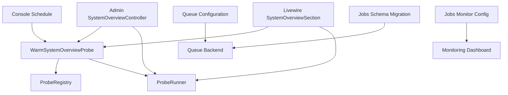
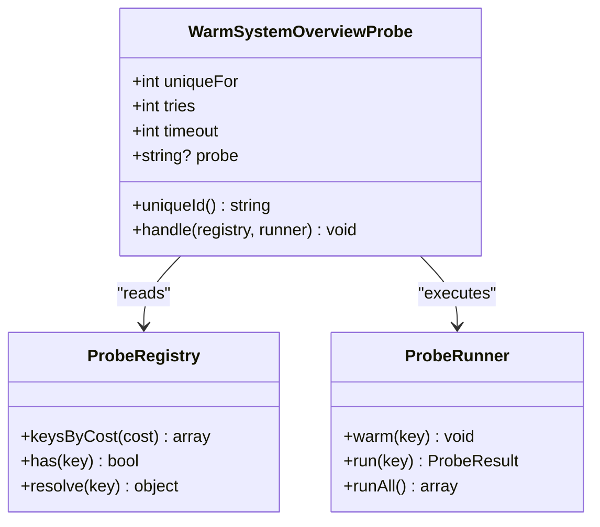
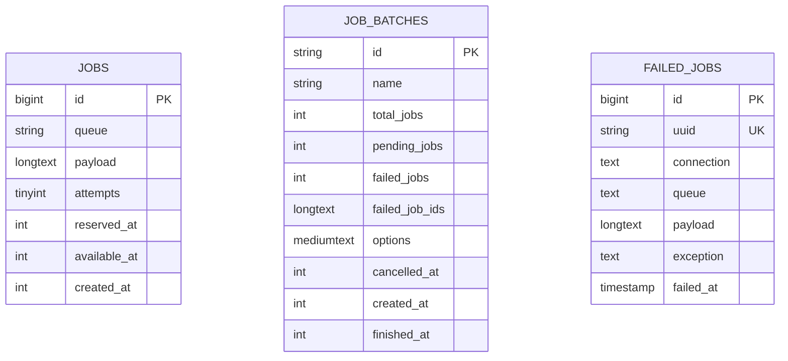
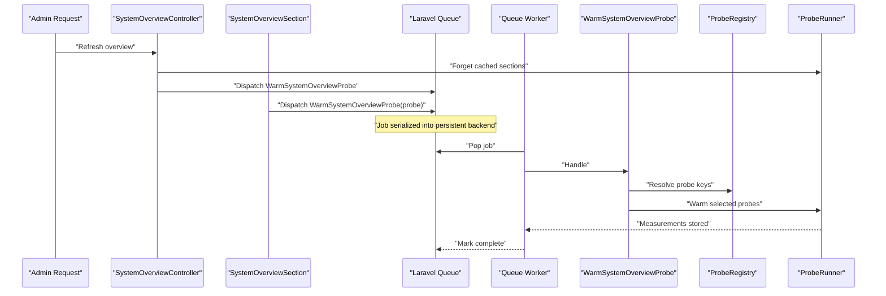
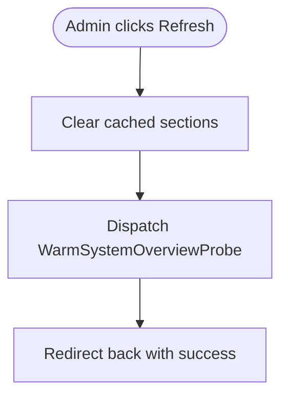
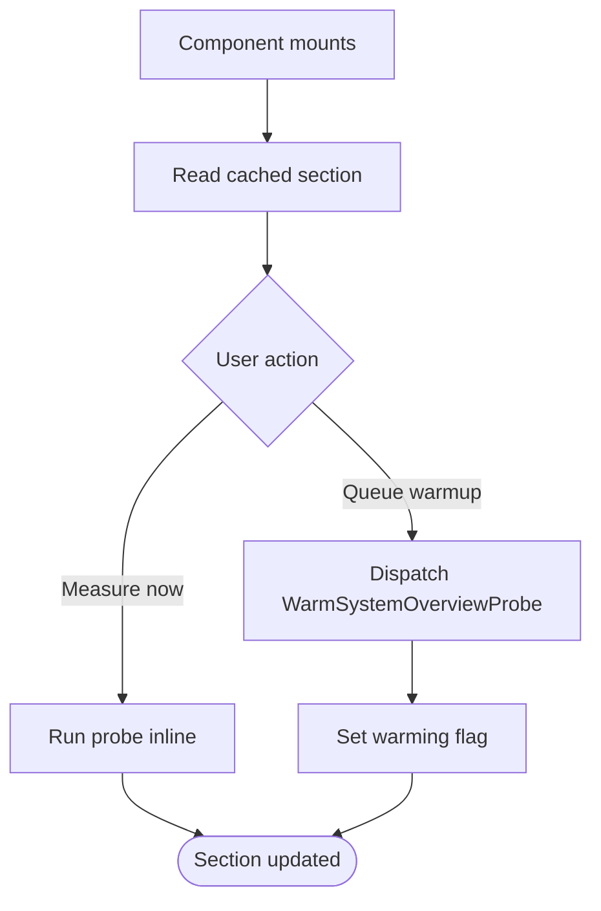
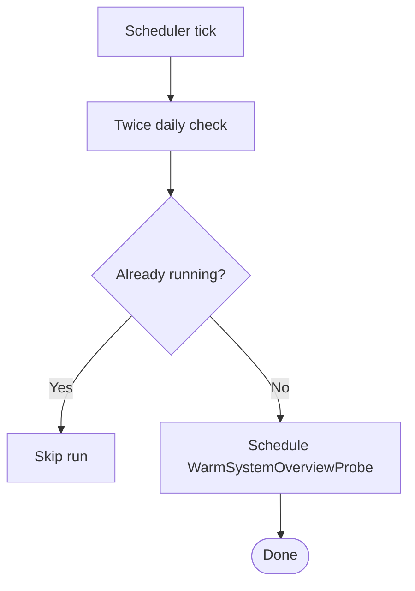
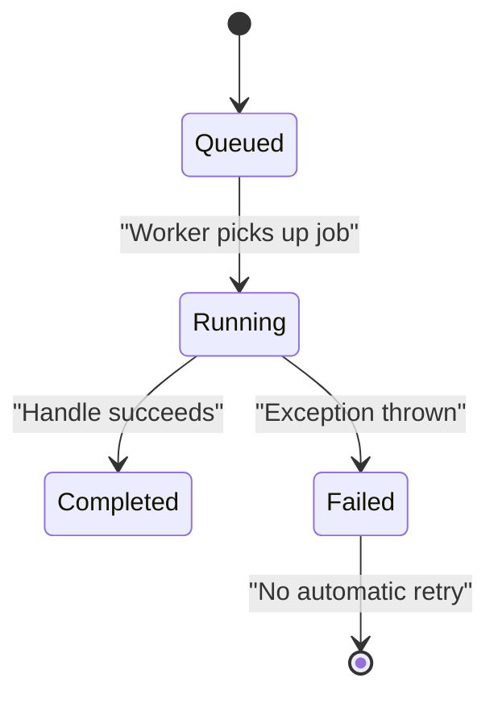
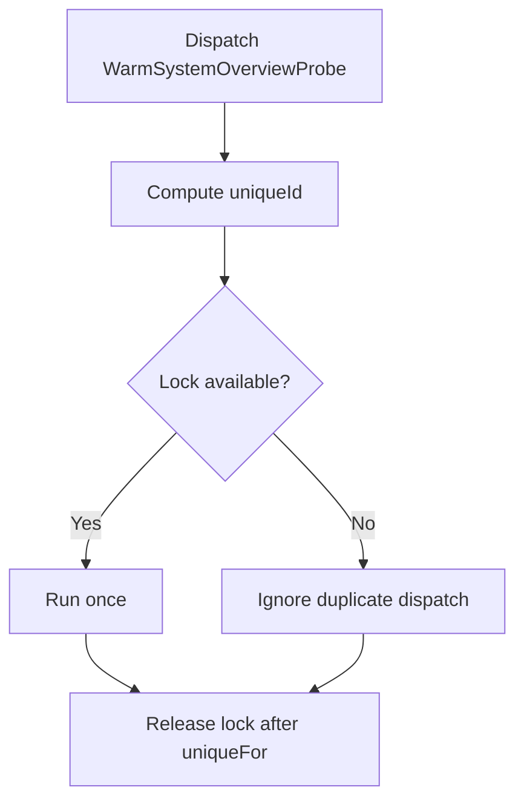
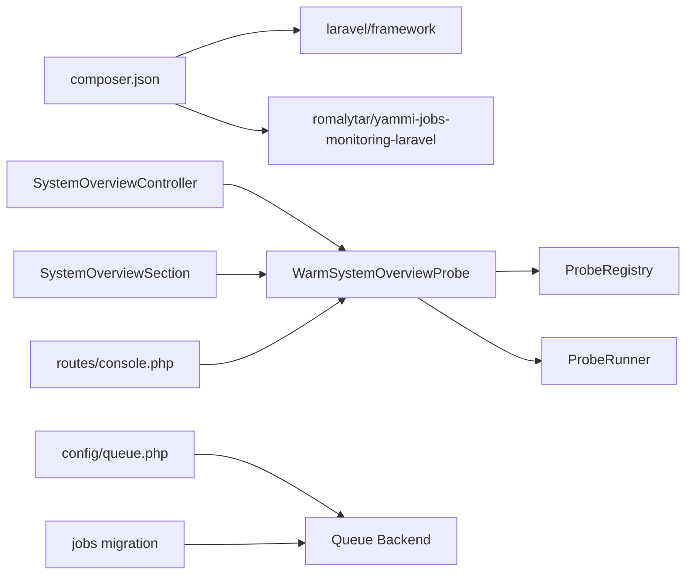

# Background Jobs

<cite>
**Referenced Files in This Document**
- [WarmSystemOverviewProbe.php](file://app/Jobs/WarmSystemOverviewProbe.php)
- [queue.php](file://config/queue.php)
- [jobs-monitor.php](file://config/jobs-monitor.php)
- [create_jobs_table.php](file://database/migrations/0001_01_01_000002_create_jobs_table.php)
- [console.php](file://routes/console.php)
- [SystemOverviewSection.php](file://app/Livewire/SystemOverviewSection.php)
- [SystemOverviewController.php](file://app/Http/Controllers/Admin/SystemOverviewController.php)
- [composer.json](file://composer.json)
</cite>

## Table of Contents
1. [Introduction](#introduction)
2. [Project Structure](#project-structure)
3. [Core Components](#core-components)
4. [Architecture Overview](#architecture-overview)
5. [Detailed Component Analysis](#detailed-component-analysis)
6. [Dependency Analysis](#dependency-analysis)
7. [Performance Considerations](#performance-considerations)
8. [Troubleshooting Guide](#troubleshooting-guide)
9. [Conclusion](#conclusion)

## Introduction
Highblossom uses Laravel’s queue system to move long-running or expensive work out of request handling paths. The only concrete job in the application is `WarmSystemOverviewProbe`, which precomputes heavy system overview sections so that admin pages stay responsive. Dispatch points include an admin controller, a Livewire component, and a scheduled console task.

Queue processing relies on Laravel’s built-in queue backends. The project currently configures a database-backed queue with support for Redis, SQS, Beanstalkd, deferred, background, failover, sync, and null drivers. Failed jobs are stored in a dedicated failed-jobs table, and the third-party `romalytar/yammi-jobs-monitoring-laravel` package provides optional monitoring and dead-letter queue management through configuration.

## Project Structure
Background-job related code is organized by responsibility:

| Area | Purpose | Key File |
|---|---|---|
| Job implementation | Defines the queued job class, uniqueness, retries, timeout, and business logic | [WarmSystemOverviewProbe.php](file://app/Jobs/WarmSystemOverviewProbe.php) |
| Queue configuration | Selects backend driver, retry timeouts, batching, and failure storage | [queue.php](file://config/queue.php) |
| Job monitoring | Controls dashboard visibility, API exposure, alerts, and DLQ behavior | [jobs-monitor.php](file://config/jobs-monitor.php) |
| Database schema | Stores pending jobs, batches, and failed jobs | [create_jobs_table.php](file://database/migrations/0001_01_01_000002_create_jobs_table.php) |
| Scheduled warm-up | Runs the probe job twice daily via the scheduler | [console.php](file://routes/console.php) |
| Admin dispatch point | Triggers a full warm-up after clearing cached sections | [SystemOverviewController.php](file://app/Http/Controllers/Admin/SystemOverviewController.php) |
| Interactive dispatch point | Lets users queue a single section without blocking the UI | [SystemOverviewSection.php](file://app/Livewire/SystemOverviewSection.php) |
| Worker execution script | Starts a queue worker during local development | [composer.json](file://composer.json) |

**Diagram sources**
- [SystemOverviewController.php:40-56](file://app/Http/Controllers/Admin/SystemOverviewController.php#L40-L56)
- [SystemOverviewSection.php:58-70](file://app/Livewire/SystemOverviewSection.php#L58-L70)
- [console.php:28-33](file://routes/console.php#L28-L33)
- [WarmSystemOverviewProbe.php:1-76](file://app/Jobs/WarmSystemOverviewProbe.php#L1-L76)
- [queue.php:1-128](file://config/queue.php#L1-L128)
- [jobs-monitor.php:1-200](file://config/jobs-monitor.php#L1-L200)
- [create_jobs_table.php:1-57](file://database/migrations/0001_01_01_000002_create_jobs_table.php#L1-L57)

**Section sources**
- [WarmSystemOverviewProbe.php:1-76](file://app/Jobs/WarmSystemOverviewProbe.php#L1-L76)
- [queue.php:1-128](file://config/queue.php#L1-L128)
- [jobs-monitor.php:1-200](file://config/jobs-monitor.php#L1-L200)
- [create_jobs_table.php:1-57](file://database/migrations/0001_01_01_000002_create_jobs_table.php#L1-L57)
- [console.php:1-33](file://routes/console.php#L1-L33)
- [SystemOverviewController.php:1-84](file://app/Http/Controllers/Admin/SystemOverviewController.php#L1-L84)
- [SystemOverviewSection.php:1-88](file://app/Livewire/SystemOverviewSection.php#L1-L88)
- [composer.json:1-138](file://composer.json#L1-L138)

## Core Components

### WarmSystemOverviewProbe Job
The job measures heavy system overview sections outside the HTTP request cycle. It implements both `ShouldQueue` and `ShouldBeUnique`.

Key behaviors:

| Property or method | Behavior |
|---|---|
| `uniqueFor` | Holds the unique lock for 60 seconds so repeated dispatches coalesce |
| `tries` | Set to 1 because the measurement is idempotent; failures leave the section pending |
| `timeout` | Limits the entire warm-up to 90 seconds |
| `__construct($probe)` | Accepts either a specific probe key or `null` for all heavy probes |
| `uniqueId()` | Produces a stable identity such as `system_overview.warm.<scope>` |
| `handle(ProbeRegistry, ProbeRunner)` | Resolves allowed probe keys and runs them through the runner |

This design avoids stacking overlapping measurements when an admin repeatedly triggers a refresh. It also keeps individual request latency low while still allowing manual re-measurement.

**Diagram sources**
- [WarmSystemOverviewProbe.php:1-76](file://app/Jobs/WarmSystemOverviewProbe.php#L1-L76)
- [SystemOverviewSection.php:1-88](file://app/Livewire/SystemOverviewSection.php#L1-L88)
- [SystemOverviewController.php:1-84](file://app/Http/Controllers/Admin/SystemOverviewController.php#L1-L84)

**Section sources**
- [WarmSystemOverviewProbe.php:1-76](file://app/Jobs/WarmSystemOverviewProbe.php#L1-L76)

### Queue Configuration
The default queue connection is read from `QUEUE_CONNECTION` and defaults to `database`. Available connections include:

| Driver | Typical Use Case | Important Settings |
|---|---|---|
| `sync` | Immediate synchronous execution, useful for testing or development where queues are unnecessary | None |
| `database` | Simple persistence using the application database | `connection`, `table`, `queue`, `retry_after` |
| `redis` | High-throughput in-memory queue | `connection`, `queue`, `block_for`, `after_commit` |
| `sqs` | AWS SQS-based distributed queue | `key`, `secret`, `prefix`, `queue`, `suffix`, `region` |
| `beanstalkd` | Classic message-broker queue | `host`, `queue`, `retry_after`, `block_for` |
| `deferred` | Defer until end of request | None |
| `background` | Run in a background process | None |
| `failover` | Try multiple connections in order | Ordered list of connections |

Failure storage uses `QUEUE_FAILED_DRIVER`, defaulting to `database-uuids`, and writes to the `failed_jobs` table. Batching uses the configured `job_batches` table.

**Section sources**
- [queue.php:1-128](file://config/queue.php#L1-L128)

### Monitoring and Failure Visibility
The `romalytar/yammi-jobs-monitoring-laravel` package adds operational visibility. Its configuration controls:

| Area | Configuration Focus |
|---|---|
| Master switch | `enabled` toggles monitoring without uninstalling the package |
| Database isolation | Optional dedicated monitoring database connection |
| Dashboard UI | Path, middleware, guard restrictions, and unauthenticated dev access |
| JSON API | Optional API endpoint for machine-readable monitoring data |
| Authorization | Gate-based authorization for destructive actions and settings |
| Failure classification | Custom classifier hook |
| Alerts | Slack, mail, and PagerDuty channel credentials |
| Dead-letter queue | Evaluation job queue selection and related behavior |

This makes it possible to inspect dispatched jobs, exceptions, and DLQ behavior through a UI or API rather than relying solely on logs.

**Section sources**
- [jobs-monitor.php:1-200](file://config/jobs-monitor.php#L1-L200)

### Database Schema
The migration creates three core tables:

| Table | Purpose |
|---|---|
| `jobs` | Pending, reserved, attempted, and scheduled jobs |
| `job_batches` | Aggregated batch status, pending count, failed IDs, timestamps, and options |
| `failed_jobs` | UUID, connection, queue, payload, exception text, and failure timestamp |

**Diagram sources**
- [create_jobs_table.php:1-57](file://database/migrations/0001_01_01_000002_create_jobs_table.php#L1-L57)

**Section sources**
- [create_jobs_table.php:1-57](file://database/migrations/0001_01_01_000002_create_jobs_table.php#L1-L57)

## Architecture Overview

**Diagram sources**
- [SystemOverviewController.php:40-56](file://app/Http/Controllers/Admin/SystemOverviewController.php#L40-L56)
- [SystemOverviewSection.php:58-70](file://app/Livewire/SystemOverviewSection.php#L58-L70)
- [WarmSystemOverviewProbe.php:1-76](file://app/Jobs/WarmSystemOverviewProbe.php#L1-L76)

## Detailed Component Analysis

### Dispatch Patterns

#### From Controllers
The admin controller clears cached overview sections and then dispatches the probe job without arguments. A null probe tells the job to warm every heavy section.

**Diagram sources**
- [SystemOverviewController.php:40-56](file://app/Http/Controllers/Admin/SystemOverviewController.php#L40-L56)

**Section sources**
- [SystemOverviewController.php:40-56](file://app/Http/Controllers/Admin/SystemOverviewController.php#L40-L56)

#### From Livewire Components
The Livewire component offers two paths:

1. **Immediate measurement:** Calls the runner directly inside the request.
2. **Queued measurement:** Dispatches the job for the current probe key and sets a warming flag.

This dual path supports production environments with workers and development environments without workers.

**Diagram sources**
- [SystemOverviewSection.php:33-70](file://app/Livewire/SystemOverviewSection.php#L33-L70)

**Section sources**
- [SystemOverviewSection.php:1-88](file://app/Livewire/SystemOverviewSection.php#L1-L88)

#### From Scheduled Console Tasks
The schedule runs the probe job twice daily at 1 AM and 1 PM. It uses `withoutOverlapping()` so concurrent scheduler instances do not start another run while one is already active.

**Diagram sources**
- [console.php:28-33](file://routes/console.php#L28-L33)

**Section sources**
- [console.php:1-33](file://routes/console.php#L1-L33)

### Job Serialization and Dependency Injection
- **Serialization:** The job stores its constructor argument `$probe` as part of the serialized payload. When the worker executes the job, Laravel reconstructs the instance and calls `handle`.
- **Dependency injection:** Constructor dependency injection is not used for the job itself. Instead, dependencies are resolved inside `handle()` through type-hinted parameters. This avoids serializing services and instead resolves fresh instances from the container when the job runs.
- **Safety:** Only scalar or simple serializable values should be passed to the constructor. Services like `ProbeRegistry` and `ProbeRunner` must remain in `handle()`.

**Section sources**
- [WarmSystemOverviewProbe.php:1-76](file://app/Jobs/WarmSystemOverviewProbe.php#L1-L76)

### Retry and Failure Handling
- The job sets `tries = 1`, meaning it will not automatically retry after failing.
- The comment explains that measurement is idempotent, so one attempt is sufficient. If it fails, the section remains pending and can be retried manually.
- Failed jobs are persisted to the `failed_jobs` table when the configured failure driver is enabled.
- The monitoring package can expose this data through its dashboard or API depending on configuration.

**Diagram sources**
- [WarmSystemOverviewProbe.php:21-38](file://app/Jobs/WarmSystemOverviewProbe.php#L21-L38)
- [create_jobs_table.php:25-49](file://database/migrations/0001_01_01_000002_create_jobs_table.php#L25-L49)

**Section sources**
- [WarmSystemOverviewProbe.php:21-38](file://app/Jobs/WarmSystemOverviewProbe.php#L21-L38)
- [queue.php:97-128](file://config/queue.php#L97-L128)

### Uniqueness and Coalescing
The job implements `ShouldBeUnique` and overrides `uniqueId()` to return a scoped identifier. Repeated dispatches within `uniqueFor` seconds are coalesced, preventing duplicate warm-ups for the same scope.

**Diagram sources**
- [WarmSystemOverviewProbe.php:21-50](file://app/Jobs/WarmSystemOverviewProbe.php#L21-L50)

**Section sources**
- [WarmSystemOverviewProbe.php:21-50](file://app/Jobs/WarmSystemOverviewProbe.php#L21-L50)

## Dependency Analysis

**Diagram sources**
- [composer.json:1-138](file://composer.json#L1-L138)
- [SystemOverviewController.php:1-84](file://app/Http/Controllers/Admin/SystemOverviewController.php#L1-L84)
- [SystemOverviewSection.php:1-88](file://app/Livewire/SystemOverviewSection.php#L1-L88)
- [console.php:1-33](file://routes/console.php#L1-L33)
- [WarmSystemOverviewProbe.php:1-76](file://app/Jobs/WarmSystemOverviewProbe.php#L1-L76)
- [queue.php:1-128](file://config/queue.php#L1-L128)
- [create_jobs_table.php:1-57](file://database/migrations/0001_01_01_000002_create_jobs_table.php#L1-L57)

**Section sources**
- [composer.json:1-138](file://composer.json#L1-L138)
- [WarmSystemOverviewProbe.php:1-76](file://app/Jobs/WarmSystemOverviewProbe.php#L1-L76)
- [queue.php:1-128](file://config/queue.php#L1-L128)

## Performance Considerations

### Queue Driver Selection
- Use `sync` for tests or development where asynchronous behavior is not required.
- Use `database` for simple deployments with minimal infrastructure.
- Use `redis` for higher throughput and lower contention.
- Use `sqs` for cloud-native distributed deployments.
- Use `failover` when resilience across backends matters.

### Worker Scaling
- Increase worker processes to increase concurrency.
- Separate high-volume jobs onto named queues if different workload classes emerge.
- Tune `retry_after` to match expected job duration.
- Keep `timeout` conservative so long-running jobs are killed before they block the worker indefinitely.

### Scheduling and Overlap Protection
- The scheduled warm-up uses `withoutOverlapping()` to prevent overlapping scheduler runs.
- The job’s own uniqueness prevents overlapping worker executions for the same scope.
- Combine both mechanisms to protect against scheduler overlap and repeated user-triggered dispatches.

### Monitoring
- Enable the jobs monitor dashboard for visual inspection.
- Configure alert channels for critical failures.
- Inspect the `failed_jobs` table when the dashboard is unavailable.
- Use the package’s API when automation needs structured job metadata.

[No sources needed since this section provides general guidance]

## Troubleshooting Guide

### Common Symptoms and Responses

| Symptom | Likely Cause | Recommended Action |
|---|---|---|
| No jobs execute locally | Worker is not running | Start a queue worker or use `sync` temporarily |
| Jobs appear but never finish | Worker crashed or exceeded timeout | Check logs, increase timeout, and inspect exceptions |
| Duplicate warm-ups stack up | Uniqueness disabled or misconfigured | Verify `ShouldBeUnique` and `uniqueId()` |
| Section stays pending after error | Job failed with `tries = 1` | Manually trigger warm-up or clear cache and retry |
| Queue grows under load | Workers cannot keep up | Scale workers, choose a faster backend, or split queues |
| Failed jobs disappear | Failure driver disabled or retention policy too short | Enable failure storage and review cleanup jobs |

### Debugging Steps
1. Confirm the queue backend by reading `QUEUE_CONNECTION`.
2. Check whether a worker is listening on the correct queue.
3. Inspect the `jobs` table for pending or reserved rows.
4. Inspect the `failed_jobs` table for exceptions and payloads.
5. Open the jobs monitor dashboard when enabled.
6. Review application logs around the time the job was scheduled or executed.

### Operational Commands and Scripts
- Development worker command is included in the composer scripts alongside server, logging, and Vite watchers.
- The scheduler requires a running scheduler process to execute the twice-daily warm-up.

**Section sources**
- [queue.php:1-128](file://config/queue.php#L1-L128)
- [create_jobs_table.php:1-57](file://database/migrations/0001_01_01_000002_create_jobs_table.php#L1-L57)
- [console.php:1-33](file://routes/console.php#L1-L33)
- [composer.json:1-138](file://composer.json#L1-L138)

## Conclusion
Highblossom’s background job system centers on a single purposeful job: warming heavy system overview sections outside the request path. Dispatch occurs from controllers, Livewire components, and scheduled tasks. The job protects against overlapping work through uniqueness, limits runtime through timeout, and accepts failure gracefully by leaving sections pending for manual retry. Queue configuration supports multiple backends, and the monitoring package adds visibility into execution, failures, and dead-letter behavior. For production, operators should run queue workers, select an appropriate backend, scale concurrency, enable failure storage, and monitor queues through the dashboard or external tooling.

[No sources needed since this section summarizes without analyzing specific files]