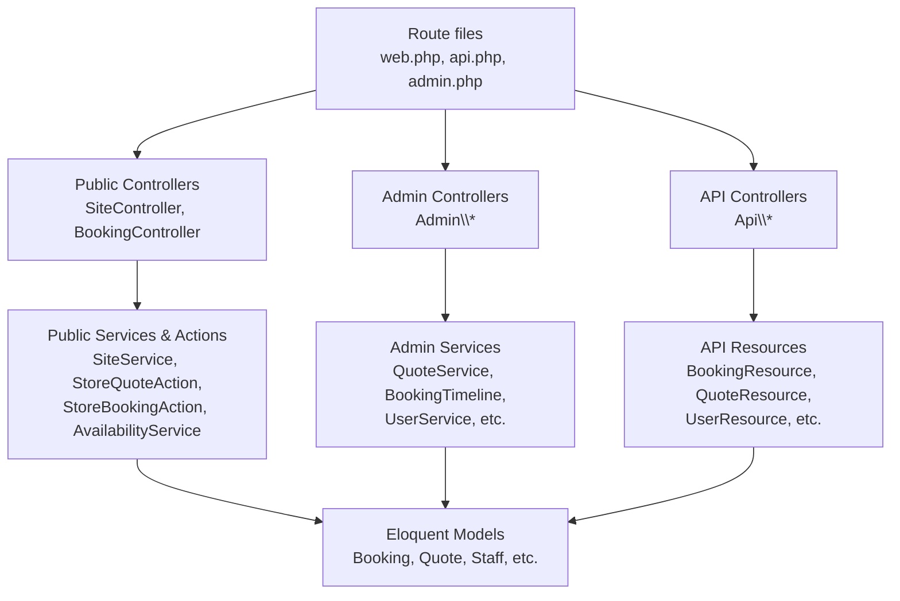
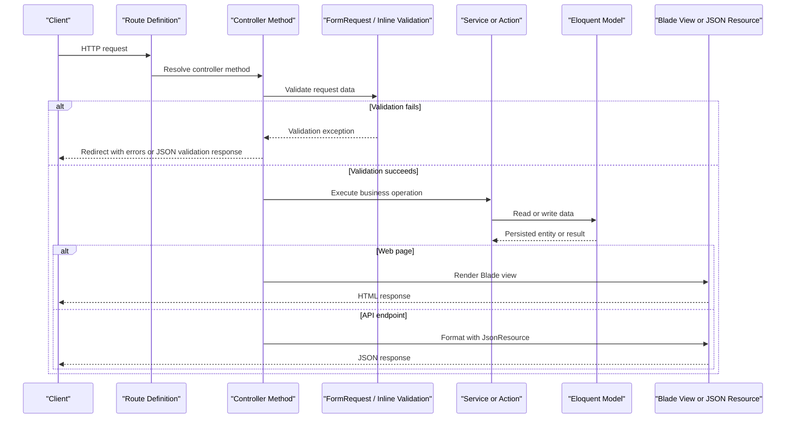
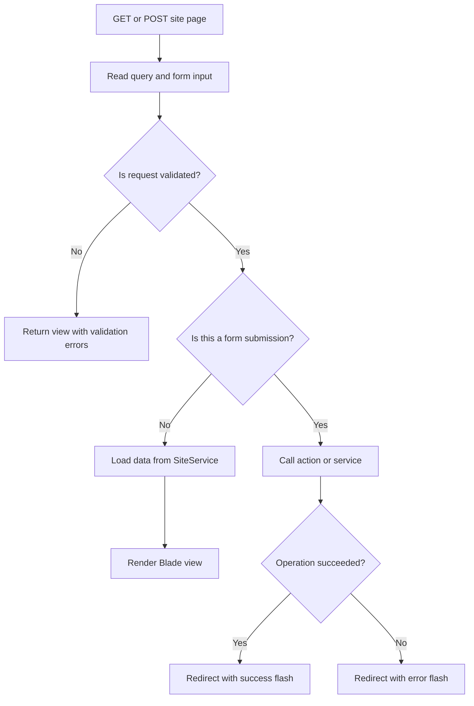
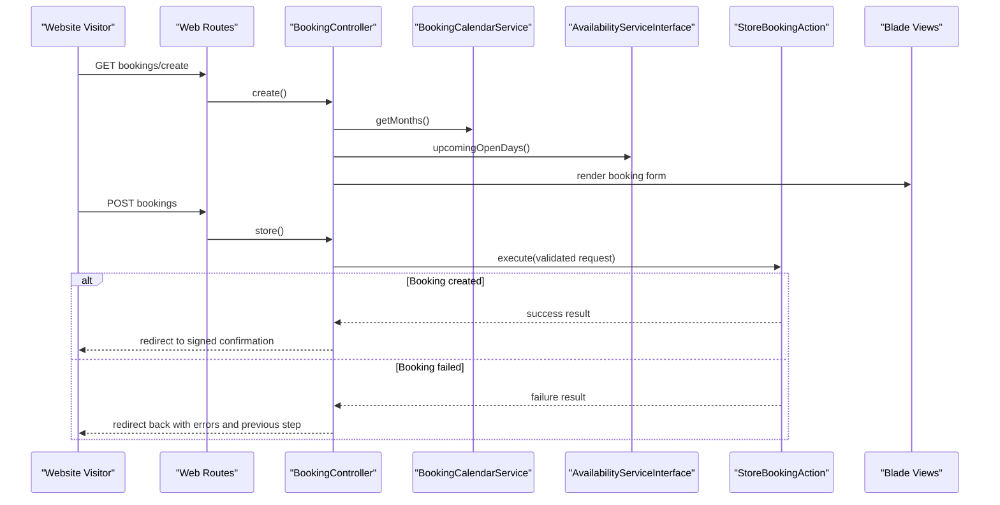
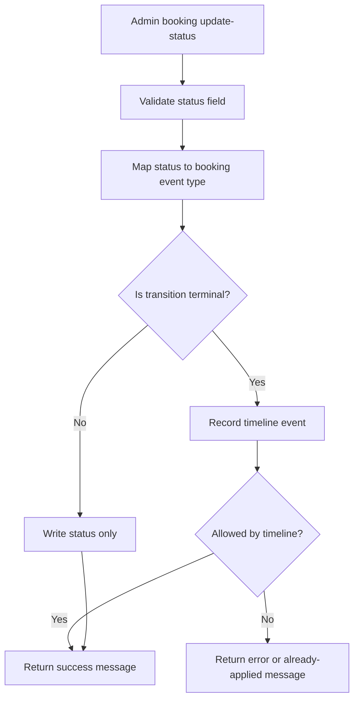
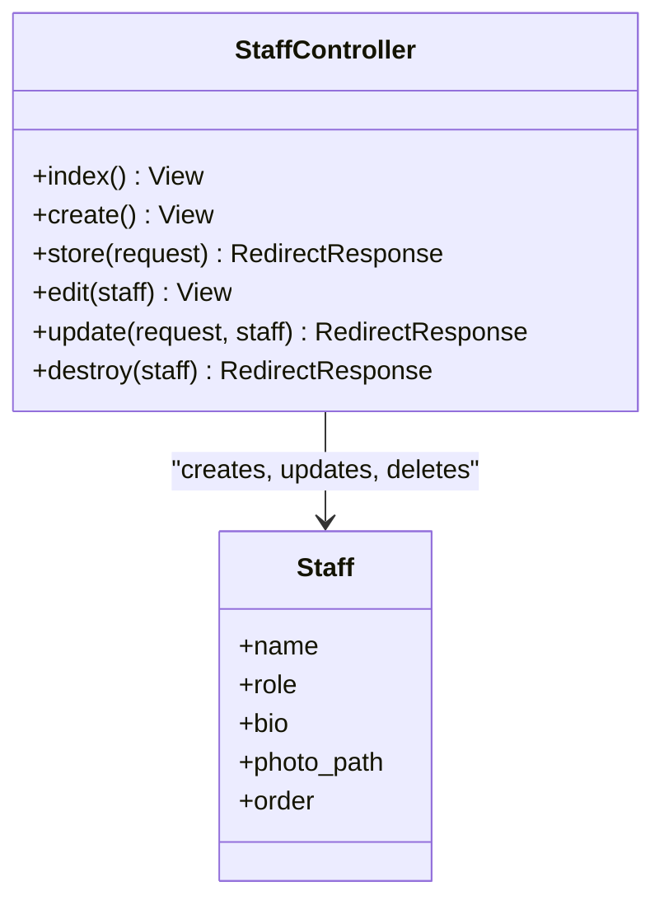
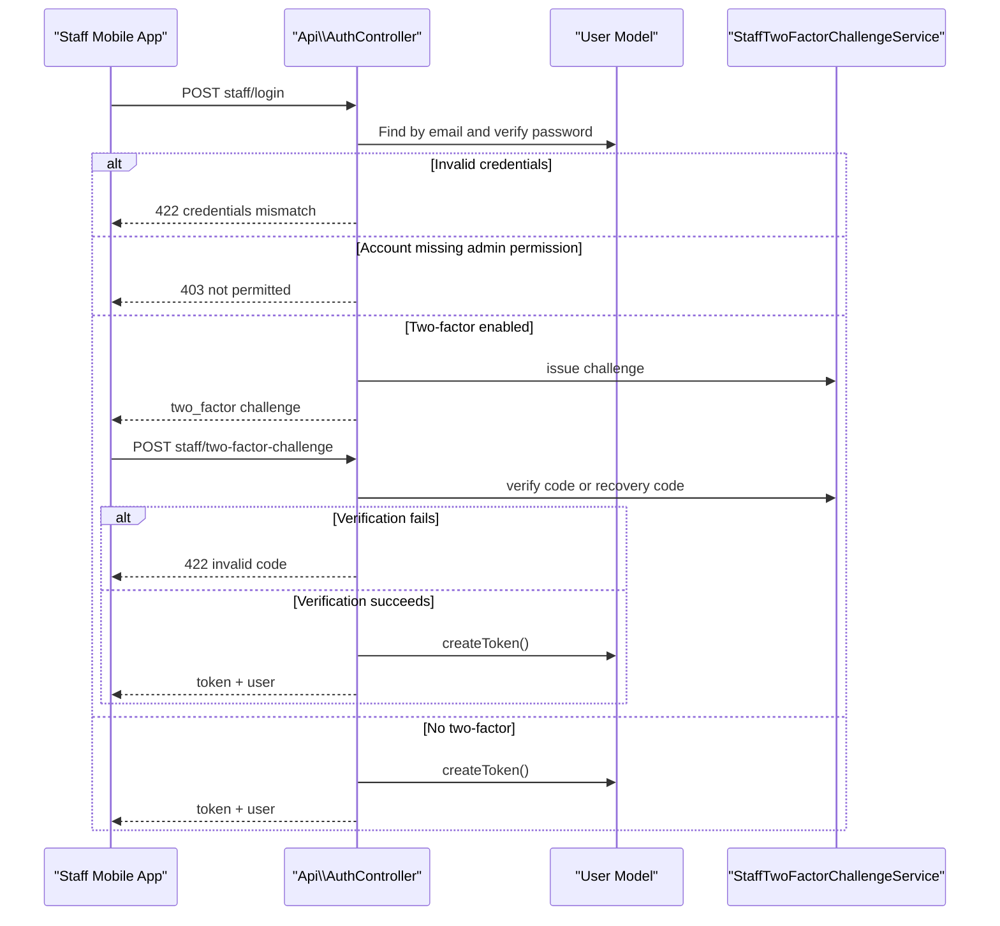
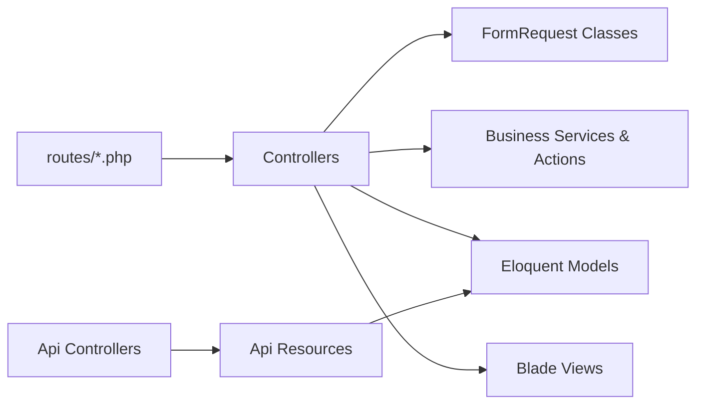

# Controllers Layer

<cite>
**Referenced Files in This Document**
- [web.php](file://routes/web.php)
- [api.php](file://routes/api.php)
- [admin.php](file://routes/admin.php)
- [SiteController.php](file://app/Http/Controllers/SiteController.php)
- [BookingController.php](file://app/Http/Controllers/BookingController.php)
- [Admin/BookingController.php](file://app/Http/Controllers/Admin/BookingController.php)
- [Admin/StaffController.php](file://app/Http/Controllers/Admin/StaffController.php)
- [Admin/QuoteController.php](file://app/Http/Controllers/Admin/QuoteController.php)
- [Api/AuthController.php](file://app/Http/Controllers/Api/AuthController.php)
- [Api/QuoteController.php](file://app/Http/Controllers/Api/QuoteController.php)
- [QuoteFormRequest.php](file://app/Http/Requests/QuoteFormRequest.php)
- [UpdateBookingRequest.php](file://app/Http/Requests/Admin/UpdateBookingRequest.php)
- [QuoteStatusRequest.php](file://app/Http/Requests/Admin/QuoteStatusRequest.php)
- [BookingResource.php](file://app/Http/Resources/Api/BookingResource.php)
- [QuoteResource.php](file://app/Http/Resources/Api/QuoteResource.php)
</cite>

## Table of Contents
1. [Introduction](#introduction)
2. [Project Structure](#project-structure)
3. [Core Components](#core-components)
4. [Architecture Overview](#architecture-overview)
5. [Detailed Component Analysis](#detailed-component-analysis)
6. [Dependency Analysis](#dependency-analysis)
7. [Performance Considerations](#performance-considerations)
8. [Troubleshooting Guide](#troubleshooting-guide)
9. [Conclusion](#conclusion)

## Introduction
This document explains the controller layer of Highblossom, focusing on how HTTP requests enter the application and are routed to controllers that coordinate services, models, validation, and responses. The project follows a layered MVC pattern:

- **Routes** declare endpoints and assign them to controller methods.
- **Controllers** accept validated input, delegate business logic to services or domain actions, interact with models when necessary, and return views or JSON.
- **Services and Actions** encapsulate reusable business operations such as booking creation, quote status updates, calendar building, and email sending.
- **Models** represent database entities like bookings, quotes, staff, inspections, and gallery items.
- **Views** render HTML for public pages and the admin panel.
- **API resources** normalize Eloquent models into structured JSON payloads for the staff mobile app.

The three major controller families are:

| Controller family | Namespace | Audience | Main responsibility |
|---|---|---|---|
| Public website controllers | `App\Http\Controllers` | Website visitors | Page rendering, contact forms, quote submissions, booking wizard, and public availability helpers |
| Admin panel controllers | `App\Http\Controllers\Admin` | Logged-in administrators | CRUD for bookings, inspections, quotes, staff, partners, gallery, services, blog content, settings, and system data |
| API controllers | `App\Http\Controllers\Api` | Staff mobile app | Sanctum-authenticated REST endpoints mirroring many admin capabilities |

## Project Structure
The controller architecture is organized by route group rather than by feature alone:

**Diagram sources**
- [web.php:1-76](file://routes/web.php#L1-L76)
- [api.php:1-117](file://routes/api.php#L1-L117)
- [admin.php:1-171](file://routes/admin.php#L1-L171)
- [SiteController.php:1-180](file://app/Http/Controllers/SiteController.php#L1-L180)
- [BookingController.php:1-146](file://app/Http/Controllers/BookingController.php#L1-L146)
- [Api/AuthController.php:1-135](file://app/Http/Controllers/Api/AuthController.php#L1-L135)
- [BookingResource.php:1-60](file://app/Http/Resources/Api/BookingResource.php#L1-L60)

**Section sources**
- [web.php:1-76](file://routes/web.php#L1-L76)
- [api.php:1-117](file://routes/api.php#L1-L117)
- [admin.php:1-171](file://routes/admin.php#L1-L171)

## Core Components
At a high level, each controller is responsible for one slice of user-facing behavior:

- **Public website controllers** present content and collect customer data. They mostly return Blade views or redirects. Validation happens through request classes, while actual persistence and notifications are delegated to actions or services.
- **Admin panel controllers** manage business state through form submissions. They commonly update models directly for simple fields and use services for state transitions that must preserve audit history or send follow-up events.
- **API controllers** expose JSON endpoints for the staff app. They share authorization concepts with the web admin through Spatie permissions and often reuse the same services used by the admin UI.

Key responsibilities across all controllers include:

| Responsibility | Typical implementation |
|---|---|
| Request entry | Route assigns method; Laravel resolves parameters and middleware |
| Input validation | `FormRequest` classes or inline `$request->validate()` |
| Business coordination | Service methods or action classes |
| Data access | Eloquent queries, model binding, eager loading |
| Response formatting | Blade views, redirects, JSON responses, or resource collections |
| Authorization | Route-level `can:` middleware or controller checks |
| Error handling | Throttling, signed routes, 404 aborts, session flash messages, JSON error payloads |

**Section sources**
- [SiteController.php:1-180](file://app/Http/Controllers/SiteController.php#L1-L180)
- [BookingController.php:1-146](file://app/Http/Controllers/BookingController.php#L1-L146)
- [Admin/BookingController.php:1-103](file://app/Http/Controllers/Admin/BookingController.php#L1-L103)
- [Admin/StaffController.php:1-116](file://app/Http/Controllers/Admin/StaffController.php#L1-L116)
- [Admin/QuoteController.php:1-73](file://app/Http/Controllers/Admin/QuoteController.php#L1-L73)
- [Api/AuthController.php:1-135](file://app/Http/Controllers/Api/AuthController.php#L1-L135)

## Architecture Overview
The controller layer sits between routing and domain logic. It does not own business rules itself; instead, it interprets HTTP concerns: authentication, authorization, validation, presentation, and response shape.

**Diagram sources**
- [web.php:1-76](file://routes/web.php#L1-L76)
- [api.php:1-117](file://routes/api.php#L1-L117)
- [admin.php:1-171](file://routes/admin.php#L1-L171)
- [SiteController.php:1-180](file://app/Http/Controllers/SiteController.php#L1-L180)
- [Api/AuthController.php:1-135](file://app/Http/Controllers/Api/AuthController.php#L1-L135)

**Section sources**
- [web.php:1-76](file://routes/web.php#L1-L76)
- [api.php:1-117](file://routes/api.php#L1-L117)
- [admin.php:1-171](file://routes/admin.php#L1-L171)

## Detailed Component Analysis

### Public Website Controllers

#### SiteController
`SiteController` handles the main public pages and customer-facing content. It depends on:

- `SiteService` for shared page data such as homepage content, about-us data, services, gallery, contact information, quote page context, and blog details.
- `StoreQuoteAction` for processing quote submissions.
- `SendContactMessage` for contact form delivery.

Typical flow:

1. A GET route renders a Blade view after asking `SiteService` for prepared data.
2. A POST route receives a validated request class, delegates to an action, and redirects back with a success or error flash message.
3. Missing content returns a 404 response rather than rendering an empty page.

**Diagram sources**
- [SiteController.php:1-180](file://app/Http/Controllers/SiteController.php#L1-L180)
- [web.php:1-76](file://routes/web.php#L1-L76)

**Section sources**
- [SiteController.php:1-180](file://app/Http/Controllers/SiteController.php#L1-L180)
- [web.php:1-76](file://routes/web.php#L1-L76)

#### BookingController
`BookingController` manages the public booking workflow. Its responsibilities include:

- Displaying the booking wizard with a calendar and quick-pick days.
- Validating booking input through `StoreBookingRequest`.
- Delegating creation to `StoreBookingAction`.
- Returning a signed confirmation URL so diary entries cannot guess booking IDs.
- Generating an ICS calendar attachment.
- Resuming the correct wizard step after validation failures.

**Diagram sources**
- [BookingController.php:1-146](file://app/Http/Controllers/BookingController.php#L1-L146)
- [web.php:1-76](file://routes/web.php#L1-L76)

**Section sources**
- [BookingController.php:1-146](file://app/Http/Controllers/BookingController.php#L1-L146)
- [web.php:1-76](file://routes/web.php#L1-L76)

#### QuoteController (Public)
There is no separate public `QuoteController` class in the analyzed codebase. Public quote submission is handled by `SiteController::submitQuote`, which uses `QuoteFormRequest` for validation and `StoreQuoteAction` for persistence and notification.

**Section sources**
- [SiteController.php:1-180](file://app/Http/Controllers/SiteController.php#L1-L180)
- [web.php:1-76](file://routes/web.php#L1-L76)

### Admin Panel Controllers

#### Admin/BookingController
This controller manages bookings in the admin panel. It:

- Lists paginated bookings with optional status filtering and search.
- Loads related inspection, user, events, and actor data for the detail view.
- Updates simple fields directly on the model.
- Uses `BookingTimeline` for status transitions that must record milestones.
- Prevents invalid state changes, especially around cancelled bookings.

**Diagram sources**
- [Admin/BookingController.php:1-103](file://app/Http/Controllers/Admin/BookingController.php#L1-L103)
- [admin.php:1-171](file://routes/admin.php#L1-L171)

**Section sources**
- [Admin/BookingController.php:1-103](file://app/Http/Controllers/Admin/BookingController.php#L1-L103)
- [admin.php:1-171](file://routes/admin.php#L1-L171)

#### Admin/StaffController
This controller provides full CRUD for staff members. It:

- Orders staff by position.
- Validates names, roles, bios, photos, and sort order.
- Stores photos under the public storage disk.
- Replaces old photos when updating.
- Deletes associated photo files before deleting records.

**Diagram sources**
- [Admin/StaffController.php:1-116](file://app/Http/Controllers/Admin/StaffController.php#L1-L116)
- [admin.php:1-171](file://routes/admin.php#L1-L171)

**Section sources**
- [Admin/StaffController.php:1-116](file://app/Http/Controllers/Admin/StaffController.php#L1-L116)
- [admin.php:1-171](file://routes/admin.php#L1-L171)

#### Admin/QuoteController
This controller manages quote requests in the admin panel. It:

- Lists quotes with optional status filtering.
- Shows a quote with related glass and service types.
- Delegates status changes to `QuoteService`.
- Deletes quotes through `QuoteService`.

**Section sources**
- [Admin/QuoteController.php:1-73](file://app/Http/Controllers/Admin/QuoteController.php#L1-L73)
- [admin.php:1-171](file://routes/admin.php#L1-L171)

### API Controllers

#### Api/AuthController
The staff API login flow uses Sanctum personal access tokens and supports two-factor authentication challenges:

1. The client sends credentials.
2. The controller validates identity using hashed passwords.
3. If the account lacks admin-panel permission, it returns a forbidden response.
4. If two-factor is enabled, it returns a challenge object.
5. On successful two-factor verification, it issues a token.
6. The `/me` endpoint returns the authenticated user.
7. Logout revokes the current token.

**Diagram sources**
- [Api/AuthController.php:1-135](file://app/Http/Controllers/Api/AuthController.php#L1-L135)
- [api.php:1-117](file://routes/api.php#L1-L117)

**Section sources**
- [Api/AuthController.php:1-135](file://app/Http/Controllers/Api/AuthController.php#L1-L135)
- [api.php:1-117](file://routes/api.php#L1-L117)

#### Api/QuoteController
The API quote controller mirrors much of the admin quote workflow but returns JSON instead of redirects. It:

- Lists quotes with optional status and search filters.
- Shows a single quote with eager-loaded relationships.
- Updates status through `QuoteService`.
- Deletes quotes through `QuoteService`.
- Returns consistent JSON payloads with a `data` field and a translated message where appropriate.

**Section sources**
- [Api/QuoteController.php:1-80](file://app/Http/Controllers/Api/QuoteController.php#L1-L80)
- [api.php:1-117](file://routes/api.php#L1-L117)

## Dependency Analysis
The controller layer has clear directional dependencies:

**Diagram sources**
- [web.php:1-76](file://routes/web.php#L1-L76)
- [api.php:1-117](file://routes/api.php#L1-L117)
- [admin.php:1-171](file://routes/admin.php#L1-L171)
- [SiteController.php:1-180](file://app/Http/Controllers/SiteController.php#L1-L180)
- [Api/AuthController.php:1-135](file://app/Http/Controllers/Api/AuthController.php#L1-L135)
- [BookingResource.php:1-60](file://app/Http/Resources/Api/BookingResource.php#L1-L60)

### Coupling and Cohesion
- Controllers are moderately coupled to services because services encapsulate cross-cutting business behavior such as timeline recording, quote lifecycle management, and availability calculation.
- Public controllers have lower coupling to domain state than admin controllers because they mostly render read-only views and submit lightweight forms.
- API controllers depend heavily on resource classes to keep payload structure stable for the mobile app.
- Authorization is centralized at the route level using Spatie `can:` middleware, keeping controllers focused on request handling rather than permission checks.

### External Integration Points
- Sanctum personal access tokens for the staff API.
- Spatie permissions for both web admin and API routes.
- File storage for gallery images, staff photos, and damage photographs.
- Email actions and mail classes triggered by quote and contact submissions.
- Signed URLs for booking confirmations and calendar downloads.

**Section sources**
- [web.php:1-76](file://routes/web.php#L1-L76)
- [api.php:1-117](file://routes/api.php#L1-L117)
- [admin.php:1-171](file://routes/admin.php#L1-L171)

## Performance Considerations
Several patterns in the controller layer help avoid performance problems:

- **Throttling:** Public endpoints for quotes, contact forms, blog search, poll voting, and availability APIs are rate-limited.
- **Signed routes:** Booking confirmation and calendar download routes require signed URLs to prevent ID guessing.
- **Eager loading:** Controllers load related models explicitly, reducing N+1 queries in list and detail views.
- **Pagination:** Listings paginate results, limiting memory and response size.
- **Conditional queries:** Filtered queries are applied only when parameters exist.
- **Resource transformation:** API resources compute derived values and conditional fields instead of forcing the mobile app to interpret raw database rows.

Recommendations for future controllers:

- Keep list queries bounded by explicit `per_page` limits.
- Prefer services for complex mutations that may trigger events, jobs, or audits.
- Avoid heavy computations inside request methods; move them to services or queued jobs.
- Use cacheable read paths where data changes infrequently, such as static site configuration.

[No sources needed since this section provides general guidance]

## Troubleshooting Guide

### Common Controller Issues

| Symptom | Likely cause | Resolution approach |
|---|---|---|
| Quote submission silently lost due to MySQL truncation | Text fields exceed column length | Ensure `QuoteFormRequest` enforces the same character limit as the database schema |
| Booking wizard always resumes at the first step | Session error bag or failed-step flag is missing | Check flashed session keys and validation step mapping |
| ICS calendar download shows an empty file | Booking has no scheduled appointment time | Return a helpful error and redirect back to the booking form |
| API login returns credential mismatch even for valid users | Password hashing or lookup path differs | Verify user lookup and password comparison logic |
| Staff app receives a two-factor challenge unexpectedly | Account has two-factor enabled | Confirm user configuration and test both normal and recovery codes |
| Admin booking status change appears to do nothing | Timeline prevents invalid transitions | Inspect booking state and allowed event transitions |
| Photo deletion leaves orphaned files | Delete path not matched or storage disk misconfigured | Verify stored path and storage disk configuration |

### Validation Patterns
- Public quote submissions use `QuoteFormRequest`, which centralizes rules, custom messages, and maximum text lengths aligned with database constraints.
- Admin booking updates use `UpdateBookingRequest`, restricting price fields to numeric non-negative values.
- Quote status updates use `QuoteStatusRequest`, allowing only predefined statuses.

**Section sources**
- [QuoteFormRequest.php:1-69](file://app/Http/Requests/QuoteFormRequest.php#L1-L69)
- [UpdateBookingRequest.php:1-33](file://app/Http/Requests/Admin/UpdateBookingRequest.php#L1-L33)
- [QuoteStatusRequest.php:1-33](file://app/Http/Requests/Admin/QuoteStatusRequest.php#L1-L33)

### Error Handling Patterns
- Public pages use redirects with session flash messages for success and error feedback.
- API endpoints return structured JSON payloads with messages and appropriate HTTP status codes.
- Missing public content triggers 404 responses.
- Two-factor API flows distinguish between expired challenges and invalid codes.

**Section sources**
- [SiteController.php:1-180](file://app/Http/Controllers/SiteController.php#L1-L180)
- [BookingController.php:1-146](file://app/Http/Controllers/BookingController.php#L1-L146)
- [Api/AuthController.php:1-135](file://app/Http/Controllers/Api/AuthController.php#L1-L135)

## Conclusion
Highblossom’s controller layer cleanly separates HTTP concerns from business logic. Public controllers focus on presenting content and collecting customer data. Admin controllers manage operational state while delegating important transitions to services. API controllers provide a secure, Sanctum-protected interface for the staff app, sharing authorization semantics with the web admin. Validation is centralized in request classes, responses are normalized through views and JSON resources, and routes enforce throttling, signing, and authorization. This design makes it straightforward to extend functionality, maintain consistent behavior across channels, and troubleshoot request flows without mixing presentation and domain rules.