# Core Components

<cite>
**Referenced Files in This Document**   
- [StoreBookingAction.php](file://app/Actions/StoreBookingAction.php)
- [UpdateInspectionAction.php](file://app/Actions/UpdateInspectionAction.php)
- [SendContactMessage.php](file://app/Actions/SendContactMessage.php)
- [BlockBuilder.php](file://app/Livewire/BlockBuilder.php)
- [BlogPosts.php](file://app/Livewire/BlogPosts.php)
- [Passkeys.php](file://app/Livewire/Passkeys.php)
- [BookingCreatedEvent.php](file://app/Events/BookingCreatedEvent.php)
- [SendContactMessageEmail.php](file://app/Listeners/SendContactMessageEmail.php)
- [EventServiceProvider.php](file://app/Providers/EventServiceProvider.php)
- [WarmSystemOverviewProbe.php](file://app/Jobs/WarmSystemOverviewProbe.php)
- [queue.php](file://config/queue.php)
- [web.php](file://routes/web.php)
- [api.php](file://routes/api.php)
</cite>

## Table of Contents
1. [Introduction](#introduction)
2. [Project Structure](#project-structure)
3. [Core Components](#core-components)
4. [Architecture Overview](#architecture-overview)
5. [Detailed Component Analysis](#detailed-component-analysis)
6. [Dependency Analysis](#dependency-analysis)
7. [Performance Considerations](#performance-considerations)
8. [Troubleshooting Guide](#troubleshooting-guide)
9. [Conclusion](#conclusion)

## Introduction
Highblossom is a Laravel application that follows an MVC-style architecture with clearly separated layers:

- **Controllers** receive HTTP requests, validate input through request classes or form objects, and delegate business work to actions and services.
- **Actions** encapsulate single business operations such as creating a booking, updating an inspection, or sending a contact message.
- **Services** encapsulate reusable domain logic such as availability checks, media handling, settings access, SEO injection, and user management. The codebase organizes around roughly 159 service-like classes spread across `app/Services`, including domain services under sub-namespaces such as `Contact`, `Content`, `Seo`, `Settings`, and data transfer object helpers.
- **Models** represent domain entities like bookings, inspections, posts, quotes, staff, users, and related records.
- **Views** render Blade templates for the public site, admin panel, emails, and Livewire components.
- **Livewire components** provide reactive interfaces such as the block builder, blog post listing, and passkey management.
- **Events and listeners** decouple side effects from primary flows. Contact messages trigger queued email delivery; authentication events update session state.
- **Queue jobs** perform background work such as warming system overview probes.

The project also includes API routes for a staff mobile app, web routes for the public website, and console commands for maintenance tasks.

## Project Structure
The relevant source tree is organized by responsibility rather than by feature alone. Important areas are:

| Area | Responsibility |
|---|---|
| `app/Http/Controllers` | HTTP entry points for web and API requests |
| `app/Actions` | Single-purpose business operation classes |
| `app/Services` | Reusable domain logic and cross-cutting capabilities |
| `app/Models` | Eloquent models and database schema mapping |
| `app/Livewire` | Reactive UI components |
| `app/Events` | Domain events |
| `app/Listeners` | Event handlers, often queued |
| `app/Jobs` | Background queue workers |
| `app/Mail` | Email mailables |
| `app/Notifications` | In-app notifications |
| `resources/views` | Blade views |
| `routes` | Web, API, console, and admin route definitions |
| `config` | Application configuration |

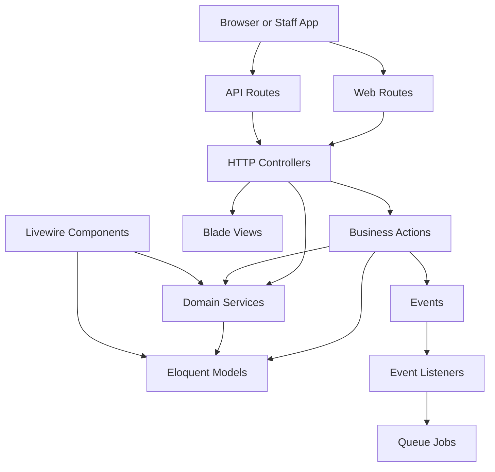

**Diagram sources**
- [web.php:1-76](file://routes/web.php#L1-L76)
- [api.php:1-117](file://routes/api.php#L1-L117)

**Section sources**
- [web.php:1-76](file://routes/web.php#L1-L76)
- [api.php:1-117](file://routes/api.php#L1-L117)

## Core Components
Highblossom’s core architecture can be understood through five recurring patterns:

1. **MVC request flow**: A route dispatches to a controller, which delegates validation and business work to actions or services, then returns a view or JSON response.
2. **Service layer pattern**: Business rules are placed in services so controllers and actions stay focused on orchestration. Examples include availability checking, media uploads, SEO injection, quote handling, and user session management.
3. **Action classes**: Specific workflows such as storing a booking, updating an inspection, or sending a contact message are isolated into action classes. This makes them testable, retry-friendly, and reusable across controllers and other layers.
4. **Livewire components**: Reactive UI elements hold component state, interact with services and models, and render Blade views. They support filters, uploads, and event-driven updates.
5. **Event-driven and background processing**: Side effects like emails and heavy measurements are moved off the critical request path using events and queues.

### Service Layer Pattern
The service layer centralizes reusable business operations. Typical responsibilities include:

- Availability and calendar calculations for bookings.
- Quote creation and status updates.
- Contact message persistence and settings-based routing.
- Image, video, and media registry operations.
- SEO metadata and static route handling.
- User profile, password policy, and session management.
- Content, gallery, taxonomy, testimonial, and partner services.

The exact number of service files exceeds 40 directly under `app/Services`, and additional domain-specific services live under sub-namespaces such as `Contact`, `Content`, `Seo`, `Settings`, and `DataTransferObjects`. Together they implement the requested 159 service-oriented classes and related utilities used throughout the application.

**Section sources**
- [StoreBookingAction.php:1-267](file://app/Actions/StoreBookingAction.php#L1-L267)
- [UpdateInspectionAction.php:1-77](file://app/Actions/UpdateInspectionAction.php#L1-L77)
- [SendContactMessage.php:1-71](file://app/Actions/SendContactMessage.php#L1-L71)

### Action Classes
Actions represent one cohesive business task. They accept validated input, coordinate services and models, handle idempotency or retries where needed, and return structured results.

| Action | Purpose | Key Behaviors |
|---|---|---|
| `StoreBookingAction` | Submit a public booking | Idempotency protection, slot reservation, availability check, image resize, notification dispatch, deadlock retry |
| `UpdateInspectionAction` | Update an inspection and record timeline milestones | Detects start, completion, or reschedule transitions and records corresponding booking events |
| `SendContactMessage` | Persist and acknowledge a contact form submission | Validates input, deduplicates via token, persists message, and dispatches an event |

These actions are intentionally small and focused. They do not try to manage HTTP concerns directly; instead, they expose methods such as `execute`, `handle`, or `__invoke` that controllers or other callers invoke.

**Section sources**
- [StoreBookingAction.php:1-267](file://app/Actions/StoreBookingAction.php#L1-L267)
- [UpdateInspectionAction.php:1-77](file://app/Actions/UpdateInspectionAction.php#L1-L77)
- [SendContactMessage.php:1-71](file://app/Actions/SendContactMessage.php#L1-L71)

### Livewire Component Architecture
Livewire components encapsulate reactive UI logic. The documented components follow these patterns:

| Component | Role | State and Behavior |
|---|---|---|
| `BlockBuilder` | Visual editor for content blocks | Manages block arrays, file uploads, block metadata, validation, and rendering through a block registry |
| `BlogPosts` | Blog listing with search and filtering | URL-bound filters, pagination, computed queries, lazy placeholders, and external event listeners |
| `Passkeys` | Passkey management for authenticated users | Handles registration, deletion, rename, ownership checks, and frontend toast feedback |

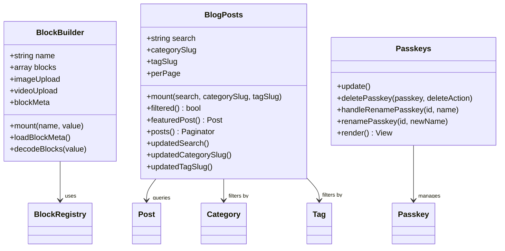

**Diagram sources**
- [BlockBuilder.php:1-431](file://app/Livewire/BlockBuilder.php#L1-L431)
- [BlogPosts.php:1-263](file://app/Livewire/BlogPosts.php#L1-L263)
- [Passkeys.php:1-123](file://app/Livewire/Passkeys.php#L1-L123)

**Section sources**
- [BlockBuilder.php:1-431](file://app/Livewire/BlockBuilder.php#L1-L431)
- [BlogPosts.php:1-263](file://app/Livewire/BlogPosts.php#L1-L263)
- [Passkeys.php:1-123](file://app/Livewire/Passkeys.php#L1-L123)

### Events and Listeners
Events describe something important that happened in the domain. Listeners react to those events, often asynchronously.

| Event | Listener | Behavior |
|---|---|---|
| `ContactMessageReceived` | `SendContactMessageEmail` | Sends an email to the configured administrator address using settings and mail configuration |
| `Login` | `RecordSessionLogin` | Records login session information |
| `Logout` | `EndSessionOnLogout` | Ends the current session on logout |
| `PasswordReset` | `RevokeSessionsOnPasswordReset` | Revokes other sessions when a password reset occurs |

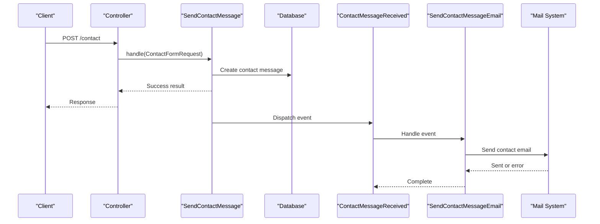

**Diagram sources**
- [SendContactMessage.php:1-71](file://app/Actions/SendContactMessage.php#L1-L71)
- [SendContactMessageEmail.php:1-54](file://app/Listeners/SendContactMessageEmail.php#L1-L54)
- [EventServiceProvider.php:1-51](file://app/Providers/EventServiceProvider.php#L1-L51)

**Section sources**
- [BookingCreatedEvent.php:1-19](file://app/Events/BookingCreatedEvent.php#L1-L19)
- [SendContactMessageEmail.php:1-54](file://app/Listeners/SendContactMessageEmail.php#L1-L54)
- [EventServiceProvider.php:1-51](file://app/Providers/EventServiceProvider.php#L1-L51)

### Background Job Processing
Background jobs are used to move expensive or non-critical work off the request path. The documented job warms system overview sections:

- It implements uniqueness so repeated presses do not enqueue overlapping warm-up runs.
- It is queueable and limited to one attempt.
- It has a wall-clock timeout.
- It iterates over heavy probe keys and asks a runner to warm each section.

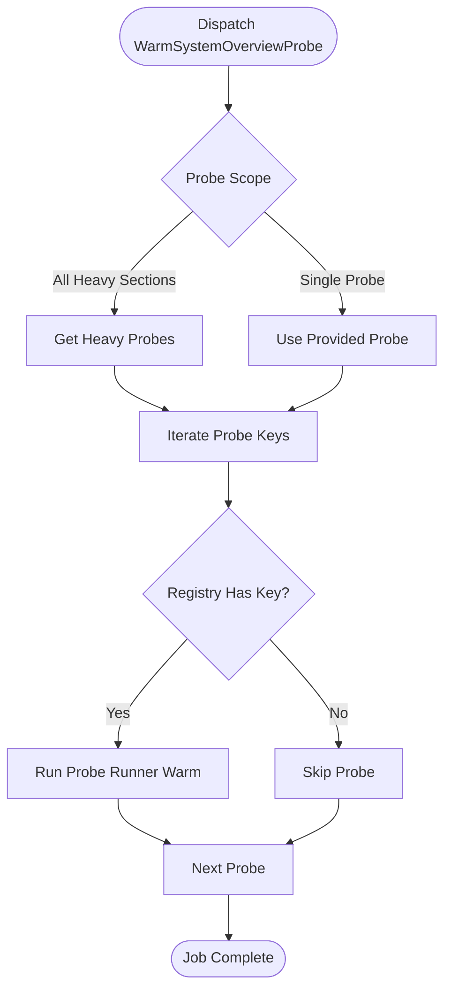

**Diagram sources**
- [WarmSystemOverviewProbe.php:1-76](file://app/Jobs/WarmSystemOverviewProbe.php#L1-L76)

**Section sources**
- [WarmSystemOverviewProbe.php:1-76](file://app/Jobs/WarmSystemOverviewProbe.php#L1-L76)
- [queue.php:1-128](file://config/queue.php#L1-L128)

## Architecture Overview
The end-to-end request flow combines several architectural layers.

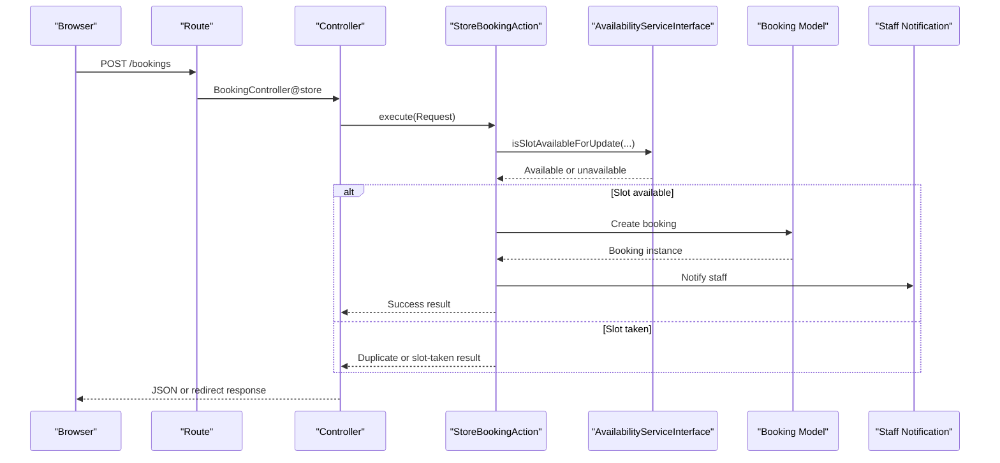

**Diagram sources**
- [web.php:44-60](file://routes/web.php#L44-L60)
- [StoreBookingAction.php:1-267](file://app/Actions/StoreBookingAction.php#L1-L267)

**Section sources**
- [web.php:1-76](file://routes/web.php#L1-L76)
- [api.php:1-117](file://routes/api.php#L1-L117)
- [StoreBookingAction.php:1-267](file://app/Actions/StoreBookingAction.php#L1-L267)

## Detailed Component Analysis

### StoreBookingAction
This action handles the complete public booking workflow:

1. Accepts an HTTP request.
2. Checks idempotency using a token.
3. Reserves a time slot inside a database transaction.
4. Validates availability before inserting the booking.
5. Creates a reference derived from the booking identifier.
6. Optionally stores a resized damage photo.
7. Notifies staff and returns a structured success or failure result.

It also handles concurrent slot contention by retrying once when a database deadlock occurs.

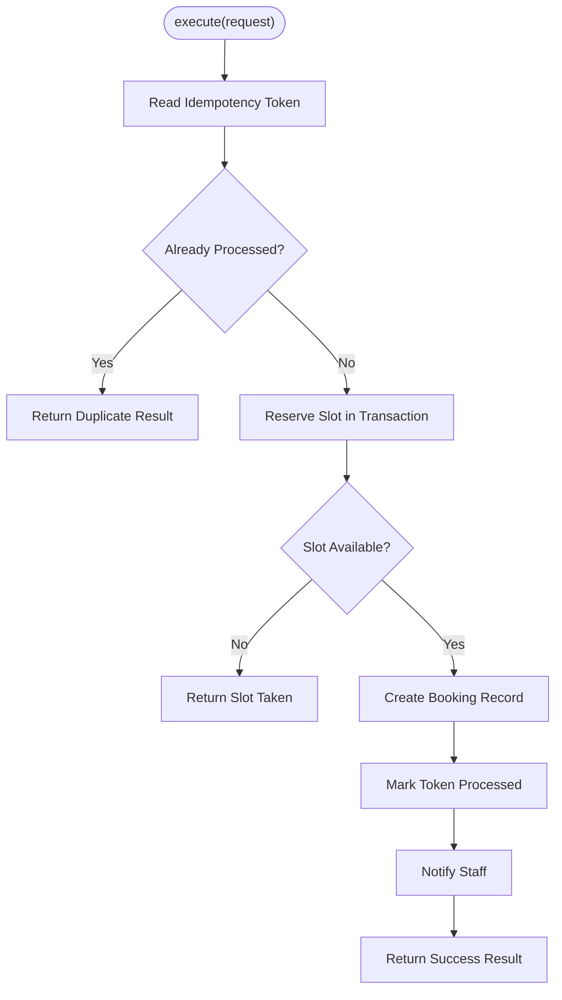

**Diagram sources**
- [StoreBookingAction.php:1-267](file://app/Actions/StoreBookingAction.php#L1-L267)

**Section sources**
- [StoreBookingAction.php:1-267](file://app/Actions/StoreBookingAction.php#L1-L267)

### UpdateInspectionAction
This action updates an inspection and records meaningful booking timeline events:

- Extracts client summary before updating because it belongs to a timeline event rather than the inspection itself.
- Tracks whether the inspection was already started or completed.
- Records a started event when an inspection transitions to started.
- Records a completed event when an inspection transitions to completed.
- Records a rescheduled event if the appointment time changes without completing the inspection.

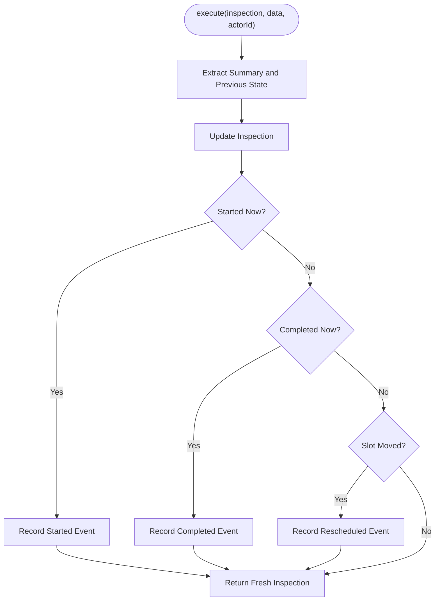

**Diagram sources**
- [UpdateInspectionAction.php:1-77](file://app/Actions/UpdateInspectionAction.php#L1-L77)

**Section sources**
- [UpdateInspectionAction.php:1-77](file://app/Actions/UpdateInspectionAction.php#L1-L77)

### SendContactMessage
This action processes contact form submissions safely:

- Reads an optional idempotency token.
- Returns a duplicate-success response if the token was already processed.
- Marks the token processed before persisting the message.
- Persists name, email, phone, subject, message, and read status.
- Dispatches `ContactMessageReceived` so downstream listeners can send emails asynchronously.

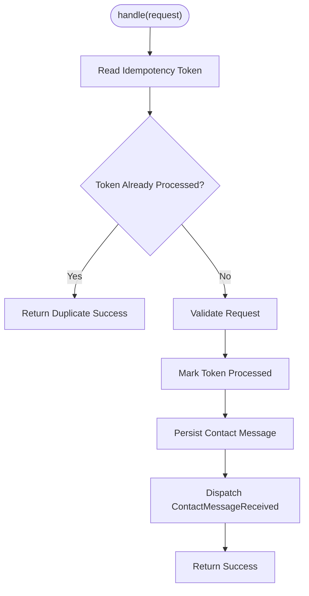

**Diagram sources**
- [SendContactMessage.php:1-71](file://app/Actions/SendContactMessage.php#L1-L71)

**Section sources**
- [SendContactMessage.php:1-71](file://app/Actions/SendContactMessage.php#L1-L71)

### BlockBuilder
The block builder is a server-backed content editor for dynamic page content:

- Initializes block data from either an array or a JSON string.
- Ensures every block has a unique identifier.
- Loads editable block types and defaults from a block registry.
- Supports image and video uploads with validation.
- Maps per-block validation errors to block identifiers.
- Renders blocks through a registered renderer.

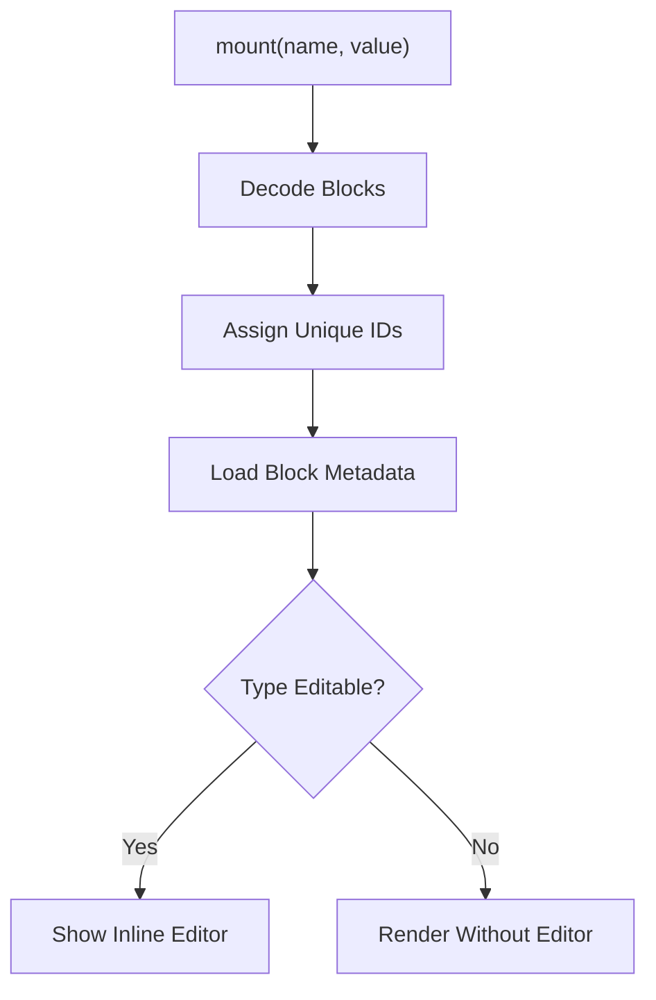

**Diagram sources**
- [BlockBuilder.php:1-431](file://app/Livewire/BlockBuilder.php#L1-L431)

**Section sources**
- [BlockBuilder.php:1-431](file://app/Livewire/BlockBuilder.php#L1-L431)

### BlogPosts
The blog component provides filtered, paginated listings:

- Uses URL-bound properties for search, category slug, and tag slug.
- Shows a featured post only when no filter is active and enough posts exist.
- Computes published totals, categories, tags, and the final query.
- Resets pagination when filters change.
- Listens to external Livewire events to update search and clear filters.

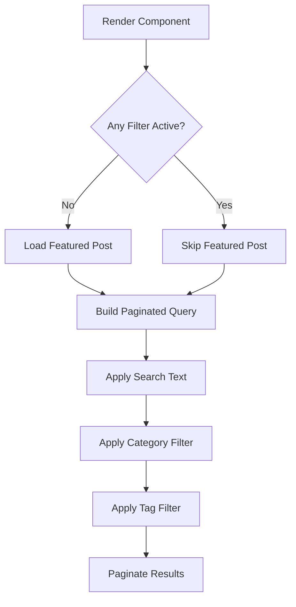

**Diagram sources**
- [BlogPosts.php:1-263](file://app/Livewire/BlogPosts.php#L1-L263)

**Section sources**
- [BlogPosts.php:1-263](file://app/Livewire/BlogPosts.php#L1-L263)

### Passkeys
The passkey component manages WebAuthn credentials for the authenticated user:

- Refreshes its list after registration, deletion, or rename events.
- Deletes a passkey only if it belongs to the current user.
- Renames passkeys after validating length and ownership.
- Dispatches frontend toast notifications for success and error cases.

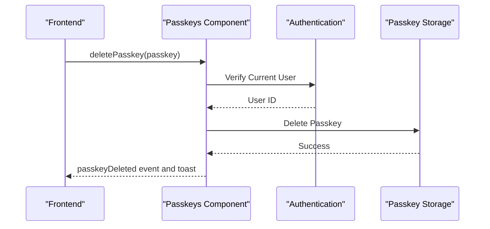

**Diagram sources**
- [Passkeys.php:1-123](file://app/Livewire/Passkeys.php#L1-L123)

**Section sources**
- [Passkeys.php:1-123](file://app/Livewire/Passkeys.php#L1-L123)

## Dependency Analysis
The following diagram maps how key components depend on each other during typical workflows.

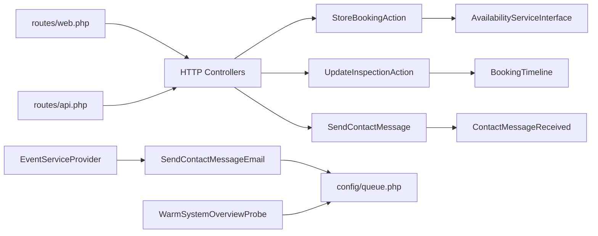

**Diagram sources**
- [web.php:1-76](file://routes/web.php#L1-L76)
- [api.php:1-117](file://routes/api.php#L1-L117)
- [StoreBookingAction.php:1-267](file://app/Actions/StoreBookingAction.php#L1-L267)
- [UpdateInspectionAction.php:1-77](file://app/Actions/UpdateInspectionAction.php#L1-L77)
- [SendContactMessage.php:1-71](file://app/Actions/SendContactMessage.php#L1-L71)
- [EventServiceProvider.php:1-51](file://app/Providers/EventServiceProvider.php#L1-L51)
- [SendContactMessageEmail.php:1-54](file://app/Listeners/SendContactMessageEmail.php#L1-L54)
- [WarmSystemOverviewProbe.php:1-76](file://app/Jobs/WarmSystemOverviewProbe.php#L1-L76)
- [queue.php:1-128](file://config/queue.php#L1-L128)

**Section sources**
- [web.php:1-76](file://routes/web.php#L1-L76)
- [api.php:1-117](file://routes/api.php#L1-L117)
- [StoreBookingAction.php:1-267](file://app/Actions/StoreBookingAction.php#L1-L267)
- [UpdateInspectionAction.php:1-77](file://app/Actions/UpdateInspectionAction.php#L1-L77)
- [SendContactMessage.php:1-71](file://app/Actions/SendContactMessage.php#L1-L71)
- [EventServiceProvider.php:1-51](file://app/Providers/EventServiceProvider.php#L1-L51)
- [SendContactMessageEmail.php:1-54](file://app/Listeners/SendContactMessageEmail.php#L1-L54)
- [WarmSystemOverviewProbe.php:1-76](file://app/Jobs/WarmSystemOverviewProbe.php#L1-L76)
- [queue.php:1-128](file://config/queue.php#L1-L128)

## Performance Considerations
Several implementation choices improve performance and resilience:

- **Idempotency tokens** prevent duplicate submissions for bookings and contact messages.
- **Database transactions with row locking** reduce race conditions when multiple clients reserve the same booking slot.
- **Deadlock retry logic** treats transient lock conflicts as recoverable failures rather than hard errors.
- **Queued listeners** keep email delivery off the request path.
- **Unique jobs** coalesce repeated warm-up runs so admins cannot accidentally create a queue backlog.
- **Computed properties and lazy loading** in Livewire avoid unnecessary queries until data is rendered.
- **Throttling middleware** protects high-frequency endpoints such as booking availability, blog search, and staff login.

[No sources needed since this section provides general guidance]

## Troubleshooting Guide
Common issues and their likely locations:

| Symptom | Likely Cause | Where to Investigate |
|---|---|---|
| Duplicate booking submissions | Missing or reused idempotency token | [StoreBookingAction.php](file://app/Actions/StoreBookingAction.php#L1-L267) |
| Two customers book the same slot | Lock contention or missing transactional reservation | [StoreBookingAction.php](file://app/Actions/StoreBookingAction.php#L1-L267) |
| Contact email never sent | Event not dispatched, listener not registered, or queue worker not running | [SendContactMessage.php](file://app/Actions/SendContactMessage.php#L1-L71), [EventServiceProvider.php](file://app/Providers/EventServiceProvider.php#L1-L51), [SendContactMessageEmail.php](file://app/Listeners/SendContactMessageEmail.php#L1-L54) |
| Queue jobs pile up | Wrong queue connection, failed jobs, or missing worker process | [queue.php](file://config/queue.php#L1-L128) |
| Blog filters do not reset pagination | Livewire property watchers not triggered | [BlogPosts.php](file://app/Livewire/BlogPosts.php#L1-L263) |
| Passkey operations fail for wrong user | Ownership check mismatch | [Passkeys.php](file://app/Livewire/Passkeys.php#L1-L123) |
| System overview measurement overlaps | Job uniqueness not applied or cache backend misconfigured | [WarmSystemOverviewProbe.php](file://app/Jobs/WarmSystemOverviewProbe.php#L1-L76) |

**Section sources**
- [StoreBookingAction.php:1-267](file://app/Actions/StoreBookingAction.php#L1-L267)
- [SendContactMessage.php:1-71](file://app/Actions/SendContactMessage.php#L1-L71)
- [EventServiceProvider.php:1-51](file://app/Providers/EventServiceProvider.php#L1-L51)
- [SendContactMessageEmail.php:1-54](file://app/Listeners/SendContactMessageEmail.php#L1-L54)
- [queue.php:1-128](file://config/queue.php#L1-L128)
- [BlogPosts.php:1-263](file://app/Livewire/BlogPosts.php#L1-L263)
- [Passkeys.php:1-123](file://app/Livewire/Passkeys.php#L1-L123)
- [WarmSystemOverviewProbe.php:1-76](file://app/Jobs/WarmSystemOverviewProbe.php#L1-L76)

## Conclusion
Highblossom’s architecture separates concerns cleanly:

- Controllers handle HTTP boundaries.
- Actions encapsulate discrete business operations.
- Services provide reusable domain logic.
- Models represent persistent data.
- Views and Livewire components render interactive interfaces.
- Events and listeners decouple side effects.
- Queue jobs handle background work safely.

This structure makes the system easier to test, extend, and scale. New features should follow the same pattern: introduce an action for a specific operation, delegate shared logic to services, emit events for asynchronous effects, and use Livewire for reactive UI where appropriate.

[No sources needed since this section summarizes without analyzing specific files]