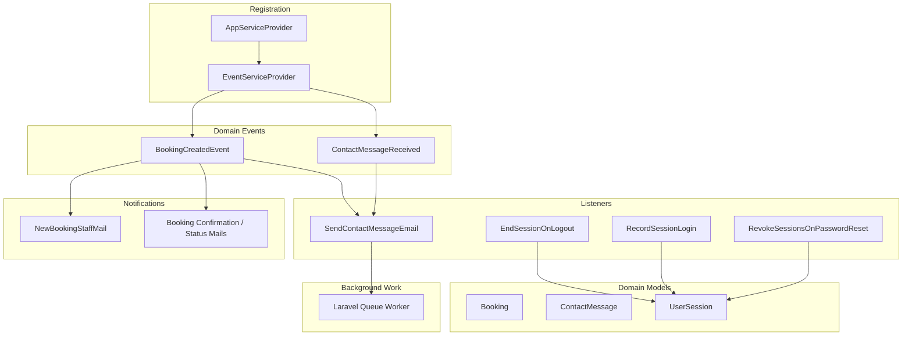
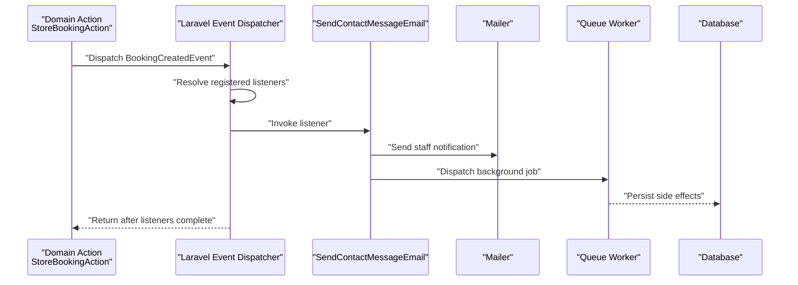
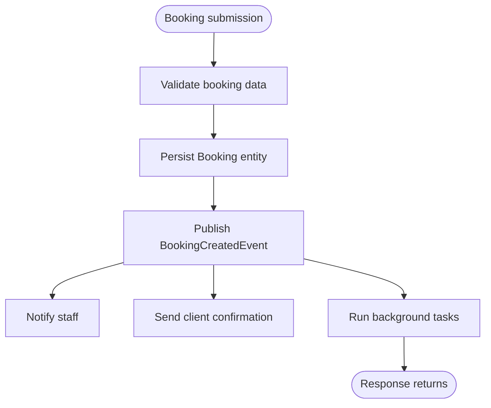
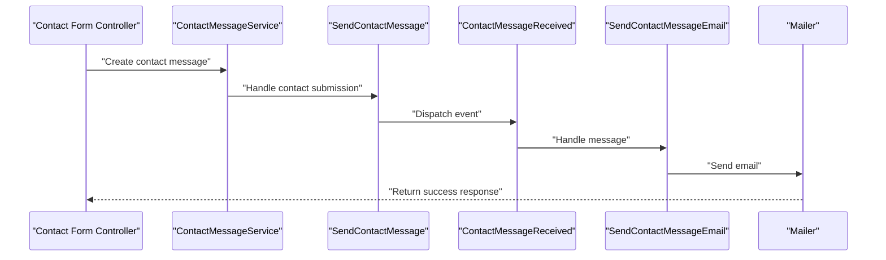
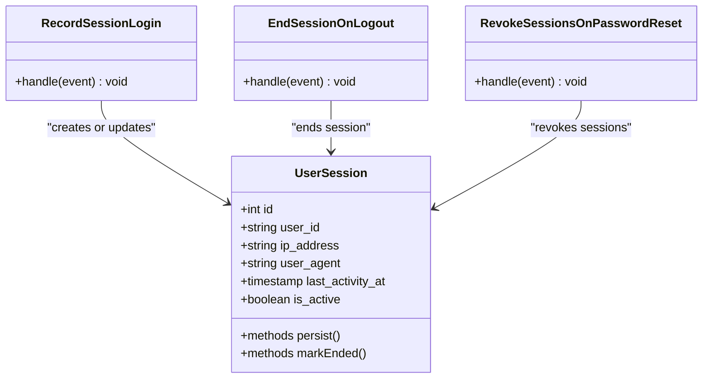
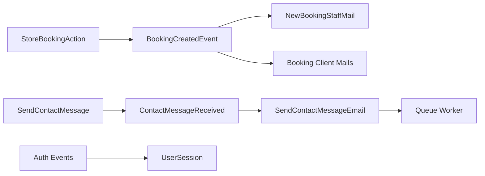

# Event & Listener System

<cite>
**Referenced Files in This Document**
- [BookingCreatedEvent.php](file://app/app/Events/BookingCreatedEvent.php)
- [ContactMessageReceived.php](file://app/app/Events/ContactMessageReceived.php)
- [SendContactMessageEmail.php](file://app/app/Listeners/SendContactMessageEmail.php)
- [EndSessionOnLogout.php](file://app/app/Listeners/EndSessionOnLogout.php)
- [RecordSessionLogin.php](file://app/app/Listeners/RecordSessionLogin.php)
- [RevokeSessionsOnPasswordReset.php](file://app/app/Listeners/RevokeSessionsOnPasswordReset.php)
- [EventServiceProvider.php](file://app/app/Providers/EventServiceProvider.php)
- [AppServiceProvider.php](file://app/app/Providers/AppServiceProvider.php)
- [booking.php](file://lang/lang/en/booking.php)
- [contact.php](file://lang/lang/en/contact.php)
- [NewBookingStaffMail.php](file://app/app/Mail/NewBookingStaffMail.php)
- [BookingConfirmationMail.php](file://app/app/Mail/BookingConfirmationMail.php)
- [BookingCancelledClientMail.php](file://app/app/Mail/BookingCancelledClientMail.php)
- [BookingConfirmedClientMail.php](file://app/app/Mail/BookingConfirmedClientMail.php)
- [BookingCompletedClientMail.php](file://app/app/Mail/BookingCompletedClientMail.php)
- [BookingRescheduledClientMail.php](file://app/app/Mail/BookingRescheduledClientMail.php)
- [StoreBookingAction.php](file://app/app/Actions/StoreBookingAction.php)
- [SendContactMessage.php](file://app/app/Actions/SendContactMessage.php)
- [ContactMessageService.php](file://app/app/Services/ContactMessageService.php)
- [UserSessionService.php](file://app/app/Services/UserSessionService.php)
- [UserSession.php](file://app/app/Models/UserSession.php)
- [Booking.php](file://app/app/Models/Booking.php)
- [ContactMessage.php](file://app/app/Models/ContactMessage.php)
- [queue.php](file://config/queue.php)
- [mail.php](file://config/mail.php)
- [session.php](file://config/session.php)
- [bootstrap/providers.php](file://bootstrap/providers.php)
</cite>

## Table of Contents
1. Introduction
2. Project Structure
3. Core Components
4. Architecture Overview
5. Detailed Component Analysis
6. Dependency Analysis
7. Performance Considerations
8. Troubleshooting Guide
9. Testing Strategies for Event-Driven Code
10. Conclusion

## Introduction
Highblossom uses Laravel’s event system to decouple business actions from their side effects. Domain events such as booking creation and contact message submission publish state changes, while listeners perform email delivery, session management, logging, background jobs, and other side effects. This makes the application easier to extend, test, and scale because components communicate through stable event contracts instead of direct method calls.

The event-driven design supports:
- Decoupled communication between controllers, actions, services, and background workers.
- Asynchronous execution through Laravel queues for heavy operations like email sending.
- Clear separation between domain state transitions and external integrations.
- Observability and testability through explicit event payloads and listener boundaries.

## Project Structure
The event subsystem is organized under `app/app` with a conventional layout:

**Diagram sources**
- [EventServiceProvider.php](file://app/app/Providers/EventServiceProvider.php)
- [BookingCreatedEvent.php](file://app/app/Events/BookingCreatedEvent.php)
- [ContactMessageReceived.php](file://app/app/Events/ContactMessageReceived.php)
- [SendContactMessageEmail.php](file://app/app/Listeners/SendContactMessageEmail.php)
- [EndSessionOnLogout.php](file://app/app/Listeners/EndSessionOnLogout.php)
- [RecordSessionLogin.php](file://app/app/Listeners/RecordSessionLogin.php)
- [RevokeSessionsOnPasswordReset.php](file://app/app/Listeners/RevokeSessionsOnPasswordReset.php)
- [NewBookingStaffMail.php](file://app/app/Mail/NewBookingStaffMail.php)
- [BookingConfirmationMail.php](file://app/app/Mail/BookingConfirmationMail.php)
- [BookingCancelledClientMail.php](file://app/app/Mail/BookingCancelledClientMail.php)
- [BookingConfirmedClientMail.php](file://app/app/Mail/BookingConfirmedClientMail.php)
- [BookingCompletedClientMail.php](file://app/app/Mail/BookingCompletedClientMail.php)
- [BookingRescheduledClientMail.php](file://app/app/Mail/BookingRescheduledClientMail.php)
- [UserSession.php](file://app/app/Models/UserSession.php)
- [Booking.php](file://app/app/Models/Booking.php)
- [ContactMessage.php](file://app/app/Models/ContactMessage.php)

**Section sources**
- [EventServiceProvider.php](file://app/app/Providers/EventServiceProvider.php)
- [bootstrap/providers.php](file://bootstrap/providers.php)

## Core Components
This section documents the main events, listeners, registration points, and their responsibilities.

### Events
- **BookingCreatedEvent**: Represents the successful creation of a booking. It carries enough information for downstream systems to send staff notifications, client confirmation emails, analytics tracking, and queue jobs without requiring the caller to know those details.
- **ContactMessageReceived**: Represents a user-submitted contact form payload. It allows email delivery, audit logging, CRM updates, or other integrations to react without coupling the contact form controller to those implementations.

Both events encapsulate immutable or serializable payloads so they can be safely dispatched synchronously or asynchronously through Laravel’s queue system.

**Section sources**
- [BookingCreatedEvent.php](file://app/app/Events/BookingCreatedEvent.php)
- [ContactMessageReceived.php](file://app/app/Events/ContactMessageReceived.php)

### Listeners
- **SendContactMessageEmail**: Reacts to `ContactMessageReceived` by delivering an email notification. It should validate the incoming contact payload, build an appropriate mail message, and dispatch it via Laravel’s mailer, ideally using queued jobs when email delivery is slow.
- **EndSessionOnLogout**: Reacts to authentication logout events to terminate or record the current user session. It coordinates with the session model and service layer to mark sessions as ended and persist relevant metadata.
- **RecordSessionLogin**: Records login activity for a user session, typically capturing device, IP, timestamp, and session identifiers for auditing and security monitoring.
- **RevokeSessionsOnPasswordReset**: Revokes existing sessions when a user resets their password, improving security by invalidating previously issued tokens.

These listeners keep business logic focused on the primary request path while still enabling important side effects.

**Section sources**
- [SendContactMessageEmail.php](file://app/app/Listeners/SendContactMessageEmail.php)
- [EndSessionOnLogout.php](file://app/app/Listeners/EndSessionOnLogout.php)
- [RecordSessionLogin.php](file://app/app/Listeners/RecordSessionLogin.php)
- [RevokeSessionsOnPasswordReset.php](file://app/app/Listeners/RevokeSessionsOnPasswordReset.php)

### Event Registration
Event-to-listener mappings are defined in the event provider. The provider registers which listeners handle each event and may define synchronous or asynchronous behavior depending on the listener implementation. In addition, application providers register service providers that bootstrap framework features used by listeners, including mail and queue configuration.

**Section sources**
- [EventServiceProvider.php](file://app/app/Providers/EventServiceProvider.php)
- [AppServiceProvider.php](file://app/app/Providers/AppServiceProvider.php)
- [bootstrap/providers.php](file://bootstrap/providers.php)

## Architecture Overview
At runtime, a domain action publishes an event. Laravel resolves matching listeners, constructs them, and executes them in registration order. For long-running work, listeners dispatch queued jobs so the HTTP response remains responsive.

**Diagram sources**
- [StoreBookingAction.php](file://app/app/Actions/StoreBookingAction.php)
- [BookingCreatedEvent.php](file://app/app/Events/BookingCreatedEvent.php)
- [SendContactMessageEmail.php](file://app/app/Listeners/SendContactMessageEmail.php)
- [NewBookingStaffMail.php](file://app/app/Mail/NewBookingStaffMail.php)
- [queue.php](file://config/queue.php)

## Detailed Component Analysis

### Booking Creation Flow
The booking flow demonstrates how a domain action triggers an event and how listeners coordinate multiple side effects without tight coupling.

Key responsibilities:
- **StoreBookingAction**: Orchestrates validation, persistence, and event publication.
- **BookingCreatedEvent**: Carries booking identity and context needed by listeners.
- **Listeners**: Send staff notifications, client emails, and enqueue background work.

**Section sources**
- [StoreBookingAction.php](file://app/app/Actions/StoreBookingAction.php)
- [BookingCreatedEvent.php](file://app/app/Events/BookingCreatedEvent.php)
- [NewBookingStaffMail.php](file://app/app/Mail/NewBookingStaffMail.php)
- [BookingConfirmationMail.php](file://app/app/Mail/BookingConfirmationMail.php)
- [BookingCancelledClientMail.php](file://app/app/Mail/BookingCancelledClientMail.php)
- [BookingConfirmedClientMail.php](file://app/app/Mail/BookingConfirmedClientMail.php)
- [BookingCompletedClientMail.php](file://app/app/Mail/BookingCompletedClientMail.php)
- [BookingRescheduledClientMail.php](file://app/app/Mail/BookingRescheduledClientMail.php)
- [Booking.php](file://app/app/Models/Booking.php)

### Contact Message Flow
Contact submissions use `ContactMessageReceived` to separate form handling from email delivery and other integrations.

**Section sources**
- [ContactMessageReceived.php](file://app/app/Events/ContactMessageReceived.php)
- [SendContactMessage.php](file://app/app/Actions/SendContactMessage.php)
- [ContactMessageService.php](file://app/app/Services/ContactMessageService.php)
- [SendContactMessageEmail.php](file://app/app/Listeners/SendContactMessageEmail.php)
- [ContactMessage.php](file://app/app/Models/ContactMessage.php)
- [contact.php](file://lang/lang/en/contact.php)

### Session Management Events
Authentication-related events coordinate session lifecycle and security:

- **RecordSessionLogin**: Captures login details for auditing and visibility.
- **EndSessionOnLogout**: Ends or records the active session when a user logs out.
- **RevokeSessionsOnPasswordReset**: Invalidates previous sessions after a password reset.

**Diagram sources**
- [RecordSessionLogin.php](file://app/app/Listeners/RecordSessionLogin.php)
- [EndSessionOnLogout.php](file://app/app/Listeners/EndSessionOnLogout.php)
- [RevokeSessionsOnPasswordReset.php](file://app/app/Listeners/RevokeSessionsOnPasswordReset.php)
- [UserSession.php](file://app/app/Models/UserSession.php)

**Section sources**
- [RecordSessionLogin.php](file://app/app/Listeners/RecordSessionLogin.php)
- [EndSessionOnLogout.php](file://app/app/Listeners/EndSessionOnLogout.php)
- [RevokeSessionsOnPasswordReset.php](file://app/app/Listeners/RevokeSessionsOnPasswordReset.php)
- [UserSessionService.php](file://app/app/Services/UserSessionService.php)
- [UserSession.php](file://app/app/Models/UserSession.php)
- [session.php](file://config/session.php)

## Dependency Analysis
The event system introduces clear dependencies between domain events, listeners, models, mail classes, and configuration.

**Diagram sources**
- [StoreBookingAction.php](file://app/app/Actions/StoreBookingAction.php)
- [BookingCreatedEvent.php](file://app/app/Events/BookingCreatedEvent.php)
- [NewBookingStaffMail.php](file://app/app/Mail/NewBookingStaffMail.php)
- [BookingConfirmationMail.php](file://app/app/Mail/BookingConfirmationMail.php)
- [BookingCancelledClientMail.php](file://app/app/Mail/BookingCancelledClientMail.php)
- [BookingConfirmedClientMail.php](file://app/app/Mail/BookingConfirmedClientMail.php)
- [BookingCompletedClientMail.php](file://app/app/Mail/BookingCompletedClientMail.php)
- [BookingRescheduledClientMail.php](file://app/app/Mail/BookingRescheduledClientMail.php)
- [SendContactMessage.php](file://app/app/Actions/SendContactMessage.php)
- [ContactMessageReceived.php](file://app/app/Events/ContactMessageReceived.php)
- [SendContactMessageEmail.php](file://app/app/Listeners/SendContactMessageEmail.php)
- [UserSession.php](file://app/app/Models/UserSession.php)
- [queue.php](file://config/queue.php)

**Section sources**
- [EventServiceProvider.php](file://app/app/Providers/EventServiceProvider.php)
- [queue.php](file://config/queue.php)
- [mail.php](file://config/mail.php)

## Performance Considerations
- Use queued listeners for expensive operations such as email delivery, file processing, and external API calls. Configure the queue driver and worker concurrency appropriately.
- Keep event payloads small and serializable. Avoid attaching large objects or unserializable resources.
- Prefer database writes inside listeners only when necessary; batch or defer heavy persistence where possible.
- Monitor queue backlog, failed jobs, and mail delivery metrics to detect bottlenecks.
- Avoid synchronous event chains that block the HTTP response. Split workflows into short synchronous steps followed by background jobs.
- Cache read-heavy data used by listeners rather than repeatedly querying the database.

[No sources needed since this section provides general guidance]

## Troubleshooting Guide
Common issues and remedies:

- **Listener not executing**: Verify the event-to-listener mapping in `EventServiceProvider`. Ensure the provider is registered and event discovery is enabled if applicable.
- **Email not sent**: Check mail configuration, credentials, and queue settings. Inspect failed job entries and mail logs.
- **Slow requests**: Identify listeners performing blocking work and move them to queued jobs. Review queue worker throughput.
- **Session inconsistencies**: Confirm that session-related listeners execute reliably and that session storage is configured correctly.
- **Duplicate events**: If a caller dispatches an event manually while a service also emits it, deduplicate at the source or centralize event emission.
- **Failure recovery**: Implement retry policies, dead-letter queues, and alerting for failed listeners. Log contextual event payloads to aid debugging.

**Section sources**
- [EventServiceProvider.php](file://app/app/Providers/EventServiceProvider.php)
- [queue.php](file://config/queue.php)
- [mail.php](file://config/mail.php)
- [session.php](file://config/session.php)

## Testing Strategies for Event-Driven Code
- Assert events are dispatched from actions and controllers using Laravel’s testing helpers.
- Test listeners in isolation by constructing event instances and invoking listener methods directly.
- Mock mailers and queue jobs to verify outgoing emails and background work without network dependencies.
- Use fake event buses to assert order and frequency of events during complex workflows.
- Write integration tests that exercise the full event pipeline against a test database and dummy queue driver.
- Add failure tests to ensure retries, logging, and error reporting behave as expected.

**Section sources**
- [StoreBookingAction.php](file://app/app/Actions/StoreBookingAction.php)
- [SendContactMessage.php](file://app/app/Actions/SendContactMessage.php)
- [SendContactMessageEmail.php](file://app/app/Listeners/SendContactMessageEmail.php)
- [EndSessionOnLogout.php](file://app/app/Listeners/EndSessionOnLogout.php)
- [RecordSessionLogin.php](file://app/app/Listeners/RecordSessionLogin.php)
- [RevokeSessionsOnPasswordReset.php](file://app/app/Listeners/RevokeSessionsOnPasswordReset.php)

## Conclusion
Highblossom’s event-driven architecture separates domain state changes from side effects, making the system modular, testable, and scalable. Events such as `BookingCreatedEvent` and `ContactMessageReceived` provide stable contracts, while listeners implement email delivery, session management, and background processing. Correct registration in `EventServiceProvider`, careful payload design, and disciplined use of queues ensure reliable asynchronous behavior without coupling components. Proper performance tuning, debugging practices, and comprehensive testing keep the event system robust in production.