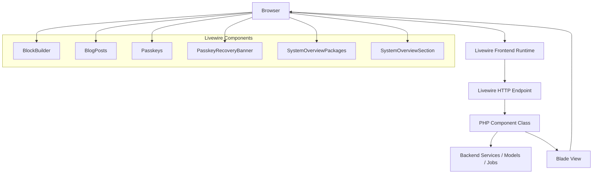
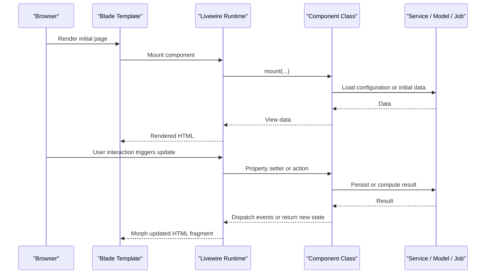
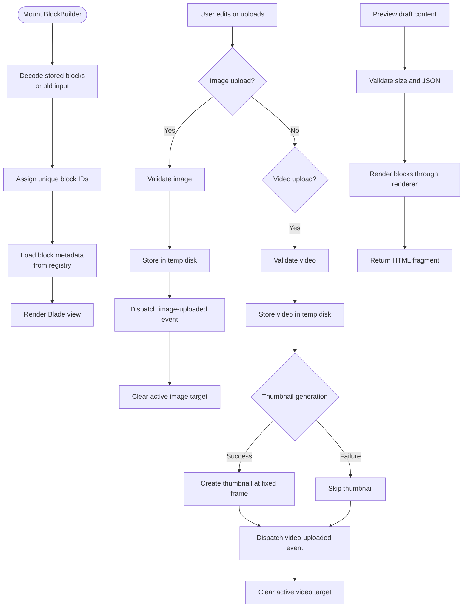
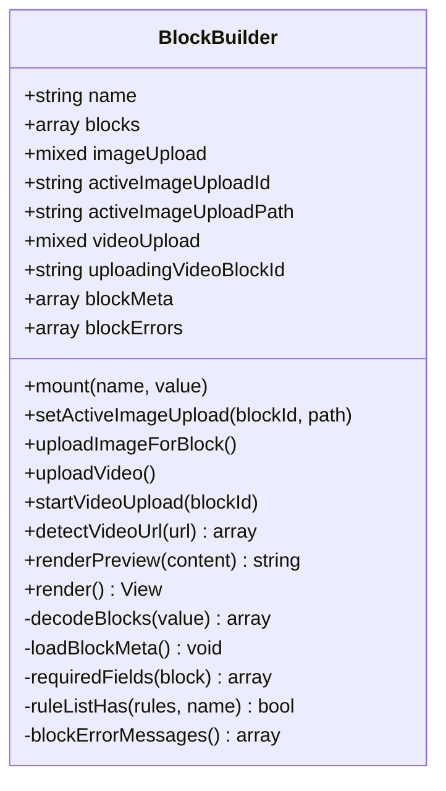
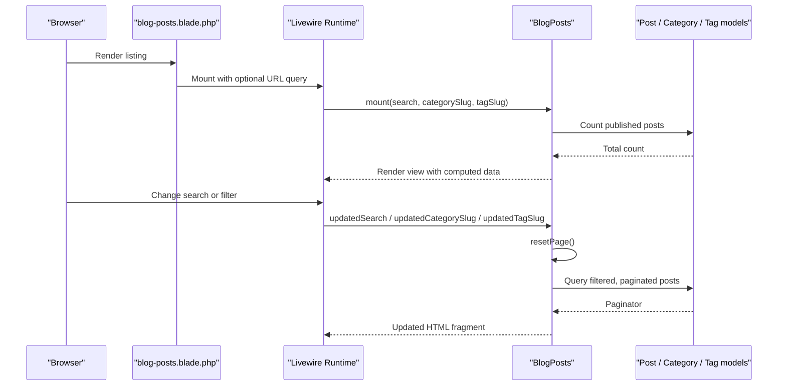
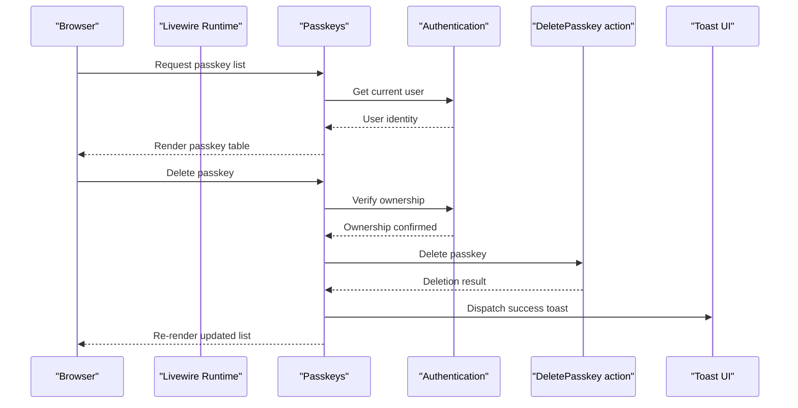
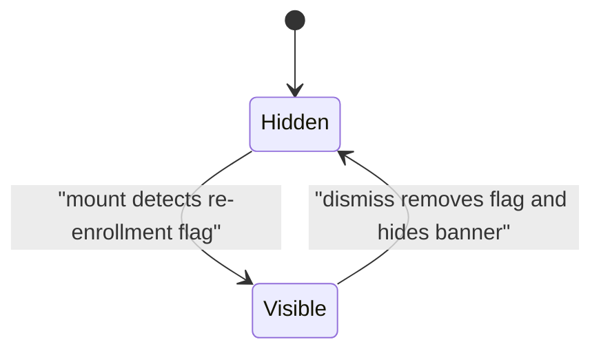
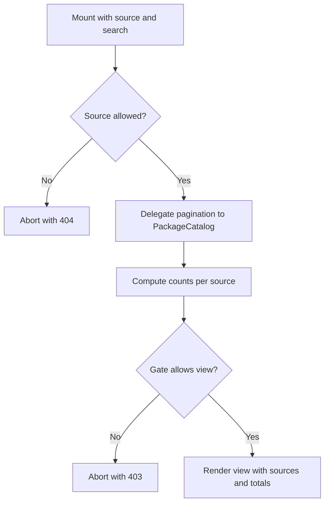
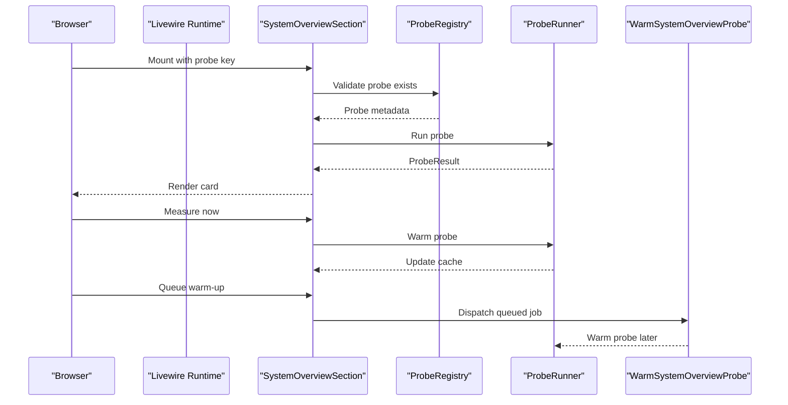
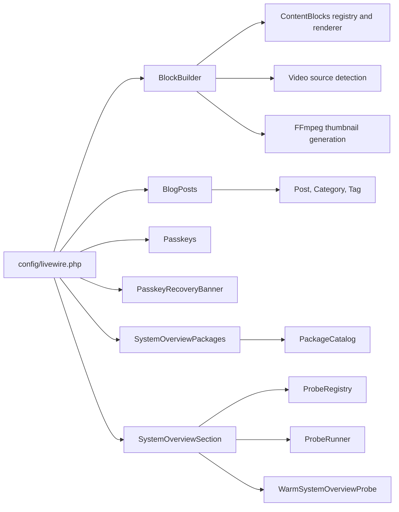

# Livewire Components

<cite>
**Referenced Files in This Document**
- [BlockBuilder.php](file://app/Livewire/BlockBuilder.php)
- [BlogPosts.php](file://app/Livewire/BlogPosts.php)
- [Passkeys.php](file://app/Livewire/Passkeys.php)
- [PasskeyRecoveryBanner.php](file://app/Livewire/PasskeyRecoveryBanner.php)
- [SystemOverviewPackages.php](file://app/Livewire/SystemOverviewPackages.php)
- [SystemOverviewSection.php](file://app/Livewire/SystemOverviewSection.php)
- [livewire.php](file://config/livewire.php)
- [block-builder.blade.php](file://resources/views/livewire/block-builder.blade.php)
- [blog-posts.blade.php](file://resources/views/livewire/blog-posts.blade.php)
</cite>

## Table of Contents
1. [Introduction](#introduction)
2. [Project Structure](#project-structure)
3. [Core Components](#core-components)
4. [Architecture Overview](#architecture-overview)
5. [Detailed Component Analysis](#detailed-component-analysis)
6. [Dependency Analysis](#dependency-analysis)
7. [Performance Considerations](#performance-considerations)
8. [Troubleshooting Guide](#troubleshooting-guide)
9. [Conclusion](#conclusion)

## Introduction
This document explains Highblossom’s Livewire component architecture and how it delivers reactive UIs without requiring a heavy JavaScript framework. The project uses Livewire components to keep state, validation, file uploads, pagination, authorization checks, and event dispatching on the server while rendering Blade templates for presentation. Lightweight client interactivity is delegated to Alpine.js where appropriate, especially around drag-and-drop and builder interactions.

The main components covered are:
- BlockBuilder: a content-block editor with image/video upload, preview, and block metadata driven by the ContentBlocks package.
- BlogPosts: a searchable, filterable, paginated blog listing that keeps filters synchronized with the URL.
- Passkeys: an administrative interface for managing WebAuthn passkeys through backend actions and frontend events.
- SystemOverviewPackages: a lazily loaded, paginated dependency list filtered by source and search term.
- SystemOverviewSection: a heavy administrative dashboard card that measures system probes synchronously or via a queued job.

## Project Structure
Livewire components live under `app/Livewire`. Their Blade views live under `resources/views/livewire`. Configuration for class namespaces, view paths, lazy loading placeholders, payload guards, CSP-safe Alpine, and pagination theme is centralized in `config/livewire.php`.

**Diagram sources**
- [BlockBuilder.php:1-431](file://app/Livewire/BlockBuilder.php#L1-L431)
- [BlogPosts.php:1-263](file://app/Livewire/BlogPosts.php#L1-L263)
- [Passkeys.php:1-123](file://app/Livewire/Passkeys.php#L1-L123)
- [PasskeyRecoveryBanner.php:1-50](file://app/Livewire/PasskeyRecoveryBanner.php#L1-L50)
- [SystemOverviewPackages.php:1-117](file://app/Livewire/SystemOverviewPackages.php#L1-L117)
- [SystemOverviewSection.php:1-88](file://app/Livewire/SystemOverviewSection.php#L1-L88)

**Section sources**
- [BlockBuilder.php:1-431](file://app/Livewire/BlockBuilder.php#L1-L431)
- [BlogPosts.php:1-263](file://app/Livewire/BlogPosts.php#L1-L263)
- [Passkeys.php:1-123](file://app/Livewire/Passkeys.php#L1-L123)
- [PasskeyRecoveryBanner.php:1-50](file://app/Livewire/PasskeyRecoveryBanner.php#L1-L50)
- [SystemOverviewPackages.php:1-117](file://app/Livewire/SystemOverviewPackages.php#L1-L117)
- [SystemOverviewSection.php:1-88](file://app/Livewire/SystemOverviewSection.php#L1-L88)
- [livewire.php:1-282](file://config/livewire.php#L1-L282)

## Core Components
The application centers its reactive interfaces on five primary Livewire components:

| Component | Responsibility | Key Livewire Features Used |
|---|---|---|
| BlockBuilder | Builds and previews content blocks; handles image and video uploads; integrates with ContentBlocks registry and renderer. | Properties, validation, locked properties, file uploads, events, service resolution, custom placeholder-like behavior via preview method. |
| BlogPosts | Lists published posts with search, category, and tag filters; persists filters in URL; provides lazy placeholder. | URL-bound properties, computed properties, pagination trait, lifecycle hooks, external event listeners. |
| Passkeys | Manages user passkeys: delete, rename, and refresh after frontend-driven changes. | External event listeners, action injection, authorization-aware dispatches. |
| PasskeyRecoveryBanner | Shows a re-enrollment banner when passkey login fails. | Mounted state from session, locked visibility property, session mutation. |
| SystemOverviewPackages | Paginates and searches cached package data by source. | Pagination trait, computed properties, authorization gate, lazy placeholder. |
| SystemOverviewSection | Runs or queues heavy system probe measurements and renders results. | Locked probe key, computed section, synchronous measure, queued warm-up, authorization gate. |

**Section sources**
- [BlockBuilder.php:1-431](file://app/Livewire/BlockBuilder.php#L1-L431)
- [BlogPosts.php:1-263](file://app/Livewire/BlogPosts.php#L1-L263)
- [Passkeys.php:1-123](file://app/Livewire/Passkeys.php#L1-L123)
- [PasskeyRecoveryBanner.php:1-50](file://app/Livewire/PasskeyRecoveryBanner.php#L1-L50)
- [SystemOverviewPackages.php:1-117](file://app/Livewire/SystemOverviewPackages.php#L1-L117)
- [SystemOverviewSection.php:1-88](file://app/Livewire/SystemOverviewSection.php#L1-L88)

## Architecture Overview
Each Livewire component follows a consistent pattern:

1. **Mount phase**: Initialize component state from request parameters, sessions, or services.
2. **Property binding**: Expose public properties used by Blade and Livewire’s two-way binding.
3. **Computed values**: Derive expensive or read-only data through methods annotated as computed.
4. **Lifecycle hooks**: React to property changes, such as resetting pagination when filters change.
5. **Event handling**: Listen for or dispatch events for cross-component communication.
6. **Rendering**: Return a Blade view with prepared data.
7. **Authorization and validation**: Enforce permissions before rendering or mutating state.

**Diagram sources**
- [BlogPosts.php:1-263](file://app/Livewire/BlogPosts.php#L1-L263)
- [SystemOverviewSection.php:1-88](file://app/Livewire/SystemOverviewSection.php#L1-L88)
- [BlockBuilder.php:1-431](file://app/Livewire/BlockBuilder.php#L1-L431)

**Section sources**
- [livewire.php:1-282](file://config/livewire.php#L1-L282)

## Detailed Component Analysis

### BlockBuilder
BlockBuilder is the central content editor. It coordinates block metadata, editable block types, image and video uploads, validation errors, and live preview rendering.

Key responsibilities:
- Resolve editable block types from the ContentBlocks registry.
- Normalize incoming block arrays and assign unique IDs.
- Map uploaded images and videos to targeted blocks using temporary storage.
- Generate video thumbnails through FFmpeg when available.
- Validate per-type required fields and map validation messages to block IDs.
- Render unsaved block JSON through the production renderer for safe preview output.

**Diagram sources**
- [BlockBuilder.php:1-431](file://app/Livewire/BlockBuilder.php#L1-L431)

Important implementation patterns:
- The component declares which block types are editable through a constant list. Non-editable types can still be rendered and preserved but are not exposed in the “Add Block” menu.
- Block metadata is resolved once from the registry, including label, editability, defaults, and required attributes.
- Validation uses both Livewire attribute rules and per-block rule inspection against the block contract.
- Uploaded files are written to a temporary disk so they can be relocated during a final save operation.
- Video thumbnail generation is isolated in a try-catch block; failures do not prevent successful video attachment.
- Live preview sanitizes and limits content length before delegating rendering to the production renderer.

**Diagram sources**
- [BlockBuilder.php:1-431](file://app/Livewire/BlockBuilder.php#L1-L431)

**Section sources**
- [BlockBuilder.php:1-431](file://app/Livewire/BlockBuilder.php#L1-L431)
- [block-builder.blade.php](file://resources/views/livewire/block-builder.blade.php)

### BlogPosts
BlogPosts presents a searchable, filterable, paginated blog listing. Filters are persisted in the URL, and pagination resets when filters change. A featured post is shown only when no filters are active and enough posts exist.

Key responsibilities:
- Bind search, category slug, and tag slug to the URL.
- Compute whether any filter is active.
- Compute featured post, categories, tags, total published count, and paginated results.
- Respond to external events such as search updates and filter clearing.
- Provide a lazy-loading placeholder view.

**Diagram sources**
- [BlogPosts.php:1-263](file://app/Livewire/BlogPosts.php#L1-L263)
- [blog-posts.blade.php](file://resources/views/livewire/blog-posts.blade.php)

Notable design points:
- URL-bound properties make filtering shareable and bookmarkable.
- Computed properties avoid redundant queries and allow Blade to receive ready-to-use data.
- External event listeners let other parts of the page control search without direct component coupling.
- The ordering strategy avoids ambiguity when multiple posts share the same publish timestamp.

**Section sources**
- [BlogPosts.php:1-263](file://app/Livewire/BlogPosts.php#L1-L263)
- [blog-posts.blade.php](file://resources/views/livewire/blog-posts.blade.php)

### Passkeys
Passkeys manages WebAuthn passkeys for the authenticated user. It listens for registration, deletion, and rename events, validates ownership, invokes backend actions, and emits toast notifications.

Key responsibilities:
- Refresh passkey list after frontend-triggered changes.
- Delete a passkey only if it belongs to the authenticated user.
- Rename passkeys with validation and ownership checks.
- Dispatch success and error toast events to the UI layer.

**Diagram sources**
- [Passkeys.php:1-123](file://app/Livewire/Passkeys.php#L1-L123)

Security considerations:
- Every destructive or mutating operation checks that the passkey belongs to the authenticated user.
- Unauthorized attempts emit an error toast rather than silently failing.
- Renaming enforces non-empty names and length constraints.

**Section sources**
- [Passkeys.php:1-123](file://app/Livewire/Passkeys.php#L1-L123)

### PasskeyRecoveryBanner
PasskeyRecoveryBanner displays a short-lived prompt inviting users to re-enroll a passkey after a rejected sign-in attempt.

Key responsibilities:
- Read a session flag indicating whether re-enrollment should be shown.
- Dismiss the banner by removing the session flag and updating local visibility.
- Render a dedicated Blade view.

**Diagram sources**
- [PasskeyRecoveryBanner.php:1-50](file://app/Livewire/PasskeyRecoveryBanner.php#L1-L50)

Design notes:
- Visibility is marked as locked because it is derived from session state and should not be mutated directly by untrusted frontend input.
- Dismissing the banner clears the session flag, preventing it from reappearing after subsequent requests.

**Section sources**
- [PasskeyRecoveryBanner.php:1-50](file://app/Livewire/PasskeyRecoveryBanner.php#L1-L50)

### SystemOverviewPackages
SystemOverviewPackages renders a paginated, searchable list of dependencies grouped by lock-file source. It defers heavy catalog work to a service and restricts access through an authorization gate.

Key responsibilities:
- Filter packages by free-text search and lock-file source.
- Reset pagination when search or source changes.
- Compute totals per source for tab labels.
- Render a skeleton placeholder while the component loads.

**Diagram sources**
- [SystemOverviewPackages.php:1-117](file://app/Livewire/SystemOverviewPackages.php#L1-L117)

Performance characteristics:
- The component comment states that search and paging filter rows already cached by a warm-up process, making keystroke operations lightweight.
- The component is intended to be rendered lazily so the initial page shell is not delayed.

**Section sources**
- [SystemOverviewPackages.php:1-117](file://app/Livewire/SystemOverviewPackages.php#L1-L117)

### SystemOverviewSection
SystemOverviewSection represents one heavy administrative dashboard card backed by a probe. It can run the probe immediately or queue a background warm-up.

Key responsibilities:
- Validate the requested probe against a registry.
- Compute and cache the measured section.
- Measure synchronously when explicitly requested.
- Queue a warm-up job when a worker is available.
- Restrict rendering to authorized users.

**Diagram sources**
- [SystemOverviewSection.php:1-88](file://app/Livewire/SystemOverviewSection.php#L1-L88)

Operational implications:
- Authorization is checked in `render`, not only in `mount`, protecting update requests from unauthorized cache writes.
- The dual-path warm-up supports environments with and without queue workers.

**Section sources**
- [SystemOverviewSection.php:1-88](file://app/Livewire/SystemOverviewSection.php#L1-L88)

## Dependency Analysis
The components depend on several layers beyond their own classes:

- **Configuration**: Livewire class namespace, view path, component locations, lazy placeholder support, morph markers, smart wire keys, pagination theme, CSP-safe Alpine, and payload guards.
- **Models and services**: BlogPosts uses Post, Category, and Tag. BlockBuilder uses ContentBlocks registry and renderer, video source detection, and FFmpeg. SystemOverview components use catalog, registry, runner, and jobs.
- **Authorization**: SystemOverview components use a gate check before rendering.
- **Frontend integration**: Blade views render component markup; Alpine.js handles lightweight interactivity such as drag-and-drop and builder state management where noted.

**Diagram sources**
- [livewire.php:1-282](file://config/livewire.php#L1-L282)
- [BlockBuilder.php:1-431](file://app/Livewire/BlockBuilder.php#L1-L431)
- [BlogPosts.php:1-263](file://app/Livewire/BlogPosts.php#L1-L263)
- [SystemOverviewPackages.php:1-117](file://app/Livewire/SystemOverviewPackages.php#L1-L117)
- [SystemOverviewSection.php:1-88](file://app/Livewire/SystemOverviewSection.php#L1-L88)

**Section sources**
- [livewire.php:1-282](file://config/livewire.php#L1-L282)

## Performance Considerations
The codebase demonstrates several Livewire performance techniques:

| Technique | Where Used | Why It Helps |
|---|---|---|
| Lazy loading with placeholders | BlogPosts, SystemOverviewPackages | Defers expensive queries until the component is needed. |
| Computed properties | BlogPosts, SystemOverviewPackages, SystemOverviewSection | Avoids recomputation and repeated database queries. |
| URL-bound properties | BlogPosts | Keeps filters stable across navigation and sharing. |
| Pagination | BlogPosts, SystemOverviewPackages | Limits data transferred and processed per request. |
| Locked properties | BlockBuilder, PasskeyRecoveryBanner, SystemOverviewSection | Prevents unintended frontend mutation of sensitive or derived state. |
| Event-driven updates | Passkeys, BlockBuilder | Reduces full-page reloads and isolates UI updates. |
| Temporary file storage | BlockBuilder | Separates upload processing from final persistence. |
| Payload guards | Livewire configuration | Protects against oversized or deeply nested Livewire payloads. |
| Smart wire keys and morph markers | Livewire configuration | Improves DOM diff reliability for lists and conditional sections. |

Recommendations:
- Keep large administrative cards lazy-loaded behind explicit user actions.
- Prefer computed properties for derived query results.
- Use locked properties for values that must not be mutated from the frontend.
- Validate and sanitize all inputs, especially block content and URLs.
- Offload heavy background work to queued jobs where possible.
- Monitor payload size and nesting depth for complex forms like BlockBuilder.

**Section sources**
- [livewire.php:1-282](file://config/livewire.php#L1-L282)
- [BlockBuilder.php:1-431](file://app/Livewire/BlockBuilder.php#L1-L431)
- [BlogPosts.php:1-263](file://app/Livewire/BlogPosts.php#L1-L263)
- [SystemOverviewPackages.php:1-117](file://app/Livewire/SystemOverviewPackages.php#L1-L117)
- [SystemOverviewSection.php:1-88](file://app/Livewire/SystemOverviewSection.php#L1-L88)

## Troubleshooting Guide
Common issues and debugging approaches:

| Symptom | Likely Cause | Recommended Action |
|---|---|---|
| Block validation errors not displayed | Errors mapped by index instead of block ID | Inspect the error mapping logic and ensure block IDs are present and stable. |
| Image upload does nothing | Active image target missing or validation failed | Check the active image upload ID and Livewire validation messages. |
| Video thumbnail missing | FFmpeg binary unavailable or extraction failed | Verify FFmpeg installation and examine warning logs for thumbnail generation failures. |
| Preview shows invalid content | Malformed JSON or unsupported block structure | Inspect the validated JSON and verify each block has a type field. |
| Blog filters do not persist | Missing URL attribute or incorrect mount parameters | Confirm URL-bound properties and mount signature match route query strings. |
| Pagination does not reset | Lifecycle hook not triggered | Verify `updated*` hooks fire when filter properties change. |
| Passkey actions fail silently | Ownership check or authorization failure | Review dispatched toast events and ensure the authenticated user owns the passkey. |
| System overview card returns forbidden | Missing authorization gate permission | Confirm the user has the required system overview permission. |
| Heavy dashboard card freezes page | Synchronous measurement running in request | Prefer queued warm-up or rely on cached measurement. |

Debugging tips:
- Use Livewire’s event dispatches to trace component interactions.
- Log temporary file paths and thumbnail generation outcomes in BlockBuilder.
- Inspect Blade view composition and component data passed to views.
- Use Livewire’s payload guard settings to detect oversized or deeply nested requests.
- Enable debug logging for service-level failures such as video detection or catalog queries.

**Section sources**
- [BlockBuilder.php:1-431](file://app/Livewire/BlockBuilder.php#L1-L431)
- [BlogPosts.php:1-263](file://app/Livewire/BlogPosts.php#L1-L263)
- [Passkeys.php:1-123](file://app/Livewire/Passkeys.php#L1-L123)
- [SystemOverviewPackages.php:1-117](file://app/Livewire/SystemOverviewPackages.php#L1-L117)
- [SystemOverviewSection.php:1-88](file://app/Livewire/SystemOverviewSection.php#L1-L88)
- [livewire.php:1-282](file://config/livewire.php#L1-L282)

## Conclusion
Highblossom’s Livewire architecture separates reactive state and business logic from presentation while keeping JavaScript complexity low. BlockBuilder leverages server-side validation, file uploads, and a content-block registry to provide a rich editing experience. BlogPosts uses URL synchronization, computed properties, and pagination to deliver performant filtering. Passkeys and PasskeyRecoveryBanner integrate authentication-related flows with secure ownership checks and event-driven UI updates. SystemOverviewPackages and SystemOverviewSection demonstrate how to safely expose heavy administrative features through lazy loading, caching, queued jobs, and authorization gates.

When extending this architecture:
- Keep component state minimal and explicit.
- Use computed properties for derived data.
- Apply locks to values that must not be mutated from the frontend.
- Delegate heavy work to services, jobs, and caches.
- Validate and authorize every mutation.
- Prefer events for cross-component communication.
- Profile and monitor payload sizes, query counts, and background job throughput.