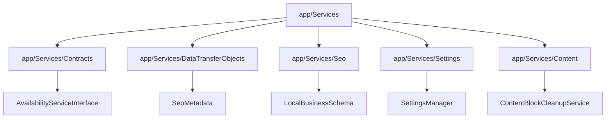
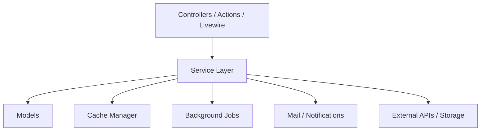
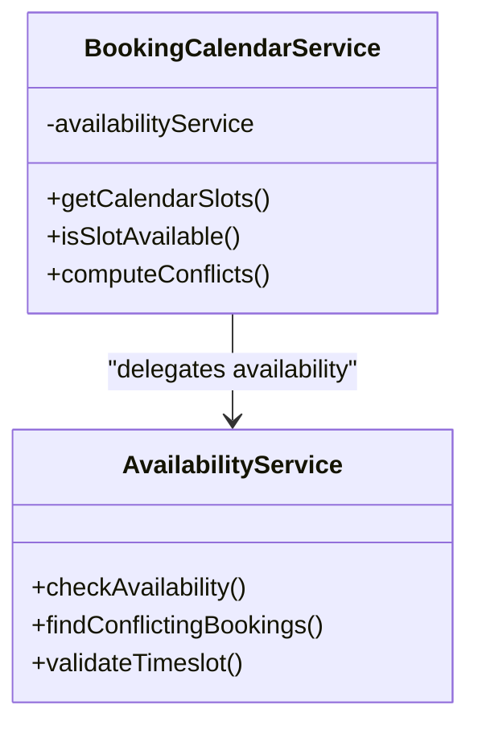
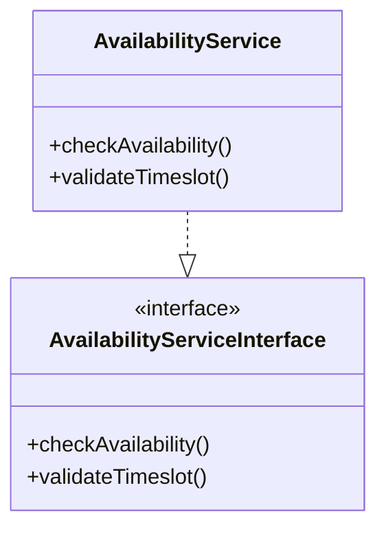
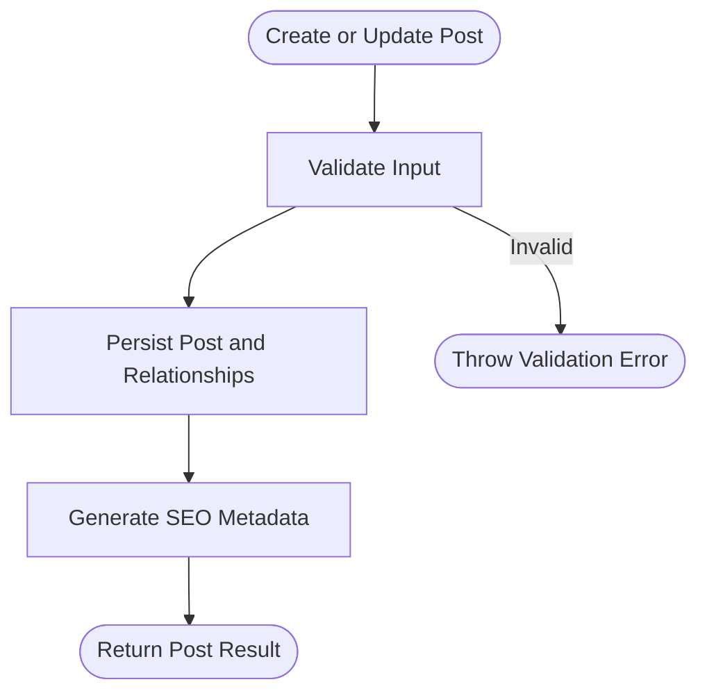
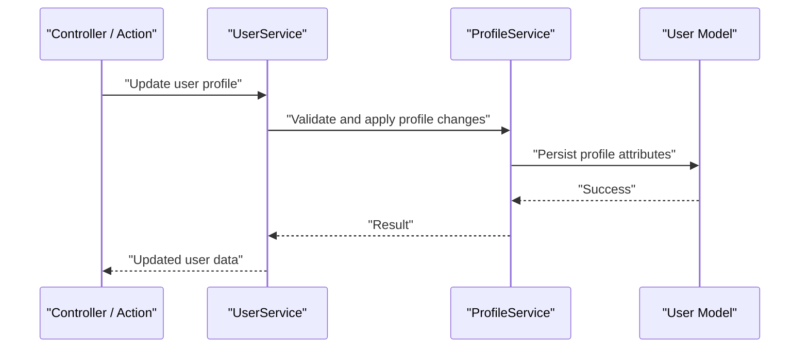
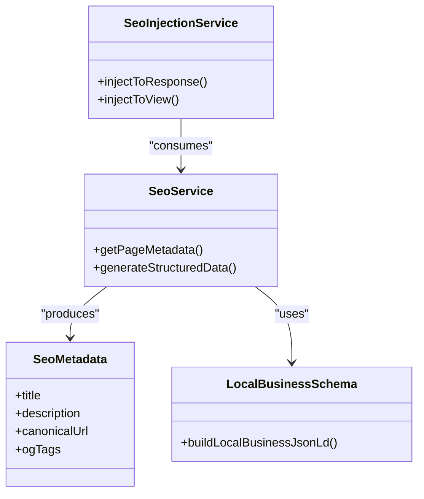
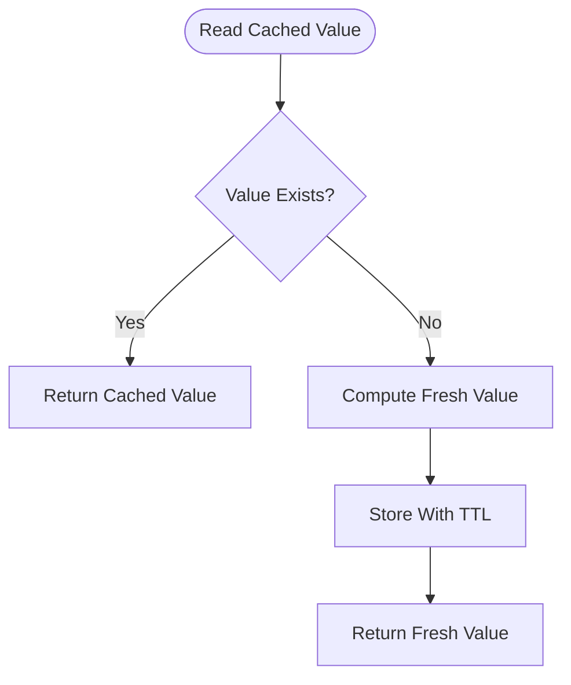
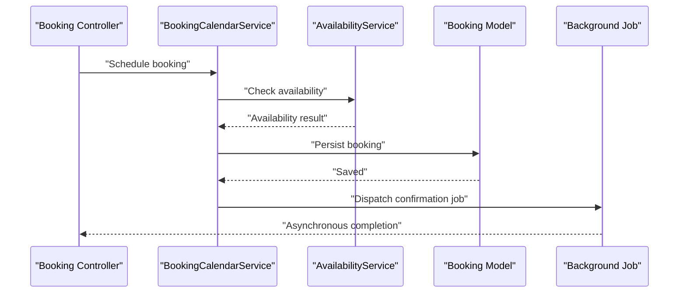
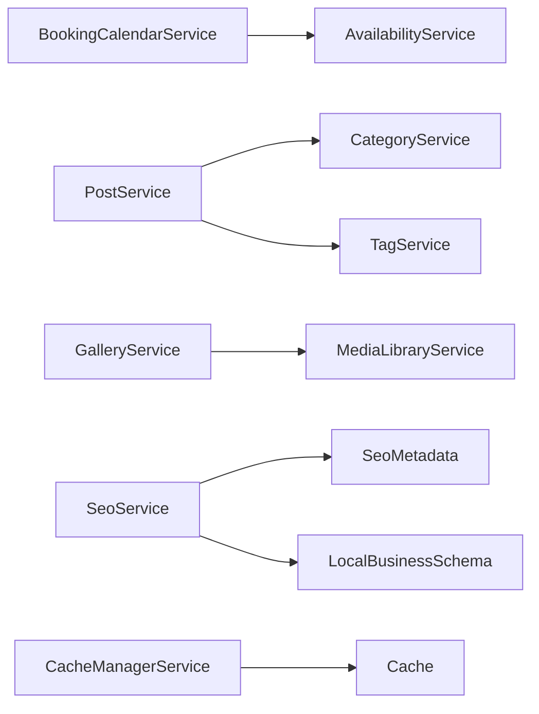

# Service Layer

<cite>
**Referenced Files in This Document**
- [BookingCalendarService.php](file://app/Services/BookingCalendarService.php)
- [AvailabilityService.php](file://app/Services/AvailabilityService.php)
- [PostService.php](file://app/Services/PostService.php)
- [GalleryService.php](file://app/Services/GalleryService.php)
- [UserService.php](file://app/Services/UserService.php)
- [ProfileService.php](file://app/Services/ProfileService.php)
- [SeoService.php](file://app/Services/SeoService.php)
- [CacheManagerService.php](file://app/Services/CacheManagerService.php)
- [AvailabilityServiceInterface.php](file://app/Services/Contracts/AvailabilityServiceInterface.php)
- [SeoMetadata.php](file://app/Services/DataTransferObjects/SeoMetadata.php)
- [ContactDetails.php](file://app/Services/Contact/ContactDetails.php)
- [LocalBusinessSchema.php](file://app/Services/Seo/LocalBusinessSchema.php)
- [SettingsManager.php](file://app/Services/Settings/SettingsManager.php)
- [ContentBlockCleanupService.php](file://app/Services/Content/ContentBlockCleanupService.php)
</cite>

## Table of Contents
1. [Introduction](#introduction)
2. [Project Structure](#project-structure)
3. [Core Components](#core-components)
4. [Architecture Overview](#architecture-overview)
5. [Detailed Component Analysis](#detailed-component-analysis)
6. [Dependency Analysis](#dependency-analysis)
7. [Performance Considerations](#performance-considerations)
8. [Troubleshooting Guide](#troubleshooting-guide)
9. [Conclusion](#conclusion)

## Introduction
This document explains Highblossom’s service layer, which centralizes business logic behind controllers, Livewire components, actions, jobs, and other entry points. The service layer is organized around cohesive domain concerns such as bookings, content, users, SEO, media, settings, and system utilities. It promotes:

- Separation of concerns: controllers handle requests; services handle business rules.
- Reusability: shared logic lives in services rather than duplicated across controllers or views.
- Testability: services are plain classes that can be unit-tested independently from HTTP concerns.
- Composition: complex workflows are built by composing multiple focused services.
- Extensibility: interfaces define contracts so implementations can be swapped or mocked during testing.

The project includes a substantial set of service classes covering booking management, content management, user management, SEO, caching, media handling, settings, and background coordination. While the exact count may vary with development activity, the documented categories represent the primary architectural grouping used throughout the application.

## Project Structure
The service layer is primarily located under the `app/Services` directory. Key subdirectories organize related concerns:

- Root-level services for domain features (bookings, content, users, SEO, media, settings).
- `Contracts/` for interface definitions used to decouple implementations.
- `DataTransferObjects/` for structured value objects passed between layers.
- `Seo/` for SEO-specific helpers and schema generation.
- `Settings/` for configuration-related orchestration.
- `Content/` for content block lifecycle helpers.

**Diagram sources**
- [AvailabilityServiceInterface.php](file://app/Services/Contracts/AvailabilityServiceInterface.php)
- [SeoMetadata.php](file://app/Services/DataTransferObjects/SeoMetadata.php)
- [LocalBusinessSchema.php](file://app/Services/Seo/LocalBusinessSchema.php)
- [SettingsManager.php](file://app/Services/Settings/SettingsManager.php)
- [ContentBlockCleanupService.php](file://app/Services/Content/ContentBlockCleanupService.php)

**Section sources**
- [BookingCalendarService.php](file://app/Services/BookingCalendarService.php)
- [AvailabilityService.php](file://app/Services/AvailabilityService.php)
- [PostService.php](file://app/Services/PostService.php)
- [GalleryService.php](file://app/Services/GalleryService.php)
- [UserService.php](file://app/Services/UserService.php)
- [ProfileService.php](file://app/Services/ProfileService.php)
- [SeoService.php](file://app/Services/SeoService.php)
- [CacheManagerService.php](file://app/Services/CacheManagerService.php)

## Core Components
The service layer is grouped into logical categories. Each category encapsulates a bounded area of business logic.

### Booking Management
- `BookingCalendarService`: Calendar orchestration for staff availability, closed days, scheduling constraints, and calendar data preparation.
- `AvailabilityService`: Availability computation, slot validation, and conflict detection; often exposed through an interface for testability.

Key responsibilities:
- Compute available time slots given staff schedules and absences.
- Validate proposed booking times against closed days and existing bookings.
- Produce calendar-friendly structures for frontend consumption.

Typical composition:
- Controllers or actions call `BookingCalendarService`.
- `BookingCalendarService` delegates availability checks to `AvailabilityService`.
- Models (`Booking`, `Staff`, `StaffAbsence`) provide persistence; events or jobs may be dispatched after successful scheduling.

### Content Management
- `PostService`: Blog post creation, updates, publishing state, and relationship handling with categories and tags.
- `GalleryService`: Gallery image operations, ordering, metadata handling, and media registry integration.
- `CategoryService`, `TagService`, `GalleryCategoryService`: Supporting entities for organizing content.

Key responsibilities:
- Enforce business rules for content creation and updates.
- Coordinate relationships with models and media registries.
- Provide read queries optimized for listing and search scenarios.

Typical composition:
- Admin controllers or actions invoke content services.
- Services coordinate with models and, where needed, media services.
- Background cleanup may be triggered via dedicated cleanup services.

### User Management
- `UserService`: User account operations, registration flows, and role-related coordination.
- `ProfileService`: Profile update logic, profile validation rules integration, and avatar/contact information handling.

Key responsibilities:
- Encapsulate user account lifecycle beyond simple CRUD.
- Apply validation rules from concerns or request classes.
- Coordinate with authentication and session services when necessary.

Typical composition:
- Authentication actions delegate sensitive operations to services.
- Services coordinate with models and may dispatch notifications or audit logs.

### SEO Services
- `SeoService`: Central SEO logic for pages, posts, and static routes; generates meta, canonical links, and structured data.
- `SeoInjectionService`: Injects SEO metadata into responses or views.
- `LocalBusinessSchema`: Builds local business JSON-LD or similar structured data.
- `SeoMetadata`: Data transfer object representing SEO values.

Key responsibilities:
- Assemble page-level SEO data consistently.
- Integrate with site-wide settings and static route configurations.
- Provide structured data suitable for search engines.

Typical composition:
- View composers, controllers, or API endpoints consume `SeoService`.
- DTOs ensure strongly typed payloads for SEO metadata.

### System Services
- `CacheManagerService`: Centralized cache orchestration, including keys, TTLs, and cache invalidation strategies.
- `SessionManager`: Session-related orchestration and tracking.
- `CompanySettingService`, `SmtpSettingService`, `SettingsManager`: Configuration retrieval, validation, and updates.
- `ApplicationVersionService`: Application version reporting and maintenance tasks.

Key responsibilities:
- Abstract infrastructure concerns like caching, sessions, and settings.
- Provide consistent behavior across controllers, jobs, and commands.
- Support environment-driven configuration.

**Section sources**
- [BookingCalendarService.php](file://app/Services/BookingCalendarService.php)
- [AvailabilityService.php](file://app/Services/AvailabilityService.php)
- [PostService.php](file://app/Services/PostService.php)
- [GalleryService.php](file://app/Services/GalleryService.php)
- [UserService.php](file://app/Services/UserService.php)
- [ProfileService.php](file://app/Services/ProfileService.php)
- [SeoService.php](file://app/Services/SeoService.php)
- [CacheManagerService.php](file://app/Services/CacheManagerService.php)

## Architecture Overview
The service layer sits between controllers/actions and models/external systems. It coordinates business rules, validation, transactions, caching, and external integrations.

**Diagram sources**
- [BookingCalendarService.php](file://app/Services/BookingCalendarService.php)
- [CacheManagerService.php](file://app/Services/CacheManagerService.php)

**Section sources**
- [BookingCalendarService.php](file://app/Services/BookingCalendarService.php)
- [CacheManagerService.php](file://app/Services/CacheManagerService.php)

## Detailed Component Analysis

### Booking Management Services

#### BookingCalendarService
Responsibilities:
- Prepare calendar data for UI rendering.
- Combine staff schedules, absences, and closed days.
- Expose methods to query available slots and conflicts.

Composition patterns:
- Delegates availability calculations to `AvailabilityService`.
- May coordinate with `BookingIcsService` for export functionality.
- Works with `Booking`, `Staff`, `StaffAbsence`, and `BookingClosedDay` models.

Error handling:
- Returns clear error states or exceptions when conflicting constraints are violated.
- Validates inputs before delegating to lower layers.

Transaction management:
- Uses database transactions when creating or updating multiple booking-related records atomically.

Caching strategy:
- Avoids recomputing calendar windows by leveraging cached availability where appropriate.

**Diagram sources**
- [BookingCalendarService.php](file://app/Services/BookingCalendarService.php)
- [AvailabilityService.php](file://app/Services/AvailabilityService.php)

#### AvailabilityService
Responsibilities:
- Compute whether a requested timeslot is available.
- Detect conflicts with existing bookings and closed days.
- Provide reusable availability rules consumed by calendar services.

Interface contract:
- Often implemented through `AvailabilityServiceInterface` to allow mocking in tests.

Validation:
- Enforces time range validity, working hours, and staff constraints.

**Diagram sources**
- [AvailabilityServiceInterface.php](file://app/Services/Contracts/AvailabilityServiceInterface.php)
- [AvailabilityService.php](file://app/Services/AvailabilityService.php)

**Section sources**
- [BookingCalendarService.php](file://app/Services/BookingCalendarService.php)
- [AvailabilityService.php](file://app/Services/AvailabilityService.php)
- [AvailabilityServiceInterface.php](file://app/Services/Contracts/AvailabilityServiceInterface.php)

### Content Management Services

#### PostService
Responsibilities:
- Create, update, archive, and retrieve blog posts.
- Manage relationships with categories and tags.
- Enforce authorship and publishing constraints.

Composition patterns:
- Coordinates with `CategoryService` and `TagService`.
- May integrate with SEO services to generate metadata for posts.

Error handling:
- Validates input data using request classes or custom rules.
- Throws meaningful exceptions on constraint violations.

#### GalleryService
Responsibilities:
- Manage gallery images, ordering, and metadata.
- Coordinate with media registry and storage services.
- Ensure integrity when moving or deleting media.

Composition patterns:
- Uses `MediaLibraryService` and `MediaRegistryService` for media operations.
- Integrates with `GalleryCategoryService` for categorization.

**Diagram sources**
- [PostService.php](file://app/Services/PostService.php)

**Section sources**
- [PostService.php](file://app/Services/PostService.php)
- [GalleryService.php](file://app/Services/GalleryService.php)

### User Management Services

#### UserService
Responsibilities:
- Handle user account operations beyond basic CRUD.
- Coordinate roles, permissions, and account lifecycle.
- Provide abstractions for auth-related workflows.

Composition patterns:
- Collaborates with `RoleService` and session management.
- May trigger audit logging and notifications.

Error handling:
- Validates emails, usernames, and passwords according to policy.
- Prevents duplicate accounts and enforces password policies.

#### ProfileService
Responsibilities:
- Manage user profile fields such as display name, phone, and avatar.
- Apply profile validation rules.
- Coordinate avatar uploads via media services.

Composition patterns:
- Uses `ImageUploadService` or equivalent for avatar handling.
- Applies profile validation rules from concerns.

**Diagram sources**
- [UserService.php](file://app/Services/UserService.php)
- [ProfileService.php](file://app/Services/ProfileService.php)

**Section sources**
- [UserService.php](file://app/Services/UserService.php)
- [ProfileService.php](file://app/Services/ProfileService.php)

### SEO Services

#### SeoService and SeoInjectionService
Responsibilities:
- Generate page-level SEO metadata consistently.
- Inject SEO tags and structured data into responses or views.
- Coordinate with site settings and static route configurations.

Composition patterns:
- Uses `SeoMetadata` DTO for strongly typed SEO values.
- Delegates local business schema generation to `LocalBusinessSchema`.

**Diagram sources**
- [SeoService.php](file://app/Services/SeoService.php)
- [SeoInjectionService.php](file://app/Services/SeoInjectionService.php)
- [SeoMetadata.php](file://app/Services/DataTransferObjects/SeoMetadata.php)
- [LocalBusinessSchema.php](file://app/Services/Seo/LocalBusinessSchema.php)

**Section sources**
- [SeoService.php](file://app/Services/SeoService.php)

### System Services

#### CacheManagerService
Responsibilities:
- Centralize cache key naming, TTL configuration, and invalidation strategies.
- Provide helper methods for common cache operations.
- Coordinate cache warming and cleanup.

Usage patterns:
- Used by services to avoid redundant computations.
- Supports feature flags and performance-sensitive reads.

#### Settings Services
- `CompanySettingService`, `SmtpSettingService`, `SettingsManager`:
  - Retrieve and update application settings.
  - Validate setting values.
  - Provide consistent access to configuration across services.

**Diagram sources**
- [CacheManagerService.php](file://app/Services/CacheManagerService.php)

**Section sources**
- [CacheManagerService.php](file://app/Services/CacheManagerService.php)
- [SettingsManager.php](file://app/Services/Settings/SettingsManager.php)

### Practical Patterns

#### Service Composition Example
A typical booking flow composes multiple services:

**Diagram sources**
- [BookingCalendarService.php](file://app/Services/BookingCalendarService.php)
- [AvailabilityService.php](file://app/Services/AvailabilityService.php)

#### Error Handling Strategy
- Use explicit exceptions for business rule violations.
- Return structured results for success cases.
- Log errors with context (user ID, booking ID, timestamp).

#### Transaction Management
- Wrap multi-step writes in database transactions.
- Roll back on any failure to maintain consistency.

#### Caching Strategies
- Cache expensive reads (e.g., calendar windows, settings).
- Invalidate caches on relevant write operations.
- Use distinct keys per tenant or scope where applicable.

**Section sources**
- [BookingCalendarService.php](file://app/Services/BookingCalendarService.php)
- [AvailabilityService.php](file://app/Services/AvailabilityService.php)
- [CacheManagerService.php](file://app/Services/CacheManagerService.php)

## Dependency Analysis
The service layer has well-defined dependencies:

- Domain services depend on models for persistence.
- Cross-cutting services depend on cache, mail, and queue systems.
- Interfaces isolate volatile implementations (e.g., availability calculation).

**Diagram sources**
- [BookingCalendarService.php](file://app/Services/BookingCalendarService.php)
- [AvailabilityService.php](file://app/Services/AvailabilityService.php)
- [PostService.php](file://app/Services/PostService.php)
- [CategoryService.php](file://app/Services/CategoryService.php)
- [TagService.php](file://app/Services/TagService.php)
- [GalleryService.php](file://app/Services/GalleryService.php)
- [MediaLibraryService.php](file://app/Services/MediaLibraryService.php)
- [SeoService.php](file://app/Services/SeoService.php)
- [SeoMetadata.php](file://app/Services/DataTransferObjects/SeoMetadata.php)
- [LocalBusinessSchema.php](file://app/Services/Seo/LocalBusinessSchema.php)
- [CacheManagerService.php](file://app/Services/CacheManagerService.php)

**Section sources**
- [BookingCalendarService.php](file://app/Services/BookingCalendarService.php)
- [PostService.php](file://app/Services/PostService.php)
- [GalleryService.php](file://app/Services/GalleryService.php)
- [SeoService.php](file://app/Services/SeoService.php)
- [CacheManagerService.php](file://app/Services/CacheManagerService.php)

## Performance Considerations
- Prefer service composition over deep controller logic to keep request paths shallow.
- Cache repeated computations such as calendar windows and settings lookups.
- Use background jobs for heavy work like email delivery, media processing, and sitemap updates.
- Batch model operations where possible to reduce database round-trips.
- Avoid N+1 queries by eager loading relationships in read-heavy services.

[No sources needed since this section provides general guidance]

## Troubleshooting Guide
Common issues and resolutions:

- Invalid availability errors:
  - Verify working hours, staff absences, and closed days.
  - Check conflict detection logic in `AvailabilityService`.

- SEO metadata not appearing:
  - Confirm `SeoService` is generating metadata for the route.
  - Ensure `SeoInjectionService` injects data into the response or view.

- Cache stale data:
  - Review cache keys and TTLs in `CacheManagerService`.
  - Invalidate affected caches after write operations.

- Settings not applied:
  - Validate settings through `SettingsManager` and related services.
  - Clear configuration caches if necessary.

**Section sources**
- [AvailabilityService.php](file://app/Services/AvailabilityService.php)
- [SeoService.php](file://app/Services/SeoService.php)
- [CacheManagerService.php](file://app/Services/CacheManagerService.php)
- [SettingsManager.php](file://app/Services/Settings/SettingsManager.php)

## Conclusion
Highblossom’s service layer organizes business logic into focused, testable components. Booking management, content management, user management, SEO, and system services collaborate through clear contracts and composition patterns. Interfaces like `AvailabilityServiceInterface` enable flexible implementations, while DTOs like `SeoMetadata` ensure type safety. By centralizing business rules in services, the application achieves better separation of concerns, reusability, and maintainability across controllers, actions, Livewire components, and background jobs.

[No sources needed since this section summarizes without analyzing specific files]