# Data Flow Patterns

<cite>
**Referenced Files in This Document**
- [api.php](file://routes/api.php)
- [web.php](file://routes/web.php)
- [EventServiceProvider.php](file://app/Providers/EventServiceProvider.php)
- [sanctum.php](file://config/sanctum.php)
- [queue.php](file://config/queue.php)
- [AuthController.php](file://app/Http/Controllers/Api/AuthController.php)
- [BookingController.php](file://app/Http/Controllers/Api/BookingController.php)
- [QuoteController.php](file://app/Http/Controllers/Api/QuoteController.php)
- [SiteController.php](file://app/Http/Controllers/SiteController.php)
- [BookingController.php](file://app/Http/Controllers/BookingController.php)
- [StoreBookingAction.php](file://app/Actions/StoreBookingAction.php)
- [StoreQuoteAction.php](file://app/Actions/StoreQuoteAction.php)
- [SendContactMessage.php](file://app/Actions/SendContactMessage.php)
- [BookingCalendarService.php](file://app/Services/BookingCalendarService.php)
- [QuoteService.php](file://app/Services/QuoteService.php)
- [IdempotencyService.php](file://app/Services/IdempotencyService.php)
- [BookingTimeline.php](file://app/Services/BookingTimeline.php)
- [BookingResource.php](file://app/Http/Resources/Api/BookingResource.php)
- [Booking.php](file://app/Models/Booking.php)
- [Quote.php](file://app/Models/Quote.php)
- [ContactMessageReceived.php](file://app/Events/ContactMessageReceived.php)
- [SendContactMessageEmail.php](file://app/Listeners/SendContactMessageEmail.php)
- [WarmSystemOverviewProbe.php](file://app/Jobs/WarmSystemOverviewProbe.php)
</cite>

## Table of Contents
1. [Introduction](#introduction)
2. [Project Structure](#project-structure)
3. [Core Components](#core-components)
4. [Architecture Overview](#architecture-overview)
5. [Detailed Component Analysis](#detailed-component-analysis)
6. [Dependency Analysis](#dependency-analysis)
7. [Performance Considerations](#performance-considerations)
8. [Troubleshooting Guide](#troubleshooting-guide)
9. [Conclusion](#conclusion)

## Introduction
This document explains how data moves through Highblossom. It covers the primary request pathway, form-driven flows, Sanctum-authenticated API processing, background jobs, event-driven side effects, and data transformation patterns. The focus is on booking creation, quote processing, contact message handling, status transitions, and content-related reads, with attention to error handling, idempotency, transactions, and queueing.

## Project Structure
Highblossom follows a layered Laravel application:

- **Routes** define HTTP entry points for web pages, public APIs, and the staff mobile API.
- **Controllers** validate or delegate input to Actions and Services.
- **Actions** encapsulate complex write workflows such as booking creation and quote submission.
- **Services** contain reusable business logic like calendar generation, timeline management, and idempotency.
- **Models** represent database entities and relationships.
- **Resources** shape JSON responses for the API.
- **Events and Listeners** decouple side effects like email notifications.
- **Jobs** run heavy work outside the request path.

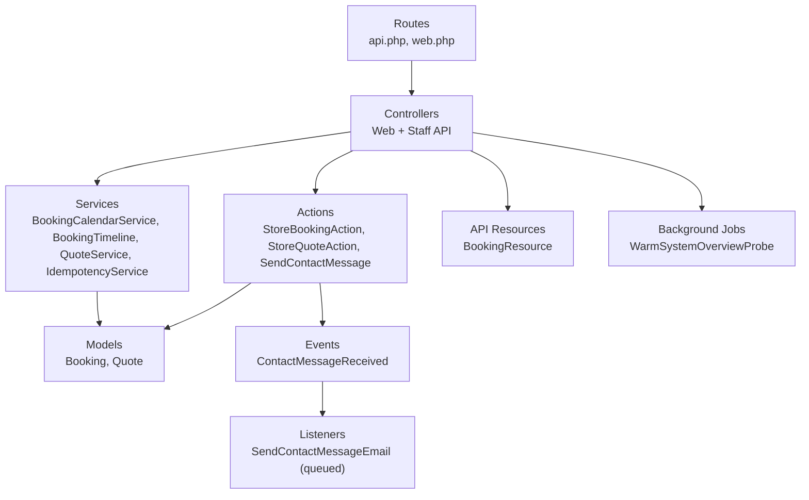

**Diagram sources**
- [api.php:1-117](file://routes/api.php#L1-L117)
- [web.php:1-76](file://routes/web.php#L1-L76)
- [AuthController.php:1-135](file://app/Http/Controllers/Api/AuthController.php#L1-L135)
- [BookingController.php:1-122](file://app/Http/Controllers/Api/BookingController.php#L1-L122)
- [QuoteController.php:1-80](file://app/Http/Controllers/Api/QuoteController.php#L1-L80)
- [SiteController.php:1-180](file://app/Http/Controllers/SiteController.php#L1-L180)
- [StoreBookingAction.php:1-200](file://app/Actions/StoreBookingAction.php#L1-L200)
- [StoreQuoteAction.php:1-160](file://app/Actions/StoreQuoteAction.php#L1-L160)
- [SendContactMessage.php:1-71](file://app/Actions/SendContactMessage.php#L1-L71)
- [BookingCalendarService.php:1-101](file://app/Services/BookingCalendarService.php#L1-L101)
- [BookingTimeline.php:1-128](file://app/Services/BookingTimeline.php#L1-L128)
- [QuoteService.php:1-22](file://app/Services/QuoteService.php#L1-L22)
- [IdempotencyService.php:1-95](file://app/Services/IdempotencyService.php#L1-L95)
- [BookingResource.php:1-60](file://app/Http/Resources/Api/BookingResource.php#L1-L60)
- [Booking.php:1-134](file://app/Models/Booking.php#L1-L134)
- [Quote.php:1-76](file://app/Models/Quote.php#L1-L76)
- [ContactMessageReceived.php:1-24](file://app/Events/ContactMessageReceived.php#L1-L24)
- [SendContactMessageEmail.php:1-54](file://app/Listeners/SendContactMessageEmail.php#L1-L54)
- [WarmSystemOverviewProbe.php:1-76](file://app/Jobs/WarmSystemOverviewProbe.php#L1-L76)

**Section sources**
- [api.php:1-117](file://routes/api.php#L1-L117)
- [web.php:1-76](file://routes/web.php#L1-L76)

## Core Components
The core data-flow components are:

- **Staff API routes**: All endpoints under `/api/staff` use Sanctum authentication and Spatie authorization middleware.
- **Web routes**: Public pages, booking forms, quote/contact submissions, blog search, and availability endpoints.
- **Controllers**: Thin layers that validate requests and delegate to Actions or Services; they return views or JSON resources.
- **Actions**: Orchestrators for multi-step writes, including idempotency, persistence, image processing, and notifications.
- **Services**: Domain helpers for availability, calendar rendering, timeline state transitions, quoting, and caching.
- **Models**: Eloquent entities for bookings, quotes, and related data.
- **Resources**: Structured JSON shapes for API consumers.
- **Events and Listeners**: Decoupled side effects, such as sending emails after contact messages.
- **Jobs**: Background workers for expensive operations, with uniqueness and retry semantics.

**Section sources**
- [AuthController.php:1-135](file://app/Http/Controllers/Api/AuthController.php#L1-L135)
- [BookingController.php:1-122](file://app/Http/Controllers/Api/BookingController.php#L1-L122)
- [QuoteController.php:1-80](file://app/Http/Controllers/Api/QuoteController.php#L1-L80)
- [SiteController.php:1-180](file://app/Http/Controllers/SiteController.php#L1-L180)
- [StoreBookingAction.php:1-200](file://app/Actions/StoreBookingAction.php#L1-L200)
- [StoreQuoteAction.php:1-160](file://app/Actions/StoreQuoteAction.php#L1-L160)
- [SendContactMessage.php:1-71](file://app/Actions/SendContactMessage.php#L1-L71)
- [BookingCalendarService.php:1-101](file://app/Services/BookingCalendarService.php#L1-L101)
- [BookingTimeline.php:1-128](file://app/Services/BookingTimeline.php#L1-L128)
- [QuoteService.php:1-22](file://app/Services/QuoteService.php#L1-L22)
- [IdempotencyService.php:1-95](file://app/Services/IdempotencyService.php#L1-L95)
- [BookingResource.php:1-60](file://app/Http/Resources/Api/BookingResource.php#L1-L60)
- [Booking.php:1-134](file://app/Models/Booking.php#L1-L134)
- [Quote.php:1-76](file://app/Models/Quote.php#L1-L76)

## Architecture Overview
Highblossom uses several consistent pathways:

| Pathway | Entry | Primary Handlers | Persistence | Side Effects | Response Shape |
|---|---|---|---|---|---|
| Web page read | `web.php` | `SiteController`, `BookingController` | Services and models | View composition | Blade view |
| Form submission | `POST /quote`, `POST /contact`, `POST /bookings` | `SiteController`, `BookingController` | Actions persist via models | Idempotency, images, events, emails | Redirect with flash messages |
| Staff API request | `api.php` | Staff API controllers | Services and models | Authorization checks, resource shaping | JSON with resource objects |
| Background job | Queue worker | Job handlers | External services or internal services | Aggregation, probing, metrics | No HTTP response |
| Event-driven flow | `event()` calls | Event listeners | Optional persistence | Email, logging, retries | Asynchronous |

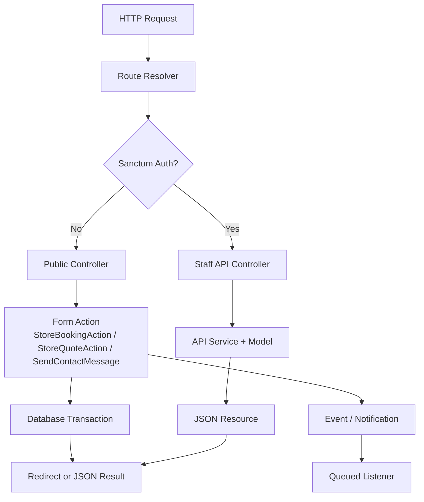

**Diagram sources**
- [web.php:1-76](file://routes/web.php#L1-L76)
- [api.php:1-117](file://routes/api.php#L1-L117)
- [sanctum.php:1-87](file://config/sanctum.php#L1-L87)
- [SiteController.php:1-180](file://app/Http/Controllers/SiteController.php#L1-L180)
- [BookingController.php:1-146](file://app/Http/Controllers/BookingController.php#L1-L146)
- [AuthController.php:1-135](file://app/Http/Controllers/Api/AuthController.php#L1-L135)
- [StoreBookingAction.php:1-200](file://app/Actions/StoreBookingAction.php#L1-L200)
- [StoreQuoteAction.php:1-160](file://app/Actions/StoreQuoteAction.php#L1-L160)
- [SendContactMessage.php:1-71](file://app/Actions/SendContactMessage.php#L1-L71)
- [BookingResource.php:1-60](file://app/Http/Resources/Api/BookingResource.php#L1-L60)
- [SendContactMessageEmail.php:1-54](file://app/Listeners/SendContactMessageEmail.php#L1-L54)

## Detailed Component Analysis

### Primary Data Pathway: Request → Route → Controller → Service → Model → Database
This is the standard read/write flow for both web and API layers.

- **Routing** maps URL paths to controller methods. Staff API routes group under `/api/staff`, while public routes include booking, quote, contact, blog, and availability endpoints.
- **Controllers** accept validated requests, call services or actions, and return either views or JSON resources.
- **Services** encapsulate domain logic such as calendar building, timeline transitions, and quoting updates.
- **Models** perform persistence through Eloquent.
- **Database** is the final persistence layer.

Example read flow:

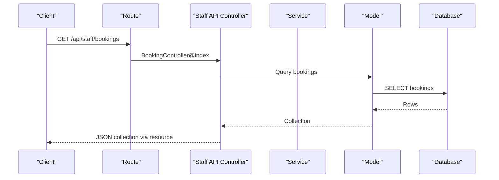

**Diagram sources**
- [api.php:1-117](file://routes/api.php#L1-L117)
- [BookingController.php:1-122](file://app/Http/Controllers/Api/BookingController.php#L1-L122)
- [Booking.php:1-134](file://app/Models/Booking.php#L1-L134)
- [BookingResource.php:1-60](file://app/Http/Resources/Api/BookingResource.php#L1-L60)

**Section sources**
- [api.php:1-117](file://routes/api.php#L1-L117)
- [web.php:1-76](file://routes/web.php#L1-L76)
- [BookingController.php:1-122](file://app/Http/Controllers/Api/BookingController.php#L1-L122)
- [Booking.php:1-134](file://app/Models/Booking.php#L1-L134)

### Alternative Flow: Form Submission → Validation → Action → Service → Model → Notification
This flow handles user-facing writes such as bookings, quotes, and contact messages.

Key responsibilities:

- **Validation** occurs in request classes before reaching the action.
- **Actions** handle orchestration: idempotency checks, persistence, optional image processing, and notification dispatch.
- **Services** provide domain support such as availability checks, duration calculation, and idempotency caching.
- **Models** create or update records.
- **Notifications** may be sent synchronously or asynchronously through events and queued listeners.

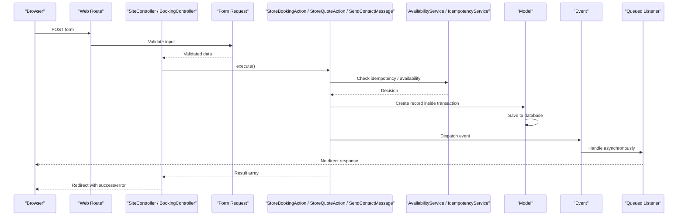

**Diagram sources**
- [web.php:1-76](file://routes/web.php#L1-L76)
- [SiteController.php:1-180](file://app/Http/Controllers/SiteController.php#L1-L180)
- [BookingController.php:1-146](file://app/Http/Controllers/BookingController.php#L1-L146)
- [StoreBookingAction.php:1-200](file://app/Actions/StoreBookingAction.php#L1-L200)
- [StoreQuoteAction.php:1-160](file://app/Actions/StoreQuoteAction.php#L1-L160)
- [SendContactMessage.php:1-71](file://app/Actions/SendContactMessage.php#L1-L71)
- [IdempotencyService.php:1-95](file://app/Services/IdempotencyService.php#L1-L95)
- [ContactMessageReceived.php:1-24](file://app/Events/ContactMessageReceived.php#L1-L24)
- [SendContactMessageEmail.php:1-54](file://app/Listeners/SendContactMessageEmail.php#L1-L54)

**Section sources**
- [SiteController.php:1-180](file://app/Http/Controllers/SiteController.php#L1-L180)
- [BookingController.php:1-146](file://app/Http/Controllers/BookingController.php#L1-L146)
- [StoreBookingAction.php:1-200](file://app/Actions/StoreBookingAction.php#L1-L200)
- [StoreQuoteAction.php:1-160](file://app/Actions/StoreQuoteAction.php#L1-L160)
- [SendContactMessage.php:1-71](file://app/Actions/SendContactMessage.php#L1-L71)

### API Request Processing Through Sanctum Authentication → Controller → Service → Resource → Response
The staff API requires a Sanctum personal access token and applies authorization per route.

Processing steps:

1. **Authentication**: `/api/staff/login` issues a token; `/api/staff/two-factor-challenge` validates second-factor challenges.
2. **Authorization**: Every protected route uses `auth:sanctum` and `can:` middleware.
3. **Controller Logic**: Controllers validate input, call services or models, and return JSON.
4. **Resource Transformation**: Models are converted into structured JSON through resources.
5. **Response**: Clients receive consistent JSON payloads with data and optional messages.

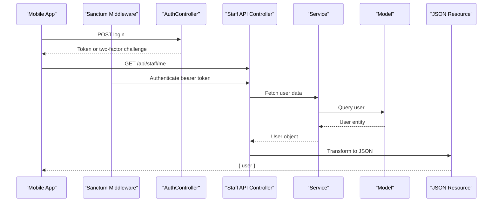

**Diagram sources**
- [api.php:1-117](file://routes/api.php#L1-L117)
- [sanctum.php:1-87](file://config/sanctum.php#L1-L87)
- [AuthController.php:1-135](file://app/Http/Controllers/Api/AuthController.php#L1-L135)
- [BookingController.php:1-122](file://app/Http/Controllers/Api/BookingController.php#L1-L122)
- [QuoteController.php:1-80](file://app/Http/Controllers/Api/QuoteController.php#L1-L80)
- [BookingResource.php:1-60](file://app/Http/Resources/Api/BookingResource.php#L1-L60)

**Section sources**
- [api.php:1-117](file://routes/api.php#L1-L117)
- [sanctum.php:1-87](file://config/sanctum.php#L1-L87)
- [AuthController.php:1-135](file://app/Http/Controllers/Api/AuthController.php#L1-L135)

### Background Job Processing: Queue → Job Handler → External Services
Background jobs run outside the request lifecycle. Highblossom currently includes a system overview probe job that measures heavy sections without blocking admin UI interactions.

Key characteristics:

- **Queue configuration** supports multiple backends, with `database` as the default connection.
- **Job uniqueness** prevents overlapping warm-up runs when an admin repeatedly triggers measurement.
- **Retry and timeout settings** ensure failed measurements do not block future attempts indefinitely.

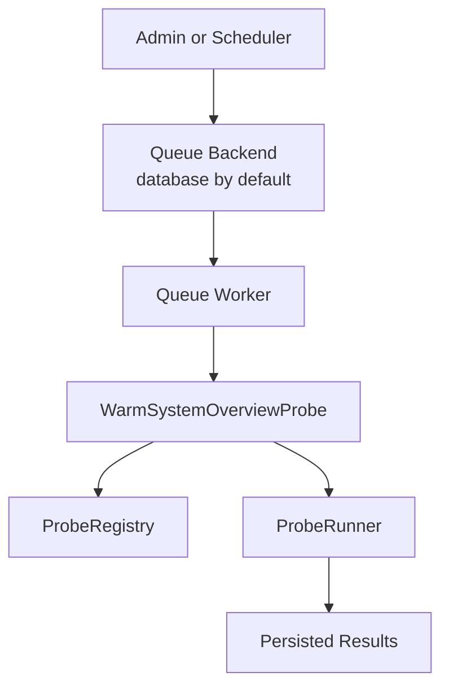

**Diagram sources**
- [queue.php:1-128](file://config/queue.php#L1-L128)
- [WarmSystemOverviewProbe.php:1-76](file://app/Jobs/WarmSystemOverviewProbe.php#L1-L76)

**Section sources**
- [queue.php:1-128](file://config/queue.php#L1-L128)
- [WarmSystemOverviewProbe.php:1-76](file://app/Jobs/WarmSystemOverviewProbe.php#L1-L76)

### Event-Driven Data Flows: Events Trigger Listeners for Notifications
Highblossom uses events to separate main business logic from side effects. The clearest example is contact message handling.

Flow:

1. `SendContactMessage` persists the contact message.
2. It dispatches `ContactMessageReceived`.
3. `EventServiceProvider` maps the event to `SendContactMessageEmail`.
4. The listener implements `ShouldQueue`, so email sending is asynchronous.
5. Errors are logged and re-thrown so the queue can retry.

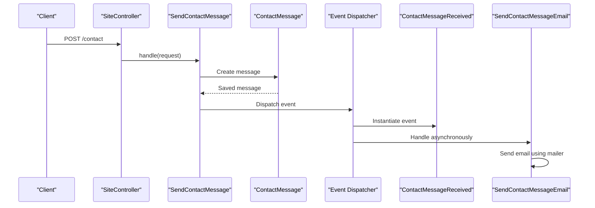

**Diagram sources**
- [web.php:1-76](file://routes/web.php#L1-L76)
- [SiteController.php:1-180](file://app/Http/Controllers/SiteController.php#L1-L180)
- [SendContactMessage.php:1-71](file://app/Actions/SendContactMessage.php#L1-L71)
- [ContactMessageReceived.php:1-24](file://app/Events/ContactMessageReceived.php#L1-L24)
- [EventServiceProvider.php:1-51](file://app/Providers/EventServiceProvider.php#L1-L51)
- [SendContactMessageEmail.php:1-54](file://app/Listeners/SendContactMessageEmail.php#L1-L54)

**Section sources**
- [EventServiceProvider.php:1-51](file://app/Providers/EventServiceProvider.php#L1-L51)
- [SendContactMessage.php:1-71](file://app/Actions/SendContactMessage.php#L1-L71)
- [ContactMessageReceived.php:1-24](file://app/Events/ContactMessageReceived.php#L1-L24)
- [SendContactMessageEmail.php:1-54](file://app/Listeners/SendContactMessageEmail.php#L1-L54)

### Data Transformation Patterns: DTOs and Service Methods
While explicit DTO classes are not the dominant pattern here, the codebase uses structured arrays, model attributes, enums, and API resources as transformation mechanisms:

- **Structured arrays**: Calendar payloads from `BookingCalendarService` return strongly shaped arrays for frontend consumption.
- **Model casts and attributes**: `Booking` casts service types, damage types, dates, and booleans, and computes derived values like end time and display reference.
- **API resources**: `BookingResource` transforms Eloquent models into JSON fields consumed by the mobile app.
- **Service methods**: `QuoteService.updateStatus` and `BookingTimeline.record` encapsulate domain rules and avoid scattering state transitions across controllers.

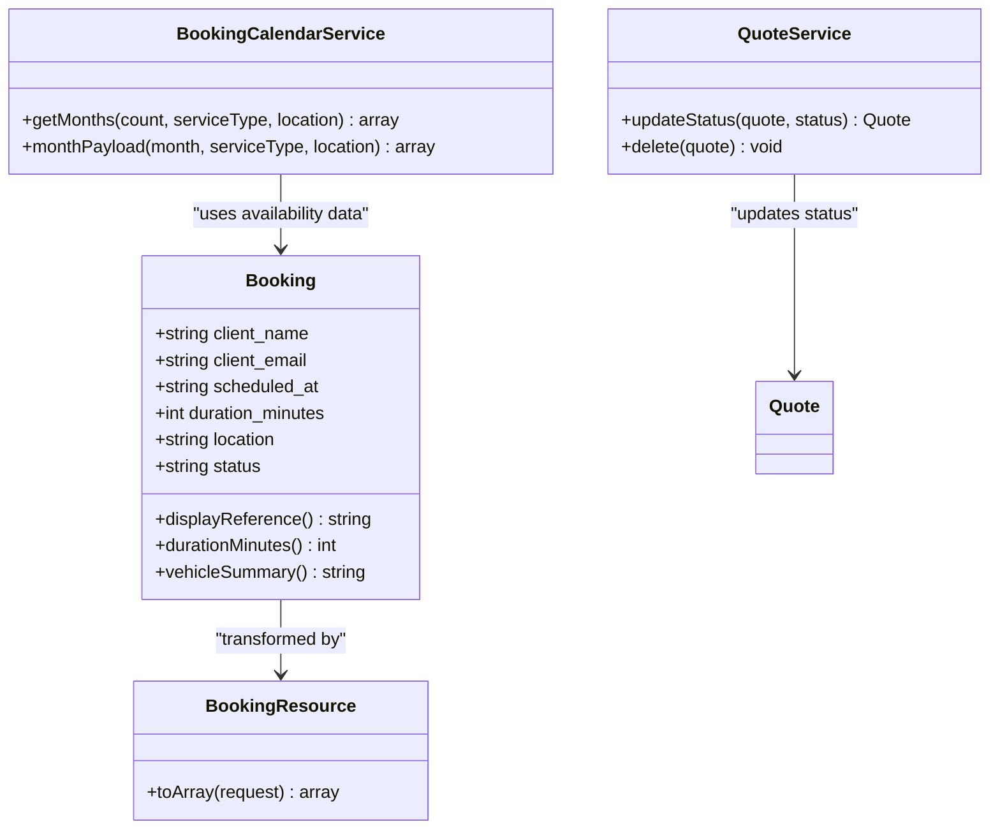

**Diagram sources**
- [Booking.php:1-134](file://app/Models/Booking.php#L1-L134)
- [BookingResource.php:1-60](file://app/Http/Resources/Api/BookingResource.php#L1-L60)
- [BookingCalendarService.php:1-101](file://app/Services/BookingCalendarService.php#L1-L101)
- [QuoteService.php:1-22](file://app/Services/QuoteService.php#L1-L22)

**Section sources**
- [Booking.php:1-134](file://app/Models/Booking.php#L1-L134)
- [BookingResource.php:1-60](file://app/Http/Resources/Api/BookingResource.php#L1-L60)
- [BookingCalendarService.php:1-101](file://app/Services/BookingCalendarService.php#L1-L101)
- [QuoteService.php:1-22](file://app/Services/QuoteService.php#L1-L22)

### Concrete Example: Booking Creation Flow
Booking creation combines validation, idempotency, availability locking, persistence, image handling, and notifications.

Steps:

1. Web route `POST /bookings` reaches `BookingController@store`.
2. `StoreBookingRequest` validates input.
3. `StoreBookingAction.execute` checks idempotency.
4. A database transaction reserves the slot using availability checks.
5. On collision or deadlock, the action retries once before reporting the slot taken.
6. The booking is created, a customer reference is assigned, and a damage photo may be processed.
7. Staff notification is triggered.
8. The controller redirects to a signed confirmation URL or back to the form with contextual errors.

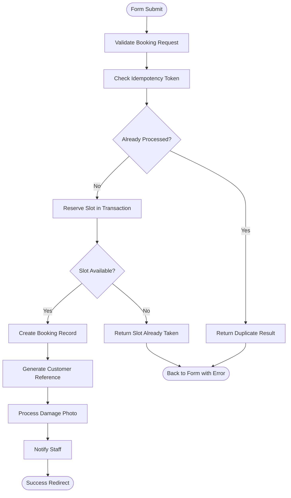

**Diagram sources**
- [web.php:1-76](file://routes/web.php#L1-L76)
- [BookingController.php:1-146](file://app/Http/Controllers/BookingController.php#L1-L146)
- [StoreBookingAction.php:1-200](file://app/Actions/StoreBookingAction.php#L1-L200)
- [IdempotencyService.php:1-95](file://app/Services/IdempotencyService.php#L1-L95)

**Section sources**
- [BookingController.php:1-146](file://app/Http/Controllers/BookingController.php#L1-L146)
- [StoreBookingAction.php:1-200](file://app/Actions/StoreBookingAction.php#L1-L200)

### Concrete Example: Quote Processing Flow
Quote submission is similar but focuses on quote persistence and email notification orchestration.

Steps:

1. Web route `POST /quote` reaches `SiteController.submitQuote`.
2. `QuoteFormRequest` validates input.
3. `StoreQuoteAction.execute` checks idempotency.
4. An image upload is optionally processed and stored.
5. A transaction marks the token processed and creates the quote.
6. Email notifications are triggered only after successful persistence.
7. The controller returns a redirect with success or error feedback.

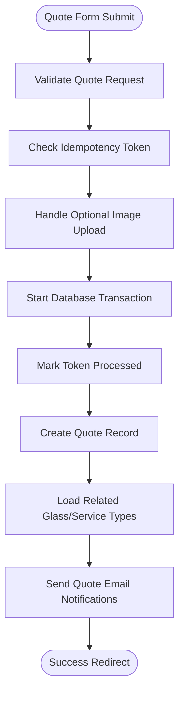

**Diagram sources**
- [web.php:1-76](file://routes/web.php#L1-L76)
- [SiteController.php:1-180](file://app/Http/Controllers/SiteController.php#L1-L180)
- [StoreQuoteAction.php:1-160](file://app/Actions/StoreQuoteAction.php#L1-L160)

**Section sources**
- [SiteController.php:1-180](file://app/Http/Controllers/SiteController.php#L1-L180)
- [StoreQuoteAction.php:1-160](file://app/Actions/StoreQuoteAction.php#L1-L160)

### Concrete Example: Content Updates and Read Flows
Content updates are handled through staff API controllers and services. Quotes, posts, testimonials, partners, and gallery items follow a consistent pattern:

- List endpoints paginate results.
- Show endpoints eager-load relationships.
- Update endpoints delegate status changes to services.
- Delete endpoints delegate destructive actions to services.
- Responses are transformed through API resources where applicable.

For quotes specifically:

- `QuoteController.index` queries quotes with filters and relationships.
- `QuoteController.updateStatus` delegates to `QuoteService.updateStatus`.
- `QuoteController.destroy` delegates to `QuoteService.delete`.

**Section sources**
- [api.php:1-117](file://routes/api.php#L1-L117)
- [QuoteController.php:1-80](file://app/Http/Controllers/Api/QuoteController.php#L1-L80)
- [QuoteService.php:1-22](file://app/Services/QuoteService.php#L1-L22)
- [Quote.php:1-76](file://app/Models/Quote.php#L1-L76)

### Booking Status Transitions and Timeline Management
Booking status transitions are centralized in `BookingTimeline` to prevent duplicate emails and inconsistent state.

Rules:

- Only valid milestone types are accepted.
- Cancelled bookings cannot move forward except by reverting to pending.
- Repeated identical milestones are collapsed.
- Milestones synchronize the booking status.
- Customer emails are queued based on milestone type.

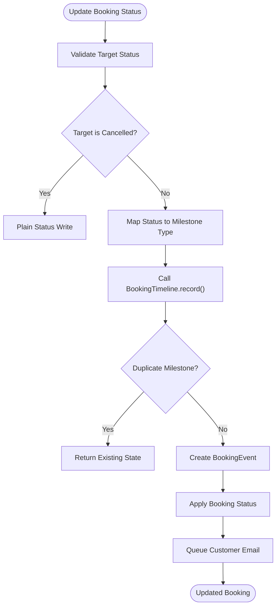

**Diagram sources**
- [BookingController.php:1-122](file://app/Http/Controllers/Api/BookingController.php#L1-L122)
- [BookingTimeline.php:1-128](file://app/Services/BookingTimeline.php#L1-L128)

**Section sources**
- [BookingController.php:1-122](file://app/Http/Controllers/Api/BookingController.php#L1-L122)
- [BookingTimeline.php:1-128](file://app/Services/BookingTimeline.php#L1-L128)

## Dependency Analysis
The following diagram shows key dependencies between controllers, actions, services, models, events, and jobs.

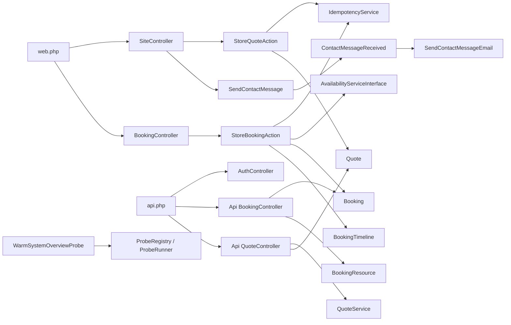

**Diagram sources**
- [web.php:1-76](file://routes/web.php#L1-L76)
- [api.php:1-117](file://routes/api.php#L1-L117)
- [SiteController.php:1-180](file://app/Http/Controllers/SiteController.php#L1-L180)
- [BookingController.php:1-146](file://app/Http/Controllers/BookingController.php#L1-L146)
- [AuthController.php:1-135](file://app/Http/Controllers/Api/AuthController.php#L1-L135)
- [BookingController.php:1-122](file://app/Http/Controllers/Api/BookingController.php#L1-L122)
- [QuoteController.php:1-80](file://app/Http/Controllers/Api/QuoteController.php#L1-L80)
- [StoreBookingAction.php:1-200](file://app/Actions/StoreBookingAction.php#L1-L200)
- [StoreQuoteAction.php:1-160](file://app/Actions/StoreQuoteAction.php#L1-L160)
- [SendContactMessage.php:1-71](file://app/Actions/SendContactMessage.php#L1-L71)
- [ContactMessageReceived.php:1-24](file://app/Events/ContactMessageReceived.php#L1-L24)
- [SendContactMessageEmail.php:1-54](file://app/Listeners/SendContactMessageEmail.php#L1-L54)
- [BookingResource.php:1-60](file://app/Http/Resources/Api/BookingResource.php#L1-L60)
- [QuoteService.php:1-22](file://app/Services/QuoteService.php#L1-L22)
- [Booking.php:1-134](file://app/Models/Booking.php#L1-L134)
- [Quote.php:1-76](file://app/Models/Quote.php#L1-L76)
- [WarmSystemOverviewProbe.php:1-76](file://app/Jobs/WarmSystemOverviewProbe.php#L1-L76)

**Section sources**
- [web.php:1-76](file://routes/web.php#L1-L76)
- [api.php:1-117](file://routes/api.php#L1-L117)

## Performance Considerations
- **Avoid N+1 queries**: Controllers explicitly eager-load relationships such as inspections, notes, actors, glass types, and service types before transforming responses.
- **Limit pagination size**: API endpoints clamp `per_page` to reasonable bounds to prevent large payloads.
- **Defer heavy work**: Email sending and system overview probing are moved off the critical request path through events and queues.
- **Use idempotency**: Cache-backed idempotency tokens reduce duplicate submissions and enable safe retries.
- **Prefer deterministic availability**: Calendar availability is computed server-side so the UI cannot present slots the server will reject.

[No sources needed since this section provides general guidance]

## Troubleshooting Guide
Common issues and their likely locations:

| Symptom | Likely Cause | Where to Inspect |
|---|---|---|
| Duplicate booking submissions | Missing or ignored idempotency token | `StoreBookingAction`, `IdempotencyService` |
| Slot appears available but submission fails | Concurrent booking or deadlock | `StoreBookingAction.reserve`, availability service |
| Contact email not received | Queue worker not running or mailer misconfigured | `SendContactMessageEmail`, queue configuration |
| Invalid booking status transition | Unauthorized or duplicate milestone | `BookingTimeline`, `BookingController.updateStatus` |
| API authentication failure | Missing or expired Sanctum token | `AuthController`, sanctum configuration |
| Excessive memory or slow admin refresh | Heavy system overview probe running concurrently | `WarmSystemOverviewProbe`, queue backend |

**Section sources**
- [StoreBookingAction.php:1-200](file://app/Actions/StoreBookingAction.php#L1-L200)
- [IdempotencyService.php:1-95](file://app/Services/IdempotencyService.php#L1-L95)
- [SendContactMessageEmail.php:1-54](file://app/Listeners/SendContactMessageEmail.php#L1-L54)
- [queue.php:1-128](file://config/queue.php#L1-L128)
- [BookingTimeline.php:1-128](file://app/Services/BookingTimeline.php#L1-L128)
- [AuthController.php:1-135](file://app/Http/Controllers/Api/AuthController.php#L1-L135)
- [sanctum.php:1-87](file://config/sanctum.php#L1-L87)
- [WarmSystemOverviewProbe.php:1-76](file://app/Jobs/WarmSystemOverviewProbe.php#L1-L76)

## Conclusion
Highblossom’s data flows are intentionally layered and explicit. Web and API routes delegate to controllers, which in turn rely on actions and services for domain complexity. Persistence happens through Eloquent models, while side effects such as emails and notifications are decoupled through events and queues. Idempotency and transactions protect against duplicate submissions and race conditions, and API resources ensure predictable client responses. For new features, follow the established pattern: validate early, isolate business logic in actions or services, persist through models, transform through resources, and defer nonessential work to events or jobs.

[No sources needed since this section summarizes without analyzing specific files]