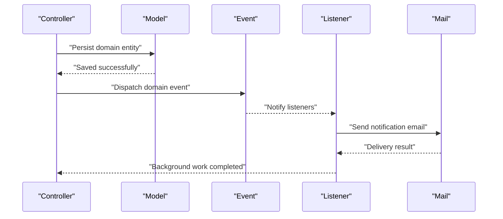
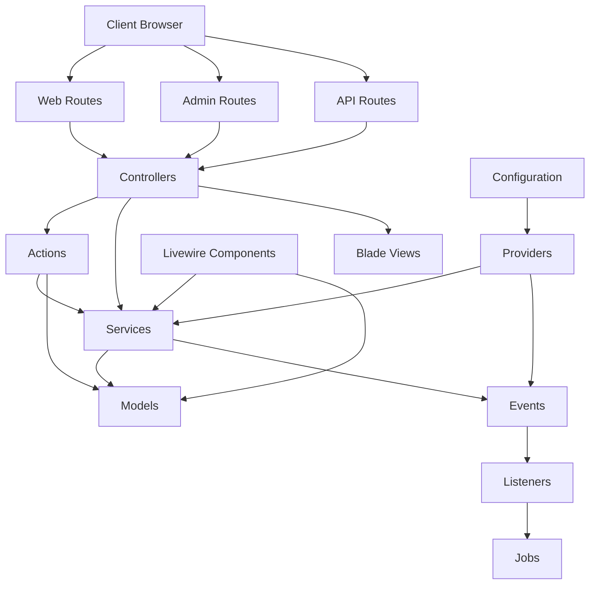
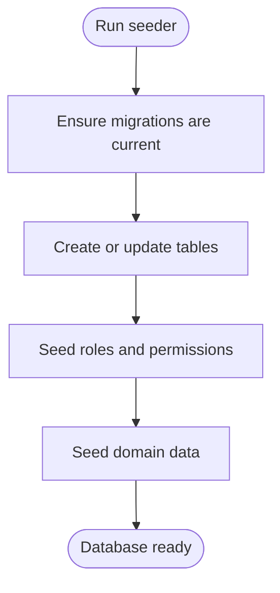
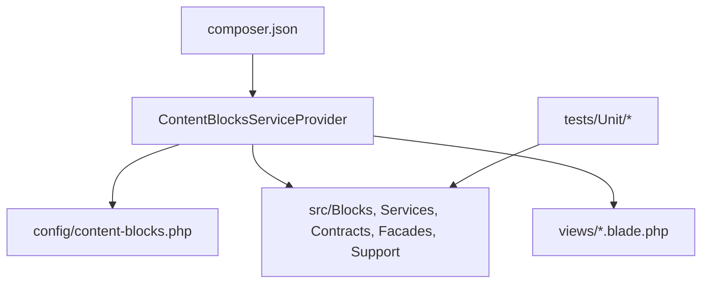
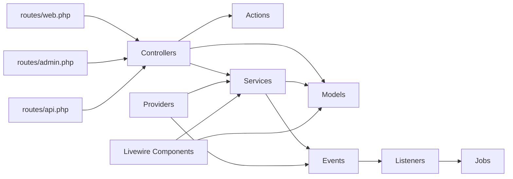

# Directory Structure

<cite>
**Referenced Files in This Document**
- [composer.json](file://composer.json)
- [app/app/Actions/SendContactMessage.php](file://app/app/Actions/SendContactMessage.php)
- [app/app/Concerns/PasswordValidationRules.php](file://app/app/Concerns/PasswordValidationRules.php)
- [app/app/Enums/HeroStyle.php](file://app/app/Enums/HeroStyle.php)
- [app/app/Events/BookingCreatedEvent.php](file://app/app/Events/BookingCreatedEvent.php)
- [app/app/Listeners/SendContactMessageEmail.php](file://app/app/Listeners/SendContactMessageEmail.php)
- [app/app/Livewire/BlockBuilder.php](file://app/app/Livewire/BlockBuilder.php)
- [app/app/Mail/NewBookingStaffMail.php](file://app/app/Mail/NewBookingStaffMail.php)
- [app/app/Models/Booking.php](file://app/app/Models/Booking.php)
- [app/app/Providers/AppServiceProvider.php](file://app/app/Providers/AppServiceProvider.php)
- [app/app/Rules/SortOrderIsUnique.php](file://app/app/Rules/SortOrderIsUnique.php)
- [app/app/Services/BookingCalendarService.php](file://app/app/Services/BookingCalendarService.php)
- [app/app/Support/AdminMenu.php](file://app/app/Support/AdminMenu.php)
- [config/config/adminlte.php](file://config/config/adminlte.php)
- [config/config/app.php](file://config/config/app.php)
- [routes/routes/web.php](file://routes/routes/web.php)
- [routes/routes/api.php](file://routes/routes/api.php)
- [routes/routes/admin.php](file://routes/routes/admin.php)
- [routes/routes/console.php](file://routes/routes/console.php)
- [database/database/migrations/2026_04_17_093356_create_bookings_table.php](file://database/database/migrations/2026_04_17_093356_create_bookings_table.php)
- [database/database/factories/UserFactory.php](file://database/database/factories/UserFactory.php)
- [database/database/seeders/DatabaseSeeder.php](file://database/database/seeders/DatabaseSeeder.php)
- [packages/packages/ContentBlocks/composer.json](file://packages/packages/ContentBlocks/composer.json)
- [packages/packages/ContentBlocks/src/ContentBlocksServiceProvider.php](file://packages/packages/ContentBlocks/src/ContentBlocksServiceProvider.php)
- [resources/resources/views/layouts/app.blade.php](file://resources/resources/views/layouts/app.blade.php)
- [resources/resources/views/components/button.blade.php](file://resources/resources/views/components/button.blade.php)
- [resources/resources/views/partials/site-footer.blade.php](file://resources/resources/views/partials/site-footer.blade.php)
</cite>

## Table of Contents
1. [Introduction](#introduction)
2. [Project Structure](#project-structure)
3. [Core Components](#core-components)
4. [Architecture Overview](#architecture-overview)
5. [Detailed Component Analysis](#detailed-component-analysis)
6. [Dependency Analysis](#dependency-analysis)
7. [Performance Considerations](#performance-considerations)
8. [Troubleshooting Guide](#troubleshooting-guide)
9. [Conclusion](#conclusion)

## Introduction
This document explains the directory structure and organizational principles of Highblossom’s Laravel-based codebase. It focuses on how application code, views, configuration, routes, database artifacts, and a standalone package are arranged to support maintainability, clear responsibilities, and scalable growth.

The layout follows layered conventions:
- Application logic lives under `app/`, organized by domain features and technical layers such as Controllers, Models, Services, Actions, Livewire components, Middleware, Events, Listeners, Jobs, Providers, Rules, Concerns, Enums, Traits, and Support utilities.
- Presentation is split across Blade views under `resources/views` with separate areas for admin, site, authentication, reusable components, layouts, Livewire views, and partials.
- Database evolution is versioned through migrations, seeders populate initial data, and factories generate test data.
- Configuration is centralized under `config/`, while routing is separated into web, API, admin, and console scopes.
- A self-contained package `packages/ContentBlocks/` encapsulates content block functionality, including its own service provider, configuration, Blade views, and tests.

## Project Structure
At a high level, the repository separates runtime application code, presentation assets, environment configuration, database schema, public entry points, and packaged extensions:

```mermaid
graph TB
  App["app/"] --> Controllers["Controllers"]
  App --> Models["Models"]
  App --> Services["Services"]
  App --> Actions["Actions"]
  App --> Livewire["Livewire"]
  App --> Http["Http (Middleware, Requests, Resources, Responses, View Composers)"]
  App --> Events["Events"]
  App --> Listeners["Listeners"]
  App --> Jobs["Jobs"]
  App --> Providers["Providers"]
  App --> Rules["Rules"]
  App --> Concerns["Concerns"]
  App --> Enums["Enums"]
  App --> TraitDir["Trait"]
  App --> Support["Support"]

  Views["resources/views/"] --> AdminViews["admin/"]
  Views --> SiteViews["site/"]
  Views --> AuthViews["auth/"]
  Views --> Components["components/"]
  Views --> Layouts["layouts/"]
  Views --> LivewireViews["livewire/"]
  Views --> Partials["partials/"]

  Config["config/"] --> Settings["Application settings"]
  Routes["routes/"] --> WebRoutes["web.php"]
  Routes --> ApiRoutes["api.php"]
  Routes --> AdminRoutes["admin.php"]
  Routes --> ConsoleRoutes["console.php"]

  Database["database/"] --> Migrations["migrations/"]
  Database --> Seeders["seeders/"]
  Database --> Factories["factories/"]

  Package["packages/ContentBlocks/"] --> PkgSrc["src/"]
  Package --> PkgConfig["config/"]
  Package --> PkgViews["resources/views/"]
  Package --> PkgTests["tests/"]
```

**Diagram sources**
- [composer.json](file://composer.json)
- [routes/routes/web.php](file://routes/routes/web.php)
- [routes/routes/api.php](file://routes/routes/api.php)
- [routes/routes/admin.php](file://routes/routes/admin.php)
- [routes/routes/console.php](file://routes/routes/console.php)
- [config/config/app.php](file://config/config/app.php)
- [database/database/migrations/2026_04_17_093356_create_bookings_table.php](file://database/database/migrations/2026_04_17_093356_create_bookings_table.php)
- [database/database/seeders/DatabaseSeeder.php](file://database/database/seeders/DatabaseSeeder.php)
- [database/database/factories/UserFactory.php](file://database/database/factories/UserFactory.php)
- [packages/packages/ContentBlocks/composer.json](file://packages/packages/ContentBlocks/composer.json)
- [packages/packages/ContentBlocks/src/ContentBlocksServiceProvider.php](file://packages/packages/ContentBlocks/src/ContentBlocksServiceProvider.php)

**Section sources**
- [composer.json](file://composer.json)

## Core Components
This section summarizes each major folder under `app/`, what it contains, and why it exists.

### app/Actions
Action classes encapsulate focused, single-purpose business operations that can be reused across controllers, services, jobs, or commands. Typical examples include sending contact messages, storing bookings, updating inspections, and handling Fortify flows.

- Naming convention: Verb + Noun + Action suffix, e.g., `StoreBookingAction`.
- Responsibility: Encapsulate one operation end-to-end, often coordinating models, services, and events.
- Composition: Often invoked from controllers or services to keep request handlers thin.

**Section sources**
- [app/app/Actions/SendContactMessage.php](file://app/app/Actions/SendContactMessage.php)

### app/Concerns
Reusable cross-cutting behavior attached via composition rather than inheritance. Common uses include validation rule sets applied to multiple request classes.

- Examples: Password and profile validation rules shared across registration and update forms.
- Benefit: Avoid duplication while keeping concerns explicit and testable.

**Section sources**
- [app/app/Concerns/PasswordValidationRules.php](file://app/app/Concerns/PasswordValidationRules.php)

### app/Enums
Type-safe enumerations represent fixed sets of values used throughout the application, such as theme selection, hero styles, booking types, or device categories.

- Benefits: Improves readability, prevents invalid state, and supports typed form inputs and database columns.

**Section sources**
- [app/app/Enums/HeroStyle.php](file://app/app/Enums/HeroStyle.php)

### app/Events and app/Listeners
Asynchronous event-driven communication decouples producers from consumers. For example, when a booking is created, an event can trigger email notifications, analytics tracking, or background processing without coupling those details to the booking controller.

- Event examples: Booking creation, contact message receipt.
- Listener examples: Sending emails, recording session activity, revoking sessions on password reset.

**Diagram sources**
- [app/app/Events/BookingCreatedEvent.php](file://app/app/Events/BookingCreatedEvent.php)
- [app/app/Listeners/SendContactMessageEmail.php](file://app/app/Listeners/SendContactMessageEmail.php)
- [app/app/Mail/NewBookingStaffMail.php](file://app/app/Mail/NewBookingStaffMail.php)

**Section sources**
- [app/app/Events/BookingCreatedEvent.php](file://app/app/Events/BookingCreatedEvent.php)
- [app/app/Listeners/SendContactMessageEmail.php](file://app/app/Listeners/SendContactMessageEmail.php)

### app/Jobs
Long-running or offloaded tasks run asynchronously via queues. The presence of a system overview probe job suggests periodic health checks or background data gathering.

- Use cases: Email delivery, media processing, cache warming, periodic probes.

**Section sources**
- [app/app/Jobs/WarmSystemOverviewProbe.php](file://app/app/Jobs/WarmSystemOverviewProbe.php)

### app/Livewire
Server-rendered interactive components built with Livewire. These handle UI interactions like block building, blog post listing, passkey recovery banners, and system overview sections.

- Organization: One component class per file, typically paired with a Blade view under `resources/views/livewire/`.
- Pattern: Stateful components communicate with models and services directly, reducing boilerplate compared to traditional AJAX endpoints.

**Section sources**
- [app/app/Livewire/BlockBuilder.php](file://app/app/Livewire/BlockBuilder.php)

### app/Middleware
HTTP middleware transforms requests, enforces policies, or enriches context before reaching controllers. Examples include rate limiting login attempts and managing session metadata.

- Responsibilities: Authentication, authorization, logging, request/response normalization.

**Section sources**
- [app/app/Middleware/CanonicalLoginRateLimiter.php](file://app/app/Middleware/CanonicalLoginRateLimiter.php)

### app/Providers
Service providers register bindings, boot global services, and wire framework integration points.

- Examples: Application service provider, event dispatcher setup, Fortify configuration, SEO service wiring, password policy registration.

**Section sources**
- [app/app/Providers/AppServiceProvider.php](file://app/app/Providers/AppServiceProvider.php)

### app/Rules
Custom validation rules extend Laravel’s validator with domain-specific constraints, such as ensuring sort order uniqueness across records.

**Section sources**
- [app/app/Rules/SortOrderIsUnique.php](file://app/app/Rules/SortOrderIsUnique.php)

### app/Services
Service layer centralizes business logic that spans multiple models or workflows. Services coordinate domain operations, external integrations, and orchestration between actions, models, and mail/jobs.

- Examples: Booking calendar management, gallery services, media registry, quote processing, user and session management, SEO injection, SMTP configuration.
- Subfolders: Contracts, data transfer objects, and domain-scoped subdirectories clarify boundaries.

**Section sources**
- [app/app/Services/BookingCalendarService.php](file://app/app/Services/BookingCalendarService.php)

### app/Trait
Shared traits provide reusable methods that can be composed into classes. In this project, company-related validation rules are exposed as a trait for reuse across request validators.

**Section sources**
- [app/app/Trait/CompanyValidationRules.php](file://app/app/Trait/CompanyValidationRules.php)

### app/Support
Utility helpers, builders, and domain-specific support classes. This includes admin navigation builders, device information extraction, hero asset and slide builders, sign-in identifiers, sort order registries, and helper functions.

- Purpose: Keep controllers and services lean by moving infrastructure-like logic here.

**Section sources**
- [app/app/Support/AdminMenu.php](file://app/app/Support/AdminMenu.php)

### app/Models
Eloquent models represent persistent entities and encapsulate relationships, accessors, mutators, and model-level behaviors.

- Examples: User, Booking, Inspection, Service, GalleryImage, Post, Partner, Staff, Testimonial, MediaRegistry, and more.
- Subfolders: Model-level concerns and contracts organize reusable model logic and interfaces.

**Section sources**
- [app/app/Models/Booking.php](file://app/app/Models/Booking.php)

## Architecture Overview
The application follows a layered architecture:

- Routing layer (`routes/`) maps HTTP requests to controllers or Livewire actions.
- Controllers receive input, delegate to Actions or Services, and return responses or redirects.
- Services encapsulate complex business workflows.
- Models manage persistence and relationships.
- Events and Listeners enable asynchronous side effects.
- Jobs handle background processing.
- Providers initialize services and bind abstractions.
- Views render HTML using Blade, with Livewire components handling interactivity.
- Configuration drives behavior and third-party integrations.
- Database artifacts evolve the schema and seed test data.

**Diagram sources**
- [routes/routes/web.php](file://routes/routes/web.php)
- [routes/routes/admin.php](file://routes/routes/admin.php)
- [routes/routes/api.php](file://routes/routes/api.php)
- [app/app/Providers/AppServiceProvider.php](file://app/app/Providers/AppServiceProvider.php)

## Detailed Component Analysis

### app/ Directory Hierarchy
The `app/` directory groups code by responsibility rather than by feature alone, which improves discoverability and reduces coupling:

- Controllers: Handle HTTP requests, validate input, and delegate to domain logic.
- Models: Represent database tables and relationships.
- Services: Orchestrate multi-step workflows and contain reusable business logic.
- Actions: Small, focused operations that can be composed into larger flows.
- Livewire: Interactive server-side components.
- Middleware: Request transformation and policy enforcement.
- Events/Listeners: Decoupled async communication.
- Jobs: Background task execution.
- Providers: Framework and application initialization.
- Rules: Custom validation logic.
- Concerns: Shared behaviors injected into classes.
- Enums: Type-safe value sets.
- Trait: Reusable method collections.
- Support: Utilities, builders, and helpers.

Naming conventions:
- Classes use PascalCase and meaningful names reflecting responsibility.
- Files follow PSR-4 autoloading conventions.
- Domain nouns (e.g., Booking, Quote, Post) are paired with verbs (Store, Update, Send) where appropriate.
- Service classes group related operations; actions refine granularity.

Architectural reasoning:
- Thin controllers keep request handling simple.
- Services prevent duplication and make testing easier.
- Events and listeners reduce tight coupling between unrelated subsystems.
- Support and Concerns collect reusable utilities without bloating core classes.

**Section sources**
- [app/app/Actions/SendContactMessage.php](file://app/app/Actions/SendContactMessage.php)
- [app/app/Services/BookingCalendarService.php](file://app/app/Services/BookingCalendarService.php)
- [app/app/Models/Booking.php](file://app/app/Models/Booking.php)
- [app/app/Events/BookingCreatedEvent.php](file://app/app/Events/BookingCreatedEvent.php)
- [app/app/Listeners/SendContactMessageEmail.php](file://app/app/Listeners/SendContactMessageEmail.php)
- [app/app/Providers/AppServiceProvider.php](file://app/app/Providers/AppServiceProvider.php)

### resources/ Views Organization
Blade views are organized by audience and purpose:

- `admin/`: Administrative dashboards, forms, listings, and settings.
- `site/`: Public-facing pages for the website.
- `auth/`: Authentication-related pages and flows.
- `components/`: Reusable Blade components, including small UI pieces and nested directories for related components.
- `layouts/`: Shared page templates and base layouts.
- `livewire/`: Blade templates for Livewire components.
- `partials/`: Small reusable fragments included by other views.

Patterns:
- Layouts define structural shells; pages compose partials and components.
- Admin views share common layouts and navigation helpers provided by Support classes.
- Site views emphasize clarity and accessibility for visitors.
- Livewire views correspond to their component classes under `app/Livewire`.

**Section sources**
- [resources/resources/views/layouts/app.blade.php](file://resources/resources/views/layouts/app.blade.php)
- [resources/resources/views/components/button.blade.php](file://resources/resources/views/components/button.blade.php)
- [resources/resources/views/partials/site-footer.blade.php](file://resources/resources/views/partials/site-footer.blade.php)

### database/ Structure
Database artifacts are split into three categories:

- Migrations: Version-controlled schema changes. Each migration targets a specific change, such as creating tables or adding columns.
- Seeders: Populate initial or reference data, including roles, permissions, services, galleries, and static content.
- Factories: Generate realistic dummy data for testing and development.

Organization patterns:
- Migration filenames are timestamped to preserve ordering.
- Seeders are grouped by domain area (services, galleries, roles).
- Factories mirror model names for consistency.

**Diagram sources**
- [database/database/migrations/2026_04_17_093356_create_bookings_table.php](file://database/database/migrations/2026_04_17_093356_create_bookings_table.php)
- [database/database/seeders/DatabaseSeeder.php](file://database/database/seeders/DatabaseSeeder.php)
- [database/database/factories/UserFactory.php](file://database/database/factories/UserFactory.php)

**Section sources**
- [database/database/migrations/2026_04_17_093356_create_bookings_table.php](file://database/database/migrations/2026_04_17_093356_create_bookings_table.php)
- [database/database/seeders/DatabaseSeeder.php](file://database/database/seeders/DatabaseSeeder.php)
- [database/database/factories/UserFactory.php](file://database/database/factories/UserFactory.php)

### config/ Organization
Configuration files live under `config/` and are grouped by concern:

- Application-wide settings: App name, locale, timezone, debug mode.
- Integration settings: Authentication, Fortify, permissions, queue, cache, session, filesystems, logging, mail, Sanctum, SEO, Livewire, and third-party packages.
- Feature toggles: Flags and options controlling optional features.

Best practices:
- Keep environment-sensitive values out of configuration files; load them from environment variables.
- Provide sensible defaults and override only what is necessary.
- Group related settings together to aid maintenance.

**Section sources**
- [config/config/app.php](file://config/config/app.php)
- [config/config/adminlte.php](file://config/config/adminlte.php)

### routes/ Separation
Routing is split into logical scopes:

- `web.php`: Public website routes and general application endpoints.
- `api.php`: Stateless API endpoints for clients.
- `admin.php`: Administrative routes protected by role and permission middleware.
- `console.php`: Scheduled and manual console commands.

Benefits:
- Clear separation of concerns by route type.
- Easier to apply route-level middleware and naming prefixes.
- Improved discoverability for developers navigating the codebase.

**Section sources**
- [routes/routes/web.php](file://routes/routes/web.php)
- [routes/routes/api.php](file://routes/routes/api.php)
- [routes/routes/admin.php](file://routes/routes/admin.php)
- [routes/routes/console.php](file://routes/routes/console.php)

### packages/ContentBlocks/ Standalone Package
The `packages/ContentBlocks/` directory represents a self-contained package embedded within the application. It includes:

- Source code under `src/`, including blocks, services, contracts, facades, support utilities, and a service provider.
- Configuration under `config/`.
- Blade views under `resources/views/`.
- Tests under `tests/`.
- Its own `composer.json` and documentation.

This arrangement allows content blocks to be developed, tested, and potentially extracted into a reusable package while remaining accessible to the application.

**Diagram sources**
- [packages/packages/ContentBlocks/composer.json](file://packages/packages/ContentBlocks/composer.json)
- [packages/packages/ContentBlocks/src/ContentBlocksServiceProvider.php](file://packages/packages/ContentBlocks/src/ContentBlocksServiceProvider.php)

**Section sources**
- [packages/packages/ContentBlocks/composer.json](file://packages/packages/ContentBlocks/composer.json)
- [packages/packages/ContentBlocks/src/ContentBlocksServiceProvider.php](file://packages/packages/ContentBlocks/src/ContentBlocksServiceProvider.php)

## Dependency Analysis
The following diagram shows key dependencies among core application components:

**Diagram sources**
- [routes/routes/web.php](file://routes/routes/web.php)
- [routes/routes/admin.php](file://routes/routes/admin.php)
- [routes/routes/api.php](file://routes/routes/api.php)
- [app/app/Providers/AppServiceProvider.php](file://app/app/Providers/AppServiceProvider.php)
- [app/app/Events/BookingCreatedEvent.php](file://app/app/Events/BookingCreatedEvent.php)
- [app/app/Listeners/SendContactMessageEmail.php](file://app/app/Listeners/SendContactMessageEmail.php)
- [app/app/Jobs/WarmSystemOverviewProbe.php](file://app/app/Jobs/WarmSystemOverviewProbe.php)

**Section sources**
- [routes/routes/web.php](file://routes/routes/web.php)
- [routes/routes/admin.php](file://routes/routes/admin.php)
- [routes/routes/api.php](file://routes/routes/api.php)
- [app/app/Providers/AppServiceProvider.php](file://app/app/Providers/AppServiceProvider.php)

## Performance Considerations
- Defer heavy work to Jobs and Listeners to keep request latency low.
- Cache frequently accessed configuration or computed data using the application’s caching layer.
- Prefer Eloquent relationships and eager loading to avoid N+1 queries.
- Use pagination for large lists in both admin and site views.
- Keep Blade rendering efficient by breaking views into small, reusable components and partials.
- Configure queues appropriately for your deployment environment to process background tasks reliably.

[No sources needed since this section provides general guidance]

## Troubleshooting Guide
Common issues and where to look:

- Routing problems: Verify that routes are registered in the correct scope file and that middleware is applied consistently.
- Authentication and authorization failures: Check Fortify and permissions configuration, and ensure admin routes are guarded properly.
- Event-driven delays: Confirm that listeners are registered and that the queue worker is running for background tasks.
- Validation errors: Inspect custom rules and shared validation concerns to ensure they reflect current domain requirements.
- Database schema mismatches: Run migrations in order and verify seeders against the expected schema.
- Package integration issues: Ensure the ContentBlocks service provider is loaded and its configuration is published if required.

**Section sources**
- [routes/routes/admin.php](file://routes/routes/admin.php)
- [app/app/Providers/AppServiceProvider.php](file://app/app/Providers/AppServiceProvider.php)
- [app/app/Rules/SortOrderIsUnique.php](file://app/app/Rules/SortOrderIsUnique.php)
- [database/database/migrations/2026_04_17_093356_create_bookings_table.php](file://database/database/migrations/2026_04_17_093356_create_bookings_table.php)
- [packages/packages/ContentBlocks/src/ContentBlocksServiceProvider.php](file://packages/packages/ContentBlocks/src/ContentBlocksServiceProvider.php)

## Conclusion
Highblossom’s directory structure emphasizes clear separation of concerns, reusability, and scalability. The `app/` hierarchy organizes code by responsibility, while `resources/views/` separates presentation by audience and component type. Configuration and routing are deliberately partitioned to simplify maintenance. Database artifacts follow standard conventions for versioning and seeding. The standalone `packages/ContentBlocks/` package demonstrates how domain functionality can be encapsulated and potentially reused beyond the application. Together, these patterns create a codebase that is easier to understand, extend, and operate.