# Request Lifecycle

<cite>
**Referenced Files in This Document**   
- [public/index.php](file://public/index.php)
- [bootstrap/app.php](file://bootstrap/app.php)
- [bootstrap/providers.php](file://bootstrap/providers.php)
- [app/Providers/AppServiceProvider.php](file://app/Providers/AppServiceProvider.php)
- [config/app.php](file://config/app.php)
- [config/auth.php](file://config/auth.php)
- [config/sanctum.php](file://config/sanctum.php)
- [config/logging.php](file://config/logging.php)
- [routes/web.php](file://routes/web.php)
- [routes/api.php](file://routes/api.php)
- [routes/admin.php](file://routes/admin.php)
- [app/Http/Middleware/ShareThemePreference.php](file://app/Http/Middleware/ShareThemePreference.php)
- [app/Http/Middleware/TrackUserSession.php](file://app/Http/Middleware/TrackUserSession.php)
- [app/Http/Middleware/ThrottleUsernameAvailability.php](file://app/Http/Middleware/ThrottleUsernameAvailability.php)
- [app/Http/Middleware/EnsureConsentRecorded.php](file://app/Http/Middleware/EnsureConsentRecorded.php)
- [app/Http/Middleware/EnsureEmailIsVerifiedWhenRequired.php](file://app/Http/Middleware/EnsureEmailIsVerifiedWhenRequired.php)
- [app/Http/Middleware/EnsureRegistrationIsEnabled.php](file://app/Http/Middleware/EnsureRegistrationIsEnabled.php)
- [app/Http/Controllers/SiteController.php](file://app/Http/Controllers/SiteController.php)
- [app/Services/ContactMessageService.php](file://app/Services/ContactMessageService.php)
- [app/Services/QuoteService.php](file://app/Services/QuoteService.php)
</cite>

## Table of Contents
1. [Introduction](#introduction)
2. [Project Structure](#project-structure)
3. [Core Components](#core-components)
4. [Architecture Overview](#architecture-overview)
5. [Detailed Component Analysis](#detailed-component-analysis)
6. [Dependency Analysis](#dependency-analysis)
7. [Performance Considerations](#performance-considerations)
8. [Troubleshooting Guide](#troubleshooting-guide)
9. [Conclusion](#conclusion)

## Introduction
This document describes Highblossom’s HTTP request lifecycle from the first byte arriving at `public/index.php` through Laravel’s application bootstrap, middleware execution, route resolution, controller invocation, service-layer processing, validation, and response generation. It also explains how authentication, authorization, rate limiting, and custom middleware fit into the pipeline, where errors are handled, how logging is configured, and which points offer optimization opportunities.

The application uses a standard Laravel web entry point with separate route files for public web routes, API routes, and console commands. Admin routes are mounted under the shared `web` middleware group. Authentication is session-based for the web guard and Sanctum-based for the staff API. Custom middleware handles consent, email verification, registration gating, user-session tracking, theme sharing, and username availability throttling.

## Project Structure
At runtime, the entry point loads Composer autoloading, bootstraps the Laravel application, captures the incoming request, and delegates handling to the framework. The bootstrap configuration wires up routing, middleware aliases, exception rendering, and provider loading.

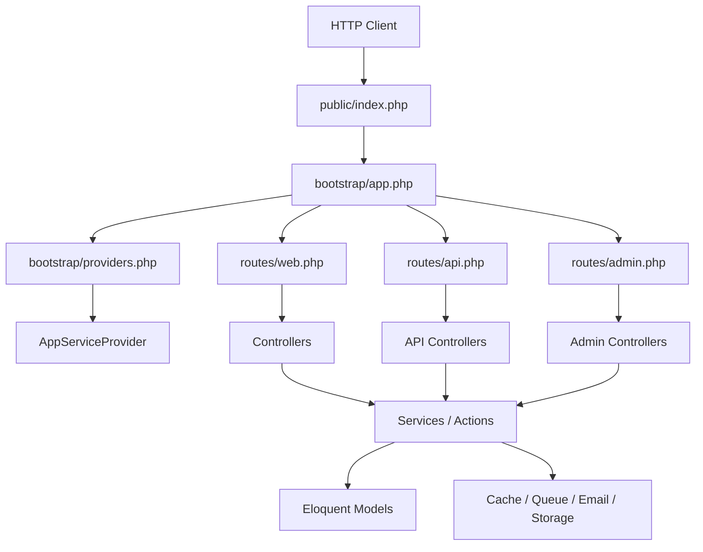

**Diagram sources**
- [public/index.php:1-20](file://public/index.php#L1-L20)
- [bootstrap/app.php:1-71](file://bootstrap/app.php#L1-L71)
- [bootstrap/providers.php:1-17](file://bootstrap/providers.php#L1-L17)
- [routes/web.php:1-76](file://routes/web.php#L1-L76)
- [routes/api.php:1-117](file://routes/api.php#L1-L117)

**Section sources**
- [public/index.php:1-20](file://public/index.php#L1-L20)
- [bootstrap/app.php:1-71](file://bootstrap/app.php#L1-L71)
- [bootstrap/providers.php:1-17](file://bootstrap/providers.php#L1-L17)

## Core Components
- **Entry point:** `public/index.php` defines the application start time, checks maintenance mode, loads Composer, requires the bootstrap file, and calls `$app->handleRequest(Request::capture())`.
- **Bootstrap configuration:** `bootstrap/app.php` configures routing, middleware aliases, global middleware groups, and exception rendering.
- **Provider list:** `bootstrap/providers.php` registers Fortify, password rules, SEO, events, passkeys, and the application service provider.
- **Application service provider:** `AppServiceProvider` registers core singletons, view composers, model behavior, schema defaults, Blade components, authorization gates, audit logging access, and production-safe database defaults.
- **Route definitions:** Public pages live in `routes/web.php`, staff API endpoints live in `routes/api.php`, and admin panel routes live in `routes/admin.php` under the shared `web` middleware group.
- **Middleware:** Custom middleware covers theme sharing, user-session tracking, username throttling, consent capture, email verification gating, and registration enablement.
- **Controllers:** Public site logic is primarily in `SiteController`; many domain controllers exist under `Http/Controllers/Admin` and `Http/Controllers/Api`.
- **Services:** Domain logic is delegated to services such as `ContactMessageService` and `QuoteService`, and to action classes referenced by controllers.

**Section sources**
- [public/index.php:1-20](file://public/index.php#L1-L20)
- [bootstrap/app.php:1-71](file://bootstrap/app.php#L1-L71)
- [bootstrap/providers.php:1-17](file://bootstrap/providers.php#L1-L17)
- [app/Providers/AppServiceProvider.php:1-110](file://app/Providers/AppServiceProvider.php#L1-L110)
- [routes/web.php:1-76](file://routes/web.php#L1-L76)
- [routes/api.php:1-117](file://routes/api.php#L1-L117)
- [routes/admin.php:1-171](file://routes/admin.php#L1-L171)

## Architecture Overview
The complete request flow consists of these stages:

1. **Request capture:** PHP receives the HTTP request; `public/index.php` records startup timing and loads the framework.
2. **Application bootstrap:** `bootstrap/app.php` builds the application container, registers providers, and sets up routing and middleware.
3. **Middleware pipeline:** Global and route-scoped middleware run before the controller.
4. **Route resolution:** Laravel matches the HTTP method and path against registered routes.
5. **Authorization and validation:** Guards, policies, form requests, and custom rules validate identity, permissions, and input.
6. **Controller invocation:** The matched controller method runs.
7. **Service-layer processing:** Controllers delegate business logic to actions or services.
8. **Response generation:** Controllers return views, redirects, JSON, or other responses.
9. **Exception handling and logging:** Exceptions are rendered using the configured exception handler and logged through Monolog channels.

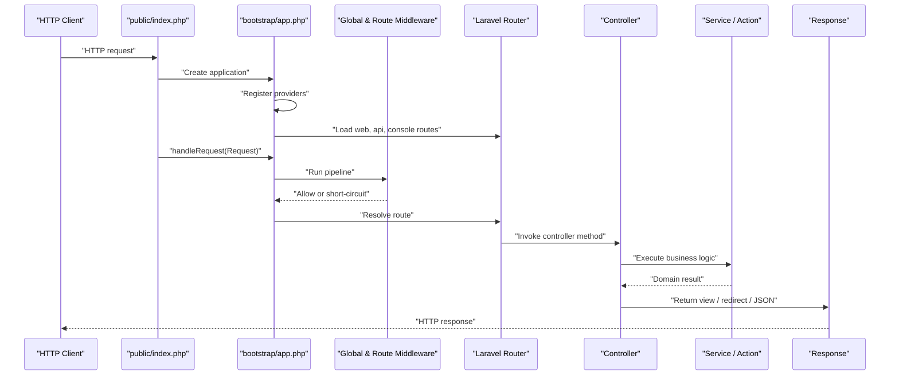

**Diagram sources**
- [public/index.php:1-20](file://public/index.php#L1-L20)
- [bootstrap/app.php:1-71](file://bootstrap/app.php#L1-L71)
- [routes/web.php:1-76](file://routes/web.php#L1-L76)
- [routes/api.php:1-117](file://routes/api.php#L1-L117)

## Detailed Component Analysis

### Bootstrap Sequence
The bootstrap sequence starts in the public entry point and moves through framework initialization:

1. `public/index.php` defines `LARAVEL_START` and loads maintenance mode if present.
2. Composer autoloading is included.
3. `bootstrap/app.php` returns the configured application instance.
4. `handleRequest(Request::capture())` dispatches the request through the kernel.
5. Provider registration occurs via `bootstrap/providers.php`.
6. `AppServiceProvider` executes its `register()` and `boot()` methods.

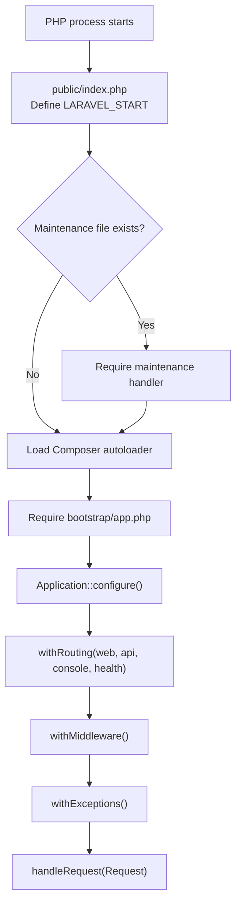

**Diagram sources**
- [public/index.php:1-20](file://public/index.php#L1-L20)
- [bootstrap/app.php:1-71](file://bootstrap/app.php#L1-L71)

**Section sources**
- [public/index.php:1-20](file://public/index.php#L1-L20)
- [bootstrap/app.php:1-71](file://bootstrap/app.php#L1-L71)
- [bootstrap/providers.php:1-17](file://bootstrap/providers.php#L1-L17)

### Middleware Pipeline Execution
The application configures several middleware layers:

- **Shared web middleware:** `ShareThemePreference`, `TrackUserSession`, and `ThrottleUsernameAvailability` are appended to the web group.
- **Middleware aliases:** Role, permission, role-or-permission, email verification, consent, and registration-gating middleware are aliased.
- **Authentication:**
  - Web routes use the session guard defined in `config/auth.php`.
  - Staff API routes use Sanctum with bearer tokens or stateful cookies depending on environment configuration.
- **Authorization:** Spatie Permission middleware (`role`, `permission`, `role_or_permission`) and route-level `can:` policies gate admin and staff API resources.
- **Rate limiting:** Laravel’s built-in throttle middleware protects sensitive endpoints such as login, two-factor challenges, quote submission, contact submission, blog search, booking availability, poll voting, and calendar endpoints.
- **Custom middleware:**
  - `ShareThemePreference` shares a theme value with all views based on the authenticated user.
  - `TrackUserSession` records device/session information after the inner pipeline completes.
  - `ThrottleUsernameAvailability` limits brute-force enumeration of usernames across specific routes.
  - `EnsureConsentRecorded` redirects unconsented users to the consent page or returns a JSON error.
  - `EnsureEmailIsVerifiedWhenRequired` enforces email verification when company settings require it.
  - `EnsureRegistrationIsEnabled` returns a 404 for registration routes when registration is disabled.

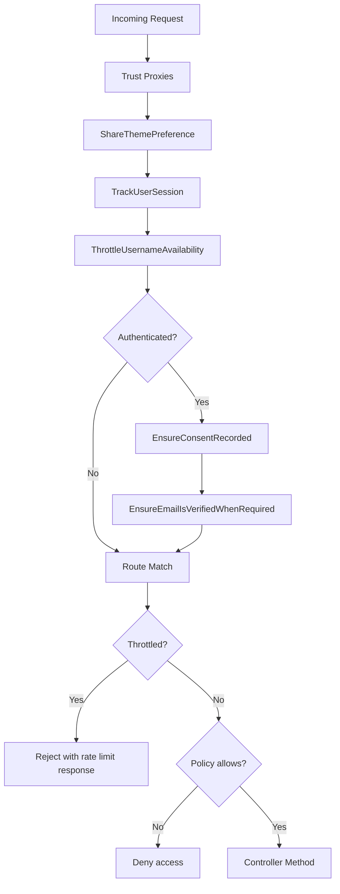

**Diagram sources**
- [bootstrap/app.php:1-71](file://bootstrap/app.php#L1-L71)
- [config/auth.php:1-117](file://config/auth.php#L1-L117)
- [config/sanctum.php:1-87](file://config/sanctum.php#L1-L87)
- [app/Http/Middleware/ShareThemePreference.php:1-32](file://app/Http/Middleware/ShareThemePreference.php#L1-L32)
- [app/Http/Middleware/TrackUserSession.php:1-39](file://app/Http/Middleware/TrackUserSession.php#L1-L39)
- [app/Http/Middleware/ThrottleUsernameAvailability.php:1-72](file://app/Http/Middleware/ThrottleUsernameAvailability.php#L1-L72)
- [app/Http/Middleware/EnsureConsentRecorded.php:1-38](file://app/Http/Middleware/EnsureConsentRecorded.php#L1-L38)
- [app/Http/Middleware/EnsureEmailIsVerifiedWhenRequired.php:1-40](file://app/Http/Middleware/EnsureEmailIsVerifiedWhenRequired.php#L1-L40)
- [app/Http/Middleware/EnsureRegistrationIsEnabled.php:1-39](file://app/Http/Middleware/EnsureRegistrationIsEnabled.php#L1-L39)

**Section sources**
- [bootstrap/app.php:1-71](file://bootstrap/app.php#L1-L71)
- [config/auth.php:1-117](file://config/auth.php#L1-L117)
- [config/sanctum.php:1-87](file://config/sanctum.php#L1-L87)
- [routes/web.php:1-76](file://routes/web.php#L1-L76)
- [routes/api.php:1-117](file://routes/api.php#L1-L117)
- [routes/admin.php:1-171](file://routes/admin.php#L1-L171)
- [app/Http/Middleware/ShareThemePreference.php:1-32](file://app/Http/Middleware/ShareThemePreference.php#L1-L32)
- [app/Http/Middleware/TrackUserSession.php:1-39](file://app/Http/Middleware/TrackUserSession.php#L1-L39)
- [app/Http/Middleware/ThrottleUsernameAvailability.php:1-72](file://app/Http/Middleware/ThrottleUsernameAvailability.php#L1-L72)
- [app/Http/Middleware/EnsureConsentRecorded.php:1-38](file://app/Http/Middleware/EnsureConsentRecorded.php#L1-L38)
- [app/Http/Middleware/EnsureEmailIsVerifiedWhenRequired.php:1-40](file://app/Http/Middleware/EnsureEmailIsVerifiedWhenRequired.php#L1-L40)
- [app/Http/Middleware/EnsureRegistrationIsEnabled.php:1-39](file://app/Http/Middleware/EnsureRegistrationIsEnabled.php#L1-L39)

### Route Resolution and Controller Invocation
Route resolution follows this pattern:

1. Laravel evaluates the HTTP method and URI.
2. For public pages, `routes/web.php` maps paths to `SiteController` methods.
3. For staff API operations, `routes/api.php` maps prefixed `/staff/*` endpoints to API controllers under Sanctum authentication.
4. For admin panel operations, `routes/admin.php` is mounted under the `web` middleware group and gated by `auth`, consent, email verification, and policy abilities.

Example flows:

- **Public homepage:** GET `/` resolves to `SiteController@home`.
- **Quote submission:** POST `/quote` resolves to `SiteController@submitQuote` with rate limiting.
- **Staff API login:** POST `/staff/login` resolves to `Api\AuthController@login` with rate limiting.
- **Admin bookings index:** GET `/admin/bookings` resolves to an admin booking controller behind auth, consent, verification, and authorization gates.

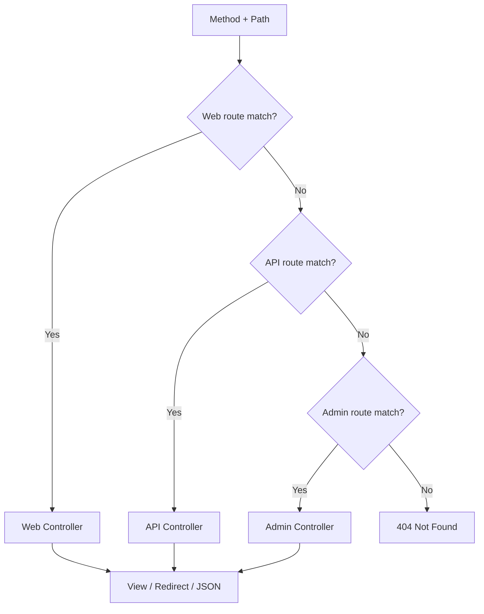

**Diagram sources**
- [routes/web.php:1-76](file://routes/web.php#L1-L76)
- [routes/api.php:1-117](file://routes/api.php#L1-L117)
- [routes/admin.php:1-171](file://routes/admin.php#L1-L171)
- [app/Http/Controllers/SiteController.php:1-180](file://app/Http/Controllers/SiteController.php#L1-L180)

**Section sources**
- [routes/web.php:1-76](file://routes/web.php#L1-L76)
- [routes/api.php:1-117](file://routes/api.php#L1-L117)
- [routes/admin.php:1-171](file://routes/admin.php#L1-L171)
- [app/Http/Controllers/SiteController.php:1-180](file://app/Http/Controllers/SiteController.php#L1-L180)

### Request Validation Flow
Validation occurs at multiple layers:

- **Form request validation:** Controllers accept typed request objects such as `ContactFormRequest` and `QuoteFormRequest`. These perform validation before controller logic executes.
- **Rate-limit validation:** Built-in throttle middleware rejects repeated requests beyond configured limits.
- **Business-rule validation:** Services and models enforce constraints such as uniqueness, status transitions, and resource ownership.
- **Passkey validation:** `ValidationException` instances thrown during passkey-related routes are converted into structured JSON responses with message, reason, and errors.

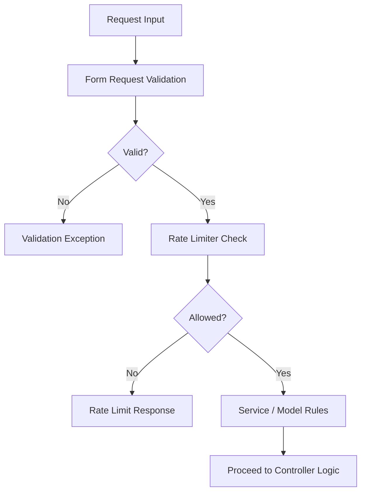

**Diagram sources**
- [app/Http/Controllers/SiteController.php:1-180](file://app/Http/Controllers/SiteController.php#L1-L180)
- [bootstrap/app.php:1-71](file://bootstrap/app.php#L1-L71)

**Section sources**
- [app/Http/Controllers/SiteController.php:1-180](file://app/Http/Controllers/SiteController.php#L1-L180)
- [bootstrap/app.php:1-71](file://bootstrap/app.php#L1-L71)

### Service Layer Invocation
Controllers delegate domain work to services and actions:

- `SiteController` injects `SiteService`, `StoreQuoteAction`, and `SendContactMessage`.
- Public page handlers call service methods to load data for views.
- Form submissions call actions that coordinate validation results, persistence, notifications, and redirects.
- Admin and API controllers similarly delegate to services such as `ContactMessageService` and `QuoteService`.

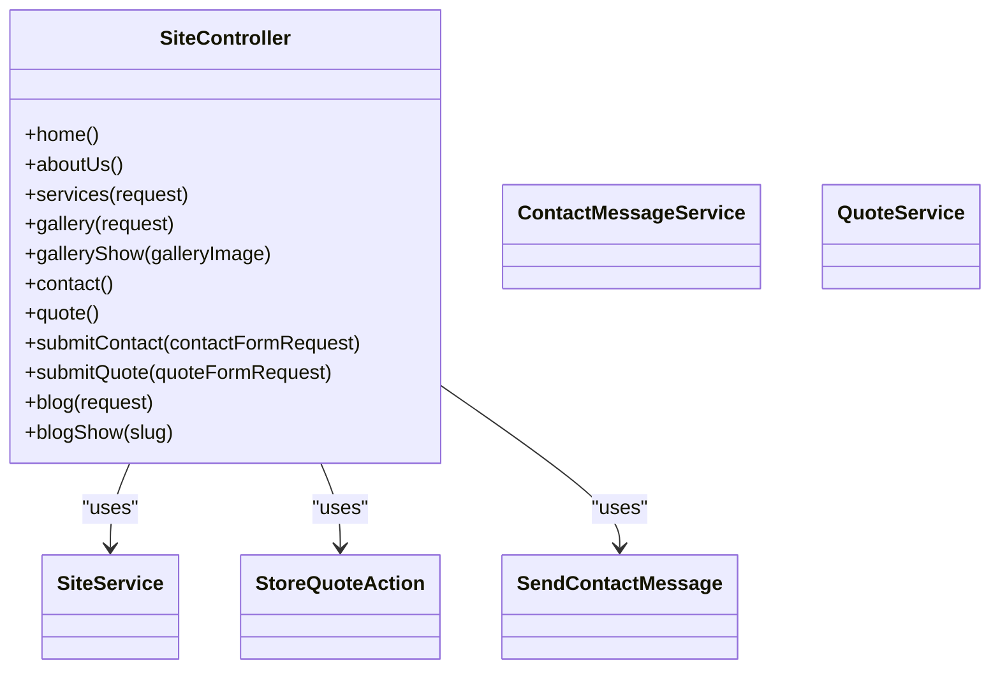

**Diagram sources**
- [app/Http/Controllers/SiteController.php:1-180](file://app/Http/Controllers/SiteController.php#L1-L180)
- [app/Services/ContactMessageService.php:1-33](file://app/Services/ContactMessageService.php#L1-L33)
- [app/Services/QuoteService.php:1-22](file://app/Services/QuoteService.php#L1-L22)

**Section sources**
- [app/Http/Controllers/SiteController.php:1-180](file://app/Http/Controllers/SiteController.php#L1-L180)
- [app/Services/ContactMessageService.php:1-33](file://app/Services/ContactMessageService.php#L1-L33)
- [app/Services/QuoteService.php:1-22](file://app/Services/QuoteService.php#L1-L22)

### Response Generation
Responses are generated in three primary forms:

- **Blade views:** Public pages return view instances populated with service data.
- **Redirects with flash messages:** Form submissions return redirects carrying success or error messages.
- **JSON responses:** API endpoints and passkey-related exceptions return structured JSON payloads.

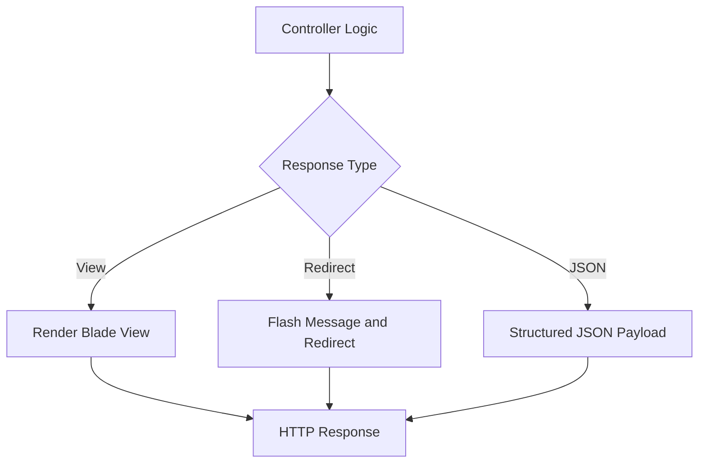

**Diagram sources**
- [app/Http/Controllers/SiteController.php:1-180](file://app/Http/Controllers/SiteController.php#L1-L180)
- [bootstrap/app.php:1-71](file://bootstrap/app.php#L1-L71)

**Section sources**
- [app/Http/Controllers/SiteController.php:1-180](file://app/Http/Controllers/SiteController.php#L1-L180)
- [bootstrap/app.php:1-71](file://bootstrap/app.php#L1-L71)

### Error Handling and Logging
Error handling and logging are configured at the bootstrap and application levels:

- **Exception rendering:** `bootstrap/app.php` registers a custom exception renderer for `ValidationException` on passkey routes, returning a JSON object with message, reason, and validation errors.
- **Application debug mode:** `config/app.php` controls whether detailed stack traces are shown based on `APP_DEBUG`.
- **Logging channels:** `config/logging.php` defines a default channel and multiple Monolog-backed channels including stack, single, daily, slack, papertrail, stderr, syslog, errorlog, null, and emergency.
- **Audit logging:** `AppServiceProvider` configures Auditify access control so only Super Admin users can access audit interfaces.
- **Database safety:** `AppServiceProvider` prohibits destructive database commands in production.

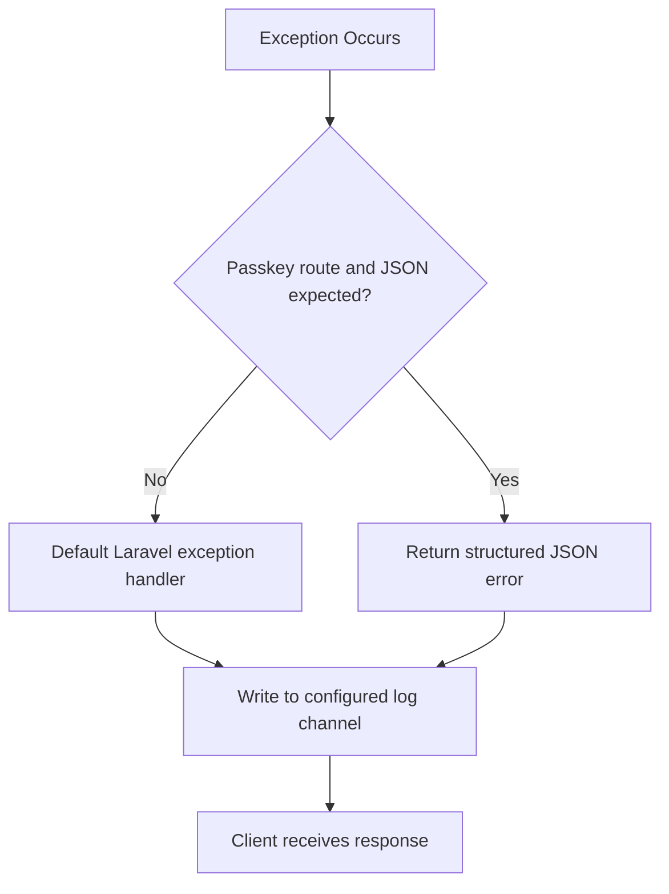

**Diagram sources**
- [bootstrap/app.php:1-71](file://bootstrap/app.php#L1-L71)
- [config/app.php:1-126](file://config/app.php#L1-L126)
- [config/logging.php:1-132](file://config/logging.php#L1-L132)
- [app/Providers/AppServiceProvider.php:1-110](file://app/Providers/AppServiceProvider.php#L1-L110)

**Section sources**
- [bootstrap/app.php:1-71](file://bootstrap/app.php#L1-L71)
- [config/app.php:1-126](file://config/app.php#L1-L126)
- [config/logging.php:1-132](file://config/logging.php#L1-L132)
- [app/Providers/AppServiceProvider.php:1-110](file://app/Providers/AppServiceProvider.php#L1-L110)

### Bootstrapping Sequence in AppServiceProvider
`AppServiceProvider` performs important application-wide setup:

- **Service registration:** Registers `SettingsManager`, `AvailabilityServiceInterface` bound to `AvailabilityService`, and `ProbeRunner` as singletons.
- **View composition:** Shares global settings and footer data through view composers.
- **Model behavior:** Prevents lazy loading outside production.
- **Schema defaults:** Sets MySQL default string length to avoid utf8mb4 index limitations.
- **Blade components:** Registers anonymous component paths for layout and admin components.
- **Authorization gates:** Grants Super Admin broad permissions and defines named gates.
- **Audit logging access:** Restricts audit interface access to Super Admin users.
- **Production defaults:** Uses immutable date types and blocks destructive database commands in production.

```mermaid
flowchart TD
    Register["AppServiceProvider::register()"] --> SettingsManager["Register SettingsManager singleton"]
    Register --> AvailabilityInterface["Bind AvailabilityServiceInterface"]
    Register --> ProbeRunner["Register ProbeRunner singleton"]
    Boot["AppServiceProvider::boot()"] --> LogViewerAuth["Configure LogViewer auth"]
    Boot --> Scheduler["Schedule always on one server"]
    Boot --> Defaults["Configure defaults"]
    Boot --> ViewComposers["Register view composers"]
    Boot --> LazyLoading["Prevent lazy loading outside production"]
    Boot --> SchemaDefault["Set default string length"]
    Boot --> BladeComponents["Register Blade component paths"]
    Boot --> Gates["Define authorization gates"]
    Boot --> Auditify["Configure Auditify auth"]
```

**Diagram sources**
- [app/Providers/AppServiceProvider.php:1-110](file://app/Providers/AppServiceProvider.php#L1-L110)

**Section sources**
- [app/Providers/AppServiceProvider.php:1-110](file://app/Providers/AppServiceProvider.php#L1-L110)

## Dependency Analysis
The request lifecycle depends on several layered components:

- **Framework dependencies:** Laravel Application, Request, Response, Router, Middleware, and Exception handling.
- **Authentication dependencies:** Session guard for web routes and Sanctum for staff API routes.
- **Authorization dependencies:** Spatie Permission middleware and route-level policy gates.
- **Business dependencies:** Services, models, cache, queue, mail, and storage systems invoked by controllers and actions.
- **Observability dependencies:** Logging channels, audit logging, and potential performance monitoring tools.

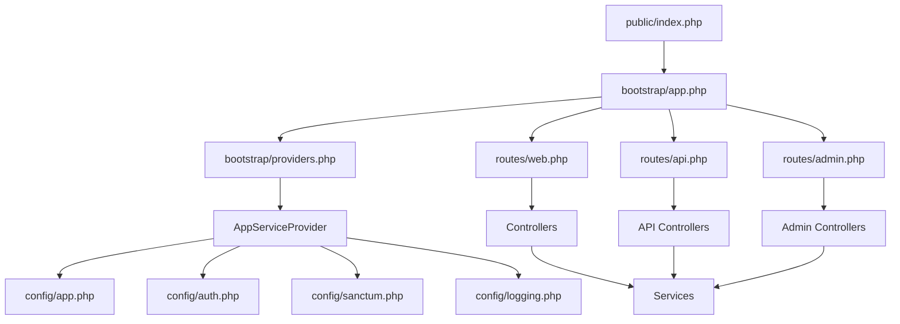

**Diagram sources**
- [public/index.php:1-20](file://public/index.php#L1-L20)
- [bootstrap/app.php:1-71](file://bootstrap/app.php#L1-L71)
- [bootstrap/providers.php:1-17](file://bootstrap/providers.php#L1-L17)
- [app/Providers/AppServiceProvider.php:1-110](file://app/Providers/AppServiceProvider.php#L1-L110)
- [config/app.php:1-126](file://config/app.php#L1-L126)
- [config/auth.php:1-117](file://config/auth.php#L1-L117)
- [config/sanctum.php:1-87](file://config/sanctum.php#L1-L87)
- [config/logging.php:1-132](file://config/logging.php#L1-L132)
- [routes/web.php:1-76](file://routes/web.php#L1-L76)
- [routes/api.php:1-117](file://routes/api.php#L1-L117)
- [routes/admin.php:1-171](file://routes/admin.php#L1-L171)

**Section sources**
- [public/index.php:1-20](file://public/index.php#L1-L20)
- [bootstrap/app.php:1-71](file://bootstrap/app.php#L1-L71)
- [bootstrap/providers.php:1-17](file://bootstrap/providers.php#L1-L17)
- [app/Providers/AppServiceProvider.php:1-110](file://app/Providers/AppServiceProvider.php#L1-L110)
- [config/app.php:1-126](file://config/app.php#L1-L126)
- [config/auth.php:1-117](file://config/auth.php#L1-L117)
- [config/sanctum.php:1-87](file://config/sanctum.php#L1-L87)
- [config/logging.php:1-132](file://config/logging.php#L1-L132)
- [routes/web.php:1-76](file://routes/web.php#L1-L76)
- [routes/api.php:1-117](file://routes/api.php#L1-L117)
- [routes/admin.php:1-171](file://routes/admin.php#L1-L171)

## Performance Considerations
Key optimization points in the request lifecycle include:

- **Startup timing:** `LARAVEL_START` in `public/index.php` enables end-to-end request duration measurement.
- **Singleton services:** `AppServiceProvider` registers long-lived singletons such as `SettingsManager`, `AvailabilityServiceInterface`, and `ProbeRunner` to reduce per-request instantiation cost.
- **Lazy loading protection:** Disabling Eloquent lazy loading outside production helps detect N+1 query problems early.
- **Rate limiting:** Route-specific throttle middleware reduces abuse and protects expensive endpoints like login, two-factor challenges, quote submission, contact submission, blog search, and poll voting.
- **Cache store configuration:** `config/cache.php` defines multiple cache stores including database, file, Memcached, Redis, DynamoDB, Octane, and failover. Choosing a fast cache driver and appropriate store can significantly reduce database pressure.
- **Logging overhead:** High-volume logging channels such as stack and single should be tuned for production environments to avoid I/O bottlenecks.
- **Database safety:** Blocking destructive commands in production prevents accidental schema changes during request handling.

Optimization recommendations:

1. Monitor request duration using `LARAVEL_START` and integrate with APM tools.
2. Prefer cached data for frequently accessed content such as gallery listings, services, and company settings.
3. Use Redis or another high-performance cache store in production.
4. Keep throttle windows aligned with expected traffic patterns.
5. Avoid unnecessary logging on hot paths; reserve detailed logs for errors and critical events.
6. Profile database queries to eliminate N+1 lookups, especially under view composers and bulk listing endpoints.

[No sources needed since this section provides general guidance]

## Troubleshooting Guide
Common issues and their lifecycle positions:

- **Maintenance mode:** If the maintenance file exists, the entry point may short-circuit normal request handling.
- **Authentication failures:** Web routes rely on the session guard; API routes rely on Sanctum. Misconfigured guards or missing tokens will cause authorization failures.
- **Consent gating:** Users without accepted terms or privacy policy are redirected or receive a JSON error depending on whether the request expects JSON.
- **Email verification gating:** When company settings require email verification, unverified users are redirected or denied access.
- **Registration disabled:** Registration routes return 404 when the company setting disables registration.
- **Username enumeration protection:** Excessive attempts on username availability routes trigger validation exceptions with a user-facing message.
- **Passkey validation errors:** Passkey-related validation exceptions return structured JSON with message, reason, and errors.
- **Logging and auditing:** Use configured log channels and audit interfaces to investigate errors; audit access is restricted to Super Admin users.

**Section sources**
- [public/index.php:1-20](file://public/index.php#L1-L20)
- [config/auth.php:1-117](file://config/auth.php#L1-L117)
- [config/sanctum.php:1-87](file://config/sanctum.php#L1-L87)
- [app/Http/Middleware/EnsureConsentRecorded.php:1-38](file://app/Http/Middleware/EnsureConsentRecorded.php#L1-L38)
- [app/Http/Middleware/EnsureEmailIsVerifiedWhenRequired.php:1-40](file://app/Http/Middleware/EnsureEmailIsVerifiedWhenRequired.php#L1-L40)
- [app/Http/Middleware/EnsureRegistrationIsEnabled.php:1-39](file://app/Http/Middleware/EnsureRegistrationIsEnabled.php#L1-L39)
- [app/Http/Middleware/ThrottleUsernameAvailability.php:1-72](file://app/Http/Middleware/ThrottleUsernameAvailability.php#L1-L72)
- [bootstrap/app.php:1-71](file://bootstrap/app.php#L1-L71)
- [config/logging.php:1-132](file://config/logging.php#L1-L132)
- [app/Providers/AppServiceProvider.php:1-110](file://app/Providers/AppServiceProvider.php#L1-L110)

## Conclusion
Highblossom’s HTTP request lifecycle follows a clear progression from the public entry point through Laravel’s bootstrap, middleware, routing, controller, service layer, and response generation. Security and operational concerns are addressed through session and Sanctum authentication, Spatie Permission authorization, rate limiting, consent and verification middleware, structured passkey error responses, and configurable logging. `AppServiceProvider` centralizes service registration, view composition, model behavior, schema defaults, Blade components, authorization gates, audit access, and production-safe defaults. Optimization opportunities center around caching, query profiling, logging tuning, and alignment of rate limits with traffic patterns.

[No sources needed since this section summarizes without analyzing specific files]