# System Architecture

<cite>
**Referenced Files in This Document**   
- [composer.json](file://composer.json)
- [package.json](file://package.json)
- [bootstrap/app.php](file://bootstrap/app.php)
- [routes/web.php](file://routes/web.php)
- [routes/admin.php](file://routes/admin.php)
- [routes/api.php](file://routes/api.php)
- [config/fortify.php](file://config/fortify.php)
- [app/Providers/FortifyServiceProvider.php](file://app/Providers/FortifyServiceProvider.php)
- [config/permission.php](file://config/permission.php)
- [config/debugbar.php](file://config/debugbar.php)
- [config/livewire.php](file://config/livewire.php)
- [config/cache.php](file://config/cache.php)
- [config/session.php](file://config/session.php)
- [docker-compose.yml](file://docker-compose.yml)
- [Dockerfile](file://Dockerfile)
- [packages/ContentBlocks/composer.json](file://packages/ContentBlocks/composer.json)
- [packages/ContentBlocks/src/ContentBlocksServiceProvider.php](file://packages/ContentBlocks/src/ContentBlocksServiceProvider.php)
</cite>

## Table of Contents
1. [Introduction](#introduction)
2. [Project Structure](#project-structure)
3. [Core Components](#core-components)
4. [Architecture Overview](#architecture-overview)
5. [Detailed Component Analysis](#detailed-component-analysis)
6. [Dependency Analysis](#dependency-analysis)
7. [Performance Considerations](#performance-considerations)
8. [Troubleshooting Guide](#troubleshooting-guide)
9. [Conclusion](#conclusion)

## Introduction
Highblossom is a Laravel-based content and booking management system with three primary user-facing surfaces:

- **Public website:** Marketing, blog, gallery, quotes, contact forms, polls, and booking availability endpoints.
- **Admin panel:** An AdminLTE-powered backend for managing bookings, inspections, staff, galleries, services, posts, testimonials, settings, permissions, and system overview data.
- **Staff API:** A Sanctum-authenticated JSON API for an external staff mobile application.

The codebase follows Laravel conventions and extends them with:

- **MVC architecture:** Controllers handle HTTP requests, services encapsulate business logic, Eloquent models represent persistence, and Blade views render HTML.
- **Service layer pattern:** Domain operations such as contact messaging, SEO rendering, image/video handling, media registry, and session management live under `app/Services`.
- **Action classes:** Small, focused domain actions live under `app/Actions` for operations like sending messages, storing bookings, updating inspections, and Fortify authentication.
- **Event-driven communication:** Events such as contact message receipt and authentication lifecycle events trigger listeners for email delivery, session tracking, and session revocation.
- **Livewire component architecture:** Interactive UI components are registered under `app/Livewire`, with view templates under `resources/views/livewire` and component locations configured in Livewire configuration.
- **Content block package:** A self-contained Composer package under `packages/ContentBlocks` provides a typed block registry, Blade directives, and renderer used to compose dynamic page content.

## Project Structure
The repository is organized around Laravel’s standard layout, with additional layers for admin tooling, API routes, Livewire components, domain services, actions, events, and a custom package.

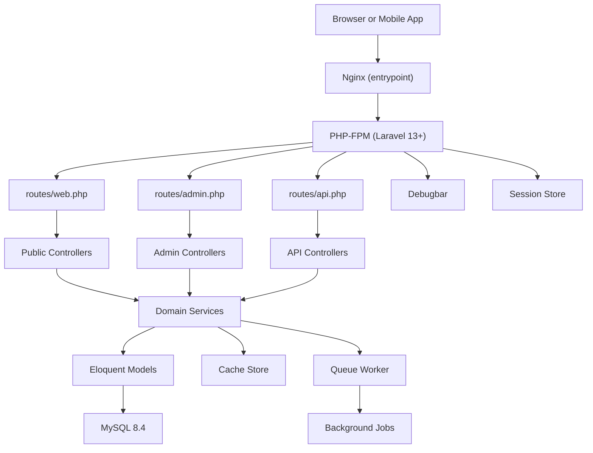

**Diagram sources**
- [bootstrap/app.php:10-33](file://bootstrap/app.php#L10-L33)
- [routes/web.php:1-76](file://routes/web.php#L1-L76)
- [routes/admin.php:1-171](file://routes/admin.php#L1-L171)
- [routes/api.php:1-117](file://routes/api.php#L1-L117)
- [docker-compose.yml:1-31](file://docker-compose.yml#L1-L31)
- [Dockerfile:1-32](file://Dockerfile#L1-L32)

### Directory Responsibilities

| Directory | Responsibility |
|---|---|
| `app/` | Application source code: controllers, services, models, actions, events, listeners, jobs, Livewire components, middleware, providers, rules, observers, notifications, mail, console commands, and support helpers. |
| `resources/` | Frontend assets and Blade templates, including admin pages, auth views, site views, Livewire views, partials, error pages, email templates, and CSS/JS entry points. |
| `database/` | Eloquent factories, migrations covering users, roles, permissions, bookings, inspections, media, posts, partners, staff, sessions, and application versions, plus seeders. |
| `config/` | Framework and third-party configuration for the application, authentication, authorization, caching, sessions, queue, debugging, Livewire, Fortify, permissions, and more. |
| `routes/` | Web, admin, API, console, and settings route definitions that wire HTTP endpoints to controllers and Livewire routes. |
| `packages/ContentBlocks/` | Self-contained Laravel package providing a content block registry, Blade directives, renderer, sanitizer, and oEmbed resolver. |
| `public/` | Web server document root, asset build output directory, and PHP entry point. |
| `storage/` | Framework cache, sessions, compiled views, logs, debugbar data, uploads, and temporary files. |
| `lang/lang/en/` | English localization strings for admin interfaces, booking flows, validation messages, and site copy. |
| `docker/` | Nginx configuration, supervisor configuration, and container entrypoint script. |

**Section sources**
- [composer.json:1-138](file://composer.json#L1-L138)
- [package.json:1-35](file://package.json#L1-L35)
- [bootstrap/app.php:10-33](file://bootstrap/app.php#L10-L33)

## Core Components

### Technology Stack

| Layer | Technology | Purpose |
|---|---|---|
| Framework | Laravel 13+ | HTTP routing, service container, Eloquent ORM, Blade templating, events, queues, and application bootstrap. |
| Authentication | Laravel Fortify 1.34+ | Login, registration, password reset, email verification, two-factor authentication, and passkeys. |
| Authorization | Spatie Laravel Permissions 7.3+ | Role and permission-based access control using database-backed tables and middleware. |
| API Authentication | Laravel Sanctum 4+ | Token-based authentication for the staff mobile app. |
| Live UI | Livewire 4.3 | Server-driven reactive components for interactive admin and public features. |
| Frontend JavaScript | Alpine.js 3.x | Lightweight client-side reactivity for small UI behaviors. |
| Frontend Styling | Tailwind CSS v4 | Utility-first styling for site and admin assets. |
| Admin Interface | AdminLTE via `jeroennoten/laravel-adminlte` | Prebuilt admin dashboard layout and components. |
| Asset Pipeline | Vite | Development server and production build for JS/CSS. |
| Database | MySQL 8.4 | Relational persistence for users, bookings, inspections, content, media, sessions, and audit data. |
| Container Runtime | Docker + PHP 8.4 FPM + Nginx + Supervisor | Single-container orchestration running web server, queue worker, and scheduler. |
| Monitoring & Debugging | Laravel Debugbar | Request profiling, query inspection, event tracing, cache monitoring, and job collection. |

**Section sources**
- [composer.json:1-138](file://composer.json#L1-L138)
- [package.json:1-35](file://package.json#L1-L35)
- [config/fortify.php:1-162](file://config/fortify.php#L1-L162)
- [config/permission.php:1-200](file://config/permission.php#L1-L200)
- [config/debugbar.php:1-200](file://config/debugbar.php#L1-L200)
- [config/livewire.php:1-200](file://config/livewire.php#L1-L200)
- [docker-compose.yml:1-31](file://docker-compose.yml#L1-L31)
- [Dockerfile:1-32](file://Dockerfile#L1-L32)

### MVC Mapping

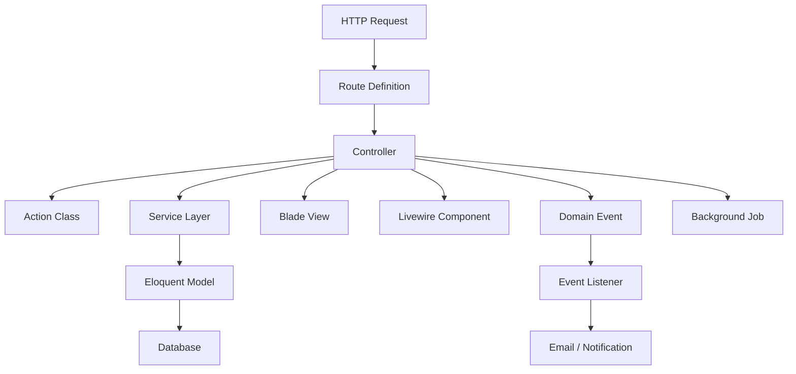

**Diagram sources**
- [bootstrap/app.php:10-33](file://bootstrap/app.php#L10-L33)
- [routes/web.php:1-76](file://routes/web.php#L1-L76)
- [routes/admin.php:1-171](file://routes/admin.php#L1-L171)
- [routes/api.php:1-117](file://routes/api.php#L1-L117)

### MVC Responsibilities

| Layer | Examples in Highblossom | Notes |
|---|---|---|
| Controllers | Public site controller, booking controller, consent controller, poll controller, admin controllers for bookings, inspections, services, posts, gallery, staff, settings, and system overview. | Thin request handlers; they delegate validation, business logic, and side effects. |
| Actions | `StoreBookingAction`, `StoreQuoteAction`, `UpdateInspectionAction`, `SendContactMessage`, Fortify authentication and user creation actions. | Encapsulate single-domain operations invoked by controllers or other services. |
| Services | `ContactMessageService`, `SeoService`, `ImageUploadService`, `VideoUploadService`, `MediaRegistryService`, `UserService`, `AvailabilityService`, `CompanySettingService`. | Centralize reusable business logic across controllers, jobs, and Livewire components. |
| Models | `User`, `Booking`, `Inspection`, `Post`, `Category`, `Tag`, `Partner`, `Staff`, `GalleryImage`, `MediaRegistry`, `CompanySetting`, `Poll`, `Quote`. | Represent database entities, relationships, and model-level concerns. |
| Views | Admin Blade views, site Blade views, Livewire Blade templates, partials, error pages, and email templates. | Render data produced by controllers, services, and Livewire components. |
| Background Jobs | `WarmSystemOverviewProbe` and queued mail/jobs dispatched through Laravel’s queue system. | Offload non-critical work from the request path. |

**Section sources**
- [routes/web.php:1-76](file://routes/web.php#L1-L76)
- [routes/admin.php:1-171](file://routes/admin.php#L1-L171)
- [routes/api.php:1-117](file://routes/api.php#L1-L117)

## Architecture Overview

### System Context Diagram

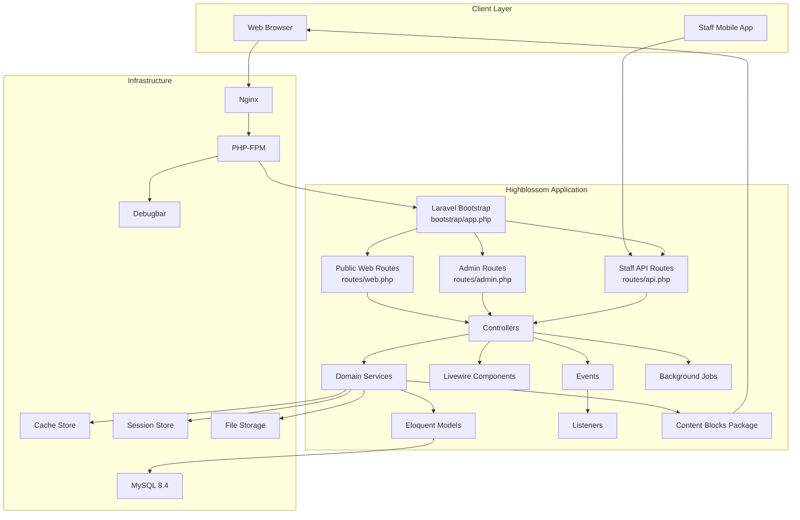

**Diagram sources**
- [bootstrap/app.php:10-33](file://bootstrap/app.php#L10-L33)
- [routes/web.php:1-76](file://routes/web.php#L1-L76)
- [routes/admin.php:1-171](file://routes/admin.php#L1-L171)
- [routes/api.php:1-117](file://routes/api.php#L1-L117)
- [packages/ContentBlocks/src/ContentBlocksServiceProvider.php:1-199](file://packages/ContentBlocks/src/ContentBlocksServiceProvider.php#L1-L199)
- [docker-compose.yml:1-31](file://docker-compose.yml#L1-L31)
- [Dockerfile:1-32](file://Dockerfile#L1-L32)

### High-Level Design Patterns

#### MVC Architecture
Laravel’s default MVC structure separates request handling (`app/Http/Controllers`), business logic (`app/Services`), persistence (`app/Models`), presentation (`resources/views`), and Livewire interactivity (`app/Livewire`). Controllers are thin, while services own complex domain workflows.

#### Service Layer Pattern
Domain services such as contact messaging, SEO injection, image and video upload, media registry, availability calculation, and company settings provide reusable abstractions. This reduces duplication between controllers, Livewire components, background jobs, and API endpoints.

#### Action Classes
Actions under `app/Actions` encapsulate discrete operations. Examples include storing bookings, submitting quotes, updating inspections, sending contact messages, and Fortify authentication customization. They make controller methods easier to read and test.

#### Event-Driven Communication
Events decouple side effects from core request processing. For example:

- Contact message receipt triggers an email listener.
- Authentication login/logout/password-reset events update session records.
- Other domain events can be extended for asynchronous notifications or analytics.

#### Livewire Component Architecture
Livewire components are registered under `app/Livewire` with Blade templates under `resources/views/livewire`. Configuration enables SFC-style components, class namespace resolution, and view path mapping. Components are used for interactive admin panels, system overview sections, block building, passkey flows, and live polling interactions.

**Section sources**
- [bootstrap/app.php:10-33](file://bootstrap/app.php#L10-L33)
- [config/livewire.php:1-200](file://config/livewire.php#L1-L200)

## Detailed Component Analysis

### Authentication and Authorization

#### Fortify Integration

Fortify is configured for:

- Email-based username field.
- Registration, password reset, and email verification.
- Two-factor authentication.
- Passkeys.
- Custom login rate limiting.
- Custom request bindings for login and password reset link requests.
- Custom response contracts for failed password confirmation and neutral reset-link responses.

The application provider binds custom Fortify request classes, response contracts, and a canonical login rate limiter. It also registers custom Fortify actions for creating users, resetting passwords, and authenticating sign-in using either email or username.

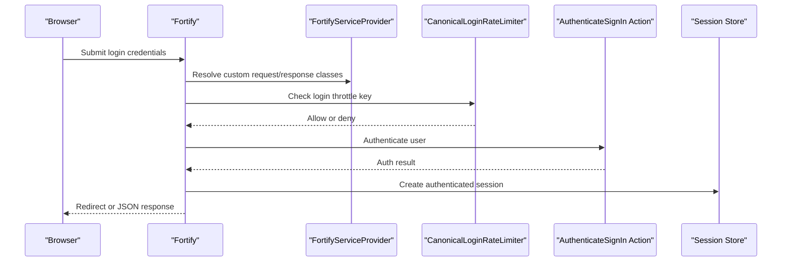

**Diagram sources**
- [config/fortify.php:1-162](file://config/fortify.php#L1-L162)
- [app/Providers/FortifyServiceProvider.php:1-118](file://app/Providers/FortifyServiceProvider.php#L1-L118)

#### Spatie Permissions Integration

Authorization uses Spatie Laravel Permissions with:

- Role and permission models.
- Middleware aliases `role`, `permission`, and `role_or_permission`.
- Route-level `can:` gates on admin and staff API routes.
- Database-backed role/permission tables.
- Permission cache configuration.

Admin routes require authentication, consent capture, email verification when required, and a specific ability to access the admin panel. Individual resource routes are gated by abilities such as viewing or updating bookings, inspections, blog posts, gallery items, settings, and staff.

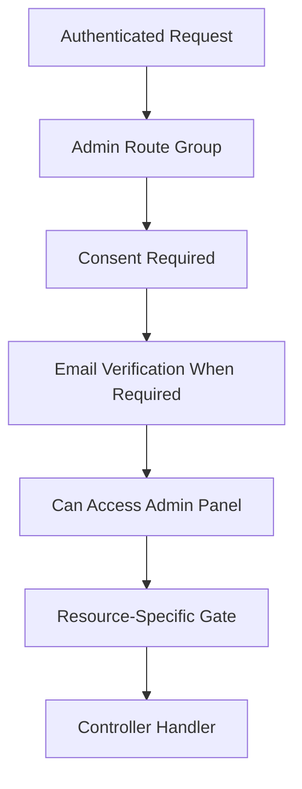

**Diagram sources**
- [bootstrap/app.php:10-33](file://bootstrap/app.php#L10-L33)
- [routes/admin.php:1-171](file://routes/admin.php#L1-L171)
- [config/permission.php:1-200](file://config/permission.php#L1-L200)

#### Staff API Authentication

The staff API lives under `/api/staff` and uses Sanctum token authentication. Login and two-factor challenge endpoints are throttled. Protected routes mirror admin abilities so the mobile app enforces the same permission model as the web admin.

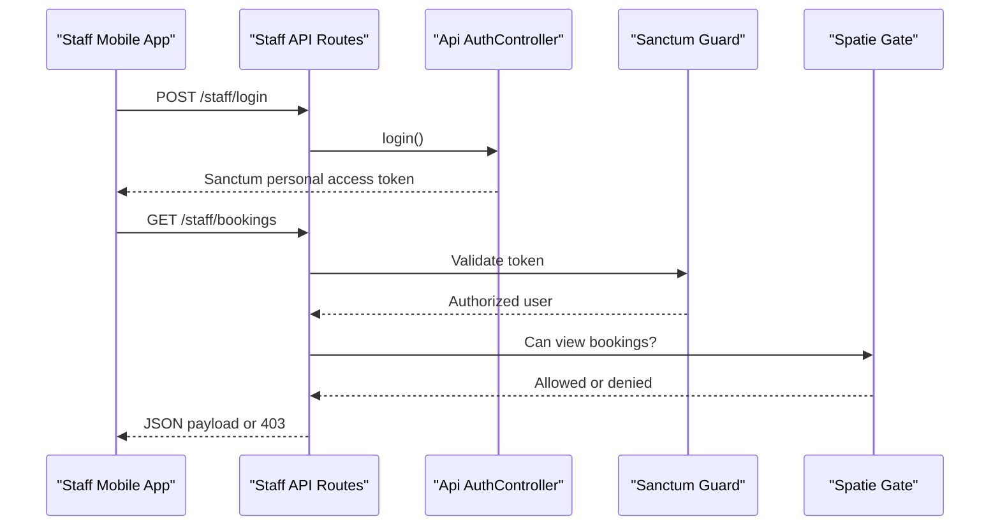

**Diagram sources**
- [routes/api.php:1-117](file://routes/api.php#L1-L117)

**Section sources**
- [config/fortify.php:1-162](file://config/fortify.php#L1-L162)
- [app/Providers/FortifyServiceProvider.php:1-118](file://app/Providers/FortifyServiceProvider.php#L1-L118)
- [bootstrap/app.php:10-33](file://bootstrap/app.php#L10-L33)
- [routes/admin.php:1-171](file://routes/admin.php#L1-L171)
- [routes/api.php:1-117](file://routes/api.php#L1-L117)
- [config/permission.php:1-200](file://config/permission.php#L1-L200)

### Content Block System

The `highblossom/content-blocks` package provides a composable content system:

- A singleton `BlockRegistry` holds available block types.
- A `BlockRenderer` renders blocks by type.
- Default blocks include paragraph, image, heading, quote, code, list, CTA, video, divider, alert, HTML, embed, accordion, table, gallery, form, columns, tabs, carousel, countdown, and poll.
- The service provider auto-registers default blocks and registers Blade directives for each block type.
- A generic `block` directive accepts a block type and attributes.
- HTML sanitization and oEmbed resolution are provided as singleton services.
- Blade directives are registered after blocks are auto-registered so the renderer knows every available type.

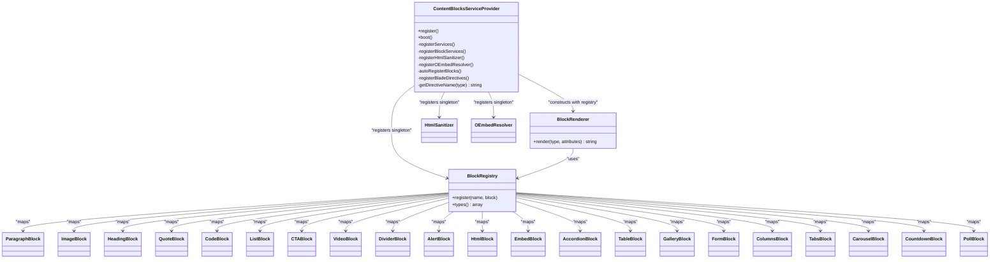

**Diagram sources**
- [packages/ContentBlocks/src/ContentBlocksServiceProvider.php:1-199](file://packages/ContentBlocks/src/ContentBlocksServiceProvider.php#L1-L199)
- [packages/ContentBlocks/composer.json:1-31](file://packages/ContentBlocks/composer.json#L1-L31)

**Section sources**
- [packages/ContentBlocks/composer.json:1-31](file://packages/ContentBlocks/composer.json#L1-L31)
- [packages/ContentBlocks/src/ContentBlocksServiceProvider.php:1-199](file://packages/ContentBlocks/src/ContentBlocksServiceProvider.php#L1-L199)

### Livewire Component Architecture

Livewire is configured with:

- Component locations under Blade component directories and Livewire views.
- Default class namespace `App\Livewire`.
- View path `resources/views/livewire`.
- SFC-style component generation.
- Temporary file upload disk, size limits, preview MIME types, and cleanup behavior.
- Automatic asset injection.
- Optional SPA-like navigation progress bar.

Components in this project include system overview packages, system overview sections, block builder, passkey recovery banner, passkey management, and blog post components. These components typically interact with services, models, and Livewire-bound properties rather than directly handling HTTP requests.

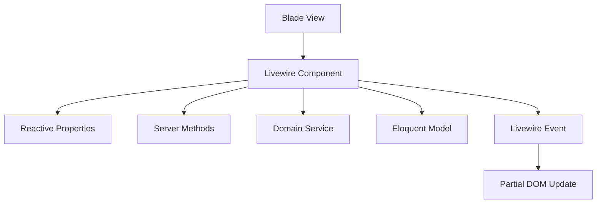

**Diagram sources**
- [config/livewire.php:1-200](file://config/livewire.php#L1-L200)

**Section sources**
- [config/livewire.php:1-200](file://config/livewire.php#L1-L200)

### Event-Driven Communication

The application registers event-to-listener mappings for:

- `ContactMessageReceived`: sends a contact message email.
- `Login`: records session login activity.
- `Logout`: ends a user session.
- `PasswordReset`: revokes related sessions.

This keeps controllers and services free from email-sending and session-tracking implementation details.

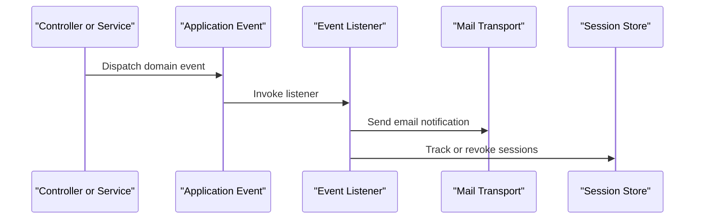

**Diagram sources**
- [app/Providers/EventServiceProvider.php:1-51](file://app/Providers/EventServiceProvider.php#L1-L51)

**Section sources**
- [app/Providers/EventServiceProvider.php:1-51](file://app/Providers/EventServiceProvider.php#L1-L51)

### Public Website Flow

A typical public request flow is:

1. Browser requests a route such as home, about us, services, gallery, quote, contact, blog, or booking availability.
2. Route definition resolves a controller.
3. Controller delegates to services or actions for validation, persistence, and side effects.
4. Livewire components may handle interactive client-server updates.
5. Blade views render the final HTML.
6. Throttled endpoints protect against abuse.

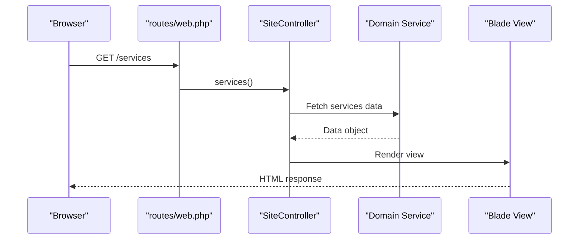

**Diagram sources**
- [routes/web.php:1-76](file://routes/web.php#L1-L76)

**Section sources**
- [routes/web.php:1-76](file://routes/web.php#L1-L76)

## Dependency Analysis

### External Dependencies

| Dependency | Version Requirement | Role |
|---|---:|---|
| `laravel/framework` | ^13.0 | Core framework. |
| `livewire/livewire` | ^4.3 | Reactive server-driven UI components. |
| `laravel/fortify` | ^1.34 | Authentication and passkeys. |
| `spatie/laravel-permission` | ^7.3 | Roles and permissions. |
| `laravel/sanctum` | ^4.0 | Staff API token authentication. |
| `jeroennoten/laravel-adminlte` | ^3.15 | Admin interface. |
| `intervention/image` | 4.0 | Image manipulation. |
| `php-ffmpeg/php-ffmpeg` | * | Video processing. |
| `league/flysystem-aws-s3-v3` | ^3.0 | S3 storage integration. |
| `opcodesio/log-viewer` | ^3.24 | Log viewing. |
| `romalytar/yammi-jobs-monitoring-laravel` | ^2.3 | Job monitoring. |
| `devakshay/scheduler-list-laravel` | ^1.0 | Scheduler listing. |
| `albertoarena/laravel-truss` | ^1.8 | Query inspection. |
| `fruitcake/laravel-debugbar` | ^4.2 | Debugging and profiling. |

**Section sources**
- [composer.json:1-138](file://composer.json#L1-L138)

### Internal Module Relationships

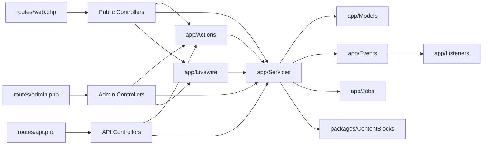

**Diagram sources**
- [routes/web.php:1-76](file://routes/web.php#L1-L76)
- [routes/admin.php:1-171](file://routes/admin.php#L1-L171)
- [routes/api.php:1-117](file://routes/api.php#L1-L117)

**Section sources**
- [routes/web.php:1-76](file://routes/web.php#L1-L76)
- [routes/admin.php:1-171](file://routes/admin.php#L1-L171)
- [routes/api.php:1-117](file://routes/api.php#L1-L117)

## Performance Considerations

### Caching Strategy

The default cache store is configurable through environment variables and defaults to the database driver. Multiple stores are defined:

- `array`: suitable for testing.
- `database`: persistent cache table.
- `file`: filesystem-based cache.
- `memcached`: distributed cache.
- `redis`: high-performance cache and lock backend.
- `dynamodb`: cloud cache backend.
- `octane`: Octane-aware cache.
- `failover`: fallback between database and array stores.

Serializable classes include pagination objects and selected Eloquent models to safely serialize cached values.

**Recommendations:**

- Use Redis or Memcached in production for faster reads and reduced database pressure.
- Enable appropriate cache stores for sessions if using cache-backed sessions.
- Clear permission caches after role or permission changes.
- Avoid serializing large collections without pagination.

**Section sources**
- [config/cache.php:1-146](file://config/cache.php#L1-L146)
- [config/permission.php:1-200](file://config/permission.php#L1-L200)

### Session Strategy

Sessions default to the database driver with a configurable lifetime. Options include encrypted cookies, secure HTTPS-only cookies, HTTP-only cookies, and SameSite policies. Session storage can be moved to cache backends by configuring the session store.

**Recommendations:**

- Use Redis or Memcached for session storage in scaled deployments.
- Set `SESSION_SECURE_COOKIE` in HTTPS environments.
- Review session lifetime for admin and staff security requirements.

**Section sources**
- [config/session.php:1-200](file://config/session.php#L1-L200)

### Monitoring and Debugging

Laravel Debugbar is enabled based on `DEBUGBAR_ENABLED`. Collectors include database queries, views, exceptions, logs, cache events, Livewire state, jobs, HTTP client requests, and more. Some collectors are disabled by default in development configurations to reduce overhead.

**Recommendations:**

- Disable Debugbar in production unless explicitly required.
- Exclude high-frequency AJAX or Livewire assets from profiling where needed.
- Use slow-query thresholds and query explain options during performance tuning.
- Combine Debugbar with log viewer and job monitoring tools.

**Section sources**
- [config/debugbar.php:1-200](file://config/debugbar.php#L1-L200)

## Troubleshooting Guide

### Authentication Issues

**Symptoms:**
- Login fails despite correct credentials.
- Two-factor challenge is locked out.
- Passkey login returns unexpected errors.

**Checks:**
- Verify Fortify configuration, especially username/email fields and feature flags.
- Inspect custom Fortify request bindings and response contracts.
- Confirm canonical login rate limiter allows expected combinations of identifier and IP.
- Check passkey-related validation exception rendering in bootstrap exception handler.

**Section sources**
- [config/fortify.php:1-162](file://config/fortify.php#L1-L162)
- [app/Providers/FortifyServiceProvider.php:1-118](file://app/Providers/FortifyServiceProvider.php#L1-L118)
- [bootstrap/app.php:34-71](file://bootstrap/app.php#L34-L71)

### Authorization Denials

**Symptoms:**
- Admin routes return 403 even for authenticated users.
- Staff API endpoints reject valid tokens.
- Resource-specific routes fail due to missing permissions.

**Checks:**
- Ensure user has the required role or permission.
- Verify `can:` middleware on routes matches permission names.
- Check permission cache expiration and flush caches after seeding roles and permissions.

**Section sources**
- [bootstrap/app.php:10-33](file://bootstrap/app.php#L10-L33)
- [routes/admin.php:1-171](file://routes/admin.php#L1-L171)
- [routes/api.php:1-117](file://routes/api.php#L1-L117)
- [config/permission.php:1-200](file://config/permission.php#L1-L200)

### Livewire Problems

**Symptoms:**
- Livewire components do not load.
- File uploads fail.
- Component state does not persist.

**Checks:**
- Confirm Livewire component namespace and class path configuration.
- Check temporary upload disk, MIME rules, and maximum upload time.
- Verify assets are injected or manually included.
- Inspect browser network requests for Livewire endpoint failures.

**Section sources**
- [config/livewire.php:1-200](file://config/livewire.php#L1-L200)

### Content Block Rendering

**Symptoms:**
- Blade directives do not render blocks.
- Unknown block types cause errors.
- Embedded URLs do not resolve.

**Checks:**
- Ensure the ContentBlocks service provider is discovered.
- Verify blocks are registered before Blade directives.
- Check directive prefix configuration.
- Confirm HTML sanitizer and oEmbed resolver are available.

**Section sources**
- [packages/ContentBlocks/src/ContentBlocksServiceProvider.php:1-199](file://packages/ContentBlocks/src/ContentBlocksServiceProvider.php#L1-L199)
- [packages/ContentBlocks/composer.json:1-31](file://packages/ContentBlocks/composer.json#L1-L31)

## Conclusion

Highblossom combines Laravel’s MVC foundation with a service-oriented design, action classes, event-driven side effects, and Livewire components. Its public website, admin panel, and staff API share a consistent permission model and domain services, while the ContentBlocks package adds a flexible content composition layer.

For deployment, the Docker setup runs Nginx, PHP-FPM, queue workers, and the scheduler in one container backed by MySQL. Production environments should configure Redis or Memcached for cache and sessions, enable HTTPS, disable Debugbar unless needed, and enforce least-privilege permissions for both users and API tokens.