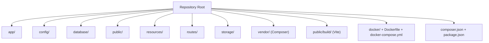
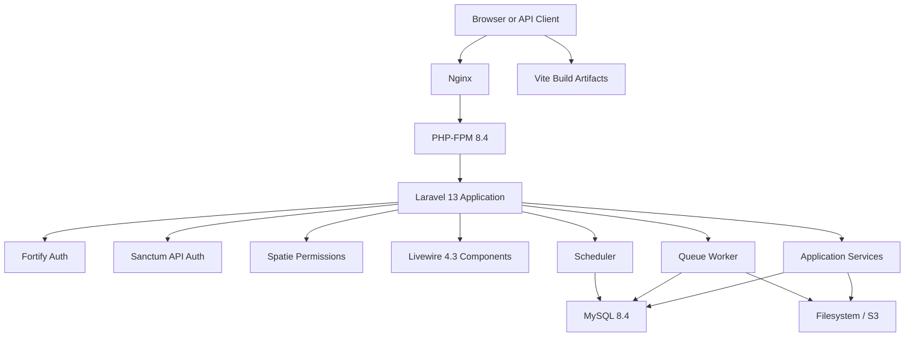
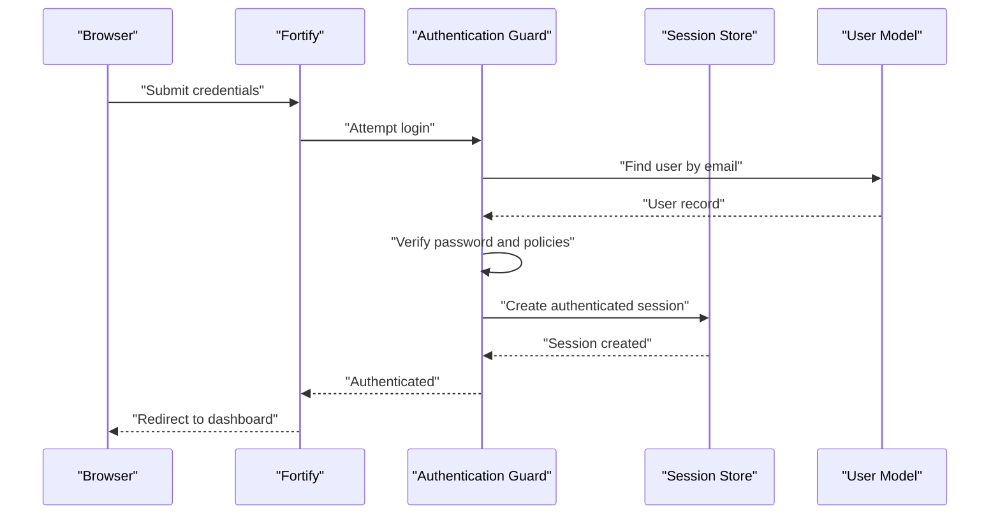
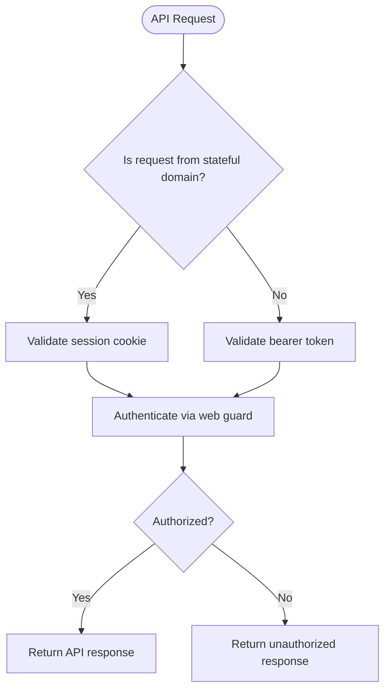
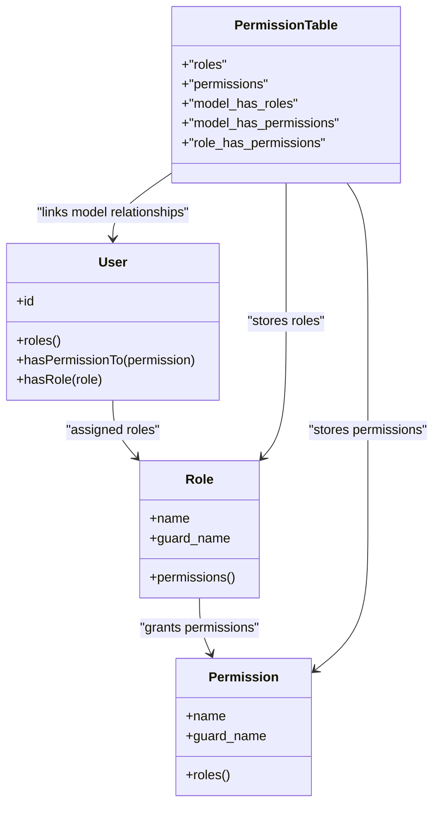
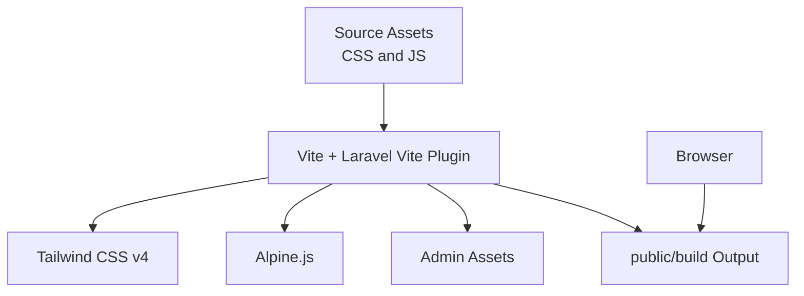
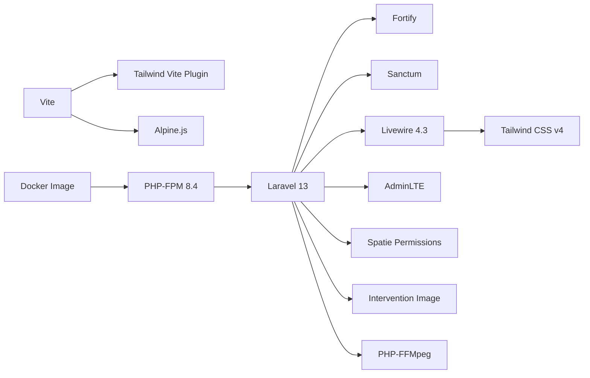

# Technology Stack

<cite>
**Referenced Files in This Document**   
- [composer.json](file://composer.json)
- [package.json](file://package.json)
- [vite.config.js](file://vite.config.js)
- [Dockerfile](file://Dockerfile)
- [docker-compose.yml](file://docker-compose.yml)
- [config/fortify.php](file://config/fortify.php)
- [config/sanctum.php](file://config/sanctum.php)
- [config/permission.php](file://config/permission.php)
- [config/livewire.php](file://config/livewire.php)
- [config/adminlte.php](file://config/adminlte.php)
</cite>

## Table of Contents
1. [Introduction](#introduction)
2. [Project Structure](#project-structure)
3. [Core Components](#core-components)
4. [Architecture Overview](#architecture-overview)
5. [Detailed Component Analysis](#detailed-component-analysis)
6. [Dependency Analysis](#dependency-analysis)
7. [Performance Considerations](#performance-considerations)
8. [Troubleshooting Guide](#troubleshooting-guide)
9. [Conclusion](#conclusion)

## Introduction
Highblossom is a Laravel-based application that combines server-rendered Blade and Livewire components with modern frontend tooling. The stack centers on:

- **Laravel 13+** as the PHP framework foundation.
- **PHP 8.2+** as the minimum runtime language version.
- **Livewire 4.3** for reactive, component-driven UI without writing JavaScript.
- **Alpine.js** for lightweight, declarative interactivity in Blade templates.
- **Tailwind CSS v4** for utility-first styling of public-facing pages.
- **AdminLTE** for the staff/admin interface.
- Supporting libraries for authentication, permissions, image processing, video handling, API tokens, and development tooling.

The build pipeline uses **Composer** for PHP dependencies, **npm/Vite** for frontend assets, and **Docker** for containerized runtime environments.

## Project Structure
The repository follows standard Laravel conventions plus dedicated directories for Livewire components, service classes, actions, models, routes, configuration, views, resources, database migrations, Docker configuration, and Composer/npm manifests.

**Diagram sources**
- [composer.json:1-138](file://composer.json#L1-L138)
- [package.json:1-35](file://package.json#L1-L35)
- [vite.config.js:1-33](file://vite.config.js#L1-L33)
- [Dockerfile:1-32](file://Dockerfile#L1-L32)
- [docker-compose.yml:1-31](file://docker-compose.yml#L1-L31)

**Section sources**
- [composer.json:1-138](file://composer.json#L1-L138)
- [package.json:1-35](file://package.json#L1-L35)
- [vite.config.js:1-33](file://vite.config.js#L1-L33)

## Core Components
This section summarizes the technology stack by layer and purpose.

### Runtime and Framework Foundation
| Layer | Technology | Version or Constraint | Purpose |
|---|---|---:|---|
| PHP Runtime | PHP | `^8.2` | Language runtime required by the application. |
| Framework | Laravel Framework | `^13.0` | Web framework providing routing, services, Eloquent, queues, validation, and lifecycle. |
| Container Entry | Bootstrap and Providers | Laravel bootstrap files | Application bootstrapping and provider registration. |
| Container Cache | Bootstrap cache | Generated cache files | Optimized service container state. |

**Section sources**
- [composer.json:1-138](file://composer.json#L1-L138)
- [Dockerfile:1-32](file://Dockerfile#L1-L32)

### Frontend Technologies
| Technology | Version or Constraint | Role |
|---|---:|---|
| Vite | `^8.0.0` | Asset bundler and development server. |
| Laravel Vite Plugin | `^3.0.0` | Integrates Vite with Laravel asset discovery. |
| Tailwind CSS | `^4.0.7` | Utility-first CSS framework for public site styling. |
| Tailwind Vite Integration | `^4.1.11` | Enables Tailwind v4 inside Vite. |
| Alpine.js | `^3.15.11` | Lightweight reactivity for small UI interactions. |
| jQuery | `^3.7.0` | Legacy compatibility for AdminLTE and older admin assets. |
| Bootstrap | `^4.6.0` | Base styles referenced by legacy admin assets. |
| Passkey Browser Libraries | `@simplewebauthn/browser ^13.3.0`, `@laravel/passkeys ^0.2.0` | Client-side passkey support. |
| CKEditor | `@ckeditor/ckeditor5-build-classic ^41.4.2` | Rich text editor integration. |

**Section sources**
- [package.json:1-35](file://package.json#L1-L35)
- [vite.config.js:1-33](file://vite.config.js#L1-L33)

### Livewire and Reactive UI
| Component | Version or Constraint | Configuration or Behavior |
|---|---:|---|
| Livewire | `^4.3` | Reactive components rendered through Blade and Vite. |
| Livewire Flux | `^2.13` | UI primitives integrated with Livewire and Tailwind. |
| Livewire Configuration | `config/livewire.php` | Component namespaces, temporary uploads, SPA-like navigation, asset injection, and make commands. |

**Section sources**
- [composer.json:1-138](file://composer.json#L1-L138)
- [config/livewire.php:1-200](file://config/livewire.php#L1-L200)

### Authentication and Authorization
| Library | Version or Constraint | Purpose |
|---|---:|---|
| Fortify | `^1.34` | Authentication features including login, registration, password reset, email verification, two-factor authentication, and passkeys. |
| Sanctum | `^4.0` | API token and first-party SPA stateful authentication. |
| Spatie Permissions | `^7.3` | Role and permission management backed by Eloquent models and database tables. |
| Passkeys Support | Laravel Passkeys and browser libraries | Passwordless authentication via WebAuthn-style passkeys. |

**Section sources**
- [composer.json:1-138](file://composer.json#L1-L138)
- [config/fortify.php:1-162](file://config/fortify.php#L1-L162)
- [config/sanctum.php:1-87](file://config/sanctum.php#L1-L87)
- [config/permission.php:1-200](file://config/permission.php#L1-L200)

### Admin Interface
| Technology | Version or Constraint | Notes |
|---|---:|---|
| Laravel AdminLTE | `^3.15` | Admin dashboard layout, menus, filters, and views. |
| AdminLTE Configuration | `config/adminlte.php` | Title, logo, preloader, user menu, layout options, and authentication view classes. |
| Admin Assets | `resources/css/admin.css`, `resources/js/admin.js` | Compiled through Vite alongside public site assets. |

**Section sources**
- [composer.json:1-138](file://composer.json#L1-L138)
- [config/adminlte.php:1-200](file://config/adminlte.php#L1-L200)
- [vite.config.js:1-33](file://vite.config.js#L1-L33)

### Media and Content Processing
| Library | Version or Constraint | Responsibility |
|---|---:|---|
| Intervention Image | `4.0` | Image manipulation and optimization. |
| PHP-FFMpeg | `*` | Video analysis, extraction, and processing where supported by the environment. |
| Endroid QR Code | `^6.1` | QR code generation for links, tickets, or integrations. |

**Section sources**
- [composer.json:1-138](file://composer.json#L1-L138)

### Infrastructure and Tooling
| Tool | Version or Constraint | Usage |
|---|---:|---|
| Docker | Multi-stage image | Builds vendor packages, frontend assets, and runs PHP-FPM with Nginx under supervisord. |
| Docker Compose | Service definition | Starts the app and MySQL service locally. |
| Composer Scripts | Defined in manifest | Setup, development server, queue listener, logging, linting, testing, and post-install hooks. |
| Pint | `^1.27` | PHP code style enforcement. |
| PHPUnit | `^12.5.12` | Unit and feature tests. |
| Debugbar | `^4.2` | Development request debugging. |
| Log Viewer | `^3.24` | Application log browsing. |
| Queue Monitoring | `^2.3` | Job monitoring integration. |

**Section sources**
- [composer.json:1-138](file://composer.json#L1-L138)
- [Dockerfile:1-32](file://Dockerfile#L1-L32)
- [docker-compose.yml:1-31](file://docker-compose.yml#L1-L31)

## Architecture Overview
The application runs as a single Laravel process behind Nginx in production, with separate concerns for web requests, queued jobs, scheduled tasks, and frontend asset compilation.

**Diagram sources**
- [Dockerfile:1-32](file://Dockerfile#L1-L32)
- [docker-compose.yml:1-31](file://docker-compose.yml#L1-L31)
- [config/fortify.php:1-162](file://config/fortify.php#L1-L162)
- [config/sanctum.php:1-87](file://config/sanctum.php#L1-L87)
- [config/permission.php:1-200](file://config/permission.php#L1-L200)
- [config/livewire.php:1-200](file://config/livewire.php#L1-L200)
- [vite.config.js:1-33](file://vite.config.js#L1-L33)

## Detailed Component Analysis

### PHP and Laravel Foundation
The project requires PHP 8.2 or newer and pins the Laravel framework to version 13+. Composer autoload configuration maps application classes under `App\`, factories under `Database\Factories`, and seeders under `Database\Seeders`. Additional helper functions are loaded from `app/Support/helpers.php`.

Key implications:
- New code should target PHP 8.2+ features only when necessary.
- Package upgrades must remain compatible with Laravel 13 constraints.
- Autoloading is PSR-4 based, with helpers included globally.

**Section sources**
- [composer.json:1-138](file://composer.json#L1-L138)

### Livewire 4.3 Reactive Components
Livewire is configured to discover components from Blade component directories and Livewire-specific view paths. Its class namespace is `App\Livewire`, with classes generated into `app/Livewire` and views into `resources/views/livewire`. Temporary file uploads use the local filesystem disk, with configurable MIME previews and cleanup behavior. SPA-like navigation can be enabled through Livewire’s navigate configuration.

Design considerations:
- Use Livewire single-file components where appropriate for simplicity.
- Keep heavy business logic in services or actions rather than components.
- Leverage Livewire’s temporary upload behavior for media forms while validating sizes and types at the application level.

**Section sources**
- [composer.json:1-138](file://composer.json#L1-L138)
- [config/livewire.php:1-200](file://config/livewire.php#L1-L200)

### Fortify Authentication Flow
Fortify provides session-based authentication with optional registration, password resets, email verification, two-factor authentication, and passkeys. The guard used is `web`, usernames resolve to the `email` attribute, and the default home route after successful authentication is `/dashboard`. Middleware applies web session handling plus a custom registration gate.

**Diagram sources**
- [config/fortify.php:1-162](file://config/fortify.php#L1-L162)

**Section sources**
- [config/fortify.php:1-162](file://config/fortify.php#L1-L162)

### Sanctum API Authentication
Sanctum supports both stateful cookie-based API access for first-party SPAs and bearer-token-based API access. Stateful domains are read from environment variables, the default guard is `web`, and middleware includes CSRF protection and session authentication. Token expiration can be controlled per token or globally if configured.

**Diagram sources**
- [config/sanctum.php:1-87](file://config/sanctum.php#L1-L87)

**Section sources**
- [config/sanctum.php:1-87](file://config/sanctum.php#L1-L87)

### Spatie Permissions Roles and Permissions
Spatie Permissions integrates with Eloquent through role and permission models and related pivot tables. The configuration defines table names, column naming, team support settings, event listeners, wildcard permissions, and caching behavior. The application uses this system to control access across admin routes, dashboards, and content operations.

**Diagram sources**
- [config/permission.php:1-200](file://config/permission.php#L1-L200)

**Section sources**
- [config/permission.php:1-200](file://config/permission.php#L1-L200)

### AdminLTE Administration Panel
The admin panel uses Laravel AdminLTE to provide layout, navigation, filters, and authentication-themed views. Configuration controls branding, logos, preloading behavior, user menus, layout modes, and authentication view styling. The admin assets are compiled separately through Vite so they can coexist with the public site’s Tailwind-based design.

Practical notes:
- Admin routes and controllers should respect permissions defined by Spatie Permissions.
- Admin styling should avoid conflicting with the public site’s Tailwind v4 setup.
- Menu entries and filters can be customized through the AdminLTE configuration and application providers.

**Section sources**
- [composer.json:1-138](file://composer.json#L1-L138)
- [config/adminlte.php:1-200](file://config/adminlte.php#L1-L200)
- [vite.config.js:1-33](file://vite.config.js#L1-L33)

### Frontend Build Pipeline
Vite bundles multiple entry points:
- Public site styles and scripts using Tailwind CSS v4 and Alpine.js.
- Authentication-related styles and scripts.
- Admin panel styles and scripts.

The Vite configuration enables hot module refresh, CORS for the development server, and ignores compiled Blade view caches during watching.

**Diagram sources**
- [vite.config.js:1-33](file://vite.config.js#L1-L33)
- [package.json:1-35](file://package.json#L1-L35)

**Section sources**
- [vite.config.js:1-33](file://vite.config.js#L1-L33)
- [package.json:1-35](file://package.json#L1-L35)

### Docker and Deployment Environment
The Dockerfile builds vendor dependencies in a Composer stage, installs Node packages and compiles assets in a Node stage, then produces a runtime image running PHP 8.4 FPM with Nginx and supervisord. Required PHP extensions include PDO MySQL/PgSQL, MySQLi, BCMath, GD, Intl, Zip, OPcache, PCNTL, and EXIF. The compose file starts the application and a MySQL 8.4 database with shared volumes.

Runtime characteristics:
- Single container runs web, queue worker, and scheduler processes.
- Port 8080 is exposed for the web server.
- Database credentials and connection parameters are supplied through environment variables.

**Section sources**
- [Dockerfile:1-32](file://Dockerfile#L1-L32)
- [docker-compose.yml:1-31](file://docker-compose.yml#L1-L31)

## Dependency Analysis

### Version Compatibility Matrix
| Category | Technology | Installed or Declared Version | Compatibility Notes |
|---|---|---:|---|
| Runtime | PHP | `^8.2` | Minimum language version; Docker runtime uses PHP 8.4 FPM. |
| Framework | Laravel | `^13.0` | Core framework constraint. |
| Reactive UI | Livewire | `^4.3` | Compatible with Laravel 13 and Blade. |
| UI Primitives | Livewire Flux | `^2.13` | Designed for Livewire and Tailwind ecosystems. |
| Styling | Tailwind CSS | `^4.0.7` | Modern utility-first CSS framework. |
| Styling Integration | Tailwind Vite plugin | `^4.1.11` | Integrates Tailwind v4 into Vite. |
| Interactivity | Alpine.js | `^3.15.11` | Lightweight reactivity library. |
| Admin UI | Laravel AdminLTE | `^3.15` | Admin dashboard theme and components. |
| Authentication | Fortify | `^1.34` | Session and passkey-based auth features. |
| API Auth | Sanctum | `^4.0` | First-party SPA and API token authentication. |
| Permissions | Spatie Permissions | `^7.3` | Role and permission management. |
| Images | Intervention Image | `4.0` | Image manipulation. |
| Video | PHP-FFMpeg | `*` | Video processing depending on installed FFmpeg binaries. |
| Build Tools | Vite | `^8.0.0` | Asset bundling and dev server. |
| Node Runtime | Node | Used via `node:22-alpine` in Docker | Compiles frontend assets. |
| Database | MySQL | `8.4` | Local development database service. |

**Section sources**
- [composer.json:1-138](file://composer.json#L1-L138)
- [package.json:1-35](file://package.json#L1-L35)
- [Dockerfile:1-32](file://Dockerfile#L1-L32)
- [docker-compose.yml:1-31](file://docker-compose.yml#L1-L31)

### Dependency Relationships

**Diagram sources**
- [composer.json:1-138](file://composer.json#L1-L138)
- [package.json:1-35](file://package.json#L1-L35)
- [vite.config.js:1-33](file://vite.config.js#L1-L33)
- [Dockerfile:1-32](file://Dockerfile#L1-L32)

### Rationale for Technology Choices
- **Laravel 13 + PHP 8.2+**: Provides a mature, well-supported backend with strong ecosystem tools, type safety, and modern PHP features.
- **Livewire 4.3**: Reduces the need for a separate frontend SPA while keeping reactive interfaces within familiar Blade and PHP workflows.
- **Alpine.js**: Adds minimal JavaScript interactivity where full Livewire overhead is unnecessary.
- **Tailwind CSS v4**: Offers fast, maintainable styling with modern build tooling and reduced CSS bundle size compared to traditional frameworks.
- **AdminLTE**: Accelerates admin panel development with proven layouts, menus, and authentication views.
- **Fortify + Sanctum**: Separates session-based authentication from API token authentication, supporting both traditional web flows and first-party SPAs.
- **Spatie Permissions**: Provides flexible role and permission modeling without reinventing authorization logic.
- **Intervention Image + PHP-FFMpeg**: Handles image optimization and video processing needs common in media-rich applications.
- **Vite + npm**: Delivers fast development feedback loops and efficient production builds for modern frontend assets.
- **Docker + Docker Compose**: Standardizes the runtime environment across development, staging, and production.

[No sources needed since this section synthesates rationale without quoting specific implementation lines]

## Performance Considerations
- **PHP Extensions**: Ensure GD, OPcache, Intl, BCMath, and relevant database extensions are enabled in production.
- **Asset Optimization**: Use Vite’s production build to minify, scope, and cache-bust frontend assets.
- **Livewire Uploads**: Configure temporary upload limits and cleanup policies according to expected media sizes.
- **Permissions Caching**: Spatie Permissions caches role and permission lookups; adjust cache expiration if roles change frequently.
- **Queue Workers**: Run queue workers and scheduler separately from web requests to reduce latency spikes.
- **Database Connections**: Tune MySQL configuration and Laravel database pool settings for workload patterns.
- **Image and Video Processing**: Offload heavy image and video operations to background jobs where possible.

[No sources needed since this section provides general guidance]

## Troubleshooting Guide
| Symptom | Likely Area | Checks and Actions |
|---|---|---|
| Livewire components do not load | Livewire configuration or Vite assets | Verify Livewire class namespace, component locations, and that Vite has built assets. |
| Admin panel styles missing | Admin assets compilation | Confirm `resources/css/admin.css` and `resources/js/admin.js` are included in Vite inputs. |
| API requests fail authentication | Sanctum configuration | Check stateful domains, CSRF middleware, and whether cookies or bearer tokens are sent correctly. |
| Authorization errors in admin routes | Spatie Permissions | Ensure roles and permissions are seeded and users have the expected assignments. |
| Image processing fails | Intervention Image or PHP extensions | Verify GD extension is installed and file permissions allow writing to storage. |
| Video processing unavailable | PHP-FFMpeg environment | Confirm FFmpeg binaries are available to the container or host environment. |
| Development server does not reload | Vite watch configuration | Ensure Vite dev server is running and compiled view cache files are ignored. |
| Database connection fails in Docker | Compose environment | Validate database host, port, username, password, and database name. |

**Section sources**
- [config/livewire.php:1-200](file://config/livewire.php#L1-L200)
- [config/sanctum.php:1-87](file://config/sanctum.php#L1-L87)
- [config/permission.php:1-200](file://config/permission.php#L1-L200)
- [vite.config.js:1-33](file://vite.config.js#L1-L33)
- [docker-compose.yml:1-31](file://docker-compose.yml#L1-L31)

## Conclusion
Highblossom combines a modern Laravel 13 backend with Livewire-driven interactivity, Tailwind CSS v4 styling, Alpine.js micro-interactions, and an AdminLTE-powered administration interface. Authentication is split between Fortify for session-based flows and Sanctum for API access, while Spatie Permissions provides structured role and permission control. The build pipeline uses Composer and Vite, and the runtime is containerized with Docker and Docker Compose. This stack prioritizes developer productivity, maintainability, and clear separation between public-facing UI, administrative UI, and backend services.

[No sources needed since this section summarizes without analyzing specific files]