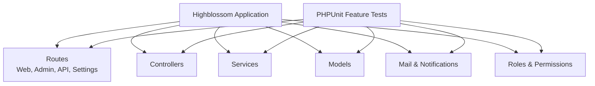
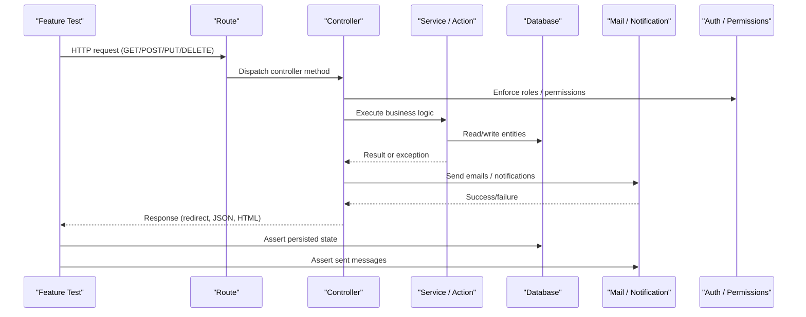
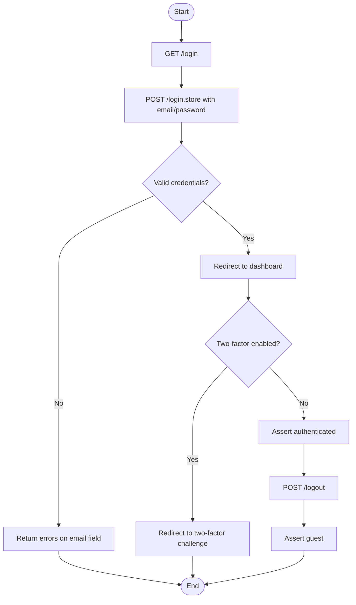
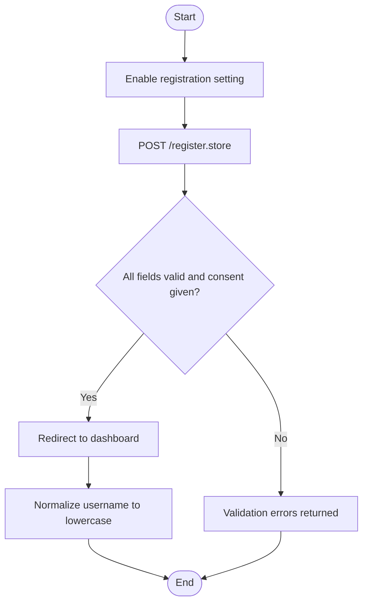
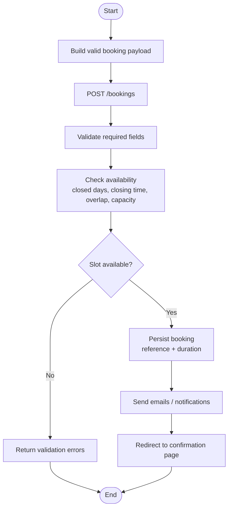
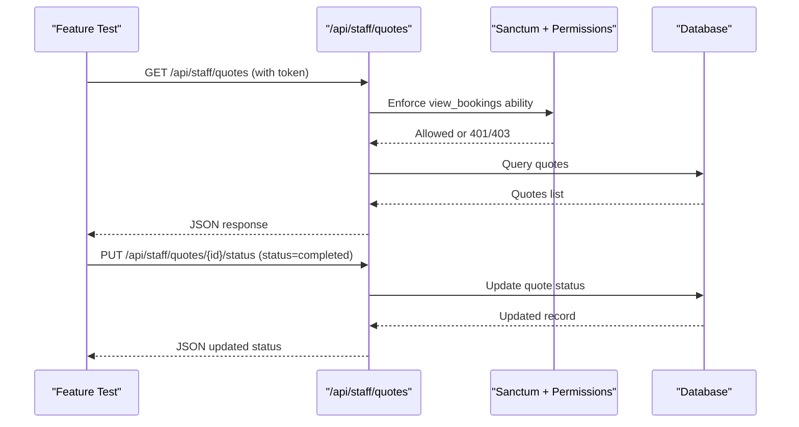
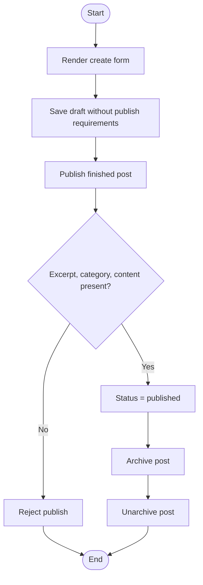
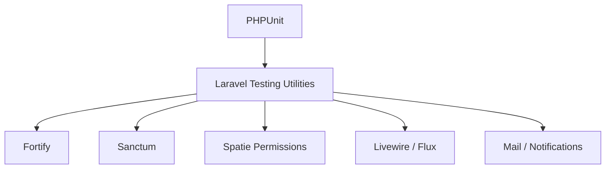

# Feature Testing

<cite>
**Referenced Files in This Document**
- [composer.json](file://composer.json)
- [tests/Feature/Auth/AuthenticationTest.php](file://tests/Feature/Auth/AuthenticationTest.php)
- [tests/Feature/Auth/RegistrationTest.php](file://tests/Feature/Auth/RegistrationTest.php)
- [tests/Feature/BookingSubmissionTest.php](file://tests/Feature/BookingSubmissionTest.php)
- [tests/Feature/Api/QuoteApiTest.php](file://tests/Feature/Api/QuoteApiTest.php)
- [tests/Feature/Admin/BlogPostsTest.php](file://tests/Feature/Admin/BlogPostsTest.php)
</cite>

## Table of Contents
1. [Introduction](#introduction)
2. [Project Structure](#project-structure)
3. [Core Components](#core-components)
4. [Architecture Overview](#architecture-overview)
5. [Detailed Component Analysis](#detailed-component-analysis)
6. [Dependency Analysis](#dependency-analysis)
7. [Performance Considerations](#performance-considerations)
8. [Troubleshooting Guide](#troubleshooting-guide)
9. [Conclusion](#conclusion)

## Introduction
This document explains how to write comprehensive feature tests for the Highblossom application. It focuses on end-to-end scenarios that simulate real user journeys: registration, login, booking creation, quote requests, and content management. It also covers Livewire-oriented assertions, form validation, API authentication, admin panel operations, role-based access control, email notifications, file upload testing, multi-step workflows, error handling, accessibility checks, and guidance for responsive behavior and browser compatibility.

The repository uses PHPUnit with Laravel’s feature testing utilities. Tests are organized under `tests/Feature` and `tests/Unit`, with feature tests exercising HTTP routes, middleware, services, database state, mail, notifications, and authorization policies.

## Project Structure
The test suite follows a conventional layout:
- `tests/Feature`: End-to-end scenarios for public pages, authentication, bookings, API endpoints, admin surfaces, settings, SEO, content blocks, and system overview features.
- `tests/Unit`: Smaller unit tests for domain logic, services, and utility classes.
- `tests/TestCase.php`: Base test class extended by all tests.

**Diagram sources**
- [composer.json:1-138](file://composer.json#L1-L138)

**Section sources**
- [composer.json:1-138](file://composer.json#L1-L138)

## Core Components
This section maps key testing patterns used across the codebase.

- Authentication and Registration
  - Rendering login/register screens.
  - Submitting credentials and asserting session state.
  - Two-factor challenge redirection.
  - Logout flow.
  - Password reveal toggle accessibility attributes.
  - Conditional registration availability based on company settings.

- Booking Submission
  - Successful booking persistence and confirmation redirect.
  - Reference generation and job duration calculation.
  - Availability validation: blocked dates, closing time, existing slots, capacity, mobile vs workshop bays.
  - Same-day notice window rules.
  - Required field validation, phone format, date format, idempotency token enforcement.
  - Email and notification fakes during submission.

- Staff API (Quotes)
  - Sanctum token authentication.
  - Role and permission enforcement for staff endpoints.
  - Listing, filtering, showing, updating status, deleting quotes.
  - Validation errors for invalid status values.

- Content Management (Blog Posts)
  - Admin-only create/edit/index flows.
  - Form fields such as categories, tags, publish checklist, and taxonomy chips.
  - Author tracking, draft/publish/archive states, bulk operations.
  - Permission-gated status updates.
  - Title/excerpt length limits and slug disambiguation.

These components demonstrate how to combine HTTP assertions, database state checks, authorization checks, and side-effect verification (mail, notifications).

**Section sources**
- [tests/Feature/Auth/AuthenticationTest.php:14-90](file://tests/Feature/Auth/AuthenticationTest.php#L14-L90)
- [tests/Feature/Auth/RegistrationTest.php:21-70](file://tests/Feature/Auth/RegistrationTest.php#L21-L70)
- [tests/Feature/BookingSubmissionTest.php:30-374](file://tests/Feature/BookingSubmissionTest.php#L30-L374)
- [tests/Feature/Api/QuoteApiTest.php:54-136](file://tests/Feature/Api/QuoteApiTest.php#L54-L136)
- [tests/Feature/Admin/BlogPostsTest.php:61-448](file://tests/Feature/Admin/BlogPostsTest.php#L61-L448)

## Architecture Overview
The following diagram shows how a typical feature test exercises the stack:

**Diagram sources**
- [tests/Feature/BookingSubmissionTest.php:30-76](file://tests/Feature/BookingSubmissionTest.php#L30-L76)
- [tests/Feature/Api/QuoteApiTest.php:54-136](file://tests/Feature/Api/QuoteApiTest.php#L54-L136)
- [tests/Feature/Admin/BlogPostsTest.php:139-190](file://tests/Feature/Admin/BlogPostsTest.php#L139-L190)

## Detailed Component Analysis

### Authentication and Login Flow
End-to-end login testing should cover:
- Login screen rendering.
- Successful login with valid credentials.
- Invalid password handling.
- Two-factor challenge redirection when enabled.
- Logout redirect and guest state.
- Accessibility markers such as password reveal toggles.

Recommended testing steps:
1. Seed or create a user via factory.
2. POST to the login route with credentials.
3. Assert session has no errors and redirects to dashboard.
4. Assert authenticated state.
5. For two-factor, enable Fortify two-factor feature and assert redirection to the two-factor challenge route.
6. Assert logout clears session and redirects appropriately.
7. Inspect HTML for password reveal attributes and ARIA labels.

**Diagram sources**
- [tests/Feature/Auth/AuthenticationTest.php:14-90](file://tests/Feature/Auth/AuthenticationTest.php#L14-L90)

**Section sources**
- [tests/Feature/Auth/AuthenticationTest.php:14-90](file://tests/Feature/Auth/AuthenticationTest.php#L14-L90)

### Registration Flow
Registration testing should verify:
- Screen rendering when enabled.
- Successful registration with required consent fields.
- Canonical username normalization.
- Disabled registration returning not found.

Recommended testing steps:
1. Enable registration via company setting.
2. POST to register store with name, username, email, password, confirmations, and consent flags.
3. Assert session has no errors and redirect to dashboard.
4. Assert authenticated state.
5. Verify canonical username storage.
6. Disable registration and assert both GET and POST return not found.

**Diagram sources**
- [tests/Feature/Auth/RegistrationTest.php:21-70](file://tests/Feature/Auth/RegistrationTest.php#L21-L70)

**Section sources**
- [tests/Feature/Auth/RegistrationTest.php:21-70](file://tests/Feature/Auth/RegistrationTest.php#L21-L70)

### Booking Creation Workflow
Booking testing is rich in business rules:
- Persistence of client details, service type, damage type, vehicle data, location, address.
- Reference generation and duration computation.
- Availability validation against closed days, closing times, overlapping slots, and bay capacity.
- Mobile vs workshop differences.
- Same-day notice windows.
- Idempotency token enforcement.
- Email and notification side effects.

Recommended testing steps:
1. Fake mail and notifications.
2. Create a valid payload using helper method.
3. POST to `/bookings`.
4. Assert redirect and success session flash.
5. Assert database contains expected booking fields.
6. Validate reference format and duration calculations.
7. Inject closed days and assert rejections.
8. Set capacity and assert concurrent bay usage.
9. Use time travel to validate same-day notice windows.
10. Remove idempotency token and assert validation failure.
11. Test phone formats, year bounds, notes length, scheduled_at format, and location enum values.

**Diagram sources**
- [tests/Feature/BookingSubmissionTest.php:30-374](file://tests/Feature/BookingSubmissionTest.php#L30-L374)

**Section sources**
- [tests/Feature/BookingSubmissionTest.php:30-374](file://tests/Feature/BookingSubmissionTest.php#L30-L374)

### Quote Requests and Staff API
Staff-facing quote operations are protected by Sanctum tokens and role-based permissions.

Recommended testing steps:
1. Seed roles and permissions.
2. Create a user with appropriate role.
3. Authenticate using Sanctum actingAs.
4. Create quotes via factories or helpers.
5. List quotes and assert JSON structure and count.
6. Filter quotes by status.
7. Show individual quote details.
8. Update quote status and verify database change.
9. Send invalid status and assert 422 validation errors.
10. Delete a quote and assert removal from database.
11. Deny access without proper ability/token.

**Diagram sources**
- [tests/Feature/Api/QuoteApiTest.php:54-136](file://tests/Feature/Api/QuoteApiTest.php#L54-L136)

**Section sources**
- [tests/Feature/Api/QuoteApiTest.php:54-136](file://tests/Feature/Api/QuoteApiTest.php#L54-L136)

### Content Management Operations
Admin blog post management includes:
- Rendering create/edit forms with taxonomy chips, counters, and publish checklist.
- Preselecting categories/tags on edit.
- Index listing statuses, authors, categories, tags.
- Creating posts with author attribution.
- Publishing workflow requiring excerpt, category, and content.
- Draft saving without publishing requirements.
- Title/excerpt length limits and duplicate title slug disambiguation.
- Tag synchronization and clearing.
- Status endpoint behaviors for publish/unpublish and archive.
- Bulk status updates and selection validation.
- Permission gating for status updates.

Recommended testing steps:
1. Act as an admin user.
2. Visit create form and assert UI elements.
3. Submit minimal draft and assert saved state.
4. Publish finished post and assert status change.
5. Attempt to publish unfinished post and assert rejection.
6. Archive and unarchive drafts/posts; assert visibility changes.
7. Perform bulk operations and assert each selected post is updated.
8. Assert index lists categories, tags, and published-by metadata.
9. Test unknown status values and permission denials.

**Diagram sources**
- [tests/Feature/Admin/BlogPostsTest.php:61-448](file://tests/Feature/Admin/BlogPostsTest.php#L61-L448)

**Section sources**
- [tests/Feature/Admin/BlogPostsTest.php:61-448](file://tests/Feature/Admin/BlogPostsTest.php#L61-L448)

### Livewire Component Interactions
Although this guide focuses on feature tests, Livewire components often drive AJAX-driven interactions. When testing Livewire:
- Use Livewire test helpers to call component actions and assert rendered output.
- Assert DOM presence or absence for reactive elements.
- Assert network requests where applicable through Livewire’s HTTP integration.
- Validate validation feedback and error messaging in the DOM.

For example, if a Livewire block builder updates content dynamically, assert:
- Component action returns expected state.
- DOM reflects updated content after interaction.
- Validation errors appear inline when inputs are invalid.

[No sources needed since this section provides general guidance]

### File Uploads and Multi-Step Processes
When testing uploads:
- Use Laravel’s temporary file helpers or fake filesystems.
- Assert uploaded files exist in expected storage locations.
- Validate file types, sizes, and naming conventions.
- For multi-step processes (e.g., media library or gallery), assert intermediate state transitions and final persistence.

For video and image uploaders:
- Ensure JavaScript uploader scripts are bundled and accessible.
- In feature tests, focus on server-side validation and storage rather than client-side behavior.

[No sources needed since this section provides general guidance]

### Email Notifications
Email testing should:
- Fake the mailer before sending.
- Assert specific mailables were queued or sent.
- Inspect recipients, subjects, and attachments.
- Combine with booking or quote workflows to ensure notifications trigger at correct lifecycle points.

Example patterns:
- Fake mail in setUp.
- Assert sent messages after successful booking or quote submission.
- Verify email templates contain relevant contextual data.

**Section sources**
- [tests/Feature/BookingSubmissionTest.php:22-28](file://tests/Feature/BookingSubmissionTest.php#L22-L28)

### Admin Panel Functionality and Role-Based Access Control
Admin panel testing should:
- Seed roles and permissions.
- Authenticate users with appropriate roles.
- Assert access to admin routes only when permitted.
- Deny unauthorized users with 401/403 responses.
- Validate UI elements visible only to authorized roles.

Examples:
- Sanctum-authenticated staff endpoints require abilities.
- Blog status endpoints require update permissions.
- System overview exports may require specific permissions.

**Section sources**
- [tests/Feature/Api/QuoteApiTest.php:126-136](file://tests/Feature/Api/QuoteApiTest.php#L126-L136)
- [tests/Feature/Admin/BlogPostsTest.php:329-345](file://tests/Feature/Admin/BlogPostsTest.php#L329-L345)

### Responsive Behavior, Browser Compatibility, and Accessibility
While feature tests run headless, they can still assert:
- Presence of ARIA attributes and labels for interactive controls.
- Semantic HTML structures.
- Client-side attributes indicating interactive behavior (e.g., password reveal toggles).

Accessibility-focused assertions:
- Check for `aria-controls`, `aria-label`, and input types.
- Validate that assistive technologies receive meaningful descriptions.

Responsive and cross-browser considerations:
- Prefer CSS framework classes and component libraries (Livewire Flux) for consistent rendering.
- Use screenshots for visual regression where supported by your CI environment.
- Avoid relying on exact pixel dimensions; instead assert structural and functional correctness.

**Section sources**
- [tests/Feature/Auth/AuthenticationTest.php:82-90](file://tests/Feature/Auth/AuthenticationTest.php#L82-L90)

### Error Scenarios, Validation Feedback, and User Experience Flows
Common patterns:
- Assert session errors for missing or invalid fields.
- Assert database remains unchanged on failed submissions.
- Validate specific field-level errors (phone, scheduled_at, notes, location).
- Confirm user experience cues such as success flashes and redirect destinations.
- For APIs, assert JSON validation errors and HTTP status codes.

Examples:
- Booking submission rejects invalid phone formats and short numbers.
- Scheduled dates outside allowed windows fail validation.
- Idempotency token is mandatory to prevent duplicate submissions.
- API status updates return 422 for invalid values.

**Section sources**
- [tests/Feature/BookingSubmissionTest.php:239-333](file://tests/Feature/BookingSubmissionTest.php#L239-L333)
- [tests/Feature/Api/QuoteApiTest.php:106-113](file://tests/Feature/Api/QuoteApiTest.php#L106-L113)

## Dependency Analysis
Key testing dependencies include:
- Laravel Fortify for authentication features.
- Sanctum for API token authentication.
- Spatie Laravel Permission for roles and abilities.
- Livewire and Flux for frontend interactivity.
- Mail and Notification facades for side-effect verification.
- RefreshDatabase trait for isolated database state.

**Diagram sources**
- [composer.json:1-138](file://composer.json#L1-L138)

**Section sources**
- [composer.json:1-138](file://composer.json#L1-L138)

## Performance Considerations
- Use `RefreshDatabase` to isolate tests and avoid shared state.
- Keep payloads minimal; use helper methods to construct them once.
- Fake external side effects like mail and notifications to speed up tests.
- Avoid heavy file processing in tests; use fake filesystems where possible.
- Be mindful of time-sensitive validations; use time travel helpers to control current time.
- Limit database seeding to what is necessary for each scenario.

[No sources needed since this section provides general guidance]

## Troubleshooting Guide
Common issues and resolutions:
- Unexpected redirects: Verify route names and middleware configuration; assert session flash messages.
- Permission denials: Ensure roles and permissions are seeded correctly before testing protected routes.
- Validation failures: Check field-level error keys and ensure payloads match expected formats.
- Mail not sent: Confirm mail is faked and assertions are placed after the operation that triggers it.
- Capacity and availability: Clear memoized settings and service instances between tests to avoid stale state.

Practical tips:
- Use `assertSessionHasErrors` and `assertSessionHas('success')` to debug form submissions.
- Use `assertDatabaseHas` and `assertDatabaseCount` to verify persistence.
- For Sanctum-authenticated endpoints, always attach tokens via `Sanctum::actingAs`.
- For Livewire components, assert DOM changes after calling component actions.

**Section sources**
- [tests/Feature/BookingSubmissionTest.php:361-374](file://tests/Feature/BookingSubmissionTest.php#L361-L374)
- [tests/Feature/Api/QuoteApiTest.php:25-34](file://tests/Feature/Api/QuoteApiTest.php#L25-L34)

## Conclusion
Highblossom’s test suite demonstrates robust end-to-end coverage across authentication, registration, booking workflows, staff API operations, and content management. Effective feature tests combine HTTP assertions, database state verification, authorization checks, and side-effect verification. By following the patterns shown here—using factories, fakes, time travel, and permission seeding—you can confidently simulate real user interactions and enforce business rules across the application.

[No sources needed since this section summarizes without analyzing specific files]