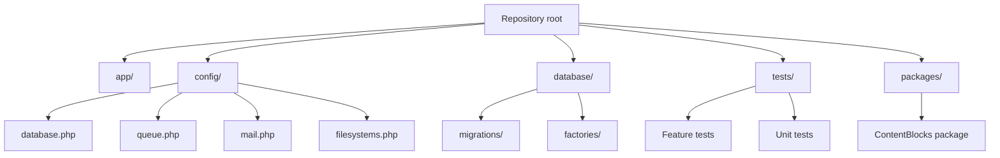
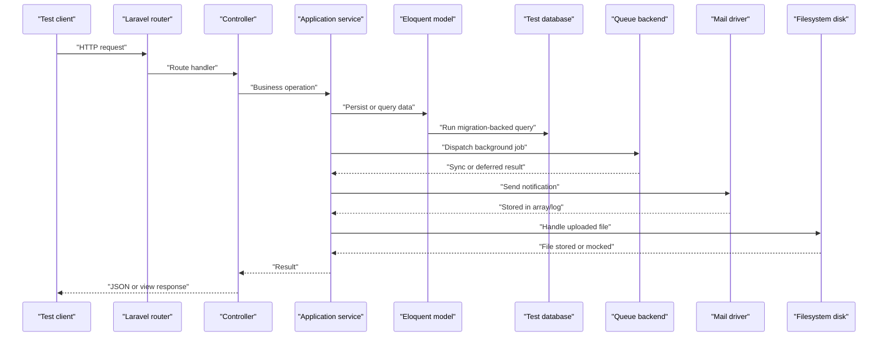
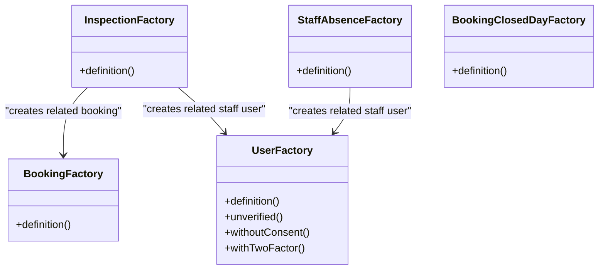
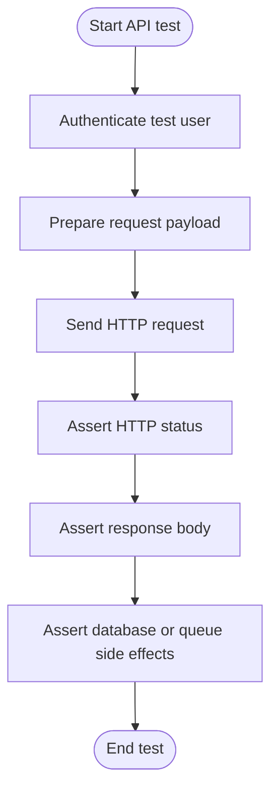
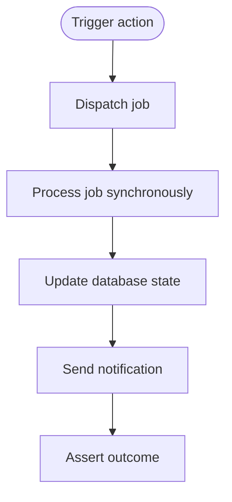
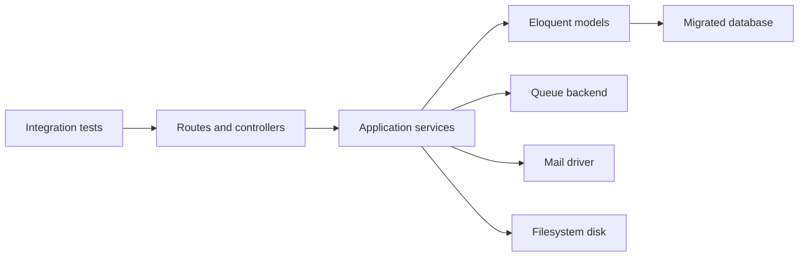

# Integration Testing

<cite>
**Referenced Files in This Document**   
- [composer.json](file://composer.json)
- [config/database.php](file://config/database.php)
- [config/queue.php](file://config/queue.php)
- [config/mail.php](file://config/mail.php)
- [config/filesystems.php](file://config/filesystems.php)
- [database/factories/UserFactory.php](file://database/factories/UserFactory.php)
- [database/factories/BookingFactory.php](file://database/factories/BookingFactory.php)
- [database/factories/InspectionFactory.php](file://database/factories/InspectionFactory.php)
- [database/factories/StaffAbsenceFactory.php](file://database/factories/StaffAbsenceFactory.php)
- [database/factories/BookingClosedDayFactory.php](file://database/factories/BookingClosedDayFactory.php)
- [packages/ContentBlocks/tests/Unit/BlockRegistryTest.php](file://packages/ContentBlocks/tests/Unit/BlockRegistryTest.php)
</cite>

## Table of Contents
1. [Introduction](#introduction)
2. [Project Structure](#project-structure)
3. [Core Components](#core-components)
4. [Architecture Overview](#architecture-overview)
5. [Detailed Component Analysis](#detailed-component-analysis)
6. [Dependency Analysis](#dependency-analysis)
7. [Performance Considerations](#performance-considerations)
8. [Troubleshooting Guide](#troubleshooting-guide)
9. [Conclusion](#conclusion)

## Introduction
This document explains how to perform integration testing for the Highblossom application. It focuses on end-to-end interactions between HTTP/API endpoints, Eloquent models, database migrations, background jobs, mailers, file uploads, and third-party integrations. The guidance is based on the repository’s Laravel project layout, configuration files, Eloquent factories, and existing test examples.

The main goals are:
- Use a dedicated test database with proper migration setup.
- Generate realistic test data through Eloquent factories.
- Test model relationships and complex queries under real database constraints.
- Exercise API endpoints with authentication, request validation, and response assertions.
- Isolate external integrations using Laravel’s built-in fakes and mock objects.
- Test queue-backed jobs, event listeners, and email delivery behavior without side effects.

## Project Structure
Highblossom follows a standard Laravel application structure:
- Application code lives under `app/`.
- Database schema is managed by migrations under `database/migrations/`.
- Test data generators live under `database/factories/`.
- Tests are organized under `tests/`, including feature and unit tests.
- A sub-package under `packages/ContentBlocks` includes its own unit test example.

**Diagram sources**
- [composer.json:1-138](file://composer.json#L1-L138)
- [config/database.php:1-184](file://config/database.php#L1-L184)
- [config/queue.php:1-128](file://config/queue.php#L1-L128)
- [config/mail.php:1-123](file://config/mail.php#L1-L123)
- [config/filesystems.php:1-109](file://config/filesystems.php#L1-L109)

**Section sources**
- [composer.json:1-138](file://composer.json#L1-L138)

## Core Components
For integration testing, focus on these components:

- **Database configuration**: Supports SQLite, MySQL, MariaDB, PostgreSQL, and SQL Server. SQLite is especially useful for fast, isolated test runs.
- **Queue configuration**: Defines sync, database, Redis, SQS, deferred, background, and failover backends. Sync is ideal for deterministic job testing.
- **Mail configuration**: Supports multiple mailers such as SMTP, SES, Postmark, Resend, log, array, failover, and roundrobin. The log or array mailer isolates email testing.
- **Filesystem configuration**: Provides local, public, S3, and temp disks. The public disk can be configured to use S3 in production-like environments, which is important when testing uploads.
- **Eloquent factories**: Provide reusable model builders for users, bookings, inspections, staff absences, and closed booking days.
- **Existing test example**: The ContentBlocks package includes a testbench-based unit test that demonstrates Laravel testing conventions.

**Section sources**
- [config/database.php:1-184](file://config/database.php#L1-L184)
- [config/queue.php:1-128](file://config/queue.php#L1-L128)
- [config/mail.php:1-123](file://config/mail.php#L1-L123)
- [config/filesystems.php:1-109](file://config/filesystems.php#L1-L109)
- [database/factories/UserFactory.php:1-78](file://database/factories/UserFactory.php#L1-L78)
- [database/factories/BookingFactory.php:1-32](file://database/factories/BookingFactory.php#L1-L32)
- [database/factories/InspectionFactory.php:1-35](file://database/factories/InspectionFactory.php#L1-L35)
- [database/factories/StaffAbsenceFactory.php:1-30](file://database/factories/StaffAbsenceFactory.php#L1-L30)
- [database/factories/BookingClosedDayFactory.php:1-29](file://database/factories/BookingClosedDayFactory.php#L1-L29)
- [packages/ContentBlocks/tests/Unit/BlockRegistryTest.php:1-62](file://packages/ContentBlocks/tests/Unit/BlockRegistryTest.php#L1-L62)

## Architecture Overview
Integration tests should exercise full request flows while isolating side effects. A typical flow looks like this:

This diagram represents a conceptual integration flow. It does not map directly to one specific source file, so no diagram sources are included.

## Detailed Component Analysis

### Test Database Setup and Migration Usage
Use a dedicated test database rather than reusing development or production databases. The repository supports several database drivers through configuration. For fast isolation during integration testing, prefer an in-memory or file-backed SQLite connection. Ensure migrations run before each test suite so schema state is predictable.

Key configuration points:
- Default connection is environment-driven.
- SQLite connection uses a database path and supports foreign key constraints.
- MySQL, MariaDB, PostgreSQL, and SQL Server connections are also available.
- Migration repository metadata is tracked via a migrations table.

Recommended approach:
- Configure the test environment to use SQLite.
- Run all migrations before exercising database-dependent tests.
- Avoid sharing state across unrelated test classes unless explicitly required.

**Section sources**
- [config/database.php:1-184](file://config/database.php#L1-L184)

### Factory-Based Test Data Generation
Factories provide structured, repeatable test data. The repository defines factories for core domain entities.

Important factory characteristics:
- User factory creates verified users with hashed passwords, generated usernames from emails, consent timestamps, and optional two-factor state.
- Booking factory creates pending bookings with client details, vehicle information, pricing, and optional addresses.
- Inspection factory creates inspections linked to a booking and a user, with scheduled and ended times.
- Staff absence factory associates absences with users and realistic time windows.
- Closed booking day factory generates closure dates and reasons.

Best practices:
- Prefer factories over raw attribute arrays to keep tests readable and aligned with schema changes.
- Chain factory states for variations, such as unverified users or two-factor-enabled accounts.
- Build related records through factory relationships where appropriate.

**Diagram sources**
- [database/factories/UserFactory.php:1-78](file://database/factories/UserFactory.php#L1-L78)
- [database/factories/BookingFactory.php:1-32](file://database/factories/BookingFactory.php#L1-L32)
- [database/factories/InspectionFactory.php:1-35](file://database/factories/InspectionFactory.php#L1-L35)
- [database/factories/StaffAbsenceFactory.php:1-30](file://database/factories/StaffAbsenceFactory.php#L1-L30)
- [database/factories/BookingClosedDayFactory.php:1-29](file://database/factories/BookingClosedDayFactory.php#L1-L29)

**Section sources**
- [database/factories/UserFactory.php:1-78](file://database/factories/UserFactory.php#L1-L78)
- [database/factories/BookingFactory.php:1-32](file://database/factories/BookingFactory.php#L1-L32)
- [database/factories/InspectionFactory.php:1-35](file://database/factories/InspectionFactory.php#L1-L35)
- [database/factories/StaffAbsenceFactory.php:1-30](file://database/factories/StaffAbsenceFactory.php#L1-L30)
- [database/factories/BookingClosedDayFactory.php:1-29](file://database/factories/BookingClosedDayFactory.php#L1-L29)

### Testing Eloquent Model Operations and Relationships
When testing Eloquent operations:
- Create minimal but realistic datasets using factories.
- Assert both database state and model relationships.
- Validate constraints such as uniqueness, foreign keys, and timestamps.
- Test cascading behavior where models trigger related updates or deletions.

Example patterns:
- Create a booking and an inspection, then assert the inspection belongs to the booking and references the correct staff user.
- Create a user with two-factor enabled and verify related attributes are persisted correctly.
- Create multiple closed booking days and assert date range logic used by availability services.

Complex queries should be tested against the migrated schema to catch index, join, and constraint issues early.

**Section sources**
- [database/factories/BookingFactory.php:1-32](file://database/factories/BookingFactory.php#L1-L32)
- [database/factories/InspectionFactory.php:1-35](file://database/factories/InspectionFactory.php#L1-L35)
- [database/factories/UserFactory.php:1-78](file://database/factories/UserFactory.php#L1-L78)
- [database/factories/BookingClosedDayFactory.php:1-29](file://database/factories/BookingClosedDayFactory.php#L1-L29)

### Testing Database Transactions
Use database transactions to guarantee test isolation:
- Wrap test operations in a transaction so rollbacks restore the database after each test.
- Avoid long-running commits inside tests; prefer synchronous execution paths.
- When testing job processing, ensure the job completes within the same transactional context or use a sync queue to make assertions reliable.

Transaction testing benefits:
- Prevents leftover rows from affecting subsequent tests.
- Keeps fixture setup concise.
- Makes failure output easier to interpret because only the failing test’s state is present.

[No sources needed since this section provides general guidance]

### Testing API Endpoints with Authentication, Validation, and Response Assertions
API integration tests should simulate real requests while validating business rules:

- Authentication: Use authenticated test helpers or tokens depending on the application’s auth mechanism.
- Request validation: Submit invalid payloads and assert validation errors.
- Authorization: Verify that unauthorized users cannot access protected routes.
- Response assertions: Check status codes, JSON structure, relationship inclusion, and pagination if applicable.

Typical API test workflow:

This flow is conceptual and does not map to a single source file.

**Section sources**
- [composer.json:1-138](file://composer.json#L1-L138)

### Testing External Service Integrations with Mocks and Fakes
Isolate external systems using Laravel’s testing utilities:

- Email: Switch to the array or log mailer and assert sent messages without delivering real emails.
- Third-party APIs: Replace HTTP clients or SDKs with mock implementations or fake responses.
- File storage: Use the local filesystem disk or temporary storage for uploads; avoid writing to production buckets during tests.
- Queues: Use the sync queue for deterministic job execution, or dispatch jobs and assert queued items when necessary.

Configuration highlights:
- Mail default can be set to log or array for safe testing.
- Public disk may point to S3 in production-like configurations, so tests should either switch to local or mock the storage layer.
- Queue defaults to database, but sync is preferable for simple job verification.

**Section sources**
- [config/mail.php:1-123](file://config/mail.php#L1-L123)
- [config/filesystems.php:1-109](file://config/filesystems.php#L1-L109)
- [config/queue.php:1-128](file://config/queue.php#L1-L128)

### Testing Background Jobs, Event Listeners, and Queue Processing
Background processing tests should cover:
- Job dispatching and parameters.
- Listener invocation triggered by application events.
- Queue backend behavior using sync or database queues.
- Failure handling and retry semantics.

Recommended approach:
- Use sync queue when asserting immediate side effects.
- Dispatch jobs and wait for them to complete in tests.
- Assert database changes, mail output, or file system artifacts created by jobs.
- Use failed job tables or logs when verifying error paths.

This flow is conceptual and does not map to a single source file.

**Section sources**
- [config/queue.php:1-128](file://config/queue.php#L1-L128)

### Testing File Uploads, Email Sending, and Third-Party API Calls
File uploads:
- Use the local filesystem disk for testing uploads.
- Assert that files are written to expected temporary locations.
- Clean up temporary files after tests.

Email sending:
- Set the mail driver to array or log.
- Assert message count, recipients, subject, and body content.
- For queued email jobs, process the queue synchronously and then assert.

Third-party API calls:
- Replace HTTP clients with mocks or fakes.
- Assert that requests are made with correct URLs, headers, and payloads.
- Simulate success and failure responses to validate error handling.

**Section sources**
- [config/filesystems.php:1-109](file://config/filesystems.php#L1-L109)
- [config/mail.php:1-123](file://config/mail.php#L1-L123)

### Example Test Pattern from the Repository
The ContentBlocks package includes a testbench-based unit test demonstrating Laravel testing conventions. It shows:
- Extending a base test case.
- Setting up dependencies in a setup method.
- Performing assertions on service methods.
- Verifying null returns and fallback behavior.

This pattern can be adapted for integration tests that need to boot a subset of the framework.

**Section sources**
- [packages/ContentBlocks/tests/Unit/BlockRegistryTest.php:1-62](file://packages/ContentBlocks/tests/Unit/BlockRegistryTest.php#L1-L62)

## Dependency Analysis
Integration tests depend on several layers:

Key coupling points:
- Controllers and services interact with models, making database schema stability critical.
- Jobs and listeners introduce asynchronous dependencies that must be synchronized in tests.
- Mail and storage drivers must be switched to safe test modes.

**Diagram sources**
- [config/database.php:1-184](file://config/database.php#L1-L184)
- [config/queue.php:1-128](file://config/queue.php#L1-L128)
- [config/mail.php:1-123](file://config/mail.php#L1-L123)
- [config/filesystems.php:1-109](file://config/filesystems.php#L1-L109)

**Section sources**
- [config/database.php:1-184](file://config/database.php#L1-L184)
- [config/queue.php:1-128](file://config/queue.php#L1-L128)
- [config/mail.php:1-123](file://config/mail.php#L1-L123)
- [config/filesystems.php:1-109](file://config/filesystems.php#L1-L109)

## Performance Considerations
- Prefer SQLite for faster test execution when database-specific features are not required.
- Keep test datasets minimal while still covering relationships and constraints.
- Avoid running heavy background jobs in CI unless they are essential; use sync mode for predictable timing.
- Reset or truncate large tables selectively instead of dropping and recreating schema repeatedly.
- Use database transactions to reduce I/O overhead and improve isolation.

[No sources needed since this section provides general guidance]

## Troubleshooting Guide
Common integration testing issues and resolutions:

- Database connection failures:
  - Verify the test environment uses a supported driver.
  - Ensure the SQLite file exists or the database server is reachable.
  - Confirm foreign key constraints are enabled when relational integrity matters.

- Missing migrations:
  - Run migrations before executing database-dependent tests.
  - Check that the migration repository table is initialized.

- Queue jobs not executing:
  - Use the sync queue for deterministic behavior.
  - If using database queues, ensure the jobs table exists and the worker processes jobs.

- Emails sent unexpectedly:
  - Switch the mail driver to array or log during tests.
  - Assert sent messages to confirm intended behavior.

- File upload tests failing:
  - Ensure the filesystem disk root is writable.
  - Avoid pointing the public disk to S3 during tests unless credentials and bucket access are configured.

**Section sources**
- [config/database.php:1-184](file://config/database.php#L1-L184)
- [config/queue.php:1-128](file://config/queue.php#L1-L128)
- [config/mail.php:1-123](file://config/mail.php#L1-L123)
- [config/filesystems.php:1-109](file://config/filesystems.php#L1-L109)

## Conclusion
Effective integration testing for Highblossom requires coordinated use of the test database, migrations, factories, authenticated request helpers, and isolation techniques for queues, mail, storage, and external APIs. By leveraging the repository’s configuration and factory definitions, you can write tests that validate real system behavior while remaining fast, reliable, and isolated. Adopt sync queues, array or log mailers, and local filesystem disks in tests to eliminate side effects, and use factories to maintain realistic model relationships and constraints.

[No sources needed since this section summarizes without analyzing specific files]