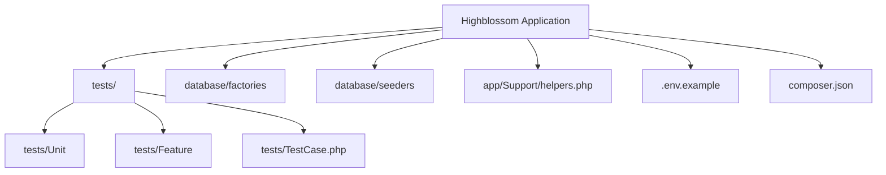
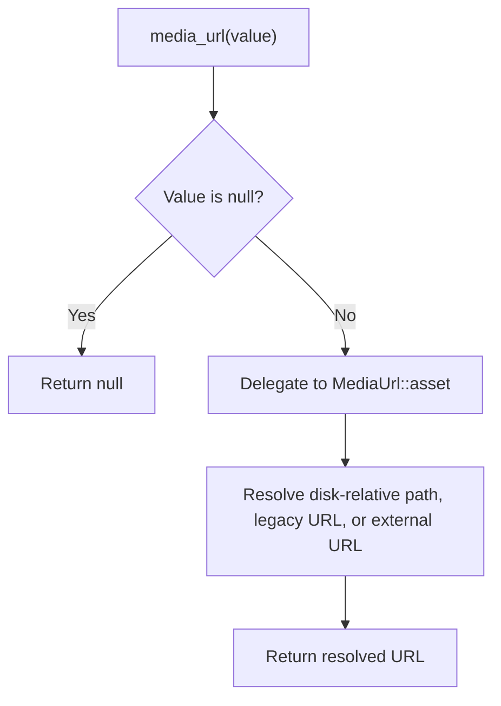
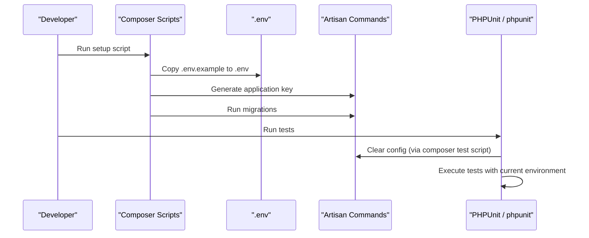
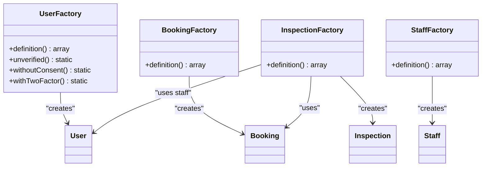
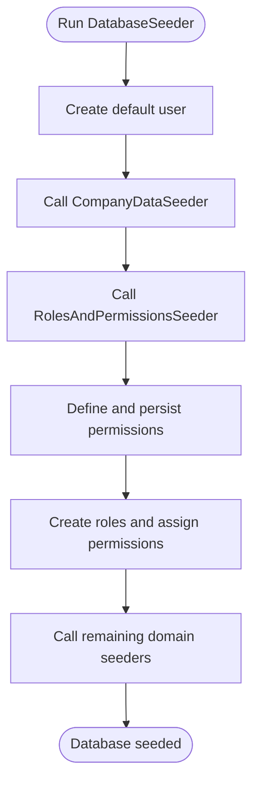
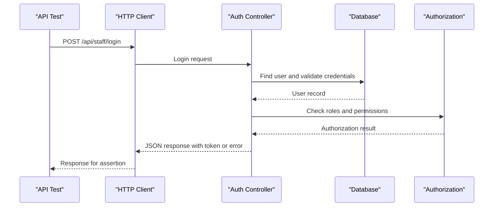
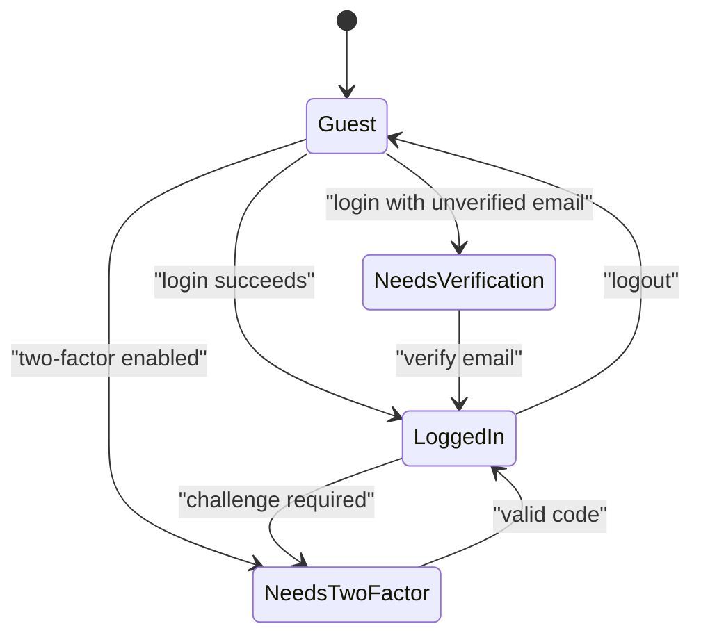
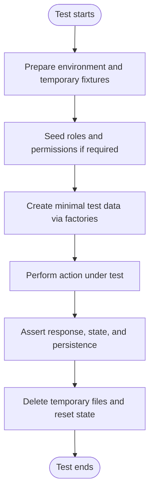

# Test Utilities and Helpers

<cite>
**Referenced Files in This Document**
- [composer.json](file://composer.json)
- [.env.example](file://.env.example)
- [app/Support/helpers.php](file://app/Support/helpers.php)
- [database/factories/UserFactory.php](file://database/factories/UserFactory.php)
- [database/factories/StaffFactory.php](file://database/factories/StaffFactory.php)
- [database/factories/BookingFactory.php](file://database/factories/BookingFactory.php)
- [database/factories/InspectionFactory.php](file://database/factories/InspectionFactory.php)
- [database/seeders/DatabaseSeeder.php](file://database/seeders/DatabaseSeeder.php)
- [database/seeders/RolesAndPermissionsSeeder.php](file://database/seeders/RolesAndPermissionsSeeder.php)
- [tests/Unit/EnvEditorTest.php](file://tests/Unit/EnvEditorTest.php)
- [tests/Feature/Admin/BlogPostsTest.php](file://tests/Feature/Admin/BlogPostsTest.php)
- [tests/Feature/Admin/BookingClosureTest.php](file://tests/Feature/Admin/BookingClosureTest.php)
- [tests/Feature/Admin/InspectionNotesTest.php](file://tests/Feature/Admin/InspectionNotesTest.php)
- [tests/Feature/Admin/BlockBuilderTest.php](file://tests/Feature/Admin/BlockBuilderTest.php)
- [tests/Feature/Admin/GlassSubCategoryModalTest.php](file://tests/Feature/Admin/GlassSubCategoryModalTest.php)
- [tests/Feature/Api/AuthTest.php](file://tests/Feature/Api/AuthTest.php)
</cite>

## Table of Contents
1. [Introduction](#introduction)
2. [Project Structure](#project-structure)
3. [Core Testing Infrastructure](#core-testing-infrastructure)
4. [Custom Test Helpers and Assertions](#custom-test-helpers-and-assertions)
5. [Test Database Configuration](#test-database-configuration)
6. [Environment Setup for Tests](#environment-setup-for-tests)
7. [Factories and Test Data Creation](#factories-and-test-data-creation)
8. [Seeders and Consistent Test States](#seeders-and-consistent-test-states)
9. [Fixture Management](#fixture-management)
10. [Common Test Patterns](#common-test-patterns)
11. [API Testing Utilities](#api-testing-utilities)
12. [Authentication Testing Patterns](#authentication-testing-patterns)
13. [Database State Management](#database-state-management)
14. [Debugging Failing Tests](#debugging-failing-tests)
15. [Logging Strategies in Tests](#logging-strategies-in-tests)
16. [Performance Optimization](#performance-optimization)
17. [Data Lifecycle, Cleanup, and Memory Safety](#data-lifecycle-cleanup-and-memory-safety)
18. [Conclusion](#conclusion)

## Introduction
This document explains the testing utilities, helper functions, and test infrastructure used by the Highblossom application. It focuses on how tests are organized, how test data is created, how authentication and API behavior are validated, and how to keep tests fast, isolated, and reliable.

The project uses Laravel with PHPUnit as its test runner. Test code lives under `tests/`, factories live under `database/factories/`, and seeders live under `database/seeders/`. A small set of global helpers is autoloaded through Composer.

## Project Structure
The testing layout follows a standard split between unit and feature tests:

| Area | Purpose |
| --- | --- |
| `tests/Unit` | Small, focused logic tests without full HTTP or database features. |
| `tests/Feature` | End-to-end-like scenarios that exercise routes, controllers, authorization, jobs, mail, files, and the database. |
| `tests/TestCase.php` | Base test class shared by all tests. |
| `database/factories` | Eloquent factory definitions for generating realistic model instances. |
| `database/seeders` | Seeders for roles, permissions, sample content, and reference data. |
| `storage/framework/testing` | Temporary test artifacts such as generated environment fixtures. |

**Diagram sources**
- [composer.json:1-138](file://composer.json#L1-L138)
- [.env.example:1-83](file://.env.example#L1-L83)
- [app/Support/helpers.php:1-24](file://app/Support/helpers.php#L1-L24)

**Section sources**
- [composer.json:1-138](file://composer.json#L1-L138)
- [.env.example:1-83](file://.env.example#L1-L83)

## Core Testing Infrastructure
The repository relies on these core testing components:

- **PHPUnit**: The main assertion and execution framework.
- **Laravel testing base classes**: Used by feature and unit tests for HTTP simulation, database access, and service container interaction.
- **Composer autoload-dev**: Maps `Tests\\` to `tests/`.
- **Global helpers autoload**: Loads `app/Support/helpers.php` so helpers like `media_url()` are available during tests.
- **Faker**: Generates fake names, emails, addresses, and other test data.
- **Mockery**: Available for mocking dependencies when needed.

Key configuration signals:

| Setting | Meaning |
| --- | --- |
| `require-dev.phpunit/phpunit` | PHPUnit is the official test runner. |
| `autoload.files` includes `app/Support/helpers.php` | Global helpers are loaded in every PHP process, including tests. |
| `autoload-dev.Tests` points to `tests/` | Tests use the `Tests\` namespace prefix. |
| `scripts.test` clears config, runs linting, then `php artisan test` | Recommended local test command. |

**Section sources**
- [composer.json:1-138](file://composer.json#L1-L138)

## Custom Test Helpers and Assertions
The application defines one global helper relevant to tests that work with media paths:

| Helper | Purpose |
| --- | --- |
| `media_url($value)` | Resolves stored media references into URLs for the active public disk. It accepts legacy storage paths, absolute internal URLs, or external URLs, making tests resilient to filesystem or object storage changes. |

The helper delegates to `Highblossom\ContentBlocks\Support\MediaUrl::asset()`. This is especially useful when tests verify uploaded image URLs, gallery images, or any persisted media path.

**Diagram sources**
- [app/Support/helpers.php:1-24](file://app/Support/helpers.php#L1-L24)

**Section sources**
- [app/Support/helpers.php:1-24](file://app/Support/helpers.php#L1-L24)

## Test Database Configuration
By default, `.env.example` configures SQLite as the development database connection. In tests, this makes it easy to run an in-memory or file-backed SQLite database without requiring MySQL or PostgreSQL.

Relevant settings include:

| Setting | Default in example | Testing implication |
| --- | --- | --- |
| `DB_CONNECTION` | `sqlite` | Lightweight database backend suitable for fast tests. |
| `SESSION_DRIVER` | `database` | Session data may be written to the database unless overridden in test configuration. |
| `QUEUE_CONNECTION` | `database` | Queue-related tests should account for job tables if they execute jobs synchronously or asynchronously. |
| `CACHE_STORE` | `database` | Cache tables may be created depending on test configuration. |
| `FILESYSTEM_DISK` | `local` | Filesystem-based uploads and storage operations can run locally unless tests override the disk driver. |

When writing new tests, prefer using Laravel’s built-in database isolation mechanisms rather than manually editing the environment per test.

**Section sources**
- [.env.example:1-83](file://.env.example#L1-L83)

## Environment Setup for Tests
The project provides an example environment file but does not commit a real `.env`. During setup, Composer scripts copy `.env.example` to `.env`, generate the application key, and run migrations.

For tests:

- Do not hardcode secrets in test files.
- Use `.env.testing` only if you explicitly configure PHPUnit to load it; otherwise, rely on the existing environment or isolate sensitive state through mocks and temporary files.
- For environment-editor tests, create temporary fixture files inside `storage/framework/testing` and delete them after each test.

**Diagram sources**
- [composer.json:1-138](file://composer.json#L1-L138)
- [.env.example:1-83](file://.env.example#L1-L83)

**Section sources**
- [composer.json:1-138](file://composer.json#L1-L138)
- [.env.example:1-83](file://.env.example#L1-L83)

## Factories and Test Data Creation
Factories define how models are created for tests. The project includes factories for users, bookings, inspections, staff, partner records, and booking closed days.

### User Factory
The user factory creates realistic users with:

- Unique safe email.
- Username derived from the email local part.
- Hashed password.
- Verified email timestamp.
- Consent acceptance timestamps.
- Optional two-factor fields.

It also exposes reusable states:

| State | Effect |
| --- | --- |
| `unverified()` | Leaves email verification unset. |
| `withoutConsent()` | Removes terms and privacy acceptance timestamps. |
| `withTwoFactor()` | Adds encrypted two-factor secret and recovery codes. |

This is the foundation for most authentication, authorization, and admin tests.

### Booking Factory
The booking factory creates:

- Client name, email, phone.
- Vehicle details.
- Status.
- Total price.
- Optional client address.

It is useful for booking submission, timeline, availability, and admin surface tests.

### Inspection Factory
The inspection factory links an inspection to:

- A booking.
- A staff user.
- A scheduled time window.
- Location and type values.

This supports inspection notes, session tracking, and admin inspection workflows.

### Staff Factory
The staff factory currently has an empty definition. When staff-specific test data is required, extend it to return meaningful attributes instead of relying solely on generic user factories.

**Diagram sources**
- [database/factories/UserFactory.php:1-78](file://database/factories/UserFactory.php#L1-L78)
- [database/factories/BookingFactory.php:1-32](file://database/factories/BookingFactory.php#L1-L32)
- [database/factories/InspectionFactory.php:1-35](file://database/factories/InspectionFactory.php#L1-L35)
- [database/factories/StaffFactory.php:1-24](file://database/factories/StaffFactory.php#L1-L24)

**Section sources**
- [database/factories/UserFactory.php:1-78](file://database/factories/UserFactory.php#L1-L78)
- [database/factories/BookingFactory.php:1-32](file://database/factories/BookingFactory.php#L1-L32)
- [database/factories/InspectionFactory.php:1-35](file://database/factories/InspectionFactory.php#L1-L35)
- [database/factories/StaffFactory.php:1-24](file://database/factories/StaffFactory.php#L1-L24)

## Seeders and Consistent Test States
Seeders provide a consistent baseline for roles, permissions, company data, services, galleries, SEO routes, and application versions.

### Database Seeder
The root seeder:

- Creates a default admin-style user.
- Calls several domain seeders.

This is useful for local development and initial setup, but tests should usually create only the exact data they need through factories or targeted seed calls.

### Roles and Permissions Seeder
The roles seeder:

- Clears permission cache.
- Defines permissions across blog, bookings, inspections, gallery, services, settings, SEO, content, communication, HR, access control, system, and dashboard areas.
- Creates roles such as Super Admin, Admin, Staff, and User.
- Assigns appropriate permissions to each role.
- Assigns Super Admin to the first user if present.

This seeder is important for authorization tests because many admin and API endpoints depend on roles and permissions.

**Diagram sources**
- [database/seeders/DatabaseSeeder.php:1-37](file://database/seeders/DatabaseSeeder.php#L1-L37)
- [database/seeders/RolesAndPermissionsSeeder.php:1-161](file://database/seeders/RolesAndPermissionsSeeder.php#L1-L161)

**Section sources**
- [database/seeders/DatabaseSeeder.php:1-37](file://database/seeders/DatabaseSeeder.php#L1-L37)
- [database/seeders/RolesAndPermissionsSeeder.php:1-161](file://database/seeders/RolesAndPermissionsSeeder.php#L1-L161)

## Fixture Management
The environment editor test demonstrates a controlled fixture pattern:

1. Create a temporary fixture file path under `storage/framework/testing`.
2. Write a known `.env`-like string before the test.
3. Assert that the file content remains secure and correct after operations.
4. Delete the fixture file in teardown.

This pattern avoids polluting the real environment and keeps tests deterministic.

Recommended rules:

- Put temporary test files under `storage/framework/testing`.
- Always clean up files in `tearDown()` or a dedicated cleanup helper.
- Never write secrets into version-controlled fixtures.
- Prefer in-memory mocks over real file writes when possible.

**Section sources**
- [tests/Unit/EnvEditorTest.php:14-80](file://tests/Unit/EnvEditorTest.php#L14-L80)

## Common Test Patterns
The test suite uses several recurring patterns:

| Pattern | Where it appears | Purpose |
| --- | --- | --- |
| `actingAs(user)` | Many admin and auth tests | Authenticate requests as a specific user. |
| Private `actingAs*Admin()` helpers | Admin tests | Encapsulate creation and login of authorized users. |
| `assertDatabaseHas(table, payload)` | Blog, booking, and inspection tests | Verify records were persisted. |
| `assertDatabaseMissing(table, payload)` | Blog and booking closure tests | Verify records were not created or were deleted. |
| `assertDatabaseCount(table, count)` | Booking closure and inspection tests | Validate collection size after actions. |
| `assertJsonValidationErrors(...)` | API and form tests | Assert validation failures. |
| `assertJsonPath(...)` and `assertJsonStructure(...)` | API tests | Assert JSON response shape and nested values. |

Example categories:

- **Admin authorization**: Tests often create a user, assign roles via the roles seeder, call a private helper to log in, then assert responses and database state.
- **Data integrity**: Tests assert both UI/API behavior and persistence using database assertions.
- **State transitions**: Tests move entities through statuses or relationships, such as bookings becoming closed or inspection notes being added.

**Section sources**
- [tests/Feature/Admin/BlogPostsTest.php:148-213](file://tests/Feature/Admin/BlogPostsTest.php#L148-L213)
- [tests/Feature/Admin/BookingClosureTest.php:24-90](file://tests/Feature/Admin/BookingClosureTest.php#L24-L90)
- [tests/Feature/Admin/InspectionNotesTest.php:28-130](file://tests/Feature/Admin/InspectionNotesTest.php#L28-L130)
- [tests/Feature/Admin/BlockBuilderTest.php:31-403](file://tests/Feature/Admin/BlockBuilderTest.php#L31-L403)
- [tests/Feature/Admin/GlassSubCategoryModalTest.php:22-57](file://tests/Feature/Admin/GlassSubCategoryModalTest.php#L22-L57)

## API Testing Utilities
API tests use Laravel’s HTTP client and Sanctum integration where applicable. Key behaviors observed:

- JSON assertions validate both status codes and response shapes.
- Validation errors are asserted using `assertJsonValidationErrors`.
- Sanctum token-based login and ability-based authorization are tested.
- Two-factor challenge flows are covered with explicit checks for two-factor flags, challenges, and token presence or absence.

Typical API test flow:

**Diagram sources**
- [tests/Feature/Api/AuthTest.php:22-89](file://tests/Feature/Api/AuthTest.php#L22-L89)

**Section sources**
- [tests/Feature/Api/AuthTest.php:22-89](file://tests/Feature/Api/AuthTest.php#L22-L89)

## Authentication Testing Patterns
Authentication tests cover:

- Web login and logout.
- Email verification enforcement.
- Password confirmation.
- Two-factor challenge and settings.
- Post-login consent.
- Registration flows.
- Username sign-in.
- Passkey deletion and recovery.
- User session tracking.

Common practices:

- Use `User::factory()` to create users with predictable attributes.
- Use `actingAs()` to simulate authenticated sessions.
- Combine route helpers with JSON assertions for API routes.
- Separate concerns by creating small private helpers for authenticated contexts, such as `actingAsClosureAdmin()` or `actingAsInspectionAdmin()`.

**Diagram sources**
- [tests/Feature/Admin/EmailVerificationEnforcementTest.php:16-70](file://tests/Feature/Admin/EmailVerificationEnforcementTest.php#L16-L70)
- [tests/Feature/Api/AuthTest.php:148-L182](file://tests/Feature/Api/AuthTest.php#L148-L182)

**Section sources**
- [tests/Feature/Admin/EmailVerificationEnforcementTest.php:16-70](file://tests/Feature/Admin/EmailVerificationEnforcementTest.php#L16-L70)
- [tests/Feature/Api/AuthTest.php:148-L182](file://tests/Feature/Api/AuthTest.php#L148-L182)

## Database State Management
Tests manage database state through three main approaches:

1. **Factories**: Create minimal, focused records for each scenario.
2. **Database assertions**: Verify persistence, non-persistence, and counts.
3. **Targeted seeders**: Initialize roles, permissions, and reference data when required.

Examples from the codebase:

- Blog tests assert post creation, duplicate slug handling, and draft filtering.
- Booking closure tests assert adding and removing closure entries and enforcing unauthorized access.
- Inspection note tests assert zero-initial state, creation, and persistence.
- Block builder tests repeatedly create posts and verify final database state after multiple interactions.

Best practices demonstrated:

- Keep test setup close to the test method.
- Use private helpers for repeated authentication and data setup.
- Assert both behavior and persistence.
- Avoid relying on global database state by seeding only what is necessary.

**Section sources**
- [tests/Feature/Admin/BlogPostsTest.php:148-213](file://tests/Feature/Admin/BlogPostsTest.php#L148-L213)
- [tests/Feature/Admin/BookingClosureTest.php:24-90](file://tests/Feature/Admin/BookingClosureTest.php#L24-L90)
- [tests/Feature/Admin/InspectionNotesTest.php:28-130](file://tests/Feature/Admin/InspectionNotesTest.php#L28-L130)
- [tests/Feature/Admin/BlockBuilderTest.php:98-403](file://tests/Feature/Admin/BlockBuilderTest.php#L98-L403)

## Debugging Failing Tests
Use these techniques when a test fails:

| Technique | How to apply |
| --- | --- |
| Inspect route and action logs | Enable application logging and review logs generated during the failing test. |
| Print request/response context | Use assertion failure messages and add minimal contextual output around the failing assertion. |
| Reduce the test scope | Extract the failing step into a smaller test case. |
| Check authorization assumptions | Confirm the test user has the expected role and permissions by running the roles seeder. |
| Validate environment variables | Ensure the test environment matches expectations, especially for media URLs and storage disks. |
| Isolate file operations | For environment or storage tests, inspect temporary files under `storage/framework/testing`. |

The environment editor test shows how to isolate file-based behavior by writing a controlled fixture and asserting file contents directly.

**Section sources**
- [tests/Unit/EnvEditorTest.php:22-80](file://tests/Unit/EnvEditorTest.php#L22-L80)

## Logging Strategies in Tests
The example environment sets logging to the stack channel at debug level. In tests:

- Avoid excessive debug logging in production-like tests because it increases I/O.
- Use structured logs when debugging complex flows such as authentication, two-factor challenges, or upload pipelines.
- For environment-editor and file-based tests, treat log files as secondary evidence; primary evidence should be assertions about application state and outputs.
- If a test depends on logs, assert log file contents explicitly rather than relying on console output.

**Section sources**
- [.env.example:1-83](file://.env.example#L1-L83)

## Performance Optimization
To keep the test suite fast:

| Optimization | Reason |
| --- | --- |
| Use SQLite for tests | Reduces database overhead compared to remote RDBMS engines. |
| Create only needed data | Use factories with minimal attributes instead of full seeders. |
| Avoid unnecessary seeders | Seed roles and permissions once per test group when authorization is required. |
| Reuse authenticated users through helpers | Reduces repeated factory and login setup. |
| Mock external services | Avoid network calls for mail, queues, S3, or third-party APIs unless specifically testing those integrations. |
| Keep feature tests focused | Each test should verify one outcome and avoid cascading side effects. |
| Clear caches and config as configured | Follow the provided Composer test script to prevent stale configuration from slowing or breaking tests. |

**Section sources**
- [composer.json:1-138](file://composer.json#L1-L138)
- [.env.example:1-83](file://.env.example#L1-L83)

## Data Lifecycle, Cleanup, and Memory Safety
The test lifecycle should follow this rule: **create explicitly, assert explicitly, clean explicitly**.

### Factories
- Use factories for short-lived model instances.
- Prefer factory states (`unverified`, `withoutConsent`, `withTwoFactor`) over manual attribute overrides.
- Extend `StaffFactory` when staff-specific attributes are required by future tests.

### Seeders
- Use seeders for stable reference data such as roles, permissions, services, and SEO routes.
- Do not use seeders for volatile test data; factories are better for per-scenario data.

### Fixtures
- Create temporary fixture files under `storage/framework/testing`.
- Write known content before the test.
- Delete the file in teardown.
- Assert file contents only when the behavior under test writes to the filesystem.

### Database
- Use database assertions to confirm insert, update, and delete outcomes.
- Avoid leaving orphaned rows by resetting state in setup or by using Laravel’s transactional or refresh mechanisms where appropriate.
- Be careful with jobs, mail, events, and cache; disable or mock them unless the test purpose requires them.

**Diagram sources**
- [tests/Unit/EnvEditorTest.php:22-80](file://tests/Unit/EnvEditorTest.php#L22-L80)
- [database/factories/UserFactory.php:1-78](file://database/factories/UserFactory.php#L1-L78)
- [database/seeders/RolesAndPermissionsSeeder.php:1-161](file://database/seeders/RolesAndPermissionsSeeder.php#L1-L161)

**Section sources**
- [tests/Unit/EnvEditorTest.php:22-80](file://tests/Unit/EnvEditorTest.php#L22-L80)
- [database/factories/UserFactory.php:1-78](file://database/factories/UserFactory.php#L1-L78)
- [database/seeders/RolesAndPermissionsSeeder.php:1-161](file://database/seeders/RolesAndPermissionsSeeder.php#L1-L161)

## Conclusion
Highblossom’s testing infrastructure combines standard Laravel and PHPUnit capabilities with small, purposeful helpers and well-defined factories and seeders. The most reliable approach is to:

- Use factories for per-test data.
- Use seeders for stable reference data.
- Use private helpers to encapsulate authentication and authorization setup.
- Assert both HTTP/API behavior and database state.
- Isolate file and environment mutations behind temporary fixtures.
- Keep tests focused, fast, and deterministic.

This approach makes authentication, authorization, API, content, booking, inspection, and system overview tests easier to read, maintain, and debug.