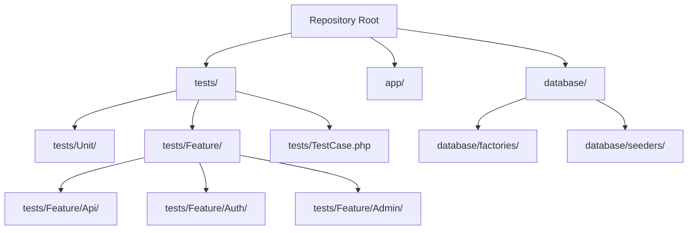
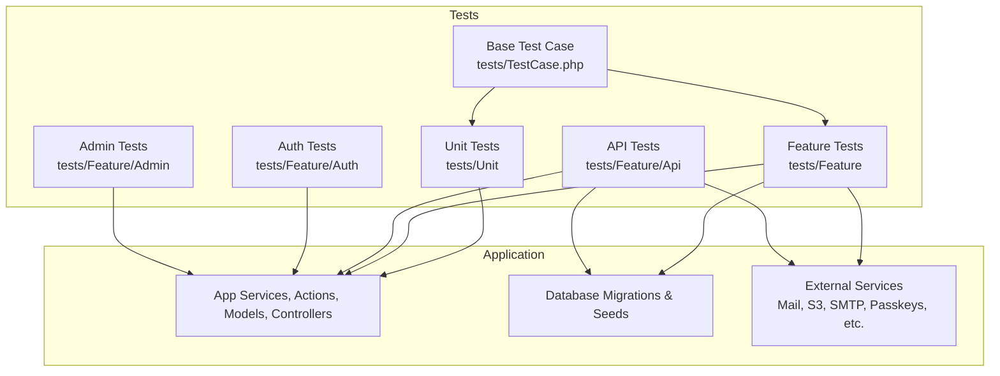
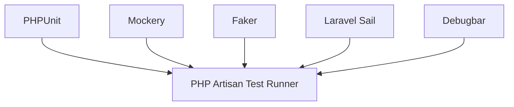

# Testing Strategy

<cite>
**Referenced Files in This Document**
- [composer.json](file://composer.json)
- [.env.example](file://.env.example)
- [lint.yml](file://.github/workflows/lint.yml)
- [TestCase.php](file://tests/TestCase.php)
- [ExampleTest.php (Unit)](file://tests/Unit/ExampleTest.php)
- [ExampleTest.php (Feature)](file://tests/Feature/ExampleTest.php)
- [AuthenticationTest.php](file://tests/Feature/Auth/AuthenticationTest.php)
- [AuthTest.php (API)](file://tests/Feature/Api/AuthTest.php)
- [ContactMessageApiTest.php](file://tests/Feature/Api/ContactMessageApiTest.php)
- [BookingSubmissionTest.php](file://tests/Feature/BookingSubmissionTest.php)
- [AvailabilityServiceTest.php](file://tests/Feature/AvailabilityServiceTest.php)
- [EnvEditorTest.php](file://tests/Unit/EnvEditorTest.php)
- [UserFactory.php](file://database/factories/UserFactory.php)
- [BookingFactory.php](file://database/factories/BookingFactory.php)
- [InspectionFactory.php](file://database/factories/InspectionFactory.php)
- [StaffFactory.php](file://database/factories/StaffFactory.php)
- [DatabaseSeeder.php](file://database/seeders/DatabaseSeeder.php)
- [RolesAndPermissionsSeeder.php](file://database/seeders/RolesAndPermissionsSeeder.php)
</cite>

## Table of Contents
1. [Introduction](#introduction)
2. [Project Structure](#project-structure)
3. [Core Components](#core-components)
4. [Architecture Overview](#architecture-overview)
5. [Detailed Component Analysis](#detailed-component-analysis)
6. [Dependency Analysis](#dependency-analysis)
7. [Performance Considerations](#performance-considerations)
8. [Troubleshooting Guide](#troubleshooting-guide)
9. [Conclusion](#conclusion)
10. [Appendices](#appendices)

## Introduction
This document describes the Houblossom application’s testing strategy and implementation. It explains how unit tests, integration tests, feature tests, API endpoint tests, test data factories, seeders, configuration, mocking, continuous integration, coverage, performance testing, best practices, and debugging techniques are organized and used across the codebase.

The project is a Laravel application that uses PHPUnit for unit and feature testing, Laravel’s built-in HTTP and database testing facilities for integration, factories and seeders for test data, and GitHub Actions for automated quality checks. The repository also includes extensive feature tests covering authentication, bookings, content, SEO, admin surfaces, uploads, system overview, and API endpoints.

## Project Structure
Testing-related artifacts live under `tests/`, with standard PHPUnit layering:
- `tests/Unit`: isolated unit tests for small logic units such as environment editing or URL helpers.
- `tests/Feature`: full-stack feature tests exercising controllers, middleware, services, database operations, jobs, mail, and external integrations.
- `tests/Feature/Api`: API-focused feature tests using Laravel’s HTTP client.
- `tests/Feature/Admin` and `tests/Feature/Auth`: domain-oriented feature tests for admin workflows and authentication flows.
- `tests/TestCase.php`: base test class extending Laravel’s default test case.

**Diagram sources**
- [composer.json:79-103](file://composer.json#L79-L103)
- [TestCase.php](file://tests/TestCase.php)
- [ExampleTest.php (Unit):1-30](file://tests/Unit/ExampleTest.php#L1-L30)
- [ExampleTest.php (Feature):1-30](file://tests/Feature/ExampleTest.php#L1-L30)

**Section sources**
- [composer.json:79-103](file://composer.json#L79-L103)

## Core Components
- **PHPUnit**: The core test runner and assertion library.
- **Laravel Test Case**: The framework provides a base test class that boots the application container, provides HTTP testing helpers, database transaction rollback, factory usage, and more.
- **Factories**: `database/factories` define reusable record builders for models such as users, bookings, inspections, and staff.
- **Seeders**: `database/seeders` populate the test database with roles, permissions, and domain data.
- **Mockery**: Available as a dev dependency for mocking classes, facades, and external dependencies.
- **Faker**: Available for generating realistic fake data inside factories and tests.
- **GitHub Actions Lint Workflow**: A CI job runs PHP linting; tests can be added to this workflow or a dedicated test workflow.

Key responsibilities:
- Unit tests validate pure business logic without touching the network or database.
- Integration tests verify interactions between components, including database queries and queued jobs.
- Feature tests simulate end-to-end user journeys through HTTP requests and UI workflows.
- API tests assert request/response contracts for JSON endpoints.

**Section sources**
- [composer.json:27-51](file://composer.json#L27-L51)
- [composer.json:79-103](file://composer.json#L79-L103)

## Architecture Overview
The testing architecture follows Laravel’s conventional layering:

**Diagram sources**
- [TestCase.php](file://tests/TestCase.php)
- [ExampleTest.php (Unit):1-30](file://tests/Unit/ExampleTest.php#L1-L30)
- [ExampleTest.php (Feature):1-30](file://tests/Feature/ExampleTest.php#L1-L30)
- [AuthTest.php (API):1-30](file://tests/Feature/Api/AuthTest.php#L1-L30)

## Detailed Component Analysis

### Unit Testing Approach for Service Classes, Action Classes, and Business Logic
Unit tests should target stateless or low-coupling logic:
- Validate input transformation, calculations, rules, formatting, and business decisions.
- Avoid database access unless absolutely necessary; prefer pure functions or mock repositories.
- Use Mockery to stub dependencies such as mappers, formatters, or external clients.
- Keep assertions focused on one behavior per test method.

Recommended pattern:
1. Arrange: create inputs and mocked dependencies.
2. Act: invoke the service, action, or helper.
3. Assert: check returned values, thrown exceptions, or side effects captured by mocks.

Useful references:
- Existing unit test file: [EnvEditorTest.php](file://tests/Unit/EnvEditorTest.php)
- Example unit structure: [ExampleTest.php (Unit)](file://tests/Unit/ExampleTest.php)

Best practices:
- One assertion goal per test method.
- Name tests descriptively so failures communicate intent.
- Use data providers when validating many input/output combinations.
- Prefer explicit error-path tests for validation and edge cases.

**Section sources**
- [EnvEditorTest.php](file://tests/Unit/EnvEditorTest.php)
- [ExampleTest.php (Unit):1-30](file://tests/Unit/ExampleTest.php#L1-L30)
- [composer.json:27-51](file://composer.json#L27-L51)

### Integration Testing for Database Operations and External Service Interactions
Integration tests should:
- Boot the application and use the test database.
- Run migrations before each test or use transactions to roll back changes.
- Verify model relationships, query scopes, and database constraints.
- Stub or mock external services like mail, object storage, or third-party APIs where appropriate.

Patterns observed in the repository:
- Authentication and authorization scenarios through HTTP requests.
- Booking submission and timeline workflows tested as features.
- API endpoint response and status verification.

References:
- Base test class: [TestCase.php](file://tests/TestCase.php)
- Feature test example: [ExampleTest.php (Feature)](file://tests/Feature/ExampleTest.php)
- Database-backed feature tests: [BookingSubmissionTest.php](file://tests/Feature/BookingSubmissionTest.php), [AvailabilityServiceTest.php](file://tests/Feature/AvailabilityServiceTest.php)

Guidelines:
- Use `RefreshDatabase` or manual migration seeding where needed.
- Prefer factories over hardcoded fixtures for realism.
- Isolate expensive external calls with mocks or feature flags.
- Use database snapshots only when partial isolation is required.

**Section sources**
- [TestCase.php](file://tests/TestCase.php)
- [ExampleTest.php (Feature):1-30](file://tests/Feature/ExampleTest.php#L1-L30)
- [BookingSubmissionTest.php](file://tests/Feature/BookingSubmissionTest.php)
- [AvailabilityServiceTest.php](file://tests/Feature/AvailabilityServiceTest.php)

### Feature Testing for User Workflows and API Endpoints
Feature tests exercise complete user journeys:
- Register, log in, confirm email, manage two-factor settings, and handle passkey flows.
- Submit contact messages, quotes, bookings, and inspect results.
- Exercise admin surfaces, content blocks, gallery, SEO, sitemap, and system overview screens.
- Validate API contracts for blog, gallery, testimonials, dashboard, auth, and staff endpoints.

Examples:
- Authentication flow: [AuthenticationTest.php](file://tests/Feature/Auth/AuthenticationTest.php)
- API authentication: [AuthTest.php (API)](file://tests/Feature/Api/AuthTest.php)
- Contact message API: [ContactMessageApiTest.php](file://tests/Feature/Api/ContactMessageApiTest.php)
- Booking submission journey: [BookingSubmissionTest.php](file://tests/Feature/BookingSubmissionTest.php)

Recommended approach:
- Start from a clean state using factories and seeders.
- Perform actions via HTTP requests rather than calling internal methods directly.
- Assert response status codes, redirects, JSON payloads, flash messages, and database state.
- Group related assertions in logical steps to make failing tests easier to diagnose.

**Section sources**
- [AuthenticationTest.php](file://tests/Feature/Auth/AuthenticationTest.php)
- [AuthTest.php (API):1-30](file://tests/Feature/Api/AuthTest.php#L1-L30)
- [ContactMessageApiTest.php](file://tests/Feature/Api/ContactMessageApiTest.php)
- [BookingSubmissionTest.php](file://tests/Feature/BookingSubmissionTest.php)

### Test Data Management Using Factories and Seeders
Factories provide structured record generation:
- `UserFactory`: creates users for authentication, roles, and session tests.
- `BookingFactory`: creates bookings for availability, confirmation, and timeline tests.
- `InspectionFactory`: creates inspection records for admin and timeline flows.
- `StaffFactory`: creates staff records for scheduling and absence scenarios.

Seeders provide baseline data:
- `DatabaseSeeder`: orchestrates other seeders.
- `RolesAndPermissionsSeeder`: sets up roles and permissions required by authorization tests.

Usage patterns:
- Use factories inline for simple records.
- Compose complex entities through multiple factories and relationships.
- Use seeders for shared baseline data like roles, permissions, and static reference data.
- Keep seeders idempotent and safe to run repeatedly.

References:
- [UserFactory.php](file://database/factories/UserFactory.php)
- [BookingFactory.php](file://database/factories/BookingFactory.php)
- [InspectionFactory.php](file://database/factories/InspectionFactory.php)
- [StaffFactory.php](file://database/factories/StaffFactory.php)
- [DatabaseSeeder.php](file://database/seeders/DatabaseSeeder.php)
- [RolesAndPermissionsSeeder.php](file://database/seeders/RolesAndPermissionsSeeder.php)

**Section sources**
- [UserFactory.php](file://database/factories/UserFactory.php)
- [BookingFactory.php](file://database/factories/BookingFactory.php)
- [InspectionFactory.php](file://database/factories/InspectionFactory.php)
- [StaffFactory.php](file://database/factories/StaffFactory.php)
- [DatabaseSeeder.php](file://database/seeders/DatabaseSeeder.php)
- [RolesAndPermissionsSeeder.php](file://database/seeders/RolesAndPermissionsSeeder.php)

### Mocking Strategies for External Dependencies
Use mocking when tests must avoid real network calls or slow I/O:
- Mock mail sending to prevent actual emails during tests.
- Stub object storage clients for upload tests.
- Replace third-party API clients with deterministic responses.
- Use Mockery to verify method calls, arguments, and call counts.

Guidelines:
- Mock only external boundaries; keep business logic real.
- Prefer interface-based design to simplify mocking.
- Assert both success and failure paths.
- Use `assertSent`, `assertNotSent`, or equivalent Laravel mail/job assertions where applicable.

Tools available:
- Mockery for general PHP mocking.
- Laravel’s built-in mail, queue, and HTTP client testing helpers.

**Section sources**
- [composer.json:27-51](file://composer.json#L27-L51)

### Writing Unit Tests for Services
A typical service unit test should:
1. Construct the service with mocked dependencies.
2. Provide controlled inputs.
3. Invoke the service method.
4. Assert return values, exceptions, and interactions with collaborators.

Example reference:
- Environment editor logic is tested in [EnvEditorTest.php](file://tests/Unit/EnvEditorTest.php).

When writing new service tests:
- Keep tests fast and deterministic.
- Avoid database, network, and filesystem I/O unless intentionally integrating.
- Use descriptive test names and clear arrange-act-assert structure.

**Section sources**
- [EnvEditorTest.php](file://tests/Unit/EnvEditorTest.php)

### Writing Integration Tests for API Endpoints
An API integration test should:
1. Create required database records using factories.
2. Authenticate if the endpoint requires authorization.
3. Send an HTTP request to the route.
4. Assert status code, JSON structure, headers, and side effects.

References:
- API authentication endpoint: [AuthTest.php (API)](file://tests/Feature/Api/AuthTest.php)
- Contact message endpoint: [ContactMessageApiTest.php](file://tests/Feature/Api/ContactMessageApiTest.php)

**Section sources**
- [AuthTest.php (API):1-30](file://tests/Feature/Api/AuthTest.php#L1-L30)
- [ContactMessageApiTest.php](file://tests/Feature/Api/ContactMessageApiTest.php)

### Writing Feature Tests for User Journeys
A user journey feature test should:
1. Prepare data with factories or seeders.
2. Navigate through the application using HTTP requests.
3. Assert page-level outcomes such as redirects, notifications, and persisted records.
4. Cover positive and negative flows.

Reference:
- Full booking submission journey: [BookingSubmissionTest.php](file://tests/Feature/BookingSubmissionTest.php)

**Section sources**
- [BookingSubmissionTest.php](file://tests/Feature/BookingSubmissionTest.php)

### Continuous Integration Setup
The repository includes a GitHub Actions workflow for linting:
- Triggers on push and pull requests to protected branches.
- Sets up PHP 8.4.
- Installs Composer and npm dependencies.
- Runs Pint for PHP code style checks.

To add tests to CI:
- Add a job that installs dependencies.
- Configure a test database or SQLite in-memory database.
- Run `php artisan test`.
- Upload coverage reports if configured.

Reference:
- Current CI lint workflow: [lint.yml](file://.github/workflows/lint.yml)

**Section sources**
- [lint.yml:1-50](file://.github/workflows/lint.yml#L1-L50)

### Test Coverage Reporting
Coverage reporting is not explicitly configured in the provided files. To enable it:
- Install Xdebug or pcov.
- Configure PHPUnit coverage output in `phpunit.xml` or the Laravel test command.
- Generate HTML or Clover XML reports.
- Integrate coverage upload into the CI workflow.

Recommended command pattern:
- `php artisan test --coverage-html=build/coverage`
- `php artisan test --coverage-clover=build/clover.xml`

[No sources needed since this section provides general guidance]

### Performance Testing Approaches
Performance testing is distinct from functional testing:
- Use synthetic load tools such as k6, Artillery, or Locust for load and stress testing.
- Benchmark critical API endpoints and background jobs.
- Monitor database query performance and N+1 queries using Laravel Query Detector or similar tooling.
- Cache hot paths and measure improvements.
- Record runtime metrics in staging or production-like environments.

[No sources needed since this section provides general guidance]

## Dependency Analysis
Testing dependencies are declared in the development requirements:
- PHPUnit is the primary test framework.
- Mockery supports mocking.
- Faker supports fake data generation.
- Laravel Sail and Debugbar support local development and diagnostics.

**Diagram sources**
- [composer.json:27-51](file://composer.json#L27-L51)

**Section sources**
- [composer.json:27-51](file://composer.json#L27-L51)

## Performance Considerations
- Keep unit tests fast by avoiding I/O and heavy setup.
- Use in-memory SQLite for database tests when possible.
- Limit large seed datasets; prefer minimal representative data.
- Parallelize tests where supported.
- Profile slow tests and refactor flaky assertions.
- Avoid sleeping or relying on wall-clock time; use Laravel’s fake time utilities.

[No sources needed since this section provides general guidance]

## Troubleshooting Guide
Common issues and remedies:
- **Database migrations fail**: Ensure migrations are applied before tests and that the test database connection is correct.
- **Authentication tests fail**: Verify roles, permissions, and user state created by seeders and factories.
- **Flaky tests**: Remove sleeps, stabilize timestamps, and isolate random data.
- **Slow tests**: Identify heavy I/O and replace with mocks or smaller datasets.
- **External service calls**: Stub mail, queues, and third-party clients to avoid nondeterminism.
- **CI failures**: Check lint errors first, then verify environment variables and dependency installation steps.

Helpful references:
- Base test class for shared helpers: [TestCase.php](file://tests/TestCase.php)
- CI lint workflow for environment expectations: [lint.yml](file://.github/workflows/lint.yml)
- Environment defaults: [.env.example](file://.env.example)

**Section sources**
- [TestCase.php](file://tests/TestCase.php)
- [lint.yml:1-50](file://.github/workflows/lint.yml#L1-L50)
- [.env.example:1-83](file://.env.example#L1-L83)

## Conclusion
Houblossom’s testing strategy combines PHPUnit-driven unit tests, Laravel-powered integration and feature tests, comprehensive API endpoint validation, and robust test data management through factories and seeders. The existing test suite covers authentication, bookings, content, SEO, admin interfaces, uploads, and system overview functionality. CI currently enforces code style through Pint, and additional test and coverage jobs can be added to maintain quality. Following the patterns documented here will help keep tests reliable, readable, and performant.

## Appendices

### Test Configuration Notes
- Default database connection in `.env.example` shows SQLite as a convenient option for local testing.
- Session, cache, queue, mail, and filesystem drivers are configurable and may need adjustments for integration tests.
- The `test` composer script clears config, runs linting, and executes tests.

**Section sources**
- [.env.example:1-83](file://.env.example#L1-L83)
- [composer.json:103-138](file://composer.json#L103-L138)