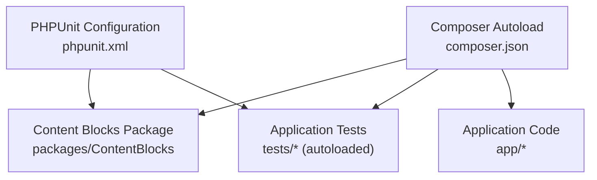
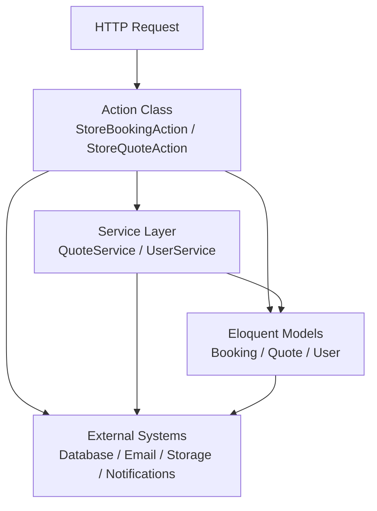
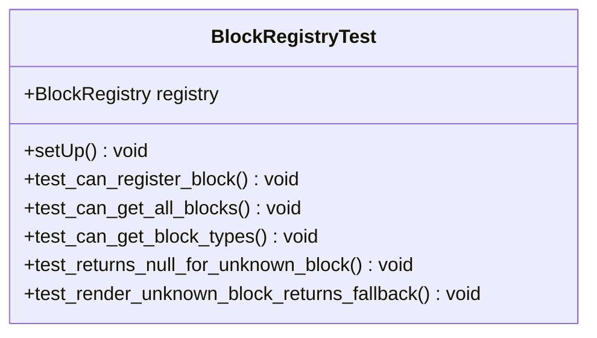
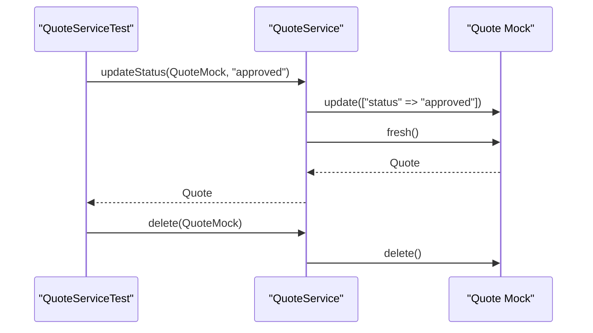
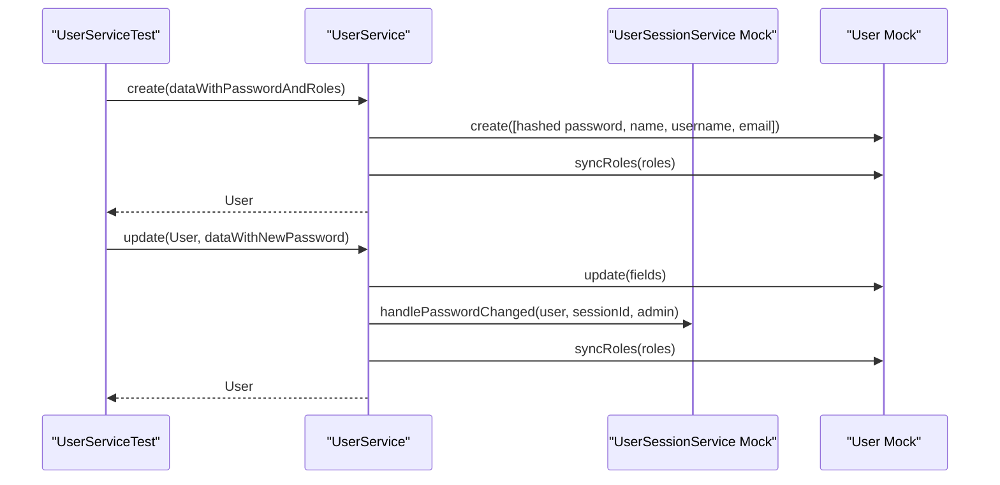
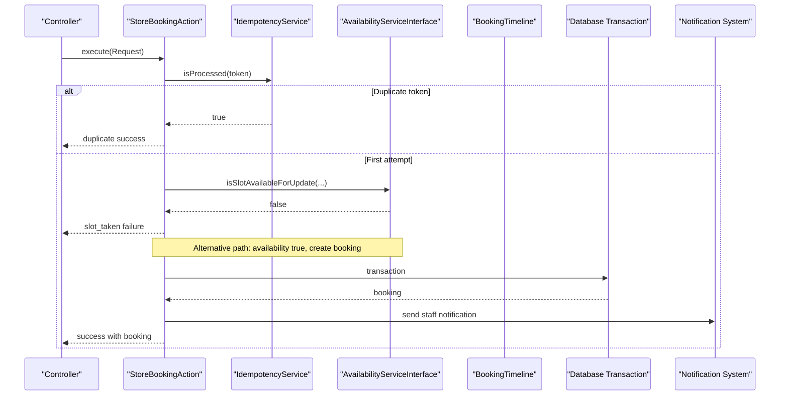
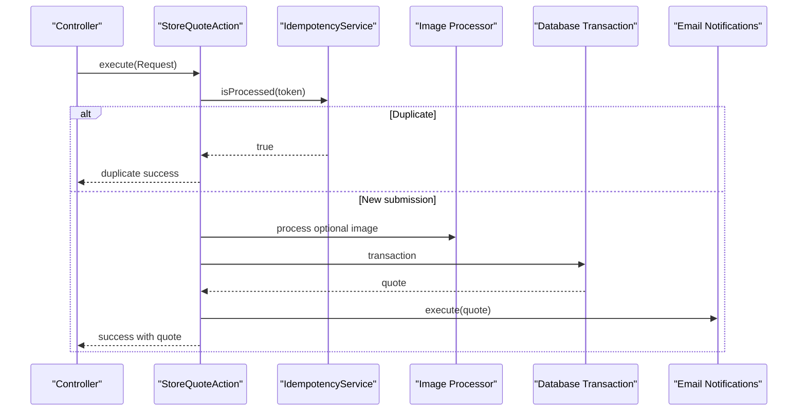
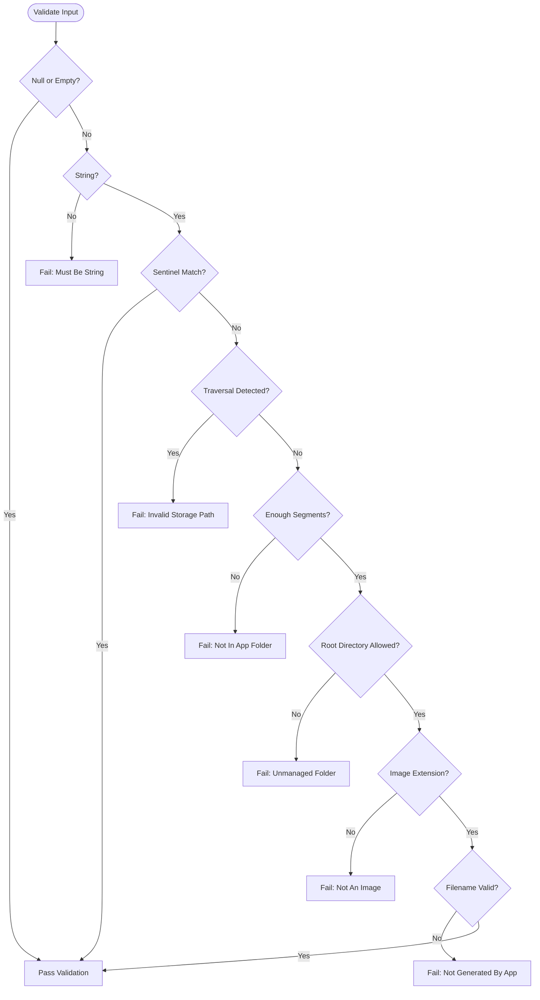
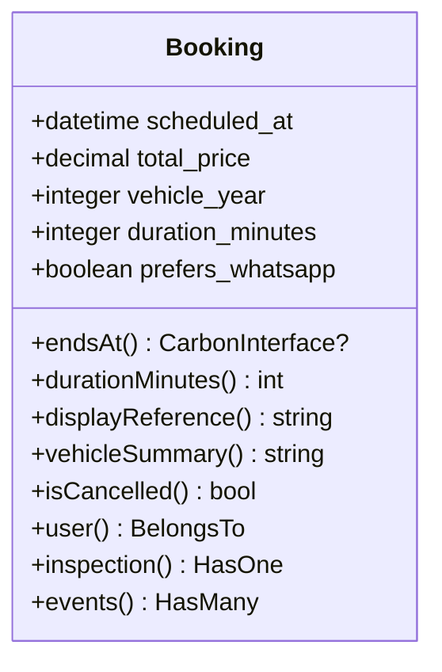
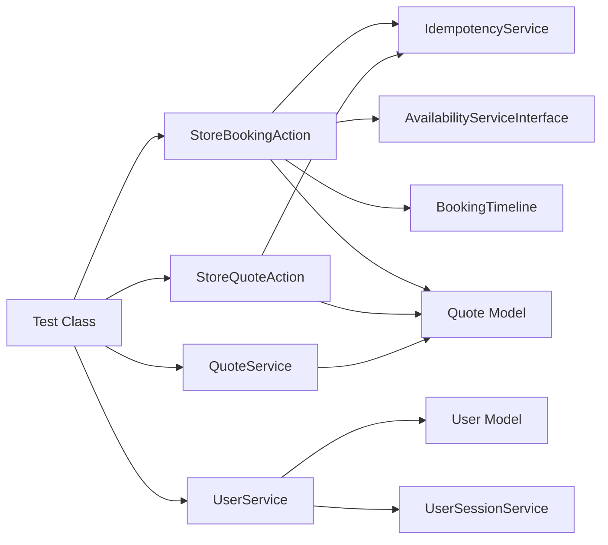

# Unit Testing

<cite>
**Referenced Files in This Document**
- [composer.json](file://composer.json)
- [phpunit.xml](file://phpunit.xml)
- [BlockRegistryTest.php](file://packages/ContentBlocks/tests/Unit/BlockRegistryTest.php)
- [QuoteService.php](file://app/Services/QuoteService.php)
- [UserService.php](file://app/Services/UserService.php)
- [StoreBookingAction.php](file://app/Actions/StoreBookingAction.php)
- [StoreQuoteAction.php](file://app/Actions/StoreQuoteAction.php)
- [Booking.php](file://app/Models/Booking.php)
- [SafeStoredUploadPath.php](file://app/Rules/SafeStoredUploadPath.php)
- [SortOrderIsUnique.php](file://app/Rules/SortOrderIsUnique.php)
- [helpers.php](file://app/Support/helpers.php)
</cite>

## Table of Contents
1. [Introduction](#introduction)
2. [Project Structure](#project-structure)
3. [Core Components](#core-components)
4. [Architecture Overview](#architecture-overview)
5. [Detailed Component Analysis](#detailed-component-analysis)
6. [Dependency Analysis](#dependency-analysis)
7. [Performance Considerations](#performance-considerations)
8. [Troubleshooting Guide](#troubleshooting-guide)
9. [Conclusion](#conclusion)

## Introduction
This document explains how to write unit tests for the Highblossom application using PHPUnit. It focuses on testing service classes, action classes, validation rules, and business logic while keeping external dependencies isolated. It also covers test organization, naming conventions, mocking strategies, error handling, edge cases, and boundary conditions.

The project is a Laravel application that uses PHPUnit 12 as its test framework, Mockery for mocking, and Testbench for package-level tests. The repository includes one existing unit test example inside the `highblossom/content-blocks` package, which demonstrates an Orchestra Testbench-based approach for package code.

## Project Structure
The repository follows standard Laravel conventions:
- Application code lives under `app/`.
- Tests are autoloaded from `tests/`, although no top-level application tests currently exist.
- Package tests live under `packages/ContentBlocks/tests/`.
- PHPUnit configuration is declared in `phpunit.xml`.
- Composer registers the `Tests\` namespace for autoloading.

**Diagram sources**
- [composer.json:1-138](file://composer.json#L1-L138)
- [phpunit.xml](file://phpunit.xml)

**Section sources**
- [composer.json:1-138](file://composer.json#L1-L138)
- [BlockRegistryTest.php:1-62](file://packages/ContentBlocks/tests/Unit/BlockRegistryTest.php#L1-L62)

## Core Components
This section maps key application components that benefit from unit testing:

| Component | Responsibility | Why Test It | Typical Dependencies |
|---|---|---|---|
| `App\Services\QuoteService` | Update quote status and delete quotes | Simple persistence operations with predictable state changes | Eloquent `Quote` model |
| `App\Services\UserService` | Create, update, and delete users; handle session revocation | Password hashing, role synchronization, and side effects | `UserSessionService`, `User` model, auth/session facades |
| `App\Actions\StoreBookingAction` | Process public booking submissions with idempotency, availability checks, image processing, and notifications | Complex orchestration with retries, transactions, logging, and external integrations | `IdempotencyService`, `AvailabilityServiceInterface`, `BookingTimeline`, DB/Image/Notification facades |
| `App\Actions\StoreQuoteAction` | Process quote submissions with idempotency, image upload, persistence, and email notifications | Orchestration with transaction boundaries and optional image processing | `IdempotencyService`, `SendQuoteEmailNotificationsAction`, Image/DB/Log facades |
| `App\Models\Booking` | Booking entity with computed attributes and relationships | Pure domain behavior without heavy infrastructure | Enums, factories, related models |
| `App\Rules\SafeStoredUploadPath` | Validate stored file paths against traversal and allowed directories | Security-critical input validation | None except built-in PHP functions |
| `App\Rules\SortOrderIsUnique` | Validate unique sort order within scopes | Business-rule validation with database lookup | Eloquent query through model class |
| `app/Support/helpers.php` | Public helper function for media URL resolution | Thin wrapper around package logic | `Highblossom\\ContentBlocks\Support\MediaUrl` |

**Section sources**
- [QuoteService.php:1-22](file://app/Services/QuoteService.php#L1-L22)
- [UserService.php:1-69](file://app/Services/UserService.php#L1-L69)
- [StoreBookingAction.php:1-200](file://app/Actions/StoreBookingAction.php#L1-L200)
- [StoreQuoteAction.php:1-160](file://app/Actions/StoreQuoteAction.php#L1-L160)
- [Booking.php:1-134](file://app/Models/Booking.php#L1-L134)
- [SafeStoredUploadPath.php:1-139](file://app/Rules/SafeStoredUploadPath.php#L1-L139)
- [SortOrderIsUnique.php:1-85](file://app/Rules/SortOrderIsUnique.php#L1-L85)
- [helpers.php:1-24](file://app/Support/helpers.php#L1-L24)

## Architecture Overview
At a high level, the application separates concerns into:
- **Actions**: Use-case orchestrators that coordinate services, models, and external systems.
- **Services**: Domain or cross-cutting responsibilities such as user management, quoting, and availability.
- **Models**: Eloquent entities with casts, relations, and computed attributes.
- **Rules**: Validation constraints that encapsulate business invariants.
- **Support**: Shared helpers and utility classes.

This architecture makes unit testing straightforward because:
- Actions can be tested by isolating their collaborators.
- Services can be tested against mocked models or interfaces.
- Rules can be tested directly with inputs and expected validation results.
- Helpers can be tested as thin wrappers around deterministic functions.

## Detailed Component Analysis

### PHPUnit Setup and Existing Example
The project declares PHPUnit 12 and Mockery as development dependencies. The only concrete test in the repository is a package-level test that uses Orchestra Testbench. That example shows:
- A test class extending `Orchestra\Testbench\TestCase`.
- A `setUp()` method that initializes collaborators.
- Multiple test methods verifying registration, retrieval, type listing, missing values, and fallback rendering.

**Diagram sources**
- [BlockRegistryTest.php:1-62](file://packages/ContentBlocks/tests/Unit/BlockRegistryTest.php#L1-L62)

**Section sources**
- [composer.json:1-138](file://composer.json#L1-L138)
- [BlockRegistryTest.php:1-62](file://packages/ContentBlocks/tests/Unit/BlockRegistryTest.php#L1-L62)

### Testing Service Classes

#### QuoteService
`QuoteService` provides two main operations:
- `updateStatus(Quote $quote, string $status)`: updates the quote status and returns a fresh instance.
- `delete(Quote $quote)`: deletes the quote.

Recommended test strategy:
- Inject a mock `Quote` object.
- Assert that `update()` is called with the expected status array.
- Assert that `fresh()` returns the expected result after status update.
- Assert that `delete()` is invoked for deletion.
- Avoid hitting the real database unless writing an integration test.

**Diagram sources**
- [QuoteService.php:1-22](file://app/Services/QuoteService.php#L1-L22)

**Section sources**
- [QuoteService.php:1-22](file://app/Services/QuoteService.php#L1-L22)

#### UserService
`UserService` handles user creation, updates, and deletion. Its `create()` method hashes passwords and optionally syncs roles. Its `update()` method supports password changes that trigger session revocation via `UserSessionService`, and it may sync roles.

Recommended test strategy:
- Mock `UserSessionService`.
- Use a mock `User` model or create a minimal Eloquent model stub if you need relationship-like behavior.
- For `create()`:
  - Assert that a new user record is created with hashed password and provided fields.
  - Assert `syncRoles()` is called when roles are present.
  - Assert `syncRoles()` is not called when roles are absent.
- For `update()`:
  - Assert field updates occur correctly.
  - Assert password change triggers `handlePasswordChanged()` on `UserSessionService`.
  - Assert session revocation is not triggered when no password is supplied.
  - Assert role synchronization occurs when roles are supplied.
- For `delete()`:
  - Assert `delete()` is called on the user model.

**Diagram sources**
- [UserService.php:1-69](file://app/Services/UserService.php#L1-L69)

**Section sources**
- [UserService.php:1-69](file://app/Services/UserService.php#L1-L69)

### Testing Action Classes

#### StoreBookingAction
`StoreBookingAction` implements a complex flow:
- Idempotency check.
- Availability reservation with retry logic for deadlocks.
- Booking creation with structured fields and derived reference.
- Optional damage photo processing.
- Staff notification dispatch.
- Centralized error logging.

Recommended test strategy:
- Mock `IdempotencyService`, `AvailabilityServiceInterface`, and `BookingTimeline`.
- Provide a real `Request` object or a mock with controlled inputs.
- Use a test double for `Booking` or inject a lightweight factory/stub for persistence.
- Cover these scenarios:
  - Duplicate submission returns duplicate success response.
  - Slot unavailable returns slot-taken failure.
  - Successful booking returns success response with booking data.
  - Deadlock retry behavior and exhaustion.
  - Damage photo processing success and failure.
  - Notification dispatch after successful booking.
  - Error path logs and returns generic failure response.

**Diagram sources**
- [StoreBookingAction.php:1-200](file://app/Actions/StoreBookingAction.php#L1-L200)

**Section sources**
- [StoreBookingAction.php:1-200](file://app/Actions/StoreBookingAction.php#L1-L200)

#### StoreQuoteAction
`StoreQuoteAction` processes quote submissions:
- Idempotency check.
- Optional image upload and processing.
- Database transaction to mark idempotency and create the quote.
- Email notification outside the transaction.
- Logging on errors.

Recommended test strategy:
- Mock `IdempotencyService` and `SendQuoteEmailNotificationsAction`.
- Control request inputs including optional image files.
- Verify:
  - Duplicate submission returns early success with duplicate flag.
  - Image upload is skipped when no file is provided.
  - Invalid images are logged and ignored.
  - Quote creation occurs inside a transaction.
  - Email notifications are dispatched only on success.
  - Exceptions return generic failure responses.

**Diagram sources**
- [StoreQuoteAction.php:1-160](file://app/Actions/StoreQuoteAction.php#L1-L160)

**Section sources**
- [StoreQuoteAction.php:1-160](file://app/Actions/StoreQuoteAction.php#L1-L160)

### Testing Validation Rules

#### SafeStoredUploadPath
This rule validates that stored paths are safe:
- Rejects null/empty values early.
- Requires string values.
- Accepts an optional sentinel value.
- Detects path traversal, absolute paths, control characters, backslashes, dot segments, and empty segments.
- Restricts top-level directories to an allowed list.
- Requires an image extension.
- Validates filename format.

Recommended test strategy:
- Construct the rule with default or custom allowed directories.
- Use a validator facade or direct `validate()` invocation depending on your test environment.
- Test:
  - Null and empty inputs pass validation.
  - Non-string inputs fail.
  - Sentinel values bypass normal validation.
  - Path traversal patterns fail.
  - Absolute paths fail.
  - Disallowed root directories fail.
  - Non-image extensions fail.
  - Malformed filenames fail.
  - Allowed paths pass.

**Diagram sources**
- [SafeStoredUploadPath.php:1-139](file://app/Rules/SafeStoredUploadPath.php#L1-L139)

**Section sources**
- [SafeStoredUploadPath.php:1-139](file://app/Rules/SafeStoredUploadPath.php#L1-L139)

#### SortOrderIsUnique
This rule ensures sort order uniqueness within a scope:
- Uses a model class and optional scope values.
- Ignores the current record by ID when editing.
- Builds scope values from submitted input or existing model attributes.
- Delegates existence checking to `Model::findBySortOrder()`.
- Produces a human-readable message naming the conflicting record.

Recommended test strategy:
- Use a testable model that implements `sortOrderScopeColumns()`, `sortOrderLabelColumn()`, and `findBySortOrder()`.
- Test:
  - Null or empty values pass.
  - Unique values pass.
  - Conflicting values fail with a meaningful message.
  - Current record is excluded by ignore ID.
  - Scope values come from input when available and fall back to stored model attributes.

**Section sources**
- [SortOrderIsUnique.php:1-85](file://app/Rules/SortOrderIsUnique.php#L1-L85)

### Testing Models and Domain Logic

#### Booking Model
`Booking` defines fills, casts, computed attributes, relationships, and display helpers:
- `endsAt()` computes booking end time from scheduled time and duration.
- `durationMinutes()` returns a minimum duration with fallback.
- `displayReference()` generates a formatted reference or fallback.
- `vehicleSummary()` builds a customer-visible vehicle summary.
- Relationships include user, inspection, and booking events.

Recommended test strategy:
- Use `BookingFactory` to create test records.
- Assert computed attributes for various combinations of `scheduled_at` and `duration_minutes`.
- Assert reference formatting for both populated and legacy references.
- Assert vehicle summary construction across partial and full vehicle data.
- Assert relationship existence where appropriate.

**Diagram sources**
- [Booking.php:1-134](file://app/Models/Booking.php#L1-L134)

**Section sources**
- [Booking.php:1-134](file://app/Models/Booking.php#L1-L134)

### Testing Helper Functions

#### media_url Helper
The helper wraps `MediaUrl::asset()` to resolve stored media references into URLs. Because it delegates entirely to another class, unit tests should focus on:
- Blank input returning null.
- Normal storage paths being transformed deterministically.
- Legacy `/storage/...` references being handled consistently.
- External URLs passing through unchanged.

Since the helper is a thin wrapper, prefer tests that verify contract behavior rather than implementation details.

**Section sources**
- [helpers.php:1-24](file://app/Support/helpers.php#L1-L24)

## Dependency Analysis
The following diagram shows how unit tests should isolate dependencies for the most complex components:

**Diagram sources**
- [StoreBookingAction.php:1-200](file://app/Actions/StoreBookingAction.php#L1-L200)
- [StoreQuoteAction.php:1-160](file://app/Actions/StoreQuoteAction.php#L1-L160)
- [QuoteService.php:1-22](file://app/Services/QuoteService.php#L1-L22)
- [UserService.php:1-69](file://app/Services/UserService.php#L1-L69)

**Section sources**
- [StoreBookingAction.php:1-200](file://app/Actions/StoreBookingAction.php#L1-L200)
- [StoreQuoteAction.php:1-160](file://app/Actions/StoreQuoteAction.php#L1-L160)
- [QuoteService.php:1-22](file://app/Services/QuoteService.php#L1-L22)
- [UserService.php:1-69](file://app/Services/UserService.php#L1-L69)

## Performance Considerations
- Prefer unit tests that do not touch the database, network, filesystem, or mail servers.
- Mock expensive operations such as image resizing, email sending, and remote API calls.
- Keep test data small and deterministic.
- Use factories for realistic but minimal model instances when needed.
- Avoid unnecessary setup in shared `setUp()` methods; initialize per-test dependencies when they differ significantly.
- For actions with retry logic, cap retry counts in tests to keep execution fast.

[No sources needed since this section provides general guidance]

## Troubleshooting Guide

### Common PHPUnit Issues
- **Namespace mismatch**: Ensure test classes use the correct namespace and that `Tests\` is autoloaded by Composer.
- **Missing configuration**: If tests rely on Laravel features, ensure `phpunit.xml` boots the application appropriately.
- **Facade access**: When testing code that uses facades like `DB`, `Image`, or `Notification`, either mock them or enable Laravel’s container in tests.
- **Time-sensitive logic**: Use frozen time or explicit timestamps for datetime-dependent assertions.
- **Filesystem tests**: Use in-memory or temporary disk configurations instead of real storage.

### Error Handling Patterns to Test
- **Logging on failure**: Verify that exceptions are caught and logged where applicable.
- **User-facing messages**: Assert that error responses contain stable, non-leaky messages.
- **Partial failures**: For optional steps like image uploads, assert that failure does not roll back unrelated success states unless required.
- **Retry boundaries**: For deadlock or transient failure retries, assert maximum attempts and final failure behavior.

**Section sources**
- [StoreBookingAction.php:1-200](file://app/Actions/StoreBookingAction.php#L1-L200)
- [StoreQuoteAction.php:1-160](file://app/Actions/StoreQuoteAction.php#L1-L160)

## Conclusion
Highblossom’s architecture is well suited to unit testing:
- Actions coordinate workflows and should be tested by isolating services, models, and external systems.
- Services encapsulate business logic and should be tested against mocks or lightweight test doubles.
- Validation rules are ideal candidates for pure unit tests with focused input/output assertions.
- Models represent domain state and computed behavior and benefit from factory-backed tests.
- Helpers should be tested for contract correctness without reimplementing downstream logic.

Adopt consistent naming, clear separation between unit and integration tests, and strict isolation of external dependencies. This keeps the test suite fast, reliable, and maintainable as the application grows.