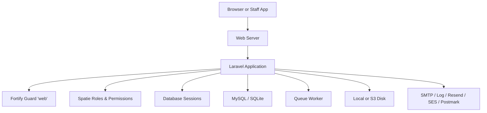
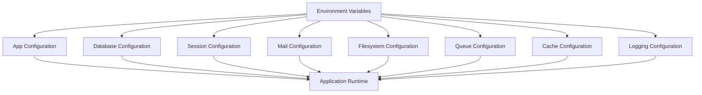
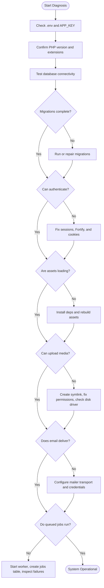

# Common Issues and Solutions

<cite>
**Referenced Files in This Document**   
- [composer.json](file://composer.json)
- [package.json](file://package.json)
- [.env.example](file://.env.example)
- [Dockerfile](file://Dockerfile)
- [docker-compose.yml](file://docker-compose.yml)
- [bootstrap/app.php](file://bootstrap/app.php)
- [routes/web.php](file://routes/web.php)
- [routes/api.php](file://routes/api.php)
- [routes/admin.php](file://routes/admin.php)
- [config/app.php](file://config/app.php)
- [config/database.php](file://config/database.php)
- [config/session.php](file://config/session.php)
- [config/mail.php](file://config/mail.php)
- [config/filesystems.php](file://config/filesystems.php)
- [config/queue.php](file://config/queue.php)
- [config/cache.php](file://config/cache.php)
- [config/logging.php](file://config/logging.php)
- [config/fortify.php](file://config/fortify.php)
- [vite.config.js](file://vite.config.js)
- [app/Support/helpers.php](file://app/Support/helpers.php)
</cite>

## Table of Contents
1. [Introduction](#introduction)
2. [Project Structure](#project-structure)
3. [Core Components](#core-components)
4. [Architecture Overview](#architecture-overview)
5. [Detailed Component Analysis](#detailed-component-analysis)
6. [Dependency Analysis](#dependency-analysis)
7. [Performance Considerations](#performance-considerations)
8. [Troubleshooting Guide](#troubleshooting-guide)
9. [Conclusion](#conclusion)

## Introduction
This document is a practical troubleshooting manual for the Highblossom application. It focuses on errors you are most likely to encounter during installation, development, deployment, and daily operation. Each issue includes the typical symptoms, root cause, and step-by-step resolution based on the project’s configuration and environment.

The application is a Laravel 13 Livewire project that uses:
- PHP 8.2 or later (container image runs PHP 8.4).
- MySQL 8 by default in Docker Compose.
- Database-backed sessions, cache, queues, and jobs.
- Fortify for authentication, including registration, password reset, email verification, two-factor authentication, and passkeys.
- Spatie permissions for authorization.
- Vite for asset compilation.
- Flysystem with a local or S3-compatible public disk for uploaded media.
- A staff API under `/api/staff` protected by Sanctum tokens.

## Project Structure
The repository follows standard Laravel conventions with an additional `packages/ContentBlocks` path repository, admin routes registered through the bootstrap layer, and a dedicated staff API route file.

```mermaid
graph TB
    Composer["composer.json<br/>PHP and framework dependencies"]
    NPM["package.json<br/>Frontend build dependencies"]
    Env[".env.example<br/>Environment defaults"]
    Bootstrap["bootstrap/app.php<br/>Application bootstrapping"]
    WebRoutes["routes/web.php<br/>Public web routes"]
    AdminRoutes["routes/admin.php<br/>Admin panel routes"]
    ApiRoutes["routes/api.php<br/>Staff API routes"]
    ConfigApp["config/app.php<br/>App name, URL, timezone, locale, key"]
    ConfigDb["config/database.php<br/>Database connections and Redis"]
    ConfigMail["config/mail.php<br/>Default mailer and transports"]
    ConfigFs["config/filesystems.php<br/>Local and S3 disks"]
    ConfigQueue["config/queue.php<br/>Job queue backends"]
    ConfigSession["config/session.php<br/>Session storage and cookies"]
    ConfigCache["config/cache.php<br/>Cache stores"]
    ConfigLogging["config/logging.php<br/>Log channels"]
    ConfigFortify["config/fortify.php<br/>Authentication features"]
    Vite["vite.config.js<br/>Vite entry points"]
    Dockerfile["Dockerfile<br/>Container build steps"]
    Compose["docker-compose.yml<br/>Local services"]

    Composer --> Bootstrap
    NPM --> Vite
    Env --> ConfigApp
    Env --> ConfigDb
    Env --> ConfigMail
    Env --> ConfigFs
    Env --> ConfigQueue
    Env --> ConfigSession
    Env --> ConfigCache
    Env --> ConfigLogging
    Bootstrap --> WebRoutes
    Bootstrap --> AdminRoutes
    Bootstrap --> ApiRoutes
    Dockerfile --> Compose
```

**Diagram sources**
- [composer.json:1-138](file://composer.json#L1-L138)
- [package.json:1-35](file://package.json#L1-L35)
- [.env.example:1-83](file://.env.example#L1-L83)
- [bootstrap/app.php:1-71](file://bootstrap/app.php#L1-L71)
- [routes/web.php:1-76](file://routes/web.php#L1-L76)
- [routes/api.php:1-117](file://routes/api.php#L1-L117)
- [routes/admin.php:1-171](file://routes/admin.php#L1-L171)
- [config/app.php:1-126](file://config/app.php#L1-L126)
- [config/database.php:1-184](file://config/database.php#L1-L184)
- [config/mail.php:1-123](file://config/mail.php#L1-L123)
- [config/filesystems.php:1-109](file://config/filesystems.php#L1-L109)
- [config/queue.php:1-128](file://config/queue.php#L1-L128)
- [config/session.php:1-200](file://config/session.php#L1-L200)
- [config/cache.php:1-146](file://config/cache.php#L1-L146)
- [config/logging.php:1-132](file://config/logging.php#L1-L132)
- [config/fortify.php:1-162](file://config/fortify.php#L1-L162)
- [vite.config.js:1-33](file://vite.config.js#L1-L33)
- [Dockerfile:1-32](file://Dockerfile#L1-L32)
- [docker-compose.yml:1-31](file://docker-compose.yml#L1-L31)

**Section sources**
- [composer.json:1-138](file://composer.json#L1-L138)
- [package.json:1-35](file://package.json#L1-L35)
- [bootstrap/app.php:1-71](file://bootstrap/app.php#L1-L71)
- [routes/web.php:1-76](file://routes/web.php#L1-L76)
- [routes/api.php:1-117](file://routes/api.php#L1-L117)
- [routes/admin.php:1-171](file://routes/admin.php#L1-L171)

## Core Components
This section summarizes the subsystems most often involved in common issues.

| Area | Configuration or Entry Point | Purpose | Typical Failure Mode |
|---|---|---|---|
| Runtime requirements | `composer.json`, `Dockerfile` | Enforces PHP version and required extensions | Dependency conflicts, missing extensions, wrong PHP version |
| Environment | `.env.example`, `config/app.php` | Application name, URL, debug mode, encryption key, locale | Missing `APP_KEY`, wrong `APP_URL`, debug leaks |
| Database | `config/database.php`, `docker-compose.yml` | MySQL connection, SQLite fallback, Redis settings | Connection refused, wrong credentials, missing tables |
| Sessions | `config/session.php`, `.env.example` | Database session driver, cookie security | Logout loops, cross-site cookie rejection |
| Mail | `config/mail.php`, `.env.example` | Default log mailer, SMTP, Resend, SES, Postmark | Emails written to logs instead of delivery |
| Filesystem | `config/filesystems.php`, `app/Support/helpers.php` | Local and S3 public disk, symlink, helper URL resolver | Missing storage link, unreadable uploads, broken media URLs |
| Queues | `config/queue.php`, `.env.example` | Database-backed jobs and failed job table | Jobs never run, no output from workers |
| Cache | `config/cache.php`, `.env.example` | Database cache store, serializable classes | Cache serialization errors or stale config |
| Logging | `config/logging.php`, `.env.example` | Stack, single, daily, Slack, stderr logging | Logs not written, production debugging visible |
| Authentication | `config/fortify.php`, `bootstrap/app.php` | Login, registration, verification, 2FA, passkeys | Redirect loops, missing guards, feature disabled |
| Authorization | `bootstrap/app.php`, `routes/admin.php`, `routes/api.php` | Role and permission middleware, `can:` gates | Forbidden responses, missing abilities |
| Frontend assets | `package.json`, `vite.config.js` | Tailwind, Alpine, CKEditor, Vite entries | Blank styles, missing scripts, build failures |

**Section sources**
- [composer.json:1-138](file://composer.json#L1-L138)
- [Dockerfile:1-32](file://Dockerfile#L1-L32)
- [.env.example:1-83](file://.env.example#L1-L83)
- [config/app.php:1-126](file://config/app.php#L1-L126)
- [config/database.php:1-184](file://config/database.php#L1-L184)
- [config/session.php:1-200](file://config/session.php#L1-L200)
- [config/mail.php:1-123](file://config/mail.php#L1-L123)
- [config/filesystems.php:1-109](file://config/filesystems.php#L1-L109)
- [config/queue.php:1-128](file://config/queue.php#L1-L128)
- [config/cache.php:1-146](file://config/cache.php#L1-L146)
- [config/logging.php:1-132](file://config/logging.php#L1-L132)
- [config/fortify.php:1-162](file://config/fortify.php#L1-L162)
- [bootstrap/app.php:1-71](file://bootstrap/app.php#L1-L71)
- [routes/admin.php:1-171](file://routes/admin.php#L1-L171)
- [routes/api.php:1-117](file://routes/api.php#L1-L117)
- [package.json:1-35](file://package.json#L1-L35)
- [vite.config.js:1-33](file://vite.config.js#L1-L33)

## Architecture Overview
Highblossom separates three request surfaces:

1. Public web requests handled by `routes/web.php`.
2. Admin panel requests grouped under `/admin`, loaded through `bootstrap/app.php`.
3. Staff mobile app JSON requests under `/api/staff`, protected by Sanctum and Spatie permissions.

**Diagram sources**
- [bootstrap/app.php:1-71](file://bootstrap/app.php#L1-L71)
- [routes/web.php:1-76](file://routes/web.php#L1-L76)
- [routes/api.php:1-117](file://routes/api.php#L1-L117)
- [routes/admin.php:1-171](file://routes/admin.php#L1-L171)
- [config/fortify.php:1-162](file://config/fortify.php#L1-L162)
- [config/session.php:1-200](file://config/session.php#L1-L200)
- [config/database.php:1-184](file://config/database.php#L1-L184)
- [config/queue.php:1-128](file://config/queue.php#L1-L128)
- [config/filesystems.php:1-109](file://config/filesystems.php#L1-L109)
- [config/mail.php:1-123](file://config/mail.php#L1-L123)

## Detailed Component Analysis

### Installation and Environment Setup Failures

#### Symptom: Composer dependency conflict or unsupported PHP version
- **Root cause**: The project requires PHP 8.2 or later and Laravel 13. Running an older PHP version or using mismatched package versions can fail dependency resolution.
- **Resolution**:
  - Confirm PHP version matches the requirement.
  - Reinstall dependencies without platform checks only when necessary, then fix actual compatibility problems.
  - Clear autoload and discovery caches after updates.
  - In Docker, the image installs extensions such as PDO MySQL, PDO PostgreSQL, MySQLi, Bcmath, GD, Intl, Zip, OPcache, PCNTL, and Exif.

**Section sources**
- [composer.json:1-60](file://composer.json#L1-L60)
- [composer.json:61-138](file://composer.json#L1-L138)
- [Dockerfile:1-32](file://Dockerfile#L1-L32)

#### Symptom: Missing application key or invalid encrypted values
- **Root cause**: `APP_KEY` is required for encryption, cookies, and secure operations.
- **Resolution**:
  - Generate a new key.
  - Clear configuration caches if the key was changed at runtime.
  - Verify `APP_ENV`, `APP_DEBUG`, and `APP_URL` before deployment.

**Section sources**
- [config/app.php:1-126](file://config/app.php#L1-L126)
- [composer.json:98-138](file://composer.json#L98-L138)

#### Symptom: Maintenance mode blocks access unexpectedly
- **Root cause**: Maintenance mode driver may be set to `file` or `cache`, and the maintenance flag remains active.
- **Resolution**:
  - Check the configured maintenance driver and store.
  - Remove or clear the maintenance state file or cache entry.
  - Avoid leaving maintenance mode enabled in production.

**Section sources**
- [config/app.php:89-126](file://config/app.php#L89-L126)
- [.env.example:1-20](file://.env.example#L1-L20)

#### Symptom: Docker container cannot reach the database
- **Root cause**: Container environment overrides database host, database name, username, and password; the MySQL service may not be ready.
- **Resolution**:
  - Confirm `DB_CONNECTION=mysql`, `DB_HOST=db`, and matching credentials.
  - Ensure MySQL service is running and the `app` database exists.
  - Retry migrations after the database is available.

**Section sources**
- [docker-compose.yml:1-31](file://docker-compose.yml#L1-L31)
- [config/database.php:1-184](file://config/database.php#L1-L184)

### Database Connection Issues

#### Symptom: “Connection refused” or incorrect credentials
- **Root cause**: Wrong `DB_CONNECTION`, `DB_HOST`, `DB_PORT`, `DB_DATABASE`, `DB_USERNAME`, or `DB_PASSWORD`.
- **Resolution**:
  - Validate each database environment variable.
  - Test connectivity outside Laravel first.
  - For local SQLite, ensure the database file exists and is writable.

**Section sources**
- [.env.example:15-25](file://.env.example#L15-L25)
- [config/database.php:1-184](file://config/database.php#L1-L184)

#### Symptom: SSL or extension error with MySQL
- **Root cause**: Missing PDO MySQL extension or incompatible SSL attribute usage depending on PHP version.
- **Resolution**:
  - Enable `pdo_mysql` and `mysqli`.
  - Set `MYSQL_ATTR_SSL_CA` only when needed.
  - Use the Docker image, which already installs required extensions.

**Section sources**
- [config/database.php:40-90](file://config/database.php#L40-L90)
- [Dockerfile:18-32](file://Dockerfile#L18-L32)

### Migration Failures

#### Symptom: Migration fails because the migration table does not exist
- **Root cause**: The application expects a `migrations` table, but the schema has not been created yet.
- **Resolution**:
  - Run migrations with the force flag when appropriate.
  - If the migration record is out of sync, inspect the migration repository table and restore consistency carefully.

**Section sources**
- [config/database.php:156-170](file://config/database.php#L156-L170)
- [composer.json:106-116](file://composer.json#L106-L116)

#### Symptom: Unique index or constraint failure
- **Root cause**: Existing data violates new unique indexes or constraints added by later migrations.
- **Resolution**:
  - Identify the failing migration by its timestamp.
  - Inspect existing rows that break uniqueness.
  - Back up data, adjust records, or use a targeted migration fix rather than blindly dropping constraints.

**Section sources**
- [database/migrations/2026_10_01_000000_replace_unique_index_on_bookings_scheduled_at.php](file://database/migrations/2026_10_01_000000_replace_unique_index_on_bookings_scheduled_at.php)
- [database/migrations/2026_06_10_184301_add_unique_constraints_to_poll_votes_table.php](file://database/migrations/2026_06_10_184301_add_unique_constraints_to_poll_votes_table.php)

### Seeding Problems

#### Symptom: Seeders run but roles, permissions, or base data are missing
- **Root cause**: Seeder order depends on the database seeder, and some seeders depend on earlier tables.
- **Resolution**:
  - Run the main database seeder.
  - If only roles and permissions are missing, run the dedicated seeder.
  - Clear configuration and cache before rerunning seeders.

**Section sources**
- [database/seeders/DatabaseSeeder.php](file://database/seeders/DatabaseSeeder.php)
- [database/seeders/RolesAndPermissionsSeeder.php](file://database/seeders/RolesAndPermissionsSeeder.php)
- [composer.json:106-116](file://composer.json#L106-L116)

### File Permission Errors and Storage Access Issues

#### Symptom: Uploads fail silently or images do not appear
- **Root cause**: The public filesystem disk writes to `storage/app/public` locally, and the web server must serve them through the `/storage` symlink.
- **Resolution**:
  - Create the storage symlink.
  - Ensure the web user owns `storage` and `bootstrap/cache`.
  - For S3, verify `PUBLIC_DISK_DRIVER=s3` and all AWS-related variables.

**Section sources**
- [config/filesystems.php:1-109](file://config/filesystems.php#L1-L109)
- [.env.example:53-83](file://.env.example#L53-L83)
- [Dockerfile:28-32](file://Dockerfile#L28-L32)

#### Symptom: Media URLs resolve incorrectly after switching to object storage
- **Root cause**: Code should resolve media through the helper function rather than hard-coded asset paths.
- **Resolution**:
  - Use the application’s media URL helper.
  - Confirm the public disk URL or bucket endpoint is correct.

**Section sources**
- [app/Support/helpers.php:1-24](file://app/Support/helpers.php#L1-L24)
- [config/filesystems.php:33-84](file://config/filesystems.php#L33-L84)

### Asset Compilation Failures

#### Symptom: Frontend assets are missing, blank, or development hot reload does not work
- **Root cause**: Node modules are not installed, Vite build fails, or the wrong entry files are used.
- **Resolution**:
  - Install frontend dependencies.
  - Run development server or production build.
  - Confirm Vite input paths match the CSS and JavaScript files in `resources/css` and `resources/js`.

**Section sources**
- [package.json:1-35](file://package.json#L1-L35)
- [vite.config.js:1-33](file://vite.config.js#L1-L33)

### Email Delivery and Notification Failures

#### Symptom: Emails are logged instead of delivered
- **Root cause**: Default mailer is `log`; this is safe for development but does not deliver messages.
- **Resolution**:
  - Switch `MAIL_MAILER` to `smtp`, `resend`, `ses`, `postmark`, or another transport.
  - Configure host, port, scheme, username, password, or provider credentials.
  - Verify the global `from` address and name.

**Section sources**
- [config/mail.php:1-123](file://config/mail.php#L1-L123)
- [.env.example:40-51](file://.env.example#L40-L51)

#### Symptom: SMTP authentication or TLS errors
- **Root cause**: Incorrect SMTP host, port, scheme, credentials, or domain.
- **Resolution**:
  - Validate `MAIL_SCHEME`, `MAIL_HOST`, `MAIL_PORT`, `MAIL_USERNAME`, and `MAIL_PASSWORD`.
  - Use `MAIL_URL` when supported by your provider.
  - Test with a simple mailer command before integrating into workflows.

**Section sources**
- [config/mail.php:29-50](file://config/mail.php#L29-L50)
- [.env.example:40-51](file://.env.example#L40-L51)

### Authentication Problems

#### Symptom: Login redirects repeatedly or login fails
- **Root cause**: Fortify guard is `web`, redirect home is `/dashboard`, and authentication requires working sessions, encryption, and correct credentials.
- **Resolution**:
  - Confirm `APP_KEY` exists.
  - Check session driver and database-backed session table.
  - Verify Fortify features such as registration, email verification, two-factor, and passkeys are enabled as intended.
  - Inspect validation exceptions for passkey routes through the custom exception renderer.

**Section sources**
- [config/fortify.php:1-162](file://config/fortify.php#L1-L162)
- [config/session.php:1-200](file://config/session.php#L1-L200)
- [bootstrap/app.php:43-71](file://bootstrap/app.php#L43-L71)

#### Symptom: Registration is blocked
- **Root cause**: The `registration.enabled` middleware protects registration routes.
- **Resolution**:
  - Check the company setting controlling registration.
  - Temporarily allow registration only for testing; never leave it open in production.

**Section sources**
- [bootstrap/app.php:28-41](file://bootstrap/app.php#L28-L41)
- [config/fortify.php:78-100](file://config/fortify.php#L78-L100)

#### Symptom: Passkey login returns a generic validation error
- **Root cause**: Passkey failures go through a custom exception handler that converts validation exceptions into structured JSON for the client.
- **Resolution**:
  - Inspect the response message, reason, and nested errors.
  - Review passkey challenge validity and stored challenges.

**Section sources**
- [bootstrap/app.php:43-71](file://bootstrap/app.php#L43-L71)
- [config/fortify.php:122-162](file://config/fortify.php#L122-L162)

### Session Handling Issues

#### Symptom: Users are logged out immediately or across tabs
- **Root cause**: Session driver is database-backed, requiring the sessions table; HTTPS hosts require secure cookies; cookie path/domain may differ between environments.
- **Resolution**:
  - Run the session migration.
  - For HTTPS, ensure `SESSION_SECURE_COOKIE=true`.
  - Align `SESSION_PATH`, `SESSION_DOMAIN`, and `APP_URL`.
  - If switching drivers, flush old sessions.

**Section sources**
- [.env.example:27-39](file://.env.example#L27-L39)
- [config/session.php:1-200](file://config/session.php#L1-L200)

#### Symptom: CSRF or session cookie rejected by browser
- **Root cause**: Cross-site cookie policy, wrong domain, or missing secure flag on HTTPS.
- **Resolution**:
  - Use the same domain for origin and session cookie domain.
  - Enable secure cookies on HTTPS.
  - Set SameSite appropriately for cross-site flows.

**Section sources**
- [config/session.php:140-200](file://config/session.php#L140-L200)
- [.env.example:27-39](file://.env.example#L27-L39)

### Authorization Failures

#### Symptom: Admin routes return forbidden or unauthorized responses
- **Root cause**: Admin routes require authentication, consent, optional email verification, and Spatie roles or permissions.
- **Resolution**:
  - Log in as a user with the required ability.
  - Assign roles and permissions through the application’s authorization system.
  - Verify the `role`, `permission`, and `role_or_permission` middleware aliases are registered.

**Section sources**
- [bootstrap/app.php:28-41](file://bootstrap/app.php#L28-L41)
- [routes/admin.php:1-171](file://routes/admin.php#L1-L171)

#### Symptom: Staff API endpoints return 401 or 403
- **Root cause**: Endpoints under `/api/staff` require Sanctum authentication and specific Spatie abilities.
- **Resolution**:
  - Obtain a valid Sanctum token through the staff login endpoint.
  - Include the token in subsequent requests.
  - Grant the user the required abilities for the requested resource.

**Section sources**
- [routes/api.php:1-117](file://routes/api.php#L1-L117)

### Queue and Job Processing Failures

#### Symptom: Jobs never execute
- **Root cause**: The queue driver is database-backed, but the worker is not running, or the jobs table is missing.
- **Resolution**:
  - Start a queue worker.
  - Run the queue migration.
  - Inspect failed jobs if they repeatedly fail.

**Section sources**
- [config/queue.php:1-128](file://config/queue.php#L1-L128)
- [.env.example:43-47](file://.env.example#L43-L47)

#### Symptom: Failed jobs are not recorded or queries are slow
- **Root cause**: Failed job storage uses a database table, and large logs or job batches can add load.
- **Resolution**:
  - Ensure the failed jobs table exists.
  - Monitor job batch progress.
  - Adjust retry behavior and queue timeouts.

**Section sources**
- [config/queue.php:90-128](file://config/queue.php#L90-L128)

### Caching and Configuration Problems

#### Symptom: Changes to configuration or cache do not take effect
- **Root cause**: Cached configuration or database-backed cache stores retain old values.
- **Resolution**:
  - Clear configuration cache.
  - Flush the cache store if needed.
  - Restart workers after changing environment configuration.

**Section sources**
- [config/cache.php:1-146](file://config/cache.php#L1-L146)
- [composer.json:118-138](file://composer.json#L118-L138)

#### Symptom: Serialization error involving models in cache
- **Root cause**: Only explicitly listed classes are unserialized from cache.
- **Resolution**:
  - Add required model classes to the serializable classes list only when trusted.
  - Avoid caching untrusted objects.

**Section sources**
- [config/cache.php:114-146](file://config/cache.php#L114-L146)

### Logging and Debugging

#### Symptom: Logs are empty or too verbose
- **Root cause**: Log channel, stack, level, and destination vary by environment.
- **Resolution**:
  - Set `LOG_CHANNEL` and `LOG_STACK` appropriately.
  - In Docker, stderr logging is configured.
  - Reduce log level in production to avoid performance impact.

**Section sources**
- [config/logging.php:1-132](file://config/logging.php#L1-L132)
- [.env.example:11-14](file://.env.example#L11-L14)
- [docker-compose.yml:8-18](file://docker-compose.yml#L8-L18)

## Dependency Analysis
The following diagram shows how configuration files drive runtime behavior and where common misconfiguration appears.

**Diagram sources**
- [.env.example:1-83](file://.env.example#L1-L83)
- [config/app.php:1-126](file://config/app.php#L1-L126)
- [config/database.php:1-184](file://config/database.php#L1-L184)
- [config/session.php:1-200](file://config/session.php#L1-L200)
- [config/mail.php:1-123](file://config/mail.php#L1-L123)
- [config/filesystems.php:1-109](file://config/filesystems.php#L1-L109)
- [config/queue.php:1-128](file://config/queue.php#L1-L128)
- [config/cache.php:1-146](file://config/cache.php#L1-L146)
- [config/logging.php:1-132](file://config/logging.php#L1-L132)

**Section sources**
- [.env.example:1-83](file://.env.example#L1-L83)
- [config/app.php:1-126](file://config/app.php#L1-L126)
- [config/database.php:1-184](file://config/database.php#L1-L184)
- [config/session.php:1-200](file://config/session.php#L1-L200)
- [config/mail.php:1-123](file://config/mail.php#L1-L123)
- [config/filesystems.php:1-109](file://config/filesystems.php#L1-L109)
- [config/queue.php:1-128](file://config/queue.php#L1-L128)
- [config/cache.php:1-146](file://config/cache.php#L1-L146)
- [config/logging.php:1-132](file://config/logging.php#L1-L132)

## Performance Considerations
- Keep `APP_DEBUG=false` in production to reduce overhead and prevent sensitive information disclosure.
- Prefer Redis or Memcached over database-backed cache and sessions for high traffic.
- Use a proper queue backend such as Redis or SQS when job volume grows beyond the database driver.
- Rotate or limit log verbosity in production.
- Avoid caching untrusted objects; restrict serializable classes to known models.
- Use object storage for uploaded media in production to avoid ephemeral instance loss.

[No sources needed since this section provides general guidance]

## Troubleshooting Guide

### Step-by-Step Diagnostic Flow

### Quick Reference Checklist

| Area | Command or Action | What It Fixes |
|---|---|---|
| Dependencies | `composer install` | PHP packages and autoloader |
| Environment | Copy `.env.example`, generate key | Missing environment and encryption key |
| Database | `php artisan migrate --force` | Schema and migration tracking |
| Frontend | `npm install`, `npm run build` | Missing or outdated assets |
| Storage | Create storage symlink | Unreadable or inaccessible public uploads |
| Sessions | Run session migration | Database-backed session failures |
| Cache | Clear configuration and cache | Stale config or cache values |
| Queue | Start worker | Pending or failed jobs |
| Mail | Configure transport | Emails written to logs instead of delivery |

**Section sources**
- [composer.json:98-138](file://composer.json#L98-L138)
- [package.json:1-35](file://package.json#L1-L35)
- [.env.example:1-83](file://.env.example#L1-L83)
- [config/session.php:1-200](file://config/session.php#L1-L200)
- [config/filesystems.php:1-109](file://config/filesystems.php#L1-L109)
- [config/queue.php:1-128](file://config/queue.php#L1-L128)
- [config/mail.php:1-123](file://config/mail.php#L1-L123)

## Conclusion
Most Highblossom issues trace back to one of six areas: environment configuration, database connectivity, sessions and cookies, filesystem permissions, asset builds, or service integrations such as mail, queues, and storage. Use the diagnostic flow above to isolate the problem quickly, then apply the targeted resolution for the affected component. Always validate environment variables first, confirm database connectivity, ensure migrations and seeders are consistent, and only then investigate higher-level features like authentication, authorization, notifications, and uploads.