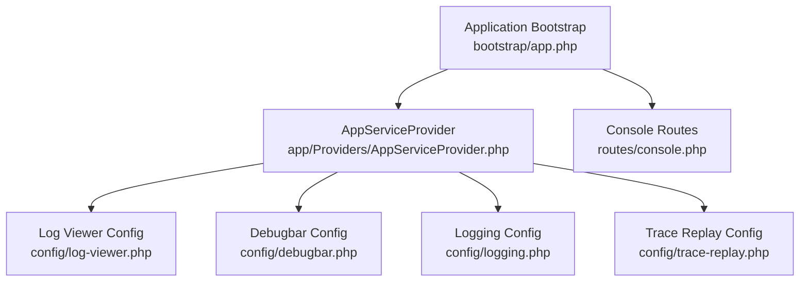
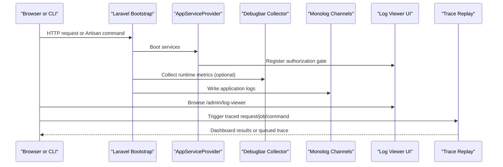
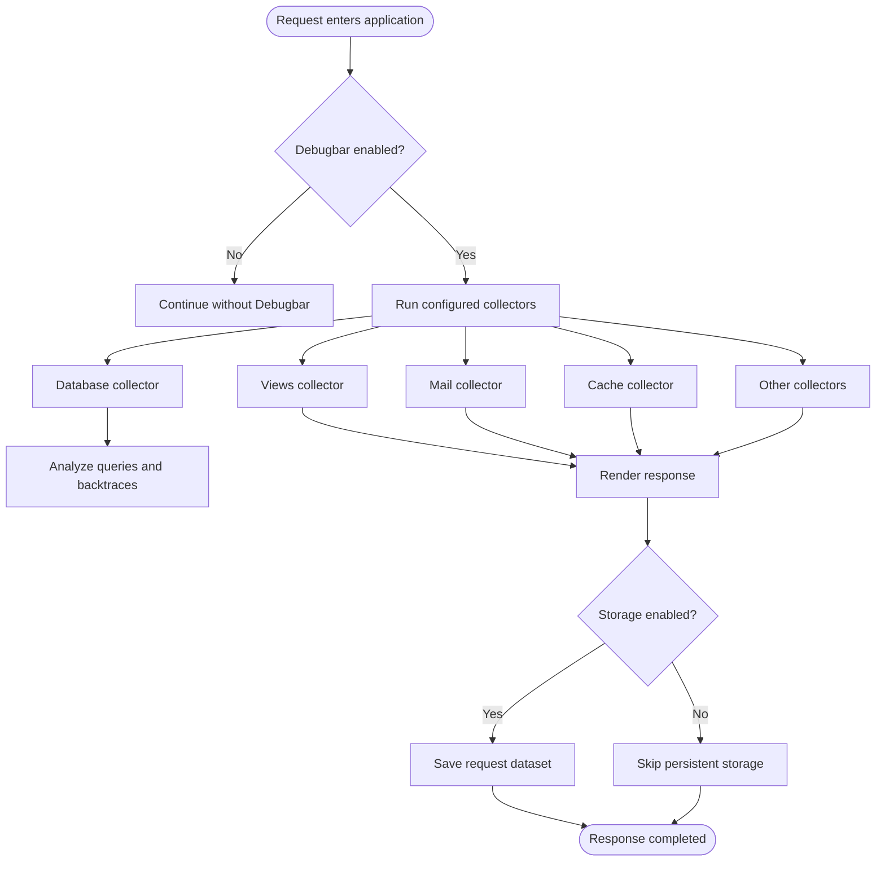
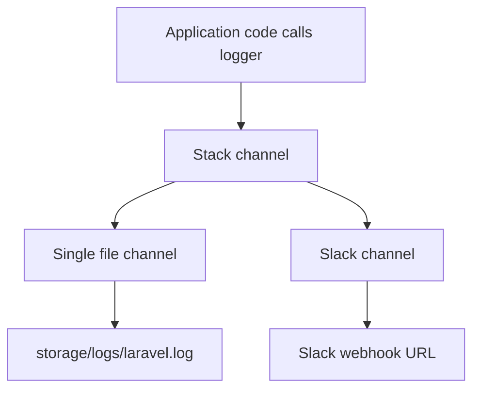
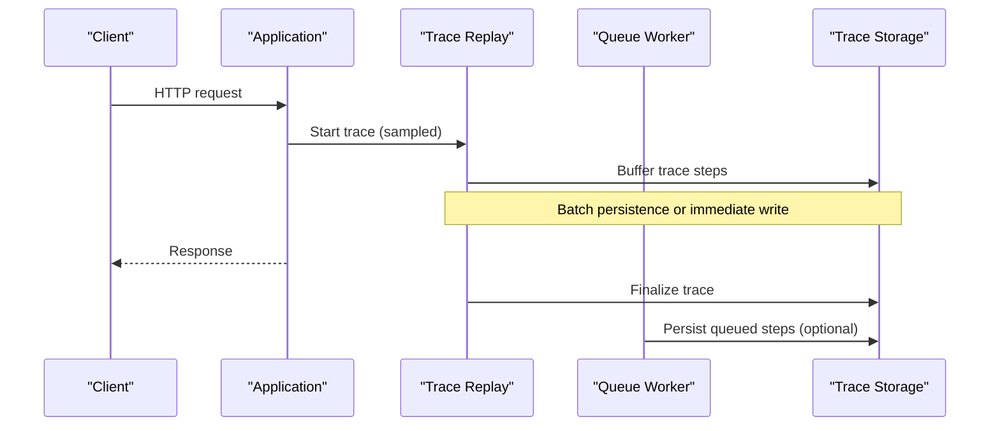
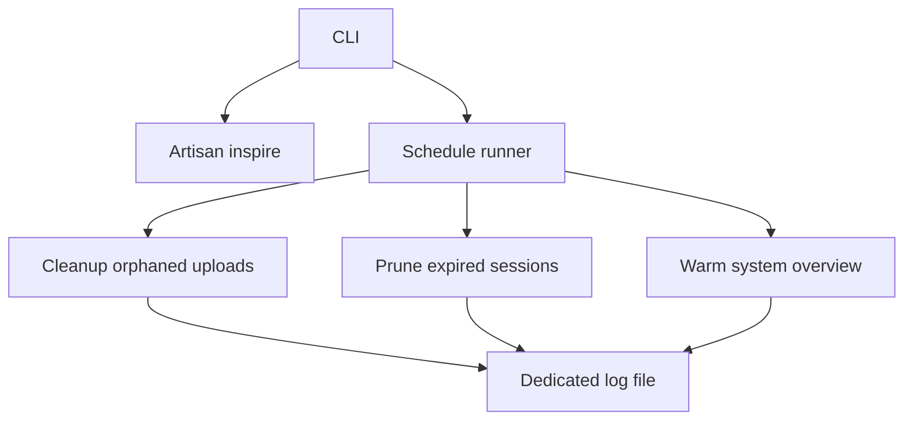
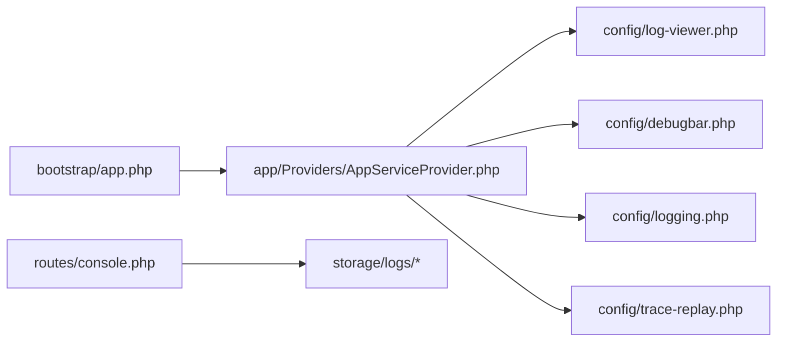

# Debugging Tools and Techniques

<cite>
**Referenced Files in This Document**
- [config/debugbar.php](file://config/debugbar.php)
- [config/logging.php](file://config/logging.php)
- [config/log-viewer.php](file://config/log-viewer.php)
- [config/trace-replay.php](file://config/trace-replay.php)
- [config/app.php](file://config/app.php)
- [bootstrap/app.php](file://bootstrap/app.php)
- [routes/console.php](file://routes/console.php)
- [app/Providers/AppServiceProvider.php](file://app/Providers/AppServiceProvider.php)
</cite>

## Table of Contents
1. [Introduction](#introduction)
2. [Project Structure](#project-structure)
3. [Core Components](#core-components)
4. [Architecture Overview](#architecture-overview)
5. [Detailed Component Analysis](#detailed-component-analysis)
6. [Dependency Analysis](#dependency-analysis)
7. [Performance Considerations](#performance-considerations)
8. [Troubleshooting Guide](#troubleshooting-guide)
9. [Conclusion](#conclusion)

## Introduction
This document explains the debugging tools and techniques available in the Highblossom application. It covers:
- Laravel Debugbar configuration, usage patterns, and performance profiling capabilities.
- Logging levels, channels, rotation policies, and the browser-based Log Viewer.
- Console command diagnostics and scheduled diagnostic jobs.
- Browser request/response inspection, database query analysis, and trace replay workflows.
- Practical step-by-step procedures for common debugging scenarios.

The guidance is grounded in the repository’s configuration files, service provider behavior, and console routing.

## Project Structure
Debugging-related configuration and runtime hooks are concentrated under `config`, with supporting behavior in the application bootstrap and service provider:
- Debugbar configuration controls data collectors, storage, AJAX capture, editor links, and injection behavior.
- Logging configuration defines default channel, stack composition, per-channel drivers, and rotation options.
- Log Viewer configuration exposes a browser UI for log navigation and filtering.
- Trace Replay configuration captures, masks, queues, and replays HTTP requests and background work.
- Application bootstrap wires routing, middleware, and exception rendering.
- Service provider protects Log Viewer behind role-based authorization and enforces production-safe defaults.

**Diagram sources**
- [bootstrap/app.php:1-71](file://bootstrap/app.php#L1-L71)
- [app/Providers/AppServiceProvider.php:1-110](file://app/Providers/AppServiceProvider.php#L1-L110)
- [config/debugbar.php:1-389](file://config/debugbar.php#L1-L389)
- [config/logging.php:1-132](file://config/logging.php#L1-L132)
- [config/log-viewer.php:1-339](file://config/log-viewer.php#L1-L339)
- [config/trace-replay.php:1-192](file://config/trace-replay.php#L1-L192)
- [routes/console.php:1-33](file://routes/console.php#L1-L33)

**Section sources**
- [bootstrap/app.php:1-71](file://bootstrap/app.php#L1-L71)
- [app/Providers/AppServiceProvider.php:1-110](file://app/Providers/AppServiceProvider.php#L1-L110)

## Core Components
- Laravel Debugbar: Captures queries, views, memory, time, events, mail, cache, models, Livewire, Inertia, HTTP client calls, and more. Its visibility is controlled by environment variables and can be forced for trusted admin panels.
- Logging: Default stack writes to multiple channels, including single-file logging and Slack alerts at critical level. Channels include daily rotation, stderr, syslog, errorlog, papertrail, and null.
- Log Viewer: Browser UI for reading logs, protected by Super Admin role authorization.
- Trace Replay: Request tracing, payload masking, optional queueing, auto-tracing of jobs/Livewire/commands, retention pruning, dashboard protection, and optional AI-assisted fixes.
- Console Diagnostics: Built-in artisan commands and scheduled tasks that append output to specific log files.

**Section sources**
- [config/debugbar.php:1-389](file://config/debugbar.php#L1-L389)
- [config/logging.php:1-132](file://config/logging.php#L1-L132)
- [config/log-viewer.php:1-339](file://config/log-viewer.php#L1-L339)
- [config/trace-replay.php:1-192](file://config/trace-replay.php#L1-L192)
- [routes/console.php:1-33](file://routes/console.php#L1-L33)

## Architecture Overview
The debugging architecture integrates into the standard Laravel lifecycle:
- Bootstrap sets up web/api/console routes and global middleware.
- Service provider registers Log Viewer authorization and applies production-safe defaults (for example, prohibiting destructive database commands).
- Debugbar optionally injects its assets and collects runtime data based on configured collectors.
- Logging dispatches messages through configured channels; Log Viewer reads from storage paths.
- Trace Replay wraps requests/jobs/commands when enabled and stores traces according to retention and persistence settings.

**Diagram sources**
- [bootstrap/app.php:1-71](file://bootstrap/app.php#L1-L71)
- [app/Providers/AppServiceProvider.php:1-110](file://app/Providers/AppServiceProvider.php#L1-L110)
- [config/debugbar.php:1-389](file://config/debugbar.php#L1-L389)
- [config/logging.php:1-132](file://config/logging.php#L1-L132)
- [config/log-viewer.php:1-339](file://config/log-viewer.php#L1-L339)
- [config/trace-replay.php:1-192](file://config/trace-replay.php#L1-L192)

## Detailed Component Analysis

### Laravel Debugbar Configuration and Usage
Debugbar is configured entirely through `config/debugbar.php`. Key behaviors:
- Enablement: Controlled by an environment variable and defaults to being enabled when the application debug mode is true. You can force enable it for trusted admin areas.
- Data collectors: Individual collectors are toggled via environment variables for PHP info, messages, timing, memory, exceptions, logs, database, views, route, auth, Gate, session, Symfony request, mail, Laravel metadata, events, logs, config, cache, models, Livewire, Inertia, jobs, Pennant, and HTTP client.
- Database analysis: Supports parameter substitution, backtraces, slow-query highlighting, EXPLAIN output, query result re-execution, soft/hard limits, and timeline integration.
- AJAX support: Can capture AJAX requests, add ServerTiming headers, defer datasets, and automatically show AJAX responses.
- Storage: File-based by default under `storage/debugbar`; supports Redis, SQLite, PDO, and custom drivers. Open storage can be restricted by callback or IP.
- Editor integration: Maps remote/local paths and opens source locations in your IDE.
- Asset injection: Injects assets automatically unless disabled; you can also set a custom route prefix/domain/middleware/theme.

Practical usage patterns:
- Use the database collector to identify N+1 queries and slow queries; tune thresholds using environment variables.
- Disable expensive collectors in production or high-traffic environments (for example, events, logs, full view data).
- Restrict Debugbar storage access so previous requests cannot be read publicly.
- Configure editor links to jump from backtraces directly to your IDE.

**Diagram sources**
- [config/debugbar.php:1-389](file://config/debugbar.php#L1-L389)

**Section sources**
- [config/debugbar.php:1-389](file://config/debugbar.php#L1-L389)

### Logging Levels, Channels, and Rotation Policies
The application uses Monolog through Laravel’s logging configuration:
- Default channel: The `stack` channel composes multiple channels defined by `LOG_STACK`, commonly `single,slack`.
- Single file channel: Writes to `storage/logs/laravel.log` at the configured `LOG_LEVEL`.
- Daily rotation: Uses the same path but rotates after `LOG_DAILY_DAYS`.
- Slack channel: Sends critical-level messages to a Slack webhook with configurable username and emoji.
- Additional channels: `papertrail`, `stderr`, `syslog`, `errorlog`, `null`, and an emergency fallback.
- Deprecations: A separate deprecations channel allows isolating deprecation warnings and enabling stack traces.

Configuration highlights:
- Control verbosity with `LOG_LEVEL`.
- Compose outputs with `LOG_STACK`.
- Rotate daily logs with `LOG_DAILY_DAYS`.
- Route critical failures to Slack with `LOG_SLACK_LEVEL=critical`.
- Direct containerized output to `stderr` for log aggregation systems.

**Diagram sources**
- [config/logging.php:1-132](file://config/logging.php#L1-L132)

**Section sources**
- [config/logging.php:1-132](file://config/logging.php#L1-L132)

### Browser-Based Log Viewer
Log Viewer provides a browser interface to inspect logs:
- Route path: `/admin/log-viewer`.
- Authorization: Requires a user with the Super Admin role, enforced in the service provider.
- Environment toggle: Can be disabled via `LOG_VIEWER_ENABLED`.
- API-only mode and stateful domains are supported.
- Include/exclude patterns control which log files are visible.
- Shorter stack traces exclude vendor/framework paths by default.
- Caching driver and key prefix optimize index scanning.
- Defaults control sorting, pagination, theme, and whether shorter stack traces are enabled.

Security note: Ensure only authorized users can reach the Log Viewer route; the configuration enforces this through middleware and the role check in the service provider.

**Section sources**
- [config/log-viewer.php:1-339](file://config/log-viewer.php#L1-L339)
- [app/Providers/AppServiceProvider.php:33-53](file://app/Providers/AppServiceProvider.php#L33-L53)

### Trace Replay Integration
Trace Replay enables end-to-end request and job tracing:
- Enable/disable globally via `TRACE_REPLAY_ENABLED`.
- Sample rate controls what fraction of requests are traced.
- Payload size limit prevents excessive database growth.
- Batch persistence buffers steps for efficient writing.
- Queue offloading avoids request latency overhead.
- Database query tracking records counts and total time per step.
- Sensitive fields are masked across captured payloads.
- Auto-tracing supports jobs, Livewire, and Artisan commands, with exclusions for infrastructure commands.
- Retention policy prunes old traces via an Artisan command.
- Dashboard protection supports middleware, IP allowlists, and API tokens.
- Optional AI integration provides prompts or direct model calls depending on configuration.

**Diagram sources**
- [config/trace-replay.php:1-192](file://config/trace-replay.php#L1-L192)

**Section sources**
- [config/trace-replay.php:1-192](file://config/trace-replay.php#L1-L192)

### Console Command Debugging and System Diagnostics
Console diagnostics rely on:
- Built-in `inspire` command for basic health checks.
- Scheduled commands appended to dedicated log files:
  - Orphaned uploads cleanup runs daily and appends to a dedicated log.
  - Session pruning runs hourly with overlap protection and a dedicated log.
  - System overview warming runs twice daily to precompute heavy sections.

Recommended diagnostic workflow:
- Run targeted Artisan commands and watch their output in the terminal.
- Inspect scheduled task logs under `storage/logs` for periodic maintenance outcomes.
- Combine with Log Viewer to correlate command runs with application errors.

**Diagram sources**
- [routes/console.php:1-33](file://routes/console.php#L1-L33)

**Section sources**
- [routes/console.php:1-33](file://routes/console.php#L1-L33)

### Request/Response Inspection and Database Query Analysis
- Request/response inspection:
  - Use Debugbar’s Symfony request collector for request metadata.
  - Enable message capture and timeline to correlate server-side actions with frontend activity.
  - For AJAX, enable AJAX handler collection and ServerTiming if needed.
- Database query analysis:
  - Enable query parameters, backtraces, EXPLAIN output, and slow-query highlighting.
  - Tune soft/hard limits to avoid overhead while still capturing problematic queries.
  - Use view grouping and timeline to understand rendering costs.

Operational tips:
- Temporarily enable additional collectors (events, logs, full view data) during local debugging.
- Exclude vendor paths from query backtraces where appropriate.
- Use editor links to navigate from slow or repeated queries directly to the source location.

**Section sources**
- [config/debugbar.php:1-389](file://config/debugbar.php#L1-L389)

## Dependency Analysis
Debugging components interact with core application services:
- AppServiceProvider authorizes Log Viewer and applies production safeguards such as disabling destructive database operations and preventing lazy loading outside production.
- Bootstrap configures routes, middleware, and exception rendering.
- Debugbar depends on collectors that instrument framework features like Eloquent, Blade, Mail, Cache, Events, and Livewire.
- Logging depends on Monolog handlers and external endpoints (for example, Slack).
- Trace Replay depends on queue workers and database persistence when configured.

**Diagram sources**
- [bootstrap/app.php:1-71](file://bootstrap/app.php#L1-L71)
- [app/Providers/AppServiceProvider.php:1-110](file://app/Providers/AppServiceProvider.php#L1-L110)
- [config/log-viewer.php:1-339](file://config/log-viewer.php#L1-L339)
- [config/debugbar.php:1-389](file://config/debugbar.php#L1-L389)
- [config/logging.php:1-132](file://config/logging.php#L1-L132)
- [config/trace-replay.php:1-192](file://config/trace-replay.php#L1-L192)
- [routes/console.php:1-33](file://routes/console.php#L1-L33)

**Section sources**
- [bootstrap/app.php:1-71](file://bootstrap/app.php#L1-L71)
- [app/Providers/AppServiceProvider.php:1-110](file://app/Providers/AppServiceProvider.php#L1-L110)

## Performance Considerations
- Debugbar collectors can add overhead. Disable unnecessary collectors in production or high-traffic environments.
- Limit database query collection with soft/hard limits and slow thresholds; disable full query result previews unless investigating specific queries.
- Avoid enabling event data and listener collection unless diagnosing event storms.
- Prefer batch persistence for Trace Replay and offload to queues to reduce request latency.
- Set appropriate retention periods for traces and prune older entries regularly.
- Restrict Debugbar storage open access to prevent reading previous requests publicly.

[No sources needed since this section provides general guidance]

## Troubleshooting Guide

### Debugbar Not Showing
- Check application debug mode setting.
- Verify Debugbar environment variable and force-enable option for trusted admin routes.
- Confirm asset injection is not disabled.
- Review excluded URIs and ensure the current route is not ignored.
- Validate storage permissions if file-based storage is used.

**Section sources**
- [config/app.php:1-126](file://config/app.php#L1-L126)
- [config/debugbar.php:1-389](file://config/debugbar.php#L1-L389)

### Excessive Database Queries Detected
- Enable query parameters and backtraces in Debugbar.
- Adjust slow threshold and enable EXPLAIN output for expensive queries.
- Use view grouping and timeline to isolate render bottlenecks.
- Reduce noisy collectors temporarily to focus on database activity.

**Section sources**
- [config/debugbar.php:1-389](file://config/debugbar.php#L1-L389)

### Logs Missing or Not Rotating
- Confirm default channel and stack composition.
- Verify `LOG_LEVEL` and `LOG_STACK`.
- Ensure `LOG_DAILY_DAYS` is set correctly for rotation.
- Check file permissions for `storage/logs`.
- For containerized deployments, verify `stderr` channel is used and aggregated by the host.

**Section sources**
- [config/logging.php:1-132](file://config/logging.php#L1-L132)

### Log Viewer Access Denied
- Ensure you are logged in as a Super Admin.
- Confirm Log Viewer is enabled and the route path matches expectations.
- Verify middleware and authorization gates are active.

**Section sources**
- [config/log-viewer.php:1-339](file://config/log-viewer.php#L1-L339)
- [app/Providers/AppServiceProvider.php:33-53](file://app/Providers/AppServiceProvider.php#L33-L53)

### Trace Replay Overhead Too High
- Lower sample rate or disable tracing for non-critical environments.
- Enable queue persistence to remove overhead from the request lifecycle.
- Reduce maximum payload size and mask sensitive fields.
- Use retention pruning to keep storage bounded.

**Section sources**
- [config/trace-replay.php:1-192](file://config/trace-replay.php#L1-L192)

### Console Jobs Not Producing Output
- Inspect the dedicated log files appended by scheduled commands.
- Confirm scheduler is running and overlapping is handled appropriately.
- Combine with Log Viewer to correlate timestamps.

**Section sources**
- [routes/console.php:1-33](file://routes/console.php#L1-L33)

## Conclusion
Highblossom provides a layered debugging toolkit:
- Use Debugbar for interactive, per-request profiling of queries, views, memory, and framework events.
- Use structured logging with flexible channels and rotation for reliable diagnostics and alerting.
- Use Log Viewer for centralized, browser-based log inspection protected by role-based authorization.
- Use Trace Replay for capturing and reproducing complex request flows, with safety controls for sensitivity and performance.
- Combine console diagnostics, scheduled tasks, and log correlation to resolve issues efficiently.

Apply these configurations thoughtfully to balance observability with performance and security, especially in production-like environments.

[No sources needed since this section summarizes without analyzing specific files]