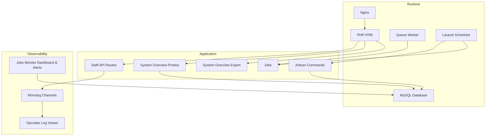
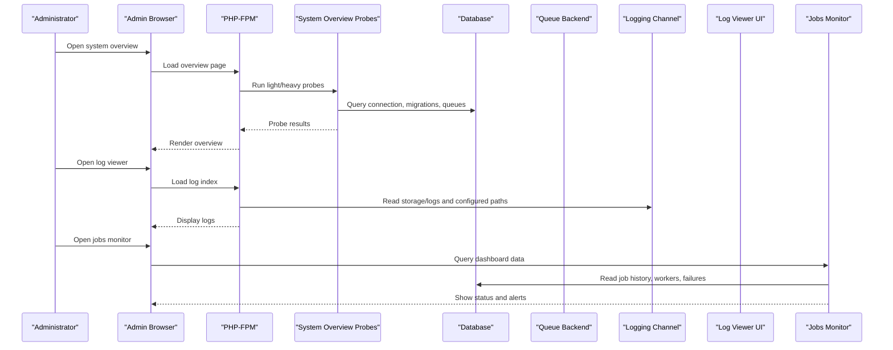
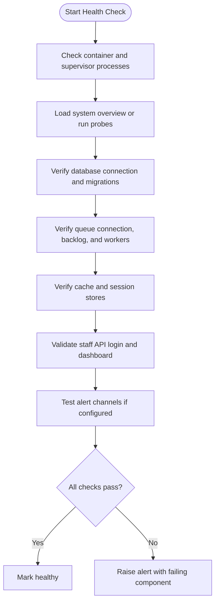
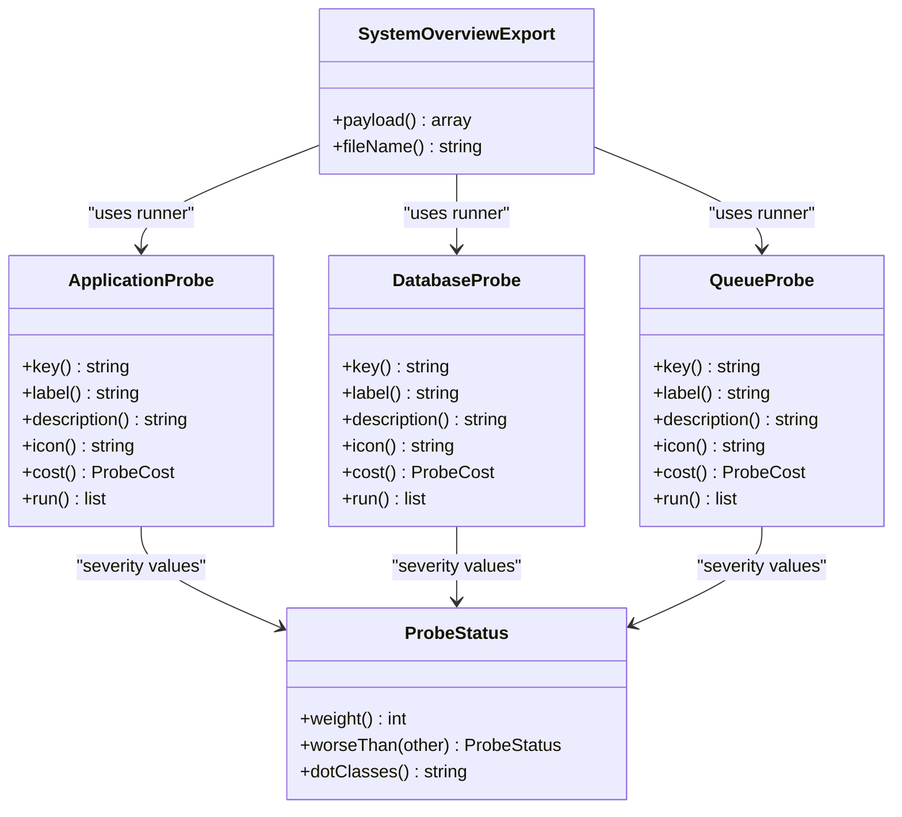
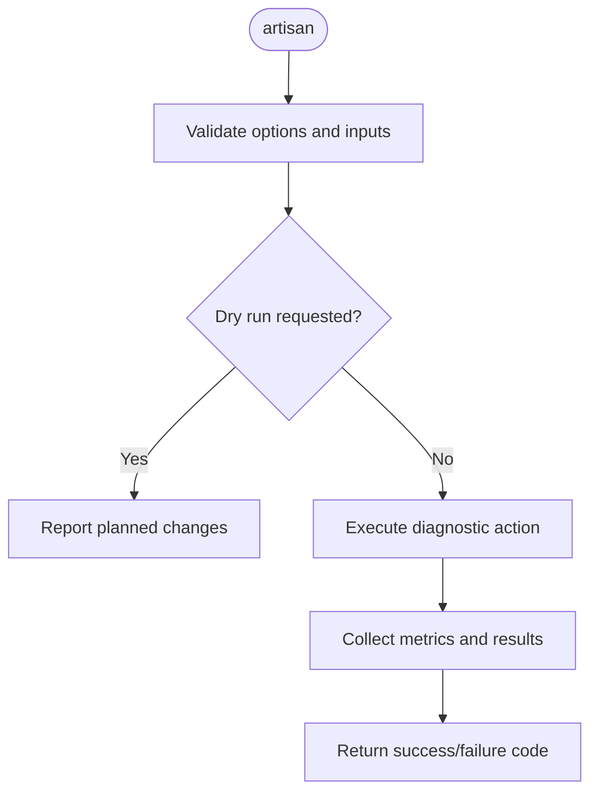
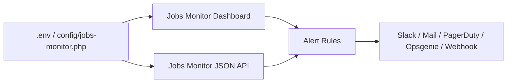
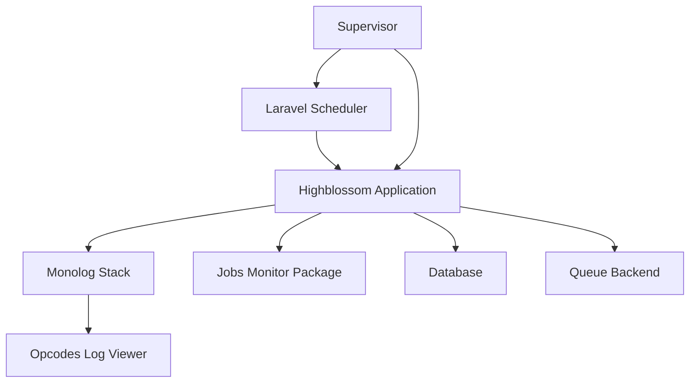

# Diagnostic Procedures and Monitoring

<cite>
**Referenced Files in This Document**   
- [Dockerfile](file://Dockerfile)
- [docker-compose.yml](file://docker-compose.yml)
- [config/app.php](file://config/app.php)
- [config/logging.php](file://config/logging.php)
- [config/log-viewer.php](file://config/log-viewer.php)
- [config/jobs-monitor.php](file://config/jobs-monitor.php)
- [config/database.php](file://config/database.php)
- [config/cache.php](file://config/cache.php)
- [config/session.php](file://config/session.php)
- [config/queue.php](file://config/queue.php)
- [routes/api.php](file://routes/api.php)
- [routes/console.php](file://routes/console.php)
- [app/Jobs/WarmSystemOverviewProbe.php](file://app/Jobs/WarmSystemOverviewProbe.php)
- [app/Console/Commands/CleanupTempUploadsCommand.php](file://app/Console/Commands/CleanupTempUploadsCommand.php)
- [app/Console/Commands/PruneUserSessionsCommand.php](file://app/Console/Commands/PruneUserSessionsCommand.php)
- [app/Support/SystemOverview/SystemOverviewExport.php](file://app/Support/SystemOverview/SystemOverviewExport.php)
- [app/Support/SystemOverview/ProbeStatus.php](file://app/Support/SystemOverview/ProbeStatus.php)
- [app/Support/SystemOverview/Probes/ApplicationProbe.php](file://app/Support/SystemOverview/Probes/ApplicationProbe.php)
- [app/Support/SystemOverview/Probes/DatabaseProbe.php](file://app/Support/SystemOverview/Probes/DatabaseProbe.php)
- [app/Support/SystemOverview/Probes/QueueProbe.php](file://app/Support/SystemOverview/Probes/QueueProbe.php)
</cite>

## Table of Contents
1. [Introduction](#introduction)
2. [Project Structure](#project-structure)
3. [Core Components](#core-components)
4. [Architecture Overview](#architecture-overview)
5. [Detailed Component Analysis](#detailed-component-analysis)
6. [Dependency Analysis](#dependency-analysis)
7. [Performance Considerations](#performance-considerations)
8. [Troubleshooting Guide](#troubleshooting-guide)
9. [Conclusion](#conclusion)
10. [Appendices](#appendices)

## Introduction
This document defines diagnostic procedures and monitoring strategies for the Highblossom application. It covers health checks, system overview monitoring, log analysis, custom diagnostic commands, job monitoring, alerting, backup verification, disaster recovery testing, and incident response templates. The guidance is grounded in the repository’s Laravel architecture, scheduled jobs, logging configuration, system overview probes, and container setup.

Highblossom runs inside a single container image that starts Nginx, PHP-FPM, a queue worker, and the scheduler under Supervisor. Observability relies on:
- Monolog-based logging with stack, file, Slack, syslog, stderr, and Papertrail channels.
- Opcodes Log Viewer for browser-based log inspection.
- A jobs-monitor package dashboard and alerting pipeline.
- Application-level system overview probes reporting application state, database health, queue backlog, and related operational signals.
- Scheduled maintenance tasks for cleanup, session pruning, and background warming of heavy system overview sections.

## Project Structure
The observability-relevant parts of the codebase are organized as follows:

**Diagram sources**
- [Dockerfile:1-32](file://Dockerfile#L1-L32)
- [docker-compose.yml:1-31](file://docker-compose.yml#L1-L31)
- [routes/api.php:1-117](file://routes/api.php#L1-L117)
- [routes/console.php:1-33](file://routes/console.php#L1-L33)
- [app/Jobs/WarmSystemOverviewProbe.php:1-76](file://app/Jobs/WarmSystemOverviewProbe.php#L1-L76)
- [config/logging.php:1-132](file://config/logging.php#L1-L132)
- [config/log-viewer.php:1-339](file://config/log-viewer.php#L1-L339)
- [config/jobs-monitor.php:1-261](file://config/jobs-monitor.php#L1-L261)

**Section sources**
- [Dockerfile:1-32](file://Dockerfile#L1-L32)
- [docker-compose.yml:1-31](file://docker-compose.yml#L1-L31)
- [config/logging.php:1-132](file://config/logging.php#L1-L132)
- [config/log-viewer.php:1-339](file://config/log-viewer.php#L1-L339)
- [config/jobs-monitor.php:1-261](file://config/jobs-monitor.php#L1-L261)
- [routes/api.php:1-117](file://routes/api.php#L1-L117)
- [routes/console.php:1-33](file://routes/console.php#L1-L33)

## Core Components
- Logging subsystem: default stack channel routes to configured writers such as single-file, daily rotation, Slack, stderr, syslog, errorlog, and Papertrail. Critical alerts can be sent to Slack automatically.
- Log Viewer: an authenticated UI at `admin/log-viewer` that indexes and displays application logs and optional external log files.
- Jobs monitor: a dashboard and JSON API for job execution history, failure classification, worker heartbeats, and alert rules across channels like Slack, email, PagerDuty, Opsgenie, and generic webhooks.
- System overview: a set of lightweight probes reporting framework state, database connectivity and migration drift, and queue backlog and throughput. A scheduled job warms heavy probes so admin pages do not trigger expensive scans on demand.
- Maintenance commands: temporary upload cleanup and session reconciliation/pruning.

Operational entry points:
- Health and diagnostics: use the system overview interface and exported payload rather than building a separate endpoint unless needed.
- Log access: use Log Viewer or stream logs via stderr/Papertrail/syslog.
- Queue diagnostics: use the jobs monitor dashboard or queue probe indicators.

**Section sources**
- [config/logging.php:1-132](file://config/logging.php#L1-L132)
- [config/log-viewer.php:1-339](file://config/log-viewer.php#L1-L339)
- [config/jobs-monitor.php:1-261](file://config/jobs-monitor.php#L1-L261)
- [app/Support/SystemOverview/Probes/ApplicationProbe.php:1-115](file://app/Support/SystemOverview/Probes/ApplicationProbe.php#L1-L115)
- [app/Support/SystemOverview/Probes/DatabaseProbe.php:1-205](file://app/Support/SystemOverview/Probes/DatabaseProbe.php#L1-L205)
- [app/Support/SystemOverview/Probes/QueueProbe.php:1-190](file://app/Support/SystemOverview/Probes/QueueProbe.php#L1-L190)
- [app/Jobs/WarmSystemOverviewProbe.php:1-76](file://app/Jobs/WarmSystemOverviewProbe.php#L1-L76)
- [routes/console.php:1-33](file://routes/console.php#L1-L33)

## Architecture Overview
The runtime architecture integrates request handling, background processing, scheduling, and multiple observability backends.

**Diagram sources**
- [app/Support/SystemOverview/Probes/ApplicationProbe.php:1-115](file://app/Support/SystemOverview/Probes/ApplicationProbe.php#L1-L115)
- [app/Support/SystemOverview/Probes/DatabaseProbe.php:1-205](file://app/Support/SystemOverview/Probes/DatabaseProbe.php#L1-L205)
- [app/Support/SystemOverview/Probes/QueueProbe.php:1-190](file://app/Support/SystemOverview/Probes/QueueProbe.php#L1-L190)
- [config/logging.php:1-132](file://config/logging.php#L1-L132)
- [config/log-viewer.php:1-339](file://config/log-viewer.php#L1-L339)
- [config/jobs-monitor.php:1-261](file://config/jobs-monitor.php#L1-L261)

## Detailed Component Analysis

### Health Check Procedures
Use layered checks to validate service readiness without exposing sensitive details.

1. **Container and process health**
   - Verify the container is running and ports are open.
   - Confirm Supervisor-managed processes (Nginx, PHP-FPM, queue worker, scheduler) are alive.
   - Inspect container logs through stderr when `LOG_CHANNEL=stderr`.

2. **Application health**
   - Open the system overview page and confirm all expected sections render.
   - Validate key probe statuses:
     - Application: environment, debug mode, maintenance mode, cache state, release record.
     - Database: connection success, driver/version, table count, pending migrations.
     - Queue: connection type, pending jobs, failed jobs, worker heartbeat presence, schedule events.

3. **External dependency health**
   - Database reachability and version.
   - Cache store availability.
   - Session store consistency.
   - Queue backend connectivity.
   - External notification channels (Slack, PagerDuty, Opsgenie, webhook endpoints).

4. **API and authentication health**
   - Staff login endpoint responds within acceptable latency.
   - Token-authenticated dashboard endpoint returns valid aggregate counts.

Recommended frequency:
- Every minute from an external monitor for process and port checks.
- Every five minutes for system overview and database connectivity.
- Hourly for cache/session/queue backend validation.

**Diagram sources**
- [config/app.php:1-126](file://config/app.php#L1-L126)
- [config/database.php:1-80](file://config/database.php#L1-L80)
- [config/cache.php:1-60](file://config/cache.php#L1-L60)
- [config/session.php:1-60](file://config/session.php#L1-L60)
- [config/queue.php:1-70](file://config/queue.php#L1-L70)
- [app/Support/SystemOverview/Probes/ApplicationProbe.php:1-115](file://app/Support/SystemOverview/Probes/ApplicationProbe.php#L1-L115)
- [app/Support/SystemOverview/Probes/DatabaseProbe.php:1-205](file://app/Support/SystemOverview/Probes/DatabaseProbe.php#L1-L205)
- [app/Support/SystemOverview/Probes/QueueProbe.php:1-190](file://app/Support/SystemOverview/Probes/QueueProbe.php#L1-L190)
- [routes/api.php:1-117](file://routes/api.php#L1-L117)

**Section sources**
- [config/app.php:1-126](file://config/app.php#L1-L126)
- [config/database.php:1-80](file://config/database.php#L1-L80)
- [config/cache.php:1-60](file://config/cache.php#L1-L60)
- [config/session.php:1-60](file://config/session.php#L1-L60)
- [config/queue.php:1-70](file://config/queue.php#L1-L70)
- [app/Support/SystemOverview/Probes/ApplicationProbe.php:1-115](file://app/Support/SystemOverview/Probes/ApplicationProbe.php#L1-L115)
- [app/Support/SystemOverview/Probes/DatabaseProbe.php:1-205](file://app/Support/SystemOverview/Probes/DatabaseProbe.php#L1-L205)
- [app/Support/SystemOverview/Probes/QueueProbe.php:1-190](file://app/Support/SystemOverview/Probes/QueueProbe.php#L1-L190)
- [routes/api.php:1-117](file://routes/api.php#L1-L117)

### System Overview Monitoring
The system overview exposes categorized diagnostic information through probes. Each probe reports items with severity levels: OK, INFO, PENDING, WARN, FAIL.

Key behaviors:
- Application probe checks framework version, environment, debug mode, maintenance mode, cached configuration/routes/events, and recorded release.
- Database probe validates connection, driver, database name, server version, footprint, table count, and migration drift. It also includes a sensitive endpoint item requiring elevated permissions.
- Queue probe inspects the queue driver, pending/reserved jobs, oldest waiting time, failed jobs, throughput, worker heartbeats, and registered schedule events.

**Diagram sources**
- [app/Support/SystemOverview/SystemOverviewExport.php:1-90](file://app/Support/SystemOverview/SystemOverviewExport.php#L1-L90)
- [app/Support/SystemOverview/ProbeStatus.php:1-58](file://app/Support/SystemOverview/ProbeStatus.php#L1-L58)
- [app/Support/SystemOverview/Probes/ApplicationProbe.php:1-115](file://app/Support/SystemOverview/Probes/ApplicationProbe.php#L1-L115)
- [app/Support/SystemOverview/Probes/DatabaseProbe.php:1-205](file://app/Support/SystemOverview/Probes/DatabaseProbe.php#L1-L205)
- [app/Support/SystemOverview/Probes/QueueProbe.php:1-190](file://app/Support/SystemOverview/Probes/QueueProbe.php#L1-L190)

**Section sources**
- [app/Support/SystemOverview/SystemOverviewExport.php:1-90](file://app/Support/SystemOverview/SystemOverviewExport.php#L1-L90)
- [app/Support/SystemOverview/ProbeStatus.php:1-58](file://app/Support/SystemOverview/ProbeStatus.php#L1-L58)
- [app/Support/SystemOverview/Probes/ApplicationProbe.php:1-115](file://app/Support/SystemOverview/Probes/ApplicationProbe.php#L1-L115)
- [app/Support/SystemOverview/Probes/DatabaseProbe.php:1-205](file://app/Support/SystemOverview/Probes/DatabaseProbe.php#L1-L205)
- [app/Support/SystemOverview/Probes/QueueProbe.php:1-190](file://app/Support/SystemOverview/Probes/QueueProbe.php#L1-L190)

### Log Analysis Techniques
Use structured patterns and correlation identifiers to diagnose issues quickly.

1. **Pattern recognition**
   - Search for critical errors, exceptions, and warnings using Monolog level filters.
   - Identify repeated stack traces indicating recurring failures.
   - Detect deprecation warnings and configuration problems early.

2. **Error correlation**
   - Use request IDs, user IDs, booking IDs, inspection IDs, quote IDs, and session identifiers present in logs to trace a single operation across controllers, services, listeners, jobs, and queue processors.
   - Correlate HTTP requests with queued job executions and database queries by timestamp and contextual fields.

3. **Trend identification**
   - Track growth in failed job counts over time.
   - Monitor increasing queue backlog age.
   - Watch for rising error rates during deployments or peak traffic.
   - Observe session cleanup metrics and orphaned sign-in closures.

4. **Tools and interfaces**
   - Use Opcodes Log Viewer for filtering, searching, and navigating large log sets.
   - Configure additional include/exclude patterns to view relevant system logs alongside application logs.
   - For containerized environments, inspect stderr and forward logs to centralized systems such as Papertrail or syslog.

**Section sources**
- [config/logging.php:1-132](file://config/logging.php#L1-L132)
- [config/log-viewer.php:1-339](file://config/log-viewer.php#L1-L339)
- [docker-compose.yml:1-31](file://docker-compose.yml#L1-L31)

### Custom Diagnostic Commands Creation
Extend the existing command pattern to create new diagnostics:
- Define a command class extending the base command.
- Use descriptive signatures and options for dry-run behavior where appropriate.
- Return standard exit codes to indicate success or failure.
- Schedule recurring commands through the Laravel scheduler and append output to dedicated log files.

Existing examples:
- Temporary upload cleanup command delegates to a cleanup service and reports deleted files and errors.
- Session pruning command reconciles expired sessions, closes lapsed sign-ins, trims historical records, and supports dry-run and retention overrides.

**Diagram sources**
- [app/Console/Commands/CleanupTempUploadsCommand.php:1-53](file://app/Console/Commands/CleanupTempUploadsCommand.php#L1-L53)
- [app/Console/Commands/PruneUserSessionsCommand.php:1-63](file://app/Console/Commands/PruneUserSessionsCommand.php#L1-L63)
- [routes/console.php:1-33](file://routes/console.php#L1-L33)

**Section sources**
- [app/Console/Commands/CleanupTempUploadsCommand.php:1-53](file://app/Console/Commands/CleanupTempUploadsCommand.php#L1-L53)
- [app/Console/Commands/PruneUserSessionsCommand.php:1-63](file://app/Console/Commands/PruneUserSessionsCommand.php#L1-L63)
- [routes/console.php:1-33](file://routes/console.php#L1-L33)

### Health Endpoint Implementation Guidance
The repository does not define a dedicated `/health` or `/status` endpoint. Recommended approaches:
- Use the system overview interface as the primary diagnostic surface.
- If an external monitor requires a simple endpoint, expose a lightweight route returning a minimal status object based on application health, database connectivity, and queue worker presence. Avoid including sensitive configuration or credentials.
- Protect internal endpoints with authorization middleware and restrict them to administrative networks or tokens.
- Do not expose full probe payloads externally; only return non-sensitive status indicators.

For existing API surfaces:
- The staff API uses Sanctum authentication and Spatie abilities. Any new diagnostic endpoint should follow this security model.

**Section sources**
- [routes/api.php:1-117](file://routes/api.php#L1-L117)
- [app/Support/SystemOverview/SystemOverviewExport.php:1-90](file://app/Support/SystemOverview/SystemOverviewExport.php#L1-L90)

### Monitoring Dashboard Setup
Two complementary dashboards are available:

1. **System overview**
   - Displays application, database, queue, and other probes.
   - Exports a machine-readable JSON report with redaction of sensitive lines.
   - Heavy sections are warmed by a scheduled job to avoid request-time overhead.

2. **Jobs monitor**
   - Dashboard path configurable via environment variables.
   - Optional JSON API for programmatic access.
   - Authorization controlled through gates and guards.
   - Worker heartbeats and alert evaluation schedules are configurable.

Configuration highlights:
- Enable or disable the monitor entirely.
- Restrict UI access to authenticated users or specific guards.
- Configure alert channels: Slack, email, PagerDuty, Opsgenie, and generic webhooks.
- Set alert evaluation cron and worker check cadence.

**Diagram sources**
- [config/jobs-monitor.php:1-261](file://config/jobs-monitor.php#L1-L261)
- [app/Support/SystemOverview/SystemOverviewExport.php:1-90](file://app/Support/SystemOverview/SystemOverviewExport.php#L1-L90)

**Section sources**
- [config/jobs-monitor.php:1-261](file://config/jobs-monitor.php#L1-L261)
- [app/Support/SystemOverview/SystemOverviewExport.php:1-90](file://app/Support/SystemOverview/SystemOverviewExport.php#L1-L90)
- [app/Jobs/WarmSystemOverviewProbe.php:1-76](file://app/Jobs/WarmSystemOverviewProbe.php#L1-L76)

### Alerting Strategies, Notification Configuration, and Escalation
Alerting is centered around the jobs monitor alerting pipeline and can be extended for general application health.

1. **Channels**
   - Slack: configure webhook URL and signing secret.
   - Email: comma-separated recipient list.
   - PagerDuty: routing key.
   - Opsgenie: API key and region.
   - Generic webhook: URL, secret, headers, timeout.

2. **Rules**
   - Define threshold-based rules with triggers, windows, and target channels.
   - Use built-in failure classification or supply a custom classifier.
   - Keep destructive actions behind authorization gates.

3. **Escalation procedure**
   - Level 1: automated alert to Slack/email for recoverable issues.
   - Level 2: PagerDuty/Opsgenie escalation after sustained failure thresholds.
   - Level 3: manual triage via system overview export and log review.
   - Post-incident: update alert thresholds and add detection rules for newly identified patterns.

4. **Scheduling**
   - Alert evaluation runs on a configurable cron.
   - Worker underprovisioning checks run on their own schedule.

**Section sources**
- [config/jobs-monitor.php:1-261](file://config/jobs-monitor.php#L1-L261)

### Backup Verification, Disaster Recovery Testing, and System Integrity Checks
Although explicit backup scripts are not present in the analyzed files, verification and integrity checks should cover:

1. **Database backups**
   - Verify MySQL dump completeness and freshness.
   - Test restore into an isolated environment.
   - Validate foreign key constraints, indexes, and migration state match production.

2. **Filesystem and media backups**
   - Back up uploaded media, storage volumes, and configuration artifacts.
   - Verify S3 or remote storage integrity when used.

3. **Cache and session stores**
   - Ensure cache and session tables exist and are accessible.
   - Validate expiration and cleanup behavior.

4. **Disaster recovery tests**
   - Perform periodic failover drills to another database instance.
   - Restore from backups and verify application startup, migrations, and core flows.
   - Confirm queue backlog is drained safely after recovery.

5. **Integrity checks**
   - Compare recorded application version with deployed artifact.
   - Validate configuration and route caches in production.
   - Confirm no pending migrations remain.
   - Verify queue workers are alive and processing jobs.

**Section sources**
- [docker-compose.yml:1-31](file://docker-compose.yml#L1-L31)
- [config/database.php:1-80](file://config/database.php#L1-L80)
- [config/cache.php:1-60](file://config/cache.php#L1-L60)
- [config/session.php:1-60](file://config/session.php#L1-L60)
- [app/Support/SystemOverview/Probes/ApplicationProbe.php:1-115](file://app/Support/SystemOverview/Probes/ApplicationProbe.php#L1-L115)
- [app/Support/SystemOverview/Probes/DatabaseProbe.php:1-205](file://app/Support/SystemOverview/Probes/DatabaseProbe.php#L1-L205)

### Incident Response Templates and Post-Mortem Processes
Use these structured templates to standardize response and learning.

**Incident Response Template**
- Summary: title, severity, affected components, timeline start.
- Impact: user-facing symptoms, error rates, data risk.
- Detection: alert source, monitoring signal, initial diagnosis.
- Containment: immediate mitigations, feature toggles, rollback steps.
- Resolution: root cause, fix applied, verification steps.
- Communication: stakeholder updates, customer notifications.
- Follow-up: monitoring improvements, alert tuning, preventive measures.

**Post-Mortem Template**
- What happened: chronological sequence.
- Why it happened: technical root cause and contributing factors.
- What went well: effective detection, containment, communication.
- What could improve: gaps in monitoring, delays, tooling limitations.
- Action items: owners, deadlines, acceptance criteria.
- Validation: tests added, alerts tuned, runbooks updated.

**Section sources**
- [config/logging.php:1-132](file://config/logging.php#L1-L132)
- [config/log-viewer.php:1-339](file://config/log-viewer.php#L1-L339)
- [config/jobs-monitor.php:1-261](file://config/jobs-monitor.php#L1-L261)
- [app/Support/SystemOverview/SystemOverviewExport.php:1-90](file://app/Support/SystemOverview/SystemOverviewExport.php#L1-L90)

## Dependency Analysis
The observability stack depends on several runtime and configuration layers.

**Diagram sources**
- [Dockerfile:1-32](file://Dockerfile#L1-L32)
- [docker-compose.yml:1-31](file://docker-compose.yml#L1-L31)
- [config/logging.php:1-132](file://config/logging.php#L1-L132)
- [config/log-viewer.php:1-339](file://config/log-viewer.php#L1-L339)
- [config/jobs-monitor.php:1-261](file://config/jobs-monitor.php#L1-L261)
- [routes/console.php:1-33](file://routes/console.php#L1-L33)

**Section sources**
- [Dockerfile:1-32](file://Dockerfile#L1-L32)
- [docker-compose.yml:1-31](file://docker-compose.yml#L1-L31)
- [config/logging.php:1-132](file://config/logging.php#L1-L132)
- [config/log-viewer.php:1-339](file://config/log-viewer.php#L1-L339)
- [config/jobs-monitor.php:1-261](file://config/jobs-monitor.php#L1-L261)
- [routes/console.php:1-33](file://routes/console.php#L1-L33)

## Performance Considerations
- Prefer lightweight probes for frequent health checks. Heavy probes should be warmed asynchronously.
- Use the scheduled warm-up job to precompute expensive system overview sections.
- Avoid loading large job payloads during probe execution; use aggregate counts instead.
- Limit log verbosity in production and rotate logs daily.
- Centralize logs to stderr or a collector to reduce disk I/O pressure.
- Tune alert evaluation intervals to balance visibility with database load.
- Protect diagnostic endpoints with authorization and rate limiting.

[No sources needed since this section provides general guidance]

## Troubleshooting Guide

### Common Issues and Resolutions
- **No queue workers draining backlog**
  - Symptoms: pending jobs increase, oldest waiting grows.
  - Checks: worker heartbeat presence, queue backend connectivity, retry_after settings, worker process lifecycle.
  - Actions: restart workers, scale horizontally, investigate failed jobs, enable job monitoring.

- **Stale session counts or wrong overview numbers**
  - Symptoms: active session cards show incorrect values.
  - Checks: session pruning schedule, session store cleanup, idle session closure.
  - Actions: run session prune command manually, verify scheduler is running.

- **Pending migrations**
  - Symptoms: database probe shows pending migrations.
  - Checks: migration files vs. migration table, deployment order.
  - Actions: run migrations, verify schema consistency.

- **Debug mode enabled in production**
  - Symptoms: application probe warns about debug mode.
  - Checks: app configuration and environment variables.
  - Actions: disable debug mode, clear caches, redeploy.

- **Logs not visible in Log Viewer**
  - Symptoms: empty or missing log files.
  - Checks: LOG_CHANNEL, storage/logs directory, include/exclude patterns, file permissions.
  - Actions: ensure logging writes to expected paths, adjust Log Viewer configuration.

**Section sources**
- [app/Support/SystemOverview/Probes/QueueProbe.php:1-190](file://app/Support/SystemOverview/Probes/QueueProbe.php#L1-L190)
- [app/Console/Commands/PruneUserSessionsCommand.php:1-63](file://app/Console/Commands/PruneUserSessionsCommand.php#L1-L63)
- [app/Support/SystemOverview/Probes/DatabaseProbe.php:1-205](file://app/Support/SystemOverview/Probes/DatabaseProbe.php#L1-L205)
- [app/Support/SystemOverview/Probes/ApplicationProbe.php:1-115](file://app/Support/SystemOverview/Probes/ApplicationProbe.php#L1-L115)
- [config/log-viewer.php:1-339](file://config/log-viewer.php#L1-L339)
- [config/logging.php:1-132](file://config/logging.php#L1-L132)

## Conclusion
Highblossom’s diagnostic and monitoring strategy combines container-aware runtime checks, application-level probes, structured logging, log viewing, and robust job monitoring. Effective operations depend on:
- Running regular health checks against application, database, queue, cache, and session stores.
- Using system overview probes and exports for safe, actionable diagnostics.
- Leveraging Log Viewer and centralized logging for pattern recognition and correlation.
- Configuring jobs monitor alerts with appropriate channels and escalation policies.
- Performing routine backup verification, disaster recovery drills, and integrity checks.
- Maintaining standardized incident response and post-mortem practices.

[No sources needed since this section summarizes without analyzing specific files]

## Appendices

### Operational Command Reference
- Warm system overview: scheduled twice daily.
- Clean temporary uploads: scheduled daily.
- Prune sessions: scheduled hourly.
- Log viewer: authenticated UI under admin/log-viewer.
- Jobs monitor: dashboard and optional JSON API.

**Section sources**
- [routes/console.php:1-33](file://routes/console.php#L1-L33)
- [config/log-viewer.php:1-339](file://config/log-viewer.php#L1-L339)
- [config/jobs-monitor.php:1-261](file://config/jobs-monitor.php#L1-L261)