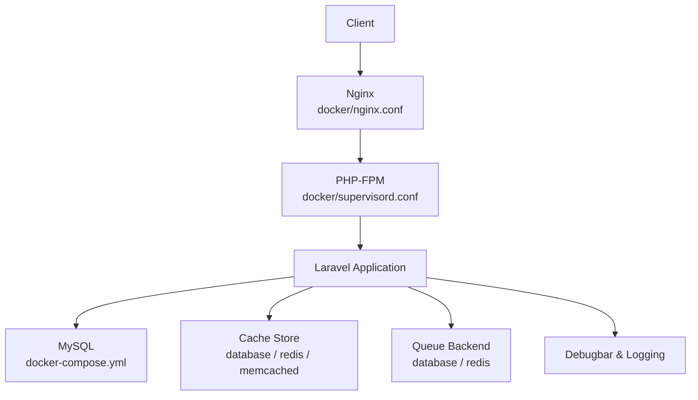
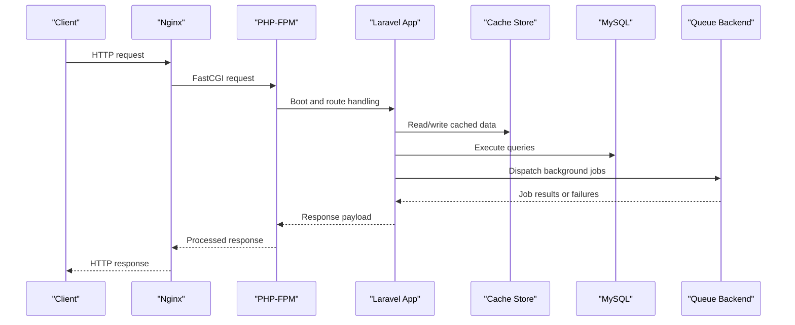
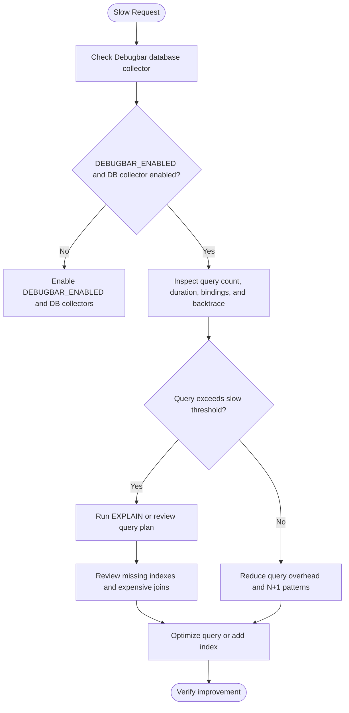
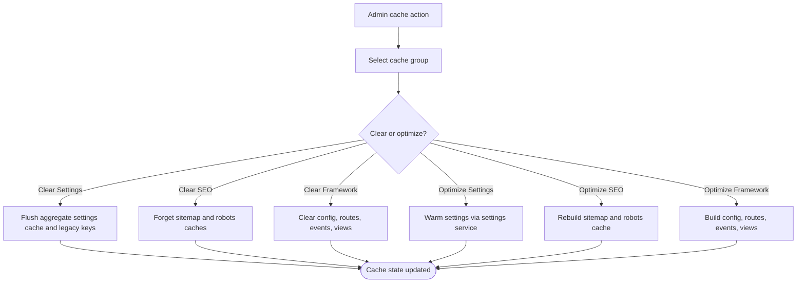
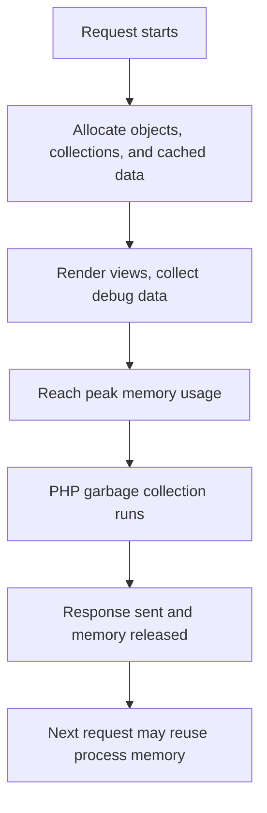
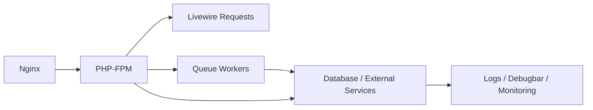
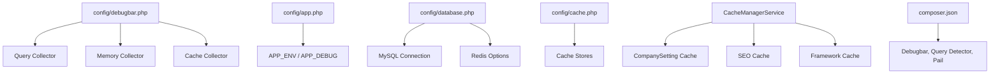

# Performance Troubleshooting

<cite>
**Referenced Files in This Document**
- [config/debugbar.php](file://config/debugbar.php)
- [config/database.php](file://config/database.php)
- [config/cache.php](file://config/cache.php)
- [config/logging.php](file://config/logging.php)
- [config/queue.php](file://config/queue.php)
- [config/app.php](file://config/app.php)
- [config/livewire.php](file://config/livewire.php)
- [app/Services/CacheManagerService.php](file://app/Services/CacheManagerService.php)
- [app/Models/CompanySetting.php](file://app/Models/CompanySetting.php)
- [app/Services/ApplicationVersionService.php](file://app/Services/ApplicationVersionService.php)
- [app/Services/UserSessionService.php](file://app/Services/UserSessionService.php)
- [app/Support/SystemOverview/Probes/PhpRuntimeProbe.php](file://app/Support/SystemOverview/Probes/PhpRuntimeProbe.php)
- [docker-compose.yml](file://docker-compose.yml)
- [Dockerfile](file://Dockerfile)
- [docker/supervisord.conf](file://docker/supervisord.conf)
- [docker/nginx.conf](file://docker/nginx.conf)
- [composer.json](file://composer.json)
</cite>

## Table of Contents
1. [Introduction](#introduction)
2. [Project Structure](#project-structure)
3. [Core Components](#core-components)
4. [Architecture Overview](#architecture-overview)
5. [Detailed Component Analysis](#detailed-component-analysis)
6. [Dependency Analysis](#dependency-analysis)
7. [Performance Considerations](#performance-considerations)
8. [Troubleshooting Guide](#troubleshooting-guide)
9. [Conclusion](#conclusion)

## Introduction
This document provides a practical performance troubleshooting guide for the application, focusing on slow database queries, cache-related bottlenecks, memory growth, and overall system load. It maps observable configuration and service behavior to actionable diagnosis steps. The project uses Laravel with Livewire, MySQL as the primary database, optional Redis or Memcached caches, a database-backed queue, and Dockerized Nginx plus PHP-FPM workers managed by Supervisor.

## Project Structure
The performance-relevant structure is centered around:

- Configuration files that define how the framework talks to the database, cache, logging, queues, and debug tooling.
- Services and models that implement caching strategies, session tracking, and application-version management.
- Container and server configuration that controls process boundaries, worker lifetimes, and request throughput.

**Diagram sources**
- [docker/nginx.conf:1-20](file://docker/nginx.conf#L1-L20)
- [docker/supervisord.conf:1-66](file://docker/supervisord.conf#L1-L66)
- [docker-compose.yml:1-31](file://docker-compose.yml#L1-L31)
- [config/database.php:1-184](file://config/database.php#L1-L184)
- [config/cache.php:1-146](file://config/cache.php#L1-L146)
- [config/queue.php:1-128](file://config/queue.php#L1-L128)
- [config/debugbar.php:1-200](file://config/debugbar.php#L1-L200)

**Section sources**
- [docker/nginx.conf:1-20](file://docker/nginx.conf#L1-L20)
- [docker/supervisord.conf:1-66](file://docker/supervisord.conf#L1-L66)
- [docker-compose.yml:1-31](file://docker-compose.yml#L1-L31)
- [Dockerfile:1-32](file://Dockerfile#L1-L32)

## Core Components
The most important performance components are:

| Area | Primary Files | Role |
|---|---|---|
| Query profiling | [config/debugbar.php](file://config/debugbar.php) | Controls query collection, slow-query filtering, backtrace capture, and EXPLAIN visibility. |
| Database layer | [config/database.php](file://config/database.php) | Defines MySQL/MariaDB connections, Redis client options, and connection prefixes. |
| Caching layer | [config/cache.php](file://config/cache.php), [app/Services/CacheManagerService.php](file://app/Services/CacheManagerService.php) | Selects default store, serializable classes, group-based cache administration, and optimization commands. |
| High-frequency settings cache | [app/Models/CompanySetting.php](file://app/Models/CompanySetting.php) | Loads all company settings once per request into an aggregate cache entry with lock-guarded rebuild. |
| Version cache | [app/Services/ApplicationVersionService.php](file://app/Services/ApplicationVersionService.php) | Caches the latest release identifier and invalidates it on new releases. |
| Session ledger | [app/Services/UserSessionService.php](file://app/Services/UserSessionService.php) | Tracks active sessions, throttles updates, and manages history. |
| Runtime diagnostics | [app/Support/SystemOverview/Probes/PhpRuntimeProbe.php](file://app/Support/SystemOverview/Probes/PhpRuntimeProbe.php) | Reports PHP limits, extensions, and runtime environment details. |
| Worker lifecycle | [docker/supervisord.conf](file://docker/supervisord.conf) | Starts web, queue, and scheduler processes with fixed lifetime and retry behavior. |

**Section sources**
- [config/debugbar.php:1-200](file://config/debugbar.php#L1-L200)
- [config/database.php:1-184](file://config/database.php#L1-L184)
- [config/cache.php:1-146](file://config/cache.php#L1-L146)
- [app/Services/CacheManagerService.php:1-328](file://app/Services/CacheManagerService.php#L1-L328)
- [app/Models/CompanySetting.php:1-196](file://app/Models/CompanySetting.php#L1-L196)
- [app/Services/ApplicationVersionService.php:1-157](file://app/Services/ApplicationVersionService.php#L1-L157)
- [app/Services/UserSessionService.php:1-200](file://app/Services/UserSessionService.php#L1-L200)
- [app/Support/SystemOverview/Probes/PhpRuntimeProbe.php:1-157](file://app/Support/SystemOverview/Probes/PhpRuntimeProbe.php#L1-L157)
- [docker/supervisord.conf:1-66](file://docker/supervisord.conf#L1-L66)

## Architecture Overview
The application’s performance characteristics are shaped by these flows:

1. HTTP requests pass through Nginx to PHP-FPM.
2. Laravel resolves routes, middleware, controllers, services, and Eloquent models.
3. Database access goes through configured PDO/MySQL connections; Redis may be used for cache, sessions, or queues.
4. Debugbar can instrument queries, views, cache events, jobs, and memory usage during development.
5. Background jobs run under Supervisor with bounded lifetimes.
6. System overview probes expose runtime health information such as PHP version, memory limit, and required extensions.

**Diagram sources**
- [docker/nginx.conf:1-20](file://docker/nginx.conf#L1-L20)
- [docker/supervisord.conf:1-66](file://docker/supervisord.conf#L1-L66)
- [config/database.php:1-184](file://config/database.php#L1-L184)
- [config/cache.php:1-146](file://config/cache.php#L1-L146)
- [config/queue.php:1-128](file://config/queue.php#L1-L128)

## Detailed Component Analysis

### Slow Database Queries
#### What to check first
- Confirm whether Debugbar is enabled and collecting database information.
- Inspect slow query thresholds, backtraces, EXPLAIN output, and soft/hard query limits.
- Validate the actual database driver and connection configuration.

#### Key configuration points
- Debugbar collects database queries, allows only slow queries, supports EXPLAIN, and can include parameter substitution and backtraces.
- The default database connection is MySQL, but MariaDB, PostgreSQL, SQLite, and SQL Server are also supported.
- Redis client, persistent connections, prefixing, retries, and backoff are configurable.

**Diagram sources**
- [config/debugbar.php:1-200](file://config/debugbar.php#L1-L200)
- [config/database.php:1-184](file://config/database.php#L1-L184)

#### Practical diagnosis steps
1. Enable Debugbar in development and verify that the database collector is active.
2. Look at the number of queries per request, highlighted slow queries, and their call stacks.
3. Use EXPLAIN where available to understand full table scans, missing indexes, or inefficient joins.
4. Prefer indexed lookups over unindexed `LIKE` searches on large tables.
5. Avoid loading unnecessary columns or eager-loading heavy relations without pagination.
6. For high-volume read paths, prefer cached aggregates or denormalized values when consistency requirements allow.

**Section sources**
- [config/debugbar.php:1-200](file://config/debugbar.php#L1-L200)
- [config/database.php:1-184](file://config/database.php#L1-L184)

### Cache Strategy Diagnostics
#### Cache stores and defaults
- The default cache store is controlled by environment configuration and can fall back to database storage.
- Multiple stores are defined: array, database, file, memcached, redis, dynamodb, octane, and failover.
- Serializable classes are explicitly whitelisted to balance serialization safety and cache usability.

#### Group-based cache management
- The cache manager exposes groups such as settings, SEO output, application versions, application cache, and framework cache.
- It can clear and optimize each group, including rebuilding permissions, sitemap, robots.txt, and compiled framework assets.
- When using the database cache store, it can estimate entries and sizes by querying the cache table.

**Diagram sources**
- [config/cache.php:1-146](file://config/cache.php#L1-L146)
- [app/Services/CacheManagerService.php:1-328](file://app/Services/CacheManagerService.php#L1-L328)

#### Common cache problems and fixes
| Symptom | Likely Cause | Recommended Fix |
|---|---|---|
| Stale company settings after admin changes | Aggregate cache not invalidated | Ensure writes trigger `flushCache`, then warm the aggregate on next read. |
| Sitemap or robots content outdated | SEO cache TTL too long or not rebuilt | Trigger rebuild through the cache manager or deploy hook. |
| Permission cache inconsistent after bulk changes | Permissions cache cleared separately from app cache | Use the permission registrar’s forget method after clearing the main cache. |
| Cache size grows unexpectedly | Database cache store accumulating rows | Review TTLs, flush unused groups, and monitor cache table size. |
| Redis connectivity errors | Wrong host, port, credentials, or unavailable instance | Validate Redis URL, host, username, password, port, database, retries, and backoff. |

**Section sources**
- [config/cache.php:1-146](file://config/cache.php#L1-L146)
- [app/Services/CacheManagerService.php:1-328](file://app/Services/CacheManagerService.php#L1-L328)
- [config/database.php:1-184](file://config/database.php#L1-L184)

### Memory Growth and Leaks
#### Where memory pressure appears
- Debugbar tracks per-request memory usage and can compare against a baseline.
- The system overview probe reports PHP memory limits, execution time, upload limits, loaded extensions, and PDO drivers.
- Large cached payloads, heavy model collections, or repeated I/O operations can increase memory use.

[No sources needed since this diagram shows conceptual workflow, not actual code structure]

#### Diagnosis checklist
1. Monitor peak memory per request using Debugbar’s memory collector.
2. Compare production runtime limits with the reported PHP runtime settings.
3. Identify requests that create very large collections or render many heavy views.
4. Check whether serialized cache values contain large model graphs.
5. Watch for process-level memory growth across Supervisor-managed workers.
6. Investigate leaked references in long-lived services, static registries, or global arrays.

**Section sources**
- [config/debugbar.php:1-200](file://config/debugbar.php#L1-L200)
- [app/Support/SystemOverview/Probes/PhpRuntimeProbe.php:1-157](file://app/Support/SystemOverview/Probes/PhpRuntimeProbe.php#L1-L157)

### Application Bottlenecks
#### Web server and PHP-FPM
- Nginx proxies PHP requests to PHP-FPM on a local FastCGI socket.
- The container image installs OPcache, PCNTL, and other extensions relevant to performance.
- Supervisor manages PHP-FPM, Nginx, queue workers, and the scheduler.

#### Queue bottlenecks
- The default queue backend is database-backed, with additional support for Redis, Beanstalkd, SQS, and others.
- Queue workers run with retries, sleep intervals, and a maximum process lifetime.
- Long-running jobs or a growing failed-jobs table can mask backend latency issues.

#### Livewire overhead
- Livewire components inject frontend assets and can perform AJAX-driven interactions.
- Heavy component rendering, large payloads, or excessive re-renders can dominate request time.

**Diagram sources**
- [docker/nginx.conf:1-20](file://docker/nginx.conf#L1-L20)
- [docker/supervisord.conf:1-66](file://docker/supervisord.conf#L1-L66)
- [config/livewire.php:1-200](file://config/livewire.php#L1-L200)
- [config/queue.php:1-128](file://config/queue.php#L1-L128)

**Section sources**
- [docker/nginx.conf:1-20](file://docker/nginx.conf#L1-L20)
- [Dockerfile:1-32](file://Dockerfile#L1-L32)
- [docker/supervisord.conf:1-66](file://docker/supervisord.conf#L1-L66)
- [config/livewire.php:1-200](file://config/livewire.php#L1-L200)
- [config/queue.php:1-128](file://config/queue.php#L1-L128)

## Dependency Analysis
The following diagram maps key runtime dependencies involved in performance analysis:

**Diagram sources**
- [config/debugbar.php:1-200](file://config/debugbar.php#L1-L200)
- [config/app.php:1-126](file://config/app.php#L1-L126)
- [config/database.php:1-184](file://config/database.php#L1-L184)
- [config/cache.php:1-146](file://config/cache.php#L1-L146)
- [app/Services/CacheManagerService.php:1-328](file://app/Services/CacheManagerService.php#L1-L328)
- [app/Models/CompanySetting.php:1-196](file://app/Models/CompanySetting.php#L1-L196)
- [composer.json:1-138](file://composer.json#L1-L138)

**Section sources**
- [config/debugbar.php:1-200](file://config/debugbar.php#L1-L200)
- [config/app.php:1-126](file://config/app.php#L1-L126)
- [config/database.php:1-184](file://config/database.php#L1-L184)
- [config/cache.php:1-146](file://config/cache.php#L1-L146)
- [app/Services/CacheManagerService.php:1-328](file://app/Services/CacheManagerService.php#L1-L328)
- [app/Models/CompanySetting.php:1-196](file://app/Models/CompanySetting.php#L1-L196)
- [composer.json:1-138](file://composer.json#L1-L138)

## Performance Considerations

### Database Optimization Techniques
- Use Debugbar to identify high-count queries and slow queries per request.
- Prefer indexed equality filters over leading-wildcard `LIKE`.
- Add composite indexes for common filter combinations.
- Avoid selecting unused columns and avoid loading entire large tables.
- Replace N+1 patterns with explicit eager loading or aggregated reads.
- For frequently accessed settings, rely on the aggregate cache rather than repeated per-key queries.

### Cache Strategy Guidance
- Keep short-lived, volatile data out of long-lived cache stores unless TTLs are appropriate.
- Invalidate related caches together; for example, settings changes should invalidate the aggregate setting cache.
- Use group-based cache operations for predictable deployments.
- Monitor cache store type: database-backed caches grow tables; Redis/Memcached require correct connectivity.
- For idempotency tokens, ensure TTLs align with expected retry windows so stale tokens do not block legitimate retries.

### Memory Management Guidance
- Treat process restarts as part of normal capacity planning because Supervisor workers have bounded lifetimes.
- Use Debugbar memory metrics to find spikes caused by large responses, heavy views, or oversized cached payloads.
- Avoid storing large object graphs in cache unless necessary; serialize IDs or lightweight DTOs where possible.
- Check PHP runtime limits to ensure memory and execution-time constraints match workload expectations.

### Queue and Background Work
- Monitor queue backlog, job processing time, and failed-job counts.
- Tune retry-after and worker lifetime based on job duration and resource usage.
- Move CPU-heavy or I/O-bound work off the web request path.
- Use separate queue backends for high-throughput scenarios if the database becomes a bottleneck.

### Capacity Planning
- Scale horizontally by adding more PHP-FPM workers behind Nginx.
- Separate databases and caches onto dedicated instances or managed services.
- Track p95/p99 latency, error rates, queue depth, cache hit ratios, and database connection saturation.
- Plan cache TTLs and invalidation policies before scaling write-heavy endpoints.

## Troubleshooting Guide

### Diagnosing Slow Queries
1. Enable Debugbar and confirm database collection is active.
2. Open a slow request and inspect the database panel for query count, duration, bindings, and backtrace.
3. If EXPLAIN is enabled, review the query plan for full scans or missing indexes.
4. Narrow down whether slowness comes from Eloquent relationships, raw queries, or external services.
5. Apply targeted fixes: indexes, reduced result sets, eager loading, or caching.

**Section sources**
- [config/debugbar.php:1-200](file://config/debugbar.php#L1-L200)

### Resolving Cache Invalidation Problems
1. Identify which cache group is stale: settings, SEO, versions, framework, or general application cache.
2. Use the cache manager to clear or optimize the affected group.
3. Verify that writes to shared data trigger cache invalidation.
4. For framework caches, rebuild config, routes, events, and views after deployment.
5. For permission-related inconsistencies, ensure permission caches are rebuilt after bulk permission changes.

**Section sources**
- [app/Services/CacheManagerService.php:1-328](file://app/Services/CacheManagerService.php#L1-L328)
- [app/Models/CompanySetting.php:1-196](file://app/Models/CompanySetting.php#L1-L196)

### Fixing Stale Data Issues
- Settings: confirm the aggregate cache is flushed and rebuilt.
- SEO outputs: rebuild sitemap and robots.txt caches.
- Application version: ensure the latest version ID is cached and invalidated on new releases.
- Sessions: verify session store and user-session ledger consistency when revoking sessions.

**Section sources**
- [app/Models/CompanySetting.php:1-196](file://app/Models/CompanySetting.php#L1-L196)
- [app/Services/ApplicationVersionService.php:1-157](file://app/Services/ApplicationVersionService.php#L1-L157)
- [app/Services/UserSessionService.php:1-200](file://app/Services/UserSessionService.php#L1-L200)

### Troubleshooting Redis and Memcached Connectivity
- Check Redis client, host, port, username, password, database, retries, and backoff configuration.
- Validate Memcached host and port when Memcached is selected as the cache store.
- Test connectivity from the application container to the cache service.
- Monitor cache store fallback behavior when the preferred store is unavailable.

**Section sources**
- [config/database.php:1-184](file://config/database.php#L1-L184)
- [config/cache.php:1-146](file://config/cache.php#L1-L146)

### Detecting Memory Leaks
1. Measure per-request peak memory using Debugbar.
2. Compare runtime limits from the PHP runtime probe with observed memory usage.
3. Reproduce the issue under load while monitoring process memory.
4. Identify large collections, uncached payloads, or repeated allocations.
5. Check whether long-lived services retain references to request-scoped objects.
6. Confirm that worker restarts reclaim memory and determine acceptable restart frequency.

**Section sources**
- [config/debugbar.php:1-200](file://config/debugbar.php#L1-L200)
- [app/Support/SystemOverview/Probes/PhpRuntimeProbe.php:1-157](file://app/Support/SystemOverview/Probes/PhpRuntimeProbe.php#L1-L157)
- [docker/supervisord.conf:1-66](file://docker/supervisord.conf#L1-L66)

### Monitoring Performance Regressions
- Track request latency, error rate, and resource utilization over time.
- Use logs and Debugbar for local reproduction, and centralized logging or observability tools for production.
- Set alerts for queue backlog, failed jobs, cache miss spikes, and database connection saturation.
- Include performance checks in CI where feasible, especially for known hot paths.

### Load Testing Strategies
- Start with small concurrent loads to identify single-request bottlenecks.
- Gradually increase concurrency to find saturation points for CPU, memory, database, and cache.
- Measure both average and tail latencies.
- Validate cache effectiveness and queue throughput under sustained load.
- Record infrastructure metrics alongside application metrics to correlate bottlenecks.

### Scaling Considerations
- Scale PHP-FPM workers for more concurrent requests.
- Offload background work to dedicated queue workers.
- Separate MySQL and cache services to reduce contention.
- Use Redis or Memcached for high-throughput caching when database-backed caches become a bottleneck.
- Review Nginx body size limits and PHP upload limits when media or large payloads are involved.

**Section sources**
- [docker/nginx.conf:1-20](file://docker/nginx.conf#L1-L20)
- [config/livewire.php:1-200](file://config/livewire.php#L1-L200)
- [config/queue.php:1-128](file://config/queue.php#L1-L128)

## Conclusion
Performance troubleshooting in this application centers on three layers: the request path through Nginx and PHP-FPM, the data path through database and cache stores, and the background path through queues and scheduled tasks. Debugbar and the runtime probe provide valuable diagnostic visibility, while the cache manager, settings model, version service, and session service define concrete optimization targets. By combining query profiling, cache validation, memory observation, queue monitoring, and structured load testing, you can locate regressions quickly and apply targeted fixes without guessing.