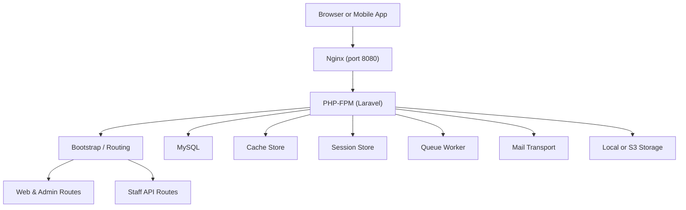
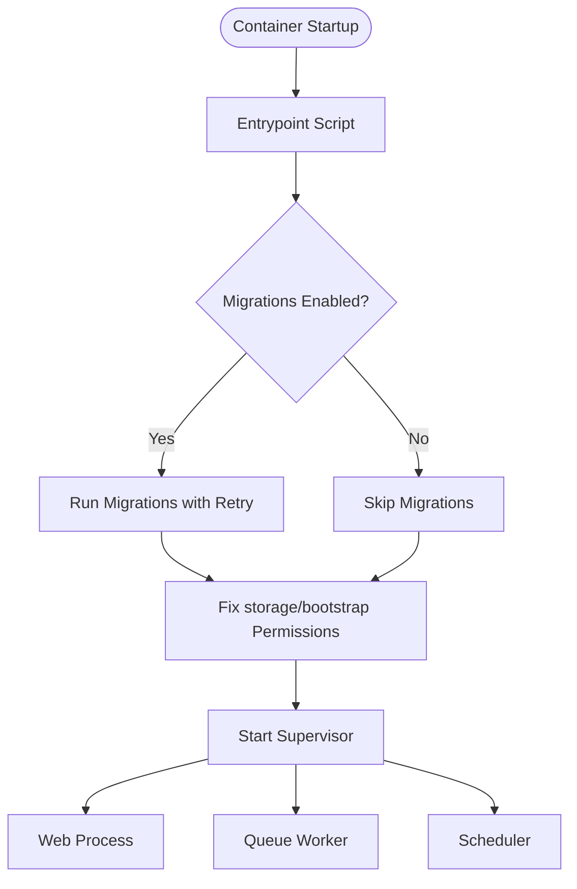
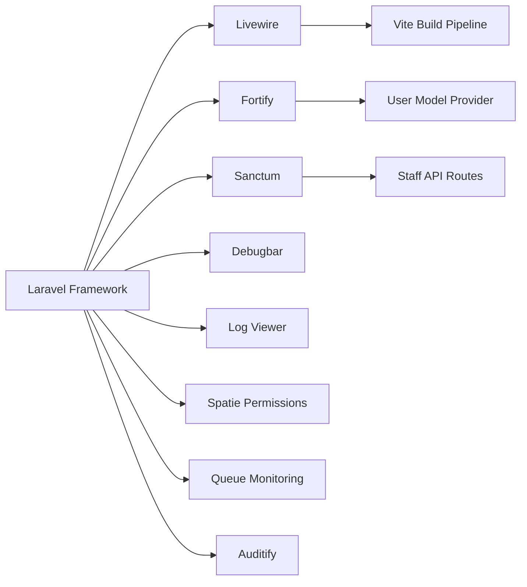

# Troubleshooting Guide

<cite>
**Referenced Files in This Document**
- [composer.json](file://composer.json)
- [Dockerfile](file://Dockerfile)
- [docker-compose.yml](file://docker-compose.yml)
- [docker/entrypoint.sh](file://docker/entrypoint.sh)
- [bootstrap/app.php](file://bootstrap/app.php)
- [public/index.php](file://public/index.php)
- [routes/api.php](file://routes/api.php)
- [config/app.php](file://config/app.php)
- [config/auth.php](file://config/auth.php)
- [config/cache.php](file://config/cache.php)
- [config/database.php](file://config/database.php)
- [config/debugbar.php](file://config/debugbar.php)
- [config/filesystems.php](file://config/filesystems.php)
- [config/fortify.php](file://config/fortify.php)
- [config/livewire.php](file://config/livewire.php)
- [config/logging.php](file://config/logging.php)
- [config/mail.php](file://config/mail.php)
- [config/queue.php](file://config/queue.php)
- [config/sanctum.php](file://config/sanctum.php)
- [config/session.php](file://config/session.php)
- [app/Providers/AppServiceProvider.php](file://app/Providers/AppServiceProvider.php)
- [vite.config.js](file://vite.config.js)
- [package.json](file://package.json)
</cite>

## Table of Contents
1. [Introduction](#introduction)
2. [Project Structure](#project-structure)
3. [Core Components](#core-components)
4. [Architecture Overview](#architecture-overview)
5. [Detailed Component Analysis](#detailed-component-analysis)
6. [Dependency Analysis](#dependency-analysis)
7. [Performance Considerations](#performance-considerations)
8. [Troubleshooting Guide](#troubleshooting-guide)
9. [Conclusion](#conclusion)

## Introduction
This guide helps diagnose and resolve common Houblossom application issues across installation, environment configuration, database connectivity, file permissions, asset compilation, performance, email delivery, authentication, API access, caching, queues, and session behavior. It is organized from quick triage to deep debugging so you can identify root causes efficiently.

## Project Structure
Houblossom is a Laravel 13 Livewire application with:
- Web routes under the `web` middleware group.
- Admin routes registered after the web route group.
- A staff mobile API under `/api/staff`.
- Dockerized PHP 8.4 FPM with Nginx, Supervisor, MySQL, queue worker, and scheduler.
- Vite for frontend assets.
- Fortify for web authentication and passkeys.
- Sanctum for stateful SPA/API authentication.
- Debugbar, Log Viewer, audit logging, permission gates, and queue monitoring packages.

**Diagram sources**
- [public/index.php:1-20](file://public/index.php#L1-L20)
- [bootstrap/app.php:1-71](file://bootstrap/app.php#L1-L71)
- [routes/api.php:1-117](file://routes/api.php#L1-L117)
- [docker-compose.yml:1-31](file://docker-compose.yml#L1-L31)
- [Dockerfile:1-32](file://Dockerfile#L1-L32)

**Section sources**
- [public/index.php:1-20](file://public/index.php#L1-L20)
- [bootstrap/app.php:1-71](file://bootstrap/app.php#L1-L71)
- [routes/api.php:1-117](file://routes/api.php#L1-L117)
- [docker-compose.yml:1-31](file://docker-compose.yml#L1-L31)
- [Dockerfile:1-32](file://Dockerfile#L1-L32)

## Core Components
- Application bootstrap and routing are defined centrally. The request entry point loads maintenance mode checks, autoloader, and passes the request to Laravel’s application container.
- Middleware aliases register role, permission, verified-email, consent, registration gating, and session tracking.
- Exceptions are customized for passkey flows to return structured JSON failures.
- Service provider registers global defaults, logging viewer authorization, schedule behavior, view composers, lazy-loading protection, string length fixes, Blade components, and gate rules.

**Section sources**
- [public/index.php:1-20](file://public/index.php#L1-L20)
- [bootstrap/app.php:1-71](file://bootstrap/app.php#L1-L71)
- [app/Providers/AppServiceProvider.php:1-110](file://app/Providers/AppServiceProvider.php#L1-L110)

## Architecture Overview
The system runs inside one container by default in development:
- Nginx serves static files and proxies PHP requests.
- PHP-FPM executes Laravel.
- Supervisor manages the web process, queue worker, and scheduler.
- MySQL stores application data, sessions, cache tables, jobs, and failed jobs.
- Frontend assets are built by Vite and served through the Laravel build pipeline.

**Diagram sources**
- [docker/entrypoint.sh:1-20](file://docker/entrypoint.sh#L1-L20)
- [Dockerfile:1-32](file://Dockerfile#L1-L32)

**Section sources**
- [docker/entrypoint.sh:1-20](file://docker/entrypoint.sh#L1-L20)
- [Dockerfile:1-32](file://Dockerfile#L1-L32)

## Detailed Component Analysis

### Debugging with Laravel Debugbar
Debugbar is configured to respect the application debug flag and supports selective collection of messages, timing, memory, exceptions, logs, database queries, views, events, cache, models, Livewire, HTTP client, and more.

Key diagnostic capabilities:
- Enable or disable Debugbar via its environment variable.
- Exclude sensitive endpoints such as telemetry and Livewire JavaScript.
- Collect slow database queries only or capture full query parameters.
- Capture mail events and optionally display message bodies.
- Group duplicate views and exclude vendor paths like Filament.
- Configure editor links for backtraces.

Common configuration variables:
- `DEBUGBAR_ENABLED`
- `DEBUGBAR_COLLECT_*`
- `DEBUGBAR_OPTIONS_*`
- `DEBUGBAR_EDITOR`

Typical problems:
- Debugbar not appearing because app debug is disabled.
- Missing DB queries because slow-query-only filtering hides normal queries.
- Excessive overhead from capturing too many collectors in production.

Recommended settings:
- Enable Debugbar only in non-production environments.
- Keep database backtrace enabled during investigations.
- Disable expensive collectors like all events when profiling large pages.

**Section sources**
- [config/debugbar.php:1-200](file://config/debugbar.php#L1-L200)
- [config/app.php:1-126](file://config/app.php#L1-L126)

### Logging and Log Analysis
Logging uses Monolog with a stack channel combining single-file and Slack channels. Production should prefer daily rotation and stderr output for container orchestration.

Important channels:
- `stack`: Combines multiple channels.
- `single`: Writes to `storage/logs/laravel.log`.
- `daily`: Rotates logs after a configurable number of days.
- `slack`: Sends critical alerts to Slack.
- `papertrail`, `stderr`, `syslog`, `errorlog`: Alternative sinks.
- `null`: For testing where no output is desired.

Configuration variables:
- `LOG_CHANNEL`
- `LOG_STACK`
- `LOG_LEVEL`
- `LOG_DAILY_DAYS`
- `SLACK_WEBHOOK_URL`
- `LOG_SLACK_USERNAME`, `LOG_SLACK_EMOJI`, `LOG_SLACK_LEVEL`
- `PAPERTRAIL_URL`, `PAPERTRAIL_PORT`
- `LOG_STDERR_FORMATTER`

Log analysis strategies:
- Inspect `storage/logs/laravel.log` for errors, warnings, and exception traces.
- Use the Log Viewer package behind Super Admin authentication.
- Stream logs through `stderr` in containers and inspect them with your orchestration tooling.
- Correlate timestamps with request IDs and Debugbar timeline entries.

Known limitation:
- Deprecation logging defaults to null; enable deprecations separately if needed.

**Section sources**
- [config/logging.php:1-132](file://config/logging.php#L1-L132)
- [app/Providers/AppServiceProvider.php:1-110](file://app/Providers/AppServiceProvider.php#L1-L110)

### Database Connection Problems
Database configuration supports MySQL, MariaDB, PostgreSQL, SQL Server, and SQLite. Redis connections are also configured for cache and queue backends.

Common symptoms:
- “Connection refused” or host resolution failure.
- Authentication failures due to wrong credentials.
- SSL errors on newer MySQL versions.
- Long migration startup times because migrations retry until the database is ready.

Checklist:
- Confirm `DB_CONNECTION`, `DB_HOST`, `DB_PORT`, `DB_DATABASE`, `DB_USERNAME`, `DB_PASSWORD`.
- Verify MySQL/MariaDB driver availability and PDO extension.
- Check `MYSQL_ATTR_SSL_CA` when using SSL.
- Validate Redis URLs and databases for cache and queue when those backends are used.
- In Docker, ensure the `db` service is reachable and migrations have completed.

Migration and schema notes:
- Default string length is fixed to 191 for utf8mb4 compatibility.
- Migration repository table is `migrations`.
- Redis prefix uses the application name to avoid collisions.

**Section sources**
- [config/database.php:1-184](file://config/database.php#L1-L184)
- [app/Providers/AppServiceProvider.php:1-110](file://app/Providers/AppServiceProvider.php#L1-L110)
- [docker/entrypoint.sh:1-20](file://docker/entrypoint.sh#L1-L20)

### File Permission Errors
Filesystem disks include local private, public, S3, and temporary storage. Public uploads may be served locally or through S3 depending on `PUBLIC_DISK_DRIVER`.

Symptoms:
- Uploads fail silently or throw errors.
- Public assets are missing even though files exist.
- Temporary Livewire uploads are not cleaned up.
- Storage symlink is broken.

Actions:
- Ensure `storage`, `bootstrap/cache`, and `database` directories are writable by the web user.
- Create the storage symlink: `php artisan storage:link`.
- When using S3 for public disk, verify AWS keys, bucket, region, endpoint, and URL.
- Review Livewire temporary upload directory and cleanup settings.
- In Docker, the entrypoint and image setup change ownership to `www-data`.

Relevant configuration:
- `FILESYSTEM_DISK`
- `PUBLIC_DISK_DRIVER`
- AWS-related filesystem variables.
- Livewire temporary upload disk, rules, directory, preview MIME types, max upload time, and cleanup.

**Section sources**
- [config/filesystems.php:1-109](file://config/filesystems.php#L1-L109)
- [config/livewire.php:1-200](file://config/livewire.php#L1-L200)
- [docker/entrypoint.sh:1-20](file://docker/entrypoint.sh#L1-L20)
- [Dockerfile:1-32](file://Dockerfile#L1-L32)

### Asset Compilation Failures
Frontend assets are compiled with Vite using Tailwind CSS v4, Alpine.js, Bootstrap, jQuery, CKEditor, and Passkeys browser libraries.

Symptoms:
- Styles or scripts missing on the page.
- Development server does not hot-reload.
- Build fails due to missing native dependencies.
- Admin and site styles are bundled but not loaded.

Actions:
- Install Node dependencies and run `npm run dev` for development.
- Run `npm run build` for production builds.
- Verify Vite input entries match expected bundles: site CSS/JS, auth CSS/JS, admin CSS/JS.
- Ignore compiled view cache during development to avoid stale templates.
- Confirm that `public/build` is copied into the production image.

Known issue:
- Optional native dependencies may be required on Linux hosts.

**Section sources**
- [vite.config.js:1-33](file://vite.config.js#L1-L33)
- [package.json:1-35](file://package.json#L1-L35)
- [Dockerfile:1-32](file://Dockerfile#L1-L32)

### Performance Troubleshooting

#### Slow Query Identification
Use Debugbar’s database collector to identify slow queries, parameter binding, execution time, and optional EXPLAIN output. You can restrict collection to slow queries and set thresholds.

Recommended steps:
- Enable database collectors in Debugbar.
- Turn on backtrace and query parameters during diagnosis.
- Set slow threshold appropriately for your workload.
- Use the application’s log channel and Debugbar timeline to correlate slow requests.

Limitations:
- Very high query volumes may hit soft/hard limits, reducing captured details.

**Section sources**
- [config/debugbar.php:1-200](file://config/debugbar.php#L1-L200)

#### Memory Leak Detection
Debugbar tracks memory usage, peak memory, baseline comparison, and per-request memory. Combine this with request-level logs and job monitoring.

Recommended steps:
- Enable memory collector and baseline comparison.
- Monitor peak memory spikes during heavy operations such as exports or bulk updates.
- Investigate long-running jobs and queued tasks.
- Watch for unbounded collections or repeated large object graphs.

**Section sources**
- [config/debugbar.php:1-200](file://config/debugbar.php#L1-L200)

#### Cache Invalidation Issues
Default cache store is database-backed, with Redis, file, Memcached, DynamoDB, Octane, and failover stores available. Serialization is restricted to a controlled class list.

Symptoms:
- Stale content after configuration or data changes.
- Cache miss storms or lock contention.
- Unexpected serialization errors.

Actions:
- Identify the active cache store and prefix.
- Clear application cache when updating configuration or seeders.
- Use Redis for distributed caches when scaling horizontally.
- Validate serializable classes list against models being cached.

**Section sources**
- [config/cache.php:1-146](file://config/cache.php#L1-L146)

### Email Delivery Problems
Mail transport defaults to log mode. In production, configure SMTP, SES, Postmark, Resend, Sendmail, or a failover/round-robin strategy.

Common issues:
- Emails written to log instead of being delivered.
- Invalid SMTP host, port, username, password, or scheme.
- Global sender address or reply-to mismatch.
- Failed background emails stuck in queue.

Actions:
- Set `MAIL_MAILER` to the intended transport.
- Configure `MAIL_URL` or transport-specific fields.
- Verify `MAIL_FROM_ADDRESS` and `MAIL_FROM_NAME`.
- Test mail through Log Viewer or Debugbar mail collector.
- Inspect queue workers and failed jobs if emails are dispatched asynchronously.

**Section sources**
- [config/mail.php:1-123](file://config/mail.php#L1-L123)
- [config/queue.php:1-128](file://config/queue.php#L1-L128)

### Authentication Failures
Web authentication uses Fortify with session guard, email-based usernames, passkeys, two-factor authentication, registration, password reset, and email verification.

Common issues:
- Login redirects loop or unexpected home path.
- Two-factor challenge failures.
- Passkey login returning generic validation errors.
- Rate-limited login attempts.
- User model or provider misconfiguration.

Actions:
- Confirm `AUTH_GUARD` points to the correct guard.
- Verify `AUTH_MODEL` resolves to the expected Eloquent model.
- Check Fortify username/email configuration and lowercase behavior.
- Inspect rate limiters for login and two-factor challenges.
- Review passkey validation exception rendering for structured error payloads.

**Section sources**
- [config/auth.php:1-117](file://config/auth.php#L1-L117)
- [config/fortify.php:1-162](file://config/fortify.php#L1-L162)
- [bootstrap/app.php:1-71](file://bootstrap/app.php#L1-L71)

### API Connectivity Issues
The staff API lives under `/api/staff` and uses Sanctum for token or stateful SPA authentication. Every protected route requires authentication and Spatie permissions.

Common issues:
- 401 Unauthorized due to missing or expired tokens.
- Cross-origin cookie failures for SPA stateful requests.
- Forbidden responses due to missing roles or permissions.
- Throttled login or two-factor challenge requests.
- Route naming conflicts avoided by the separate `staff` prefix.

Actions:
- Ensure Sanctum stateful domains include the frontend origin.
- Send credentials and cookies correctly for stateful requests.
- Attach bearer tokens for token-based requests.
- Check throttling on login and two-factor endpoints.
- Verify user has required roles and permissions for the requested resource.

**Section sources**
- [routes/api.php:1-117](file://routes/api.php#L1-L117)
- [config/sanctum.php:1-87](file://config/sanctum.php#L1-L87)

### Session and Cookie Issues
Session driver defaults to database-backed storage with configurable lifetime, encryption, connection, table, domain, path, secure flag, http-only flag, and same-site policy.

Common issues:
- Users logged out unexpectedly.
- Sessions not shared across subdomains.
- CSRF or cookie security mismatches behind reverse proxies.
- Lost session data when switching drivers without migrating data.

Actions:
- Confirm `SESSION_DRIVER` matches the deployment strategy.
- Align `SESSION_DOMAIN`, `SESSION_PATH`, `SESSION_SECURE_COOKIE`, and `SESSION_HTTP_ONLY`.
- Trust proxies for correct scheme detection.
- Verify session table exists and is writable.

**Section sources**
- [config/session.php:1-200](file://config/session.php#L1-L200)
- [bootstrap/app.php:1-71](file://bootstrap/app.php#L1-L71)

## Dependency Analysis
The application depends on:
- Laravel framework and Livewire for reactive UI.
- Fortify for authentication flows including passkeys and two-factor.
- Sanctum for API authentication.
- Spatie permissions for role and ability gates.
- Debugbar for development diagnostics.
- Log Viewer for authenticated log inspection.
- AWS SDK integration for S3 storage.
- Queue monitoring and audit logging packages.
- Vite, Tailwind, Alpine, Bootstrap, jQuery, CKEditor, and Passkeys browser libraries.

**Diagram sources**
- [composer.json:1-138](file://composer.json#L1-L138)
- [routes/api.php:1-117](file://routes/api.php#L1-L117)
- [config/fortify.php:1-162](file://config/fortify.php#L1-L162)
- [config/sanctum.php:1-87](file://config/sanctum.php#L1-L87)
- [config/debugbar.php:1-200](file://config/debugbar.php#L1-L200)
- [config/logging.php:1-132](file://config/logging.php#L1-L132)

**Section sources**
- [composer.json:1-138](file://composer.json#L1-L138)

## Performance Considerations
- Prefer Redis for cache and queue backends in multi-instance deployments.
- Avoid enabling every Debugbar collector in production.
- Use database slow-query thresholds and backtraces selectively.
- Limit serialized cache classes to what is actually cached.
- Protect destructive database commands in production through framework defaults.
- Monitor queue backlog and failed jobs.
- Keep asset builds optimized and cacheable.

[No sources needed since this section provides general guidance]

## Troubleshooting Guide

### Installation and Environment Checklist
- Generate application key.
- Copy `.env.example` to `.env` and fill required values.
- Install Composer dependencies and publish assets.
- Run migrations and seeders as appropriate.
- Build frontend assets for production.

Useful commands:
- `composer install`
- `php artisan key:generate`
- `php artisan migrate --force`
- `npm install`
- `npm run build`

**Section sources**
- [composer.json:1-138](file://composer.json#L1-L138)

### Database Troubleshooting
Symptoms:
- Unable to connect to MySQL.
- Migrations do not run at container start.
- Redis cache or queue operations fail.

Diagnostic steps:
- Verify database credentials and host reachability.
- Check Docker Compose services and ports.
- Inspect container logs for migration retries.
- Validate Redis URL, host, port, and database index.

Commands:
- `php artisan db:show`
- `php artisan migrate:status`
- `php artisan cache:clear`
- `php artisan config:clear`

**Section sources**
- [config/database.php:1-184](file://config/database.php#L1-L184)
- [docker-compose.yml:1-31](file://docker-compose.yml#L1-L31)
- [docker/entrypoint.sh:1-20](file://docker/entrypoint.sh#L1-L20)

### File Permission Troubleshooting
Symptoms:
- Uploads fail.
- Public storage link missing.
- Temporary Livewire uploads persist.

Diagnostic steps:
- Check ownership and write permissions on `storage` and `bootstrap/cache`.
- Recreate the storage symlink.
- Verify S3 configuration when `PUBLIC_DISK_DRIVER=s3`.
- Review Livewire temporary upload settings.

Commands:
- `php artisan storage:link`
- `ls -la storage`
- `ls -la bootstrap/cache`

**Section sources**
- [config/filesystems.php:1-109](file://config/filesystems.php#L1-L109)
- [config/livewire.php:1-200](file://config/livewire.php#L1-L200)

### Asset Compilation Troubleshooting
Symptoms:
- Styles and scripts not loading.
- Development server hot reload fails.
- Build fails on Linux.

Diagnostic steps:
- Check Node version and dependency installation.
- Verify Vite input entries.
- Rebuild assets.
- Clear compiled view cache during development.

Commands:
- `npm run dev`
- `npm run build`
- `php artisan view:clear`

**Section sources**
- [vite.config.js:1-33](file://vite.config.js#L1-L33)
- [package.json:1-35](file://package.json#L1-L35)

### Logging and Error Reporting
Symptoms:
- No logs appear.
- Critical errors are not sent to Slack.
- Deprecation warnings are invisible.

Diagnostic steps:
- Confirm `LOG_CHANNEL` and `LOG_STACK`.
- Check log file or stderr output.
- Validate Slack webhook and level.
- Review Log Viewer access restrictions.

Commands:
- `php artisan tinker`
- `tail -f storage/logs/laravel.log`
- Use Log Viewer UI for authenticated users.

**Section sources**
- [config/logging.php:1-132](file://config/logging.php#L1-L132)
- [app/Providers/AppServiceProvider.php:1-110](file://app/Providers/AppServiceProvider.php#L1-L110)

### Email Troubleshooting
Symptoms:
- Emails not delivered.
- Emails appear only in logs.
- Background emails never finish.

Diagnostic steps:
- Confirm mail transport and credentials.
- Test mail sending through application actions.
- Inspect queue worker status and failed jobs.
- Use Debugbar mail collector.

Commands:
- `php artisan queue:work`
- `php artisan queue:failed`
- `php artisan queue:retry all`

**Section sources**
- [config/mail.php:1-123](file://config/mail.php#L1-L123)
- [config/queue.php:1-128](file://config/queue.php#L1-L128)

### Authentication Troubleshooting
Symptoms:
- Login fails repeatedly.
- Two-factor codes rejected.
- Passkey login returns generic errors.
- Redirect loops after login.

Diagnostic steps:
- Check Fortify features and rate limiters.
- Verify user provider and model.
- Inspect passkey validation exception response.
- Confirm session and cookie settings.

Commands:
- `php artisan tinker`
- Inspect request logs and Debugbar auth collector.

**Section sources**
- [config/fortify.php:1-162](file://config/fortify.php#L1-L162)
- [config/auth.php:1-117](file://config/auth.php#L1-L117)
- [bootstrap/app.php:1-71](file://bootstrap/app.php#L1-L71)

### API Troubleshooting
Symptoms:
- Staff API returns 401 or 403.
- CORS or cookie failures from SPAs.
- Endpoints throttle unexpectedly.

Diagnostic steps:
- Validate Sanctum stateful domains.
- Send credentials or bearer tokens as required.
- Check user roles and permissions.
- Inspect throttle middleware on login and two-factor routes.

Commands:
- `curl` or API client with proper headers.
- Inspect request logs and Debugbar HTTP client collector.

**Section sources**
- [routes/api.php:1-117](file://routes/api.php#L1-L117)
- [config/sanctum.php:1-87](file://config/sanctum.php#L1-L87)

### Cache and Session Troubleshooting
Symptoms:
- Outdated data persists.
- Sessions expire quickly.
- Cross-subdomain login fails.

Diagnostic steps:
- Verify cache store and prefix.
- Clear configuration and cache.
- Check session driver, lifetime, domain, secure, and same-site settings.
- Ensure proxy trust configuration is correct.

Commands:
- `php artisan config:clear`
- `php artisan cache:clear`
- `php artisan session:table`

**Section sources**
- [config/cache.php:1-146](file://config/cache.php#L1-L146)
- [config/session.php:1-200](file://config/session.php#L1-L200)
- [bootstrap/app.php:1-71](file://bootstrap/app.php#L1-L71)

### Known Limitations and Workarounds
- Debugbar adds overhead; keep it disabled in production.
- Slow-query-only database collection may hide frequent queries below the threshold.
- Serialized cache classes must be explicitly allowed.
- Production disables destructive database commands by default.
- Passkey flows use custom exception rendering for structured JSON errors.
- Docker entrypoint retries migrations while the database starts.

**Section sources**
- [config/debugbar.php:1-200](file://config/debugbar.php#L1-L200)
- [config/cache.php:1-146](file://config/cache.php#L1-L146)
- [app/Providers/AppServiceProvider.php:1-110](file://app/Providers/AppServiceProvider.php#L1-L110)
- [bootstrap/app.php:1-71](file://bootstrap/app.php#L1-L71)
- [docker/entrypoint.sh:1-20](file://docker/entrypoint.sh#L1-L20)

### Escalation Procedure
1. Reproduce the issue and capture the exact request path, method, and payload.
2. Check application logs and Debugbar for the failing request.
3. Verify environment configuration for database, cache, session, mail, and filesystem.
4. Inspect queue worker and failed jobs for asynchronous operations.
5. Validate authentication and API authorization boundaries.
6. Isolate the problem to a specific layer: network, web server, PHP, framework, database, cache, queue, or frontend.
7. If unresolved, collect:
   - Request ID or timestamp.
   - Relevant log excerpts.
   - Debugbar screenshots or exported data.
   - Environment variables (without secrets).
   - Steps to reproduce.
8. Escalate to external support with the collected evidence.

[No sources needed since this section summarizes procedural guidance]

## Conclusion
This guide maps Houblossom’s configuration and runtime behavior to practical troubleshooting workflows. Start with logging and Debugbar, validate environment and infrastructure, then narrow down to database, cache, session, mail, authentication, API, and asset layers. Use the provided commands and configuration references to isolate root causes and prepare escalation material when necessary.